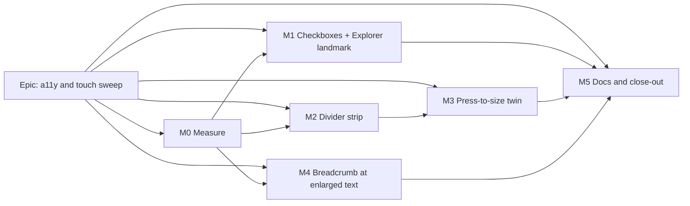

# Implementation Plan: Accessibility and touch sweep

- **Feature spec:** [`./spec.md`](./spec.md)
- **Status:** Accepted — shipped (ADR-0188). Approved 2026-10-11 by the product owner, every recommendation accepted (CQ-1 A, CQ-2 now, CQ-3 the browser's own text size); built as M0-M5. #483 closed unbuilt on M0's readings.
- **Owner:** web. Built by the **builder** agent (Sonnet); planned here (Opus).

## Breakdown

### Epic

**Accessibility and touch sweep** closes `docs/TECH_DEBT.md` #442, #470, #473, #476 and #483, and #475
by a docs fix. It is quality work under CLAUDE.md §13 (WCAG 2.2 AA) and ADR-0118's house rule. No
feature flag (ADR-0088 D1). No schema, API or engine change.

---

### Milestone M0: Measure the problems (no product code)

**Outcome:** committed readings that confirm or overturn each row's figures and pick #476's and #483's
remedies (ADR-0113, ADR-0142).
**Entry point:** `Ships dark: measurement only; no product change.`
**Journey:** none (a measurement spec under `apps/web/measure-toolbar/` or `apps/web/measure-*`, the
existing pattern, not a CI gate).

#### Feature: M0 readings

> **Description:** predictions first, then readings.
> **Complexity:** M
> **Dependencies:** none
> **Risks:** CI fonts differ from the container (HANDOFF `:115-119`) → record the container and treat
> the device sheet as the arbiter (ADR-0128).
> **Testing requirements:** the measurement spec runs green locally; its output is committed.

##### Task M0-T1: falsification file

- **Description:** write `docs/specs/a11y-touch-sweep/m0-falsification.md` **before** any reading.
  It states the spec's expectations (§0.2 row heights 45 → 60; §4.6 `coarseStrip` per consumer; #483
  candidate (a)), each with what would overturn it.
- **Complexity:** S · **Dependencies:** none · **Risks:** none
- **Testing:** n/a
- **Development steps:**
  1. List each prediction with its cell and its falsifying reading.
  2. Commit before running anything.

##### Task M0-T2: readings

- **Description:** one measurement spec that records:
  - **#470:** activities row heights for rows with and without a `⋯`, fine and coarse, at
    1912 × 1114 and 1024 × 600, with a plan holding a WBS summary. Viewer and Planner seats. Plus the
    label box.
  - **#476:** for each of the seven `PanelResizer`s, `elementFromPoint` sampled across a hypothetical
    44 px strip, both sides, at the same cells. Record what each sample point would steal: the tree's
    `⋯`, a Gantt sort header, a dock control. Also the current 25 px strip's overlaps.
  - **#442:** finger jitter between press and release on a tap, if obtainable from the device sheet;
    otherwise the 4 px threshold is the default and step 25b records it.
  - **#473:** axe with `region` enabled on the overview, a list page and a plan, Explorer docked. Every
    `region` node, not only the known one.
  - **#483:** header geometry with a long plan and project name ("Riverside Quarter — Phase 2
    Substructure"). Both methods: `Page.setFontSizes` 2× (root asserted 32 px) and the inline-root
    200 %. At 1024 × 600, 1280 × 800, 1440 × 900 and 1912 × 948. Crumb widths, link box, line count,
    header height. Repeat at 100 % for the before-reading.
  - If CQ-3 says yes: #478 and #487 at the same cells, readings only.
- **Complexity:** M · **Dependencies:** M0-T1
- **Risks:** `Page.setFontSizes` fails silently → assert root 32 px (the `command-surface.spec.ts:1757`
  pattern).
- **Testing:** n/a (it is the instrument)
- **Development steps:**
  1. Seed via the catalogue/REST helpers the workspace-fit suite already uses.
  2. Emit JSON, and write `m0-measurement.md` with the readings, each prediction marked held or
     overturned, and each remedy choice.
  3. Update spec §4.6 where a prediction fell.

---

### Milestone M1: Row checkboxes and the Explorer landmark

**Outcome:** a finger ticks activity checkboxes at 44 px; the Explorer splitter is inside the Explorer
landmark.
**Entry point:** existing controls. The activities table's "Select <activity name>" checkboxes in the
Activities panel; the "Resize Project Explorer" separator inside the "Project Explorer" navigation.
**Journey:** `e2e-workspace-fit/command-surface.spec.ts` coarse sweep (activities surface) and
`e2e-overview/overview.spec.ts` step 5b2 with `region` enabled and no filter.

#### Feature: #470 row checkboxes

> **Description:** labels grow to `--control-h` under a coarse pointer; the exemption is retired.
> **Complexity:** S · **Dependencies:** M0-T2 (row-height cost recorded)
> **Risks:** rows without a `⋯` grow on touch → accepted as default D-3, figure from M0 in the changeset.
> **Testing requirements:** the coarse sweep measures labels; fine-pointer row heights asserted
> unchanged; planted red.

##### Task M1-T1: grow the labels, sweep them

- **Description:** `ActivitiesTable.tsx:132-135` and `:190-193` become
  `size-6 pointer-coarse:size-(--control-h)` plus a `data-row-select` measurement hook; the
  `data-coarse-exempt` attribute is removed. In `command-surface.spec.ts`, the activities surface also
  sweeps `[data-row-select]`. `ROW_SELECT_EXEMPT`, `assertRowSelectExemptionsPresent` and their
  docblocks (`:1899-1901`, `:1956-1967`, `:2266-2286`) are deleted.
- **Complexity:** S · **Dependencies:** M0-T2
- **Risks:** the sweep measures the 16 px input instead of the label → the selector targets the label
  explicitly, and the plant-red step proves it.
- **Testing:**
  - Plant red: revert one label to `size-6` → the sweep fails at 1646 × 1097.
  - Fine-pointer row heights equal M0's before-reading.
  - `ActivitiesTable` unit tests unchanged.
- **Development steps:**
  1. Change the two labels; update the `SelectAllCheckbox` docblock (the "24 px" reasoning).
  2. Update the sweep; plant red; restore.
  3. Run `scripts/e2e-local.sh web:workspace-fit` (the suite's script name per `package.json`).
  4. Changeset (web, patch): "Activity checkboxes are finger-sized on touch".

#### Feature: #473 Explorer landmark

> **Description:** hoist the `Project Explorer` navigation to wrap the column and its separator.
> **Complexity:** S · **Dependencies:** none (M0-T2's axe sweep tells whether other `region` nodes exist)
> **Risks:** a duplicate landmark, or a change to the Sheet below `lg` → `landmark` defaults to `true`;
> a unit test counts landmarks in both shapes.
> **Testing requirements:** axe `region` clean on the overview; landmark count; Tab order unchanged.

##### Task M1-T2: hoist the landmark

- **Description:** `explorer-column.tsx:102` `div` → `nav aria-label="Project Explorer"`;
  `NavigatorRail` gains `landmark?: boolean` (default `true`) and renders a `div` when `false`. The
  docblocks at `explorer-column.tsx:103-108` and `navigator-rail.tsx:100-103` are rewritten to say
  where the landmark now lives. `overview.spec.ts:197-205` filter deleted.
- **Complexity:** S · **Dependencies:** none
- **Risks:** `explorer-column.test.tsx:9` mocks `NavigatorRail` as a `nav`, so the mock must become a
  `div` or the test will count two landmarks for the wrong reason.
- **Testing:**
  - Unit: exactly one `navigation` named "Project Explorer" docked, and one in the Sheet; the separator
    is inside the docked one.
  - Journey: overview 5b2 with no filter; plant red by moving the separator outside → `region` fails.
  - Tab order asserted (tree → destinations → version line has no stop → separator → stage).
- **Development steps:**
  1. Change the components and the test mock.
  2. Delete the journey filter; plant red; restore.
  3. **accessibility-reviewer** on the diff before merge (ADR-0111; row #473 asks for it).
  4. Changeset (web, patch).

---

### Milestone M2: Divider strip follows the finger (#476)

**Outcome:** on a coarse pointer every divider's grab strip is 44 px, except a named exception with a
typed equivalent.
**Entry point:** existing separators: "Resize Project Explorer", "Resize float paths panel", "Resize
health check panel", "Resize revision comparison panel", "Resize notes panel", "Resize activities
panel" and "Grid width".
**Journey:** a new "dividers" surface in the `command-surface.spec.ts` coarse sweep, measuring
`[data-resizer-hit]` at 1646 × 1097 and 1024 × 600.

#### Feature: coarse strip

> **Description:** `PanelResizer` gains `coarseStrip?: 'both' | 'outward' | 'none'` and the
> `data-resizer-hit` hook; consumers set it from M0.
> **Complexity:** M · **Dependencies:** M0-T2, CQ-2
> **Risks:**
>
> - The strip steals taps from a neighbour → M0's samples choose `outward` or `none`; the journey
>   samples `elementFromPoint` at the neighbour's centre and asserts it is the neighbour.
> - Arbitrary-value refusal by `token-architecture.test.ts` → use `--control-h` through existing
>   variants, as the spec notes.
>
> **Testing requirements:** sweep, exemption inventory, neighbour-centre assertion, plant red.

##### Task M2-T1: primitive

- **Description:** the hit child under `pointer-coarse:` spans `--control-h` across the axis.
  - `both`: centred.
  - `outward`: from the separator into the side named by `reverseKeys`' anchor sense. Start-anchored
    grows toward the end; end-anchored grows toward the start, i.e. away from the panel the divider
    sizes.
  - `none`: unchanged, with `data-coarse-exempt="divider"`.
  - Fine pointer: unchanged.
- **Complexity:** S · **Dependencies:** none
- **Risks:** `className` merges last (`panel-resizer.tsx:129-136`); a consumer could override → the
  structural test (`panel-resizer.structural.test.ts`) extends to refuse width classes on the hit
  child.
- **Testing:** unit (classes per mode); structural.
- **Development steps:**
  1. Implement; update the docblock's touch contract.
  2. Unit tests.

##### Task M2-T2: consumers + sweep

- **Description:** set `coarseStrip` on the seven call sites from M0; add the dividers surface and the
  `divider` inventory to the coarse sweep.
- **Complexity:** S · **Dependencies:** M2-T1
- **Risks:** right docks are withheld when `!bounds.resizable` → the surface opens a dock in a cell
  where it is resizable (1646 × 1097), and records the floor's state rather than asserting a divider
  that is not there.
- **Testing:** plant red (force `none` without the marker → inventory fails; narrow the strip → sweep
  fails). Add a device-sheet step 25b: "your finger found the line first time".
- **Development steps:**
  1. Consumers.
  2. Sweep and inventory; plant red.
  3. Update `device-checklist.md` in the same PR (HANDOFF `:159-160`).
  4. Hold for the joint ADR-0111 review with M3 if they ship in one PR; otherwise
     **accessibility-reviewer + component-reviewer** now.

---

### Milestone M3: Press-to-size, the single-pointer twin (#442)

**Outcome:** a pointer-only user sets any panel's size by pressing its divider and typing or stepping.
**Entry point:** pressing (without dragging) the "Resize Project Explorer" separator, or any of the
six others, opens a panel whose field is named e.g. "Project Explorer width".
**Journey:** a new journey in an existing suite (the workspace-fit or Gantt column-widths config; no
new config). It presses the Explorer separator and the notes dock's separator at 1024 × 600 and
1912 × 948, types out-of-range and in-range values, asserts width and status sentence, then Escape and
focus on the separator.

**Gated on CQ-1.** If the answer is (B), this milestone is re-planned around menu fields (spec §4.7).
If (C), it is replaced by recording the ruling and closing #442.

#### Feature: `SizeField` extraction

> **Description:** move `WidthField` (`gantt-columns-group.tsx:58-140`) to
> `components/ui/size-field.tsx`, generalising subject, unit and notice copy.
> **Complexity:** S · **Dependencies:** none
> **Risks:** the Gantt's behaviour drifts → `gantt-columns-group.test.tsx` runs unchanged against the
> extracted field.
> **Testing requirements:** ported unit tests; the Gantt tests untouched and green.

##### Task M3-T1: extract

- **Description:** a pure move plus props; `limitedNotice` moves with it (its chart-guard sentence
  becomes an optional `limitReason`).
- **Complexity:** S · **Dependencies:** none
- **Risks:** see Feature.
- **Testing:** `size-field.test.tsx`; the Gantt suite unchanged.
- **Development steps:**
  1. Move; re-import in the Columns group.
  2. Port tests; `docs/COMPONENT_LIBRARY.md` entry.
  3. **accessibility-reviewer** (a `*Field` arrow model, ADR-0111).

#### Feature: press-to-size in `PanelResizer`

> **Description:** `usePointerDrag` gains `onPress`; `PanelResizer` gains a required `sizeLabel` and an
> optional `onReset`, and opens the anchored size panel on press.
> **Complexity:** M · **Dependencies:** M3-T1, M2-T1
> **Risks:**
>
> - Focus lost on unmount → ADR-0135 hand-off.
> - A top-layer modal swallows the panel (the ADR-0111 #192 class) → reuse the positioning `View ▾`
>   already uses, and test inside the workspace.
> - Accidental opens on a mouse → non-modal, closes on outside press, stated in the changeset.
>
> **Testing requirements:** unit (press vs drag, open/close, focus, keys unchanged); the journey above;
> a structural test that every call site passes `sizeLabel`.

##### Task M3-T2: hook and primitive

- **Description:** a threshold of 4 px (or M0's figure); `onPress` fires only if no move exceeded it
  and the gesture was not cancelled. The panel holds `SizeField` and "Reset to standard" (when
  `onReset` is given). Escape and outside press close it, with focus to the separator. The separator's
  `aria-describedby` hint says "Drag, or press to type a size".
- **Complexity:** M · **Dependencies:** M3-T1
- **Risks:** see Feature.
- **Testing:** unit; structural.
- **Development steps:**
  1. Hook change; `GanttColumnEdge` behaviour unchanged (it passes no `onPress`).
  2. Primitive change and docblock.
  3. Tests.

##### Task M3-T3: consumers, journey, ADR

- **Description:**
  - Pass `sizeLabel` and `onReset` at all seven call sites (the prefs hooks' defaults).
  - Write the journey.
  - Write **ADR-0187** (number to confirm) from spec §4.8, and add its one line to CLAUDE.md §16
    (`check:adr-coverage`).
- **Complexity:** M · **Dependencies:** M3-T2
- **Risks:** `check:counts` moves with new files and the ADR → run `pnpm prepush`.
- **Testing:** the journey; plant red (remove the open path → the journey fails at the press).
  Device-sheet step 26: "press a divider without moving; a size box opens".
- **Development steps:**
  1. Consumers.
  2. Journey; `scripts/e2e-local.sh web:<suite>`.
  3. ADR and the CLAUDE.md line.
  4. **accessibility-reviewer + component-reviewer** on M2 + M3 together, and **ux-reviewer** on the
     panel's copy and placement, before merge.
  5. Changeset (web, minor: new interaction).

---

### Milestone M4: Breadcrumb at enlarged text (#483)

**Outcome:** with text-only 200 %, the plan's breadcrumb names the plan and its project link is
pressable.
**Entry point:** the header breadcrumb's "<project name>" link on any open plan.
**Journey:** `e2e-narrow-shell/narrow-shell.spec.ts` text-only cells (the `setDefaultFontSize` helper)
at M0's widths; `e2e-workspace-fit/pen-status.spec.ts` unchanged at 100 %.

#### Feature: breadcrumb floor

> **Description:** the remedy M0 selected (spec §4.6 a/b/c).
> **Complexity:** S · **Dependencies:** M0-T2, CQ-3
> **Risks:** a wrap at 100 % text on 1024 costs 48 px of diagram → SC-5's 100 % line-count assertion,
> and the stage-floor assertion (`e2e-minimap/viewport-cluster.spec.ts`, 2 px of margin, HANDOFF
> `:118-119`).
> **Testing requirements:** text-only 200 % assertions; 100 % unchanged; `breadcrumbs.test.tsx`
> updated.

##### Task M4-T1: build the chosen remedy

- **Description:** apply it in `breadcrumbs.tsx` (`nowrap` variant) and/or `plan-workspace-toolbar.tsx:2240`.
  Correct the two stale comments it sits beside:
  - `plan-workspace-toolbar.tsx:2248-2253`: the "ONLY route" premise; the tree now navigates for
    projects (`HierarchyTree.tsx:413-417`).
  - `breadcrumbs.tsx:19-23`: the "fixed-height band" premise; the header is `min-h-12` and wraps.
- **Complexity:** S · **Dependencies:** M0-T2
- **Risks:** see Feature.
- **Testing:** journeys above; unit.
- **Development steps:**
  1. Implement; comments.
  2. Journeys at 200 % and 100 %; plant red (remove the floor → the 200 % assertion fails).
  3. **component-reviewer**; **accessibility-reviewer** if the link's name, focus or order changes.
  4. Changeset (web, patch).

---

### Milestone M5: Docs and close-out

**Outcome:** the register, ADRs and device sheet match what shipped.
**Entry point:** `Ships dark: documentation only.`
**Journey:** none.

##### Task M5-T1: docs

- **Description:**
  - `docs/TECH_DEBT.md`: close #442, #470, #473, #476 and #483, adding them to Closed numbers, each with
    its evidence. For #475, re-point ADR-0179:53 and `docs/specs/minimum-viewport/feature-spec.md:122`
    and `:410` at a durable source (HANDOFF's "The product owner's screens" bullet by heading, or a
    commit-pinned path), then close #475 (spec §0.6).
  - `docs/DESIGN_SYSTEM.md` / `docs/COMPONENT_LIBRARY.md`: `SizeField` and the divider strip rule.
  - Spec header → `Accepted — shipped (ADR-0187)` (ADR-0131).
  - `pnpm check:spec-status`, `check:debt-status`, `check:counts` and `check:adr-coverage` all green.
- **Complexity:** S · **Dependencies:** M1, M3, M4
- **Risks:** row numbers collide with a parallel branch (HANDOFF `:125-127`) → rebase onto the latest
  `origin/main` first.
- **Testing:** `pnpm prepush`.
- **Development steps:**
  1. Edit; run the checks.
  2. Write the hand-off (CLAUDE.md §19.14).

## Sequencing & slices

1. **M0** first. Nothing is built on an unmeasured figure.
2. **M1** (two independent tasks, each releasable alone) can follow M0 straight away.
3. **M2 → M3** in order, ideally one PR, so `PanelResizer` gets **one** ADR-0111 review. If M3 waits
   on CQ-1, M2 can ship alone with its own review.
4. **M4** after M0, independent of M1–M3.
5. **M5** last.

Every slice keeps `main` releasable. No flag (ADR-0088 D1): the rollback is reverting the slice's
commit. No `apps/api` change, so no API e2e run is owed; every touched web suite is run locally
(CLAUDE.md §19.8).

## Definition of Done (per task)

Each task's PR satisfies the Feature Completion Criteria in [`docs/PROCESS.md`](../../PROCESS.md):
code, tests (the pre-push gate **run**, plus each touched Playwright suite via
`scripts/e2e-local.sh`), docs, security (no surface), performance (drag path unchanged), accessibility
(the reviews named per task), Docker build, CI green (deduped check runs, §19.9), changeset, and
version impact (web minor at M3, patch elsewhere).

## Risks & assumptions (rollup)

| Risk / assumption                                                           | Likelihood       | Impact | Mitigation                                                                                  |
| --------------------------------------------------------------------------- | ---------------- | ------ | ------------------------------------------------------------------------------------------- |
| A 44 px divider strip covers the Explorer tree's `⋯` or a Gantt sort header | med              | med    | M0 `elementFromPoint`; `outward` or `none` per consumer; neighbour-centre assertion         |
| Press-to-size surprises mouse users (a click on a divider opens a box)      | med              | low    | Non-modal, outside-press close; changeset says so; CQ-1 lets the owner choose B             |
| accessibility-reviewer rules keyboard sufficient for 2.5.7                  | low              | scope  | M3 becomes "record the ruling, close #442"                                                  |
| #483's reported figures do not reproduce under `Page.setFontSizes`          | med              | scope  | M0 decides; M4 may shrink to comment fixes, or to a different cell                          |
| Row-height growth on touch for rows without a `⋯` (#470)                    | high (by design) | low    | Accepted default D-3; figure in the changeset                                               |
| CI e2e budget is already over its re-open trigger (#491)                    | high             | low    | Extend existing suites, no new config; update `scripts/e2e-durations.json`                  |
| CI fonts differ from the container, so header widths shift                  | med              | low    | One-sided assertions with a bounded allowance (the SC-18a pattern, HANDOFF `:115-119`)      |
| `token-architecture.test.ts` refuses the strip's inset values               | med              | low    | `--control-h` through existing variants; the builder checks against the test before writing |
