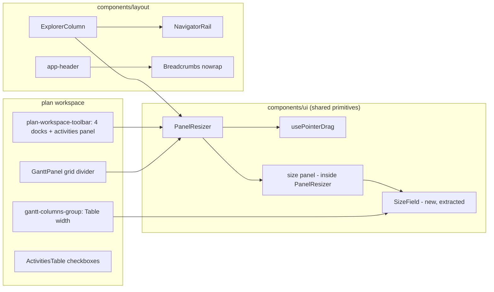
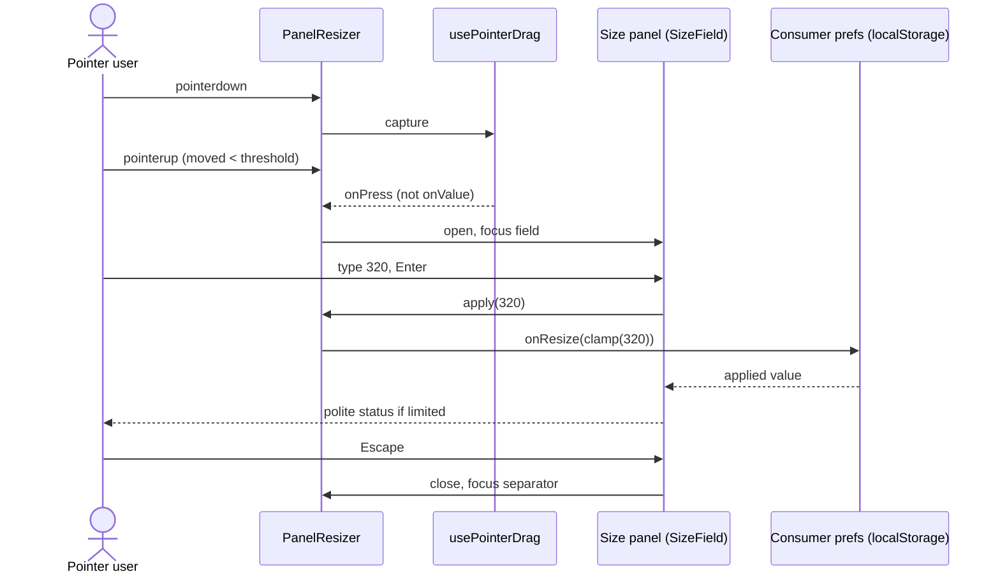
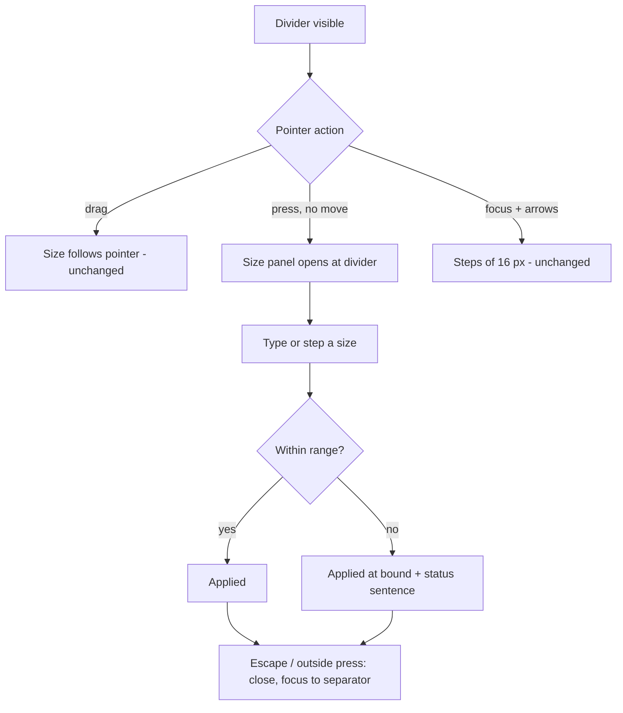

# Feature Spec: Accessibility and touch sweep — dividers, row checkboxes, the Explorer landmark, and the breadcrumb at enlarged text

- **Status:** Draft — awaiting approval
- **Author(s):** Claude Code (feature-analyst), for James Ewbank (product owner)
- **Date:** 2026-10-11
- **Tracking issue / epic:** `docs/TECH_DEBT.md` #442, #470, #473, #476, #483 (and #475, checked for overlap)
- **Roadmap link:** none. Register-driven quality work (CLAUDE.md §13 makes WCAG 2.2 AA a merge requirement).
- **Related ADR(s):** ADR-0111, ADR-0118, ADR-0173, ADR-0179, ADR-0183. A new ADR is required for the
  divider decisions (§4.8, outline drafted there, number to be taken at writing; 0187 is free today).

**Why this is a spec and not five register fixes (ADR-0105).** Four of the five rows cross a trigger.
`PanelResizer` gains behaviour and so changes a shared primitive's public contract (#442, #476). The
coarse sweep in `command-surface.spec.ts` and the overview axe filter are shared gates (#470, #473,
#476). `NavigatorRail` gains a prop (#473). #442 adds a user-facing entry point. Only #483's remedy
might stay inside the behaviour its row describes, and it is re-measured first (§0.5).

---

## 0. Re-verification of each row's problem statement

CLAUDE.md §19 says to re-verify the problem as well as the design, and that the brief is not evidence.
Everything below was **read** on branch `docs/outstanding-items-specs` at `addfc7b0`. **Nothing was
run in a browser for this spec.** Where a row's figure depends on a browser, it is labelled
"not re-measured", and M0 takes the reading (ADR-0113).

### 0.1 #442: `PanelResizer` has no single-pointer alternative to a drag, outside the Gantt

**Status: confirmed, and the consumer list is corrected.**

- `panel-resizer.tsx:65-149`: pointer drag (via `usePointerDrag`), arrows, Home and End. There is no
  click, tap or other non-drag pointer path.
- The row lists five files, from `grep -rl PanelResizer`. Two of them only mention it in comments:
  `surface.tsx:154` and `TsldMinimap.tsx:333`.
- The real call sites are **seven, in three files**:

| #   | Consumer                       | Where                                 | Non-drag pointer route today                                       |
| --- | ------------------------------ | ------------------------------------- | ------------------------------------------------------------------ |
| 1   | Project Explorer width         | `explorer-column.tsx:130`             | Hide/Show only (binary, `navigator-rail.tsx:162-176`)              |
| 2   | Float paths dock width         | `plan-workspace-toolbar.tsx:2614`     | Close only                                                         |
| 3   | Health check dock width        | `plan-workspace-toolbar.tsx:2649`     | Close only                                                         |
| 4   | Revision comparison dock width | `plan-workspace-toolbar.tsx:2676`     | Close only                                                         |
| 5   | Notes dock width               | `plan-workspace-toolbar.tsx:2703`     | Close only                                                         |
| 6   | Activities panel height        | `plan-workspace-toolbar.tsx:2741`     | Collapse/expand, and the ADR-0180 swap (binary)                    |
| 7   | Gantt grid width               | `GanttPanel.tsx:1413`                 | **Yes**: `View ▾` › Columns › `Table width` (`gantt-columns-group.tsx:209-217`) |

- The row's open question still stands: whether arrow keys satisfy SC 2.5.7. ADR-0173's Context
  (`:29-30`) already answered "no" for the Gantt, and the Understanding document for 2.5.7 requires a
  single-pointer alternative, so a keyboard route is not one. This spec treats the answer as no. It
  still asks accessibility-reviewer to confirm before build (CQ-1).

**Recommendation: build.** M3 does it.

### 0.2 #470: activities table row checkboxes are 24 px labels around 16 px boxes

**Status: confirmed. One cost the row missed.**

- `ActivitiesTable.tsx:132-135` (`SelectAllCheckbox`) and `:190-193` (`RowSelectCheckbox`): both
  labels are `size-6` and carry `data-coarse-exempt="row-select"`.
- `command-surface.spec.ts:1967` defines `ROW_SELECT_EXEMPT`. `:2266-2286` asserts the inventory and
  that the marked labels really are under 44 px. Both are as the row says.
- **The row says growing the label "costs no height" because the row is already 61 px with a 44 px
  `⋯`.** That holds only for rows that render a `⋯`.
  - `ActivitiesTable.tsx:992-994` renders **no** trigger when a row has no actions, or every action
    is shaded.
  - Selection is deliberately **not** gated on the write right (`:715-719`), so a Viewer gets
    checkboxes too.
  - ADR-0183 D4 measured "rows **with a `⋯`** go 45 to 61" at 1912 wide.
  - So on a coarse pointer, a row with a checkbox and no `⋯` is about 45 px today and would grow to
    about 60 (a 44 px label plus `py-2`). Inferred from those numbers, **not measured**; M0 measures it.
- The column exists only when `bulkAssignActive` (`:491-492`): `VITE_WBS_IMPROVEMENTS` (default on,
  `env.ts:908`) **and** a plan with at least one WBS summary.

**Recommendation: build** (M1), accepting the row-height cost above as a stated default (§1 Open
questions, D-3).

### 0.3 #473: the Explorer's splitter wrapper fails axe `region`

**Status: confirmed. The line citation has drifted by one.**

- `explorer-column.tsx:129` is `<Surface tone="panel" className="contents">` around the
  `PanelResizer`. The row cites `:128-130`.
- The landmark is `NavigatorRail`'s `<nav aria-label="Project Explorer">`
  (`navigator-rail.tsx:127-130`), which is the separator's **sibling**, not its ancestor.
- `app-shell.tsx:196-199` places the column in grid row 3, column 1, outside `<main>`. Nothing
  encloses the separator.
- `overview.spec.ts:197-205` still filters exactly `region` + `.contents`.

**Recommendation: build** (M1).

### 0.4 #476: a `PanelResizer`'s grab strip is 25 px wide

**Status: confirmed. The trigger has not fired, and one consumer cannot simply take the remedy.**

- `panel-resizer.tsx:140-146`: the hit child is `-left-3 -right-3` (12 px each side) over a `w-px`
  separator, so it is 25 px. Nothing changes under `pointer-coarse:`.
- `command-surface.spec.ts:239-244`: the coarse sweep's selector list has no `[role="separator"]`,
  as the row says.
- **The trigger** is "a device reading that misses a divider". The Surface sheet's step 25
  (`docs/specs/gantt-coarse-pointer/device-checklist.md:178-183`) asks whether a drag *follows* the
  finger, not whether a finger *finds* the strip. `docs/HANDOFF.md:63` lists step 25 as still awaited.
- **The Gantt grid divider cannot simply widen.**
  - It sits at `z-30` across the table/chart seam (`GanttPanel.tsx:1404-1411`).
  - A 44 px strip there would cover 22 px of the last grid column (its sort header and cells) and
    22 px of the chart's first bars.
  - ADR-0173 D3 already decided this shape for the column edges: *omit rather than enlarge* when
    enlarging would cover a neighbour, with the typed field (44 px under coarse) as the stated
    equivalent.
- **A risk the row does not name.** The hit child paints after the panel in DOM order, so it already
  lies 12 px over the Explorer's trailing edge. The tree's always-visible 44 px `⋯` (ADR-0183 D4) sits
  at the row's end. Whether today's strip, or a 22 px half-strip, covers that `⋯` is **not
  established**; M0 reads it with `elementFromPoint`.

**Recommendation: build, alongside #442**, so `PanelResizer` gets one ADR-0111 review, not two. The
Gantt grid divider becomes a named exception. Alternatively leave it until step 25 is answered (CQ-2).

### 0.5 #483: at 200 % text the breadcrumb collapses to "R… / P"

**Status: mechanism confirmed in code. The measurement method differs from the repo's own, so the
reported numbers may describe a layout an enlarged-text user never sees. Re-measure before choosing a
remedy.**

- **What the code says.**
  - Section 1 of the header is `flex min-w-0 shrink … lg:max-w-1/2` (`app-header.tsx:147`).
  - Its siblings inside the identity slot don't shrink: the brand (`:148`), the status `Badge`, and
    the "Plan details" toolbar (`plan-workspace-toolbar.tsx:2270-2290`).
  - The breadcrumb is `variant="nowrap"`, and each crumb is `block truncate` (`breadcrumbs.tsx:38-58`,
    `:97-100`).
  - So the breadcrumb is the only item that gives way. That much of the row is right.
- **How the row measured.** `document.documentElement.style.fontSize = '200%'`.
  - Under Media Queries Level 4, a rem in a media query resolves against the **initial** font size
    (the browser's default), not against the root element's computed size.
  - So that method doubles every rem width while leaving `lg:` (64rem = 1024 px) **active**, and with
    it the `lg:max-w-1/2` cap. That is the worst case for this header.
- **How the repo measures text-only 200 %.** It sets the browser's default font size through CDP
  `Page.setFontSizes`, so rem media queries respond. See `e2e-narrow-shell/narrow-shell.spec.ts:1244-1251`
  and `:1394`, and `command-surface.spec.ts:1728-1757`, which asserts the root reads 32 px; HANDOFF
  `:120-123` says the same.
- **Under that method, 64rem is 2,048 px.** So a 1440 window is **below the designed floor**:
  - the viewport notice states its floor in rem-derived pixels (`viewport-notice.tsx:201-203`);
  - the Explorer is a Sheet;
  - the `lg:max-w-1/2` cap is off.

  ADR-0179 D2 then requires reflow, not a designed layout. The breadcrumb may still be unreadable
  there, because the shrink-0 siblings are also twice as wide. It just isn't known.
- **The SC attribution is arguable.** The Understanding document for 1.4.4 allows meeting the SC
  through user-agent zoom (technique G142). Full-page zoom at 200 % on 1440 gives a 720 px window,
  which ADR-0179 handles with the notice and reflow. Text-only enlargement is still a real user setting,
  and the repo already gates it (SC-7 in the narrow-shell journey). This spec treats #483 as a defect
  in the **text-only** case and asks accessibility-reviewer whether it is an AA failure or a robustness
  defect (CQ-3). The fix is the same either way; the urgency is not.
- **Two stale comments next door, which change the remedy space.**
  - `plan-workspace-toolbar.tsx:2248-2253` says the project crumb is "the ONLY route from an open plan
    to its project", because the tree navigated only for plans. `HierarchyTree.tsx:405-425` now
    navigates for projects and clients too. So collapsing the project crumb at enlarged text no longer
    strands that route. Whether #143 is closed was **not** checked.
  - `breadcrumbs.tsx:19-23` says `nowrap` exists because the header is a **fixed-height** band. The
    header row has been `min-h-12` and allowed to wrap since the console epic (`app-header.tsx:192-198`).
    A wrapped identity costs a line of diagram (48 px); it no longer clips.

**Recommendation: build after M0's re-measurement** (M4). The remedy is chosen from the readings.
§4.6 lists the candidates.

### 0.6 #475: two stale statements (checked for overlap)

**Status: half done, and the "Next" no longer describes the remaining defect.**

- The `routes/members.tsx` half was fixed, as the row says; `page-container.tsx:38` reads
  `max-w-screen-2xl`.
- **The HANDOFF half.** The row says `docs/HANDOFF.md:38` no longer carries the 1912 × 1114 Surface
  reading, and that the figure survives at `minimum-viewport/feature-spec.md:410`.
  - HANDOFF was overwritten on 2026-10-11 and **does** carry it again, at `:18`.
  - The "survivor" is no better: `minimum-viewport/feature-spec.md:122` and `:410` both cite
    `docs/HANDOFF.md:38-39`.
  - ADR-0179:53 cites `docs/HANDOFF.md:38`, which is now a line about the toolbar's visual brief.
  - The defect is **a line citation into a file that is overwritten at every epic boundary**
    (HANDOFF `:3-4` says so), not a missing figure.
- **Related to this group only in that** the Surface reading is the device every coarse decision here
  is judged on.

**Recommendation: close, with a docs-only fix in M5.** Re-point the three citations at something
durable: HANDOFF's "The product owner's screens" bullet by heading, or a commit-pinned path. Then close
#475. If the product owner prefers, it can stay out of this epic. It is a docs-owner row and nothing
here depends on it.

### 0.7 Per-row summary

| Row  | Problem holds? | Recommendation                                          | Milestone |
| ---- | -------------- | ------------------------------------------------------- | --------- |
| #442 | Yes (7 consumers, not 5 files) | Build after accessibility-reviewer's ruling  | M3        |
| #470 | Yes (plus an unstated row-height cost) | Build                                | M1        |
| #473 | Yes            | Build                                                   | M1        |
| #476 | Yes (trigger not yet fired; Gantt divider cannot widen) | Build with #442, or leave (CQ-2) | M2 |
| #483 | Mechanism yes; figures not reproducible by the repo's method | Re-measure, then build | M0, M4 |
| #475 | Half fixed; remaining defect re-described | Close with a docs fix        | M5        |

---

## 1. Business understanding

### Problem

Five small accessibility and touch defects in the shell and plan workspace. Each is below the house
rule (ADR-0118 D1: 44 px under a coarse pointer) or below WCAG 2.2 AA, and each was filed rather than
fixed because it sat outside the epic that found it.

- **The dividers.** Seven panel dividers can only be resized by dragging or by arrow keys.
  - A pointer-only user (head pointer, switch with pointer emulation, a tremor) has no single-pointer
    way to set a size, which is SC 2.5.7, level AA.
  - Their 25 px grab strip is under the 44 px house rule for a finger.
- **The row checkboxes.** Bulk-assign checkboxes in the activities table are 24 px targets in rows
  that are already tall enough for 44.
- **The Explorer splitter** sits outside every landmark, so a screen-reader user navigating by
  landmarks never reaches it.
- **The breadcrumb.** With text enlarged, the plan's breadcrumb can shrink to a few pixels and stop
  naming anything.

### Users

All signed-in roles: Org Admin, Planner, Contributor, Viewer. These are layout and chrome controls,
not permissions.

- Viewers are directly affected by #470, since they get checkboxes and often no `⋯`.
- **External Guests are not affected.** `grep PanelResizer` finds no file under `features/share`, and
  `/share` does not mount the shell (ADR-0179 D4).

The product owner's devices:

- monitor 1912 × 948, mouse;
- Surface 1912 × 1114, DPR 1.5, finger and stylus (HANDOFF `:18-19`);
- design floor 1024 × 600 (ADR-0179).

### Primary use cases

1. A finger on the Surface grabs any divider first time (#476).
2. A pointer-only user sets a panel's size without dragging (#442).
3. A finger ticks activities for bulk assign without missing (#470).
4. A screen-reader user finds the Explorer splitter inside the Explorer's landmark (#473).
5. A reader with enlarged browser text can read the plan's breadcrumb and press its project link (#483).

### User journeys

See §4.3. For #442 the recommended journey is: tap the divider without moving → a small size panel
opens at the divider → type or step a size → Enter → the panel resizes and the field says what was
applied.

### Expected outcomes

- No `data-coarse-exempt="row-select"` marker and no `ROW_SELECT_EXEMPT`.
- No `region` filter in the overview journey.
- Every divider either has a 44 px coarse strip, or is a **named** exception with a typed equivalent.
- Every divider has a single-pointer, non-drag way to reach every size the drag reaches.
- The breadcrumb stays legible at text-only 200 % at the widths M0 measures.

### Success criteria

- **SC-1 (#470).** Under `pointer: coarse`, each row checkbox's label box is ≥ 44 × 44 at 1912 × 1114
  and at 1024 × 600, measured by the coarse sweep, not by an exemption inventory. Under `pointer: fine`,
  the label stays 24 px and row heights are unchanged (asserted).
- **SC-2 (#473).** axe with `region` enabled finds **no** `region` violation on the overview page with
  the Explorer docked, the filter is deleted, and the separator's closest landmark is the
  `Project Explorer` navigation.
- **SC-3 (#476).** Under `pointer: coarse`, every `PanelResizer` that is not a named exception has a
  hit strip ≥ 44 px across its axis. `elementFromPoint` sampled across the strip lands on the separator
  or its strip, and **never takes a point that belongs to a neighbouring control's own box** (M0 sets
  the sample points). Under `pointer: fine`, strips are unchanged (25 px).
- **SC-4 (#442).**
  - For each of the six non-Gantt consumers, a single pointer press without movement (≤ the drag
    threshold) opens a control that sets every size from `min` to `max`.
  - What was applied is said in a polite status when it differs from what was typed (the ADR-0173 rule).
  - Focus returns to the separator on close.
  - Driven by a Playwright journey on at least the Explorer and one right dock, at 1024 × 600 and
    1912 × 948.
- **SC-5 (#483).** At text-only 200 % (`Page.setFontSizes`, root asserted 32 px), at each cell M0
  names, the breadcrumb's current-page crumb is ≥ the floor M0 chooses, and the project link is ≥ 24 px
  in both dimensions (AA). At 100 % text, the header's line count at 1024, 1280, 1440, 1646 and 1912 is
  unchanged (the `pen-status.spec.ts` assertion still passes).
- **SC-6.** Nothing changes for a mouse at 100 % text except what SC-4 adds (a press opens a panel)
  and what SC-5 adds at enlarged text. M0 records before-readings and M1–M4 compare against them.

### Open questions

Critical questions are in §6. Defaults taken without asking:

- **D-1.** **No feature flag** (ADR-0088 D1). The rollback is a commit boundary.
- **D-2.** **No schema, API or engine change.** Panel sizes are already per-device `localStorage`
  preferences (`use-explorer-prefs.ts`, `use-resizable-panel-prefs.ts`). `computeSchedule` is never
  imported, so the recalc parity gate is untouched.
- **D-3.** **#470 accepts the coarse row-height cost** for rows with a checkbox and no `⋯`, about
  45 → 60 px (M0 measures it). This is the same trade ADR-0183 D4 accepted for the `⋯`. Fine pointers
  are unaffected.
- **D-4.** **#473 hoists the landmark.** The Explorer column's outer element becomes the
  `<nav aria-label="Project Explorer">`, and `NavigatorRail` gets a prop to render a plain `
`
  inside it. No second landmark, and no `aside` (that would announce "Project Explorer" twice, the
  defect `explorer-column.tsx:103-108` warns against).
- **D-5.** **#475 is closed with a docs fix in M5**, unless the product owner wants it out of scope.
- **D-6.** **The Surface sheet changes in the same PR** as anything it tests (HANDOFF `:159-160`).
  Step 25 gains "did your finger find the line first time" and a tap-to-size item.

---

## 2. Functional requirements

### User stories & acceptance criteria

> **US-1 (#470)** — As a planner on a touch device, I want the activity checkboxes to be finger-sized,
> so I can tick rows for bulk assign without missing.
>
> - **Given** `pointer: coarse` and a plan with a WBS summary **when** the activities table renders
>   **then** each select label (row and header) measures ≥ 44 × 44, and the visible box stays 16 px.
> - **Given** `pointer: fine` **then** the label is 24 × 24 and no row's height changes against M0's
>   before-reading.
> - **Given** a summary row **then** it still has no checkbox (`:711-714`, unchanged).
> - **Given** the coarse sweep **then** the activities surface sweeps the select labels as targets,
>   with no exemption marker, and fails if one is under 44.

> **US-2 (#473)** — As a screen-reader user, I want the Explorer's resize handle inside the Explorer's
> landmark, so landmark navigation reaches it and it is announced in context.
>
> - **Given** the Explorer is docked (≥ `lg`) **when** axe runs with `region` enabled on the overview
>   **then** there is no `region` violation, with no filter.
> - **Given** the Explorer is docked **then** exactly one `navigation` landmark is named
>   "Project Explorer", and the separator "Resize Project Explorer" is inside it.
> - **Given** the Explorer is collapsed to its spine, or shown as the Sheet below `lg` **then**
>   landmark structure there is unchanged from today.
> - **Given** keyboard Tab order **then** it is unchanged: tree and destinations, then the separator,
>   then the stage. This is asserted, because ADR-0111 review applies.

> **US-3 (#476)** — As a planner using a finger, I want to grab a divider first time.
>
> - **Given** `pointer: coarse` **when** any non-exception `PanelResizer` renders **then** its hit
>   strip is ≥ 44 px across its axis (`--control-h`).
> - **Given** the strip would cover a neighbouring control (M0's readings) **then** it grows **away
>   from** that control (asymmetric), or the consumer is a named exception with a typed equivalent.
>   Never both overlapping and unnamed.
> - **Given** the Gantt grid divider **then** it is the named exception, and `Table width` is its
>   equivalent, extending ADR-0173 D3 from column edges to the grid divider (pending CQ-2).
> - **Given** `pointer: fine` **then** every strip is 25 px as today.

> **US-4 (#442)** — As a pointer-only user, I want to set a panel's size without dragging.
>
> - **Given** any `PanelResizer` **when** a pointer is pressed and released on it with movement under
>   the drag threshold **then** a small, non-modal size panel opens, anchored at the divider. It holds:
>   - a labelled number field, e.g. "Project Explorer width" or "Activities panel height", in px,
>     bounded `min`–`max`;
>   - a "Reset to standard" button;
>   - a one-line hint stating the range.
> - **Given** the field **when** Enter, blur or an arrow step **then** the size applies, using the
>   ADR-0173 `WidthField` rules: never per keystroke; Escape discards the draft; a limited value is
>   said in a polite status.
> - **Given** the panel is open **when** Escape or an outside press **then** it closes and focus
>   returns to the separator.
> - **Given** a drag (movement ≥ threshold) **then** no panel opens and the drag behaves as today.
> - **Given** the keyboard **then** the separator's keys are unchanged: arrows, Home, End. The panel
>   is **not** opened by a key (separator cannot carry `aria-haspopup`; arrows already reach every
>   value, 2.1.1). Activation by assistive technology that synthesises a click (a screen reader's
>   browse-mode "click") opens it, and focus moves into the field.
> - **Given** the Gantt grid divider **then** the same panel opens. `View ▾` › `Table width` remains,
>   and both write the same value (`useGanttGridPrefs`, one instance).

> **US-5 (#483)** — As a reader who has enlarged their browser's text, I want the plan's breadcrumb to
> stay readable and its project link pressable.
>
> - **Given** text-only 200 % at each of M0's cells **then** the current-page crumb shows at least
>   M0's chosen floor (`min-w-24`, 6 rem, as a starting candidate). The header may take a second line
>   to keep it, and the project link is ≥ 24 × 24.
> - **Given** 100 % text **then** the header's line count is unchanged at 1024, 1280, 1440, 1646 and
>   1912.

### Workflows

- **#442, size by tap:** press (no move) → release → the panel opens with focus in the field → type or
  arrow → Enter → applied; the status speaks if limited → Escape → focus is back on the separator.
- **#442, drag:** unchanged. The threshold distinguishes the two: it reuses `usePointerDrag`'s first
  movement, so the hook reports "moved" vs "pressed" on release. That is a hook contract addition, and
  it claims no key.

### Edge cases

- **A dock whose `dockBounds.resizable` is false** (`plan-workspace-toolbar.tsx:2607-2610`) has no
  separator, so no panel. Unchanged.
- **The activities panel while swapped** (ADR-0180) has no separator (`:2736-2739`). Unchanged.
- **The size panel is open when its separator unmounts.** For example, a dock closes, or the panel
  swaps. The panel closes with it, and focus goes to the separator's container hand-off (ADR-0135,
  `use-container-unmount-handoff.ts`). It never falls to `<body>`.
- **The Explorer's `max` (`prefs.limit`) changes while the panel is open** (window resize). The field's
  bounds follow, and a pending draft is clamped on commit with the limited notice.
- **Tap on the divider in the Gantt at a coarse pointer** is reachable even if the strip stays 25 px
  under CQ-2's exception.
- **Text-only 200 % below the floor:** the viewport notice may cover the page first (ADR-0179 D4).
  Journeys acknowledge it (`acknowledgeViewportNotice`) before measuring.
- **A long plan name and a long project name at 1024 / 100 %** must not cause a new wrap. SC-5
  asserts it.

### Permissions

No RBAC change. Every control here is view chrome, a per-device preference or a read (ticking a box
sends nothing until Assign). **No pen interaction:** none of these is a structural write (ADR-0028).

### Validation rules

The size field is an integer in px, rounded, clamped to `[min, max]` by `clampSize`
(`use-resizable-panel-prefs`). Non-numeric or empty input gives "X not changed. Enter min to max
pixels." (the ADR-0173 copy pattern, `gantt-columns-group.tsx:27-39`, generalised).

### Error scenarios

| Scenario                        | Detection          | User-facing result                                  | Status |
| ------------------------------- | ------------------ | --------------------------------------------------- | ------ |
| Typed size out of range         | `clampSize`        | Applied at bound; polite "limited to N px. Allowed range is A to B pixels." | n/a |
| Empty or non-numeric entry      | `Number.isFinite`  | Not changed; polite range sentence                  | n/a    |
| `localStorage` unavailable      | existing prefs hooks | Size applies for the session (existing behaviour) | n/a    |

---

## 3. Technical analysis

| Area           | Impact | Notes |
| -------------- | ------ | ----- |
| Frontend       | med    | `PanelResizer` (pointer path, coarse strip, optional size panel); a new shared `SizeField` extracted from the Gantt's private `WidthField`; `usePointerDrag` reports pressed vs moved; `ExplorerColumn` + `NavigatorRail` landmark; `ActivitiesTable` labels; `Breadcrumbs` / `app-header` (remedy per M0) |
| Backend        | none   | |
| Database       | none   | **No schema change.** Sizes are per-device `localStorage` (ADR-0173 D1 precedent). database-architect is not needed. |
| API            | none   | |
| Security       | none   | No input reaches the server. A typed size is clamped client-side. |
| Performance    | low    | One extra hidden popover per divider, mounted only when open. Drag path unchanged (rAF-coalesced in `usePointerDrag`). |
| Infrastructure | low    | No new Playwright config; extends `e2e-overview`, `e2e-workspace-fit` (coarse sweep), `e2e-narrow-shell` (text-only 200 %) and one existing divider journey. CI shard durations may move (`scripts/e2e-durations.json`, #491's budget is already tight). |
| Observability  | none   | |
| Testing        | med    | Unit (primitive, field, hook), journeys (above), axe `region`, coarse sweep, the Surface sheet. |

### Dependencies

- **CQ-1** must be answered before M3. accessibility-reviewer's ruling is an agent run; the product
  owner chooses among remedies.
- M2 and M3 both change `PanelResizer`. They are sequenced, and reviewed under ADR-0111 together if
  they land in one PR.
- #483's remedy depends on M0.
- **Adjacent rows, not in scope:** #478 (ruler labels at 200 %) and #487 (selection bar tail at 200 %,
  touch 1024). M0's text-only harness can take their readings at the same cells, at no extra design
  cost (§6 CQ-3 asks).

### Shared primitives touched (ADR-0111 review)

| Primitive / gate | Change | Review |
| ---------------- | ------ | ------ |
| `components/ui/panel-resizer.tsx` | Coarse strip; press-without-move opens a size panel; focus returns to the separator | **accessibility-reviewer + component-reviewer** before release (focus contract changes; more than one primitive is involved, with the new field) |
| `components/ui/use-pointer-drag.ts` | Reports "moved" vs "pressed" on release; still claims no key | component-reviewer (shared with `GanttColumnEdge`) |
| New `components/ui/size-field.tsx` (`*Field` family) | Extracted from `gantt-columns-group.tsx:58-140`: arrows apply, Escape discards, Enter or blur commits | **accessibility-reviewer** (an arrow-key model in a `*Field`) |
| `navigator-rail.tsx` / `explorer-column.tsx` | Landmark hoisted (D-4) | **accessibility-reviewer** (row #473 says so: shell landmark change) |
| `breadcrumbs.tsx` | Possible floor or collapse rule on `nowrap` (M4) | component-reviewer; accessibility-reviewer only if the link's focus or name changes |
| Gates: `command-surface.spec.ts` coarse sweep; `overview.spec.ts` axe filter | Exemption deleted; dividers surface added; filter deleted | Planted red first (ADR-0110) |

### ADR-0105 triggers crossed

- A component's public contract: `PanelResizer`, `usePointerDrag`, `NavigatorRail`, and new `SizeField`.
- A shared gate: the coarse sweep and the overview axe run.
- A user-facing entry point: the size panel.
- **Not crossed:** schema, Playwright config, CI step.

---

## 4. Solution design

### 4.1 Architecture overview

### 4.2 Data flow (#442, tap to size)

### 4.3 User flow

### 4.4 Database changes

None.

### 4.5 API changes

None.

### 4.6 Component changes

**#470 `ActivitiesTable.tsx`.** Both labels become `size-6 pointer-coarse:size-(--control-h)`, and the
`data-coarse-exempt` attribute is removed. The coarse sweep's activities surface widens from
`only: '[aria-haspopup="menu"]'` to also measure the select **labels**. The swept box must be the
label, the hit target, not the 16 px input, so the selector anchors on the label (a stable
`data-row-select` measurement hook, which is not an exemption). `ROW_SELECT_EXEMPT` and
`assertRowSelectExemptionsPresent` are deleted. ADR-0183 D7's third bullet is amended in the new ADR.

**#473 `ExplorerColumn` / `NavigatorRail`.** The column's outer `div` (`explorer-column.tsx:102`)
becomes `<nav aria-label="Project Explorer">`. `NavigatorRail` takes `landmark?: boolean` (default
`true`, so the Sheet below `lg` is unchanged); the docked column passes `false` and gets a `
` with
the same classes. The spine's `OrgDestinationsCollapsed` (its own `nav`, `org-destinations.tsx:150`)
is untouched. The `contents` `Surface` stays as the panel-family scope for the separator, now inside
the landmark. `overview.spec.ts:197-205` loses its filter.

*Alternatives:*

- An `aside` wrapper gives two "Project Explorer" landmarks. Rejected per `:103-108`.
- Render the separator inside `NavigatorRail`'s scrolling `nav`. That would put a horizontal sibling
  inside a column flex container that scrolls; the separator would scroll with the tree. Rejected.
- `role="presentation"` on the wrapper doesn't help, because axe flags the separator's content, not
  the wrapper.

**#476 `PanelResizer` strip.**

- Under `pointer-coarse:` the hit child grows to `--control-h` across the axis. By default it grows
  **symmetrically**. A new optional prop `coarseStrip?: 'both' | 'outward' | 'none'` lets a consumer
  whose panel controls sit at the divider grow it away from them (`outward` = into the neighbour that
  has no controls at the edge, e.g. the page's `p-6` gutter), or name itself an exception (`none`).
- M0's `elementFromPoint` readings decide each consumer's value. **Starting expectations, to be
  falsified:** Explorer `outward`; right docks `both`; activities panel `both`; Gantt grid `none`, with
  `Table width` as the equivalent (CQ-2).
- `none` requires a `data-coarse-exempt="divider"` marker, so the sweep can count it (the ADR-0177 D4
  pattern).
- The hit child gains `data-resizer-hit`, so the coarse sweep measures the **strip**, not the 1 px
  separator. That answers the row's "would sweep the 1 px box" objection.
- Arbitrary values stay out (`token-architecture.test.ts`); the strip uses `--control-h` through the
  existing `pointer-coarse:` variant, with negative insets of half of it (`calc` via a token, or the
  spacing scale if `--control-h` maps to one; the builder confirms against the token test).

**#442 `PanelResizer` size panel + `SizeField`.**

- `usePointerDrag` gains `onPress?: () => void`, fired on up or cancel-free release when no move
  exceeded a threshold of **4 px**, a starting value that M0 checks against finger jitter on the device
  sheet. The hook still claims no key.
- `PanelResizer` gains `sizeLabel: string`, e.g. "Project Explorer width". It is **required**, so a new
  consumer cannot forget the 2.5.7 twin. A structural test counts call sites with it, as ADR-0183 D2
  does for `icon-sm`.
- On press it opens an anchored non-modal panel. It reuses the positioning `Menu` uses
  (`components/ui/menu.tsx`) or, better, the existing popover mechanism `View ▾` uses; the builder
  picks the one already used for non-menu content, and no new positioning code is written.
- The panel holds a `SizeField` and "Reset to standard". Reset calls a new optional `onReset` prop and
  is hidden when the consumer passes none. All seven consumers' prefs hooks already know a default.
- `SizeField` is `WidthField` (`gantt-columns-group.tsx:58-140`) moved to `components/ui/size-field.tsx`
  with `subject`, `unit`, `min`, `max`, `value`, `apply`, `onNotice` and `hintId`. The Gantt's Columns
  group then imports it: one implementation, two homes.

**#483 header / breadcrumb.** The remedy is chosen from M0. Candidates, each measured at the M0 cells
before choosing (ADR-0142):

- **(a) Floor and wrap.** The current-page crumb's `<li>` gets `min-w-24` (6 rem, so it scales with
  text), and the identity slot's inner flex (`plan-workspace-toolbar.tsx:2240`) gains `flex-wrap`. When
  the crumb meets its floor, the badge and "Plan details" toolbar drop to a second line; the header row
  is `min-h-12` and already wraps. At 100 % text the floor must never engage at 1024 with typical
  names, or a line of diagram is lost. M0 checks this.
- **(b) Ancestor collapses first.** The project crumb shrinks before the plan name (a higher
  `shrink` factor from the scale) and hides below a width, while the plan name keeps its floor. The
  project stays reachable through the tree, which now navigates (§0.5).
- **(c) Lift the `lg:max-w-1/2` cap when text is enlarged.** This only matters under the inline-root
  method; under `Page.setFontSizes` the cap is already off below 2,048 px. Probably moot. Recorded so
  M0 can dismiss it with a reading.

Expectation, to be falsified: **(a)**, because it keeps both crumbs, scales with text, and uses a
behaviour the header already accepts.

### 4.7 Implementation approach & alternatives (#442, the significant one)

| Option | What | For | Against |
| ------ | ---- | --- | ------- |
| **A (recommended): press-to-size on the divider** | A press without movement opens a size panel at the divider | One implementation in the primitive covers all seven consumers. On the object (ADR-0093). Required prop means no future consumer ships without a twin. Reuses ADR-0173's field. | Changes the primitive's pointer and focus contract (ADR-0111). Discoverability: nothing visible says "tap me", so the separator's tooltip and the `aria-valuetext` hint must say it. Accidental taps open a panel, mitigated by non-modal, Escape and outside-press. |
| B: fields in owning menus | Workspace `View ▾` gets a "Panels" group (activities height plus open docks); the Explorer's actions row gets a `⋯` with "Explorer width…" | Discoverable in a menu. No primitive pointer change. | Five places to keep in step. The Explorer row (`navigator-rail.tsx:160`) is tight at 1024 / coarse. Dock widths in a menu while the dock may be closed is awkward. Nothing stops a new divider shipping without a twin. |
| C: rule keyboard sufficient, close #442 | Record accessibility-reviewer's ruling | Free | Contradicts ADR-0173's own reading of 2.5.7 (`:29-30`). Leaves an AA gap if the ruling is "no". |
| D: visible grip button on each divider | A small button at the divider's midpoint opens the panel | Discoverable | One more Tab stop per divider, and a 44 px coarse button on a divider covers neighbours, which is the #476 problem made worse. |

### 4.8 ADR required — outline

**ADR-0187 (number to confirm): "A divider has a single-pointer twin, and its strip follows the finger"**

- **Status:** Proposed, with this spec.
- **Context:**
  - 2.5.7 and the seven consumers (§0.1).
  - The 25 px strip (§0.4).
  - ADR-0173 D3 decided this for column edges only.
- **Decisions:**
  - **D1** — Every `PanelResizer` offers a press-to-size panel; `sizeLabel` is required; a structural
    test counts it.
  - **D2** — `SizeField` is the shared typed twin (extracted from ADR-0173's `WidthField`).
  - **D3** — Under `pointer: coarse` a divider's strip is `--control-h` across its axis, symmetric by
    default, `outward` where it would cover panel controls, and `none` only as a named exception with a
    typed equivalent. The Gantt grid divider is the first `none`. This extends ADR-0173 D3 from column
    edges to dividers.
  - **D4** — The coarse sweep measures `[data-resizer-hit]` and counts `data-coarse-exempt="divider"`.
- **Amends:**
  - ADR-0118 D1's exception list (adds the Gantt grid divider, if CQ-2 says so).
  - ADR-0183 D7, third bullet (the `row-select` marker is retired).
  - ADR-0173 Consequences, "neutral, filed rather than answered" (now answered).
- **Alternatives:** §4.7 B–D.
- **Consequences:**
  - A mouse press on a divider opens a panel, which is new behaviour on a monitor and is stated in the
    changeset.
  - One extra hidden overlay per divider.
  - The Surface sheet gains items.
- **No flag** (ADR-0088 D1). **Not a recalculation input.**

#473 and #483 do not need an ADR. #473 applies the existing landmark rule; #483 is a layout remedy
inside ADR-0179 D2. Both are recorded in their own docblocks and the changeset.

---

## 5. Testing (summary; per-task detail in the plan)

- **Unit (Vitest).**
  - `panel-resizer.test.tsx`: press vs drag; panel opens and closes; focus returns; keys unchanged;
    coarse strip classes per `coarseStrip`.
  - `use-pointer-drag` press threshold.
  - `size-field.test.tsx`: ported from `gantt-columns-group.test.tsx`; the Gantt tests keep passing
    unchanged.
  - `explorer-column.test.tsx`: separator inside the named `navigation`; exactly one such landmark.
  - `breadcrumbs.test.tsx`: the floor class on the current crumb.
  - Structural test: every `<PanelResizer` call site passes `sizeLabel`.
- **Journeys (Playwright).**
  - `overview.spec.ts` step 5b2 without the filter.
  - `command-surface.spec.ts` coarse sweep: activities labels swept; new "dividers" surface measuring
    `[data-resizer-hit]` at 1646 × 1097 and 1024 × 600, plus the `divider` exemption inventory.
  - A divider journey, extending `e2e-gantt/column-widths.spec.ts` or the workspace-fit suite: press
    the Explorer separator and a right dock's separator, type a size, Enter, assert the box width and
    the status sentence, Escape, assert focus.
  - `narrow-shell.spec.ts` text-only 200 % cells for SC-5, plus `pen-status.spec.ts` unchanged for
    100 %.
- **Gates planted red first (ADR-0110).**
  - Restore `size-6` on a label → the sweep fails.
  - Restore the `contents` wrapper outside the landmark → axe fails.
  - Narrow the strip → the dividers surface fails.
  - Remove `sizeLabel` → the structural test fails.
- **Device sheet.** Step 25 gains "found the line first time"; new steps for tap-to-size and a row
  checkbox tick.
- **Pre-push.** `pnpm prepush`, plus `scripts/e2e-local.sh web:<suite>` for every suite touched.

---

## 6. Critical questions

These answers change design or scope. Everything else has a default in §1.

- **CQ-1 (#442): which single-pointer alternative for the dividers?**
  - **(A) Recommended:** pressing a divider without dragging opens a small size box at the divider.
    This is new on your monitor too: a click on a divider will open it.
  - (B) Size fields in menus (`View ▾`, plus a new Explorer `⋯`).
  - (C) Rely on keyboard and Hide/Collapse, and close #442 if accessibility-reviewer rules that
    sufficient.

  accessibility-reviewer runs first (an agent ruling, not your call); this question is the product
  choice among the compliant options.
- **CQ-2 (#476): grow the divider grab strip for a finger now, or wait for your step-25 reading?**
  Recommended: now, alongside CQ-1, so the shared divider is reviewed once.
  - It grows to 44 px on your Surface, and grows away from controls where it would cover them.
  - The Gantt's table/chart divider stays 25 px, with `View ▾` › `Table width` as its finger-sized
    equivalent, the same exception ADR-0173 made for column edges.
- **CQ-3 (#483): what does "200 % text" mean for this fix, and may the header take a second line?**
  - Recommended: the browser's own text-size setting (what the journeys already use), measured at
    1024 × 600, 1280 × 800, 1440 × 900 and your 1912 × 948.
  - At enlarged text the header may wrap the status and Plan details controls onto a second line
    rather than shrink the plan name to nothing. Mouse and finger at normal text are unchanged.
  - Also: should M0 take #478 (ruler) and #487 (selection bar) readings at the same cells while the
    harness is set up? It costs one measurement, not a fix.

Device context used for every decision: monitor 1912 × 948 (mouse); Surface 1912 × 1114, DPR 1.5
(finger and stylus); floor 1024 × 600.

---

## 7. Links

- Implementation plan: [`./implementation-plan.md`](./implementation-plan.md)
- Rows: `docs/TECH_DEBT.md` #442, #470, #473, #475, #476, #483
- ADRs: 0093, 0105, 0110, 0111, 0113, 0118, 0135, 0142, 0173, 0177, 0179, 0180, 0183
- Docs updated by this change (in M5): `docs/TECH_DEBT.md` (rows closed, Closed numbers), `CLAUDE.md`
  §16 (one line for the new ADR), `docs/specs/gantt-coarse-pointer/device-checklist.md`,
  `docs/DESIGN_SYSTEM.md` / `docs/COMPONENT_LIBRARY.md` (`SizeField`, the divider strip rule),
  ADR-0179:53 and `docs/specs/minimum-viewport/feature-spec.md:122,410` (citations, #475)
