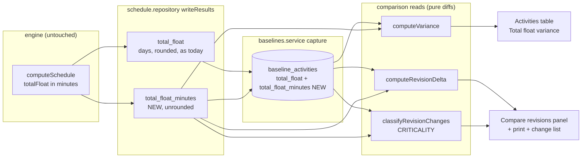
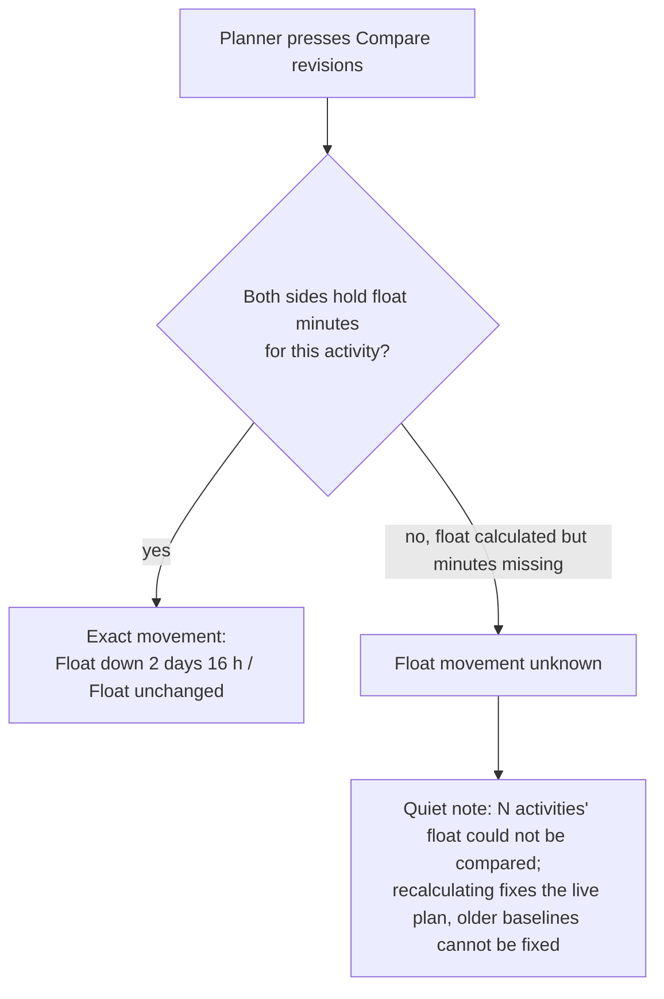

# Feature Spec: A baseline's float is compared in minutes — the float-frame fix

- **Status:** Approved — by the product owner, 2026-11-08, after the answers in §6 were folded in ("Approve" on
  the simplified plan: float stored in minutes from now on, earlier baselines show "Float movement unknown").
- **Author(s):** feature-analyst, for the product owner
- **Date:** 2026-11-08 (revised the same day with the owner's answers)
- **Tracking issue / epic:** `docs/TECH_DEBT.md` #318 — "A baseline's frozen float cannot be re-framed, so a
  day-factor change reads as variance"
- **Roadmap link:** none — debt-driven work before the 1.0 cut (ADR-0190); triggered by ADR-0105 (a
  register row is not a spec: this adds a schema change and changes response fields)
- **Related ADR(s):** ADR-0025 (snapshot copy), ADR-0068 §3a/§4/§5 (the day factor), ADR-0125 (the
  "unknown is never agreement" rule, reused here in a simpler form), ADR-0126 (the change list),
  ADR-0127 (an overlay counts what it does not know), ADR-0139 (the last instance of this class),
  ADR-0088 D1 (no flag), ADR-0081 (entry point + journey). **A new ADR is required** (§4.8) — provisional
  number **ADR-0214**; confirm at filing.

---

## 0. What this spec re-verified, and what it corrects in its own row

Every claim below names the file and line read to establish it (§19.11 / ADR-0076). The register row
was re-verified as a **problem statement**, not only as a design sketch: four of its claims stand,
three move, and one hazard it does not mention was found.

| Claim in row #318 (or the brief)                                                                    | Verdict                                         | Evidence                                                                                                                                                                                                                                                                                                                                                                                                                    |
| --------------------------------------------------------------------------------------------------- | ----------------------------------------------- | --------------------------------------------------------------------------------------------------------------------------------------------------------------------------------------------------------------------------------------------------------------------------------------------------------------------------------------------------------------------------------------------------------------------------- |
| A baseline freezes `total_float` in days                                                            | **CONFIRMED**                                   | `schema.prisma:2570` `totalFloat Int?` on `BaselineActivity`; `baseline.repository.ts:313` copies `a.totalFloat` verbatim at capture                                                                                                                                                                                                                                                                                       |
| Those days are a function of "a calendar's" `hours_per_day_minutes`                                 | **CORRECTED — of each activity's own calendar** | `schedule.repository.ts:842-844` divides engine minutes by `factorFor(activityId)`; the map is built from `schedulingCalendarId` (driving resource → activity → plan), `schedule.service.ts:1720-1735`. The baseline freezes only the **plan** calendar's factor: `baselines.service.ts:183-188` calls `resolveDayFactorMinutes` with `activityCalendarId: null`                                                            |
| The fix needs "a float-frame marker frozen per baseline"                                            | **CORRECTED — insufficient, and half exists**   | A per-baseline marker for the plan calendar **already exists**: `baselines.hours_per_day_minutes` (`schema.prisma:2349-2354`). It cannot describe an activity on its own or a resource's calendar, so another per-baseline column would add nothing                                                                                                                                                                         |
| Editing `hoursPerDay` re-frames every float "instantly"                                             | **CORRECTED — at the next recalculation**       | Live `total_float` is written only by the recalculation (`schedule.repository.ts:818-846`). An `hours_per_day`-only edit stamps the plan "edited since calculated" (`schema.prisma:1086-1090`)                                                                                                                                                                                                                             |
| `hoursPerDay` is client-settable and independent of the shift rows                                  | **CONFIRMED, and there are more routes**        | `hours-per-day.ts:23,34` (explicit value wins). Also: a weekly-pattern write re-derives the factor (`hours-per-day.ts:24,35-36`); moving an activity to a calendar of different day length; changing a `RESOURCE_DEPENDENT` activity's driver (`day-factor.ts:58-61`); changing the plan's calendar; and a **cross-plan** comparison of two plans whose calendars simply differ                                          |
| Finding 1: ADR-0125's criticality columns do not help, because `is_critical` is decided in minutes   | **CONFIRMED**                                   | `engine/compute.ts:714-725` — `totalFloat <= criticalThreshold`, both working minutes. (Side finding, out of scope: `isNearCritical` **is** day-factor dependent, `compute.ts:740-743`; it is neither frozen nor compared. `schema.prisma:1088-1089`'s "the engine never reads it" is therefore stale.)                                                                                                                      |
| Finding 2: the frozen side cannot be rescaled, ever                                                 | **CONFIRMED**                                   | `schedule.repository.ts:844` `Math.round(r.totalFloat / factor)`; `schema.prisma:1594-1597` — "MINUTES ARE PERSISTED FOR NEITHER". `Math.round(2400/1440) = 2`, truth at 480 is 5                                                                                                                                                                                                                                          |
| Finding 3: the precedent is `revision-changes.ts` comparing duration in minutes                     | **CONFIRMED**                                   | `revision-changes.ts:209-213` (minutes) directly above `:216-217` (`from.totalFloatDays !== to.totalFloatDays`)                                                                                                                                                                                                                                                                                                            |
| "Nothing today distinguishes the two for a reader"                                                  | **CONFIRMED — on four surfaces**                | §1 Problem lists them                                                                                                                                                                                                                                                                                                                                                                                                       |
| _(not in the row)_ A capture can freeze a float beside a factor it was not computed with            | **NEW**                                         | Capture refuses only an uncalculated plan (`baselines.service.ts:170-176`), reads the factor **at capture** (`:184-188`), and copies float written by the **last recalculation**. Minutes carry no day length, so this design is immune to it                                                                                                                                                                              |

**The one sentence that frames the fix.** Start variance, finish variance and the completion movement
are **not** affected: each divides one working-time span by **one** frozen factor (`variance.ts:61`;
`schedule.service.ts:2241-2243`). Float is the only comparison that subtracts a number framed on one
side's day lengths from a number framed on the other's (`variance.ts:104-107`,
`revision-delta.ts:223-225`, `revision-changes.ts:217`). Comparing it in minutes and converting **once**,
on the frame those three already use, removes the defect.

---

## 1. Business understanding

### Problem

A planner who changes how long a working day is — on a calendar, by switching an activity's calendar,
or by changing the plan's calendar — and recalculates sees **float move against every baseline, with no
date and no minute of work moved**. The same happens, with no edit at all, when two plans on calendars of
different day length are compared. Four surfaces report it as schedule change:

1. **Activities table → "Total float variance"** (`ActivitiesTable.tsx:1074`, fed by `variance.ts:104-107`)
   — "−2 d float", toned **behind**.
2. **Compare revisions → entered / left rows** (`RevisionComparePanel.tsx:757-760, 849-857`) — "Float up 4
   days · 2 d → 6 d", **sorted by that movement** (`revision-delta.ts:259-269`).
3. **The printed comparison** (`RevisionComparePrintDocument.tsx:300-301`).
4. **The change list → "Criticality changed"** (`revision-changes.ts:216-217`) — fires on the float half
   alone, so a day-length change can fill a class called "Criticality changed" with activities whose
   criticality did not change. The loudest of the four.

Why now: the 1.0 cut. **All plans are wiped at 1.0** (owner, 2026-11-08, §6), so the fix needs no
investment in baselines captured before it; it only has to be exact from the release on.

### Users

| Role                | Need                                                                               |
| ------------------- | ---------------------------------------------------------------------------------- |
| Planner, Org Admin  | Trust that a float difference against a baseline is a schedule fact                |
| Contributor, Viewer | Read the same comparison without being misled (read-only)                          |
| External Guest      | **Not affected** — guests see no baseline surface (`share-guest.controller.ts:59`) |

### Primary use cases

1. Compare the live plan with a baseline after a calendar's working day was changed.
2. Compare two baselines captured either side of such a change.
3. Compare two plans (cross-plan) whose calendars have different working days.
4. Read the float-variance column in the activities table after such a change.

### User journeys

The planner changes a calendar from 24 h to 8 h, recalculates, and presses **Compare revisions** against a
baseline. Activities whose dates did not move show "Float unchanged"; one that genuinely lost two
eight-hour days of float shows "Float down 2 days (16 h)". On the owner's current data, a baseline
captured before this release shows a quiet note instead of a float movement it cannot vouch for (§4 User
flow) — a state that disappears at the 1.0 wipe.

### Expected outcomes

- A working-day change never shows as float movement, on any of the four surfaces.
- Float figures on the comparison screen agree with the finish movement beside them, because both are
  counted on the same working day.

### Success criteria

- API e2e: capture → change `hoursPerDay` → recalculate → compare: every float movement 0, no float-only
  `CRITICALITY` row, `floatVarianceDays` 0 for unmoved activities.
- An unknown float is never shown as 0 or as "unchanged" — a unit case per surface.
- No change to `computeSchedule`; conformance goldens and the revision family's engine-free structural
  gates stay green.
- **Nothing in this spec asks the product owner to test or measure anything** on a server or device.

### Open questions

Answered — see §6.

---

## 2. Functional requirements

### User stories & acceptance criteria

> **US-1** — As a planner, I want float compared in working minutes, so that a change of working day is
> never reported as float movement.
>
> - **Given** both sides of a matched activity hold float minutes **when** I compare **then** the movement
>   is `toMinutes − fromMinutes`, and a day-length change with no date moved gives 0.
> - **Given** that movement **then** it reads in days counted on the earlier revision's plan working day,
>   with hours beside — "Float down 2 days (16 h)"; zero reads "Float unchanged" (CQ-3).
> - **Given** the rows are ordered by float movement **then** they are ordered by the minutes movement.

> **US-2** — As a planner, I want "Criticality changed" to list only real changes.
>
> - **Given** an activity whose criticality did not flip and whose float, in whole days on the comparison's
>   working day, did not change **then** no `CRITICALITY` row exists for it.
> - **Given** a row is listed **then** its two labels differ (never "float 2 d → float 2 d").

> **US-3** — As a planner, I want the float-variance column to be exact.
>
> - **Given** an active baseline row and a live row that both hold minutes **then** `floatVarianceDays` is
>   `round((liveMinutes − baselineMinutes) / baseline.hoursPerDayMinutes)` — the frame
>   `startVarianceDays` already uses (`variance.ts:61`).

> **US-4** — As a planner, I want to be told when a float cannot be compared, rather than shown a guess.
>
> - **Given** a matched activity whose float was calculated but whose minutes are missing on either side
>   (a baseline captured before this release, or a live plan not recalculated since it) **then** its float
>   movement reads "unknown", it is excluded from float-based ordering (sorted last, as nulls are today),
>   and the comparison shows a quiet note saying how many activities could not be compared and why
>   (CQ-2). No rescaling is attempted.
> - **Given** no such activity **then** no note is shown.

### Workflows

One rule, applied per matched activity in each of the four diffs:

1. Both sides hold minutes → compare minutes; convert to days once, on the frame (below), for display.
2. Float calculated (days non-null) but minutes NULL on either side → **not comparable**: movement `null`,
   counted in the response's `floatNotComparableCount`.
3. Float not calculated on a side (days NULL) → movement `null` as today; **not** counted (the existing
   `SIDE_NOT_SCHEDULED` / "unknown" handling already says why).

**The frame** — the working day a minutes figure is shown in — is the earlier side's plan working day,
already in every payload or computed for the dates beside it: same-plan compare `fromBaseline.hoursPerDayMinutes`
(`schedule.service.ts:2241`, returned as `dayFactorMinutes`); cross-plan the earlier side's factor
(`:2735-2741`); variance the active baseline's `hoursPerDayMinutes` (`baselines.service.ts:489`).

### Edge cases

- **Activity on its own calendar**: its minutes are exact; the day figure on the comparison is counted on
  the plan's working day, so it may differ from the day count in the activities table's "Total float"
  column. The comparison states its frame (the completion sentence already says "measured on the plan
  calendar", `revision-sentences.ts:76-82`).
- **Live plan not recalculated since this release**: live rows have days but no minutes → rule 2 for
  every row, note shown; the next recalculation clears it.
- **Baseline captured from such a plan**: copies NULL minutes → rule 2 against that baseline, permanently
  (until the 1.0 wipe).
- **Sub-day float**: minutes are exact; the day figure rounds to whole days and the hours figure carries
  the precision.
- **Uncalculated side**: existing handling wins; nothing new is shown.

### Permissions

Unchanged. Compare revisions requires `schedule:read` **and** `baseline:read`
(`schedule.service.ts:2138-2139`); variance requires `baseline:read` (`baselines.service.ts:435`). No new
route, permission or input; no guest exposure. **Not a pen write**: the new activity column is written by
the recalculation's engine-owned batch (`schedule.repository.ts:818`), the baseline column by capture
(`baseline:create`) — both existing paths (ADR-0028).

### Validation rules

None new: both columns are engine-/capture-owned and never accepted from a DTO.

### Error scenarios

No new error. Existing behaviour unchanged: a missing calendar falls back to 1440
(`day-factor.ts:84-86`); out-of-org ids are a uniform 404; a calendar with no working time is the existing
422 (`baselines.service.ts:541`).

---

## 3. Technical analysis

| Area           | Impact                     | Notes                                                                                                                                                            |
| -------------- | -------------------------- | ---------------------------------------------------------------------------------------------------------------------------------------------------------------- |
| Frontend       | low                        | Float labels and one note on the panel, print, change list and the variance column. No new component, no flag (ADR-0088 D1)                                    |
| Backend        | low–medium                 | One more array in the recalculation's `unnest` write; one more copied column at capture; a minutes rule in three pure diffs                                     |
| Database       | **yes**                    | Two nullable columns, no backfill — **database-architect mandatory** (§4 Database changes)                                                                       |
| API            | low                        | Float fields re-derived from minutes; minutes fields and `floatNotComparableCount` added. Backwards compatibility not required (owner, 2026-11-08). Minor bump |
| Security       | none                       | No new route, permission or input                                                                                                                                |
| Performance    | negligible, to be reviewed | One INT array in an existing UPDATE; one INT column in an existing insert/select. Not measured; backend-performance-reviewer confirms                            |
| Infrastructure | none                       | —                                                                                                                                                                |
| Observability  | low                        | Add `floatNotComparableCount` to the "revision comparison read" log line (`schedule.service.ts:2539-2551`)                                                       |
| Testing        | medium                     | Unit (diffs, labels, note), API e2e (factor-change sequence), journey extension in `e2e-revision-compare`                                                       |

**Recalculation parity gate.** No new scheduling input. `computeSchedule` is not touched: the
recalculation persists a value the engine already returns (`r.totalFloat`, working minutes) without
rounding, beside the column it already writes. Every existing column is written exactly as today, so
engine output and the conformance goldens are byte-identical.

### Dependencies

- **Parallel PR** removing `fromEarlyStart`/`toEarlyStart`/`fromEarlyFinish`/`toEarlyFinish`. This spec
  neither reads nor extends them; the diff task edits `moved()` (`revision-delta.ts:227-246`) and the
  moved-row DTO, so it **rebases onto that PR**.
- Organisation export census (`export-census.structural.spec.ts:178`, "a decision for every model and every
  column") — the two columns need an export decision and a format bump from `2.4` (`export-columns.ts:1091`).
- `pnpm check:counts` — the migration moves the migration count in CLAUDE.md's banner; the ADR moves the
  ADR count.

---

## 4. Solution design

### Options compared

| Option                                              | Size | Schema | Exact?                       | Verdict                                                                                                                     |
| --------------------------------------------------- | ---- | ------ | ---------------------------- | --------------------------------------------------------------------------------------------------------------------------- |
| **C — store float minutes, compare in minutes**     | M    | yes    | yes, from the release on     | **Chosen**                                                                                                                  |
| B — verdict from stored data, caveat on all screens | S    | no     | no                           | Dropped: its value was protecting baselines that the 1.0 wipe removes (owner, 2026-11-08)                                  |
| A — footnote only                                   | XS   | no     | no                           | Dropped with B                                                                                                              |
| D — per-baseline frame marker (the row's sketch)    | M    | yes    | no                           | Rejected: the plan factor is already frozen; cannot describe per-activity calendars; still rounded                         |
| E — freeze each activity's factor                   | M    | yes    | no — still rounded           | Rejected: same cost as C, strictly less information                                                                         |
| F — rescale the frozen days                         | —    | —      | —                            | Impossible (finding 2)                                                                                                      |
| G — drop the float half of `CRITICALITY`            | XS   | no     | —                            | Rejected: loses a real signal ADR-0126 added, does nothing for variance                                                    |

**What the owner's answer removed.** The first draft had an interim milestone (a three-valued
`floatFrameVerdict` computed from plan factors) and a capture-level `*_snapshot_level` discriminator, both
to serve baselines captured before the fix. With every plan wiped at 1.0, neither earns its keep: the only
pre-release state left is "minutes are NULL", which this design reports as **not comparable** with a count
— the ADR-0127 shape — rather than with a verdict enum.

### Architecture overview



### Data flow

```mermaid
sequenceDiagram
  participant Web as Compare revisions panel
  participant API as ScheduleService.revisionCompare
  participant Repo as BaselineRepository
  participant Pure as delta + classifier
  Web->>API: GET …/plans/:planId/schedule/revision-compare?from=B1&to=live
  API->>Repo: snapshot rows + live rows (both now carry totalFloatMinutes)
  API->>Pure: rows, frame = fromBaseline.hoursPerDayMinutes
  Pure-->>API: movement in minutes, days on the frame, null where not comparable
  API-->>Web: { …, dayFactorMinutes, floatNotComparableCount, criticalPath, changes }
  Web->>Web: "Float down 2 days (16 h)"; note if floatNotComparableCount > 0
```

### User flow



### Database changes

**Yes — a schema change. `database-architect` is mandatory and designs it; this spec does not write the
migration** (§19.3). The brief:

1. **`activities.total_float_minutes`** — the engine's total float in working minutes, **unrounded**,
   written only by the recalculation's batched write beside `total_float` (`schedule.repository.ts:844`).
   Engine-owned like its neighbours: never from a DTO, never touching `version`/`updated_at`.
   **Nullable, no default, no backfill** — NULL means "not written since this release" — so the migration
   is a metadata-only add, safe on the existing database. No CHECK (negative float is valid), no index (no
   query filters or sorts by it) — the `free_float` precedent (`schema.prisma:1435-1447`).
2. **`baseline_activities.total_float_minutes`** — copied verbatim from the activity at capture, immutable
   after. Nullable, no default, no backfill.
3. **No discriminator and no plan-level mirror** (owner's decision via the coordinator, 2026-11-08).
   Readers infer from NULL, and the rule is written once, in the columns' comments and the projections:
   `total_float_minutes` NULL with `total_float` non-null ⇒ "calculated before this release, not
   comparable"; both NULL ⇒ "not calculated". This **departs deliberately** from the `*_snapshot_level`
   rule (`schema.prisma:2369-2386`); the justification — the legacy population is wiped at 1.0 and nothing
   after the release can produce the first state except a plan not yet recalculated — belongs in the
   column comment so the next reader does not "fix" it.
4. **Decide whether to pair the columns with a CHECK.** Not on `activities`: a `NOT VALID` CHECK still
   applies to updates, so renaming a pre-release activity would fail. On `baseline_activities` (immutable
   rows) a `NOT VALID` pairing CHECK is possible; the agent decides whether it is worth it.
5. **Export census**: a decision for both columns and the format bump from `2.4` under ADR-0194's rule.
6. **Do not add** minutes for `free_float`, `remaining_float` or `visual_drift_days` — not compared across
   baselines.
7. Optional comment fix while in `schema.prisma`: `:1088-1089`'s "the engine never reads it" of
   `hours_per_day` is stale since `compute.ts:740-741` (#522).

### API changes

Route list read from `schedule.controller.ts:112,272`, `cross-plan-revision-compare.controller.ts:48` and
`baselines.controller.ts:51,108` (all `/api/v1/organizations/:orgSlug/…`). Backwards compatibility is not
required (owner, 2026-11-08); still a **minor** bump pre-1.0, stated in the changeset.

| Response                                                                                  | Change                                                                                                                                                                                                                                                 |
| ----------------------------------------------------------------------------------------- | ------------------------------------------------------------------------------------------------------------------------------------------------------------------------------------------------------------------------------------------------------ |
| `GET …/plans/:planId/schedule/revision-compare` (`RevisionCompare`)                       | Moved rows: `fromTotalFloatMinutes`, `toTotalFloatMinutes`, `floatMovementMinutes` added; `fromTotalFloatDays`/`toTotalFloatDays`/`floatMovementDays` **re-derived** from minutes on `dayFactorMinutes` (null where not comparable). Top level: `floatNotComparableCount` |
| `GET …/organizations/:orgSlug/cross-plan-revision-compare` (`CrossPlanRevisionCompare`)   | Same                                                                                                                                                                                                                                                   |
| `GET …/plans/:planId/baselines/variance` (`PlanVarianceSummary` + rows)                   | Rows: `floatVarianceMinutes` added, `floatVarianceDays` re-derived on the baseline's frozen factor. Summary: `floatNotComparableCount`                                                                                                                 |
| Change list `CRITICALITY` rows                                                            | Predicate: `isCritical` flipped, or float in whole days **on the frame** differs (both minutes present). Labels "float 2 d (16 h)". A float-only difference with minutes missing on a side is not listed and is counted                              |

`docs/API.md` and the OpenAPI descriptions say what NULL means for each field.

### Component changes

No new component; copy through the existing sentence modules, no one-off styling:

- `revision-compare/model/revision-sentences.ts` — float phrase per CQ-3 ("Float down 2 days (16 h)",
  "Float unchanged", "Float movement unknown"); `floatNotComparableNote(count)` returning `null` at 0.
- `RevisionComparePanel.tsx` — `floatPhrase`/`floatCell` (`:845-857`) read the new fields; the note in the
  entered/left section. A standing condition (ADR-0132): no live-region announcement on load.
- `RevisionComparePrintDocument.tsx` — the same phrase and note (`:300-301`, `:72` pattern).
- `RevisionChangesView.tsx` — `CRITICALITY` labels from the API; the note when the count is non-zero.
- `ActivitiesTable.tsx:1074` / `schedule-format.ts:82-104` — "Total float variance" keeps its days text,
  now exact; when `floatNotComparableCount > 0` the column header gets a visible description associated by
  `aria-describedby` (never tooltip-only), and non-comparable cells read "—" as today's null does.

### Implementation approach

- **Compare in minutes, convert once, on the earlier side's plan working day** — the frame the completion
  movement and start/finish variance already use, so every number on a screen agrees.
- **NULL is not comparable, never 0, never rescaled**; counted and stated (ADR-0127).
- **`CRITICALITY` compares whole days on the frame**, not raw minutes: it keeps today's sensitivity and
  guarantees two different labels per row — the `edgeChanged` lesson (`revision-changes.ts:255-265`).
- **No `VITE_*` flag** (ADR-0088 D1); the rollback is the commit boundary.

### 4.8 ADR

**Required** — provisional **ADR-0214**, _"A frozen float carries its minutes"_; amends ADR-0068 §5,
whose "a later calendar edit must not rewrite what this baseline reports as its float" held for the stored
figure but not for the comparison. Outline:

- **Context:** row #318; the four surfaces; findings 1–3; the corrections in §0.
- **Decision:** (1) the recalculation stores float in working minutes beside the day figure; capture
  copies it; (2) every float comparison uses minutes and converts once on the earlier side's plan working
  day; (3) NULL minutes on a calculated row mean "not comparable" — inferred from NULL, no discriminator,
  justified by the 1.0 wipe; (4) not-comparable rows are counted and stated, never rescaled.
- **Alternatives:** A, B, D, E, F, G above.
- **Consequences:** the export format gains two columns; ADR-0068 §5 amended in place; after the 1.0 wipe
  the only source of NULL minutes is a plan not recalculated since the release.

---

## 5. Links

- Implementation plan: [`./implementation-plan.md`](./implementation-plan.md)
- Related docs updated by this change: `docs/TECH_DEBT.md` #318 (closed), `docs/API.md`, ADR-0068
  (amendment note), ADR-0214 (provisional), CLAUDE.md §16 line + banner counts.

---

## 6. Critical questions — answered

Answered by the product owner on **2026-11-08**, relayed by the coordinator:

- **Q1 — how far before 1.0?** Not answered as (a)/(b). The owner's words: _"All plans will be wiped when I
  roll out 1.0. Only I have used it so far so happy for it to start afresh. Same goes for any backwards
  compatibility elsewhere."_ **Interpreted as:** no investment in baselines from before the fix. One
  milestone: store and compare minutes; no interim verdict, no capture discriminator, no plan mirror; API
  fields may change shape.
- **Q2 — when it cannot be sure: (a)**, show a quiet note whenever it cannot be sure.
- **Q3 — display: (a)**, days counted on the plan's working day at the earlier revision, with hours beside
  — "Float down 2 days (16 h)".

**Approval.** The answers above were given on the first draft; this revision was then put to the owner as
one question and approved on 2026-11-08.

**Defaults (no answer needed):** not-comparable rows are counted, never hidden or rescaled; no feature
flag; no new seeded catalogue plan (the API e2e builds its own); free float, remaining float and drift
stay in days; `isNearCritical`'s day-factor dependence is reported, not changed; guests are unaffected.
