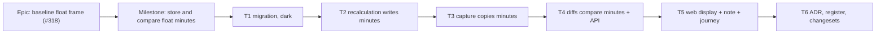

# Implementation Plan: A baseline's float is compared in minutes — the float-frame fix

- **Feature spec:** [`./feature-spec.md`](./feature-spec.md)
- **Status:** Approved — by the product owner, 2026-11-08 (the simplified plan, one milestone).
- **Owner:** api (with web for the display)

## Breakdown

### Epic

**Baseline float frame** — every float comparison is exact from the release on, and says so plainly
where it cannot be. Closes `docs/TECH_DEBT.md` #318. One milestone; there is no interim slice, because
the owner wipes every plan at 1.0 (spec §6).

### Milestone: Store and compare float minutes (shippable slice)

**Outcome:** a working-day change never shows as float movement; float reads "Float down 2 days (16 h)"
on the comparison; a float that cannot be compared says so instead of guessing.
**Entry point:** plan workspace toolbar → **Compare revisions** (`RevisionComparePanel.tsx:227,250`),
and the activities table's **Total float variance** column (`ActivitiesTable.tsx:1074`). T1–T4 ship
dark (no screen change); T5 surfaces the result.
**Journey:** extend `apps/web/e2e-revision-compare/revision-compare.spec.ts`. Seed a plan through the
API, recalculate, capture a baseline, change the calendar's `hoursPerDay` through the API, recalculate,
then press **Compare revisions**. Assert "Float unchanged" on an activity that did not move, assert there
is no not-comparable note, and assert the print view matches.

---

#### Feature: Float minutes, stored and compared

> **Description:** the recalculation stores unrounded float minutes; capture copies them; variance,
> revision compare, cross-plan compare and the change list compare in minutes and convert once, on the
> earlier side's plan working day.
> **Complexity:** M
> **Dependencies:** owner's answers (done, 2026-11-08); the parallel `*Early*` removal PR (rebase T4 onto it)
> **Risks:** a schema written by hand, which §19.3 forbids, so database-architect is used and re-run if it
> fails. NULL read as 0, which a unit case per surface prevents.
> **Testing requirements:** unit (diffs, labels, note), API e2e (the factor-change sequence), journey, a11y
> via the suite's axe checks.

##### Task 1 — Migration (database-architect, mandatory; ships dark)

- **Description:** brief database-architect with spec §4 "Database changes", items 1–7. Land its migration
  and schema change. Nothing writes or reads the columns yet. Record the export census decision and the
  format bump. Update CLAUDE.md's banner migration count so `pnpm check:counts` passes.
- **Complexity:** S
- **Dependencies:** —
- **Risks:** the migration is checksummed for good, so review it before merge. The safety argument is
  nullable columns with no default and no backfill, which makes the change a metadata-only add.
- **Testing:** `pnpm prepush`; `scripts/e2e-local.sh api` (migrations apply to a real database);
  `prisma:check-drift`; export census spec.
- **Development steps:**
  1. Run database-architect. Keep its design beside this plan.
  2. Apply its migration and schema comments, including the NULL rule (spec §4 item 3).
  3. Export census, format bump, banner counts.

##### Task 2 — The recalculation writes minutes

- **Description:** add the unrounded `r.totalFloat` array beside `totalFloat` in `writeResults`
  (`schedule.repository.ts:844`) and update the docblock's engine-column count.
- **Complexity:** S
- **Dependencies:** T1
- **Risks:** this touches the recalculation write. Parity holds because `computeSchedule` is untouched and
  every existing column is written identically. The conformance goldens and the pairwise differential
  stay green.
- **Testing:** API e2e: after a recalculation, `total_float_minutes` equals the engine's minutes on a
  24 h calendar and on an 8 h one (e.g. 2,400 at 480, where `total_float` is 5).
- **Development steps:** 1. Write. 2. Test. 3. No changeset (nothing user-visible).

##### Task 3 — Capture copies minutes

- **Description:** select `totalFloatMinutes` in the capture load and copy it in `createWithSnapshot`
  (`baseline.repository.ts:313`).
- **Complexity:** S
- **Dependencies:** T2
- **Risks:** a plan not recalculated since the release copies NULL. That is the intended state, and T4
  treats it as not comparable.
- **Testing:** API e2e: recalculate then capture gives equal minutes on both tables. Capture from a row
  with NULL minutes stores NULL.
- **Development steps:** 1. Load. 2. Copy. 3. Test.

##### Task 4 — The diffs compare minutes, and the API carries them

- **Description:**
  - Extend `RevisionRow` with `totalFloatMinutes`, carried by both projections
    (`revision-projections.ts:142,250`) and by the variance projections (`baselines.service.ts:473-487`).
  - In `computeVariance`, `computeRevisionDelta.moved()` with its sort, and the `CRITICALITY` predicate
    and label, apply the spec §2 rule. The frame is passed in: `dayFactorMinutes` for both compares,
    `active.hoursPerDayMinutes` for variance.
  - Add `floatNotComparableCount` and the DTO and OpenAPI changes from spec §4 API changes.
  - Add the count to the comparison log line.
- **Complexity:** M
- **Dependencies:** T3; rebase onto the `*Early*` removal PR, and do not read or extend those fields.
- **Risks:** the sort could be left on days, so test it. A per-row frame could creep in, so the frame is
  one argument from the seam.
- **Testing:**
  - Unit for each diff: minutes on both sides; NULL minutes on one side gives null and is counted; NULL
    days are not counted; a `CRITICALITY` row's two labels always differ.
  - API e2e: factor change with no date moved gives every movement 0, no float-only `CRITICALITY` row
    and `floatVarianceDays` 0. A baseline with NULL minutes gives non-zero `floatNotComparableCount`.
- **Development steps:** 1. Projections. 2. Each diff and its tests. 3. DTOs and OpenAPI. 4. e2e.

##### Task 5 — Web display, note and journey

- **Description:**
  - Add the CQ-3 float phrase and `floatNotComparableNote(count)` in `revision-sentences.ts`.
  - Wire them into `RevisionComparePanel.tsx` (`:845-857`), `RevisionComparePrintDocument.tsx`
    (`:300-301`) and `RevisionChangesView.tsx`.
  - Give the "Total float variance" column header a visible, `aria-describedby`-associated description
    when the count is non-zero.
  - It is a standing condition (ADR-0132), so there is no live-region announcement.
- **Complexity:** S
- **Dependencies:** T4
- **Risks:** §19.13 fires only if a shared primitive's keyboard contract changes, and none is planned. If
  the header description needs a primitive change, run accessibility-reviewer first.
- **Testing:**
  - Unit: each phrase; the note is null at 0; "unknown" is never "unchanged"; print matches screen.
  - Journey per the milestone header.
  - `scripts/e2e-local.sh web:revision-compare`, plus `e2e/baselines.spec.ts` if the table assertion
    lands there.
- **Development steps:** 1. Sentences. 2. Surfaces. 3. Journey, run locally.

##### Task 6 — ADR, register, changesets

- **Description:** file ADR-0214 (provisional; outline in spec §4.8) and its CLAUDE.md §16 line, and move
  the banner ADR count. Add an ADR-0068 §5 amendment note. Close `docs/TECH_DEBT.md` #318 with the §0
  corrections and the residual: NULL minutes until a plan is recalculated, and old baselines until the
  1.0 wipe. Update `docs/API.md`. Add `api` and `web` changesets (minor), naming the re-derived float
  fields.
- **Complexity:** S
- **Dependencies:** T4, T5
- **Risks:** none.
- **Testing:** `pnpm prepush` (the ADR coverage, counts, spec-status and debt-status gates).
- **Development steps:** 1. ADR. 2. Register and API.md. 3. `pnpm changeset`.

## Sequencing & slices

T1 adds dark columns. T2 starts writing, with nothing reading. T3 starts copying, with nothing reading.
T4 switches the API on, and the web ignores the new fields until T5. T5 changes the screens. T6 closes
out. Every step keeps `main` releasable, and there is no flag (ADR-0088 D1).

**Agents to involve:**

- database-architect: T1, mandatory.
- builder: implementation.
- api-reviewer and backend-performance-reviewer: T2 and T4.
- security-reviewer: light, since there is no new route or input.
- component-, accessibility- and ux-reviewer: T5.
- test-engineer: the e2e sequences.

## Definition of Done (per task)

Each task's PR must satisfy the Feature Completion Criteria in [`docs/PROCESS.md`](../../PROCESS.md)
(code, tests, docs, security, performance, accessibility, Docker build, CI, changelog, version impact).
"Tests" means `pnpm prepush` was run, plus `scripts/e2e-local.sh api` for T1–T4 and
`scripts/e2e-local.sh web:revision-compare` for T5.

## Risks & assumptions (rollup)

| Risk / assumption                                                                      | Likelihood | Impact | Mitigation                                                                        |
| -------------------------------------------------------------------------------------- | ---------- | ------ | --------------------------------------------------------------------------------- |
| Pre-release baselines show the not-comparable note until the 1.0 wipe                  | certain    | low    | Intended (CQ-2); the owner wipes every plan at 1.0                                |
| A plan not recalculated since the release shows the note on its live side              | med        | low    | The note says recalculating fixes it                                              |
| NULL inferred as 0 or "unchanged" in a later edit                                      | low        | high   | Column comments state the NULL rule; a unit case per surface                      |
| Schema hand-written under time pressure                                                | low        | high   | §19.3: database-architect, re-run on failure                                      |
| Merge conflict with the `*Early*` removal PR                                           | med        | low    | Rebase T4 onto it; do not touch those fields                                      |
| The extra `writeResults` array costs measurable time                                   | low        | low    | Not measured here; backend-performance-reviewer reviews T2 (no owner measurement) |
| A day figure on the comparison differs from an activity's own-calendar float elsewhere | med        | low    | Frame stated on the panel; minutes and hours are exact                            |
| `isNearCritical` also depends on the day factor (`compute.ts:740-743`)                 | —          | —      | Out of scope (neither frozen nor compared); reported in spec §0                   |
