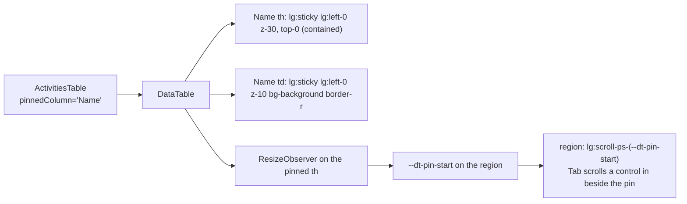

# Feature Spec: Baseline slip in the bottom bar, and activity names that stay in view

- **Status:** Approved — by the product owner, 2026-11-13: Q1 answered "working days", Q2 answered "Name only". Not yet built.
- **Author(s):** feature-analyst (Claude Code), for the product owner
- **Date:** 2026-11-13
- **Tracking issue / epic:** "Batch D: baseline and progress" (owner's walkthrough choice, 2026-11-13), findings rank 9
  and rank 44
- **Roadmap link:** none; walkthrough findings
- **Related ADR(s):** ADR-0025 and ADR-0126 (baseline variance is server-side, working days, from the frozen snapshot),
  ADR-0148 (the placed finish), ADR-0145 D3 (a metric names what it measures), ADR-0092, ADR-0114, ADR-0187, ADR-0216
  D6/D9 and ADR-0219 (the foot row's budget and wrap rules), ADR-0179 (1024 x 600 floor), ADR-0051/0163/0198 (the guest
  view), ADR-0146, ADR-0165, ADR-0173/0188, ADR-0183/0184 and ADR-0191 (tables, windowed rows, widths, wrapping,
  contrast theme), ADR-0142 (measure before building), ADR-0081 (entry point and journey), ADR-0088 D1 (no flag)

Both parts are specified rather than built straight from the walkthrough because each adds surface (ADR-0105): part A
adds a fact to the plan workspace's bottom bar and fields to an API response; part B changes a shared component's public
contract (`DataTable`).

---

## In plain English

**A. How far the finish has slipped.** Once a plan has an active baseline, the bottom bar shows, beside **Finish**, how
far the plan's finish has moved against that baseline: **"3 working days later than baseline"**, **"2 working days
earlier than baseline"**, or **"On baseline"**. With no active baseline nothing is added, so a plan that has never had a
baseline looks exactly as it does today. The number is worked out by the server, counting working days on the plan's
calendar, the same way every other baseline variance in the product is counted. Shared-link guests see no change.

**B. Names stay put when the table scrolls sideways.** In the activities table, the **Name** column stays fixed at the
left edge while the rest of the table scrolls sideways under it, so you always know which activity a row is. Nothing
else about the table changes. On windows narrower than a laptop the column is not pinned (it would take too much of a
small screen) and the table scrolls as it does today.

---

## 1. Business understanding

### Problem (verified against the code, CLAUDE.md section 19.11)

**A (rank 9).** `apps/web/src/components/layout/status/plan-facts.tsx:204-249` (`FactList`) renders exactly four facts:
Data date and Finish on one row (lines 219-237), Activities and "N critical activities" on the second (238-246). There
is no baseline or variance fact. The plan-level number the owner wants **does not exist in any response today**:

- The variance read's roll-up has `worstFinishSlipDays` (`packages/types/src/index.ts:1989-2005`), but that is the
  **largest single activity's** finish slip (`apps/api/src/modules/baselines/variance.ts:125-129`), not the plan's
  finish. A plan whose last activity is on time can carry a large worst slip on a non-critical activity, and the
  reverse. Showing it next to "Finish" would break ADR-0145 D3 (a metric names what it measures).
- `BaselineSummary.capturedProjectFinish` exists, but it is `MAX(earlyFinish)` at capture
  (`baselines.service.ts:169` and `latestFinish`, lines 574-582): the network finish. The variance read compares
  **placed** dates since 1.1.0 (`baselines.service.ts:472-492`), and the Finish fact is the **placed** finish
  (`schedule.repository.ts:447-449`, `MAX(placedFinishSql())`, ADR-0148). Comparing the two would mix two bases.
  (Recorded as an observation for a debt row, not changed here; see section 4.6.)
- Working the number out in the browser from the variance rows would need the plan calendar's working time, and
  ADR-0025 puts working-day variance on the server.

So part A needs an **additive API change** to the existing variance read. No schema change: the snapshot already holds
each activity's frozen placed finish (`BaselineActivitySnapshot.placedFinish`, `packages/types/src/index.ts:1912-1913`,
loaded by `loadSnapshotRowsForVariance`, used at `baselines.service.ts:479-480`) and the baseline holds its frozen day
length (`active.hoursPerDayMinutes`, line 494).

**B (rank 44).** `apps/web/src/features/activities/components/ActivitiesTable.tsx:1249-1261` renders
`<DataTable scroll="contained" windowed>`. In `apps/web/src/components/ui/data-table.tsx` the only sticky element is the
header cell (`sticky top-0 z-20`, line 634); body cells get no position at all (lines 315-325). Name is the second column
(Code first, lines 773-783), or the third when bulk-assign adds Select (748-772). So scrolling the region sideways carries
Name out of view. Whether the table actually overflows sideways at 1024 wide is not measured anywhere I could find; M3
records it first (ADR-0113).

### Users

- A: Org Admin, Planner, Contributor, Viewer: every member who opens a plan (the variance read is `baseline:read`, in
  `HIERARCHY_READ` for every role, `apps/api/src/common/auth/org-permissions.ts:198-211`). External guests: no change.
- B: everyone who opens the activities table (read-only change; no permission involved).

### Expected outcomes and success criteria

- A: on a plan with an active baseline whose finish moved 3 working days later, the bottom bar reads "3 working days
  later than baseline"; with no active baseline, the fact list is exactly today's. At 1024 x 600 the diagram is as tall
  with the fact as without it (journey, no pixel figures).
- B: at 1024 wide, after scrolling the activities table to its far right, every visible row's name is fully on screen
  and nothing paints over it; tabbing to a control in a far column leaves that control fully visible beside the pinned
  name (journey, no pixel figures).

### Open questions

**Critical (the owner's answer changes what is built):**

- **Q1 (A). "Working days" or "days"?** The number counts working days on the plan's calendar. Recommended: say
  **"working days"** ("3 working days later than baseline"), because ADR-0145 D3 says a figure names what it measures,
  and "3 days" would be read as calendar days. Alternative: the shorter "3 days later than baseline", as in the
  walkthrough note.
- **Q2 (B). Pin Name only, or Code and Name?** Recommended: **Name only**. It is what the finding is about and costs the
  least width at 1024. Alternative: Code and Name together, for planners who work by activity code; it takes more of a
  laptop screen and needs the pinned columns' widths added up (section 4.8).

**Defaults (no answer needed; say if you disagree):**

- D-A1. On baseline (rounds to 0 working days) shows **"On baseline"**; a slip under half a working day rounds to it.
- D-A2. The fact uses the same colour as the other facts. The words carry the direction; no red for "later" (never
  meaning in colour alone, and the bar's one red item stays the critical count).
- D-A3. Shared-link guests: no change. The guest page (`GuestPlanView.tsx:204-209`) keeps its own Project finish fact
  and has no baseline data.
- D-A4. The baseline's name is not shown in the bar (width); the Baselines panel already names the active one.
- D-B1. Pinned from the `lg` breakpoint (1024 px) up, the design floor (ADR-0179); below it the table scrolls as today
  so the pinned column can never take most of a narrow or zoomed screen (WCAG 1.4.10).
- D-B2. Only the activities table opts in. The other 26 `DataTable` callers are unchanged.

## 2. Functional requirements

### User stories and acceptance criteria

> **US-A1.** As anyone on a plan, I want to see how far the finish has moved against the active baseline, without
> opening the Baselines panel.
>
> - **Given** an active baseline and a calculated plan whose placed finish is 3 working days after the baseline's,
>   **then** the Finish row reads "Finish 12 Dec 2026" then "3 working days later than baseline", and a screen reader
>   reads "Finish against baseline: 3 working days later".
> - **Given** 1 working day, **then** "1 working day later than baseline" (singular). **Given** −2, **then** "2 working
>   days earlier than baseline". **Given** 0, **then** "On baseline".
> - **Given** no active baseline, a never-calculated plan, a baseline with no frozen placed finish, the variance read
>   still loading, or the read failing (including the 422 for a calendar with no working time), **then** nothing is
>   added.
> - **Given** edits not yet calculated, **then** the slip, like Finish, describes the last calculation; the schedule
>   state sentence already says so. After a recalculation it refreshes (`use-schedule.ts:132` invalidates the variance
>   query).
> - **Given** a short window with a selection bar showing, **then** the slip yields with the other passive facts
>   (`sr-only`, still read), ADR-0219 D1.

> **US-B1.** As anyone reading the activities table, I want the activity's name to stay in view while I scroll sideways.
>
> - **Given** a window 1024 wide or more and a table wider than its region, **when** I scroll right, **then** the Name
>   column stays at the left edge, opaque, with a rule on its right; other columns pass under it.
> - **When** I Tab to a control in a column scrolled under the pin, **then** it scrolls fully into view to the right of
>   the pin (WCAG 2.4.11).
> - **Given** the header pinned at the top (today) **and** Name pinned at the left, **then** the Name header cell sits
>   above both.
> - **Given** a window under 1024 wide, **then** nothing is pinned.
> - **Given** a long name, **then** it wraps inside the pinned cell and the row grows (ADR-0184; never clipped).

### Edge cases

- A: activities added since capture count in the current finish and removed ones in the baseline's; that is what the
  plan finish is. A WBS summary or level of effort counts on both sides exactly as `placedFinishSql` counts it.
- A: two plans' finishes in different weeks around a holiday: the working-day count is on the plan calendar with the
  baseline's frozen day length, as every variance row is (`variance.ts:57-68`).
- B: bulk-assign on: the Select checkbox column is left of Name and scrolls under it; at scroll position 0 it is in its
  place, and Tab brings it back into view (it is at the scroll start).
- B: windowed rows (ADR-0165): the spacer rows hold no cells that need pinning; column widths stay frozen from the first
  window (pinning adds a position, not a width).

### Permissions

No server permission change. A's new fields ride the existing `GET …/plans/:planId/baselines/variance`, any member,
organisation-scoped as today. Not a pen write (read only, nothing structural). B is presentation only.

### Validation and errors

| Scenario                             | Detection                  | Result                         |
| ------------------------------------ | -------------------------- | ------------------------------ |
| No active baseline                   | `baselineId === null`      | No slip fact                   |
| A side has no finish                 | field `null`               | No slip fact                   |
| Older API image (rolling update)     | field `undefined`          | No slip fact (as `basis` does) |
| Calendar with no working time        | 422 from the variance read | No slip fact; nothing logged   |
| Pinned column name matches no column | dev assertion in DataTable | Throws in dev; ignored in prod |

## 3. Technical analysis

| Area           | Impact | Notes                                                                                  |
| -------------- | ------ | -------------------------------------------------------------------------------------- |
| Frontend       | low    | One fact (A); one `DataTable` prop and one caller (B)                                  |
| Backend        | low    | Three additive fields on the variance roll-up, computed from rows already loaded       |
| Database       | none   | No schema change; database-architect not required. One extra selected column (A)       |
| API            | low    | Additive `meta` fields; not breaking (ADR-0190)                                        |
| Security       | none   | Same read, same scope; guests unaffected                                               |
| Performance    | low    | Two max passes over rows the read already holds                                        |
| Infrastructure | none   | No flag (ADR-0088 D1); each milestone is its own release                               |
| Testing        | med    | API unit + e2e; web unit; journeys; foot-row suites one at a time; browser a11y review |

**Recalculation parity.** No scheduling input. `computeSchedule` is untouched; A reads persisted dates, B is layout.

## 4. Solution design

### 4.1 Part A: data flow

```mermaid
sequenceDiagram
  participant W as Plan workspace (useBaselineVariance, already loaded)
  participant API as GET …/baselines/variance
  participant S as BaselinesService.variance
  participant F as PlanFacts / FactList
  W->>API: (existing query; refetched after every recalculation)
  API->>S: snapshot rows (frozen placedFinish) + live rows (+ earlyFinish)
  S->>S: baselineProjectFinish = max frozen placedFinish<br/>currentProjectFinish = max COALESCE(visualEffectiveFinish, earlyFinish)<br/>projectFinishVarianceDays = workingDiff(plan calendar, frozen day length)
  S-->>W: meta { …existing, baselineProjectFinish, currentProjectFinish, projectFinishVarianceDays }
  W->>F: baselineSlip = projectFinishVarianceDays (or undefined)
  F-->>F: "3 working days later than baseline" beside Finish
```

### 4.2 Part A: the API addition

`PlanVarianceSummary` (`packages/types/src/index.ts:1989`) and its DTO (`dto/baseline-variance-response.dto.ts`) gain:

| Field                       | Type             | Meaning                                                                                       |
| --------------------------- | ---------------- | --------------------------------------------------------------------------------------------- |
| `baselineProjectFinish`     | `string \| null` | Latest frozen placed finish in the active baseline (`YYYY-MM-DD`); null with no baseline      |
| `currentProjectFinish`      | `string \| null` | Latest live placed finish, the same value the summary read's `projectFinish` states           |
| `projectFinishVarianceDays` | `number \| null` | Working days, plan calendar, frozen day length; positive = later; null if either side is null |

- **Where.** `computeVariance` stays per-activity. The service computes the three after it (it holds both row sets
  and the calendar), reusing `workingDiff` (export it from `variance.ts`) so the arithmetic is the one every row uses.
- **Changed in review (2026-11-13).** The frozen side also falls back: `COALESCE(placedFinish, baselineFinish)`,
  because the snapshot keeps the early finish (`baseline.repository.ts`, the capture map), so both sides are on one
  basis. `projectFinishVarianceDays` is normalised so a sub-day slip earlier than baseline reads `0`, never `-0`.
- **One definition of "current finish".** `loadActiveActivitiesForVariance` (`baseline.repository.ts:987-1014`) gains
  `earlyFinish` in its `select`, and the max is over `COALESCE(visualEffectiveFinish, earlyFinish)`, the in-memory
  twin of `placedFinishSql` (`schedule/placed-finish.ts:24-28`) over the same population (organisation, plan,
  `deletedAt: null`). An API e2e asserts `currentProjectFinish === GET …/schedule projectFinish`, so the slip never
  disagrees with the Finish beside it.
- **Why not `PlanScheduleSummary`.** The schedule summary is also the recalculate response (`schedule.service.ts:606-611`),
  so baseline data there would be computed inside every recalculation's transaction, and it would invite a later
  change to copy it into the guest's own projection (`GuestScheduleSummary`, `features/share/guest-api.ts:87`). The
  variance read is where baseline comparisons live (ADR-0025), and the workspace already loads it.
- `docs/API.md` and the OpenAPI description at `baselines.controller.ts:109-118` say what the three mean.

### 4.3 Part A: the fact, and the bottom row's budget

- `PlanFacts`/`FactList` take `baselineSlip?: number | undefined` (undefined = show nothing). Passed from
  `plan-workspace-toolbar.tsx:3054-3062` (`PlanStatusBar`) using `model.variance` (`use-plan-workspace-model.ts:499`).
  The facts render in whichever host registers (the foot row's `PlanFactsOutlet`, `activity-bottom-panel.tsx:611`), so
  both hosts get it from one component.
- **Placement.** A third item on the **dates row**, after Finish, using `Fact`'s pattern with `aria-label` "Finish
  against baseline: 3 working days later" and visible text "3 working days later than baseline". Inside the existing
  two rows: a third row would make the facts 48 px against the 40 px floor that keeps the foot row from growing
  (`plan-facts.tsx:76-90` and 144-155), which is diagram height.
- **The width cost is the real risk, and it is measured first (ADR-0142).** At 1024 x 600 the dock outlet beside the
  facts is about 350 px (ADR-0216 line 83), and the diagram is owed 350 px at 600 high (ADR-0092, ADR-0216 line 82).
  Widening the facts narrows the outlet, which can wrap a selection bar or a transient strip onto another line. ADR-0219
  D1 removes the cost for a selection on a short window (the facts yield), but not on a tall window, not for strips, and
  not for nothing selected. M0 reads it; the stop rule is in the plan.
- **Fallbacks if M0 stops** (owner chooses): the dates row as "+3 working days" with the label carrying "against
  baseline" for screen readers only (weaker for sighted readers); or the population row instead, if it is the
  narrower one in the measured states.
- Announces nothing (the component's rule, `plan-facts.tsx:38-48`).

### 4.4 Part B: options for the DataTable contract

| Option | Contract                                                         | Verdict                                                                                                                          |
| ------ | ---------------------------------------------------------------- | -------------------------------------------------------------------------------------------------------------------------------- |
| B1     | `pinnedColumn?: string` on the table: the `header` of one column | **Recommended.** At most one by construction; `header` is already a column's key (`data-table.tsx:316, 628`)                     |
| B2     | `pinned?: true` on `Column<T>`                                   | Nothing stops two columns setting it; they would both stick at `left: 0` and overlap. Needs a runtime rule the type cannot state |
| B3     | Pin a leading run of columns (`pinnedThrough`)                   | Needs each pinned column's left offset; only the windowed mode knows widths (`<colgroup>`). Q2's alternative uses this           |
| B4     | Move Name to be first in the activities table, no contract       | Changes the reading order (Select, Code, Name today), and still scrolls away                                                     |

### 4.5 Part B: the recommended design (B1)



- **One sticky column at `left: 0`, nothing to add up.** Name sits in its natural place until Code has scrolled under
  the left edge, then sticks. No offsets, so it works the same in windowed and plain modes and in `'page'` scroll
  (whose region is `overflow-x-auto`, a horizontal scrollport, line 677).
- **Layers.** Pinned header cell above the other header cells (they are `z-20`), pinned body cells above other body
  cells, all opaque `bg-background`. A `border-r border-border` marks the edge: a border, not a shadow, because forced
  colours drop shadows and keep borders (ADR-0191; the contrast theme rebinds both tokens).
- **Focus not obscured (WCAG 2.4.11).** The region gains `scroll-padding-inline-start` equal to the pinned column's
  width, read by a `ResizeObserver` on its `<th>` into a CSS variable, as it already carries `scroll-pt-12` for the
  header (line 677). The browser then scrolls a focused cell control into view to the right of the pin.
- **Reflow.** Every class is `lg:`-prefixed (D-B1), the way `width: 'fit'` applies from `md:` for the same reflow
  reason (`data-table.tsx:68-73`). Below `lg` the DOM differs from today only by inert data attributes.
- **Untouched.** Column widths (frozen per ADR-0165 D1, `data-table-windowed-body.tsx:31-42`), the wrap rules
  (ADR-0183/0184: the pinned cell wraps and the row grows), the sticky header, and every caller that does not pass the
  prop: their DOM is what it was, asserted by unit test. ADR-0173/0188 (planner-set widths and the resize strip) apply
  to the Gantt grid (`GanttColumnEdge.tsx`), not to `DataTable`, which has no resize; nothing here interacts with them.
  ADR-0146 holds: the pinned column is the row's subject, which is the reason it has.
- **Keyboard contract (ADR-0111).** No keys change; focus order is the DOM order. Focus visibility under the pin is the
  new obligation, so accessibility-reviewer runs in a browser before release.

### 4.6 ADR and docs handling

- **A:** dated amendment note on ADR-0025 (the plan-level finish variance joins the roll-up, on the placed basis) and
  CLAUDE.md section 16's ADR-0025 line "(amended …)". `docs/API.md`. A `docs/TECH_DEBT.md` row for
  `capturedProjectFinish` being the network finish while variance is placed (observation only; not fixed here).
- **B:** no new ADR. The `pinnedColumn` docblock, a dated note on ADR-0146 (a column has a reason; the subject column
  may stay in view), and `docs/COMPONENT_LIBRARY.md`'s DataTable entry.

## 5. Links

- Implementation plan: [`implementation-plan.md`](implementation-plan.md).
