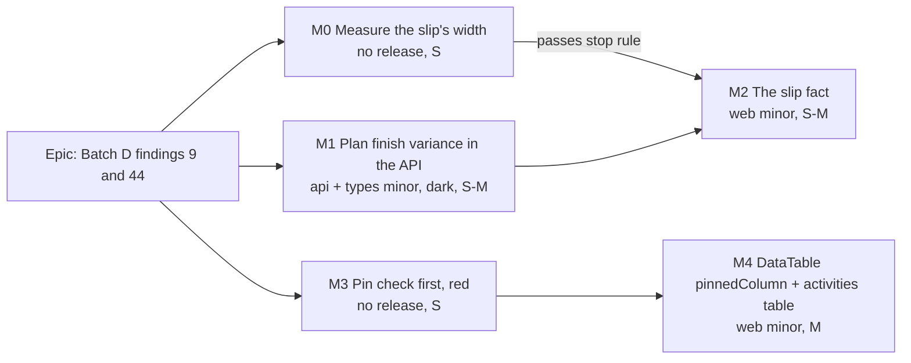

# Implementation Plan: Baseline slip in the bottom bar, and activity names that stay in view

- **Feature spec:** [`feature-spec.md`](feature-spec.md)
- **Status:** Approved (2026-11-13); Q1 working days, Q2 Name only
- **Owner:** product owner; built by the `builder` agent, one milestone per pull request

## Breakdown

### Epic

Two walkthrough findings from "Batch D: baseline and progress". No flag (ADR-0088 D1): each milestone is its own commit
boundary and its own release. Parts A (M0-M2) and B (M3-M4) are independent and may run in either order.

**Machine-independent checks only**, in every journey below: nothing cut off (an element's box inside its container's
box), every button pressable (`document.elementFromPoint` at a control's centre returns that control or a descendant),
no sideways page scroll (`scrollingElement.scrollWidth <= clientWidth`), and heights compared with and without the
change. Never a pixel figure.

---

### Milestone M0: measure the slip's width before building it (no release)

**Outcome:** a reading, not a feature. **Ships dark.** Decides whether M2 proceeds and where the fact sits.

- **Description:** a measurement spec under `apps/web/measure-toolbar/` (as `cq3-facts-chip.spec.ts` is), which injects
  the longest realistic slip string ("12 working days earlier than baseline") into the facts' dates row, then the
  population row, and reads with and without it: the foot row's height, the diagram's height and the dock's line
  count. States: nothing selected, a single selection, the plural selection bar, a stale schedule sentence, an armed
  Select hint. Windows: 1024 x 600 and 1024 x 768, 1280 x 720, 1366 x 768; mouse and finger. Readings to
  `docs/specs/baseline-slip-and-pinned-names/m0-measurement.md`.
- **Complexity:** S
- **Stop rule:** if the fact costs the diagram height (or adds a dock line) in any state on a mouse at 1024 x 768 or
  larger, or at 1024 x 600 with nothing selected, **stop** and put the readings and the spec's fallbacks (section 4.3)
  to the owner. The finger states are recorded, not gating (ADR-0216 D6: the 350 px floor was never owed to a finger).

### Milestone M1: the plan finish variance in the API (api minor, types minor)

**Outcome:** the variance read's `meta` carries `baselineProjectFinish`, `currentProjectFinish`,
`projectFinishVarianceDays`. **Ships dark** (ADR-0081): no user-facing surface until M2.

#### Feature: three roll-up fields

> **Complexity:** S to M
> **Dependencies:** none
> **Risks:** "current finish" disagreeing with the Finish fact → one definition, `COALESCE(visualEffectiveFinish,
earlyFinish)` over the summary's population, asserted equal by an API e2e. A sub-day slip reading as 0 → stated
> (spec D-A1), tested.
> **Testing requirements:** unit (pure), API e2e (Supertest, real Postgres), DTO/OpenAPI.

##### Task M1-T1: compute and return

- **Description:** export `workingDiff` from `variance.ts`; in `BaselinesService.variance` compute the max frozen
  `placedFinish` (all snapshot rows), the max live placed finish, and their working-day difference on the plan calendar
  with `active.hoursPerDayMinutes`; add `earlyFinish` to `loadActiveActivitiesForVariance`'s `select`. Fields `null`
  in the no-baseline branch (`baselines.service.ts:446-459`). Types, DTO, the controller's OpenAPI text, the web's
  `EMPTY_SUMMARY` (`use-baselines.ts:26-35`).
- **Testing:**
  - Unit (`variance.spec.ts` or a new `project-finish-variance.spec.ts`): later, earlier, equal, sub-day rounding,
    a holiday between the two dates, a side null, an activity added after capture extending the finish, the removed
    last activity.
  - API e2e (`apps/api/test/`): capture, push the last activity 3 working days later, recalculate; `meta` has
    `projectFinishVarianceDays: 3` and `currentProjectFinish` equals `GET …/schedule`'s `projectFinish`; no active
    baseline gives three `null`s; a Viewer reads it; another organisation's user gets 404.
- **Development steps:** build; `scripts/e2e-local.sh api`; `docs/API.md`; ADR-0025 dated note and CLAUDE.md section 16
  line; `docs/TECH_DEBT.md` row for `capturedProjectFinish`'s basis (spec section 1); changesets `@repo/api` minor and
  `@repo/types` minor ("The baseline variance read reports how far the plan's finish has moved, in working days").
- **Reviews:** api-reviewer, backend-performance-reviewer (one extra column, two in-memory passes).

### Milestone M2: the slip in the bottom bar (web minor)

**Outcome:** with an active baseline the Finish row says how far the finish has moved.
**Entry point:** the plan workspace's bottom bar (the foot row's facts), beside **Finish**.
**Journey:** `apps/web/e2e/baselines.spec.ts` gains a case: capture a baseline, lengthen the last activity, recalculate,
the bar reads "3 working days later than baseline"; deactivate by deleting the baseline, the fact is gone.
`e2e-workspace-chrome/dock.spec.ts` gains: at 1024 x 600 and 1366 x 768 with a slip shown, the diagram height equals
the same plan's height with no baseline; the fact's box is inside the foot row's box; Recalculate (stale state) and the
panel toggle are pressable; no sideways page scroll.

#### Feature: the fact

> **Complexity:** S to M
> **Dependencies:** M0 passed; M1 released (or the field read defensively as `undefined`, which it is)
> **Risks:** the facts' width narrows the dock (spec 4.3) → M0 first; the journeys run in the states M0 measured.
> The slip and Finish refresh from two queries → both are invalidated by the same recalculation; a brief gap shows the
> previous slip, never a wrong sign for a settled plan (the e2e equality in M1 pins the settled value).
> **Testing requirements:** unit, two journeys, the foot-row suites one at a time, browser accessibility review.

##### Task M2-T1: `FactList` and its wiring

- **Description:** `baselineSlip` prop on `PlanFacts`/`PlanStatusBar`; a pure `slipSentence(days)` returning the visible
  text and the accessible name (Q1's wording); passed from `plan-workspace-toolbar.tsx:3054-3062` using
  `model.variance.data?.summary.projectFinishVarianceDays` when `baselineId` is set, else `undefined`.
- **Testing:** `plan-facts`/`plan-status-bar` unit: absent when `undefined`; singular and plural; earlier; "On
  baseline"; the accessible name; `plan-status-bar.test.tsx` otherwise unchanged; the yield hook (`data-plan-fact-list`)
  still wraps it.
- **Development steps:** build; journeys above; reviews; changeset `@repo/web` minor ("The bottom bar shows how far the
  plan's finish has moved against the active baseline").

**Suites to run, one at a time** (a foot-row change): `pnpm prepush`, then the base suite that holds
`e2e/baselines.spec.ts` (through `scripts/e2e-local.sh`), `web:workspace-chrome`, `web:minimap`, `web:workspace-fit`, `web:multi-select`,
`web:gantt-editing`, `web:toolbar`, `web:arrange`, `web:undo`, `web:narrow-shell`, then read every CI shard.
**Reviews:** accessibility-reviewer in a browser (the accessible name, the yield on a short window, contrast in the
contrast theme), ux-reviewer (wording, placement).

---

### Milestone M3: the pin check first, red on today's code (no release)

- **Description:** in `e2e-workspace-chrome/activities-panel-scroll.spec.ts`, first record whether the activities table
  overflows sideways at 1024 x 600, 1280 x 720 and 1440 x 900 on a seeded plan with code columns and swimlanes (region
  `scrollWidth > clientWidth`). Then the case M4 must turn green: at 1024 wide, scroll the region to its far right; for
  every rendered row, the Name cell's box lies inside the region's box and `elementFromPoint` at its centre lands in
  that cell. Run on today's code and record it failing. Also record the Name column's share of the region's width at
  1024 (a ratio, for the owner, not a gate): if Name alone would take more than half the region, say so before M4.
- **Complexity:** S
- **Stop rule:** if the table does not overflow sideways at 1024 or wider on the catalogue's widest plan, **stop**: the
  finding is not reproducible there; report to the owner with the readings.

### Milestone M4: `DataTable` `pinnedColumn`, opted into by the activities table (web minor)

**Outcome:** at 1024 wide and up, the activities table's Name column stays in view while it scrolls sideways.
**Entry point:** the activities table (the plan workspace's bottom panel, expanded).
**Journey:** M3's case goes green, plus: Tab to the row's Actions menu button with the region scrolled to the start;
its box ends up fully inside the region and to the right of the pinned Name cell's box; Name's header cell is on top at
the corner after scrolling both ways; at 1000 wide nothing is sticky-left (computed `position` of the Name cell);
no sideways page scroll at either width.

#### Feature: the contract and its one caller

> **Complexity:** M
> **Dependencies:** M3; owner's answer to Q2 (Name only is B1; Code and Name is B3 and adds offset arithmetic from the
> windowed `<colgroup>`)
> **Risks:** sticky cells in `border-separate` tables in WebKit/Firefox (the module already moved borders onto cells
> for this, `data-table.tsx:422-429`) → run the journey's pin case in the firefox and webkit projects once, locally.
> A focused control hidden under the pin → `scroll-padding-inline-start` from a `ResizeObserver`, journey-asserted.
> Other callers' DOM drifting → unit assertion that a table without the prop renders the same class strings as today.
> **Testing requirements:** unit, journey, forced-colors journey, component and accessibility reviews before release.

##### Task M4-T1: `DataTable`

- **Description:** `pinnedColumn?: string` on `DataTableBaseProps`, matched against `Column.header`; the classes and
  the region variable in spec section 4.5; dev assertion when no column matches; docblock (why one column, why `lg:`,
  why a border and not a shadow, why scroll padding). Both the plain and the windowed body (`DataTableRow` is shared).
- **Testing:** `data-table.test.tsx` and `data-table-windowed-body.test.tsx`: classes on the pinned `th` and every
  pinned `td` and on no other cell; the region variable is set from the observed width; unmatched name throws in
  dev; without the prop, `'page'` and `'contained'` class strings are exactly today's.

##### Task M4-T2: the activities table, journeys, reviews, docs, release

- **Description:** `pinnedColumn="Name"` at `ActivitiesTable.tsx:1249`; the journey above; a case in the forced-colors
  suite: pinned cells' computed background is not transparent and the right border is present after scrolling.
- **Development steps:** build; ADR-0146 dated note; `docs/COMPONENT_LIBRARY.md`; changeset `@repo/web` minor ("The
  activities table keeps each activity's name in view when you scroll it sideways").

**Suites to run, one at a time:** `pnpm prepush`, `web:workspace-chrome`, `web:forced-colors`, `web:narrow-shell`,
`web:page-composition` (other tables unchanged), `web:multi-select` (bulk-assign Select column), `web:wbs`, then read
every CI shard.
**Reviews:** component-reviewer (the `DataTable` contract, before release), accessibility-reviewer **in a browser**
(focus not obscured, forced colours, contrast theme, reflow below 1024, screen-reader reading order unchanged),
performance-reviewer (sticky cells across a windowed 2,000-row table while scrolling).

## Sequencing and slices

1. **M0** and **M3**: measurements, no release; run first, in parallel.
2. **M1** (api + types minor, dark): no wait on M0.
3. **M2** (web minor): after M0 passes and M1 is released.
4. **M4** (web minor): after M3 confirms the problem and Q2 is answered.

## Definition of Done (per milestone)

The Feature Completion Criteria in [`docs/PROCESS.md`](../../PROCESS.md): `pnpm prepush` run, the listed suites run
locally one at a time (plus `scripts/e2e-local.sh api` for M1), every check on the current head read green after
deduping by name, a changeset, the named docs in the same pull request, and the named reviews done before release.

## Risks and assumptions (rollup)

| Risk / assumption                                                     | Likelihood | Impact | Mitigation                                             |
| --------------------------------------------------------------------- | ---------- | ------ | ------------------------------------------------------ |
| The slip text costs diagram height at 1024                            | med        | med    | M0 measures first and stops; fallbacks in spec 4.3     |
| The slip disagrees with the Finish beside it                          | low        | high   | One placed-finish definition; API e2e asserts equality |
| "Worst slip" and "finish slip" confused                               | med        | low    | Distinct fields and names; ADR-0145 D3 wording         |
| The table does not overflow sideways at 1024 (finding not reproduced) | low        | low    | M3 measures first and stops                            |
| A focused control hides under the pinned column                       | med        | med    | Scroll padding; journey and browser a11y review        |
| A wide Name column takes most of a 1024 region                        | low        | med    | M3 records the pinned share; owner decides a cap if so |
