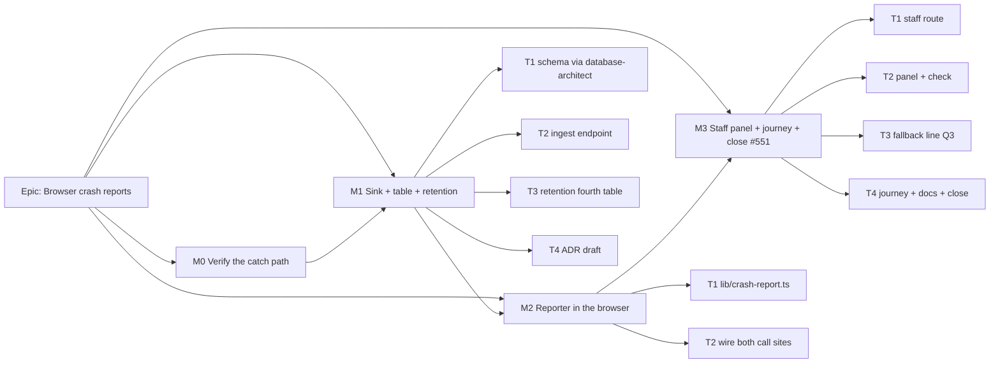

# Implementation Plan: Browser crash reports

- **Feature spec:** [`./spec.md`](./spec.md)
- **Status:** Approved — by the product owner, 2026-11-01, every recommended answer: Q1 signed-in people only; Q2 the console's top line says "Needs attention" while any crash was reported in the last 7 days; Q3 the fallback says "This problem has been reported. Reference: …" only when the report arrived; Q4 only errors that break the screen.
- **Owner:** web + api (builder agent; reviewers listed per task)

Nothing in this plan asks the product owner to test, measure or check anything on their server or
devices. Every proof is a unit test, an API e2e against the local Postgres, or a Playwright journey,
run by the builder (`pnpm prepush`, `scripts/e2e-local.sh api`, `scripts/e2e-local.sh web:staff`).
Nothing requires an operator to set an env var. `RETENTION_CRASH_REPORTS_DAYS` is an optional
override with a working default.

## Breakdown

### Epic

**Browser crash reports.** A crash on any signed-in screen becomes a cleaned, deduplicated row that
staff can read, cleared after 30 days. This closes `docs/TECH_DEBT.md` #551.

---

### Milestone M0: Verify the catch path (no product change)

**Outcome:** the two facts the design rests on are proved by tests in the repository, not only by
reading `node_modules`.
**Entry point:** `Ships dark: a measurement record and a test only; nothing user-visible.`
**Journey:** none (no capability claimed).

##### M0-T1 — Prove which boundary catches what, and choose the journey's crash trigger

- **Description:** Add a Vitest that builds a real router with `defaultErrorComponent` and a
  `defaultOnCatch` spy. It asserts that (a) a throwing route component renders `RouteErrorScreen`
  and calls `defaultOnCatch` once, (b) `AppErrorBoundary` is **not** reached, and (c) a loader
  throwing an `ApiFetchError` also reaches `onCatch`, so the skip rule is needed. Then find, by
  reading the code, one API response a Playwright `page.route` can corrupt so that a real
  signed-in screen throws during render. The fallback, if none is clean, is a response field whose
  absence a component dereferences. Record both in `m0-record.md`. Re-count the interpolated throw
  sites (spec §3 Security: 8 at `5e9435e5`).
- **Complexity:** S
- **Dependencies:** none
- **Risks:** the router version moves → the test pins the behaviour, so a bump that changes it fails
  here. Also register `Match.js:33-34,52-64` in `scripts/dependency-claims.json` (CLAUDE.md §19.11).
- **Testing:** the new Vitest; `pnpm check:claims`.
- **Development steps:**
  1. Write the router test (`apps/web/src/app/route-catch.test.tsx`).
  2. Register the dependency claim.
  3. Write `docs/specs/browser-crash-reports/m0-record.md`: the trigger choice and the throw-site count.

---

### Milestone M1: The sink, the table and its retention

**Outcome:** `POST /api/v1/crash-reports` stores cleaned, deduplicated reports, and the sweep
expires them. The console's existing **Clearing old records** box lists the fourth table.
**Entry point:** `Ships dark: no producer exists until M2, and no reader until M3. The endpoint is
reachable with a session cookie and curl only. The retention box row is the one visible change.`
**Journey:** none in M1 (ADR-0081: dark). The retention row is covered by the existing staff journey
as soon as the label exists. M1-T3 extends it.

#### Feature: Storage and ingest

> **Description:** table, normaliser/cleaner, upsert, throttle, auth.
> **Complexity:** M
> **Dependencies:** M0
> **Risks:** the cleaner lets user text through → hostile-fixture e2e, plus a structural field-list
> spec. A CHECK refuses a row silently → the architect is told the `csp_reports` lesson.
> **Testing:** unit + API e2e against real Postgres.

##### M1-T1 — Design the table (database-architect, mandatory)

- **Description:** Hand spec §4.4 to **database-architect** unchanged. It returns the Prisma model,
  the migration, the constraints, the index(es) and a `docs/DATABASE.md` section. Re-run it if it
  returns nothing (CLAUDE.md §19.3). The builder does not write the model.
- **Complexity:** M
- **Dependencies:** M0
- **Risks:** a migration is checksummed on landing → review before merge. ADR-0107 applies if the
  architect proposes any data step (none expected: new table).
- **Testing:** migration applies on a clean database in the API e2e run. A structural spec asserts
  the model has none of the forbidden fields (spec §4.4 "Must NOT hold").
- **Development steps:**
  1. Run database-architect with §4.4 and the six queries.
  2. Apply its model and migration verbatim. Add the `docs/DATABASE.md` section.
  3. Add `crash-reports.fields.structural.spec.ts`, which reads the Prisma DMMF and refuses
     `userId`, `organizationId`, `email`, `ip`, `userAgent`, `url`, `correlationId` and any `*Id`
     other than `id`.

##### M1-T2 — `CrashReportsModule`: normalise, clean, hash, upsert

- **Description:** New `apps/api/src/modules/crash-reports/`, separate from `StaffModule`
  (`csp.module.ts:6-11`). `normaliseCrashReport` never throws. `cleanMessage`, `cleanFrames` and
  `cleanComponentStack` implement spec §2 Validation in that order. `browserOf(userAgent)` is
  coarse. `dedupeHashOf` uses the U+001F join. The upsert is raw SQL with the
  `GREATEST(clock_timestamp(), first_seen_at)` clamp (`csp-report.service.ts:133-147`), sequential
  and one statement per report. The cap check is as the architect designed it. The handler has
  `@Throttle({ default: { limit: 10, ttl: 60_000 } })` and is **not** `@Public()`. It returns
  `{ reference }`.
- **Complexity:** M
- **Dependencies:** M1-T1
- **Risks:** an over-eager quoted-span rule deletes useful property names → fixtures pin `reading
  'startAt'` surviving. An under-eager one leaks a value → fixtures pin `JSON.parse` snippets,
  Zod-style received values, an email, a UUID, a URL with `?token=`, and a 6-digit number being
  redacted.
- **Testing:** unit tests for each cleaner rule (red-first, one fixture per rule). API e2e: 401
  without a session; 200 with a reference; a 16-way concurrent burst of one new crash records
  `count = 16` (the #311 regression shape); hostile fixtures stored cleaned; the cap drops a new hash
  and counts a repeat; the 11th request in a minute returns 429; the full UA is not stored; the DB
  failure path returns `reference: null`. Census:
  `'POST /api/v1/crash-reports': REASONS.BROWSER_TELEMETRY`.
- **Development steps:**
  1. Cleaner and normaliser with unit tests.
  2. Service and controller; register in `app.module.ts`.
  3. `apps/api/test/crash-reports.e2e-spec.ts`.
  4. `docs/API.md` entry; OpenAPI decorators.
  5. Reviewers: **security-reviewer**, **api-reviewer**, **backend-performance-reviewer**.

##### M1-T3 — The fourth retention table

- **Description:** Add `crash_reports` to `RETENTION_TABLE_NAMES` (`packages/types/src/index.ts:63`)
  and add the policy (`last_seen_at`, `retentionCrashReportsDays`) to `retention-policy.ts:57-99`.
  Add the runner `switch` arm with a literal `DELETE FROM` (`retention-sweep.runner.ts:213-230`), the
  `oldestSurviving` arm and `days` record (`staff-health.service.ts:129-161`), and the boot-log field
  (`retention-sweep.service.ts:90-102`, the M4-T5 omission). Add `RETENTION_CRASH_REPORTS_DAYS`
  (default 30, 1–3650) to `env.validation.ts` and `app-config.service.ts`, plus a commented line in
  `.env.example`. Add the web label in `retention-copy.ts:28-30`. Edit the equality in
  `retention-boundary.structural.spec.ts:55-57` to four and add a comment naming this spec as the
  decision.
- **Complexity:** S
- **Dependencies:** M1-T1
- **Risks:** missing one of the parallel lists → the exhaustive `switch` with no `default` makes it
  a compile error (`staff-health.service.ts:170-183`). The boot-log field has no compile guard → a
  unit assertion on the logged keys (`retention-sweep.service.spec.ts:315` already compares against
  `RETENTION_TABLES.length`).
- **Testing:** the existing retention e2e pattern extended to delete an aged `crash_reports` row and
  keep one at the cutoff. `retention-copy.test.ts` label. The e2e-staff journey's retention
  assertions read the fourth row.
- **Development steps:**
  1. Types, policy, runner, health arm, config, log.
  2. Tests and gates edited deliberately.
  3. Reviewer: **database-architect** (sweep predicate against its index).

##### M1-T4 — Draft the ADR (Proposed)

- **Description:** Write ADR-0211 from spec §4.9 with status Proposed. Add the §16 line in CLAUDE.md
  (`check:adr-coverage`). Update the stage-banner counts (`pnpm check:counts`). Spec status stays
  Draft until approval.
- **Complexity:** S
- **Dependencies:** M1-T2
- **Testing:** `pnpm prepush` (adr-coverage, counts, spec-status, claims).
- **Development steps:** write; register; one changeset (`api` minor).

---

### Milestone M2: The reporter in the browser

**Outcome:** a crash on any signed-in screen sends one report.
**Entry point:** `Ships dark: reports are stored but nobody can read them until M3. The planner sees
no change unless Q3 is approved, and that line also lands in M3.`
**Journey:** deferred to M3 on purpose, because the journey's assertion is the staff panel showing
the row. M2 is proved by unit tests and one API-level e2e that posts what the real builder produces.

##### M2-T1 — `lib/crash-report.ts`

- **Description:** `buildCrashReport(input)` is pure: skip rules (ApiFetchError, chunk failure,
  non-Error handling), caps, and URL path-only reduction of frames and component-stack locations.
  `reportCrash(input)` checks the signed-in state from the query cache only, then the per-load
  counter (3) and the `sessionStorage` seen-set (wrapped in try/catch for private modes). It sends
  with `fetch` keepalive and credentials included, never rejects, and publishes the returned
  reference to a tiny external store for Q3.
- **Complexity:** M
- **Dependencies:** M1-T2
- **Risks:** the reporter throws inside a crash → everything is in one `try`, and a test injects a
  throwing `sessionStorage`, a rejecting `fetch` and a non-Error value. A loop → the per-load cap
  test throws 10 times and expects 3 requests.
- **Testing:** Vitest for every skip rule and cap, for the query string never appearing in the
  body (fixture frame `https://host/assets/a.js?x=1#y`), and for no request when signed out.
- **Development steps:** write module and tests; reviewer **performance-reviewer** (not on the boot
  path; the module is small and imported by `router.tsx`, so check the entry-chunk delta against
  ADR-0171's groups).

##### M2-T2 — Wire both call sites

- **Description:** `defaultOnCatch` in `createRouter` (`router.tsx:695-727`) passes `boundary:
  'route'` and the deepest match's `routeId`. `AppErrorBoundary.componentDidCatch` passes `boundary:
  'app'`. Remove the TODO at `error-boundary.tsx:26` and keep the `console.error` (developers still
  want it locally).
- **Complexity:** S
- **Dependencies:** M2-T1, M0-T1 (the test it extends)
- **Risks:** `routeId` read after the router has moved on → read from the match being caught, and
  the M0 test asserts the pattern string.
- **Testing:** extend `route-catch.test.tsx` so the spy is now the real reporter with `fetch`
  mocked. Assert one request with a route **pattern** and no concrete path. `error-boundary` unit
  test with the same mock.
- **Development steps:** wire; tests; one changeset (`web` minor).

---

### Milestone M3: The staff panel, the journey, and closing #551

**Outcome:** staff see screen crashes on `/staff`. The console's summary flags recent crashes (Q2).
The planner is told a report was sent (Q3).
**Entry point:** `/staff` (account menu → staff console, ADR-0086 D9) → section **"Screen crashes"**
in the Conditions group, linked from the summary row **"Screen crashes"**.
**Journey:** `apps/web/e2e-staff/staff.spec.ts` gains one test. It signs in as a planner, uses
M0-T1's `page.route` corruption to make a real screen throw, and asserts "Something went wrong"
(plus the reference line, if Q3). It then signs in as staff, opens `/staff`, follows the summary's
"Screen crashes" link, and asserts a row with the route pattern and `Times 1`. It finishes with an
axe check on the section. No new Playwright config and no new CI step (existing
`playwright.staff.config.ts`).

##### M3-T1 — `GET /api/v1/staff/crash-reports`

- **Description:** Add `StaffHealthService.crashReports()` (Q-c, Q-d, cap) and a controller handler
  that calls `recordPanelRead(…, 'crashes')`. Add a census entry in `AUDITED_ROUTES`. Update the
  throttle arithmetic comment (`staff.controller.ts:92-103`, nine → ten handlers, 270 → 300/min) and
  `docs/SECURITY_STANDARDS.md`'s handler-count note if it names the figure.
- **Complexity:** S
- **Dependencies:** M1
- **Testing:** API e2e: staff 200 with `meta`; member and Org Admin 404; anonymous 401; one
  `staff.panel_read` row with `subject_label = 'crashes'` and no content.
- **Development steps:** service, controller, DTO, census, docs; reviewers **security-reviewer**,
  **api-reviewer**.

##### M3-T2 — The panel and the summary check

- **Description:** Add `useStaffCrashReports` and add the read to `STAFF_PAGE_READS` (6 → 7;
  update `page-reads.test.ts:9`, `staff-console-screen.test.tsx:204,267`, and the "six" prose at
  `staff-console-screen.tsx:109-123`, `refresh-page-reads.ts:17-28` and `console-header.tsx:23`).
  Add `CrashReportsPanel` (spec §4.6) in the Conditions group. If Q2 = yes: add the `crashes` check
  to `CHECK_IDS`, `LABEL`, `CHECK_SECTION_ID` and `deriveConsoleStatus`, with the US-4 rules.
- **Complexity:** M
- **Dependencies:** M3-T1
- **Risks:** a second observer of the key makes a second audited read → the panel and the summary
  both read the one query passed down (`staff-console-screen.tsx:118-123`). A long stack breaks the
  layout → `wrap-anywhere` `<pre>` inside a disclosure, checked at 1024 × 600 (ADR-0179).
- **Testing:** panel unit tests for the loading, error, empty, data and cap-reached states.
  `console-status.test.ts` for the three verdicts. `check-answers-its-link.test.tsx`.
- **Development steps:** hook, panel, copy, status; reviewers **component-reviewer**,
  **accessibility-reviewer**, **ux-reviewer**.

##### M3-T3 — The fallback line (only if Q3 = yes)

- **Description:** `RouteErrorScreen` and `AppErrorBoundary` read the reference store and render
  "This problem has been reported. Reference: XXXXXX." beneath the existing paragraph, only when a
  reference exists.
- **Complexity:** S
- **Dependencies:** M2-T1
- **Risks:** the line claims a send that failed → it renders only from a non-null server reference;
  tested with a 429 and a rejecting fetch.
- **Testing:** `route-error-screen.test.tsx` gains both cases; focus still lands on the heading.
- **Development steps:** both components; reviewers **accessibility-reviewer**, **ux-reviewer**
  (copy).

##### M3-T4 — Journey, docs, close the row

- **Description:** the journey above. Docs: `FRONTEND_QUALITY.md` (Error boundaries: correct
  `:176-178`; Telemetry: "crash reports only, here"), `FRONTEND_ARCHITECTURE.md:244-261`,
  `OBSERVABILITY.md` domain events, `SECURITY_STANDARDS.md` PII sentence, CLAUDE.md §17's retention
  bullet ("three tables" → four), `docs/TECH_DEBT.md` #551 closed with this spec cited,
  `docs/DECISIONS.md` entry. ADR-0211 → Accepted. Spec and plan → `Accepted — shipped (ADR-0211)`.
- **Complexity:** S
- **Dependencies:** M3-T1–T3
- **Testing:** `scripts/e2e-local.sh web:staff`, `scripts/e2e-local.sh api`, `pnpm prepush`.
- **Development steps:** journey; docs; changesets (`web` minor, `api` patch if touched).

## Sequencing & slices

M0 → M1 → M2 → M3, each one or more PRs that keep `main` releasable. M1 adds a dark endpoint and a
retention row. M2 adds a background request that only fires after a crash. M3 adds the reader. **No
feature flag** (ADR-0088 D1). The rollback for any slice is reverting its commit. Reverting M1 after
it ships needs a down-migration only if the table must go. The table being present and empty is
harmless.

## Definition of Done (per task)

Each task's PR meets the Feature Completion Criteria in [`docs/PROCESS.md`](../../PROCESS.md): code,
tests, docs, security, performance, accessibility, Docker build, CI, changeset, version impact. "Tests"
means `pnpm prepush` was **run**, plus `scripts/e2e-local.sh api` for every `apps/api` change and
`scripts/e2e-local.sh web:staff` for M3.

## Risks & assumptions (rollup)

| Risk / assumption                                                                 | Likelihood | Impact | Mitigation                                                                                                    |
| --------------------------------------------------------------------------------- | ---------- | ------ | ------------------------------------------------------------------------------------------------------------- |
| A third-party error message embeds a plan value the cleaner misses                 | low        | med    | Rules plus hostile fixtures; no identity stored, so the row cannot be linked to a person; 30-day expiry. Stated in the ADR as residual. |
| Stacks are minified and so hard to read                                            | high       | low    | Source maps already ship (`vite.config.ts:79`). A developer resolves frames against that release's `.map`. Server-side symbolication is out of scope. |
| The router changes how `defaultOnCatch` behaves on a bump                          | low        | high   | M0 test + `check:claims` registration.                                                                        |
| The journey's crash trigger is brittle (depends on a response shape)               | med        | low    | M0-T1 chooses it by reading. If it breaks, the journey fails loudly rather than passing.                       |
| Signed-out and guest crashes stay unseen                                           | certain    | low–med | Stated (Q1). The anonymous variant is an additive follow-up on the CSP precedent.                                 |
| Chunk-load failures after a deploy are not counted                                 | certain    | low    | Deliberate: they are not defects (ADR-0047). The skip rule is unit-tested so it stays deliberate.                  |
| The audit table grows by one more `staff.panel_read` per console load              | certain    | low    | Same order as today (6 → 7 per load); the `refresh-page-reads` pins move with it.                               |

## Critical questions for the owner

1. **Whose crashes should be reported?** Recommended: **only people who are signed in.** This is the
   simplest and safest choice, because a stranger cannot fill the list. Alternatives: (a) also people
   viewing a share link and the sign-in screens, which needs an open door like the security-report
   one; (b) signed-in people plus share-link viewers, using their link as the pass.
2. **Should the staff console's top line say "Needs attention" when crashes are happening?**
   Recommended: **yes, while any crash was reported in the last 7 days.** Alternatives: (a) no, show
   them only in their own section; (b) yes, and also post a message to the alert chat address if one
   is set up (it is empty unless the server is configured).
3. **Should the "Something went wrong" screen tell the person a report was sent?** Recommended:
   **yes: one line, "This problem has been reported. Reference: 7F3A9C", shown only if the report
   really arrived.** Alternatives: (a) say nothing; (b) say it was reported but show no reference code.
4. **Which errors count?** Recommended: **only errors that break the screen** (the "Something went
   wrong" page). Alternative: (a) also errors in the background that do not break the screen. These
   are far more numerous, and many come from browser add-ons rather than from SchedulePoint.

**Engineering defaults (no answer needed):** keep a crash for 30 days after it was last seen; at most
1,000 different crashes kept; at most 3 reports per page load and one per crash per tab; 10 reports
a minute per address; no user, organisation, address, full link or full browser string ever stored;
same crash on a new release counts as a new row; the endpoint is authenticated and returns a
reference; one optional setting `RETENTION_CRASH_REPORTS_DAYS` that never needs setting; no feature
flag.
