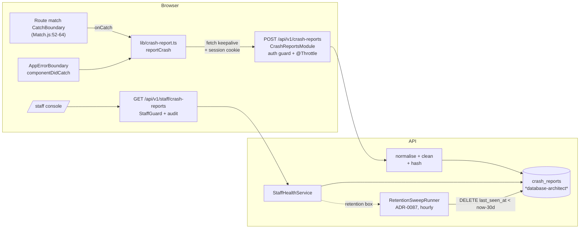
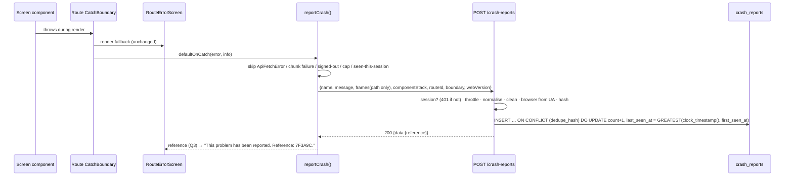
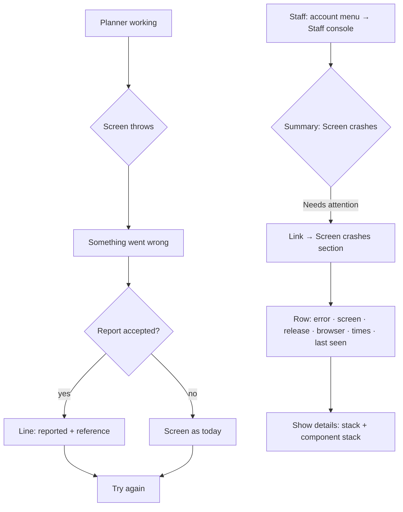

# Feature Spec: Browser crash reports

- **Status:** Approved — by the product owner, 2026-11-01, every recommended answer: Q1 signed-in people only; Q2 the console's top line says "Needs attention" while any crash was reported in the last 7 days; Q3 the fallback says "This problem has been reported. Reference: …" only when the report arrived; Q4 only errors that break the screen.
- **Author(s):** feature-analyst (for the product owner)
- **Date:** 2026-11-01
- **Tracking issue / epic:** `docs/TECH_DEBT.md` #551 "A render crash in the browser reaches nobody"
- **Roadmap link:** none; a debt row the product owner chose to build (2026-11-01)
- **Related ADR(s):** a new ADR is required (outline in §4.9, provisionally ADR-0211). It builds on
  ADR-0086 (staff principal), ADR-0087 (retention sweep), ADR-0085 (privacy), ADR-0143/0178 (console
  layout) and ADR-0088 D1 (no flag). It narrows ADR-0013 for the browser; it does not supersede it.

This spec is needed under ADR-0105: the change adds an endpoint, a table and a staff-console panel,
so a debt row does not cover it (CLAUDE.md §19.1).

---

## 0. Problem re-verified, and one part of it is wrong

The rule is "re-verify a spec's PROBLEM statement" (CLAUDE.md §19.11). Each claim below was checked
against the tree at `5e9435e5`.

| Claim (row #551 or the docs)                                                                                                      | Verified?                                                                                                                                                                                                                                                                                                                                                                                                                                                                                                                                                                                                                                                                                                                                                                                         |
| --------------------------------------------------------------------------------------------------------------------------------- | ------------------------------------------------------------------------------------------------------------------------------------------------------------------------------------------------------------------------------------------------------------------------------------------------------------------------------------------------------------------------------------------------------------------------------------------------------------------------------------------------------------------------------------------------------------------------------------------------------------------------------------------------------------------------------------------------------------------------------------------------------------------------------------------------- |
| The boundary only writes to the console under a `TODO(telemetry)`                                                                 | **True.** `apps/web/src/components/error-boundary.tsx:25-28`.                                                                                                                                                                                                                                                                                                                                                                                                                                                                                                                                                                                                                                                                                                                                     |
| There is no telemetry facade                                                                                                      | **True.** No `apps/web/src/lib/telemetry*`; `docs/FRONTEND_QUALITY.md:186-191` says so too.                                                                                                                                                                                                                                                                                                                                                                                                                                                                                                                                                                                                                                                                                                       |
| **"When a component throws while rendering, the error boundary shows its fallback"**                                              | **Mostly false, and this changes the design.** `createRouter` sets `defaultErrorComponent: RouteErrorScreen` (`apps/web/src/app/router.tsx:712`). TanStack Router wraps **every route match** in its own `CatchBoundary` with that component (`@tanstack/react-router@1.170.46` `dist/esm/Match.js:33,52-64`). A render error inside any screen is therefore caught by the route's boundary and shows `RouteErrorScreen` (`apps/web/src/app/route-error-screen.tsx:83-122`). It never reaches `AppErrorBoundary`, which sits **outside** `RouterProvider` (`apps/web/src/app/providers.tsx:13-15`). `AppErrorBoundary` only sees a fault outside every match. So putting the reporter in `componentDidCatch` alone would leave almost every real crash unreported, and the row would look closed. |
| `docs/FRONTEND_QUALITY.md:176-178`: "no route declares an `errorComponent`, so a render fault in one screen still blanks the app" | **Stale.** The router-level default covers every route (above). That doc and `docs/FRONTEND_ARCHITECTURE.md:256-261` are corrected in M3.                                                                                                                                                                                                                                                                                                                                                                                                                                                                                                                                                                                                                                                         |
| The router's own hook exists                                                                                                      | **True.** `Match.js:34` reads `route.options.onCatch ?? router.options.defaultOnCatch` and calls it with `(error, errorInfo)` at `:61`, after re-throwing not-found errors at `:56-59`.                                                                                                                                                                                                                                                                                                                                                                                                                                                                                                                                                                                                           |
| `RouteErrorScreen` is "what a reader sees when a route's `beforeLoad` or loader rejects" (`route-error-screen.tsx:38-39`)         | **Incomplete.** It also catches render errors (row above), and its copy ("We couldn't load this page", `:102`) is written for load failures. Rewording it is not this epic's job. Q3 adds one line to it.                                                                                                                                                                                                                                                                                                                                                                                                                                                                                                                                                                                         |

**Consequence:** the reporter has **two** call sites. The main one is the router's
`defaultOnCatch`. `AppErrorBoundary.componentDidCatch` is the last-resort one. Both call one
function.

---

## 1. Business understanding

### Problem

When a screen crashes, the planner sees "Something went wrong" and the error goes to their own
browser console (`error-boundary.tsx:27`, and nothing at all from `RouteErrorScreen`). A crash that
every planner on the deployed host meets is seen by nobody who can fix it. The product is in real use:
releases auto-deploy to the owner's host (CLAUDE.md §17, "Hosting is decided"), so this gap is live.

### Users

| Who                                                                                          | Need                                                                                                               |
| -------------------------------------------------------------------------------------------- | ------------------------------------------------------------------------------------------------------------------ |
| **Any signed-in person** (Org Admin, Planner, Contributor, Viewer; also staff using the app) | Nothing to do. When their screen crashes, a report goes out on its own. Optionally they are told it was sent (Q3). |
| **Staff** (`STAFF_EMAILS`, ADR-0086)                                                         | See which screens crash, how often, on which release and browser, with enough stack to find the code.              |
| **External Guest** (share link, ADR-0051)                                                    | Not covered by default (Q1). A guest has no session, so the endpoint answers 401 and the client does not try.      |
| Org Admins                                                                                   | **Do not** see crash reports. This is installation data, not organisation data (ADR-0086 D6).                      |

### Primary use cases

1. A planner's screen crashes. A report is recorded with no action from them.
2. Staff open `/staff`, see that a crash was reported in the last week, and open the "Screen crashes"
   section to find the error, the screen pattern, the release and the stack.
3. The same crash meeting fifty planners makes **one row** with a count, not fifty rows.
4. A crash nobody has met for 30 days disappears on its own (ADR-0087 sweep).

### User journeys

- **Planner:** working → a component throws → `RouteErrorScreen` replaces the screen → the report is
  sent in the background → (Q3) "This problem has been reported. Reference: 7F3A9C" → **Try again**.
- **Staff:** account menu → Staff console (ADR-0086 D9) → summary row "Screen crashes: Needs
  attention" (Q2) → link to the section → the table → open a row to read its stack.

### Expected outcomes

A crash on the deployed host becomes a row a developer can act on, without the owner checking
anything on a server or a device. Row #551 closes.

### Success criteria

- SC-1: a render error in any route-matched screen produces exactly one stored report, or one more
  count on an existing row. Proved by a Playwright journey on the real product (ADR-0081).
- SC-2: the stored row holds **no** user id, organisation id, email, IP address, full URL, query string,
  entity UUID or free-text value from the plan. Proved by API e2e fixtures that post hostile messages
  and by a structural spec on the table's column list.
- SC-3: one tab can never send more than 3 reports per page load. One browser session sends a given
  crash at most once. The server stores at most 1,000 distinct rows. Each bound is unit-tested or
  e2e-tested.
- SC-4: the reporter never throws and never blocks the fallback from rendering. A reporter that
  fails leaves the fallback exactly as it is today. Unit-tested with a rejecting fetch.
- SC-5: the retention sweep covers the new table at 30 days after last seen, and the console's
  retention box shows it. Proved by the existing retention e2e pattern.
- SC-6: the staff panel is audited (`staff.panel_read`, subject `crashes`). Pinned by the route census
  (`apps/api/src/modules/audit/audit-coverage.structural.spec.ts:51-62`).

### Open questions

Answered by the product owner on 2026-11-01, each with the recommended answer: **Q1** signed-in
people only; **Q2** yes, "Needs attention" while any crash was reported in the last 7 days; **Q3**
yes, one line with a reference code, shown only when the report arrived; **Q4** only errors that
break the screen. Defaults are stated inline as **[Default]**.

---

## 2. Functional requirements

### User stories & acceptance criteria

> **US-1** — As a signed-in planner, I want a crash on my screen to be reported for me, so that it
> gets fixed without my having to describe it.
>
> - **Given** I am signed in **when** any route-matched screen throws during render or in its loader
>   with a non-HTTP error **then** one report is posted to `POST /api/v1/crash-reports` in the background.
> - **Given** the same crash happens again in the same tab session **then** no second report is sent.
> - **Given** the report fails (offline, 5xx, 429) **then** the fallback screen looks and behaves exactly
>   as it does today. Nothing is retried, and nothing is shown that claims a report was sent.
> - **Given** I am not signed in (sign-in screen, guest share page) **then** no request is made (Q1).

> **US-2** — As a planner, I want to be told that a report was sent and given a reference, so I can
> quote it if I contact support. _(Q3; recommended yes.)_
>
> - **Given** the server accepted the report **then** `RouteErrorScreen` (and `AppErrorBoundary`)
>   show "This problem has been reported. Reference: XXXXXX." beneath the existing sentence.
> - **Given** the report was not accepted **then** the line does not appear. The line never says
>   something was sent when it was not.

> **US-3** — As staff, I want to see which screens crash, so I can fix the worst first.
>
> - **Given** reports exist **when** I open `/staff` **then** a "Screen crashes" section lists distinct
>   crashes, most recently seen first, at most 50 rows (the `CSP_LIMIT` precedent,
>   `apps/api/src/modules/staff/staff-health.service.ts:234-238`).
> - Each row shows: what broke (error name + cleaned message), screen (route pattern), web release,
>   browser, times reported, first seen, last seen, and the reference code. A disclosure per row shows
>   the cleaned stack and component stack as text.
> - **Given** none exist **then** the section says "No crashes received" and explains that this means
>   nothing arrived, not that nothing happened (the `SECURITY.caveat` pattern,
>   `apps/web/src/features/staff/ui/security-panel.tsx:9-21`).
> - **Given** the 1,000-row cap has been reached **then** the section says that new kinds of crash
>   are not being recorded until old ones expire.

> **US-4** — As staff, I want the console's top line to tell me when crashes are happening. _(Q2;
> recommended yes.)_
>
> - **Given** any row was last seen within the past 7 days **then** the summary check "Screen crashes"
>   reads **Needs attention** with value "N kinds in the last 7 days".
> - **Given** there are rows but none in 7 days **then** it reads **OK** with "Last crash D days ago".
> - **Given** the read failed or is pending **then** it reads "Could not be read" / "Checking", never OK
>   (`apps/web/src/features/staff/model/console-status.ts:37-45`).

> **US-5** — As the operator, I want crash reports to clear themselves, so the table never needs me.
>
> - Rows are deleted 30 days after `last_seen_at` by the existing sweep. It is on by default
>   (`apps/api/src/config/env.validation.ts:154-157`).
> - The period can be overridden by an optional `RETENTION_CRASH_REPORTS_DAYS`, default 30. **No
>   operator action is needed for any of this to work.**

### Workflows

**Capture (web).** `reportCrash({ error, boundary, routeId, componentStack })` runs:

1. **Skip** if the error is an `ApiFetchError` (`apps/web/src/lib/api/client.ts:10`). That is a
   server answer the API already logged. Also skip a chunk-load failure (`isChunkLoadFailure`,
   `route-error-screen.tsx:17-25`), because that is a deploy under an open tab (ADR-0047) and
   not a defect. Also skip a router redirect or not-found (not-found is re-thrown before `onCatch`,
   `Match.js:56-59`).
2. **Skip** if the session cache does not hold a signed-in user (`sessionQueryOptions`,
   `apps/web/src/features/auth/api/use-session.ts:36`). This only reads the cache and never fetches.
3. **Skip** if this tab already sent 3 reports since load, or if `sessionStorage` already holds this
   crash's local key (name + first frame + route id).
4. Build the body. It holds the error name, the message (capped at 1,000 characters), and stack
   frames with every URL reduced to its path, with **query and fragment removed in the browser**.
   It also holds the component stack (capped), `routeId` (the route **pattern**, e.g.
   `/_authed/orgs/$orgSlug/plans/$planId`, never the concrete path), `boundary` (`route` | `app`), and
   the web release (`__APP_VERSION__`, `apps/web/vite.config.ts:30`).
5. `fetch(…, { method: 'POST', credentials: 'include', keepalive: true })`. `keepalive` lets the
   request survive a **Reload** press. Everything is inside one `try`, and the function returns a
   promise that never rejects.

**Ingest (api).** The global auth guard authenticates the request (deny-by-default, 401 without a
session). `normaliseCrashReport(body)` never throws and returns `null` for anything it cannot use. The
server then **cleans** every field (it is the authority, §2 Validation) and computes the dedupe hash. It
derives the browser family and major version from the `User-Agent` header, upserts the row and returns
the reference.

**Read (staff).** `GET /api/v1/staff/crash-reports` is audited and returns the newest 50 rows plus
`meta: { total, capReached, cap }`.

### Edge cases

| Case                                                        | Behaviour                                                                                                                                                                                                                                     |
| ----------------------------------------------------------- | --------------------------------------------------------------------------------------------------------------------------------------------------------------------------------------------------------------------------------------------- |
| The fallback itself throws                                  | `AppErrorBoundary` catches it and reports once with `boundary: 'app'`. The per-load cap of 3 stops any loop.                                                                                                                                  |
| A crash while offline                                       | The fetch rejects and is swallowed. No reference line appears. No retry queue (there is no storage worth adding for this).                                                                                                                    |
| Burst: 50 planners meet one crash in the same second        | 50 upserts on one `dedupe_hash`, with `count = 50`. `last_seen_at` is clamped `GREATEST(clock_timestamp(), first_seen_at)`, the #311 fix copied from `csp-report.service.ts:133-147`, so no write is lost to `last_seen ≥ first_seen`.        |
| A new release changes the chunk hashes                      | Frames change, so it is a new row. **The release is in the key on purpose**, so "did it come back after the fix?" is a new row and not a merged count. Fragmentation is additive and safe (the CSP reasoning, `csp-report.service.ts:13-26`). |
| A hostile signed-in user posts 10,000 distinct fingerprints | The throttle allows 10 a minute per IP. Past 1,000 distinct rows, new fingerprints are dropped and repeats still count. The panel says the cap is reached. Worst case ≈ 1,000 × ~8 KB ≈ 8 MB.                                                 |
| A message carries an email, UUID, URL or quoted user value  | The server cleaner redacts it before storage (Validation rules). A residue is possible and is stated as a risk in §3 Security and in the ADR.                                                                                                 |
| The error is not an `Error` (`throw 'x'`, `throw {}`)       | Name `NonError`. The message is the cleaned `String(value)`, capped. No stack.                                                                                                                                                                |
| Crash on `/staff` itself                                    | Reported like any other screen, because staff are signed-in users.                                                                                                                                                                            |
| The database is down                                        | The write is swallowed and logged at warn with no content (the `csp_report.persist_failed` shape, `csp-report.service.ts:167-174`). The response says the report was not stored (`reference: null`).                                          |

### Permissions

| Act                                             | Who                                                                                                                                        | Mechanism                                                                                                                                          |
| ----------------------------------------------- | ------------------------------------------------------------------------------------------------------------------------------------------ | -------------------------------------------------------------------------------------------------------------------------------------------------- |
| `POST /api/v1/crash-reports`                    | Any authenticated session. No organisation scope, no role check, like `GET /api/v1/me` (`apps/api/src/modules/me/me.controller.ts:17-35`). | Global auth guard. Not `@Public()`. No `Principal` field is read beyond "a session exists", and none is stored.                                    |
| `GET /api/v1/staff/crash-reports`               | Staff only                                                                                                                                 | `StaffGuard` + uniform 404 for everyone else (`apps/api/src/modules/staff/staff.controller.ts:71-80,110`). Audited `staff.panel_read` / `crashes`. |
| Org Admin / Planner / Contributor / Viewer read | Nobody                                                                                                                                     | There is no route.                                                                                                                                 |
| External Guest                                  | Cannot post (no session). Q1 asks whether that should change.                                                                              | —                                                                                                                                                  |
| Pen (ADR-0028)                                  | **Not structural.** No plan write.                                                                                                         | —                                                                                                                                                  |

**Why authenticated, not anonymous like the CSP sink.** The CSP sink is `@Public()` "by necessity,
not by choice" because a browser sends a violation report without credentials
(`apps/api/src/modules/csp/csp-report.controller.ts:13-16`). That reason does not apply here: our own
code sends this report with the session cookie through `fetch`. Requiring a session buys four things.
(a) The `@Public()` list ADR-0051 wants short stays short. (b) An anonymous flood needs an account
first. (c) The throttle has a real bound. (d) Nothing is stored for people who never agreed to use
the product. What it costs: crashes on the sign-in screens and on the guest share page are not seen
(Q1). The CSP sink shows the anonymous alternative is buildable later without redesign.

### Validation rules

The server is the authority. The client caps only to keep the request small and removes query strings
so they never leave the browser.

| Field (stored)              | Rule                                                                                                                                                                                                                                                                                                                                                                                                                                                                                                                                                                                     |
| --------------------------- | ---------------------------------------------------------------------------------------------------------------------------------------------------------------------------------------------------------------------------------------------------------------------------------------------------------------------------------------------------------------------------------------------------------------------------------------------------------------------------------------------------------------------------------------------------------------------------------------- |
| `error_name`                | Matches `^[A-Za-z_$][\w$]{0,63}$`. Otherwise `Error`. This is the `mail_events.error_class` idea (`docs/DATABASE.md:2259-2263`).                                                                                                                                                                                                                                                                                                                                                                                                                                                         |
| `message` (cleaned)         | In order: (1) URLs → `scheme://host` only (path, query and fragment dropped: a path holds a customer's slug; amended 2026-11-01 after the security review); then any rooted path, host-with-path, token carrying a `?` and `/…/` regular-expression literal → `[path]` / `[regex]`; (2) emails (Unicode-aware) → `[email]`; (3) UUIDs → `[id]`; (4) runs of ≥ 4 digits (any script) → `[n]`; (5) quoted spans (`'…'`, `"…"`, `` `…` ``) kept **only** if the content is a bare identifier (`reading 'startAt'` survives), otherwise → `'…'`; (6) collapse whitespace; (7) cap 300 chars. |
| `route_pattern`             | A TanStack route **id**, matching `^[\w$/.\-_]{1,200}$`, or null. Never a resolved path. A value containing a UUID is refused, because a pattern never holds one.                                                                                                                                                                                                                                                                                                                                                                                                                        |
| `boundary`                  | `route` \| `app`.                                                                                                                                                                                                                                                                                                                                                                                                                                                                                                                                                                        |
| `stack` (cleaned)           | At most 20 frames. Each frame is `fn @ path:line:col`, where `path` is the URL path only. Same-origin frames keep their path (`/assets/canvas-Ab12.js`). Other origins become their scheme only (`[chrome-extension]`, `[https]`). Function names pass the identifier rule or become `?`. Cap 4,000 chars.                                                                                                                                                                                                                                                                               |
| `component_stack` (cleaned) | At most 20 lines. Component names pass the identifier rule. Locations are cleaned like frames. Cap 2,000 chars.                                                                                                                                                                                                                                                                                                                                                                                                                                                                          |
| `web_version`               | SemVer-shaped, ≤ 32 chars, or `unknown`.                                                                                                                                                                                                                                                                                                                                                                                                                                                                                                                                                 |
| `browser`                   | Server-derived from `User-Agent`: `chrome` \| `edge` \| `firefox` \| `safari` \| `other`. Plus `browser_major` (int or null). The full UA is **never** stored.                                                                                                                                                                                                                                                                                                                                                                                                                           |
| Body                        | JSON, inside the existing 64 KB default limit (`apps/api/src/common/http/body-limits.ts:15-16`).                                                                                                                                                                                                                                                                                                                                                                                                                                                                                         |

**Dedupe key**: `sha256(web_version ␟ boundary ␟ error_name ␟ message ␟ route_pattern ␟ top-5 frames ␟ browser)`,
joined on U+001F (the `csp-report.service.ts:38-60` separator lesson). `browser_major` and both
stacks are last-writer-wins, using `COALESCE` so a later report cannot erase them.

**Reference** = the first 6 hex chars of the hash, upper-cased. It is display only and is not unique by
contract. The panel shows it, so a quoted reference finds its row.

### Error scenarios

| Scenario                                              | Detection                              | User-facing result                                        | Status                                  |
| ----------------------------------------------------- | -------------------------------------- | --------------------------------------------------------- | --------------------------------------- |
| No session                                            | Global auth guard                      | None (the client does not send it)                        | 401                                     |
| Throttled                                             | `@Throttle` on the handler             | No reference line                                         | 429                                     |
| Unusable body (not an object, no name and no message) | `normaliseCrashReport` → `null`        | No reference line                                         | 200 `{ data: { reference: null } }`     |
| Cap reached, new fingerprint                          | Cap check in the write                 | No reference line                                         | 200 `{ data: { reference: null } }`     |
| Database write fails                                  | Caught, logged at warn without content | No reference line                                         | 200 `{ data: { reference: null } }`     |
| Stored or counted                                     | —                                      | "This problem has been reported. Reference: 7F3A9C." (Q3) | 200 `{ data: { reference: "7F3A9C" } }` |
| Non-staff `GET /staff/crash-reports`                  | `StaffGuard`                           | Not found                                                 | 404 (401 when anonymous, ADR-0086 D7)   |

A malformed JSON body never reaches the handler. The exception filter answers 400 (the
`csp-report.controller.ts:21-23` note). That is fine, because the client never sends one.

**[Default] Validation shape.** Normalise-and-drop rather than a `class-validator` DTO that answers 422.
The reasoning is the CSP one (`csp-report.controller.ts:42-44`): the caller is a crashed screen that
cannot act on a 422, and a rejected field would lose the whole report. The api-reviewer confirms this
against `docs/API.md` at M1.

---

## 3. Technical analysis

| Area                   | Impact | Notes                                                                                                                                                                                                                                                                                                                                                                                                                                                                                                                                                                                                                                                                                                                                                                                           |
| ---------------------- | ------ | ----------------------------------------------------------------------------------------------------------------------------------------------------------------------------------------------------------------------------------------------------------------------------------------------------------------------------------------------------------------------------------------------------------------------------------------------------------------------------------------------------------------------------------------------------------------------------------------------------------------------------------------------------------------------------------------------------------------------------------------------------------------------------------------------- |
| Frontend               | med    | New `apps/web/src/lib/crash-report.ts`, a pure builder plus one sender. `defaultOnCatch` added to `createRouter` (`router.tsx:695-727`). `AppErrorBoundary.componentDidCatch` calls the reporter and the TODO is removed. The fallback line is added to `RouteErrorScreen` and `AppErrorBoundary` (Q3). Staff: `CrashReportsPanel`, `useStaffCrashReports`, `STAFF_PAGE_READS` 6 → 7 (`apps/web/src/features/staff/model/page-reads.ts:11`, pinned at `page-reads.test.ts:9`), plus `CHECK_IDS` gains `crashes` (Q2, `console-status.ts:33,89-103`) and a `retention-copy.ts:28-30` label.                                                                                                                                                                                                      |
| Backend                | med    | New `modules/crash-reports/` (controller + service + normaliser/cleaner), kept **separate from `StaffModule`**, the `csp.module.ts:6-11` reasoning. Staff: `StaffHealthService.crashReports()` and a controller route. Retention: policy row, runner `switch` arm (`retention-sweep.runner.ts:213-230`), `oldestSurviving` arm and `days` record (`staff-health.service.ts:129-161`), boot log field (`retention-sweep.service.ts:90-102`).                                                                                                                                                                                                                                                                                                                                                     |
| Database               | med    | **One new table, to be designed by database-architect** (§4.4). No change to any existing table.                                                                                                                                                                                                                                                                                                                                                                                                                                                                                                                                                                                                                                                                                                |
| API                    | low    | `POST /api/v1/crash-reports` (in OpenAPI, unlike the CSP sink, because our own client calls it) and `GET /api/v1/staff/crash-reports`. `docs/API.md` is updated.                                                                                                                                                                                                                                                                                                                                                                                                                                                                                                                                                                                                                                |
| Security               | med    | Authenticated ingest. The cleaner is **load-bearing for ADR-0086 D6** (staff must not read customer content): a raw message is the one channel through which plan text could reach a staff screen. Evidence for the residual risk: the non-test web code has **8** `throw new …Error(\`…${…}\`)` sites. None interpolates user-entered text: toolbar ids/labels (`toolbar-registry.ts:489,492,672`, `Toolbar.tsx:213`, `toolbar-promotion.tsx:312`), a probe scenario id and HTTP status (`perf-probe/…/scenarios.ts:167`, `run-loading-probe.ts:365`), and an activity **UUID** (`levelling-application.ts:99`, redacted by rule 3). Third-party messages are the residue. The full UA, IP, user and org are never stored. The audit row names the panel and never its contents (ADR-0086 D5). |
| Performance            | low    | One upsert per report. The write is bounded by the client caps and the throttle. The staff read is `ORDER BY last_seen_at DESC LIMIT 50` on a table capped at 1,000 rows. Nothing touches the planner's request path: the report is sent only after a crash, in the background.                                                                                                                                                                                                                                                                                                                                                                                                                                                                                                                 |
| Infrastructure         | low    | **One optional env var**, `RETENTION_CRASH_REPORTS_DAYS` (default 30, bounds 1–3650), following the three siblings (`env.validation.ts:170,181,196`). The operator never has to set it. `.env.example` gains a commented line. No new service, no new container, no CI step, no new Playwright config (the journey joins `apps/web/e2e-staff/staff.spec.ts`).                                                                                                                                                                                                                                                                                                                                                                                                                                   |
| Observability          | low    | Two log events with scalars only: `crash_report.persist_failed` (warn) and `crash_report.cap_reached` (warn, at most once per hour per process). `docs/OBSERVABILITY.md` "Domain events" gains them.                                                                                                                                                                                                                                                                                                                                                                                                                                                                                                                                                                                            |
| Testing                | med    | Unit (cleaner, normaliser, hash, client builder and caps, both call sites, panel, console status). API e2e (ingest auth, dedupe under a 16-way burst, hostile fixtures, cap, throttle, staff read and audit, retention delete). Playwright: a journey in `e2e-staff`. a11y on the new panel.                                                                                                                                                                                                                                                                                                                                                                                                                                                                                                    |
| Engine / recalc parity | none   | Not a scheduling input. No file under `apps/api/src/modules/schedule/` changes, so `computeSchedule` is byte-identical by construction.                                                                                                                                                                                                                                                                                                                                                                                                                                                                                                                                                                                                                                                         |
| Flag                   | none   | **No `VITE_*` flag** (ADR-0088 D1): every published image carries every flag at its default, so a flag here is a second root and not a rollback. The rollback is reverting the commit. The ingest half has no user-visible surface. The staff half is reached from the existing console.                                                                                                                                                                                                                                                                                                                                                                                                                                                                                                        |

### Dependencies

- Nothing must land first. Reused as they are: the global auth guard, `@nestjs/throttler`, `StaffGuard`,
  `AuditService`, `RetentionSweepRunner`, `QueryPanel`, `DataTable`, `SectionGroup`.
- **Gates this touches, so they must be edited deliberately:**
  - `retention-boundary.structural.spec.ts:43-57` (equality to three tables, becomes four; "editing
    this line IS the decision")
  - `RETENTION_TABLE_NAMES` (`packages/types/src/index.ts:63`)
  - `audit-coverage.structural.spec.ts:51-62,227-228` (the new staff route audited; the new POST
    unaudited as `BROWSER_TELEMETRY`)
  - `page-reads.test.ts:9` (6 → 7)
  - The arithmetic comment on the staff controller throttle, "NINE routes … 270 a minute"
    (`staff.controller.ts:92-103`), becomes ten and 300
  - `pnpm check:counts`: the stage banner gains one model and one migration
  - `check:adr-coverage`: the new ADR gets one §16 line

---

## 4. Solution design

### 4.1 Architecture overview



### 4.2 Data flow



### 4.3 User flow



### 4.4 Database changes — **to be designed by database-architect** (CLAUDE.md §19.3)

This spec states what the table must hold and the queries it must serve. **It does not define the
Prisma model, column types, names, constraints or indexes.** Those are the architect's, at M1-T1.
Suggested name: `crash_reports`.

**Must hold, per distinct crash:**

- a unique dedupe hash (producer-computed, as for `csp_reports.dedupe_hash`,
  `apps/api/prisma/schema.prisma:4749-4767`)
- `boundary`, `error_name`, cleaned `message`, `route_pattern` (nullable), `web_version`, `browser`
  — the key inputs
- `browser_major`, cleaned `stack`, cleaned `component_stack` — last-writer-wins, not in the key
- `count`, `first_seen_at`, `last_seen_at`

**Must NOT hold (structural, asserted by a spec over the model's field list):** any user id, any
organisation, plan, project, client or activity id, email, IP address, full user agent, full or
resolved URL, query string, correlation id. **Why no correlation id:** it joins the row to a Pino line
that carries the principal id (`docs/OBSERVABILITY.md:20-21`), which would turn an anonymous row
into an attributable one.

**Must be ordinary** (`docs/DATABASE.md:2228-2236`): no audit triggers, no soft delete, no `version`, no
`organization_id` and no FK into the organisation graph. The sweep deletes these rows, and a
`RESTRICT` must never block an organisation delete.

**Queries it must serve:**

| #   | Query                                 | Shape                                                                                                                                                                                      | Frequency                           |
| --- | ------------------------------------- | ------------------------------------------------------------------------------------------------------------------------------------------------------------------------------------------ | ----------------------------------- |
| Q-a | Upsert one report                     | `INSERT … ON CONFLICT (dedupe_hash) DO UPDATE` with the `csp_reports` clamp on `last_seen_at`                                                                                              | Per crash; throttled                |
| Q-b | Cap check before inserting a new hash | "Are there already ≥ 1,000 rows?" Small races that overshoot by a few are acceptable. The architect chooses the mechanism (count in the statement, a `WHERE` on a sub-select, or another). | Per new hash                        |
| Q-c | Staff list                            | `ORDER BY last_seen_at DESC, id DESC LIMIT 50` + total + cap reached                                                                                                                       | Per console load (audited)          |
| Q-d | Summary: rows seen in the last 7 days | count where `last_seen_at ≥ now − 7 d`, plus the most recent `last_seen_at`                                                                                                                | Per console load (same read as Q-c) |
| Q-e | Retention delete                      | `DELETE … WHERE ctid IN (SELECT ctid … WHERE last_seen_at < $cutoff LIMIT 1000)` (ADR-0087 D6)                                                                                             | Hourly                              |
| Q-f | Oldest surviving                      | `ORDER BY last_seen_at ASC, id ASC LIMIT 1`                                                                                                                                                | Per console load                    |

**Questions the architect must answer:** CHECKs vs producer-only bounds for the length and shape
rules. `csp_reports` learned that a refusing CHECK on a swallow-and-204 table is a silent delete
(`schema.prisma:4774-4782`), so a refusal must be harmless. Next: whether one index on
`last_seen_at` serves Q-c, Q-d, Q-e and Q-f. Then the int vs bigint `count` argument
(`schema.prisma:4829-4836`). Last, whether `ck_…_seen_order` is kept with the clamp, as in
`csp_reports`.

### 4.5 API changes

**`POST /api/v1/crash-reports`** (authenticated, no org scope, `@Throttle({ default: { limit: 10, ttl: 60_000 } })`, one handler, so the bound is 10/min per IP)

```text
Request  { name?: string, message?: string, stack?: string, componentStack?: string,
           routeId?: string, boundary?: 'route' | 'app', webVersion?: string }
Response 200 { data: { reference: string | null } }
         401 no session · 429 throttled · 400 unparseable JSON (filter)
```

In OpenAPI, tagged `crash-reports`. Unaudited, `REASONS.BROWSER_TELEMETRY`
(`audit-coverage.structural.spec.ts:228`).

**`GET /api/v1/staff/crash-reports`** (StaffGuard, controller throttle 30/min, audited
`staff.panel_read` / `crashes`)

```text
Response 200 { data: CrashReportRowDto[], meta: { total: number, cap: number, capReached: boolean,
                                               seenLast7Days: number } }
CrashReportRowDto { id, reference, boundary, errorName, message, routePattern, webVersion, browser,
                    browserMajor, stack, componentStack, count, firstSeenAt, lastSeenAt }
```

`meta` uses the `Paginated` precedent (`staff.controller.ts:369-377`). The response holds no
personal data by construction, so the audit row is the usual one.

### 4.6 Component changes

| Where                                             | Change                                                                                                                                                                                                                                                                                                                                                                                                                                                                                     |
| ------------------------------------------------- | ------------------------------------------------------------------------------------------------------------------------------------------------------------------------------------------------------------------------------------------------------------------------------------------------------------------------------------------------------------------------------------------------------------------------------------------------------------------------------------------ |
| `apps/web/src/lib/crash-report.ts` (new)          | `buildCrashReport()` (pure: skip rules, caps, URL stripping) and `reportCrash()` (one `fetch`, never rejects, per-load counter, `sessionStorage` seen-set). It is the "facade" the TODO named, deliberately one function and not a vendor wrapper.                                                                                                                                                                                                                                         |
| `apps/web/src/app/router.tsx`                     | `defaultOnCatch: (error, info) => void reportCrash({ boundary: 'route', … })`. The route id comes from `router.state.matches` at catch time.                                                                                                                                                                                                                                                                                                                                               |
| `apps/web/src/components/error-boundary.tsx`      | `componentDidCatch` calls `reportCrash({ boundary: 'app' })`. The TODO is removed. The `console.error` stays.                                                                                                                                                                                                                                                                                                                                                                              |
| `RouteErrorScreen`, `AppErrorBoundary` (Q3)       | One muted sentence under the existing paragraph once a reference arrives. A polite live region is not used: the heading already takes focus (`route-error-screen.tsx:79-81,89`), and the sentence is static text that a reader reaches next. The ux-reviewer and accessibility-reviewer confirm. The hand-off from the catch hook to the screen uses a small module-level store read with `useSyncExternalStore`, because the boundary's `onCatch` and the error component share no props. |
| `features/staff/ui/crash-reports-panel.tsx` (new) | `QueryPanel` + `DataTable` in the security-panel shape (`security-panel.tsx:59-105`), in the **conditions** group after Security (`staff-console-screen.tsx:254-259`). Each row has a `<details>` disclosure with `<pre>` text for the stacks: React-escaped text with no HTML, `wrap-anywhere`. Copy goes in `panel-copy.ts`. Loading, error, empty (with the caveat) and cap-reached states. No one-off styling.                                                                         |
| `features/staff/model/console-status.ts` (Q2)     | `CHECK_IDS` + `crashes`. Gives the `LABEL`, `CHECK_SECTION_ID` and verdict rules from US-4. `check-answers-its-link.test.tsx` covers the new pair.                                                                                                                                                                                                                                                                                                                                         |
| `features/staff/model/retention-copy.ts`          | Label `crash_reports: 'Screen crash reports'` (total by type, `retention-copy.ts:22-30`).                                                                                                                                                                                                                                                                                                                                                                                                  |

### 4.7 Implementation approach & alternatives

**Chosen:** a first-party sink modelled on `csp_reports`, but authenticated. It has dedupe by a
producer hash, a row cap, server-side cleaning, the ADR-0087 sweep, and an audited staff panel.

| Alternative                                         | Why not                                                                                                                                                                                                                                                                                 |
| --------------------------------------------------- | --------------------------------------------------------------------------------------------------------------------------------------------------------------------------------------------------------------------------------------------------------------------------------------- |
| Wait for ADR-0013 (OpenTelemetry)                   | It is one of the four accepted ADRs with no implementation (CLAUDE.md §17), with no dependency installed. Waiting leaves #551 open for an unknown period, and OTel for browsers would still need a backend the operator must run and configure, which breaks the owner's no-setup rule. |
| A hosted service (Sentry or similar)                | A new third party receiving customer-adjacent data. Needs a DSN (an env var the operator must set). Needs a CSP `connect-src` change and a vendor SDK in the bundle. Every dependency is a liability (CLAUDE.md §2).                                                                    |
| Anonymous `@Public()` endpoint like the CSP sink    | Covers sign-in and guest screens, but adds a second anonymous writer and weakens the flood bound. Kept as Q1's alternative.                                                                                                                                                             |
| Store one row per report (no dedupe)                | Unbounded growth from one broken screen. That is the failure the brief names.                                                                                                                                                                                                           |
| Store the raw message and stack                     | Breaks ADR-0086 D6 the first time a message carries plan text, and makes the table personal data under ADR-0085.                                                                                                                                                                        |
| Report `window.onerror` / `unhandledrejection` too  | Much noisier: extensions, aborted fetches, ResizeObserver loop warnings. Those errors also do not break the screen. Kept as Q4's alternative. The reporter's API takes a `boundary` value so a third source is additive later.                                                          |
| Hook only `AppErrorBoundary` (the row's suggestion) | It almost never fires (§0). It would close #551 on paper and leave it open in practice.                                                                                                                                                                                                 |

### 4.8 Privacy (ADR-0085)

The stored row holds no personal data by design. There is no person, organisation, address or
identifier, the message and stack are cleaned, and the browser is reduced to a family and major
version. So it adds **no erasure obligation** (D1 and D2 do not reach it). It is not part of the
organisation export (ADR-0194: the table is not organisation-scoped). It adds nothing to
`audit_events` beyond the usual panel-read row. In transit, the raw message reaches **our own API
only**, same-origin, and is cleaned before it is written or logged. The log line carries no
content. `docs/SECURITY_STANDARDS.md` "Minimise collected PII" (`:244-246`) gains one sentence
saying so. The residual risk is a third-party library message that embeds a user value in a form
the rules miss. It is bounded by the 30-day retention and by the fact that the row cannot be
linked to anyone.

### 4.9 ADR outline (provisionally ADR-0211, "A crash report is the screen's, never the person's")

- **Context:** #551. The router-boundary finding in §0. ADR-0013 is unbuilt.
- **D1** The browser reports its own crashes to a first-party sink. This narrows ADR-0013 for the
  browser and does not wait for it.
- **D2** The sink is authenticated. Why the CSP sink's reason for being anonymous does not apply.
  What that leaves unseen (Q1).
- **D3** What is stored and what is never stored. The cleaner is the ADR-0086 D6 guarantee for this
  table. The structural field-list spec. No correlation id.
- **D4** Dedupe key with release and browser in it. Fragmentation over conflation (the CSP argument).
- **D5** Three bounds: the per-load and per-session client caps, the per-IP throttle, and the
  1,000-row cap. Their arithmetic.
- **D6** Retention: 30 days after last seen, so it bounds staleness and not age (the `csp_reports`
  reasoning). Fourth table in `RETENTION_TABLES`.
- **D7** No flag (ADR-0088 D1). Entry point: the staff console section.
- **Consequences / not done:** symbolication (a developer resolves frames with the release's
  `.map`, since `sourcemap: true`, `vite.config.ts:79`); `window.onerror`; guest/anonymous coverage;
  alerts to a webhook.

---

## 5. Links

- Implementation plan: [`./plan.md`](./implementation-plan.md)
- Docs updated by this change: `docs/FRONTEND_QUALITY.md` (Error boundaries + Telemetry; corrects
  `:176-178`), `docs/FRONTEND_ARCHITECTURE.md:244-261`, `docs/OBSERVABILITY.md` (domain events),
  `docs/DATABASE.md` (new table section), `docs/SECURITY_STANDARDS.md` (PII), `docs/API.md`,
  `CLAUDE.md` §16 (ADR line), §17 (retention "three tables" becomes four) and the banner counts,
  `.env.example`, `docs/TECH_DEBT.md` #551 (closed), `docs/DECISIONS.md`.
