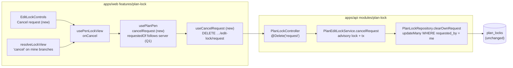
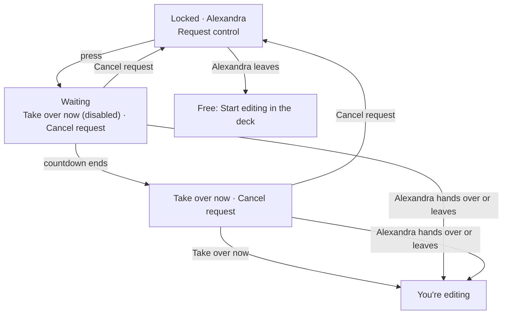

# Feature Spec: Cancel request

- **Status:** Draft, awaiting the product owner's approval. One question (Q1) needs an answer; every other choice below is a stated default.
- **Author(s):** feature-analyst (Claude Code), for the product owner
- **Date:** 2026-11-13
- **Tracking issue / epic:** `docs/TECH_DEBT.md` #588 ("A planner who asked for control cannot withdraw the request"), closed by this work
- **Roadmap link:** none; a follow-on to ADR-0220 D4, which names this gap as its cost
- **Related ADR(s):** ADR-0028 (the pen), ADR-0220 (amended by this work: a new D7, see §4.7), ADR-0081 (entry point and journey), ADR-0088 D1 (no flag), ADR-0135 (focus goes to the container), ADR-0114 / ADR-0187 / ADR-0219 (the foot row at 1024 × 600), ADR-0190 (what 1.0 promises)

---

## In plain English

**What happens today.** When a colleague is editing a plan, a Planner can press **Request control**. From then on
they cannot take the request back. If they leave that tab open and wander off, they start editing the plan the
next time they look at it, as soon as the colleague leaves.

**What I recommend.** A **Cancel request** button beside the waiting message. Pressing it withdraws the request
completely: the colleague's "{Name} is asking to edit this plan" prompt goes away (within about 15 seconds, on
their next automatic check), and the person who cancelled goes back to seeing **Request control**, exactly as
before they asked.

**What the person sees, step by step.**

1. Alexandra is editing. Ben opens the plan and sees `Locked · Alexandra` and **Request control**.
2. Ben presses **Request control**. He now sees a greyed-out **Take over now** with a short countdown, and a new
   **Cancel request** button beside it.
3. Ben presses **Cancel request**. The button goes, **Request control** comes back, and his screen reader says
   "Alexandra is editing this plan." Nothing will now hand Ben the plan without him asking again.
4. On Alexandra's screen, the "Ben is asking to edit this plan" prompt and its **Hand over** / **Keep editing**
   buttons disappear within about 15 seconds. She carries on editing; she is not told why.
5. If Ben waited past the countdown, he sees **Take over now** (now pressable) and **Cancel request** side by
   side. Cancel works the same there.
6. If Alexandra pressed **Hand over** at the very moment Ben pressed **Cancel request**, and hers arrived first,
   Ben is now editing. He sees "You're editing this plan." and **Stop editing**, which he can press to let go.

**One thing that needs your answer (Q1, §1).** While checking this I found that a reload makes the screen say
something untrue: after a reload Ben still reads "you will start editing when Alexandra hands over or leaves",
but if she simply leaves, he does not get the plan. I recommend fixing that in the same change, so the sentence
is true again.

---

## 1. Business understanding

### Problem

ADR-0220 D4 (2026-11-12) made a requester take the pen automatically when the holder lets go. That is what a
person who asked wants, but it gave them no way to stop asking. The ADR records the cost itself
(`docs/adr/0220-the-first-planner-to-open-a-free-plan-holds-the-pen.md:67-71`) and points at #588.

Verified in the code on 2026-11-13 (web 1.8.0, api 1.2.0, `apps/web/package.json:3`, `apps/api/package.json:3`):

- **The server keeps one request per plan and nothing withdraws it.** `request()` stamps `requestedByUserId` and
  `requestedAt` on the `PlanLock` row (`apps/api/src/modules/plan-lock/plan-lock.service.ts:192-227`, repository
  `stampRequest` at `plan-lock.repository.ts:143-154`, "newest request wins"). The fields are cleared only when the
  holder changes (`writeLeaseToHolder`, `plan-lock.repository.ts:73-82`) or the row is deleted on release
  (`remove`, `:160-172`). The controller has GET, POST, POST `heartbeat`, POST `request`, POST `handoff` and DELETE
  (`plan-lock.controller.ts:47-134`); none clears a request.
- **The browser keeps a second memory of the same request.** `requestControl` sets the tab-local `requestedOf` to
  the holder's id (`apps/web/src/features/plan-lock/api/use-plan-edit-lock.ts:343, 475-484`). While it is set, a
  `FREE`/`EXPIRED` read in a visible tab sends one acquire (`shouldTakeOnFree`, `lib/auto-acquire.ts:69-72`;
  effect at `use-plan-edit-lock.ts:375-391`).
- **The holder's Hand over needs no consent from the requester's tab.** `handoff()` writes the lease straight to
  `requestedByUserId` (`plan-lock.service.ts:253-264`).

**Re-verified finding 1: the two memories disagree after a reload, and the screen then says something false.**
After a reload `requestedOf` starts as `null` (`use-plan-edit-lock.ts:343`) while the server row still names the
requester. The view reads the server, so it still shows `waitingForHandover`, "Requested, you will start editing
when {Name} hands over or leaves" (`lib/lock-view.ts:248-259`, copy at `lib/lock-copy.ts:67-68`). The opening's one
decision was already spent on the `HELD_BY_OTHER` read (`use-plan-edit-lock.ts:372-374`; `shouldAutoAcquire`
needs `FREE`, `auto-acquire.ts:35`), and `shouldTakeOnFree` needs `iRequested`, which is false. So if the holder
**leaves**, the reloaded tab shows **Start editing** and does not take the pen; only a **Hand over** reaches it,
because that is a server write. Your reading was right.

**Re-verified finding 3 (not in the brief): the browser memory also outlives a request that was replaced.** If
Carol requests after Ben, the server row now names Carol (`stampRequest` overwrites). Ben's view drops to
**Request control** (the `mine` test fails, `lock-view.ts:249`), but Ben's `requestedOf` is only dropped when a
_different holder_ is seen or Ben holds the pen (`use-plan-edit-lock.ts:345-347`). So when Alexandra leaves, Ben's
tab can still take the pen, racing Carol, whose request is the one on record. Cancel cannot fix this on its own;
the rule in §4.2 (the browser follows the server's record) fixes both findings.

**Re-verified finding 4 (not in the brief): Org Admins never see Request control.** An Org Admin holds
`plan:request_control` (`apps/api/src/common/auth/org-permissions.ts:284`) but also `plan:override_lock` (`:287`),
and the view checks `canOverride` first (`lock-view.ts:229-238`), so an admin is always offered **Take over**,
never **Request control**. In the product, Cancel request is therefore a **Planner's** control. The route still
accepts an Org Admin, who can have a request only through a direct API call.

### Users

| Role                         | Needs                                                                                                |
| ---------------------------- | ---------------------------------------------------------------------------------------------------- |
| Planner (requester)          | To withdraw a request they no longer want, so the plan is not handed to them later.                  |
| Planner / Org Admin (holder) | The "is asking" prompt to go away when the request is withdrawn, rather than offer a dead Hand over. |
| Org Admin (requester)        | Only via the API (finding 4). The route serves them the same way.                                    |
| Contributor, Viewer, Guest   | Nothing. They cannot request, so they cannot cancel (403; a guest has no route here).                |

### Primary use cases

1. A Planner asked, changed their mind, and withdraws the request.
2. A Planner asked, waited past the countdown, and withdraws instead of taking over.

### User journeys

See the user flow in §4.3. Happy path: Request control, then Cancel request, then back to Request control, and the
holder's prompt clears on their next check.

### Expected outcomes

A request is something a person can take back. The waiting sentence stays true across a reload.

### Success criteria

- After Cancel request, the holder leaving the plan does **not** give the plan to the person who cancelled
  (journey-checked, not just unit-checked).
- After Cancel request, the holder's Hand over prompt is gone on their next status read (≤ 15 s poll,
  `use-plan-edit-lock.ts:22`).
- `computeSchedule` is untouched: this is not a scheduling input, so the recalc parity gate is not engaged.
- At 1024 × 600 every pen control in the foot row is fully on screen and pressable, with and without a selection
  bar docked.

### Open questions

**Q1 (critical, the owner's call): fix the reload gap in the same change?** Recommended **yes**. The browser
re-learns "I asked" from the server whenever the server says so, and forgets it whenever the server says the request
is gone or belongs to someone else (§4.2). Effect: a requester who reloads still starts editing when the holder
leaves, as the sentence promises. Alternative: leave the behaviour, and instead change the sentence after a reload
to "Requested, you will start editing if {Name} hands over", filing the gap as its own register row. I recommend
the fix because Cancel needs the same rule to be correct (findings 3 and §2 edge E4), so it costs almost nothing
extra.

Defaults I am proceeding on (overrule any of them if you disagree):

- **D-a.** Cancel request is offered both while waiting and after the countdown (the "Take over now" state), and
  only when the server says the request is the reader's own.
- **D-b.** If a Hand over beats the cancel, the person keeps the pen. Nothing gives it back automatically; **Stop
  editing** is one press away. Undoing a colleague's deliberate hand-over without anyone pressing anything would be
  worse than one press.
- **D-c.** The holder is not told the request was withdrawn. Their prompt simply disappears, which is the same
  thing that happens today when a request lapses with a release.
- **D-d.** No new error message. If a cancel fails (network), the screen stays as it was, with Cancel request still
  offered, so the person can press it again. This matches Request control and Hand over today, neither of which
  shows an error (`use-plan-edit-lock.ts:83-104`).
- **D-e.** No `VITE_` flag (ADR-0088 D1). Rollback is the commit boundary.

## 2. Functional requirements

### User stories & acceptance criteria

> **US-1**: As a Planner who requested control, I want to cancel my request, so that the plan is not handed to me
> later.
>
> - **Given** Alexandra holds the pen and I have requested it, **when** I look at the foot row, **then** I see
>   **Take over now** (disabled, with countdown) and **Cancel request**.
> - **When** I press **Cancel request**, **then** the server no longer records my request, the button is replaced
>   by **Request control**, focus lands on the pen area (not lost to the page), and the live region reads
>   "Alexandra is editing this plan."
> - **Given** I cancelled, **when** Alexandra stops editing, **then** I do not start editing; I see the free state
>   with **Start editing** in the deck.

> **US-2**: As a Planner past the countdown, I want Cancel request offered beside Take over now.
>
> - **Given** my request is past the grace window, **then** I see **Take over now** (enabled) and **Cancel
>   request**; the sentence says I can take over now or will start editing when Alexandra hands over or leaves.
> - **When** I press **Cancel request**, **then** I return to **Request control**, unless Alexandra has stopped
>   heartbeating, in which case **Take over now** stays on offer (that offer never depended on my request,
>   `plan-lock.policy.ts:81-92`) and Cancel request disappears.

> **US-3**: As the holder, I want a withdrawn request to stop asking me.
>
> - **Given** Ben's request is showing, **when** Ben cancels, **then** within my next status read (15 s poll, or
>   my 30 s heartbeat, which also refreshes the status, `use-plan-edit-lock.ts:147-153`) the prompt and its
>   **Hand over** / **Keep editing** buttons disappear and I read "You're editing this plan."
> - **Given** I press **Hand over** after Ben's cancel reached the server, **then** nothing is handed over (the
>   server answers 409, `plan-lock.service.ts:254-256`), the status refetches, and I keep editing. No error is shown.

> **US-4** (Q1): As a Planner who requested and then reloaded, I want the plan to come to me when the holder
> leaves, as the screen says.
>
> - **Given** my request is on the server and I reload, **when** the holder leaves, **then** my visible tab takes
>   the pen with one `{ takeover: false }` acquire.

### Workflows

Cancel: press **Cancel request**; the tab forgets the request at once (so a free read arriving meanwhile cannot hand
it the pen); the server clears the request if it is the caller's; the response status replaces the cached one; the
view re-renders from it.

### Edge cases (each with its outcome)

| #   | Situation                                                                             | Outcome                                                                                                                                                                                                                                                                                                                             |
| --- | ------------------------------------------------------------------------------------- | ----------------------------------------------------------------------------------------------------------------------------------------------------------------------------------------------------------------------------------------------------------------------------------------------------------------------------------- |
| E1  | Cancel and Hand over at the same moment, **Hand over first**                          | Both run under the plan advisory lock, so one wins outright. The hand-over clears the request and gives Ben the lease; Ben's cancel finds nothing of his and returns `HELD_BY_ME`. Ben sees "You're editing this plan." and **Stop editing** (D-b).                                                                                 |
| E2  | Same, **cancel first**                                                                | Request cleared. Alexandra's Hand over gets 409 "No one has requested control", the status refetches, her prompt clears; she keeps editing (US-3).                                                                                                                                                                                  |
| E3  | Someone else (Carol) has requested since                                              | The server row names Carol. Ben's cancel changes nothing (the write is conditional on Ben's id) and returns the status, which still shows Carol's request to the holder. Ben's view shows **Request control**; his tab has dropped its memory (§4.2). Never clears Carol's request.                                                 |
| E4  | Cancel after the countdown                                                            | As US-2.                                                                                                                                                                                                                                                                                                                            |
| E5  | The holder already left (plan free) when the cancel arrives                           | Nothing to clear (no row). Returns `FREE`. Because the tab forgot the request on the press, it does not grab the pen; Ben sees the free state and **Start editing**. If the tab's freed-pen acquire had already won before he pressed, the cancel returns `HELD_BY_ME`, same as E1.                                                 |
| E6  | Lease expired but the row is still there                                              | The request is cleared if it is Ben's (harmless; the status hides requests on non-live leases, `plan-lock.service.ts:381-384`). Returns `EXPIRED`.                                                                                                                                                                                  |
| E7  | Cancel pressed twice, or from two tabs                                                | Idempotent: the second finds nothing and returns 200 with the status.                                                                                                                                                                                                                                                               |
| E8  | Ben cancels in tab 1 while tab 2 of the same plan is open                             | Tab 2 forgets on its next `HELD_BY_OTHER` read (≤ 15 s while visible). **Residual:** if tab 2 is in the background, the holder leaves, and Ben then brings tab 2 forward, tab 2 can take the pen before it ever reads the cancellation. Accepted and recorded in ADR-0220 D7; fixing it needs cross-tab messaging.                  |
| E9  | Ben cancels, the holder had pressed **Keep editing** on Ben's request, Ben asks again | Today the holder's "Keep editing" hides that person's requests for the rest of the opening (`use-pen-lock-view.ts:84, 229-231`). Default: clear that dismissal when the holder's status shows no request, so a fresh ask after a cancel is seen. If both happen inside one 15 s poll, the holder may not see it; stated, not fixed. |
| E10 | Network failure                                                                       | D-d. The server still holds the request; the tab re-learns it on the next read (§4.2), so the screen tells the truth.                                                                                                                                                                                                               |
| E11 | Plan soft-deleted, or not in the caller's organisation                                | 404, as for `request()` (`plan-lock.service.ts:305-316`).                                                                                                                                                                                                                                                                           |

### Permissions

`plan:request_control` in the plan's organisation (Planner, Org Admin; `org-permissions.ts:284`), resolved from the
caller's memberships with the plan checked in scope (`resolvePlanOrg`, `plan-lock.service.ts:305-316`). The write is
conditional on `requestedByUserId = caller`, so a caller can only ever clear their own request. **Not structural**:
it does not need the pen (the caller by definition does not hold it) and does not touch plan content.

### Validation rules

No body, no query. `planId` is `ParseUUIDPipe` as on every sibling route.

### Error scenarios

| Scenario                  | Detection                 | User-facing result                       | Status |
| ------------------------- | ------------------------- | ---------------------------------------- | ------ |
| No session                | auth guard                | sign-in                                  | 401    |
| Contributor / Viewer      | `assertCan`               | not reachable from the UI                | 403    |
| Plan not in org / deleted | `resolvePlanOrg`          | not reachable from the UI                | 404    |
| Nothing of mine to cancel | conditional write count 0 | status returned; view follows it         | 200    |
| Network / 5xx             | mutation error            | screen unchanged, button pressable (D-d) | n/a    |

## 3. Technical analysis

| Area           | Impact | Notes                                                                                                                                                                                                                             |
| -------------- | ------ | --------------------------------------------------------------------------------------------------------------------------------------------------------------------------------------------------------------------------------- |
| Frontend       | low    | One `LockAction`, one button, one mutation, the memory rule in `usePlanPen`, one copy line, the holder's dismissal reset.                                                                                                         |
| Backend        | low    | One service method, one repository method, one controller route.                                                                                                                                                                  |
| Database       | none   | `requested_by_user_id` / `requested_at` are already nullable (`apps/api/prisma/schema.prisma:3092-3094`). **No schema change**, so no database-architect run. Lookups are by the primary key `plan_id`.                           |
| API            | low    | Additive route `DELETE …/edit-lock/request`. `PlanEditLockStatus` unchanged; `packages/types` untouched.                                                                                                                          |
| Security       | low    | Deny-by-default permission, org scope, plan 404, write conditional on caller id. security-reviewer on M1.                                                                                                                         |
| Performance    | low    | One short transaction under the plan advisory lock, at most three queries, same cost as `request()`. Nothing on a hot path.                                                                                                       |
| Infrastructure | none   | No env, no service, no CI change.                                                                                                                                                                                                 |
| Observability  | low    | Log line `plan_edit_lock.request_cancelled` via the existing `audit()` helper (`plan-lock.service.ts:411-428`), only when a request was actually cleared, with `holder`. A log line like its siblings, not an `audit_events` row. |
| Testing        | med    | Service unit, Supertest e2e, web unit (view, hook, controls, partition), one two-actor Playwright journey, a 1024 × 600 check.                                                                                                    |

### Dependencies

None to land first. ADR-0220 (web 1.8.0) is shipped.

**Mounted surfaces, verified.** Only one pen cluster is mounted in the product: `PenStatusCluster` with
`only={HANDOFF_ACTIONS}`, portalled into the foot row from `plan-workspace-toolbar.tsx:2626-2632`, fed by the one
`usePenLockView` call at `:838`. Start/Stop is the deck's `PlanPenControl` (`tsld-toolbar-items.tsx:3172`).
`CompactPenStatus` (the self-resolving wrapper) and `EditLockBanner` are exported but rendered only by their tests.
All three render buttons through `EditLockControls`, so one new branch there serves every surface. The structural
partition test (`lib/action-partition.structural.test.ts`) will refuse a new action that is in neither
`HANDOFF_ACTIONS` nor the pen verbs, which is the guard that it reaches the foot row.

## 4. Solution design

### 4.1 Architecture overview



### 4.2 The browser follows the server's record (Q1)

Today the tab's `requestedOf` is set only by its own press. The rule becomes:

- **Adopt.** On any `HELD_BY_OTHER` read whose `requestedBy.id` is the signed-in user, `requestedOf` = that
  holder's id (and the freed-pen guard is re-armed). This is the reload fix.
- **Drop.** On any `HELD_BY_OTHER` read whose `requestedBy` is someone else or nobody, `requestedOf` = null. This
  fixes finding 3 and carries a cancel from a sibling tab.
- **Kept as today.** Dropped when this tab holds the pen or sees a different holder (`use-plan-edit-lock.ts:345-347`);
  the tab still remembers through the moment of release, when the server row (and its request) is deleted, which
  is the one thing only the tab can remember (ADR-0220 D4).
- **Cancel** clears `requestedOf` on the press, and adoption is suspended while the cancel is in flight, so a read
  that left the server before the cancel cannot re-arm it.

`usePlanPen` needs the signed-in user's id for this. It is already in scope one line above the call
(`use-plan-workspace-model.ts:261-263`), so it becomes a third argument; the status shape does not change.

### 4.3 Data flow (including the hand-over race)

```mermaid
sequenceDiagram
  participant B as Ben's tab (requester)
  participant API as API (advisory lock per plan)
  participant A as Alexandra's tab (holder)
  B->>B: press Cancel request: forget request, suspend adopt
  B->>API: DELETE …/edit-lock/request
  alt cancel lands first
    API->>API: clear request WHERE requested_by = Ben (1 row)
    API-->>B: 200 status HELD_BY_OTHER, requestedBy null
    B->>B: view: "Alexandra is editing", Request control
    A->>API: GET status (poll ≤ 15 s)
    API-->>A: requestedBy null, prompt clears
    opt Alexandra presses Hand over late
      A->>API: POST …/handoff
      API-->>A: 409 no one has requested; refetch; keeps editing
    end
  else Hand over lands first
    A->>API: POST …/handoff (lease to Ben, request cleared)
    API-->>A: HELD_BY_OTHER (Ben)
    API->>API: cancel: 0 rows of Ben's to clear
    API-->>B: 200 status HELD_BY_ME
    B->>B: "You're editing this plan.", Stop editing; heartbeat starts
  end
```

### 4.4 User flow



### 4.5 API changes

`DELETE /api/v1/organizations/:orgSlug/plans/:planId/edit-lock/request`

- **Why DELETE on `…/request`:** the request is a sub-resource the caller created with `POST …/request`; deleting
  it is the plain REST reading, and it sits beside the lease's own `DELETE …/edit-lock`.
- **Why 200 with `PlanEditLockStatus`, not 204:** docs/API.md's "can the caller derive it?" test
  (`docs/API.md:181-186`, applied to a DELETE at `:2254-2261`). The caller cannot: the outcome may be "you now hold
  the pen" (E1) or "someone else's request stands" (E3), and the tab must not guess. It also matches `request` and
  `handoff`, which both return the status.
- **Idempotent:** always 200 when authorised and in scope, whether or not anything was cleared.
- **OpenAPI:** `@ApiOperation`, `@ApiOkResponse({ type: PlanEditLockStatusDto })`; the controller's class-level 401
  / 403 / 404 decorators already apply (`plan-lock.controller.ts:40-42`). No 423 or 409 is possible.
- **docs/API.md:** one table row under "Plan edit-lock" (`:247-254`) and the permission sentence (`:243-245`).
- **ADR-0190 / `docs/RELEASE_1_0.md:104-107`:** additive, no existing shape changes, so **api minor**; no promise is
  broken.

### 4.6 Component changes

- `lib/lock-view.ts`: new `LockAction` `'cancel'`. The `mine` branch (`:249-259`) becomes `['waiting', 'cancel']`.
  The `canTakeOver` branch (`:239-247`) gains a `mine` test: when `requestedBy.id` is the reader, actions
  `['takeover', 'cancel']` and the message `lockCopy.canTakeOverRequested(holder)`.
- `lib/lock-copy.ts`: `cancelRequest: 'Cancel request'`; `canTakeOverRequested`: "You can take over editing from
  {Name} now, or you will start editing when they hand over or leave." The existing waiting sentence is unchanged.
- `components/EditLockControls.tsx`: one `Button size="sm" variant="ghost"` after Take over now, disabled while
  pending, like its neighbours. No new styling.
- `components/CompactPenStatus.tsx`: `'cancel'` added to `HANDOFF_ACTIONS`.
- `lib/use-pen-lock-view.ts`: `onCancel: act(cancelRequest)`; reset `dismissedRequestId` when the status carries no
  request (E9).
- **Focus.** Pressing Cancel removes the pressed button, so the existing own-action restore moves focus to the
  cluster container (`use-pen-lock-view.ts:146-152`), which is described by the sentence region. Default extension:
  when the button is removed by **someone else's** act (Alexandra hands over while Ben's focus is on Cancel request),
  the same container takes focus, detected by containment as ADR-0135 D2/D3 do for the toolbars. Today's waiting
  state has no focusable control at all (its Take over now is disabled), so this is the first time that case can
  happen there.
- **Announcement.** Unchanged mechanism: the cluster's `role="status"` region is the single announcer
  (`use-plan-edit-lock.ts:280-283`; `CompactPenStatus.tsx:197-246`). Cancel produces one polite change, from the
  waiting sentence to "{Name} is editing this plan."
- **Foot row at 1024 × 600.** The waiting state is a `locked` tone, whose badge stays painted when a selection bar
  is docked (ADR-0219 D1), so this state is the tightest: badge, disabled Take over now, and the new button. The
  plan carries a journey check, with no pixel figures.

### 4.7 Implementation approach, alternatives, and the ADR

**Chosen:** a server withdrawal plus a browser memory that follows the server. Server first (ships dark), then the
button.

**ADR: amend ADR-0220 with a D7, no new ADR.** The lock model, its permissions and its state machine are
unchanged; this adds one verb ADR-0220 D4 already said was owed, and corrects D4's memory rule (Q1). D7 records:
the route and its 200, the adopt/drop rule, D-b, and the sibling-tab residual (E8). The §16 line for ADR-0220 in
CLAUDE.md gains "D7 added for #588" (the form ADR-0208's line already uses), so the ADR count and the stage banner
do not change. A new ADR would be the right call only if the request model changed (for example, a queue of
requesters, or a per-tab lease), which it does not.

**Alternatives considered**

- **Browser-only cancel** (clear `requestedOf` and nothing else). Rejected: the holder keeps seeing the prompt, and
  a Hand over still gives the pen to someone who withdrew.
- **POST `…/request/cancel`.** Workable, but a verb in the path where the resource already exists; rejected for REST
  shape.
- **Return 204.** Rejected by the API.md test above (E1, E3).
- **Give the pen back automatically when a Hand over beat the cancel.** Rejected (D-b): it would silently reverse a
  colleague's deliberate act.
- **Tell the holder "Ben withdrew".** Rejected for now (D-c): a new transient message type for little value.

## 5. Links

- Implementation plan: [`./implementation-plan.md`](./implementation-plan.md)
- Docs this change updates: `docs/API.md`, `docs/adr/0220-the-first-planner-to-open-a-free-plan-holds-the-pen.md`
  (D4 cost paragraph, new D7), `CLAUDE.md` §16 (the ADR-0220 line), `docs/TECH_DEBT.md` #588 (closed)
