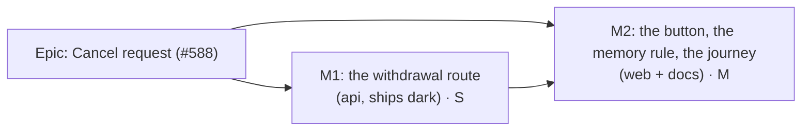

# Implementation Plan: Cancel request

- **Feature spec:** [`./feature-spec.md`](./feature-spec.md)
- **Status:** Draft, awaiting the product owner's approval (Q1 in the spec).
- **Owner:** product owner (approval); builder agent (implementation)

## Breakdown

### Epic

**Cancel request** closes `docs/TECH_DEBT.md` #588 and the cost ADR-0220 D4 recorded. No schema change, no flag
(ADR-0088 D1), no `packages/types` change.

---

### Milestone M1: the withdrawal route (shippable slice, api minor)

**Outcome:** `DELETE …/edit-lock/request` withdraws the caller's own request and returns the status.
**Entry point:** `Ships dark: no screen calls the route until M2 adds Cancel request.`
**Journey:** none in M1 (no user-facing capability); M2 carries it.

#### Feature: withdraw a request on the server

> **Description:** service method, repository method, controller route, docs.
> **Complexity:** S
> **Dependencies:** none
> **Risks:** clearing someone else's request → the write is conditional on the caller's id, and a test proves a
> later requester's record survives. A cancel interleaving with Hand over → same advisory lock as `request()` and
> `handoff()` (`plan-lock.service.ts:204-205, 242-243`); a test runs both orders.
> **Testing requirements:** service unit, Supertest e2e, `scripts/e2e-local.sh api`.

##### Task M1-T1: repository and service

- **Description:** `PlanLockRepository.clearOwnRequest(tx, { planId, organizationId, requesterId })`, an
  `updateMany` WHERE `planId`, `organizationId`, `requestedByUserId = requesterId`, setting both request fields to
  null, returning the count. `PlanEditLockService.cancelRequest(principal, orgSlug, planId)`: `resolvePlanOrg` with
  `plan:request_control`, then a transaction with `acquirePlanWriteLock`, the conditional clear, `audit('request_cancelled', …, { holder })` only when the count is 1, a re-read, and `buildStatus`.
- **Complexity:** S
- **Dependencies:** none
- **Risks:** forgetting the org scope in the WHERE → copy `stampRequest`'s shape (`plan-lock.repository.ts:144-154`).
- **Testing:** `plan-lock.service.spec.ts`: clears own request (log line emitted once, with holder); no-op when
  no row, when no request, when the request is another user's (that record unchanged, no log); expired row with my
  request is cleared and returns `EXPIRED`; 403 for a principal without `plan:request_control`; 404 out of scope.
  No policy change, so `plan-lock.policy.spec.ts` is untouched.
- **Development steps:**
  1. Repository method with a docblock in the file's style.
  2. Service method beside `request()`.
  3. Unit tests above.

##### Task M1-T2: route, OpenAPI, Supertest, docs

- **Description:** `@Delete('request')`, `@HttpCode(HttpStatus.OK)`, `@ApiOperation` ("Withdraw your own pending
  request-control (Planner or Org Admin)."), `@ApiOkResponse({ type: PlanEditLockStatusDto, description: 'Idempotent; clears only the caller\'s own request.' })`. Update the controller docblock's permission list.
- **Complexity:** S
- **Dependencies:** M1-T1
- **Risks:** Nest route order between `@Delete()` and `@Delete('request')` → distinct paths; the e2e proves the lease
  is not released by the new route.
- **Testing:** `apps/api/test/plan-lock.e2e-spec.ts`, against real Postgres: two users; B requests, B cancels → 200,
  A's GET shows `requestedBy: null`, A's handoff → 409, the lease is still A's (proves it is not the release route);
  B cancels again → 200 (idempotent); C requests after B, B cancels → C's request stands; Hand over then cancel →
  B's response is `HELD_BY_ME`; Viewer and Contributor → 403; another org → 404; no session → 401. Run
  `scripts/e2e-local.sh api`.
- **Development steps:**
  1. Controller route.
  2. Supertest cases.
  3. `docs/API.md`: table row and permission sentence (`:243-254`).
  4. Changeset: `api` minor ("Withdraw a pending request for control of a plan").
  5. `pnpm prepush` and `scripts/e2e-local.sh api`.

**Reviewers for M1:** security-reviewer (scope, conditional write), api-reviewer (verb, 200 vs 204, OpenAPI).
backend-performance-reviewer is optional (one short transaction, same as `request()`).

---

### Milestone M2: the button, the memory rule, and the journey (web minor)

**Outcome:** a Planner who requested control can press **Cancel request** in the foot row, while waiting and after
the countdown; the holder's prompt clears on their next read; a reloaded requester's tab behaves as the sentence says
(Q1).
**Entry point:** plan workspace foot row, the pen cluster: button **Cancel request**, shown when the server says the
pending request is the reader's own.
**Journey:** `apps/web/e2e-edit/pen-handoff.spec.ts` (new test, two actors via `setUpTwoActors`) presses Request
control, then Cancel request, and proves the holder leaving does not give the plan to the canceller.

#### Feature: Cancel request in the pen cluster

> **Description:** view, copy, control, hook, memory rule, focus, dismissal reset, journey, docs.
> **Complexity:** M
> **Dependencies:** M1 merged (the route must exist for the journey)
> **Risks:** see the rollup; the main ones are the adopt rule re-arming during a cancel, and the foot row at 1024 × 600.
> **Testing requirements:** web unit (view, hook, controls, partition, focus), Playwright two-actor journey, 1024 ×
> 600 check, wider suites one at a time, accessibility review in a browser before release.

##### Task M2-T1: view, copy and control

- **Description:** `'cancel'` in `LockAction`; `['waiting', 'cancel']` on the `mine` branch; a `mine` test inside
  the `canTakeOver` branch giving `['takeover', 'cancel']` and `canTakeOverRequested`; copy `cancelRequest`;
  `EditLockControls` branch (ghost `Button`, `disabled={isPending}`, `aria-busy`); `onCancel` prop; `'cancel'` in
  `HANDOFF_ACTIONS`; `onCancel: act(cancelRequest)` in `usePenLockView`.
- **Complexity:** S
- **Dependencies:** none (pure web; can be written against the M1 contract)
- **Risks:** an Org Admin wrongly offered Cancel → the `canOverride` branch stays first and a test pins it.
- **Testing:** `lock-view.test.ts` (waiting mine, take-over mine, take-over not mine with holder inactive has no
  cancel, admin override has no cancel, request by someone else has no cancel); `lock-copy.test.ts`;
  `EditLockControls.test.tsx` (renders, calls `onCancel`, disabled while pending); `action-partition.structural.test.ts`
  passes with `'cancel'` in `HANDOFF_ACTIONS`; `EditLockBanner.a11y.test.tsx` and `CompactPenStatus.test.tsx` gain the
  waiting-with-cancel state.

##### Task M2-T2: the hook (cancel, and the memory follows the server)

- **Description:** `useCancelRequest` (DELETE `…/edit-lock/request`, `setQueryData` on success, invalidate on
  settle, as `useRequestControl` does); `cancelRequest` in `PlanPen`; `cancel.isPending` in `isPending`;
  `usePlanPen(orgSlug, planId, currentUserId)` with the adopt and drop rules of spec §4.2, the freed-pen guard re-armed
  on adopt, and adoption suspended while a cancel is in flight. Call site `use-plan-workspace-model.ts:263`.
- **Complexity:** M
- **Dependencies:** M2-T1
- **Risks:** a stale poll re-arming the memory during a cancel → the suspend flag plus TanStack's cancel-on-invalidate;
  a test feeds a `requestedBy: me` read while the cancel is pending and asserts no acquire follows a `FREE` read.
  Changing `usePlanPen`'s signature → one production caller; tests updated.
- **Testing:** `use-plan-edit-lock.test.ts`: cancel sends DELETE and clears the memory, so a later `FREE` read sends
  no acquire; reload case (fresh mount, `HELD_BY_OTHER` with `requestedBy: me`, then `FREE`) sends exactly one
  `{ takeover: false }` (Q1); another requester replaces mine, then `FREE` sends nothing (finding 3); a sibling-tab
  cancel (`requestedBy: null` read) drops the memory; cancel answered `HELD_BY_ME` leaves the tab holding, heartbeat
  running; `auto-acquire.test.ts` unchanged (the pure rule does not change, only what feeds `iRequested`).

##### Task M2-T3: focus and the holder's dismissal

- **Description:** in `usePenLockView`, restore focus to the container when a control inside it is removed by
  someone else's act, detected by containment (ADR-0135 D2/D3 pattern), in addition to today's own-action case; reset
  `dismissedRequestId` when the status carries no request (spec E9).
- **Complexity:** S
- **Dependencies:** M2-T1
- **Risks:** stealing focus from elsewhere → acts only when focus is on `<body>` or detached **and** the last focused
  element was inside the container, the same guard the existing effect uses (`use-pen-lock-view.ts:146-152`).
- **Testing:** unit cases: focus on Cancel request, status flips to `HELD_BY_ME` from outside → focus on the container;
  focus elsewhere in the workspace → untouched; holder dismissed Ben, status shows no request, Ben asks again → prompt
  shown. `use-pen-lock-view.stability.test.tsx` still passes (no new per-tick churn).

##### Task M2-T4: journey, foot-row check, docs, close #588

- **Description and testing:**
  1. **Journey** in `e2e-edit/pen-handoff.spec.ts`, two real users (`setUpTwoActors`, `refetchLock`, `holdThePen`
     from `e2e-support/pen.ts`): A holds; B presses **Request control**; B sees **Cancel request**; A sees "B… is
     asking"; B presses **Cancel request**; B sees **Request control** and focus is not on `<body>`; after
     `refetchLock(a)` A sees no **Hand over**; A presses **Stop editing**; after `refetchLock(b)` B shows **Start
     editing** and the API reads the plan as free (B did not take it). Second test: B requests, **reloads**, A stops,
     B ends holding the pen (Q1). Assertions are roles, accessible names, exact sentences and API reads; no pixels, no
     sleeps.
  2. **1024 × 600 check:** in the same file, B's page at 1024 × 600 in the waiting state and in the take-over state,
     once with no selection and once with an activity selected so the selection bar docks (ADR-0219): **Cancel
     request**, **Take over now** and the `Locked · …` badge are each `toBeInViewport()` with ratio 1 and pass a trial
     click (`click({ trial: true })`). No pixel figures.
  3. **Wider suites, one at a time** (the foot row changed): `scripts/e2e-local.sh web:edit`, then `web:workspace-fit`,
     then `web:workspace-chrome`, then `web:minimap` (`docs/HANDOFF.md:201`), then the base `web`.
  4. **Docs:** ADR-0220 gains D7 and its D4 cost paragraph points to it; CLAUDE.md §16's ADR-0220 line becomes
     "(Accepted; amends ADR-0028; D7 added for #588)" (no new ADR, so no count change; run `pnpm check:counts` and
     `pnpm check:adr-coverage` via `pnpm prepush`); `docs/TECH_DEBT.md` #588 closed with the merge reference;
     `docs/TEST_PLAYBOOK.md` only if `pnpm check:playbook` asks.
  5. **Changeset:** `web` minor ("Cancel a request for control of a plan").
- **Complexity:** S to M (the two-actor fixture is slow; set the 120 s timeout its neighbours use, `pen-handoff.spec.ts:32`)
- **Dependencies:** M1 merged, M2-T1 to T3

**Reviewers for M2:** accessibility-reviewer **in a real browser, before release** (a new control in a live-region
cluster, plus a focus-return change; CLAUDE.md §19.13 and the owner's standing rule), component-reviewer
(`EditLockControls` contract, `HANDOFF_ACTIONS`), ux-reviewer (copy, D-b, D-c), test-engineer on the journey.

## Sequencing & slices

1. **M1** (one PR): route only, ships dark, `main` stays releasable, api minor.
2. **M2** (one PR, after M1 is merged and released or at least merged): the user-facing change, web minor. If Q1 is
   answered "no", M2-T2 drops the adopt rule and instead changes the waiting sentence after a reload, and the
   reload test in M2-T4 is replaced by a register row.

No flag (ADR-0088 D1); rollback is reverting M2's commit, which leaves M1's route harmless and unused.

## Definition of Done (per task)

Each PR meets the Feature Completion Criteria in [`docs/PROCESS.md`](../../PROCESS.md): code, tests, docs, security,
performance, accessibility, Docker build, CI green (read per CLAUDE.md §19.9), changeset, version impact. "Tests"
means `pnpm prepush` was run, plus `scripts/e2e-local.sh api` for M1 and the suites listed in M2-T4 for M2.

## Risks & assumptions (rollup)

| Risk / assumption                                                                         | Likelihood | Impact | Mitigation                                                                                                        |
| ----------------------------------------------------------------------------------------- | ---------- | ------ | ----------------------------------------------------------------------------------------------------------------- |
| A cancel clears another person's request                                                  | low        | high   | Conditional write on caller id; unit and Supertest cases with a later requester.                                  |
| A read in flight re-arms the memory during a cancel, and the tab takes a freed pen        | med        | high   | Memory cleared on press, adoption suspended while pending, invalidate cancels in-flight reads; unit test.         |
| Hand over beats the cancel and the person is surprised to be editing                      | low        | low    | D-b: the screen says "You're editing this plan." with Stop editing; journey-free, unit-tested.                    |
| A background sibling tab takes a freed pen after a cancel elsewhere (E8)                  | low        | med    | Accepted residual, recorded in ADR-0220 D7; cross-tab messaging is the fix if it is ever reported.                |
| Q1's adopt rule hands the plan to a reloaded requester who forgot (same as before reload) | low        | low    | That is ADR-0220 D4's intended behaviour; Cancel request is now the remedy.                                       |
| The foot row at 1024 × 600 cuts off a button                                              | med        | med    | Journey check in both states with and without a docked selection bar; wider suites run one at a time.             |
| A failed cancel is silent (D-d)                                                           | low        | med    | Screen stays truthful (re-adopts from the server); ux-reviewer may ask for a message, which would be a follow-on. |
| Holder's prompt lingers up to 15 s after a cancel                                         | high       | low    | Stated in the spec; a late Hand over gets a harmless 409 and refetch.                                             |
| A demoted requester (Planner to Contributor) cannot cancel (403) yet their request stands | low        | low    | Pre-existing: their request can already be honoured by Hand over today. Noted, not in scope.                      |
