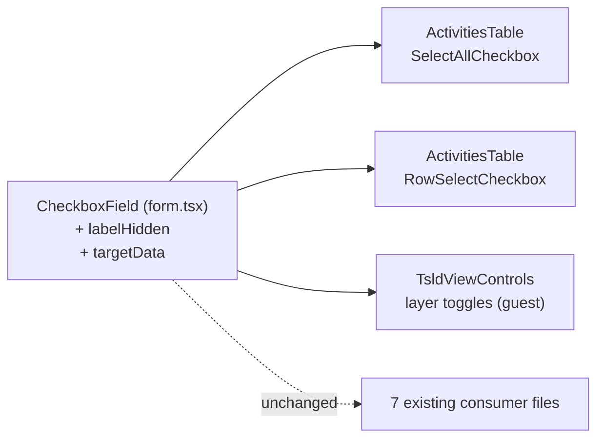

# Feature Spec: `CheckboxField` adoption — closing `docs/TECH_DEBT.md` #72

- **Status:** Approved — by the product owner, 2026-10-21, with all defaults
- **Author(s):** feature-analyst (Claude Code), for James Ewbank
- **Date:** 2026-10-21 (base `46edeb56`)
- **Tracking issue / epic:** `docs/TECH_DEBT.md` #72 ("The bulk-selection checkboxes are hand-rolled")
- **Related ADR(s):** ADR-0105 (why a spec: a primitive's public contract widens), ADR-0083 (the
  gate), ADR-0118 / ADR-0183 / ADR-0188 (control height, coarse growth), ADR-0088 D1 (no flag),
  ADR-0111 (not triggered — §3). **No new ADR**: an additive prop on an existing primitive, same
  precedent as ADR-0055's `density="compact"`.

## 1. Business understanding

Re-verified against the tree, not the row (§19.11). Row #72 says **five** call sites hand-roll the
checkbox shape. `grep 'type="checkbox"'` over `apps/web/src` (non-test) finds **three**:

| #   | Call site                                                                      | What it is                                          |
| --- | ------------------------------------------------------------------------------ | --------------------------------------------------- |
| 1   | `features/activities/components/ActivitiesTable.tsx:139-151` (`input` at :145) | select-all, `aria-label`, 24 px label, 44 px coarse |
| 2   | `features/activities/components/ActivitiesTable.tsx:197-208` (`input` at :202) | per-row select, same shape                          |
| 3   | `features/tsld/components/TsldViewControls.tsx:111-119` (`input` at :113)      | layer toggles, visible label                        |

The other two the row counted are **gone or not checkboxes**: the toolbar registry's view toggles
already render `CheckboxField density="compact"` (`tsld/toolbar/tsld-toolbar-items.tsx:2324`), and
the only remaining hand-rolled inputs there are **radios** (`:2221-2226` zoom, `:2311-2316` colour-by)
— a different primitive question, out of scope. The row's "trailing row content" gap is **also
already closed**: `label` became `React.ReactNode` in the wbs-nest-from-members work
(`components/ui/form.tsx:252-257`), used by `ActivityMembersPanel.tsx:374-399`.

So one real gap remains: `CheckboxField` cannot render a **visually-hidden label** inside a centred
24 px (44 px coarse) hit box, which is what the selection column needs. The target-size half of #72
closed 2026-09-01 and is pinned in `e2e-wbs/wbs.spec.ts:87-101`.

**Users:** Planner / Org Admin (selection column; Contributor/Viewer see it read-only as today) and
External Guest (`TsldViewControls` renders only in the non-chromeless `TsldPanel`, whose sole
production host is `features/share/components/GuestPlanView.tsx:266`). **Outcome:** no visible or
behavioural change; one primitive owns the checkbox chrome, the 2.5.8 floor and the ADR-0083 gate.

## 2. Functional requirements

- **FR-1** `CheckboxField` accepts `labelHidden?: boolean`. When true the label text is rendered in
  an `sr-only` span (accessible name unchanged, never via `aria-label`), and the `<label>` becomes
  the centred hit box `flex size-6 cursor-pointer items-center justify-center
pointer-coarse:size-(--control-h)` — exactly today's `ActivitiesTable.tsx:141`.
- **FR-2** `CheckboxField` accepts `targetData?: Record<\`data-${string}\`, string>`, spread on the
`<label>`only. Data attributes, never`className`— no one-off styling route (DESIGN_SYSTEM).
It carries`data-row-select`, the hook `e2e-workspace-fit/command-surface.spec.ts:2776` measures.
- **FR-3** Both `ActivitiesTable` boxes move to `CheckboxField labelHidden` with labels
  `"Select all activities"` / `` `Select ${name}` `` (identical names); the select-all keeps its
  `indeterminate` effect through the forwarded ref.
- **FR-4** `TsldViewControls` toggles move to `CheckboxField density="compact"`.
- **FR-5** Default `CheckboxField` output (no new props) is **byte-identical DOM** — the 7 existing
  consumer files (10 call sites: `ImportScheduleDialog`, `AssignmentRow`, `ActivityResourcesPanel`,
  `ActivityPlacementFields`, `gantt-columns-group`, `ActivityMembersPanel`, `tsld-toolbar-items`)
  do not move.

**Acceptance criteria.** Given the WBS fixture, every `/^Select /` checkbox's label measures ≥ 24×24
(fine) and the `[data-row-select]` sweep stays at `--control-h` (coarse). Given a screen reader, each
box's name is unchanged. Given keyboard, Tab order and Space are unchanged.

**Edge cases.** `labelHidden` with a shut gate: the lock icon is not drawn (it cannot fit 24 px);
`aria-disabled`, the click guard and the `aria-describedby` reason still apply, and an own reason
still renders below. No current hidden-label caller is gated. `labelHidden` + `hint`/`error`: render
below as today. **Permissions / validation / API / data:** none change.

## 3. Technical analysis

- **Frontend only.** No API, schema, migration, recalc input or pen-gated write — `computeSchedule`
  is untouched, so the parity gate holds trivially; selection is client state.
- **Keyboard (ADR-0111):** not changed — still one native `<input type="checkbox">`, same tab stop,
  Space toggles, no new key handling. Review still runs (task brief; primitive contract).
- **Accessible name source** moves from `aria-label` to label text content. The computed name is the
  same string; `wbs.spec.ts:91`'s diagnostic reads `getAttribute('aria-label')` and will print `?` —
  only the failure message, updated in M1.
- **Control height (ADR-0118/0183/0188):** hidden mode copies the existing 24/44 rule verbatim;
  default mode keeps `min-h-6 py-1` and is not given coarse growth here (unchanged behaviour; a
  separate ADR-0183 question). `TsldViewControls` gap goes 6 px → 8 px (`gap-1.5` → `gap-2`), the
  only pixel delta — accepted as convergence, not regression.
- **Flag:** none (ADR-0088 D1). Rollback is the commit boundary. **Entry point:** existing (Activities
  panel selection column; guest view controls) — no new capability, so ADR-0081 is satisfied by the
  existing journeys below.

### "Make the table row itself the hit target" — out of scope (decision)

Not trivial, so out, per the brief's default. (a) WCAG need is already met at 24/44 px. (b) A row
holds other targets — the name, cells, the `⋯` menu — so row-click-to-select needs a new interaction
contract (what a click on a cell means, drag-to-select text, modifier keys) that ADR-0080's plural
selection would have to own. (c) A `<tr>` click has no keyboard twin, so it would add a pointer-only
path — an ADR-0111 trigger by itself. Recorded in the #72 close-out as declined, not re-filed.

## 4. Solution design

**Alternatives.** (1) A sibling `Checkbox` primitive — rejected: it would duplicate
`resolveFieldGate`/`mergeDescribedBy` and split the 2.5.8 floor across two owners, the exact drift
#72 records. (2) `labelProps` passthrough — rejected: admits `className`, i.e. one-off styling.
(3) Leave the table hand-rolled and close #72 as "accepted" — rejected: the row's remedy is cheap now
that the ReactNode-label half has landed.

## 5. Open questions

None that are the owner's. Defaults: row-as-hit-target declined (§3); radios out of scope; `web`
patch changeset; no ADR; no flag.
