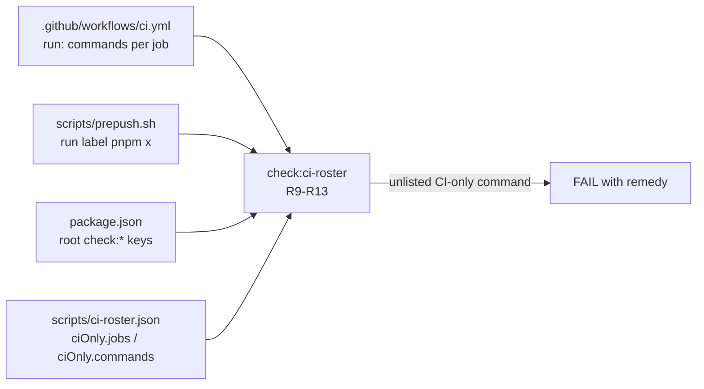

# Feature Spec: Every command CI runs is one `pnpm prepush` runs, or says why not (`docs/TECH_DEBT.md` #299)

- **Status:** Approved — by the product owner, 2026-10-22, with all defaults
- **Author(s):** Claude (feature-analyst, for the product owner)
- **Date:** 2026-10-21
- **Tracking issue / epic:** `docs/TECH_DEBT.md` #299 (`:8131`) — repository tooling, one milestone
- **Roadmap link:** none (a tooling change a planner cannot act on; ADR-0136 precedent)
- **Related ADR(s):** ADR-0160 (whose rule this makes computed), ADR-0136, ADR-0105, ADR-0124,
  ADR-0110, ADR-0076

This changes `check:ci-roster`, a shared gate, which is an ADR-0105 trigger however small. No
product surface, schema, API, role, pen or flag.

## 0. Evidence (read at base `9dfb5e7`; nothing here was run)

- **E1** `check:ci-roster` asserts one direction only: every root `check:*` runs in CI or is exempt
  (R1, `scripts/check-ci-roster.mjs:213-226`), plus R2–R4a about stale names and advisory gates
  (`:228-280`). Nothing compares a CI command against what `prepush` runs.
- **E2** `prepush` runs three fixed stages, `run "lint" pnpm lint`, `run "typecheck" pnpm typecheck`,
  `run "test" pnpm test` (`scripts/prepush.sh:181-183`), then `pnpm <key>` for every root `check:*`
  key, derived from `package.json` (`:190-200`).
- **E3** Both CI-only commands found so far were found by a red pull request after `prepush` passed:
  the web bundle budget (ADR-0160) and `format:check` (`docs/specs/prepush-format-gate/`, E1). Row
  `TECH_DEBT.md:8141-8145`.
- **E4** **Why it was not built.** ADR-0160's spec put the converse rule to the owner as CQ-2 with
  the default "this instance only" (`docs/specs/prepush-bundle-gate/feature-spec.md:123-127`), and
  the row records it as declined, with trigger "a third CI-only command found the same way, **or a
  decision to build it**" (`TECH_DEBT.md:8147-8149`). The owner's instruction of 2026-10-21, "fix
  them all unless there is a valid reason not to", is that decision — **CQ-1 asks the owner to
  confirm it**, because it reverses an answer they gave.
- **E5** `ci.yml` has four jobs: `quality` (`:21`), `e2e-api` (`:289`), `e2e-web` (`:417`), `image`
  (`:1214`). Only `quality` needs no database, browser or Docker.
- **E6** `quality` runs **28** `run:` commands, every one single-line, none chained with `&&`
  (`grep -n 'run:' .github/workflows/ci.yml`, lines 44–287). Classified:
  - **Prepush fixed stage (3):** `pnpm lint` `:55`, `pnpm typecheck` `:58`, `pnpm test` `:266`.
  - **Prepush-derived root gate (21):** `pnpm check:` + `format` `:52`, `doc-links` `:65`,
    `doc-register` `:73`, `debt-status` `:81`, `spec-status` `:92`, `playbook` `:100`,
    `build-contract` `:108`, `surface-contract` `:116`, `counts` `:124`, `flags` `:132`,
    `frontend-only` `:150`, `engine-parity` `:159`, `claims` `:169`, `advisory-agreement` `:179`,
    `ci-roster` `:194`, `e2e-roster` `:211`, `adr-coverage` `:225`, `licenses` `:239`, `nginx`
    `:249`, `browser-safe` `:263`, `web-bundle` `:287`. All 21 are root keys (`package.json:21-53`);
    the 22nd key, `check:reconcile-due`, is advisory and correctly absent (R3a).
  - **Setup (3):** `pnpm install --frozen-lockfile` `:44`; `pnpm --filter @repo/api prisma:generate`
    `:47`; `git fetch --no-tags origin +refs/heads/main:refs/remotes/origin/main` `:147` (the merge
    base for `check:frontend-only` and `check:engine-parity`, `:134-145`).
  - **Build (1):** `pnpm build` `:269` — `turbo run build` (`package.json:14`).
- **E7** **`pnpm build` is a real CI-only command, and the new rule will make somebody decide about
  it.** Turbo's `lint`/`typecheck`/`test` depend on `^build` (`turbo.json:28-40`), which builds the
  **packages**; `check:web-bundle` builds `@repo/web` (`package.json:52`). What `prepush` never
  builds is the two leaf apps: `apps/api` (`nest build`, `apps/api/package.json:9`) and
  `apps/seed-cli` (`tsc -p tsconfig.build.json`, `apps/seed-cli/package.json:12`).
  `scripts/e2e-local.sh` contains no `build` either (grep). Whether a `nest build` can fail where
  `pnpm typecheck` passes was **not** established — so this spec does not claim either way; CQ-2.
- **E8** The other three jobs' commands are database, browser or container work that `prepush`
  excludes by design (`prepush.sh:41-43`) and `scripts/e2e-local.sh` owns; `check:e2e-roster`
  already rosters `e2e-web`'s suite steps (`ci.yml:196-211`).
- **E9** The gate already strips comments before matching and refuses a quoted `#` (R8,
  `check-ci-roster.mjs:122-140`), and keeps an `exempt` map in `scripts/ci-roster.json:4`, empty
  today.
- **E10** One existing fixture would go red under the new rule as written: the workspace-call case
  expects 0 with `pnpm --filter @repo/web check:bundle-size` in `quality`
  (`check-ci-roster.test.mjs:223-235`). That command is not one `prepush` runs, so the fixture must
  gain a written reason — which is the rule working, since that exact command was ADR-0160's case.

## 1. Business understanding

**Problem.** A command CI runs and `prepush` does not is a failure a contributor meets only after
pushing (E3). It has happened twice, each time found by a red PR, and the next one is already
present (E7). The rule ("a gate CI runs is a gate prepush runs", ADR-0160) exists only in prose.

**Users.** Anyone pushing to this repository; the reader of a red PR.

**Outcome.** A new CI command that `prepush` does not run fails `check:ci-roster` on the commit
that adds it — locally, since `prepush` runs that gate — unless `scripts/ci-roster.json` says why.

**Success criteria.** The gate passes on today's tree with exactly the entries in §4, and fails on
each mutation in the test plan.

## 2. Functional requirements

Rules are numbered after the existing ones so no shipped label moves (the R3a/R4a precedent,
`check-ci-roster.mjs:205-211`).

- **R9** Every `run:` command in a **checked job** is (a) a fixed `prepush` stage, parsed from
  `prepush.sh`'s `run "<label>" pnpm <script>` lines rather than restated; (b) `pnpm <key>` for a root
  `check:*` key; or (c) a key of `ciOnly.commands` with a non-empty reason. Otherwise FAIL, naming
  the command, its line, and the two remedies (make it a root gate, or give the reason).
- **R10** Every job is checked unless it is a key of `ciOnly.jobs` with a non-empty reason — so a new
  job is checked by default, the safe direction (ADR-0124 D4's inversion).
- **R11** A `ciOnly.commands` entry that no checked job runs, or a `ciOnly.jobs` entry naming no job,
  is stale: FAIL.
- **R12** A `ciOnly.commands` entry for a command `prepush` runs is a contradiction: FAIL.
- **R13** Refuse rather than misread: a block-scalar `run:` (`|`, `>`, `>-`), a `run:` continued on a
  deeper-indented line, a flow-style step, a quoted `"run"` key, or `working-directory:` in a checked job; no
  `jobs:` key; zero checked jobs; zero `run:` commands in them; or zero fixed stages parsed from
  `prepush.sh`. None occurs today (E6).

**A missing `ciOnly` reads as empty maps**, not as a refusal: that fails closed (every CI-only
command and every non-prepush job is then a finding) and keeps the existing fixtures, which write
`{ exempt: {} }`, meaningful.

**Matching.** Whole command, comment-stripped and whitespace-collapsed, compared exactly. `pnpm run
check:x` therefore does not match `pnpm check:x`, and is refused with that sentence.

**Scope.** `.github/workflows/ci.yml` only, as today. `uses:` steps are not commands and are out of
scope. Other workflows (`pr-title.yml`, CodeQL) are not prepush's business.

## 3. Technical analysis

One gate file, its suite, and its JSON change; **no new CI step and no new root key**, so R1 and
`check:counts` are unaffected. R5 (no foreign `check:` literal in the gate's source,
`check-ci-roster.test.mjs:313-328`) still holds: the new code matches by pattern. `prepush.sh` is
read, not edited (Spec `gate-failure-output` edits it; the two do not overlap — that spec changes
`run()`'s body, this one reads `run "…"` call lines). Job extraction is text-based like the rest of
the gate (`:20-37` records why not YAML): the 2-space-indented keys after `^jobs:`.

## 4. Solution design

**`scripts/ci-roster.json` gains** (reasons abbreviated here; the builder writes them in full):

- `ciOnly.jobs`: `e2e-api`, `e2e-web` (database and browser; owned by `scripts/e2e-local.sh`,
  `prepush.sh:41-43`), `image` (Docker build and smoke boot, ADR-0020).
- `ciOnly.commands`: `pnpm install --frozen-lockfile` (a contributor's tree is installed);
  `pnpm --filter @repo/api prisma:generate` (generated client; a local install already holds it);
  the `git fetch … origin/main` line (a CI checkout lacks the merge base a local clone has); and
  `pnpm build` (default of CQ-2: the reason states E7's residue — the API and seed-CLI builds are not
  run locally).

With those, every one of E6's 28 commands is accounted for, so the rule passes on today's tree.

**Alternatives.** A **new `check:ci-commands` gate**: rejected — it costs a CI step and a roster
entry, and splits one concern (two rosters agree) across two files. **A YAML parse**: rejected for
the reasons the gate already records (`:20-37`). **Matching by step name**: rejected, a name is
prose (`ci.yml:203-204` makes the same call for `check:e2e-roster`).

**ADR.** No new ADR: this makes ADR-0160's stated rule computed and decides nothing new. ADR-0160's
consequences say "**The general rule is not built.**" on the owner's CQ-2 decision
(`docs/adr/0160-a-gate-ci-runs-is-a-gate-prepush-runs.md:97-101`), so that ADR gets a dated
amendment paragraph and its CLAUDE.md §16 line an amendment note, in the same commit.

## 5. Questions for the product owner

- **CQ-1 (critical).** Is "fix them all" (2026-10-21) the decision to build that #299's trigger
  names, reversing ADR-0160 CQ-2's "this instance only"? _Default: yes — build it._
- **CQ-2 (critical).** `pnpm build` (E7): give it a written reason (`apps/api` and `apps/seed-cli`
  builds stay CI-first), or add it to `prepush` as a fourth fixed stage at an unmeasured cost?
  _Default: the written reason._ Adding the stage is a separate, measured change (ADR-0142), and the
  reason names the residue so it is not hidden.

Everything else is a default: jobs are checked unless listed (R10); exact command matching; scope is
`ci.yml` only.

## 6. Links

- Plan: [`implementation-plan.md`](implementation-plan.md)
- Row: `docs/TECH_DEBT.md` #299; ADR-0160's spec: [`prepush-bundle-gate`](../prepush-bundle-gate/feature-spec.md)
