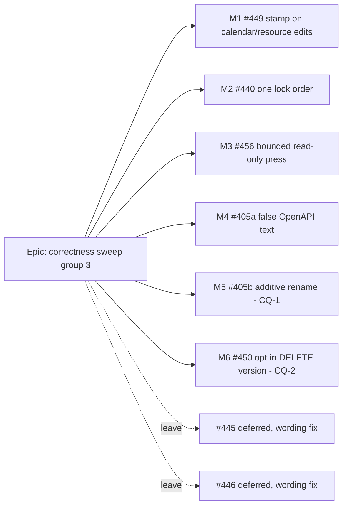

# Implementation Plan: Correctness sweep, group 3

- **Feature spec:** [spec.md](./spec.md)
- **Status:** Draft
- **Owner:** builder (Sonnet) per milestone; feature-analyst authored

## Breakdown

### Epic

**Correctness sweep, group 3.** Seven register rows about server-side correctness: five built, two
left on their triggers. Debt, not roadmap.

**No `VITE_` flag in any milestone (ADR-0088 D1).** Every change is server-side or a renamed read. The
rollback is the commit boundary.

**No schema change in any milestone.** If one becomes necessary, the work stops and goes to the
database-architect (CLAUDE.md §19.3).

**Order:** M1 → M2 → M3 (M3 before 2026-11-01) → M4 → M5 and M6 only if CQ-1 / CQ-2 say so. Each
milestone is one PR, keeps `main` releasable, and closes or amends its row in `docs/TECH_DEBT.md` in
the same PR.

---

### Milestone M1: a calendar or resource edit marks the plans that use it (#449)

**Outcome:** after a working-time or resource-limit edit, every plan using that object reads "edited
since calculated" until it is recalculated.

**Entry point:** existing surfaces.

- The edit: **Calendars** → a calendar → its shifts or exceptions.
- The effect is read on:
  - the organisation overview's standing row (`PlanStandingRow.tsx:87`);
  - the workspace status bar (`[data-schedule-state]`), whose **Recalculate** clears it.

**Journey:** extend `apps/web/e2e-workspace-chrome/edited-since.spec.ts`:

1. Calculate, and assert `current`.
2. Add a calendar exception through the API. The suite already makes its edit through the API, for
   the reason in its docblock (`:20-24`).
3. Reload, and assert the state is no longer `current`.
4. Press Recalculate, and assert `current`.

#### Feature: plan-set resolution and stamping

> **Description:** five write paths call `markScheduleInputsChanged` with the plans that use the edited
> object (spec D1.1–D1.3).
> **Complexity:** M
> **Dependencies:** none
> **Risks:**
> - *Lock-order inversion with plan settings or activity writes.* The helper locks plans in id order
>   and these transactions lock no activity rows. **database-architect reviews** the order before
>   merge (spec §4).
> - *Fan-out cost on an org calendar used by many plans.* M1-T0 measures it.
> **Testing requirements:** Supertest e2e per route (SC-1, SC-2); the structural spec extended;
> unit tests for the value diff on resources; the Playwright step above.

##### Task M1-T0: measure the plan-set query before building it (ADR-0142)

- **Description:** write the two plan-set queries as SQL and run `EXPLAIN (ANALYZE, BUFFERS)` against
  a seeded catalogue org. Use the TEST_PLAYBOOK plans plus one org with about 200 plans on one ORG
  calendar. Record the plans chosen and the timings in `docs/specs/correctness-sweep/m1-measurement.md`.
- **Complexity:** S
- **Dependencies:** none
- **Risks:** a seq scan at scale → **stop**, and take the index question to the database-architect.
  Do not add an index in this task.
- **Testing:** n/a (measurement)
- **Development steps:**
  1. Seed (`pnpm` seed CLI) and add the many-plans org.
  2. `EXPLAIN` both queries and record the results.
  3. Hand the record to the database-architect with the lock-order note from spec §4.

##### Task M1-T1: calendars stamp

- **Description:**
  - Add `CalendarRepository.findActivePlanIdsUsing(calendarId, orgId, tx)`: plans direct, plus
    activities, plus resources → assignments → activities. It carries the ADR-0172 soft-delete
    annotation.
  - Call it and then `markScheduleInputsChanged` **last** in `update` (only when
    `workingTimeChangeKind(dto) !== null` and `rows > 0`), `addException`, `updateException` and
    `removeException`.
- **Complexity:** M
- **Dependencies:** M1-T0
- **Risks:** stamping inside the 409 path. Guard on `rows > 0`, as the audit row already does
  (`calendars.service.ts:331`).
- **Testing:**
  - Supertest `calendars-edited-since.e2e-spec.ts`: three plans using C by the three routes, one plan
    not using it, and every route checked.
  - A rename and an archive stamp nothing.
  - A stale-version 409 stamps nothing.
  - Extend `schedule-inputs.structural.spec.ts` `STAMPING` with `calendars/calendars.service.ts`
    `update`, `addException`, `updateException`, `removeException`.
- **Development steps:**
  1. Write the e2e red first.
  2. Add the repository query and the calls.
  3. Update the `schema.prisma` comment (not a migration), `docs/DATABASE.md` and the helper's
     docblock caller list.
  4. Changeset (api patch).

##### Task M1-T2: resources stamp

- **Description:** in `ResourcesService.update`, diff `maxUnitsPerHour` and `calendarId` by value
  against `existing`, as `changedInputs` does. Then stamp:
  - `calendarId` changed → every active plan with an active assignment of R;
  - `maxUnitsPerHour` changed → those plans with `level_resources = true`.
- **Complexity:** S
- **Dependencies:** M1-T0
- **Risks:** a GROUP resource has no scheduling fields (`assertGroupHasNoSchedulingFields`), so it
  never stamps. A test asserts that.
- **Testing:** Supertest for levelling on and off, an unchanged value, and an unassigned resource.
  Add `resources/resources.service.ts update` to the structural `STAMPING` list.
- **Development steps:**
  1. Write the tests red first.
  2. Add the query and the call.
  3. Add a `docs/DECISIONS.md` entry for D1.1–D1.3.
  4. Extend the journey.
  5. Close #449 in `docs/TECH_DEBT.md` (race half stays documented in the helper).

---

### Milestone M2: placements and recalculation lock in one order (#440)

**Outcome:** a placement batch, a lane batch or a single summary delete cannot deadlock a concurrent
recalculation.

`Ships dark: a server-internal lock order. Nothing to press; the only user-visible effect is the
absence of a 500.`

**Journey:** none new. The existing levelling-apply and arrange journeys re-run.

#### Feature: id-ordered row locks

> **Description:** spec D2.1.
> **Complexity:** S–M
> **Dependencies:** none
> **Risks:**
> - The extra lock statement on `writeResults` costs time at 2,000 rows. Measure it (T3).
> - The `ORDER BY … FOR NO KEY UPDATE` ordering claim is about Postgres. T0 verifies it on the real
>   statement before anything relies on it.
> **Testing requirements:** a concurrency harness (before and after), a structural spec, and the
> existing activity, schedule and history e2e suites green.

##### Task M2-T0: reproduction harness (red, or an honest null)

- **Description:** `apps/api/test/measure/placement-recalc-deadlock.measure.ts`. On a 2,000-activity
  plan, run `updatePlacements` over every row in **reverse** id order concurrently with
  `recalculatePlan`, N = 200 rounds on two connections, and count `40P01`. Also `EXPLAIN` both
  statements and record the join type.
- **Complexity:** S
- **Dependencies:** none
- **Risks:** zero deadlocks before the fix is a possible outcome. Record it as such. The fix still
  rests on the plan shape (a hash join gives no order guarantee), which the `EXPLAIN` shows. Do not
  write a red test that is only flaky-red.
- **Testing:** n/a
- **Development steps:**
  1. Write the harness.
  2. Run it.
  3. Record the results in `docs/specs/correctness-sweep/m2-measurement.md`.

##### Task M2-T1: the ordered pre-lock seam

- **Description:** add `lockActivityRowsInIdOrder(tx, orgId, planId, ids)`. It issues one
  `SELECT 1 … ORDER BY id FOR NO KEY UPDATE` and lives beside the repository. Call it first in
  `ActivityRepository.updatePlacements`, `updateLanePositions` and `ScheduleRepository.writeResults`.
- **Complexity:** S
- **Dependencies:** M2-T0
- **Risks:** forgetting a future writer → T2's structural spec.
- **Testing:** repository e2e against a real database. The `EXPLAIN` shows a `LockRows` above a
  `Sort`.
- **Development steps:**
  1. Add the seam.
  2. Make the three calls.
  3. Have the database-architect review it.
  4. Add a `docs/DATABASE.md` "lock order" paragraph.

##### Task M2-T2: single delete takes the plan lock; structural pin

- **Description:**
  - `ActivitiesService.remove` calls `acquirePlanWriteLock` first in its transaction, as `bulkDelete`
    does (`:1590`).
  - A structural spec asserts:
    - every raw multi-row `UPDATE activities` in `activities/` and `schedule/` is preceded by the
      seam, or sits in a method that takes the plan lock;
    - single `remove` takes the plan lock.
- **Complexity:** S
- **Dependencies:** M2-T1
- **Risks:** a structural spec that matches by text can rot. Find writers by structure (the
  `UPDATE activities` raw template), not by method name (ADR-0124's lesson).
- **Testing:** the spec itself, plus a red-first variant proving it fails when a call is removed
  (ADR-0110).
- **Development steps:**
  1. Add the lock call.
  2. Write the spec and prove it can go red.
  3. Run the e2e api suite.

##### Task M2-T3: re-run the harness and measure cost

- **Description:** re-run M2-T0, and time `writeResults` at 2,000 rows before and after.
- **Complexity:** S
- **Dependencies:** M2-T2
- **Risks:** a cost that is not negligible → backend-performance-reviewer decides before merge.
- **Testing:** n/a
- **Development steps:**
  1. Record the figures in `m2-measurement.md`.
  2. Close #440 citing them.
  3. Changeset (api patch).

---

### Milestone M3: one bounded, read-only diagnostics reading (#456)

**Outcome:** a press is one snapshot, provably read-only, and cannot hold a pooled connection
indefinitely.

**Entry point:** existing: staff console → **Tools** → **Run diagnostics**. Nothing changes on screen.

**Journey:** the existing staff-console journey re-runs, and a Supertest e2e drives the route.

#### Feature: transaction-wrapped press

> **Description:** spec D3.1.
> **Complexity:** S
> **Dependencies:** none. **Land before 2026-11-01.**
> **Risks:**
> - The staff boundary gate bans `$executeRaw` (`staff-boundary.structural.spec.ts:155`, `:191-196`).
>   Transaction setup must go through `$queryRaw` (`SELECT set_config(...)`) in the one excepted
>   file, or the gate is amended narrowly. Either way security-reviewer reviews it, and ADR-0140 gains
>   an amendment note.
> - Prisma's interactive-transaction defaults and its `isolationLevel` option are dependency claims.
>   Register them in `scripts/dependency-claims.json` (`pnpm check:claims`).
> **Testing requirements:** a real-database e2e for the timeout and for read-only. A unit test that
> the service opens exactly one transaction.

##### Task M3-T0: verify the setup statements on a real database

- **Description:** confirm on Postgres 17 two things:
  - `set_config('transaction_read_only', 'on', true)` (or `SET TRANSACTION READ ONLY` through
    `$queryRaw`) takes effect as the first statement of a Prisma interactive transaction;
  - `set_config('statement_timeout', '3000', true)` bounds the following statements.
- **Complexity:** S
- **Dependencies:** none
- **Risks:** neither works through `$queryRaw` → amend the gate to allow one named setup call. The
  security review is mandatory then.
- **Testing:** the probe itself.
- **Development steps:**
  1. Run the probe.
  2. Write the finding in the PR body.

##### Task M3-T1: wrap the press

- **Description:** `StaffDiagnosticsService.run` opens
  `prisma.$transaction(fn, { isolationLevel: RepeatableRead, timeout: 60_000 })`. The repository
  methods take the `tx`, and setup runs first.
- **Complexity:** S
- **Dependencies:** M3-T0
- **Risks:** elapsed time per entry still measures each entry alone, since the entries stay
  sequential.
- **Testing:**
  - An e2e where a test-only registry entry runs `pg_sleep` past the bound and gets a 500 with the
    entry id logged. It goes through the repository seam, not the shipped registry, so gates S-1 to S-4
    are untouched.
  - An e2e that a write inside the seam fails with `25006`.
- **Development steps:**
  1. Write the tests red first.
  2. Implement.
  3. Add the ADR-0140 amendment note and the `docs/TECH_DEBT.md` #456 close.
  4. Changeset (api patch).

---

### Milestone M4: the revision comparison stops stating something false (#405, part)

**Outcome:** OpenAPI readers are told placement comparison exists.

`Ships dark: description text in the OpenAPI contract only.`

#### Feature: description correction

> **Description:** rewrite `placementNotAssessableReason`'s description at
> `revision-compare.dto.ts:360-376` and `cross-plan-revision-compare.dto.ts:300`. The new text says
> null means both sides recorded placements, so `datesBasis` is `PLACED`.
> **Complexity:** S
> **Dependencies:** none
> **Risks:** the text drifting from `revisionDatesBasis` again → a unit test asserts the description
> does not contain "not implemented".
> **Testing requirements:** that unit test; an OpenAPI snapshot if one exists.

##### Task M4-T1

- **Description:** as above. Also check `docs/API.md` for the same sentence.
- **Complexity:** S
- **Dependencies:** none
- **Risks:** none material.
- **Testing:** as above.
- **Development steps:**
  1. Edit both DTOs.
  2. Add the test.
  3. Narrow #405's field list in `docs/TECH_DEBT.md` (spec §1.4).
  4. Changeset (api patch).

---

### Milestone M5: basis-neutral names beside the old ones (#405, rename) — only if CQ-1 = yes

**Outcome:** moved-activity rows carry `fromStart`/`toStart`/`fromFinish`/`toFinish`. The `*Early*`
four are deprecated and the web reads the new names.

**Entry point:** existing: plan workspace → **Baselines…** → compare → the moved-activities list and
its printed form. There is no visual change.

**Journey:** the existing revision-compare Playwright suite re-runs and must stay green.

#### Feature: additive rename

> **Description:** spec §4 "API changes" row 2.
> **Complexity:** M
> **Dependencies:** M4; CQ-1
> **Risks:**
> - The two sets of fields disagree. A single producer sets both from one value in `revision-delta.ts`,
>   and an e2e asserts equality on every row.
> - Removing the old names later is breaking, needs an ADR and is **not** in this plan.
> **Testing requirements:** Supertest equality; web unit tests updated; api-reviewer.

##### Task M5-T1: API and types

- **Description:**
  - Add the fields to `RevisionMovedActivity` (`packages/types/src/index.ts:3177`) and to both DTOs,
    with `deprecated: true` on the old four.
  - Populate both in `revision-delta.ts`.
  - Update `docs/API.md` with a "Deprecated fields" note naming the removal condition.
- **Complexity:** S
- **Dependencies:** M4
- **Risks:** as above.
- **Testing:** e2e equality across both routes.
- **Development steps:**
  1. Write the tests red first.
  2. Update types, producer and DTOs.
  3. Update the docs.
  4. Changeset (api minor, `feat`).

##### Task M5-T2: web reads the new names

- **Description:** `RevisionComparePanel.tsx` and `RevisionComparePrintDocument.tsx` (and their tests)
  switch to the new names.
- **Complexity:** S
- **Dependencies:** M5-T1, **released**. ADR-0027 releases are per package, so the web must not ship
  ahead of the API that serves the fields.
- **Risks:** shipping order → separate PR after the api release is confirmed.
- **Testing:** unit tests; the revision-compare journey.
- **Development steps:**
  1. Switch the reads.
  2. Re-run the tests.
  3. Amend #405 to "removal pending" in `docs/TECH_DEBT.md`.
  4. Changeset (web patch).

---

### Milestone M6: an opted-in delete refuses a row that changed (#450) — only if CQ-2 = yes

**Outcome:** undo/redo deletes and dissolves are version-checked.

**Entry point:** existing: **Undo** / **Redo** in the workspace (toolbar and keyboard). There is no
new capability. The race cannot be driven from a browser deterministically, so the guarantee is proven
at the API.

**Journey:** the existing undo-redo Playwright suites re-run.

#### Feature: optional version on single delete and dissolve

> **Description:** spec D6.1.
> **Complexity:** M
> **Dependencies:** M2-T2 (single `remove` already takes the plan lock there; the version re-read goes
> after it). CQ-2.
> **Risks:**
> - A stricter refusal than the client's check (§1.5): a placement or progress write in the window
>   now refuses. That is correct and reads as `changed`.
> - The audit payload's change of shape. Check any audit payload schema or registry gate.
> **Testing requirements:** Supertest per route (stale → 409, absent → unchanged, fresh → 200/204);
> web unit tests that the version is threaded; security-reviewer and api-reviewer.

##### Task M6-T1: API

- **Description:**
  - Add an optional `@Query('version')` on the three `DELETE` routes, and an optional DTO body on
    dissolve.
  - In each service, inside the transaction and after the existing locks, re-read
    `SELECT version … FOR NO KEY UPDATE`. On a mismatch, throw `ConflictError` with `STALE_VERSION`.
  - Add `deleteBatchId` to the `activity.dissolved` payload.
- **Complexity:** M
- **Dependencies:** M2-T2
- **Risks:** as above.
- **Testing:** e2e red first, per route.
- **Development steps:**
  1. Write the tests.
  2. Implement.
  3. Update `docs/API.md` and OpenAPI.
  4. Changeset (api minor, `feat`).

##### Task M6-T2: web threads the version; LOE orphan

- **Description:**
  - `commands.ts` / `record-commands.ts` pass the version the pre-check read.
  - The LOE span redo records an orphan id and deletes it first on retry (#450 paragraph 3).
- **Complexity:** S–M
- **Dependencies:** M6-T1 **released**.
- **Risks:** an ADR-0111 keyboard-contract trigger? No: no primitive changes.
- **Testing:** unit tests over the command builders; the undo journeys.
- **Development steps:**
  1. Thread the version.
  2. Handle the orphan.
  3. Amend the ADR-0176 consequence and close #450.
  4. Changeset (web patch).

---

### Rows left on their triggers (no milestone)

- **#445:** leave deferred. Recommended wording correction: only xlink entries can outlive their
  subject, because expiry candidates are clients, projects and plans
  (`hierarchy-expiry.service.ts:197-267`). Either remedy amends ADR-0174 D5. Any scrub of stored
  names would be a data migration, so database-architect (§19.3).
- **#446:** leave deferred. Recommended wording correction: 429s are already logged with their path
  (`all-exceptions.filter.ts:119-123`), so the trigger is observable. "Every route change" is
  unverified (TanStack `ensureQueryData` behaviour not checked).

## Sequencing & slices

1. **M1** (#449): user-visible wrong answer on two surfaces; highest value.
2. **M2** (#440): a possible 500 on levelling apply. Shares nothing with M1, so it can run in
   parallel.
3. **M3** (#456): before 2026-11-01.
4. **M4** (#405a): tiny; can ride beside any of the above.
5. **M5** (#405b): only on CQ-1 = yes. Two PRs, api then web, with a release between.
6. **M6** (#450): only on CQ-2 = yes. After M2. Two PRs, api then web.

Each slice is independently releasable, no flag (ADR-0088 D1).

**Agents:**

- **builder** implements each milestone.
- **database-architect** reviews M1-T0 and M2-T1 (no DDL; mandatory if any DDL appears).
- **backend-performance-reviewer** reviews M1, M2 and M3.
- **security-reviewer** reviews M3 (staff gate) and M6.
- **api-reviewer** reviews M4, M5 and M6.
- **test-engineer** reviews M2-T0/T2 (the concurrency harness and the structural spec).
- No UI reviewers are needed (no visual change).

## Definition of Done (per task)

Each task's PR meets the Feature Completion Criteria in [`docs/PROCESS.md`](../../PROCESS.md):

- `pnpm prepush`, plus `scripts/e2e-local.sh api` for every milestone (all touch `apps/api`);
- the touched Playwright suite for M1, M5 and M6;
- docs and register updated in the same PR;
- a changeset;
- CI deduped-green on the current head (CLAUDE.md §19.9).

## Risks & assumptions (rollup)

| Risk / assumption | Likelihood | Impact | Mitigation |
| ----------------- | ---------- | ------ | ---------- |
| Calendar fan-out locks many plan rows, so plan saves wait | med | low | Ids in order, held only to commit; measured in M1-T0 |
| Plan-set query needs an index at scale | low | med | Measure first; **stop** and go to the database-architect if so (§19.3) |
| Lock inversion between the calendar stamp and plan/activity writes | low | high | database-architect review; analysis in spec §4 shows no cycle (FK `KEY SHARE` is compatible with `NO KEY UPDATE`), to be confirmed |
| #440 harness shows zero deadlocks before the fix | med | low | Recorded as a null; fix rests on the `EXPLAIN` join shape, not a flaky red |
| Ordered pre-lock slows `writeResults` | low | med | M2-T3 measures it; backend-performance review |
| `$queryRaw` cannot set read-only/timeout under the staff gate | med | low | M3-T0 probe; narrow gate amendment + security review |
| Deprecated #405 fields never removed | med | low | The row stays open with "removal pending" and the existing trigger |
| This analysis ran no code | certain | med | Every behavioural claim is file:line; every measurable one has a T0 task |
