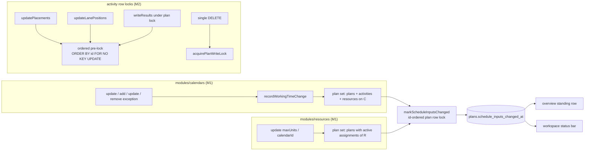
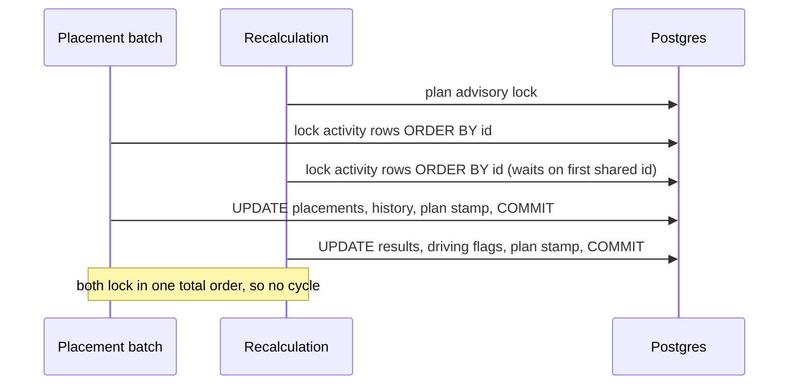
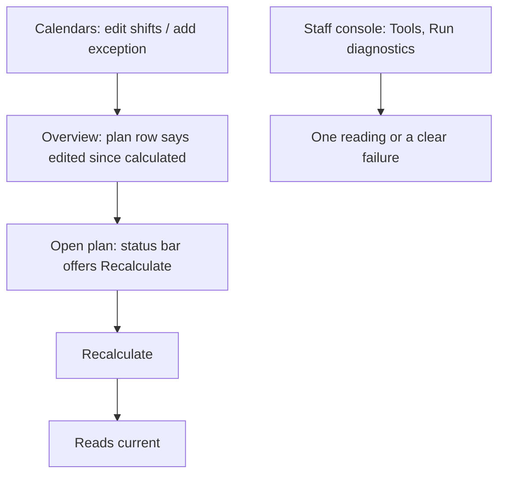

# Feature Spec: Correctness sweep, group 3 (behind-the-scenes correctness)

- **Status:** Draft — awaiting approval before implementation
- **Author(s):** feature-analyst (Opus), for the product owner
- **Date:** 2026-10-11
- **Tracking issue / epic:** `docs/TECH_DEBT.md` rows #449, #450, #440, #445, #405, #456, #446
- **Roadmap link:** none (debt, not roadmap)
- **Related ADR(s):** ADR-0176, ADR-0174, ADR-0166, ADR-0148, ADR-0140, ADR-0085, ADR-0086, ADR-0072,
  ADR-0028, ADR-0105, ADR-0076, ADR-0088 D1

> **Why this is a spec and not seven register fixes (ADR-0105).** Several rows cross a trigger:
> #450 and #405 change the **public API**, #456 changes a **shared gate**
> (`staff-boundary.structural.spec.ts`), and #449 changes which writes flip a **user-visible
> indicator**. Each row was re-checked against `main` by reading the code. Every claim below names the
> file and line it came from. **No shell was available to this analysis**, so nothing was run: there
> is no reproduction, measurement or test result in this document. Where a reproduction is possible it
> is written out as a task (plan M2-T0, M1-T0).

## 0. Verdicts at a glance

| Row  | Problem still true on `main`?                                                                                      | Recommendation                                                                                       | Schema change? | Public API change?                                       |
| ---- | ------------------------------------------------------------------------------------------------------------------ | ---------------------------------------------------------------------------------------------------- | -------------- | -------------------------------------------------------- |
| #449 | **Yes**, plus one gap the row does not name (hours-per-day, §1.1)                                                  | **Build** (M1)                                                                                       | No (the indexes exist, §3) | No shape change. `editedSinceCalculated` becomes true in more cases |
| #440 | **Yes, as a hazard.** Not reproduced. **The row's own remedy would not work** (§1.2)                               | **Build** (M2), with a corrected remedy and a reproduction harness first                             | No             | No                                                       |
| #456 | **Yes**, plus a consistency gap the row does not name (§1.3)                                                       | **Build** (M3), before the product owner's 1 November reading                                        | No             | No (staff console only)                                  |
| #405 | **Partly.** Only 4 fields are misnamed, not the 8 the row lists. **And one public description is now false** (§1.4) | **Build** the false-description fix (M4). The rename: **additive with deprecation** (M5), pending CQ-1 | No             | **Yes.** Additive now, breaking only when old names are removed later |
| #450 | **Yes**, but the realistic window is narrower than the row implies (§1.5)                                          | **Build, low priority** (M6), pending CQ-2. Leaving it is defensible                                  | No             | **Yes, additive and opt-in** (optional `version`)        |
| #445 | **Partly.** For knock-on and dissolve entries it is **not true**: the neighbour row is never hard-deleted (§1.6)    | **Leave** (deferred on its trigger). Narrow the row's wording                                         | No             | No                                                       |
| #446 | **Yes** as code. Real-world impact unmeasured; one claim in the row is overstated (§1.7)                           | **Leave** (deferred on its trigger). The trigger can already be seen in the logs                     | No             | No                                                       |

**No row needs a schema change** under this design. CLAUDE.md §19.3 still applies the moment a build
finds it needs one. Plan M1 and M2 ask the **database-architect** to *review* a query and a lock order.
That review is a recommendation, not a §19.3 obligation, because neither adds DDL.

## 1. Business understanding

### Problem

Seven register rows describe the product doing something subtly wrong where nobody can see it. Each
was re-verified on 2026-10-11:

#### 1.1 #449: a calendar or resource edit leaves "edited since calculated" reading current

**Verified.** `plans.schedule_inputs_changed_at` has exactly one writer, `markScheduleInputsChanged`
(`common/schedule-inputs/mark-schedule-inputs-changed.ts:36-56`). The only callers are activities,
dependencies, cross-plan dependencies, assignments and plan settings
(`schedule-inputs.structural.spec.ts:107-128`, the `STAMPING` list, and a grep that finds no call in
`modules/calendars/` or `resources.service.ts`). The calendar routes that change working time:

- `update` with `workingWeekdays`/`shifts`/`hoursPerDay` (`calendars.service.ts:254`, classified at
  `working-time-change.ts:31-35`)
- `addException` (`:551`), `updateException` (`:639`) and `removeException` (`:726`)

All four funnel through one audit producer, `recordWorkingTimeChange` (`:334`, `:604`, `:701`,
`:749`). None of them stamps. `ResourcesService.update` writes `maxUnitsPerHour` and `calendarId`
(`resources.service.ts:224`, `:229-230`, `:296-308`), and it does not stamp either. The engine reads
both (`schedule.repository.ts:357`, `select: { id, maxUnitsPerHour, calendarId }`). Plan
`levelResources` is already classified as an input (`schedule-input-fields.ts:64`).

**A gap the row does not name: an hours-per-day edit.** `schema.prisma:1900-1902` says the CPM engine
never reads `hoursPerDayMinutes`, and that is true. But the recalculation write turns float and drift
from minutes into **days** using that factor (`schedule.service.ts:590-597` →
`schedule.repository.ts:830-834`). So after an hours-per-day edit, the stored float-in-days is
stale until the next recalculation. The dates are not stale. The design below stamps for it anyway
(D1.2).

**Not affected:** resource delete is refused while the resource is assigned
(`resources.service.ts:455-466`, 409 `RESOURCE_IN_USE`), so it cannot change any plan's inputs.
Calendar delete is refused while the calendar is in use (`calendars.service.ts:509-523`). Archive
leaves scheduling unchanged in both modules (`calendars.service.ts:401-408`,
`resources.service.ts:336-345`).

**The race half of #449 is already documented** in the helper's docblock
(`mark-schedule-inputs-changed.ts:16-25`), and this spec leaves it alone.

**Who it hurts:** a Planner or Org Admin who edits a shared calendar after a recalculation. The
organisation overview (`PlanStandingRow.tsx:87`) and the workspace status bar
(`[data-schedule-state]`, pinned by `e2e-workspace-chrome/edited-since.spec.ts`) both say the plan's
figures are current, but they are not.

#### 1.2 #440: `updatePlacements` and the recalculation write may deadlock

**The hazard is real.**

- `ActivitiesService.updatePlacements` (`activities.service.ts:973-1078`) takes the pen but **not** the
  plan advisory lock. In that file the lock is taken only at `:361`, `:645`, `:1135`, `:1590`,
  `:1747` and `:1861`.
- It issues `UPDATE activities … FROM unnest(…) WHERE a.id = v.id AND a.version = v.version`
  (`activity.repository.ts:282-304`). Its docblock says so: "The caller takes no plan advisory lock"
  (`:255-256`).
- The recalculation takes `lockPlanForWrite` (`schedule.service.ts:562`) and then the same shape of
  statement over every activity (`schedule.repository.ts:920-982`). After that come
  `writeDrivingFlags` (`:1072-1083`) and the plan-row stamp (`:1023-1032`).

Neither statement fixes the order in which it locks rows. With a multi-row placement batch (Arrange,
the overlap resolve, a multi-select drag, or **levelling's apply, which goes through this route**,
`activities.service.ts:1039-1040`), Postgres can abort one side with `40P01`.

**Not reproduced**, because no shell was available. Plan M2-T0 is a harness.

**Established: what a user would see.**

- The repositories run raw SQL, so a deadlock is a Prisma known-request error with a code other than
  `P2025`/`P2002`, or an unknown error.
- `AllExceptionsFilter` maps both to an opaque **500 INTERNAL_ERROR**
  (`all-exceptions.filter.ts:186-191`, `:154-159`).
- It logs them at `error` with the cause (`:114-118`). So the row's trigger ("a 40P01 in the API
  logs") can be observed.

**Two more lock-free, multi-row writers have the same shape.** The row does not list either:

- `updatePositions` → `updateLanePositions` (`activities.service.ts:892`,
  `activity.repository.ts:319-335`).
- **A single `DELETE` of a WBS summary**: `ActivitiesService.remove` (`:1477-1544`) cascades through
  `HierarchyLifecycleService.cascadeSoftDelete` without the plan lock. It sweeps the subtree's
  activities **and dependencies**, which are the two tables the recalculation writes. Bulk delete, by
  contrast, takes the plan lock (`:1590`).

**The row's proposed remedy is not sufficient.** It proposes to "`ORDER BY id` the two `unnest`
joins". In `UPDATE … FROM`, the order rows are locked follows the **join plan Postgres chooses**, not
the order the `FROM` subquery is written in. A hash join locks rows in heap-scan order whatever
`unnest` was sorted by.

The repository already uses the reliable pattern: lock first with an explicit
`SELECT … ORDER BY id FOR NO KEY UPDATE`, then write.

- `mark-schedule-inputs-changed.ts:44-49` locks plan rows that way.
- `resource-advisory-lock.ts:45-55` takes advisory keys in id order for the same reason.

**This is a claim about Postgres internals.** Its evidence is the PostgreSQL `SELECT` documentation,
locking clause: with `ORDER BY` and `FOR UPDATE`, rows are locked in the order they are returned.
M2-T0 confirms it on the real statement with `EXPLAIN` before anything is built, as ADR-0142 requires.

#### 1.3 #456: the staff diagnostics press has no statement timeout and no read-only transaction

**Verified.**

- `StaffDiagnosticsRepository.examined`/`affected` call `this.prisma.$queryRaw` directly on the
  shared client (`staff-diagnostics.repository.ts:34-49`). The service runs the 16 registry entries
  one after another (`staff-diagnostics.service.ts:41-43`, `staff-diagnostics.registry.ts:24-41`).
- No `statement_timeout` is configured anywhere in the application. A grep finds it only in docs and
  in `common/query/optional-count.ts:21`, which says the same.

**A second defect the row does not name: each press is not one reading.** The 32 statements run
outside a transaction, each with its own snapshot, so on a busy host an entry's `affected` can count
rows its `examined` did not see. The handoff and ADR-0174 ask the product owner to take the history
reading on or after **1 November** (`docs/HANDOFF.md:63-64`). That reading is pasted into a
measurement record as one observation, so it should come from one snapshot.

#### 1.4 #405: the revision comparison's `Early*` fields carry placed dates

**Partly verified, and the row's field list is wrong.** Only **four** names are misnamed: the
`fromEarlyStart`/`toEarlyStart`/`fromEarlyFinish`/`toEarlyFinish` quartet. It appears on
`RevisionMovedActivityDto` (`revision-compare.dto.ts:123-130`), on its cross-plan twin
(`cross-plan-revision-compare.dto.ts:203-205` and following) and in `@repo/types`
(`packages/types/src/index.ts:3177-3180`).

The completion's `fromFinish`/`toFinish` (`revision-compare.dto.ts:178-181`) and the ghost's
`fromStart`/`fromFinish` (`:382-388`) are **already** basis-neutral names. The row lists them as
misnamed, and they are not. The placed basis is real: `revision-projections.ts:52` chooses `PLACED`
when every side is `FULL`, and `:126-127` and `:158-161` select placed dates under it.

**Found during verification: a public description that is now false.** `placementNotAssessableReason`
tells API readers that "**No placement comparison is implemented yet** … the ghosts and the delta both
still run on early dates on both sides". The text is at `revision-compare.dto.ts:360-376` and again at
`cross-plan-revision-compare.dto.ts:300`. It has been false since #405 (a) closed on 2026-09-29. It is
an ADR-0076 wrong claim in the OpenAPI contract, and fixing it breaks nothing.

The rename's consumers: `apps/api/src/modules/baselines/revision-delta.ts` (8 references), the two DTOs,
`@repo/types`, and `apps/web/src/features/revision-compare/` (`RevisionComparePanel.tsx`,
`print/RevisionComparePrintDocument.tsx`, and their tests). `docs/API.md` does not name the fields.

#### 1.5 #450: single-row `DELETE` is unversioned, so undo's check-then-delete has a window

**Verified.**

- `DELETE …/activities/:activityId` (`activities.controller.ts:143-167`),
  `DELETE …/dependencies/:dependencyId` (`dependencies.controller.ts:73-86`) and
  `DELETE …/assignments/:id` (`resource-assignments.controller.ts:152-164`) take an id and nothing
  else. `POST …/dissolve` takes no body (`activities.controller.ts:169-204`).
- Bulk delete is versioned (`bulk-delete-activities.dto.ts:13-23`).
- Undo checks before it deletes (`commands.ts:558-566`, `:629-634`), as ADR-0176 records
  (`0176-…md:148-150`).

**The realistic window is narrower than "a colleague's write".**

- Server-side pen enforcement is **off by default** (`env.validation.ts:244-247`,
  `docker-compose.yml:111`). The web client gates structural edits on the pen itself.
- So the writers that can realistically land inside the one round trip are:
  - the progress path, which is never pen-gated (`env.validation.ts:241-242`);
  - the same user in a second tab;
  - a direct API caller.
- A deleted row is **soft**-deleted, so whatever landed in the window can be restored from Recently
  deleted. It is not lost.
- The check itself compares only definition fields (`commands.ts:236-260`, which omits placement and
  progress), so a version on `DELETE` would be **stricter** than the check it backs.

The remaining parts of the row (the LOE redo orphan, and `deleteBatchId` missing from the
`activity.dissolved` audit payload) were not re-read beyond the row and ADR-0176. They are carried as
written.

#### 1.6 #445: history keeps a deleted neighbour's name, and an xlink entry keeps the other plan's name

**Verified as code, but the row's harm statement is only half true.**

- The recorder snapshots names into stored `changes`: the other end of a cross-plan link with its
  plan's name (`activity-history.recorder.ts:378-404`) and the neighbour on a knock-on entry
  (`:444-458`).
- That is ADR-0174 **D5** ("a later rename or deletion never rewrites an entry", `0174-…md:70-75`) and
  **D6** ("names inside `changes` are content, with the same status as `activities.name`", `:76-79`).
- The row says "ADR-0096 retention later hard-deletes the neighbour". **For knock-on and dissolve
  entries that is false.** The retention expiry selects only **clients, projects and plans** as
  candidates (`hierarchy-expiry.service.ts:197-267`). A soft-deleted activity in a live plan is never
  hard-deleted, so its name stays in `activities` exactly as long as the survivor's plan does.
- **Only the xlink case outlives its subject:** plan B expires while plan A's history still names B.
- On exposure: readers are org members with `activity:read`, and never an External Guest
  (`0174-…md:80-82`). No per-plan access model exists, so nobody can read a name they could not
  already see. **Neither trigger has fired.**

#### 1.7 #446: the throttler counts per address

**Verified as code.**

- One global throttler, 100 per 60 s (`app.module.ts:101-106`, `env.validation.ts:292-293`). It runs
  first among the global guards (`app.module.ts:157`).
- It is keyed on `req.ip`, with `trust proxy` set from `TRUSTED_PROXY_IPS` (`app-setup.ts:78-88`).
- It is per handler by the guard's key prefix. That is registered in `scripts/dependency-claims.json`
  (`throttler.guard.js`, anchor
  `` const prefix = `${context.getClass().name}-${context.getHandler().name}-${name}`; ``).

**One claim in the row is overstated.** "`GET /api/v1/me` is read on every route change":

- Display observers use `DEFAULT_STALE_TIME` (`use-session.ts:63`, `:67`).
- The `_authed` guard calls `ensureQueryData(sessionQueryOptions)` (`router.tsx:257`). In TanStack
  Query that serves cached data when present.
- **That library claim is not verified here** (`node_modules` was absent) and is not registered. It
  should not be relied on until it is.

**The trigger can already be observed.** Every 429 is logged at `warn` with its code and path
(`all-exceptions.filter.ts:119-123`), so "a production 429 report" can be checked from logs without
new code.

### Users

| Row  | Who is affected                                                                                                                                       |
| ---- | ----------------------------------------------------------------------------------------------------------------------------------------------------- |
| #449 | Planner, Org Admin (they edit calendars and resources: `calendar:update`, `calendar:manage_org`, `resource:update`). Every member who reads the overview |
| #440 | Planner holding the pen (placement, Arrange, levelling apply)                                                                                         |
| #456 | Staff (ADR-0086), and the product owner taking readings                                                                                               |
| #405 | API consumers. Today that is the web app's revision-compare panel and its printed form                                                                |
| #450 | Planner using undo/redo. Any Contributor whose progress write lands in the window                                                                     |
| #445 | None today                                                                                                                                            |
| #446 | Members of an organisation behind one NAT. None measured                                                                                              |

### Primary use cases

1. A planner edits a shared calendar's shifts, and every plan that uses it reads "edited since
   calculated" until it is recalculated (#449).
2. A planner applies levelling while an auto-recalculation is in flight. Both finish, with no 500
   (#440).
3. Staff press **Run diagnostics** and get one consistent reading, bounded in time, that provably
   writes nothing (#456).
4. An API reader of the revision comparison is told the truth about what each date field holds (#405).
5. A redo that deletes refuses rather than deleting a row someone changed after the check (#450).

### User journeys

There is no new screen. Each journey runs through an **existing** entry point (§4 "User flow"):

- #449: the workspace status bar and the overview's standing row.
- #456: the staff console's **Run diagnostics**.
- #405: **Baselines… → compare**.
- #450: **Undo / Redo**.

### Expected outcomes

- The "edited since calculated" indicator no longer reads current after a calendar, exception,
  hours-per-day or resource-limit edit.
- No placement-versus-recalculation deadlock is possible by construction.
- A diagnostics press is one snapshot, read-only, and time-bounded.
- The OpenAPI contract stops stating something false.
- An opted-in delete cannot remove a row edited since it was read.

### Success criteria

- **SC-1 (#449):** in a Supertest e2e, each of the five stamping calendar/resource writes leaves every
  plan that uses the edited object reading `editedSinceCalculated: true`. Plans that do not use it are
  unchanged.
- **SC-2 (#449):** a calendar rename, description edit, archive and scope change stamp nothing.
- **SC-3 (#440):** a structural spec pins that every lock-free multi-row activity writer, and
  `writeResults`, locks rows only through the id-ordered seam. The M2-T0 harness shows **0** `40P01`
  in N rounds after the change. Its before-figure is recorded, whatever it is.
- **SC-4 (#456):** a statement over the bound surfaces as the route's existing 500, with the error
  logged. A write attempted inside the press transaction fails (proven against a real database).
- **SC-5 (#405):** no OpenAPI description on either revision route asserts that placement comparison
  is unimplemented.
- **SC-6 (#450):** `DELETE` with a stale `version` answers 409 and deletes nothing. Without `version`,
  behaviour is byte-identical to today.

### Open questions

**Critical**, because the answer changes scope:

- **CQ-1 (#405):** may the rename land now as an **additive, non-breaking** change? New
  `fromStart`/`toStart`/`fromFinish`/`toFinish` would sit beside the old names, which are marked
  `deprecated` in OpenAPI. The web app would switch to the new names, and the old ones would be
  removed only with the next breaking change and an ADR (`docs/API.md:28-29`). Or does the 2026-09-29
  decision ("not take the breaking change on its own") mean nothing moves until that trigger fires?
  **Default if unanswered: ship M4 (the false description) and hold M5.**
- **CQ-2 (#450):** build the opt-in `version` on single-row `DELETE` and on dissolve now (M6, size M,
  low risk, low value: soft delete makes the loss recoverable), or leave it on its trigger?
  **Default if unanswered: leave it, and hold M6.**
- **CQ-3 (#440, #456):** both rows are **deferred on triggers that have not fired**. This spec
  recommends building both ahead of their triggers:
  - #440 is a possible 500 on the levelling apply.
  - #456 should land before the 1 November reading it would otherwise make inconsistent.

  Do you agree to pre-empt them? **Default if unanswered: yes, build M2 and M3.**

**Defaults** (not critical; stated so the work is not blocked):

- D1.1: a resource's `maxUnitsPerHour` edit stamps only plans that use it **and** have
  `level_resources = true`, because the ceiling is read only by levelling. A resource `calendarId`
  edit stamps every plan that uses the resource.
- D1.2: an `hoursPerDay`-only calendar edit **does** stamp, because it changes the stored float-in-days
  (§1.1). A false positive here is honest ("the figures may have moved"). A miss is the defect.
- D1.3: a calendar's plan set is: plans on it directly; plans with an active activity on it; plans
  with an active assignment of an active resource on it. Cross-plan successors are **not** fanned out.
  That matches every existing stamp, e.g. `activities.service.ts:1536` stamps only the activity's own
  plan.
- D2.1: #440 is fixed with id-ordered row locks, not by adding the plan advisory lock to the drag path.
  The recalculation holds that lock while the engine computes (`schedule.service.ts:562-597`), so a
  drag would queue behind it. **Exception:** the single `DELETE` takes the plan advisory lock, matching
  `bulkDelete` (`activities.service.ts:1590`). It is rare, it cascades two tables, and it needs no new
  helper.
- D3.1: #456 uses one `REPEATABLE READ` transaction per press, set `READ ONLY`, with
  `statement_timeout` set locally to **3 s**. That is about 5.5× the worst statement measured at 1M
  rows (524–538 ms, `docs/specs/staff-server-readings/m1-measurement.md` as quoted by #456). The
  interactive-transaction timeout is 60 s. One timed-out entry fails the whole press with the existing
  500, as the row asks. Per-entry failure would change the row shape and needs an ADR-0140 decision.
- D6.1: #450's version travels as a query parameter (`?version=N`) on `DELETE`, not as a body
  (DELETE bodies are poorly supported by intermediaries) and not as `If-Match` (no route here uses
  ETags). Dissolve gains an optional JSON body `{ version? }`.

## 2. Functional requirements

### User stories & acceptance criteria

> **US-1 (#449)**: As a **Planner**, I want a calendar or resource-limit edit to mark the plans that
> use it as edited since calculated, so that the overview never tells me stale figures are current.
>
> - **Given** plan P on calendar C, calculated at T, **when** a Planner adds an exception to C, **then**
>   P's `editedSinceCalculated` is `true` in `GET …/plans/:id` and in the overview, until P is
>   recalculated.
> - Same for: a shift/working-week edit; an exception edit or removal; an `hoursPerDay` edit; an
>   activity on C in plan Q (Q stamps); a resource on C assigned in plan R (R stamps); a
>   `maxUnitsPerHour` edit on a resource assigned in a plan with levelling **on** (stamps) and **off**
>   (does not).
> - **Given** a rename, description edit, archive/unarchive or scope change **then** no plan stamps.
> - **Given** a version-stale calendar PATCH (409) **then** nothing stamps (the transaction rolls back).

> **US-2 (#440)**: As a **Planner**, I want a placement batch and a recalculation that overlap to both
> complete, so that applying levelling or arranging never fails with an unexplained error.
>
> - **Given** a 2,000-activity plan, **when** a placement batch over every activity, in reverse id
>   order, runs concurrently with a recalculation, for N rounds, **then** no round fails with `40P01`.
> - Ordinary version conflicts still answer 409 exactly as today.

> **US-3 (#456)**: As **staff**, I want a diagnostics press to be one consistent, read-only and
> time-bounded reading.
>
> - **Given** an entry whose statement exceeds the bound **then** the press answers the existing 500
>   and logs the entry id. It does not hang, and the pooled connection is released.
> - **Given** any registry SQL **then** it executes in a transaction that refuses writes (proven by a
>   repository e2e that attempts one inside the same seam).

> **US-4 (#405)**: As an **API reader**, I want date fields named for what they hold.
>
> - M4: neither revision route's OpenAPI says placement comparison is unimplemented.
> - M5 (if CQ-1 = yes): the moved-activity rows carry `fromStart`/`toStart`/`fromFinish`/`toFinish`
>   with values identical to the deprecated `*Early*` fields in every response. The web reads only the
>   new names.

> **US-5 (#450)**: As a **Planner**, I want a redo that deletes to refuse when the row changed after
> its check.
>
> - **Given** `DELETE …?version=3` and the row is at 4 **then** 409 `STALE_VERSION`, and nothing is
>   deleted, audited, stamped or recorded.
> - **Given** no `version` **then** behaviour is unchanged (existing e2e specs stay green unedited).
> - The undo commands pass the version from the read their check just made, and a 409 reads as the
>   existing `changed` set-aside (ADR-0176 D3).

### Workflows

- **#449.** The calendar or resource transaction does its write and its audit row as today. Then,
  last and inside the same transaction, it resolves the plan set (D1.3) and calls
  `markScheduleInputsChanged(tx, orgId, planIds)`. That helper sorts the ids and locks plan rows in id
  order (`mark-schedule-inputs-changed.ts:41-49`).
- **#440.** Each lock-free multi-row activity writer, and `writeResults`, first issues
  `SELECT 1 FROM activities WHERE id = ANY($ids) AND plan_id = $p AND organization_id = $o ORDER BY id
  FOR NO KEY UPDATE`, then its existing `UPDATE`. The single `DELETE` takes `acquirePlanWriteLock`.
- **#456.** `run()` opens one interactive transaction. Its first statements set it read-only and set
  the local timeout. All entries run inside it, then it commits.

### Edge cases

- **#449, empty plan set:** the helper returns early (`:42`). Calendar used by 500 plans: one
  `UPDATE` of 500 plan rows, locked in id order. Concurrent plan-settings saves on those plans wait
  for the commit, which is brief. Deleted plans, activities and resources are excluded (ADR-0172 filter
  stated at each query).
- **#449, resource `calendarId` set to the value it already has:** compare by value as
  `changedInputs` does (`schedule-input-fields.ts:110-121`), so it does not stamp.
- **#440, batch of 1:** a single row lock cannot form a cycle on its own, and the ordered pre-lock is
  harmless.
- **#456, empty registry:** not reachable (closed union). A statement that times out mid-press rolls
  back a read-only transaction, which changes nothing.
- **#450, a summary delete with a version:** the version guards the **root** only. The cascade is
  unchanged, and children were already covered by the client's check (ADR-0176 "A step that deletes
  checks more than its own fields").

### Permissions

Nothing changes:

- **#449:** stamping rides the caller's existing `calendar:update` (+ `calendar:manage_org` for an ORG
  calendar) or `resource:update`. The plan set is resolved **organisation-scoped**, and the helper
  re-asserts `organization_id` (`:46`).
- **#450:** keeps `activity:delete`, `dependency:delete` and the assignment permission, plus the pen.
- **#456:** keeps the staff boundary (ADR-0086), and the route still takes no input (ADR-0140 D2).
- **External Guest:** unaffected by every row.

### Validation rules

- #450 `version`: optional integer ≥ 1. A non-integer is rejected with 422 by the global
  `ValidationPipe` (`app.module.ts:144-152`).
- No other new input.

### Error scenarios

| Scenario                                          | Detection                                | User-facing result                               | Status |
| ------------------------------------------------- | ---------------------------------------- | ------------------------------------------------ | ------ |
| Stale `version` on single `DELETE` / dissolve     | locked re-read inside the tx             | undo strip "changed", step set aside             | 409    |
| Diagnostics statement over `statement_timeout`    | Postgres `57014`, propagated             | staff panel's existing failure state             | 500    |
| Write attempted inside the diagnostics tx         | Postgres `25006` (read-only transaction) | never reachable by a registry entry; test only   | 500    |
| Deadlock after M2                                 | should be impossible                     | unchanged: opaque 500, logged at `error`         | 500    |

## 3. Technical analysis

| Area           | Impact | Notes |
| -------------- | ------ | ----- |
| Frontend       | low    | #405 M5: two components and their tests switch field names. #450 M6: `commands.ts` and `record-commands.ts` pass `version`, and the LOE orphan id is remembered. No new UI |
| Backend        | med    | #449: calendars and resources services, plus two plan-set queries. #440: three repository writers and `writeResults`. #456: staff repository/service. #450: three delete paths and dissolve |
| Database       | none (DDL) | **No schema change.** The plan-set queries are served by existing partial indexes: `idx_plans_calendar_id` (`migrations/20260710130000_add_plan_calendar/migration.sql:13`), `idx_activities_calendar_id` (`20260715130000_activate_activity_calendar_fk/migration.sql:22`), `idx_resources_calendar_id` and `idx_resource_assignments_resource_id` (`20260717020000_m7_resource_model/migration.sql:151`, `:173`). Whether the planner uses them is to be shown with `EXPLAIN` in M1-T0 |
| API            | med    | #405: additive fields + `deprecated: true`, and a description fix. #450: optional query parameter / optional body. Both go into `docs/API.md` + OpenAPI. **No breaking change in this spec.** Removing the deprecated #405 fields later is breaking and needs an ADR (`docs/API.md:28-29`) |
| Security       | low    | #456 changes `staff-boundary.structural.spec.ts`. The narrowest change is to let the one existing `$queryRaw` exception file also issue the two transaction-setup statements. `$executeRaw` stays banned (`:155`, `:191-196`), so setup goes through `$queryRaw`/`set_config`, verified in M3-T0. #450 adds a stricter guard, never a looser one |
| Performance    | low–med | #449 adds one indexed plan-set read and one plan `UPDATE` to calendar/resource edits. #440 adds one ordered lock statement to `writeResults` (up to 2,000 rows), which **must be measured** (M2-T3). #456 holds one pooled connection for one press, as today |
| Infrastructure | none   | No env var, no compose change, no flag (ADR-0088 D1) |
| Observability  | low    | #456 logs the timed-out entry id. #440 needs nothing, since `error` logs already carry the cause |
| Testing        | med    | Supertest e2e for #449, #450, #456. A concurrency harness and a structural spec for #440. A Playwright step extending `edited-since.spec.ts` for #449. Existing revision-compare and undo journeys re-run |

### Dependencies

- No milestone depends on another; each is independently releasable.
- M5 depends on CQ-1, and M6 on CQ-2.
- M3 should land before 2026-11-01, the date of the ADR-0174 M3-T2 reading.
- M1 and M2 should get a database-architect **review** (query plan and lock order) before merge.

## 4. Solution design

### Architecture overview



### Data flow

#449, a calendar exception added to a calendar three plans use:

```mermaid
sequenceDiagram
  participant P as Planner
  participant API as CalendarsService
  participant DB as Postgres
  P->>API: POST …/calendars/:id/exceptions
  API->>DB: BEGIN
  API->>DB: INSERT exception, touch calendar version
  API->>DB: INSERT audit calendar.working_time_changed
  API->>DB: SELECT plan ids using calendar (org-scoped, active)
  API->>DB: SELECT plans ORDER BY id FOR NO KEY UPDATE; UPDATE schedule_inputs_changed_at
  API->>DB: COMMIT
  Note over DB: overview and status bar now read "edited since calculated"
```

#440, the order every party takes:



### User flow



### Database changes

**None.** No model, column, index, constraint or data migration. Two points to note:

- The `schema.prisma` docblock on `scheduleInputsChangedAt`, and `docs/DATABASE.md`'s description of
  it, gain the calendar/resource writers. That is a comment edit, not a migration.
- If M1-T0's `EXPLAIN` shows a sequential scan that matters, an index would be a schema change. At that
  point the work **stops** and goes to the **database-architect** (CLAUDE.md §19.3). It is not designed
  here.

### API changes

| Route | Change | Breaking? |
| ----- | ------ | --------- |
| `GET …/plans/:id/revision-compare` and the cross-plan revision route (exact paths as in `docs/API.md`) | `placementNotAssessableReason` description corrected (M4) | No |
| Same | `RevisionMovedActivity` gains `fromStart`, `toStart`, `fromFinish`, `toFinish`. The `*Early*` four are marked `deprecated: true` with "same value; removed at the next breaking change" (M5, if CQ-1) | No (additive). Removal later is breaking + ADR |
| `DELETE …/activities/:activityId` | optional `?version=` → 409 `STALE_VERSION` when stale | No (opt-in) |
| `DELETE …/dependencies/:dependencyId` | same | No |
| `DELETE …/assignments/:id` | same (assignment's version) | No |
| `POST …/activities/:activityId/dissolve` | optional body `{ version? }` | No |
| `activity.dissolved` audit payload | gains `deleteBatchId` (#450) | No (additive) |

`docs/API.md` and OpenAPI are updated in the same PR as each change.

### Component changes

- **M5:** `RevisionComparePanel.tsx` and `RevisionComparePrintDocument.tsx` read the new names. There
  is no visual change.
- **M6:** `features/undo-redo/commands.ts` and `record-commands.ts` pass `version` from the read their
  `checkDeletable` just made, and the LOE redo records its orphan id.
- No design-system change and no new state.

### Implementation approach & alternatives

**#449.** Chosen: resolve the plan set in the calendar/resource repositories and call the existing
helper last in the transaction.

- *Alternative:* a database trigger on `calendar_shifts`/`calendar_exceptions`. Rejected: it moves
  "which writes are inputs" out of the structural spec that pins it, it would fire on engine-irrelevant
  writes, and it is a schema change.
- *Alternative:* stamp the **calendar** and have the overview join through it. Rejected: it changes the
  read model, the plan response and a gated column's single-writer rule.

**#440.** Chosen: id-ordered pre-lock (D2.1), plus the plan lock on single delete.

- *Alternative:* the plan advisory lock on every placement. Simpler, but it serialises a drag behind
  the engine's compute window.
- *Alternative:* the row's remedy, `ORDER BY` in `unnest`. Insufficient, see §1.2.
- *Alternative:* retry on `40P01`. It treats the symptom, and a retried placement batch must re-check
  versions anyway.

**#456.** Chosen: one read-only `REPEATABLE READ` transaction with a local timeout.

- *Alternative:* a role-level `statement_timeout`. That is operator configuration on the host, and it
  would bound every API query, not this one.

**#405.** Chosen: add, deprecate, and remove later (CQ-1).

- *Alternative:* rename in place. Breaking, needs an ADR, and needs the api and web images to deploy
  together (ADR-0027 per-package releases).

**#450.** Chosen: an opt-in version.

- *Alternative:* undo calls the already-versioned bulk delete with one row. Rejected: bulk delete
  refuses a `WBS_SUMMARY` by design (`commands.ts:1748-1752`).

**ADR impact**

- No new ADR.
- **ADR-0140** gains an amendment note (the staff gate's exception now admits transaction setup).
- **ADR-0176**'s #450 consequence is amended when M6 ships.
- `docs/DECISIONS.md` records D1.1–D1.3 and D2.1.

**Register corrections recommended.** This spec does not edit `docs/TECH_DEBT.md`; the builder makes
these edits when each milestone lands, or now if the product owner prefers:

- #405: narrow the field list to the four `*Early*` names, and record the false
  `placementNotAssessableReason` text.
- #440: replace the remedy, and add `updateLanePositions` and single `DELETE`.
- #445: say only the xlink case outlives its subject.
- #446: soften "every route change", and note that 429s are already logged.
- #449: add the hours-per-day case.
- #456: add the snapshot-consistency point.

## 5. Links

- Implementation plan: [implementation-plan.md](./implementation-plan.md)
- Related docs updated by this change: `docs/API.md`, OpenAPI (M4–M6); `docs/DATABASE.md` +
  `schema.prisma` comment (M1); `docs/adr/0140-*.md` amendment note (M3); `docs/adr/0176-*.md`
  consequence (M6); `docs/DECISIONS.md`; `docs/TECH_DEBT.md` rows on close; `CHANGELOG` via
  changesets.
