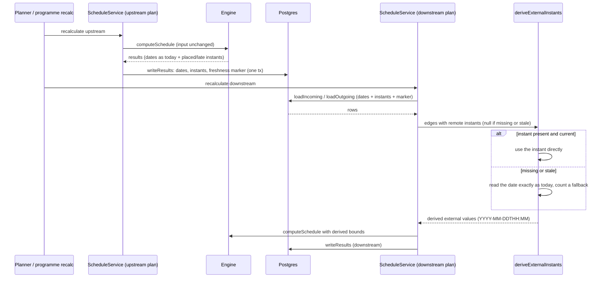
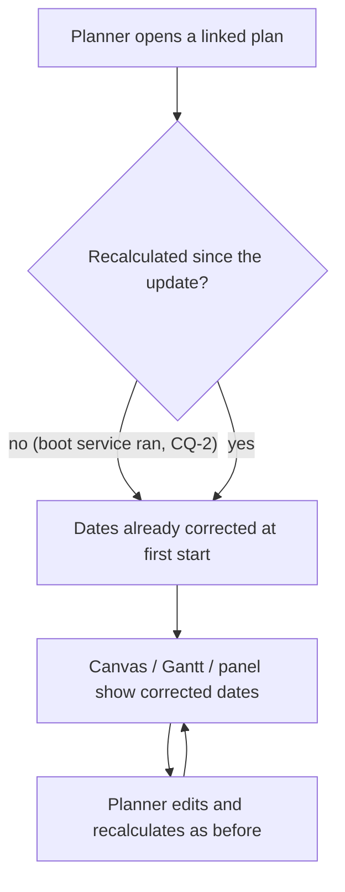

# Feature Spec: A plan keeps the instant beside the date, so a cross-plan link reads what one plan keeps

- **Status:** Approved 2026-11-07 (product owner; Q1 B — milestones and part-day finishes; Q2 A — recalculate linked plans once at first start)
- **Author(s):** feature-analyst (for the product owner)
- **Date:** 2026-11-07
- **Tracking issue / epic:** [`docs/TECH_DEBT.md`](../../TECH_DEBT.md) #565 (build approved by the product
  owner 2026-11-07)
- **Roadmap link:** Inter-project scheduling (ADR-0043 / ADR-0045 / ADR-0161). A planner-visible date
  change on linked plans, so it takes a roadmap line rather than an exemption.
- **Related ADR(s):** proposed **ADR-0212** (drafted in §4.9, reserved, not yet filed); ADR-0161 (its
  parity domain's zero-span edge, and its sub-day edge if CQ-1 answers B); ADR-0045 §2 and §5; ADR-0043;
  ADR-0207 D1–D5; ADR-0155; ADR-0162 D3; ADR-0022 (engine-owned write); ADR-0148 M-H (placed basis, not
  reopened); ADR-0194 (organisation export format); ADR-0105 (why this is a spec)

This is a spec rather than a row fix because it adds a schema change on the schedule write path
(ADR-0105 trigger: a schema change). The row says so itself (`TECH_DEBT.md:9399`).

## 0. Evidence: what the brief and the row claimed, and what was checked

This spec was written with read and search tools only, no shell. Every claim below was established by
**reading** the file and line given. None was run. M0 turns the decision-bearing ones into executed
results before any product code changes (ADR-0076, CLAUDE.md §19.11).

| #   | Claim                                                                                                                                        | Verdict                                   | Established by                                                                                                                                                                                                                                                                                                                                                            |
| --- | -------------------------------------------------------------------------------------------------------------------------------------------- | ----------------------------------------- | ------------------------------------------------------------------------------------------------------------------------------------------------------------------------------------------------------------------------------------------------------------------------------------------------------------------------------------------------------------------------- |
| R1  | Six fixture cases diverge from one plan today; the row lists them as 4 + 1 + 1.                                                              | True                                      | `cross-plan-milestone-fixture.spec.ts:215-222` (`DIVERGES`, six keys, each run as `it.fails` at `:230`).                                                                                                                                                                                                                                                                  |
| R2  | The row's "Verified" line says "six of the **twenty** cases".                                                                                | **Stale count**: there are now **24**     | `MIDDLES` has six entries (`:184-191`), run over two cuts × two variants (`:225-227`). The twenty predates the weekend zero-duration task the 2026-11-01 review added. The six divergences are correct. Corrected in the row at closure (plan M5).                                                                                                                        |
| R3  | A stored date cannot tell the two instants apart, so no reading of the date alone can be right for both.                                     | True                                      | `cross-plan-milestone-fixture.spec.ts:260-275` (driven and SNET-pinned start milestone both store `2027-07-03`; `K` starts 06-28 against 07-05) and `:277-292` (successor-driven and FNLT-constrained finish milestone both store late `2027-07-02`; `W` float 1440 against 0).                                                                                           |
| R4  | The engine already holds the exact instants when it writes the dates.                                                                        | True                                      | `compute.ts:961-983`: `placedStartInst`, `placedFinishInst`, `lsInst`, `lfInst` are in scope where the result is built; the date columns are derived from them (`dayOf`, `placedDayOf`, `lateDayOf`, `:900-927`).                                                                                                                                                         |
| R5  | The engine's offsets cannot stand in for those instants.                                                                                     | True                                      | The `*Offset` fields are "projected onto the **plan** calendar" (`engine/types.ts:259-266`), which is lossy for an instant on another calendar: `compute.ts:896-898` records that an offset "cannot tell Friday 16:00 from the Sunday 19:00 that weekend work ended at". `passOnStartInstant`/`passOnFinishInstant` are absolute but in memory only (`types.ts:287-297`). |
| R6  | Nothing persists an instant for the computed dates.                                                                                          | True                                      | `schema.prisma:1414-1417` (`early_*`, `late_*` are `@db.Date`), `:1501-1502` (`visual_effective_*` `@db.Date`). `writeResults` sets 24 columns, none an instant (`schedule.repository.ts:934-999`).                                                                                                                                                                       |
| R7  | The engine's clamps already accept a timed value as the instant itself.                                                                      | True                                      | Forward: `externalStartInstant` (`constraints.ts:223-235`) reads a timed value unrolled for a zero-span activity (`:233`). Backward: `clampExternalBackwardFinish` reads a value longer than ten characters as the bound for every type (`:287-290`). **No engine clamp needs to change.**                                                                                |
| R8  | The derivation reads the remote end through the date readers, and that is where the information is lost.                                     | True                                      | `cross-plan-derivation.ts:239-268` (`remoteInstants`: `finishMilestoneRemoteInstant`, `startDateInstant`, `finishDateInstant`, each from a `YYYY-MM-DD`).                                                                                                                                                                                                                 |
| R9  | Forward reads the upstream's **placed** dates; backward reads the downstream's **late** dates; both come in one org-scoped include.          | True                                      | `cross-plan-dependency.repository.ts:283-313` (`visualEffectiveStart/Finish` via `predecessor` include) and `:321-345` (`lateStart/lateFinish` via `successor` include). `cross-plan-basis.structural.spec.ts:34-96` pins the asymmetry and names **two producers** (repository and conformance adapter).                                                                 |
| R10 | A plan with no cross-plan edge never reaches the derivation.                                                                                 | True                                      | `schedule.service.ts:1744-1748` (`countActiveForPlan` gates both loads).                                                                                                                                                                                                                                                                                                  |
| R11 | The third shape (finish milestone on the weekend calendar, cut at `M → K`) is the upstream plan's own finish basis, not a stored-date fault. | **Confirmed** (see §1, "The third shape") | `cross-plan-milestone-fixture.spec.ts:294-305`: the split equals the upstream plan run alone, and the `longer` variant equals one plan. The same effect for tasks is a known property recorded by the previous epic (`docs/specs/cross-plan-day-boundary/implementation-plan.md:78-82`).                                                                                  |
| R12 | The organisation export must decide about every new `activities` column, in the same change.                                                 | True                                      | `export-columns.ts:8-11`: `export-census.structural.spec.ts` fails when a column has no decision. Include-by-default (`:11`). Appending is a minor version (`docs/ORGANISATION_EXPORT_FORMAT.md:131-133`); the current version is `2.3` (`:4`).                                                                                                                           |
| R13 | XER/MSPDI interchange does not carry computed dates, so it is untouched.                                                                     | True                                      | `packages/interchange/src/xer-emit.ts:222-248` (TASK fields: inputs, constraints, actuals; no early/late dates). `mspdi-emit.ts:312-337` writes `ActualStart`/`ActualFinish`/expected finish only. Import recalculates through the engine, which will write the new columns like any recalculation.                                                                       |
| R14 | An older image left running after a rollback would leave the new columns stale.                                                              | True by construction                      | `writeResults` names its columns explicitly (`schedule.repository.ts:934-960`), so an image that predates the columns never writes them and they keep the newer image's values while the dates move. Drives requirement D-4 (§4.4).                                                                                                                                       |
| R15 | Linked plans keep old dates after a release that changes what the derivation reads, with nothing flagging them.                              | True                                      | Staleness is computed from upstream `schedule_computed_at` (ADR-0045 §5), which this change does not move. Four boot services exist for this reason, each keyed on a migration's `finished_at` (`docs/DATABASE.md:2125-2155`; `milestone-rederive.service.ts:11-15`, `:33-43`, `:155`).                                                                                   |
| R16 | Creating a cross-plan link recalculates nothing.                                                                                             | True                                      | `cross-plan-dependencies.service.ts` has no recalculation call (searched for `recalc`, `stale`, `scheduleInputsChangedAt`). Drives the residual in §2 "Edge cases" and row #570.                                                                                                                                                                                          |

## 1. Business understanding

### Problem

A planner can split a programme into several plans and join them with cross-plan links. ADR-0161 made
such a link produce the dates the same link would inside one plan, to the minute, for everything the
link arithmetic controls. Three edges were left outside, named. This spec closes the one #565 owns:
**zero-span activities** (a start milestone, a finish milestone, a zero-duration task, ADR-0207 D1).

A zero-span activity keeps the exact instant its logic gives it, but its plan **stores only the day**.
The day is not enough. Two different instants, a weekend apart, can be stored as the same day (R3). So
when another plan reads that day across a link, it has to guess, and for any guess there is a real plan
where it is a week wrong:

- **A start milestone, or a zero-duration task, on a weekend calendar, cut at `M → K` (4 cases).** In
  one plan, weekend work ends, the milestone keeps Monday 06-28 00:00, and the weekday task after it
  starts Monday 06-28. The upstream plan stores the milestone as Saturday 07-03 (the day its next
  working minute opens, ADR-0207 D3), so across the link `K` starts Monday 07-05: **a week late**. A
  milestone pinned "start no earlier than Saturday 07-03" stores the same date and really should push
  `K` to 07-05.
- **A finish milestone on the plan calendar, cut at `W → M`, with float to spare (1 case).** Its late
  instant is Monday 07-05 08:00, stored as Friday 07-02. A "finish no later than Friday 07-02" stores
  the same date for Saturday 00:00. The derivation reads the second, so the weekend work before it
  **loses a weekend of float** across the link that it has in one plan.

Every one of the five is **pessimistic**: the split programme looks later or tighter than the same
logic in one plan. Fixing them moves some linked dates **earlier** and gives some upstream work back
float it really has. That is the correct direction, and it should be said plainly in the changeset.

### The third shape: confirmed, it stays

The row's third shape (a finish milestone on the **weekend** calendar, cut at `M → K`, `longer` off)
diverges for a reason unrelated to storage. The upstream plan holding `A → W → M` ends at `M`, so its
own backward pass starts from its own project finish (Sunday 19:00), and a cross-plan late bound can
only tighten that, never loosen it (`deriveExternalInstants` composes by tighter-of, `:406-426`).
`M`'s late date reads Sunday 06-27 across plans and Monday 06-28 in one plan. Three facts make it stay:

1. **No stored value can change it.** Instant columns change what a plan reads about the other plan;
   this is what the upstream plan computes about itself.
2. **It is not milestone-specific.** Any activity that ends an upstream plan takes that plan's finish
   as its late finish, a task included. The previous epic met it and designed around it
   (`cross-plan-day-boundary/implementation-plan.md:78-82`, FC-9's unlinked task).
3. **It is display only here.** On the weekend calendar there is no working time between Sunday 19:00
   and Monday 08:00, so `M`'s float is equal in both worlds; only the late date's label differs, and
   the `longer` variant, where the plan finish stops binding, equals one plan (`:302-304`).

Changing it would mean an upstream plan's end activities take their late finish from their cross-plan
successors instead of their own plan, which changes every linked upstream's float and criticality.
That is a different decision about ADR-0045's per-plan float basis, with no report asking for it. It
stays `it.fails`, re-labelled as "by design" rather than "#565" (plan M5).

### Users

| Role                                | Need                                                                                                        |
| ----------------------------------- | ----------------------------------------------------------------------------------------------------------- |
| Planner                             | Linked plans give the dates the same logic gives in one plan, including at milestones next to weekend work. |
| Org Admin                           | The same, plus an organisation export that carries what the product stores (ADR-0194).                      |
| Contributor, Viewer, External Guest | See corrected dates through every existing read. Nothing new to do; no new control.                         |

No permission changes. Recalculation stays what it is: a Planner action under the pen, or the system at
boot (ADR-0161 D8 precedent).

### Primary use cases

1. A planner recalculates a programme whose plans meet at a milestone after weekend work, and the
   weekday work after it starts on the morning the weekend work hands over, not a week later.
2. A planner recalculates the upstream plan of a link into a finish milestone, and the work before it
   keeps the float it has in one plan.
3. An operator updates the image; at the first start, linked plans are recalculated once, upstream
   first, so their dates are corrected without anyone pressing anything (CQ-2).

### User journeys

There is no new screen or control. The journey is the existing one: open a linked plan, recalculate
(or let the boot recalculation run), read the dates on the canvas, the Gantt, the activity panel and
the cross-plan link list. See the user flow in §4.3.

### Expected outcomes

- The five #565 cases equal one plan to the minute.
- (If CQ-1 answers B) an upstream task that finishes mid-day hands over at that time, not at the end
  of its day, closing ADR-0161's sub-day edge with the same columns.
- Nothing changes for any plan with no cross-plan link (§4.8 parity argument).

### Success criteria

| #     | Criterion                                                                                                                                                                                                                                                                                                                            |
| ----- | ------------------------------------------------------------------------------------------------------------------------------------------------------------------------------------------------------------------------------------------------------------------------------------------------------------------------------------ |
| FC-1  | `cross-plan-milestone-fixture.spec.ts`: `DIVERGES` holds exactly one key, `a finish milestone on the weekend calendar\|M->K\|false`, re-labelled as the plan's own finish basis. The five other keys are plain `it` and pass. Each was verified red with the instant read switched off.                                              |
| FC-2  | The "what a stored date cannot say" witnesses stay as they are (they document the date's limit) and each gains a companion asserting that the **instants** differ where the dates agree, and that the split equals one plan for both the driven and the pinned case.                                                                 |
| FC-3  | The ADR-0161 twin matrix (1,728 cells plus the mixed-calendar axis, `cross-plan-twin.characterisation.spec.ts`) stays all-equal with instants supplied by **both** producers. If CQ-1 = B, a sub-day axis is added and is all-equal; its prediction is committed before the run (M0).                                                |
| FC-4  | Parity: `compute.spec.ts`, the ADR-0034 conformance matrix and the golden suites pass with **no assertion value edited**. Every existing `EngineResult` field is byte-identical for every engine spec input (a comparison test over the existing fixtures, M1). A plan with no cross-plan edge builds a byte-identical engine input. |
| FC-5  | A remote end with no stored instant (never recalculated since the release, or from an older run, D-4) is read exactly as today: the derivation's output is byte-identical to the current code for that edge.                                                                                                                         |
| FC-6  | API e2e, through the public REST API against real Postgres: two plans, a weekend-calendar start milestone linked `M → K`, programme recalculation; `K`'s early start equals the one-plan twin's. A second case for the plan-calendar finish milestone `W → M`. Each verified red with the read switched off.                         |
| FC-7  | A recalculation writes the instants for every activity, and `stored → read` is the identity on the engine axis (round-trip test). Dropping one column from the `UPDATE SET` is caught by a test (the `remaining_float` lesson, `schema.prisma:1544-1552`).                                                                           |
| FC-8  | An instant written by an older run is never read: simulate an older image's recalculation (dates rewritten, instants untouched) and assert the derivation falls back to the date (D-4).                                                                                                                                              |
| FC-9  | The boot recalculation recalculates every pending linked plan once, upstream first across the organisation graph, and is verified red with the order reversed (the `cross-plan-rederive.e2e-spec.ts` pattern).                                                                                                                       |
| FC-10 | Cost: `buildEngineGraph` issues the same number of queries at 10 and 100 links each way (instants come in the existing include). `writeResults` median at 5,000 activities is within +15 % of the same-sitting baseline taken in M0.                                                                                                 |
| FC-11 | `export-census.structural.spec.ts` passes; the new columns are appended to `activities` and the format reads `2.4` with a "Changes since" entry.                                                                                                                                                                                     |

### Open questions

Critical (answers change scope or behaviour), with the default assumed until answered:

- **CQ-1: Close only the five milestone cases, or also ADR-0161's mid-day upstream edge?** The same
  stored instants close both. Default: **B, both** (§4.7).
- **CQ-2: Recalculate linked plans once at the first start after the update?** Default: **yes**, the
  fourth time this pattern is used (ADR-0155 D9, ADR-0161 D8, ADR-0207 D5).

Everything else is decided in this spec ("Decided by analyst", §4.10).

## 2. Functional requirements

### User stories & acceptance criteria

> **US-1** As a Planner, I want weekday work after a weekend-calendar milestone in another plan to
> start when the weekend work hands over, so that splitting a programme does not push it a week late.
>
> - **Given** an upstream plan whose start milestone or zero-duration task on a weekend calendar keeps
>   Monday 00:00 after weekend work, linked FS lag 0 to a weekday task in a downstream plan, **when**
>   the programme is recalculated, **then** the weekday task's early start equals the same network
>   in one plan (Monday, not the following Monday).
> - **Given** the same milestone pinned SNET Saturday, **when** recalculated, **then** the weekday task
>   starts the Monday after that Saturday, as in one plan.

> **US-2** As a Planner, I want work before a finish milestone in another plan to keep the float it
> has in one plan.
>
> - **Given** a finish milestone on the plan calendar whose late instant is Monday 08:00, in a
>   downstream plan, linked from weekend work in an upstream plan, **when** the programme is
>   recalculated, **then** the weekend work's total float equals one plan's.
> - **Given** the milestone constrained FNLT Friday instead, **then** the float equals one plan's for
>   that case too (zero).

> **US-3** (CQ-1 = B) As a Planner, I want an upstream task that finishes at 12:00 to hand over at
> 12:00.
>
> - **Given** an upstream task finishing mid-day linked FS lag 0 to a downstream task on a calendar
>   working that afternoon, **when** recalculated, **then** the downstream starts at 12:00 that day, as
>   in one plan.

> **US-4** As an Org Admin updating the image, I want linked plans corrected without anyone pressing
> anything, and I want the export to carry the stored instants.
>
> - **Given** linked plans last recalculated by an older image, **when** the new image starts, **then**
>   each is recalculated once, upstream first, and the boot log records how many (CQ-2).
> - **Given** an organisation export after the update, **then** `activities` carries the instant
>   columns appended at the end and the manifest reads `2.4`.

> **US-5** As anyone, I want nothing to change for a plan that has no cross-plan link.
>
> - **Given** a plan with no cross-plan edge, **when** recalculated, **then** every date, float and flag
>   it stores is identical to before the change (only the new instant columns are additionally
>   written).

### Workflows

1. **Recalculation (any plan).** The engine computes as today and additionally reports, per activity,
   the four instants its stored dates are dated from (D-1). `writeResults` writes them beside the dates
   in the same statement, with the plan-level marker that says which run wrote them (D-4).
2. **Recalculation of a plan with cross-plan edges.** The two existing loads also select the remote
   end's instants and the marker. For each edge, the derivation uses the remote instant when it is
   present and current (and, under CQ-1 = A, only for a zero-span remote); otherwise it reads the date
   exactly as today (D-3).
3. **First start after the update.** A new boot service, keyed on a marker migration, recalculates
   every live linked plan computed before the marker, ordered upstream first (D-5).

### Edge cases

| Case                                                                                                             | Behaviour                                                                                                                                                                                                                                                                                                     |
| ---------------------------------------------------------------------------------------------------------------- | ------------------------------------------------------------------------------------------------------------------------------------------------------------------------------------------------------------------------------------------------------------------------------------------------------------- |
| Remote plan never recalculated since the release (instants null)                                                 | Read the date as today (FC-5). Counted per recalculation and logged (D-6).                                                                                                                                                                                                                                    |
| Remote plan recalculated by an older image after a rollback (instants stale)                                     | Detected by D-4 and read as the date. Never read as an instant.                                                                                                                                                                                                                                               |
| Remote plan never calculated at all (dates null)                                                                 | Unchanged: an incoming edge counts as N32 (`upstreamMissingCount`), an outgoing one contributes nothing.                                                                                                                                                                                                      |
| Remote activity created after the remote plan's last recalculation                                               | Dates and instants both null: as above.                                                                                                                                                                                                                                                                       |
| Remote is an LOE                                                                                                 | Unchanged: skipped before any read (`cross-plan-derivation.ts:302`, `:331`).                                                                                                                                                                                                                                  |
| Remote is a WBS summary (still accepted, ADR-0161 E18)                                                           | Its instants are read like any other's under CQ-1 = B; under A it is not zero-span and keeps the date read.                                                                                                                                                                                                   |
| Remote is hand-placed (ADR-0148 M-H)                                                                             | The **placed** instant is read, the instant the placed date is dated from. Still outside the parity domain (one plan uses placements in Pass 2 only), now with the exact instant rather than the day. A placed finish milestone reads the end of the typed day (ADR-0207 D2) as it does in one plan's Pass 2. |
| Remote has progress (started, complete)                                                                          | The instant the engine used for its successors in that run. Covered by a progressed-upstream twin case in M0's prediction.                                                                                                                                                                                    |
| Finish milestone's late date clamped to its early date (`lateDayOf`, `compute.ts:918-923`)                       | The stored late **date** is the clamped day; the stored late **instant** is the engine's late instant. They legitimately disagree; the derivation reads the instant, which is what one plan reads.                                                                                                            |
| A downstream single-plan recalculation of a plan linked after the release to an upstream last computed before it | Reads the date (no instant yet) until the upstream is recalculated, by itself or by a programme recalculation. No worse than today; recorded as row #570 (§4.11).                                                                                                                                             |
| Data date moved on the remote plan without recalculation                                                         | Instants are absolute; they and the dates are as stale as each other, flagged by ADR-0045 §5 as today.                                                                                                                                                                                                        |
| Two replicas both run the boot service                                                                           | As in ADR-0161: idempotent, serialised by the plan advisory lock.                                                                                                                                                                                                                                             |

### Permissions

No change. The instants are read inside the existing org-scoped loads (`cross-plan-dependency.repository.ts:289`,
`:327`), the same rows and the same scope as the dates beside them. Engine-owned columns are never
accepted from a DTO and never touch `version`/`updated_at`/`updated_by` (ADR-0022). The boot service runs
as the system, asserts no pen and writes no audit row (ADR-0161 D8 precedent). Not exposed on any API
response, the guest DTO or the web.

**The pen (ADR-0028):** no new structural write. Recalculation's engine-owned write is unchanged in kind.

### Validation rules

No user input. Internal invariants, enforced in code and, where the database-architect chooses, by a
constraint:

- An instant column is written only by `writeResults`, in the same statement as its date.
- An instant is a whole minute on the engine axis (ADR-0037); `stored → read` is the identity.
- An instant is trusted only if D-4 says it was written by the run that wrote the dates beside it.

### Error scenarios

| Scenario                                             | Detection                                                     | Result                                                                                    | Status         |
| ---------------------------------------------------- | ------------------------------------------------------------- | ----------------------------------------------------------------------------------------- | -------------- |
| `writeResults` updates fewer rows than results       | existing row-count check (`schedule.repository.ts:1004-1008`) | recalculation fails loudly, transaction rolls back (unchanged)                            | 500 (existing) |
| A column missing from the `UPDATE SET`               | FC-7 test against a real database; optional constraint (DBA)  | build fails                                                                               | n/a            |
| Stored instant unreadable (non-finite after mapping) | repository mapping throws                                     | recalculation fails loudly rather than reading a wrong bound                              | 500            |
| Boot recalculation of one plan fails                 | per-plan guard                                                | warn log; the plan stays pending and is retried at the next boot (ADR-0161 D8 shape)      | n/a            |
| Organisation graph cannot be ordered                 | per-organisation guard                                        | whole organisation skipped, warn log (ordering wrong is the defect the ordering prevents) | n/a            |

## 3. Technical analysis

| Area           | Impact | Notes                                                                                                                                                                                                                                                                              |
| -------------- | ------ | ---------------------------------------------------------------------------------------------------------------------------------------------------------------------------------------------------------------------------------------------------------------------------------- |
| Frontend       | none   | No component, route or copy change. Dates the web already shows move for linked plans.                                                                                                                                                                                             |
| Backend        | med    | Engine: four additive in-memory fields on `EngineResult` (no input change). `writeResults`: four more columns plus the D-4 marker. Repository: two selects widen. Derivation: one read rule. Service: map and count. New boot service. Conformance adapter: the second producer.   |
| Database       | med    | New engine-owned instant columns on `activities` and a D-4 freshness marker; one comment-only marker migration for the boot service. **Designed by database-architect** (§4.4 states what and why only).                                                                           |
| API            | none   | No endpoint, DTO or OpenAPI change. `docs/API.md:559`'s residual sentence is updated.                                                                                                                                                                                              |
| Security       | low    | No new input or endpoint. Same org-scoped loads. Export carries the new columns inside the tenant's own export only.                                                                                                                                                               |
| Performance    | low    | Zero new queries (R9). Four more `unnest` arrays per recalculation write; measured (FC-10).                                                                                                                                                                                        |
| Infrastructure | low    | A migration with DDL plus a comment-only marker. Rollback procedure gains a step in `docs/DEPLOYMENT.md` (delete the marker row, ADR-0207 D6).                                                                                                                                     |
| Observability  | low    | Boot service logs the four ADR-0161 events under its own names; recalculation logs a count of remote reads that fell back to the date (D-6).                                                                                                                                       |
| Testing        | med    | Unit (engine fields, derivation rule, fallback), conformance (fixture, twin matrix, structural basis spec), API e2e (two plans, boot service, stale guard, write round-trip), export census. No Playwright journey: no user-facing entry point (ADR-0081 declaration in the plan). |

### Dependencies

- database-architect designs the columns, the D-4 marker, the migration and the decision not to backfill
  (M2) before M2 is built. CLAUDE.md §19.3: always, re-run if it returns nothing.
- M1 (pure code) lands first and is independently releasable.
- No dependency on any other open epic. Touches files that the swimlane and activity-code work also
  touches (`export-columns.ts`, `ORGANISATION_EXPORT_FORMAT.md`), so the format number is taken at merge
  time (if another change takes `2.4` first, this one takes the next minor).

## 4. Solution design

### 4.1 Architecture overview

The fix is entirely on the **input** side of the derivation. The engine's clamps already read a timed
value as an instant (R7), and the derivation already hands the engine timed values
(`formatExternalInstant`). What is missing is the remote plan's instant, so the plan that owns the
activity must store it, and the plan that reads across the link must load it.

```mermaid
flowchart LR
  subgraph Upstream["Remote plan (writes)"]
    E1[computeSchedule] -->|"EngineResult + 4 instants (in memory)"| W1[writeResults]
    W1 -->|"dates + instants + freshness marker, one statement"| DB[(activities / plans)]
  end
  subgraph Downstream["Plan being recalculated (reads)"]
    R[cross-plan repository loads] -->|"dates + instants + marker, same include"| S[schedule.service]
    S --> D[deriveExternalInstants]
    D -->|"instant when present and current, else date reader (today)"| B[forwardLowerBound / backwardUpperBound]
    B -->|"formatExternalInstant (unchanged)"| E2[computeSchedule]
  end
  DB --> R
  Boot[CrossPlanInstantRederiveService at boot] -->|"upstream-first recalculation of linked plans"| E1
  A[conformance adapter, second producer] -.->|"same instants from EngineResult"| D
```

### 4.2 Data flow

### 4.3 User flow

### 4.4 Database changes (what and why; database-architect designs how)

**This section names data requirements. Column names, types, nullability, constraints, the migration
and its tests are the database-architect's (CLAUDE.md §19.3).**

- **D-DB-1. Four engine-owned instants per activity**, the instants the four dates the derivation reads
  are dated from:
  - the placed start and placed finish instants (beside `visual_effective_start/finish`), read by the
    **forward** derivation (R9);
  - the late start and late finish instants (beside `late_start/finish`), read by the **backward**
    derivation.

  _Why these four and not the early pair:_ nothing across a link reads early dates (ADR-0148 M-H made the
  forward basis the placed one, and `cross-plan-basis.structural.spec.ts` pins it). Adding the early pair
  would be a column with no reader. _Why every activity type and not only zero-span:_ one rule ("an
  instant column is the instant its date is dated from") is simpler to hold than a type-conditional
  column, a type can change between recalculations, and it is what CQ-1 = B needs. The read rule, not the
  write rule, is where CQ-1 is decided.

  _Unit:_ a whole minute on the engine's absolute axis (`instantToAbsMinutes`,
  `working-time-calendar.ts:68-77`): a civil date-time with no time zone, compared as if UTC. The
  existing precedent for an engine-axis instant is `external_early_start`/`external_late_finish`,
  `Timestamptz(3)` (`schema.prisma:1260-1279`). The requirement is only that `abs → stored → abs` is the
  identity and that the organisation export can write it as an `instant` (§4.6).

- **D-DB-2. A freshness marker (D-4)** that lets a reader tell instants written by the run that wrote the
  dates beside them from instants left by an older image after a rollback (R14). Recommended shape, for
  the architect to accept or replace: a plan-level stamp written by the same transaction as
  `schedule_computed_at` (`stampScheduleComputedAt`, `schedule.repository.ts:1011-1036`), so a remote plan's
  instants are trusted only when its stamp equals its `schedule_computed_at`. An older image advances
  `schedule_computed_at` without the stamp, so its plans fall back to the date automatically. The
  alternative is a documented rollback step that nulls the columns; it was not preferred because it
  depends on an operator remembering it, which is the vigilance ADR-0058 replaces. Note the
  `docs/DATABASE.md:2147-2152` caution about DDL on `plans`; the architect weighs it.

- **D-DB-3. No backfill.** An instant cannot be computed in SQL: it needs the engine. Existing rows stay
  null until their plan is next recalculated, and null means "read the date" (FC-5). The boot service
  (D-5) fills every linked plan at first start. Not backfilling is not fabrication (ADR-0126): nothing is
  invented.

- **D-DB-4. A comment-only marker migration** for the boot service, in the release that switches the
  read on (plan M4), not the release that adds the columns. Keying it on the DDL migration would miss
  plans recalculated between the two releases (the reason `docs/DATABASE.md:2147-2152` gives for #421's
  separate marker).

- **D-DB-5. No index.** The columns are read only through the existing cross-plan includes and the
  plan-scoped write; no predicate targets them (the `visual_effective_*` precedent).

- **Questions for the architect, not for the owner:** whether a CHECK can hold "instant set implies date
  set" given existing rows; whether the D-DB-2 stamp belongs on `plans` or elsewhere; whether the
  `unnest` append order keeps `schedule.repository.day-factor.spec.ts`'s positional pins (it pins indices
  16 and 17; appending after `derived_duration_minutes` keeps every index, `schedule.repository.ts:890-896`).

### 4.5 API changes

None. No endpoint, request or response changes. The instants are not on `ActivityResponseDto`, the
guest DTO or the cross-plan summary: no consumer needs them, and adding a response field is an API
promise (ADR-0190) with no reader. `docs/API.md:559` (the residual "an upstream that finishes mid-day is
read as the end of that day") is reworded to the new domain.

### 4.6 Export and interchange

- **Organisation export (ADR-0194): carried.** The registry is include-by-default and withholding needs
  a reason (`export-columns.ts:11`); "internal" is not one when the dates they explain are exported. The
  four columns are **appended** to `activities` as kind `instant`, and the format becomes `2.4` with a
  "Changes since" entry. The entry says: the exact working instant each placed or late date is dated
  from, written in the plan's own clock time in UTC form (no time-zone conversion applies, as for
  `externalEarlyStart`), empty for a plan not recalculated since the column was added, and from the run
  that wrote the dates only when the plan was last recalculated by this version or later. If the D-4
  marker is a `plans` column it is **withheld** with the reason "says which recalculation wrote the
  instants; meaningless outside this database", like `version`.
- **XER/MSPDI: untouched.** Both emitters write inputs, not computed dates (R13); the receiving tool
  recalculates. Import recalculates through the engine, which writes the new columns as any
  recalculation does.

### 4.7 Implementation approach

**D-1. The engine reports the instants it already has.** `EngineResult` gains four **required**
in-memory fields (placed start/finish, late start/finish, absolute minutes), set from `placedStartInst`,
`placedFinishInst`, `lsInst`, `lfInst` at `compute.ts:973-983`. Required, as `placedStartOffset` and
`passOnStartInstant` are (`types.ts:278-297`), so a hand-built result cannot omit them. No engine input
changes, no existing field changes. Hand-built results in about a dozen spec files gain the fields
(R4; `passOnStartInstant` appears in 12 files today); no assertion value is edited (FC-4).

**D-2. `writeResults` writes them** in the same statement, appended after `derived_duration_minutes`
so no positional pin moves, with the D-4 marker in the freshness stamp's transaction.

**D-3. The derivation reads the instant when it has one.** `IncomingCrossPlanEdge` gains the two placed
instants and `OutgoingCrossPlanEdge` the two late instants, each `number | null`. In `remoteInstants`,
for the anchor the edge type needs: if the instant is non-null (and, under CQ-1 = A, the remote is
zero-span), it is the bound's anchor, unread and unrolled; otherwise the date reader runs exactly as
today. Nothing else in the derivation changes: the bound functions, the composition with M1 (D6) and the
formatter (D7) are ADR-0161's. The two producers (repository/service, and `conformance/cross-plan-adapter.ts`)
move together, and `cross-plan-basis.structural.spec.ts` gains a clause that each passes instants.

**Why CQ-1 = B is the default.** The instants are written for every type anyway (D-DB-1), so reading
them for every type costs nothing more and makes the derivation's remote read **one rule** with no type
branch, which is ADR-0161's own principle ("a cross-plan link is the same link in one plan"). It closes
ADR-0161's first parity edge (sub-day upstream finishes, `0161…md:146-149`), whose fix was deferred to
"the same deferred columns". It moves some downstream dates up to one upstream working day earlier, in
the direction one plan already gives. A cannot be wrong where B is right, but A leaves a known defect
standing behind columns that would already fix it.

**D-4. A stale instant is never read** (D-DB-2). The service passes null for a remote plan whose marker
does not match, so the derivation sees "no instant" and FC-5 applies.

**D-5. Boot recalculation** (CQ-2): `CrossPlanInstantRederiveService`, the fifth of its kind, shaped
like `MilestoneRederiveService` (scalar-subquery marker, fail-closed, `orderPlansUpstreamFirst` over the
whole organisation graph and recalculating only pending plans, ADR-0161 D8's lesson). Pending: a live
plan with a data date, an endpoint of a live cross-plan link in **either** direction (the upstream must
write instants before the downstream reads them), and `schedule_computed_at` earlier than the marker.
Logs four events mirroring ADR-0161's, under `schedule.xplan_instants_*` names.

**D-6. Observability.** `deriveExternalInstants` reports a `remoteInstantMissingCount` (edges whose read
fell back to the date, LOE and null-date edges excluded); the service logs it once per recalculation
when non-zero. It is the population #570's trigger reads.

### Alternatives considered

| Alternative                                                                         | Verdict       | Why                                                                                                                                                        |
| ----------------------------------------------------------------------------------- | ------------- | ---------------------------------------------------------------------------------------------------------------------------------------------------------- |
| A cleverer date reader (e.g. read the last working end boundary)                    | Rejected      | R3 proves no reading of the date is right for both instants; the row's own example puts the SNET case a week early, which hides risk.                      |
| Persist the plan-frame offsets the engine already reports                           | Rejected      | Projected onto the plan calendar and lossy for another calendar (R5): the exact information this change exists to keep.                                    |
| Persist only zero-span instants (null for other types)                              | Rejected      | A type-conditional column, wrong after a type change until recalculated, and no cheaper; CQ-1 is decided at the read, not the write.                       |
| Persist all six (early pair too)                                                    | Rejected      | No reader (ADR-0148 M-H basis is placed). Add when one exists.                                                                                             |
| Recompute the remote plan in memory during the downstream recalculation             | Rejected      | Runs the other plan's engine inside this plan's transaction and lock, reverses ADR-0045 §2's "read persisted dates" design, and multiplies cost by fan-in. |
| Change the third shape (end activities take late finish from cross-plan successors) | Rejected here | A different decision about per-plan float basis (§1), with no report asking for it.                                                                        |
| Rollback safety by a documented null-out step instead of D-4                        | Not preferred | Depends on an operator remembering; ADR-0058. Left to database-architect to weigh against DDL on `plans`.                                                  |
| A `VITE_` flag                                                                      | Rejected      | No web change; and a flag is not a rollback here (ADR-0088 D1). The rollback is a commit boundary plus D-4.                                                |

### 4.8 Parity (the recalculation parity gate)

- **`computeSchedule` is byte-identical for every input.** Its input type does not change. Its output
  gains four fields; every existing field is computed by unchanged code (FC-4 compares them over the
  existing fixtures). The conformance matrix and goldens pass unedited.
- **A plan with no cross-plan edge** never reaches the derivation (R10), so its engine input is
  byte-identical, and its stored dates, floats and flags are identical. Its recalculation additionally
  writes the new columns; no reader outside the cross-plan loads and the export reads them.
- **A plan with cross-plan edges whose remote ends have no current instant** builds a byte-identical
  engine input (FC-5).
- **A plan with cross-plan edges whose remote ends have current instants** changes deliberately and only
  toward the one-plan answer: the five #565 cases, and under CQ-1 = B the sub-day cases.

### 4.9 ADR-0212 (reserved; drafted here as Proposed, filed by plan M1)

Not filed as a file now: an ADR citing this directory would make `check:spec-status` refuse a `Draft`
spec, and filing it requires the CLAUDE.md §16 line, which the build adds with the file.

> **ADR-0212: A plan keeps the instant beside the date, and a cross-plan link reads it**
>
> - **Status:** Proposed
> - **Amends:** ADR-0161 parity domain (the zero-span edge; the sub-day edge if CQ-1 = B); ADR-0045 §2
>   (the derivation reads persisted instants where present). Notes against ADR-0022 (a new class of
>   engine-owned output), ADR-0194 (format 2.4), ADR-0207 D3/D4 (dates unchanged; the cross-plan read of
>   a zero-span remote no longer goes through them), ADR-0148 M-H (basis unchanged).
> - **Context:** R3; the five cases; ADR-0161's deferred "instant columns on `activities`".
> - **Decision:** D1 the engine reports the placed and late instants it dates from; D2 a recalculation
>   persists them beside the dates, one statement; D3 the derivation uses a current instant, else reads
>   the date as before (scope per CQ-1); D4 an instant from an older run is never read; D5 linked plans
>   are recalculated once at boot, keyed on a marker (CQ-2); D6 the export carries them, format 2.4; D7
>   the third shape is the upstream plan's own finish basis and stays.
> - **Parity:** §4.8.
> - **Consequences:** linked dates move earlier and float returns, never the reverse, in the closed cases;
>   one more boot service; rollback deletes the marker row (ADR-0207 D6) and needs nothing else because
>   of D4; the remaining parity edges are placed upstreams and progress-mode tie dropping (ADR-0161).
> - **Alternatives:** §4.7 table.

### 4.10 Decided by analyst

1. Persist four instants (placed start/finish, late start/finish) for **every** activity type; not the
   early pair (D-DB-1).
2. No engine input change; four required in-memory result fields (D-1).
3. A stale instant is never read, by a freshness marker rather than an operator step (D-4, D-DB-2;
   shape to database-architect).
4. No backfill; null reads the date (D-DB-3, FC-5).
5. The boot marker ships with the read switch, as a comment-only migration (D-DB-4).
6. The third shape stays (§1), re-labelled as by design.
7. The organisation export carries the columns, appended, format `2.4` (§4.6).
8. XER/MSPDI untouched (R13).
9. No API, DTO, web or guest change; no `VITE_` flag (ADR-0088 D1); no Playwright journey, declared
   per ADR-0081 (no user-facing entry point; the API e2e drives the real product).
10. ADR-0212 required and reserved (§4.9).
11. One new debt row, #570 (§4.11); #571 not used.

### 4.11 New debt row (filed by plan M5)

> **570. A downstream plan reads an upstream's date until that upstream is recalculated after the
> instant release.** Status: open. The derivation falls back to the date (today's behaviour) for a remote
> plan with no current instants. After the boot recalculation every linked plan has them; the residual
> is a plan linked **later** to an upstream last computed before the release, recalculated alone (a
> programme recalculation fills it, because it solves upstream first; creating a link recalculates
> nothing, R16). No worse than before the change. **Trigger:** `remoteInstantMissingCount` logged above
> zero on the deployed host more than a release after the change, or a planner report of a linked
> milestone a week off.

## 5. Links

- Implementation plan: [`implementation-plan.md`](./implementation-plan.md)
- Related docs updated by this change: `docs/TECH_DEBT.md` (#565 closed, #570 filed), ADR-0212 (new),
  ADR-0161 (parity-domain note), `docs/API.md:559`, `docs/ORGANISATION_EXPORT_FORMAT.md` (2.4),
  `docs/DATABASE.md` ("Re-derivation markers" table gains a fifth row), `docs/DEPLOYMENT.md` (rollback
  step), `CLAUDE.md` §16 (one line for ADR-0212).
