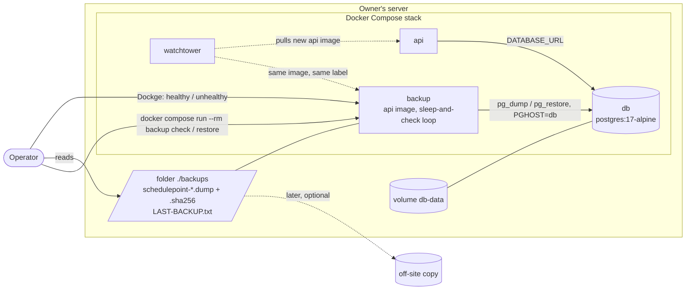
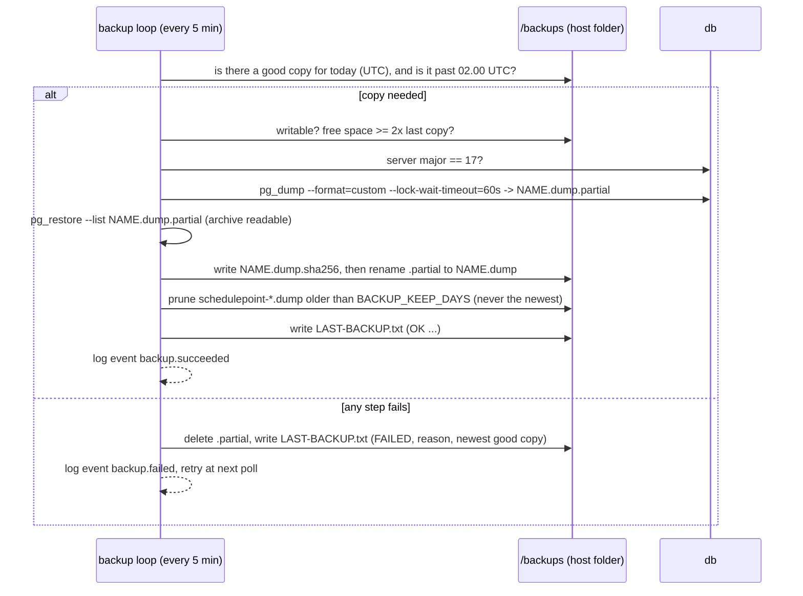
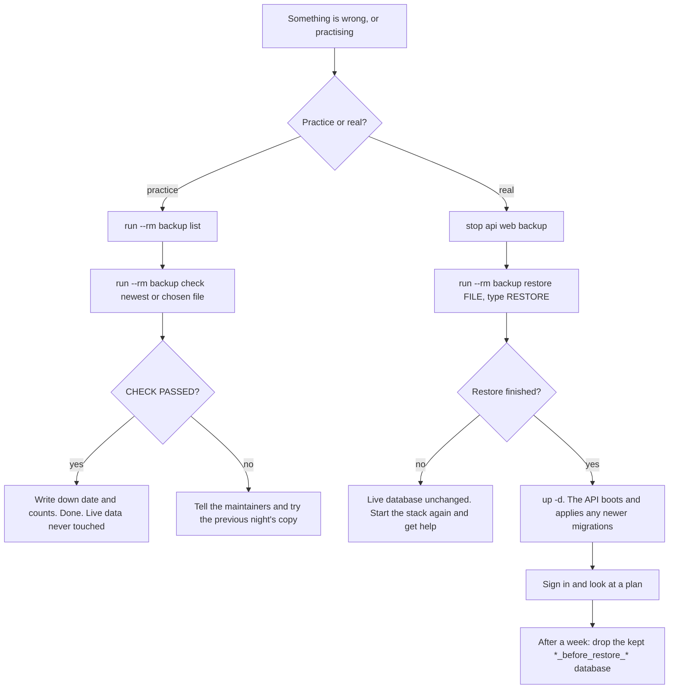

# Feature Spec: Database backup and restore

- **Status:** Draft — awaiting the product owner's approval. Nothing below is built.
- **Author(s):** feature-analyst, for the product owner
- **Date:** 2026-10-14
- **Tracking issue / epic:** pre-1.0 requirement (a), `docs/RELEASE_1_0.md` row 5. Required for 1.0 by the owner on
  2026-10-13 (`docs/DECISIONS.md:13-26`). Backup is first of the three 1.0 requirements (owner, 2026-10-14).
- **Roadmap link:** the 1.0 entry in `docs/ROADMAP.md` (added by pre-1.0 batch 2).
- **Related ADR(s):** one **new** ADR proposed (§4.9; number taken at landing, 0192 today — `docs/adr/` ends at
  0191). Cited: ADR-0018, ADR-0020, ADR-0027, ADR-0047, ADR-0058, ADR-0072, ADR-0076, ADR-0081, ADR-0085, ADR-0087,
  ADR-0088 D1, ADR-0096, ADR-0105, ADR-0110, ADR-0131, ADR-0160, ADR-0190.

**Decided by the owner before this spec (not re-asked):** backup goes first; copies live **on the same server, in
their own folder**; off-site copies are out of scope for now but must stay possible; the brief's promise is a
**daily Postgres snapshot kept 30 days** (`docs/PROJECT_BRIEF.md:232`); the recycle-bin clear-out is a separate spec;
the owner does one practice restore of 30–45 minutes; alert set-up (#100) stays parked and nothing here depends on it.

---

## 1. Business understanding

### Problem

SchedulePoint keeps every plan in one PostgreSQL database, in one Docker volume (`db-data`) on the owner's server
(`docker-compose.release.yml:65-66`, `:242-243`). **Nothing copies that database anywhere.** Measured 2026-10-14: no
file under `scripts/`, `.github/` or either compose file runs `pg_dump`, and `docs/guides/` holds two guides, neither
about backups. If the volume is damaged, deleted by a mistyped command, or corrupted by a bad release, every
organisation's plans are gone and there is no way back.

This matters more here than on most servers for two reasons that are already true:

1. **Releases deploy themselves.** Watchtower pulls a new API image and the API applies database changes on boot,
   unattended (ADR-0047, ADR-0018; `apps/api/docker-entrypoint.sh:8-9`). A release that damages data reaches the live
   database with nobody watching.
2. **A permanent delete is waiting to be switched on.** `RETENTION_HIERARCHY_ENABLED` permanently removes recycle-bin
   items (`docker-compose.release.yml:131-142`). Turning it on with no backup means a wrong setting cannot be undone.

### Users

| Who                                                                           | What they need                                                                                                |
| ----------------------------------------------------------------------------- | ------------------------------------------------------------------------------------------------------------- |
| **The operator** (today: the product owner, on their own host; non-technical) | A copy made every night without doing anything; a way to see it is working; plain steps to get the data back. |
| **Every organisation's users** (all roles)                                    | Nothing visible. Their benefit is that a disaster costs at most a day of work instead of everything.          |
| **Developers / CI**                                                           | Proof, on every change, that a backup restores to an identical database.                                      |

No organisation role (Org Admin, Planner, Contributor, Viewer, External Guest) gains or loses anything. Backup is an
**installation** concern, done by whoever has the server, like `STAFF_EMAILS` (`docs/DEPLOYMENT.md:1282-1284`).

### Primary use cases

1. **Nightly copy.** Every night the server writes one complete copy of the database to a folder on the server and
   deletes copies older than 30 days.
2. **Is it working?** The operator can see at a glance whether last night's copy succeeded.
3. **Check a copy** without touching the live data: load it into a scratch database, count what is in it, throw the
   scratch database away.
4. **Restore** the live database from a chosen copy, keeping the current database aside rather than destroying it.
5. **Copy now** before something risky (for example before switching on the recycle-bin clear-out).

### User journeys

- **Normal week:** nothing to do. Once a week the operator glances at the stack in Dockge (the backup service shows
  "healthy") or opens `LAST-BACKUP.txt` in the backups folder. See §4.3.
- **Practice (once, 30–45 min):** follow the guide's "Check a backup" part, which proves a real copy from this server
  loads, then read the "Restore" part through.
- **Disaster:** stop SchedulePoint, run one restore command, start SchedulePoint, sign in and look. About 15 minutes
  for a small database.

### Expected outcomes

- The worst case for a lost or damaged database becomes "**lose at most one day's work**" (copies are nightly).
- The 1.0 checklist's row 5 can become **Done**, and the clear-out (row 7) gets its precondition (§1, "Success
  criteria").

### Success criteria

1. A copy is written every night with no operator action, and copies older than 30 days are removed.
2. A failed night is **visible without any alert service**: the backup service turns "unhealthy" in Dockge and
   `docker compose ps`, and `LAST-BACKUP.txt` says FAILED and why.
3. CI proves on every pull request that a backup taken from a database full of real test data restores to a database
   **identical row for row** (same counts, same content checksums per table), with the audit log's protection
   triggers intact, and that the API's boot-time migration step accepts the restored database.
4. CI proves the restore command itself works against the shipped image: back up, restore over the live database,
   boot the API, readiness answers 200.
5. The owner has done one practice check on their own server and recorded the result.

**The precondition rule (for the separate clear-out spec):** `RETENTION_HIERARCHY_ENABLED` must not be switched on
until (1)–(5) above are true **and** a backup taken that same day has passed the "check" command on the host. This
spec writes that rule into `docs/DEPLOYMENT.md`'s "Deleted work" section (M3). Rewording `docs/RELEASE_1_0.md` row 7
is left to the clear-out spec.

### Open questions

The critical ones are in §6. Defaults for everything else are stated where they arise; the main ones:

- **Time of the nightly copy:** 02:00 UTC (03:00 in British summer time). Fixed in the script, not a setting, so the
  1.0 promise stays small. A later `BACKUP_HOUR_UTC` setting would be additive.
- **What is copied:** everything in the database, including the audit log, sessions and operational tables. No
  exclusions — a partial backup is a second thing to explain.
- **Copies on by default:** yes, for every installation that runs the release compose file.

---

## 2. Functional requirements

### User stories & acceptance criteria

> **US-1 — Nightly copy.** As the operator, I want a full copy of the database made every night and old ones removed,
> so that I can recover from a disaster without remembering to do anything.
>
> - **Given** the stack is running **when** 02:00 UTC passes and no successful copy exists for that UTC day **then**
>   a copy named `schedulepoint-YYYY-MM-DDTHHMMZ.dump` and its `.sha256` appear in the backups folder.
> - **Given** the server was off at 02:00 **when** it comes back **then** the copy is taken within 5 minutes of the
>   backup service starting (catch-up), not the next night.
> - **Given** the folder holds no copy at all (first install) **when** the service starts **then** it takes one
>   straight away, whatever the hour.
> - **Given** a copy succeeded **then** copies matching the name pattern whose age exceeds `BACKUP_KEEP_DAYS` (30)
>   days are deleted — **and only then**: a failed night deletes nothing, the newest good copy is never deleted, and
>   no file outside the name pattern is ever touched.
> - **Given** the API is crash-looping (for example after a bad release) **then** the nightly copy still runs: the
>   backup service depends on the database only, never on the API.

> **US-2 — See whether it works.** As the operator, I want to know at a glance whether last night's copy worked.
>
> - **Given** the newest good copy is under 26 hours old **then** the backup container reports `healthy`.
> - **Given** it is older, or none exists 10 minutes after start **then** the container reports `unhealthy`, which
>   Dockge and `docker compose ps` both show.
> - **Given** any run **then** `LAST-BACKUP.txt` in the backups folder states, in plain English, OK or FAILED, when,
>   the file name, its size, how long it took, the free disk space, and on failure the reason and the newest good copy.
> - **Given** any run **then** one log line is written with `event` `backup.succeeded` or `backup.failed`
>   (`docker compose logs backup`).

> **US-3 — Check a copy safely.** As the operator, I want to test a copy without touching live data.
>
> - **When** I run `docker compose … run --rm backup check` (newest copy) or `… check <file>` **then** the copy's
>   checksum is verified, it is loaded into a new scratch database, a table of counts (copy vs. live now) is printed
>   for the main tables, the audit log's protection is confirmed present, the copy's database version is confirmed
>   compatible with the installed SchedulePoint, the scratch database is deleted, and the last line says
>   `CHECK PASSED` or `CHECK FAILED: <reason>`.
> - The live database is never written to by `check`.

> **US-4 — Restore.** As the operator, I want to put the live database back to a chosen copy without destroying the
> current one.
>
> - **Given** SchedulePoint's API and web app are stopped **when** I run `… run --rm backup restore <file>` and type
>   `RESTORE` at the prompt **then**: a safety copy of the current database is taken first; the chosen copy is loaded
>   into a new database and checked as in US-3; the current database is renamed to
>   `<name>_before_restore_<YYYYMMDDHHMM>`; the loaded one takes the live name; the command prints the two commands to
>   start SchedulePoint and to delete the kept database later.
> - **Given** the API is still connected **then** it refuses, says so, and prints the stop command. Nothing changes.
> - **Given** the copy was made by a **newer** SchedulePoint than the one installed **then** it refuses with "this copy
>   was made by a newer version; update SchedulePoint first". Nothing changes.
> - **Given** any step fails **then** the live database is untouched (the rename is the last step) and the half-loaded
>   database is dropped.

> **US-5 — Copy now.** As the operator, I want to take a copy on demand, for example before a risky change.
>
> - `… run --rm backup now` takes a copy immediately with the same naming, checks and status file as the nightly one.

> **US-6 — Proven in CI.** As a developer, I want every pull request to prove that backup and restore still work.
>
> - The `e2e-api` job's round trip (§4.7) fails if any table's row count or content checksum differs between the
>   source and the restored database, if any trigger's enabled state differs, if an `UPDATE` on the restored
>   `audit_events` is not refused, or if `prisma migrate deploy` on the restored database does anything but report no
>   pending migrations.
> - The comparator proves it can fail on every run (a deliberately altered row and a disabled trigger must both be
>   caught — ADR-0110).

### Workflows

See §4.2 (nightly), §4.4 (restore) and Appendix A (the owner's guide, step by step, timed).

### Edge cases

| Case                                                  | Behaviour                                                                                                                                                                                                                                       |
| ----------------------------------------------------- | ----------------------------------------------------------------------------------------------------------------------------------------------------------------------------------------------------------------------------------------------- |
| Folder missing or not writable by the container user  | Run fails; container unhealthy; log line says "cannot write to /backups — see the guide, step 1". The status file cannot be written in this one case, so the healthcheck is the signal.                                                         |
| Disk nearly full                                      | Before dumping, free space must be at least twice the previous copy's size (or 200 MB when there is none). Otherwise FAILED "disk nearly full"; nothing is pruned early.                                                                        |
| A migration holds a lock at 02:00 (Watchtower deploy) | `pg_dump --lock-wait-timeout=60s` fails rather than hanging; the next 5-minute poll retries.                                                                                                                                                    |
| Watchtower recreates the backup container mid-copy    | The unfinished `.partial` file is left; the next start deletes stale `.partial` files and takes the copy again.                                                                                                                                 |
| Database server major version newer than the client   | `pg_dump` refuses by design ("cannot dump from PostgreSQL servers newer than its own major version", PostgreSQL 17 `pg_dump` docs). The script checks first and fails with "database is version N, backup tools are 17 — update SchedulePoint". |
| Truncated or corrupted copy                           | Caught at write time (`pg_restore --list` must read the archive) and at check time (`.sha256` must match).                                                                                                                                      |
| The whole server is lost                              | Copies are lost too. **Accepted by the owner** (same-server decision). §4.8 says how off-site copies are added later.                                                                                                                           |
| Restore when the database volume was wiped            | The database container recreates an empty database and the API migrates it on boot; restore then swaps the copy in exactly as normal.                                                                                                           |
| `BACKUP_KEEP_DAYS` not a whole number from 1 to 3650  | The backup service refuses to start, naming the setting (same strictness as ADR-0096 D10).                                                                                                                                                      |
| Two copies on one day (nightly + `now`)               | Both kept; both age out normally.                                                                                                                                                                                                               |

### Permissions

No application permission is added or changed. Running any backup command needs shell access to the host and the
Docker socket, the same bar as reading the database with `psql` today (`docs/DEPLOYMENT.md:1282-1284`). The backup
container receives **only** the database credentials — not `BETTER_AUTH_SECRET`, mail credentials or any URL.

### Validation rules

- `BACKUP_KEEP_DAYS`: integer 1–3650, default 30. Anything else refuses the start.
- `BACKUP_DIR`: a host path (compose interpolation only, never inside the container). Default `./backups`, relative
  to the compose file's folder.
- Restore and check accept only a file name matching `schedulepoint-*.dump` inside the backups folder — no paths, so
  a typo cannot point at anything else.

### Error scenarios

| Scenario                          | Detection                                                  | What the operator sees                                         |
| --------------------------------- | ---------------------------------------------------------- | -------------------------------------------------------------- |
| Nightly copy fails                | non-zero `pg_dump` / `pg_restore --list`                   | `unhealthy` after 26 h; `LAST-BACKUP.txt` FAILED + reason; log |
| Folder not writable               | write test at start of each run                            | `unhealthy`; log line naming the folder and the guide step     |
| Restore while API connected       | `pg_stat_activity` count > 0                               | refused, stop command printed, nothing changed                 |
| Copy newer than installed version | `_prisma_migrations` names not in `/app/prisma/migrations` | refused, "update first", nothing changed                       |
| Checksum mismatch                 | `sha256sum -c`                                             | `CHECK FAILED: the file is damaged`                            |

---

## 3. Technical analysis

### What was read or run (ADR-0076)

| Claim                                                                                                                                                           | Evidence                                                                                                                    |
| --------------------------------------------------------------------------------------------------------------------------------------------------------------- | --------------------------------------------------------------------------------------------------------------------------- |
| The database is `postgres:17-alpine`, data in volume `db-data`, never touched by Watchtower                                                                     | `docker-compose.release.yml:43-44`, `:55-58`, `:65-66`; Watchtower only updates labelled containers, `:198-200`, `:229-230` |
| The API image is `node:22-alpine`, runs as `node`, ships `prisma/migrations` at `/app/prisma`                                                                   | `apps/api/Dockerfile:9`, `:48-52`, `:58`                                                                                    |
| The API migrates on every boot with `prisma migrate deploy`                                                                                                     | `apps/api/docker-entrypoint.sh:8-9`                                                                                         |
| The owner's stack is a separate copy of the compose file (Dockge), so compose edits are manual                                                                  | `docs/DEPLOYMENT.md:781-789`                                                                                                |
| The database container mounts only `db-data`; host files must be piped in, not `-f`                                                                             | `docs/DEPLOYMENT.md:898-906`                                                                                                |
| `audit_events` refuses UPDATE/DELETE (row trigger) and TRUNCATE (statement trigger), both `ENABLE ALWAYS`                                                       | `apps/api/prisma/migrations/20260803170000_audit_events/migration.sql:110-122`                                              |
| The app role is a superuser on the Compose stack                                                                                                                | same file, `:9-14`; `scripts/e2e-local.sh:86-101`                                                                           |
| The schema needs the `btree_gist` extension and has `EXCLUDE` constraints                                                                                       | `apps/api/prisma/migrations/20260715120100_calendar_shift_model/migration.sql:30`, `:51`, `:74`, `:132`                     |
| The database holds credentials (password hashes, sessions, verification tokens)                                                                                 | `apps/api/prisma/schema.prisma:59`, `:84`, `:96` (`sessions`, `accounts`, `verifications`)                                  |
| No data is encrypted with `BETTER_AUTH_SECRET`, so a restore needs no secret to read data                                                                       | `grep -r 'createCipheriv\|symmetricEncrypt\|encrypt(' apps/api/src` → no files                                              |
| `pg_dump` is consistent while others write; triggers are created in the post-data section (after the data is loaded); an older `pg_dump` refuses a newer server | PostgreSQL 17 docs, <https://www.postgresql.org/docs/17/app-pgdump.html> (`--section`, Description, Notes)                  |
| CI's API job has a disposable `postgres:17-alpine` and runs the pairwise seeding last                                                                           | `.github/workflows/ci.yml:289-395`                                                                                          |
| CI's `image` job builds the images from source and boots the stack                                                                                              | `.github/workflows/ci.yml:1182-1268`                                                                                        |
| `pnpm prepush` runs root `check:*` gates only and deliberately no database work                                                                                 | `scripts/prepush.sh:29-31`, `:147-157`                                                                                      |
| Operator settings in `.env.example` and the compose files are promised at 1.0                                                                                   | `docs/RELEASE_1_0.md`, "What 1.0 promises" item 3                                                                           |
| The database port 5432 is published on the host                                                                                                                 | `docker-compose.release.yml:63-64` (finding, §4.10)                                                                         |

**Claims not yet verified, and where M1 verifies them:** that `ALTER TABLE … ENABLE ALWAYS TRIGGER` survives
`pg_dump`/`pg_restore` (expected from how `pg_dump` records a trigger's enabled state; the round trip asserts
`tgenabled = 'A'`); that `node:22-alpine` offers the `postgresql17-client` package and that its `node` user is uid
1000; the image-size increase; that busybox `find -mtime`, `sha256sum` and `df -P` behave as the script needs. Each is
a test or a measured step in M1, not a premise of this design.

### Impact

| Area           | Impact | Notes                                                                                                                                                              |
| -------------- | ------ | ------------------------------------------------------------------------------------------------------------------------------------------------------------------ |
| Frontend       | none   | No screen changes. A status panel on the staff console is a later option (§4.8), which would be an ADR-0105 entry-point trigger.                                   |
| Backend        | low    | No Nest module. One POSIX shell script shipped in the API image, plus the PostgreSQL 17 client tools.                                                              |
| Database       | none   | **No schema change**: no model, column, index, constraint or migration. The restore creates and renames whole databases, which is operational, not schema.         |
| API            | none   | No endpoint.                                                                                                                                                       |
| Security       | med    | Copies contain password hashes and session tokens: folder mode 700, files 600, container gets DB credentials only, read-only root filesystem, no capabilities.     |
| Performance    | low    | One `pg_dump` a night (a consistent snapshot; does not block readers or writers). Size and duration unmeasured on the owner's data — the status file reports both. |
| Infrastructure | med    | A new compose service (`backup`) in both compose files; two new operator settings; the API image grows by the client tools.                                        |
| Observability  | low    | Two log events, a status file and a container healthcheck. No metrics.                                                                                             |
| Testing        | med    | A round-trip step in `e2e-api`; a real-restore step in `image`; a local target in `scripts/e2e-local.sh`. No Playwright suite changes.                             |

### Constraints from the house rules

- **Recalc parity gate:** not a scheduling input. The engine and `computeSchedule` are untouched; parity holds
  trivially. No `scripts/engine-parity.json` declaration is needed because no engine file changes.
- **Multi-tenancy:** a backup is the whole installation, every organisation. A per-organisation download is the
  separate 1.0 requirement (b).
- **The pen (ADR-0028):** no plan write. Not structural.
- **No `VITE_` flag** (ADR-0088 D1): nothing in the web bundle changes. Rollback is the commit boundary, and for the
  operator, removing the `backup` service from the compose file.
- **ADR-0105 triggers crossed:** CI steps added (`e2e-api`, `image`), and new operator settings that become a 1.0
  promise. No user-facing UI entry point, no component contract, no shared gate, **no schema change**. If any schema
  need appears during build, the milestone stops and goes to **database-architect** (CLAUDE.md §19.3).

### Dependencies

- None to build. The owner's host steps (§4.6) depend on the M1 release reaching the host, because the compose block
  calls a script that only exists in images from that release onwards.

---

## 4. Solution design

### 4.1 Architecture overview

A new compose service, `backup`, runs **the same API image** the stack already pulls, with a different entrypoint: a
small shell script, `schedulepoint-backup`, that the image ships next to the migrations it has to agree with. It
talks to the `db` service over the stack's private network and writes into one host folder that only it mounts.



Why the API image, not `postgres:17-alpine` or a host script, is argued in §4.11. In one sentence: **Watchtower then
updates the backup tool with every release, the script can check a copy against the migrations of the version that
will boot it, and the owner's compose file only ever needs this block pasted once.**

### 4.2 Data flow — the nightly copy



Format: PostgreSQL **custom format** (`pg_dump -Fc`), compressed by default and restorable selectively. One
self-contained file per night with a sortable UTC name, written atomically (`.partial` then rename) with a
`.sha256` beside it. That file shape is what makes a later off-site copier trivial (§4.8).

### 4.3 How a failure becomes visible without alerts

Three signals, none needing an outside service (#100 stays parked):

1. **Container health.** `healthcheck` runs `schedulepoint-backup health` every 5 minutes; healthy only if the newest
   good copy is under 26 hours old (24 h + 2 h slack). Dockge and `docker compose ps` show `unhealthy`. This is the
   signal that survives the status file being unwritable.
2. **`LAST-BACKUP.txt`** in the folder, overwritten every run, plain English:

   ```text
   OK — last backup 2026-10-15 02:00 UTC
   File: schedulepoint-2026-10-15T0200Z.dump (14.2 MB), took 9 seconds
   Copies kept: 30, oldest 2026-09-16. Free disk space: 182 GB.
   ```

   or `FAILED — 2026-10-15 02:00 UTC. Reason: disk nearly full (needs 28 MB, 11 MB free). Newest good copy:
schedulepoint-2026-10-14T0200Z.dump.`

3. **Log lines** `backup.succeeded` / `backup.failed` / `backup.pruned`, one JSON object per line, in
   `docker compose logs backup`.

When alerts are eventually set up, the natural addition is an optional ping URL hit after each good copy (a
dead-man's switch, like `HEARTBEAT_URL`). It is **not** in this spec, so nothing here waits on #100.

### 4.4 User flow — check and restore



Restore steps inside the command (US-4): refuse if anything is connected → safety copy of the current database →
`CREATE DATABASE <db>_restoring TEMPLATE template0` → `pg_restore --exit-on-error --single-transaction --no-owner
--no-privileges` → the same checks as `check` (including the version check: every `_prisma_migrations` name must
exist in `/app/prisma/migrations`) → `ALTER DATABASE <db> RENAME TO <db>_before_restore_<stamp>` →
`ALTER DATABASE <db>_restoring RENAME TO <db>`. The renames run on the `postgres` maintenance database. The live
database is only renamed, never dropped, so the previous state is always one rename away.

**Why a new database and never `--clean` into the live one:** restoring into an empty database means the data is
loaded **before** the audit triggers exist (they are post-data, per the `pg_dump` docs cited in §3), and nothing is
ever updated or deleted, so `audit_events`' `BEFORE UPDATE OR DELETE` and `BEFORE TRUNCATE` triggers
(`…/20260803170000_audit_events/migration.sql:110-116`) have nothing to refuse. It also means a failure half-way
leaves the live database exactly as it was.

**How the self-migrating API behaves on a restored database (ADR-0018):** `_prisma_migrations` is an ordinary table
in `public` and is copied like any other, so on boot `prisma migrate deploy` (`docker-entrypoint.sh:9`) sees the
copy's migrations as applied and applies only those the running image has and the copy lacks — the normal
"restore an older copy, then upgrade" path. The opposite case (copy newer than the image) is **refused by the restore
command** before anything changes, so what Prisma would do there is never reached. Whether it would warn or fail is
not established and does not need to be.

### 4.5 Compose and settings

Added to **both** `docker-compose.release.yml` and `docker-compose.yml` (sketch — final text in M2):

```yaml
backup:
  image: ghcr.io/huttonhomehub/schedulepoint_1/api:${API_IMAGE_TAG:-${IMAGE_TAG:-latest}}
  restart: unless-stopped
  logging: { driver: json-file, options: { max-size: '10m', max-file: '3' } }
  labels:
    com.centurylinklabs.watchtower.enable: 'true' # follows the api image, ADR-0047
  depends_on:
    db:
      condition: service_healthy # deliberately NOT the api: copies continue while the api is broken
  entrypoint: ['sh', '/app/backup/schedulepoint-backup.sh']
  command: ['schedule']
  environment:
    PGHOST: db
    PGUSER: ${POSTGRES_USER:-app}
    PGPASSWORD: ${POSTGRES_PASSWORD:-app}
    PGDATABASE: ${POSTGRES_DB:-app}
    BACKUP_KEEP_DAYS: ${BACKUP_KEEP_DAYS:-30}
  volumes:
    - ${BACKUP_DIR:-./backups}:/backups
  read_only: true
  tmpfs: [/tmp]
  cap_drop: [ALL]
  security_opt: ['no-new-privileges:true']
  healthcheck:
    test: ['CMD', 'sh', '/app/backup/schedulepoint-backup.sh', 'health']
    interval: 5m
    timeout: 20s
    start_period: 10m
```

**New operator settings — both become 1.0 promises (`docs/RELEASE_1_0.md`, item 3), so the names are chosen to
last:**

| Setting            | Where                             | Default     | Meaning                                                         |
| ------------------ | --------------------------------- | ----------- | --------------------------------------------------------------- |
| `BACKUP_DIR`       | compose interpolation (host path) | `./backups` | The host folder the copies are written to.                      |
| `BACKUP_KEEP_DAYS` | `backup` container environment    | `30`        | Copies older than this many days are deleted after a good copy. |

No `BACKUP_ENABLED`: an operator who wants none removes the service. No schedule setting (02:00 UTC fixed). Both are
additive later, so leaving them out promises less. `PGPASSWORD` is interpolated from the host's `.env` exactly as the
API's `DATABASE_URL` already is (`docker-compose.release.yml:94`), so **no password enters git**.

`.env.example` gains both, commented, in the "Self-hosted RELEASE stack" section (`.env.example:360-376`).
`.gitignore` gains `backups/` for the dev compose file.

### 4.6 What the owner does on the host, once

After the release that ships M1 has reached the server (Watchtower pulls it on its own):

| Step | What                                                                                                                                            | Minutes |
| ---- | ----------------------------------------------------------------------------------------------------------------------------------------------- | ------- |
| 1    | In the folder holding the compose file, make the backups folder owned by the container's user: `sudo install -d -o 1000 -g 1000 -m 700 backups` | 2       |
| 2    | Add the `backup` block to your compose file (Dockge: edit the stack, paste the block from the guide, save)                                      | 5–10    |
| 3    | Nothing to set in `.env` unless you want a different folder or period                                                                           | 0–2     |
| 4    | Update the stack (Dockge: **Update**; or `docker compose -f docker-compose.release.yml up -d`)                                                  | 2       |
| 5    | Within a minute, `LAST-BACKUP.txt` says OK and Dockge shows the backup service healthy                                                          | 3       |
| 6    | Save a copy of your `.env` in your password manager — **it is not in the backup**, and a rebuilt server needs it                                | 5       |
| 7    | The practice check (Appendix A, Part 2), then read Part 3 through                                                                               | 30–45   |

About **20 minutes** of set-up plus the 30–45 minute practice.

### 4.7 How restore is tested automatically

**No new required check.** CLAUDE.md §19.9's roster of ten stays ten; both additions are steps in jobs that
already exist.

1. **Round trip with real data — a step in `e2e-api`**, after "Pairwise differential", when the database holds
   everything the API e2e suite and the 63 seeded pairwise plans wrote and nothing else is writing.
   `scripts/backup-restore-check.sh` runs the **shipped script** (`apps/api/backup/schedulepoint-backup.sh now` and
   `check --keep`) inside `postgres:17-alpine` with the repository's migrations mounted at `/app/prisma/migrations`
   (Docker is on the runner; the `image` job already uses it, `ci.yml:1196-1199`). It then compares source and restored
   database exactly:
   - per table in `public`: `count(*)` and `md5(string_agg(md5(t::text), '' ORDER BY md5(t::text)))`;
   - every sequence's `last_value`/`is_called`; every non-internal trigger's name and `tgenabled`; every extension;
     the number of indexes and constraints per table;
   - an `UPDATE audit_events …` on the restored database must fail with SQLSTATE `0A000`;
   - `prisma migrate deploy` against the restored database must exit 0 with no pending migration, and
     `prisma:check-drift` against it must exit 0.
   - **Not vacuous:** `organizations`, `users`, `plans`, `activities`, `dependencies`, `calendars`, `calendar_shifts`,
     `baselines` and `audit_events` must each be non-empty in the source, and `_prisma_migrations` must have one row
     per migration directory.
   - **Can fail (ADR-0110):** each run alters one row and disables one trigger in the restored database and asserts
     the comparator reports both, then drops it.
2. **The real restore against the shipped image — a step in `image`**, after the smoke tests: `run --rm backup now`;
   stop `api`/`web`; `run --rm backup restore --yes <newest>`; start them; `/api/v1/health/ready` must answer 200
   and the API log must show no pending migrations applied; the `*_before_restore_*` database must exist. This drives
   the exact commands the guide gives the owner — it is this epic's journey in ADR-0081's sense (there is no browser
   surface to drive).
3. **Locally:** `scripts/e2e-local.sh backup` runs (1) against the local database. It uses Docker if present,
   otherwise local PostgreSQL 17 client tools, and refuses with a clear message if neither. `docs/TESTING.md` "Before
   you push" adds: run it when you touch `apps/api/backup/`, either compose file's `backup` block, or a migration.
4. **Not in `pnpm prepush`.** ADR-0160 says a root `check:*` gate CI runs is one prepush runs; this is not a root
   `check:*` gate (it needs a database and Docker, like the rest of the e2e half, `scripts/prepush.sh:29-31`), and it
   is deliberately **not named `check:*`**, because prepush derives its roster from that prefix
   (`scripts/prepush.sh:147-150`) and would then fail on every machine without a database.

### 4.8 Adding an off-site copy later (designed for, not built)

Each copy is one finished file with its checksum beside it, and unfinished copies only ever exist as `.partial`.
So an off-site copy is **any tool that copies finished `schedulepoint-*.dump` and `.sha256` files out of
`BACKUP_DIR`** — the owner's NAS sync, `rclone` to cloud storage, or a second compose service on a profile. The
receiving end verifies with `sha256sum -c`. Two rules for that later spec: the copies must be **encrypted before
they leave** (they contain password hashes and session tokens), and an off-site copy must have its own check, since
a copy nobody has restored is not yet a backup. Nothing in this design needs to change for it.

Other later options, recorded as register rows in M3 rather than built: a dedicated read-only database role for the
backup service (`pg_read_all_data`); a copy taken automatically just before an update changes the database (§6 Q1);
a backup status line on the staff console (an ADR-0105 entry-point trigger, so its own spec).

### 4.9 ADR required — outline of ADR-0192

**Title (proposed):** "A backup is a file the image writes, and a restore never overwrites"

- **Context:** no backup exists; releases auto-deploy and self-migrate; a permanent delete awaits a switch; the
  owner's decisions (same server, nightly, 30 days).
- **D1 — A sidecar that runs the API image.** Rejected: `postgres:17-alpine` with an inline script (never updated by
  Watchtower, fixes need hand edits, cannot see the migrations); a host cron script (owner installs and maintains it,
  not versioned); a third-party backup image (a dependency holding superuser credentials); running it inside the API
  process like the retention sweep (ADR-0087 — couples copies to API health, the exact time they are needed most).
- **D2 — Nightly custom-format copy at 02:00 UTC with catch-up; keep 30 days; prune only after a good copy; never
  the newest; only our name pattern.**
- **D3 — Restore loads into a new database and swaps by rename; the old one is kept; restore refuses a copy newer than
  the image.**
- **D4 — Failure is visible without alerts:** healthcheck, status file, log events.
- **D5 — Tested twice in existing CI jobs:** an exact round trip on real data, and the real restore against the
  shipped image; no new required check; not a `check:*` gate.
- **D6 — Two operator settings, `BACKUP_DIR` and `BACKUP_KEEP_DAYS`,** promised at 1.0.
- **D7 — Off-site is a later copier of finished files,** encrypted, with its own check.
- **D8 — A restore-tested backup is the precondition for `RETENTION_HIERARCHY_ENABLED`.**
- **Consequences:** the API image carries PostgreSQL 17 client tools and must move major version with the `db`
  image; a `db` upgrade to 18 needs the client bumped in the same release (the script fails loudly otherwise).

`check:spec-status` refuses a spec an ADR cites while it is headed Draft (`ci.yml:83-92`), so the ADR lands only after
this spec is Approved.

### 4.10 Finding outside this scope (filed, not fixed)

`docker-compose.release.yml:63-64` publishes the database port `5432` on every host interface, with the password
defaulting to `app` (`:61`). If the owner's firewall does not block it, the database — and therefore every plan —
is reachable from the network. That is unrelated to backups but was found reading for them; M3 files it as a
`docs/TECH_DEBT.md` row for the **security-reviewer**, and the guide asks the owner nothing about it.

### 4.11 Alternatives considered

| Option                                           | For                                                                                                           | Against                                                                                                              | Verdict    |
| ------------------------------------------------ | ------------------------------------------------------------------------------------------------------------- | -------------------------------------------------------------------------------------------------------------------- | ---------- |
| **Sidecar running the API image** (chosen)       | Watchtower updates it; script versioned and tested with the migrations it checks; owner pastes one block once | API image grows by the client tools; client major must track the `db` major                                          | **Chosen** |
| `postgres:17-alpine` sidecar, inline script      | No image change; version matches `db` by construction                                                         | Never updated by Watchtower — every fix is a hand edit on the host; no migrations to check against; long YAML script | Rejected   |
| Host cron + script                               | Familiar                                                                                                      | Owner must install and maintain cron; not versioned; not in Dockge's view                                            | Rejected   |
| Third-party image (e.g. a postgres-backup image) | Feature-complete                                                                                              | A dependency nobody here reviews, holding the superuser password (CLAUDE.md §2)                                      | Rejected   |
| Inside the API process (like ADR-0087)           | Staff console could show it natively                                                                          | A crash-looping API — the moment a copy matters most — stops the copies                                              | Rejected   |
| Volume snapshots (filesystem level)              | Fast                                                                                                          | Unsafe while Postgres runs unless the filesystem supports atomic snapshots; host-specific                            | Rejected   |
| Continuous archiving (WAL, point-in-time)        | Loses minutes, not a day                                                                                      | Far more moving parts for one small server; the brief asked for daily                                                | Not now    |

### Database changes

**None.** No Prisma model, column, index, constraint or migration. (Restore creates, renames and drops whole
databases at run time; that is operational and changes no schema.)

### API changes

None.

### Component changes

None.

---

## 5. Links

- Implementation plan: [`./implementation-plan.md`](./implementation-plan.md)
- Docs this work updates: `docs/DEPLOYMENT.md` (new "Backups" section; the clear-out precondition in "Deleted work"),
  `docs/guides/back-up-and-restore.md` (new), `.env.example`, both compose files, `.gitignore`, `docs/TESTING.md`,
  `scripts/README.md`, `docs/RELEASE_1_0.md` row 5, `docs/TECH_DEBT.md` (new rows), `CLAUDE.md` §16/§17 and the ADR
  count, `docs/adr/README.md`, `docs/ROADMAP.md`, `docs/HANDOFF.md` (owner steps).

---

## 6. Critical questions for the owner

Only these three change scope or the definition of done. Each has a default; approving the spec as written accepts
all three defaults.

1. **An extra copy just before each update changes the database?** Updates install themselves (Watchtower), and a bad
   one could damage data up to a day after the last nightly copy. Taking a copy automatically before the API applies
   database changes closes that gap, but it touches the start-up step every release goes through and makes a full
   disk able to stop an update.
   **Default: not in this spec.** Recorded as a register row; take a manual copy (`… run --rm backup now`, one
   minute) before anything you know is risky.
2. **What does the practice prove?** The scratch-database check (Part 2) proves a real copy from your server loads
   and contains your data, without touching anything live. The full swap is proved on every pull request by CI
   against the shipped image (§4.7, step 2), not on your server.
   **Default: your practice is the check only; you read the restore part through without doing it.** Row 5 of the
   1.0 checklist becomes Done when M1–M3 have shipped and you have recorded one `CHECK PASSED` from your server.
3. **Where the copies go.** You decided "same server, own folder". The default is a `backups` folder beside your
   compose file, which is on the same disk as the database.
   **Default: `./backups`.** If your server has a second disk or a mounted NAS folder, naming it here costs nothing
   now (`BACKUP_DIR`) and survives a failed main disk, which the default does not.

---

## Appendix A — The restore guide (written in M3 as `docs/guides/back-up-and-restore.md`)

Plain English, in the style of `docs/guides/set-up-alerts.md`: every step says what to type, what you should see,
and what to do if you do not. Commands use `docker compose -f docker-compose.release.yml`; a Dockge note explains
the equivalent.

**Part 1 — Turn backups on (about 20 minutes, once).** The table in §4.6, steps 1–6, each with "You should see".

**Part 2 — Check a backup without touching live data (about 10–15 minutes; this is the practice).**

1. Open a terminal on the server in the folder with your compose file. (1 min)
2. `docker compose -f docker-compose.release.yml run --rm backup list` — the copies, newest first, with sizes and
   dates. You should see one for last night. (1 min)
3. `docker compose -f docker-compose.release.yml run --rm backup check` — checks the newest copy. It prints a table:
   organisations, users, clients, projects, plans, activities, audit events — in the copy and in the live database
   now. Small differences are normal if people worked since 02:00. The last line must be `CHECK PASSED`. (3–10 min,
   depending on size)
4. Write down the date, the copy's name and `CHECK PASSED`, and tell the maintainers. (2 min)
5. If it says `CHECK FAILED`, repeat step 3 with the previous night's file name from step 2, then report both.

**Part 3 — Restore the live database from a copy (about 15 minutes for a small database; read it now, do it only
when needed).**

1. Tell your users SchedulePoint is going down. (—)
2. `docker compose -f docker-compose.release.yml stop api web backup` (1 min)
3. `docker compose -f docker-compose.release.yml run --rm backup list` and choose the copy. (1 min)
4. `docker compose -f docker-compose.release.yml run --rm backup restore schedulepoint-…dump` and type `RESTORE`
   when asked. It takes a safety copy of what is there now first. Wait for `RESTORE FINISHED`. (3–10 min)
5. `docker compose -f docker-compose.release.yml up -d` (Dockge: **Update**). (2 min)
6. Sign in and open a plan you know. Check the work you expect is there. (5 min)
7. If anything is wrong, the database from before the restore is kept under the name the command printed; the
   maintainers can swap it back in one step.
8. After a week, delete the kept one with the command the restore printed. (1 min)

**Weekly (1 minute):** glance at Dockge — the backup service should say healthy — or open `backups/LAST-BACKUP.txt`.

**What this does not protect against:** losing the whole server, its disk, or the `.env` file. Keep `.env` in your
password manager. Off-site copies are a later step.
