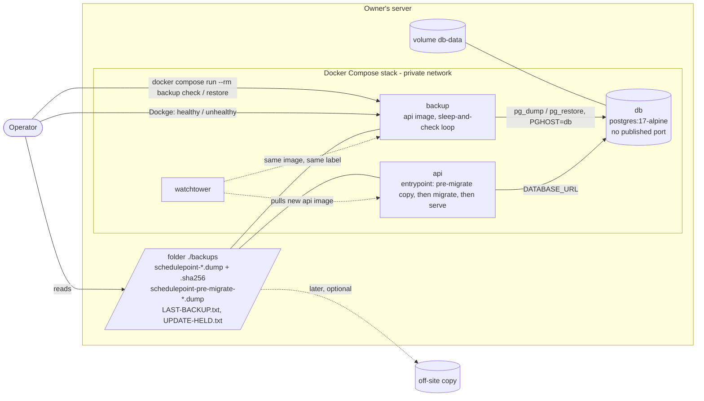
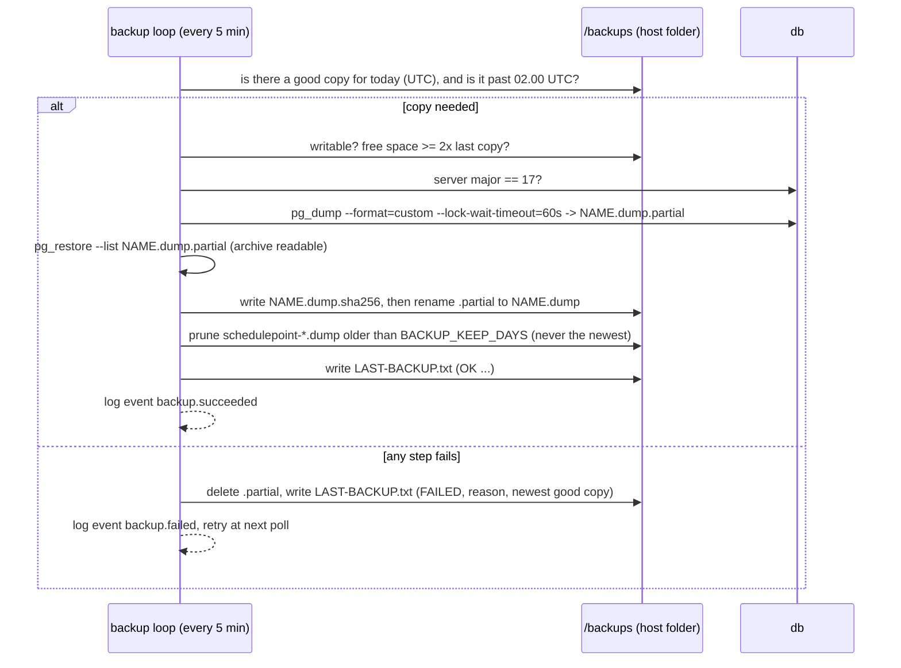
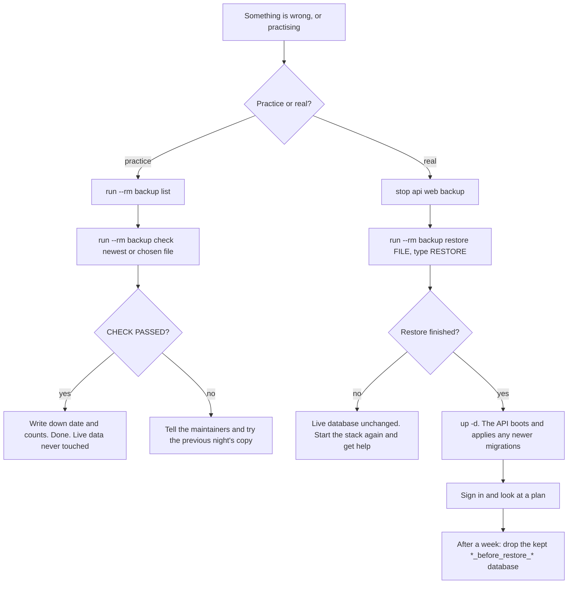
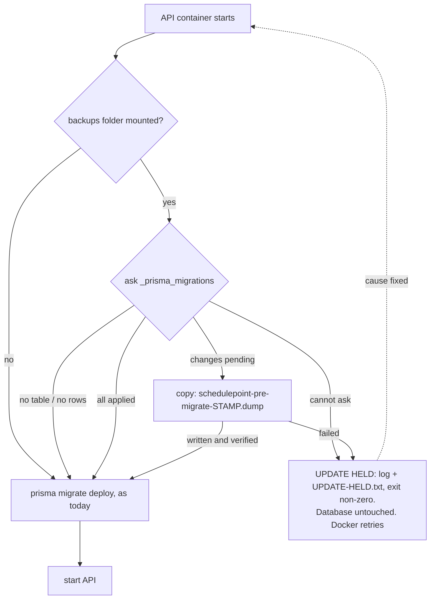

# Feature Spec: Database backup and restore

- **Status:** Approved — by the product owner, 2026-10-14, with a copy before each database update and the database port closed added to scope; answers recorded in §6 and `docs/DECISIONS.md` (2026-10-14). Nothing below is built yet.
- **Author(s):** feature-analyst, for the product owner
- **Date:** 2026-10-14 (amended the same day on approval)
- **Tracking issue / epic:** pre-1.0 requirement (a), `docs/RELEASE_1_0.md` row 5. Required for 1.0 by the owner on
  2026-10-13 (`docs/DECISIONS.md`, entry "2026-10-13 — Pre-1.0 batch 2 is approved…"). Backup is first of the three 1.0 requirements (owner, 2026-10-14).
- **Roadmap link:** the 1.0 entry in `docs/ROADMAP.md` (added by pre-1.0 batch 2).
- **Related ADR(s):** one **new** ADR proposed (§4.9; number taken at landing, 0192 today — `docs/adr/` ends at
  0191). It amends ADR-0018 (the self-migrating image now takes a copy first). Cited: ADR-0018, ADR-0020, ADR-0027, ADR-0047, ADR-0058, ADR-0072, ADR-0076, ADR-0081, ADR-0085, ADR-0087,
  ADR-0088 D1, ADR-0096, ADR-0105, ADR-0110, ADR-0131, ADR-0160, ADR-0190.

**Decided by the owner before this spec (not re-asked):** backup goes first; copies live **on the same server, in
their own folder**; off-site copies are out of scope for now but must stay possible; the brief's promise is a
**daily Postgres snapshot kept 30 days** (`docs/PROJECT_BRIEF.md:232`); the recycle-bin clear-out is a separate spec;
the owner does one practice restore of 30–45 minutes; alert set-up (#100) stays parked and nothing here depends on it.

**Decided by the owner on approval (2026-10-14, §6):** the practice is the safe `check` only; copies go to `./backups`
on the same server; **a copy is taken automatically just before an update changes the database** (§4.12); and **the
database port is closed** on the release stack (§4.10).

---

## 1. Business understanding

### Problem

SchedulePoint keeps every plan in one PostgreSQL database, in one Docker volume (`db-data`) on the owner's server
(`docker-compose.release.yml:65-66`, `:242-243`). **Nothing copies that database anywhere.** Measured 2026-10-14: no
file under `scripts/`, `.github/` or either compose file runs `pg_dump`, and `docs/guides/` holds two guides, neither
about backups. If the volume is damaged, deleted by a mistyped command, or corrupted by a bad release, every
organisation's plans are gone and there is no way back.

This matters more here than on most servers for two reasons that are already true:

1. **Releases deploy themselves.** Watchtower pulls a new API image and the API applies database changes on boot,
   unattended (ADR-0047, ADR-0018; `apps/api/docker-entrypoint.sh:8-9`). A release that damages data reaches the live
   database with nobody watching.
2. **A permanent delete is waiting to be switched on.** `RETENTION_HIERARCHY_ENABLED` permanently removes recycle-bin
   items (`docker-compose.release.yml:131-142`). Turning it on with no backup means a wrong setting cannot be undone.

### Users

| Who                                                                           | What they need                                                                                                |
| ----------------------------------------------------------------------------- | ------------------------------------------------------------------------------------------------------------- |
| **The operator** (today: the product owner, on their own host; non-technical) | A copy made every night without doing anything; a way to see it is working; plain steps to get the data back. |
| **Every organisation's users** (all roles)                                    | Nothing visible. Their benefit is that a disaster costs at most a day of work instead of everything.          |
| **Developers / CI**                                                           | Proof, on every change, that a backup restores to an identical database.                                      |

No organisation role (Org Admin, Planner, Contributor, Viewer, External Guest) gains or loses anything. Backup is an
**installation** concern, done by whoever has the server, like `STAFF_EMAILS` (`docs/DEPLOYMENT.md:1282-1284`).

### Primary use cases

1. **Nightly copy.** Every night the server writes one complete copy of the database to a folder on the server and
   deletes copies older than 30 days.
2. **Is it working?** The operator can see at a glance whether last night's copy succeeded.
3. **Check a copy** without touching the live data: load it into a scratch database, count what is in it, throw the
   scratch database away.
4. **Restore** the live database from a chosen copy, keeping the current database aside rather than destroying it.
5. **Copy now** before something risky (for example before switching on the recycle-bin clear-out).
6. **Copy before an update.** When a new release is about to change the database, a copy is taken first, so a bad
   release can be undone to the minute it arrived rather than to last night.
7. **The database is not reachable from the network.** Only SchedulePoint's own containers can talk to it.

### User journeys

- **Normal week:** nothing to do. Once a week the operator glances at the stack in Dockge (the backup service shows
  "healthy") or opens `LAST-BACKUP.txt` in the backups folder. See §4.3.
- **Practice (once, 30–45 min):** follow the guide's "Check a backup" part, which proves a real copy from this server
  loads, then read the "Restore" part through.
- **Disaster:** stop SchedulePoint, run one restore command, start SchedulePoint, sign in and look. About 15 minutes
  for a small database.

### Expected outcomes

- The worst case for a lost or damaged database becomes "**lose at most one day's work**" (copies are nightly).
- The 1.0 checklist's row 5 can become **Done**, and the clear-out (row 7) gets its precondition (§1, "Success
  criteria").

### Success criteria

1. A copy is written every night with no operator action, and copies older than 30 days are removed.
2. A failed night is **visible without any alert service**: the backup service turns "unhealthy" in Dockge and
   `docker compose ps`, and `LAST-BACKUP.txt` says FAILED and why.
3. CI proves on every pull request that a backup taken from a database full of real test data restores to a database
   **identical row for row** (same counts, same content checksums per table), with the audit log's protection
   triggers intact, and that the API's boot-time migration step accepts the restored database.
4. CI proves the restore command itself works against the shipped image: back up, restore over the live database,
   boot the API, readiness answers 200.
5. The owner has done one practice check on their own server and recorded the result.
6. When an update brings database changes and backups are switched on, a `schedulepoint-pre-migrate-….dump` copy
   exists before the first change is applied; when the copy cannot be made, **the database is not changed**, the API
   does not start, and the reason is printed in plain English. CI proves all three cases (taken, skipped, held)
   against the built image.
7. The release compose file publishes no database port, and CI asserts it on every pull request.

**The precondition rule (for the separate clear-out spec):** `RETENTION_HIERARCHY_ENABLED` must not be switched on
until (1)–(5) above are true **and** a backup taken that same day has passed the "check" command on the host. This
spec writes that rule into `docs/DEPLOYMENT.md`'s "Deleted work" section (M3). Rewording `docs/RELEASE_1_0.md` row 7
is left to the clear-out spec.

### Open questions

None left open: the owner answered §6 on 2026-10-14. Defaults for everything else are stated where they arise; the main ones:

- **Time of the nightly copy:** 02:00 UTC (03:00 in British summer time). Fixed in the script, not a setting, so the
  1.0 promise stays small. A later `BACKUP_HOUR_UTC` setting would be additive.
- **What is copied:** everything in the database, including the audit log, sessions and operational tables. No
  exclusions — a partial backup is a second thing to explain.
- **Copies on by default:** yes, for every installation that runs the release compose file.

---

## 2. Functional requirements

### User stories & acceptance criteria

> **US-1 — Nightly copy.** As the operator, I want a full copy of the database made every night and old ones removed,
> so that I can recover from a disaster without remembering to do anything.
>
> - **Given** the stack is running **when** 02:00 UTC passes and no successful copy exists for that UTC day **then**
>   a copy named `schedulepoint-YYYY-MM-DDTHHMMZ.dump` and its `.sha256` appear in the backups folder.
> - **Given** the server was off at 02:00 **when** it comes back **then** the copy is taken within 5 minutes of the
>   backup service starting (catch-up), not the next night.
> - **Given** the folder holds no copy at all (first install) **when** the service starts **then** it takes one
>   straight away, whatever the hour.
> - **Given** a copy succeeded **then** copies matching the name pattern whose age exceeds `BACKUP_KEEP_DAYS` (30)
>   days are deleted — **and only then**: a failed night deletes nothing, the newest good copy is never deleted, and
>   no file outside the name pattern is ever touched.
> - **Given** the API is crash-looping (for example after a bad release) **then** the nightly copy still runs: the
>   backup service depends on the database only, never on the API.

> **US-2 — See whether it works.** As the operator, I want to know at a glance whether last night's copy worked.
>
> - **Given** the newest good copy is under 26 hours old **then** the backup container reports `healthy`.
> - **Given** it is older, or none exists 10 minutes after start **then** the container reports `unhealthy`, which
>   Dockge and `docker compose ps` both show.
> - **Given** any run **then** `LAST-BACKUP.txt` in the backups folder states, in plain English, OK or FAILED, when,
>   the file name, its size, how long it took, the free disk space, and on failure the reason and the newest good copy.
> - **Given** any run **then** one log line is written with `event` `backup.succeeded` or `backup.failed`
>   (`docker compose logs backup`).

> **US-3 — Check a copy safely.** As the operator, I want to test a copy without touching live data.
>
> - **When** I run `docker compose … run --rm backup check` (newest copy) or `… check <file>` **then** the copy's
>   checksum is verified, it is loaded into a new scratch database, a table of counts (copy vs. live now) is printed
>   for the main tables, the audit log's protection is confirmed present, the copy's database version is confirmed
>   compatible with the installed SchedulePoint, the scratch database is deleted, and the last line says
>   `CHECK PASSED` or `CHECK FAILED: <reason>`.
> - The live database is never written to by `check`.

> **US-4 — Restore.** As the operator, I want to put the live database back to a chosen copy without destroying the
> current one.
>
> - **Given** SchedulePoint's API and web app are stopped **when** I run `… run --rm backup restore <file>` and type
>   `RESTORE` at the prompt **then**: a safety copy of the current database is taken first; the chosen copy is loaded
>   into a new database and checked as in US-3; the current database is renamed to
>   `<name>_before_restore_<YYYYMMDDHHMM>`; the loaded one takes the live name; the command prints the two commands to
>   start SchedulePoint and to delete the kept database later.
> - **Given** the API is still connected **then** it refuses, says so, and prints the stop command. Nothing changes.
> - **Given** the copy was made by a **newer** SchedulePoint than the one installed **then** it refuses with "this copy
>   was made by a newer version; update SchedulePoint first". Nothing changes.
> - **Given** any step fails **then** the live database is untouched (the rename is the last step) and the half-loaded
>   database is dropped.

> **US-5 — Copy now.** As the operator, I want to take a copy on demand, for example before a risky change.
>
> - `… run --rm backup now` takes a copy immediately with the same naming, checks and status file as the nightly one.

> **US-7 — Copy before an update changes the database.** As the operator, I want a copy taken automatically just
> before a new release changes the database, so a bad release can be undone to the minute before it arrived.
>
> - **Given** backups are switched on (the API has the backups folder mounted) **and** the new image carries
>   database changes the database has not had yet **when** the API starts **then**, before `prisma migrate deploy`
>   runs, a copy named `schedulepoint-pre-migrate-YYYY-MM-DDTHHMMZ.dump` and its `.sha256` are written, with the same
>   checks as the nightly copy, and only then are the changes applied.
> - **Given** no change is pending (an ordinary restart, or a release with no database change) **then** no copy is
>   taken and the start is not slowed beyond one small query.
> - **Given** the database is new and empty (no `_prisma_migrations` table, or no rows in it) **then** no copy is
>   taken: there is nothing to save.
> - **Given** backups are not switched on (no backups folder mounted on the API) **then** no copy is taken and the
>   API migrates exactly as it does today, with one log line saying so. An update never stops on a server whose
>   operator has not turned backups on.
> - **Given** backups are switched on and the copy **cannot** be made (disk nearly full, folder not writable, the
>   dump fails, or the database cannot be asked what is pending) **then** the database is **not** changed, the API
>   exits before starting, its log states in plain English why and what to do, and `UPDATE-HELD.txt` in the backups
>   folder says the same where the folder is writable. Docker restarts the API by itself, so once the cause is fixed
>   the update completes without anybody re-running it.

> **US-8 — The database is not on the network.** As the operator, I want the database reachable only by
> SchedulePoint's own containers.
>
> - **Given** the release compose file **then** the `db` service publishes no port; the API, the backup service and
>   `docker compose exec db psql` (the form every operator procedure in `docs/DEPLOYMENT.md` already uses) all still
>   work.

> **US-6 — Proven in CI.** As a developer, I want every pull request to prove that backup and restore still work.
>
> - The `e2e-api` job's round trip (§4.7) fails if any table's row count or content checksum differs between the
>   source and the restored database, if any trigger's enabled state differs, if an `UPDATE` on the restored
>   `audit_events` is not refused, or if `prisma migrate deploy` on the restored database does anything but report no
>   pending migrations.
> - The comparator proves it can fail on every run (a deliberately altered row and a disabled trigger must both be
>   caught — ADR-0110).
> - The `image` job proves the pre-update copy against the built image: skipped on a fresh database, skipped on a
>   restart with nothing pending, **taken** when a change is pending, and **held** (API exits, database unchanged)
>   when the copy cannot be written (§4.12). It also asserts the release compose file publishes no database port.

### Workflows

See §4.2 (nightly), §4.4 (restore) and Appendix A (the owner's guide, step by step, timed).

### Edge cases

| Case                                                  | Behaviour                                                                                                                                                                                                                                       |
| ----------------------------------------------------- | ----------------------------------------------------------------------------------------------------------------------------------------------------------------------------------------------------------------------------------------------- |
| Folder missing or not writable by the container user  | Run fails; container unhealthy; log line says "cannot write to /backups — see the guide, step 1". The status file cannot be written in this one case, so the healthcheck is the signal.                                                         |
| Disk nearly full                                      | Before dumping, free space must be at least twice the previous copy's size (or 200 MB when there is none). Otherwise FAILED "disk nearly full"; nothing is pruned early.                                                                        |
| A migration holds a lock at 02:00 (Watchtower deploy) | `pg_dump --lock-wait-timeout=60s` fails rather than hanging; the next 5-minute poll retries.                                                                                                                                                    |
| Watchtower recreates the backup container mid-copy    | The unfinished `.partial` file is left; the next start deletes stale `.partial` files and takes the copy again.                                                                                                                                 |
| Database server major version newer than the client   | `pg_dump` refuses by design ("cannot dump from PostgreSQL servers newer than its own major version", PostgreSQL 17 `pg_dump` docs). The script checks first and fails with "database is version N, backup tools are 17 — update SchedulePoint". |
| Truncated or corrupted copy                           | Caught at write time (`pg_restore --list` must read the archive) and at check time (`.sha256` must match).                                                                                                                                      |
| The whole server is lost                              | Copies are lost too. **Accepted by the owner** (same-server decision). §4.8 says how off-site copies are added later.                                                                                                                           |
| Restore when the database volume was wiped            | The database container recreates an empty database and the API migrates it on boot; restore then swaps the copy in exactly as normal.                                                                                                           |
| `BACKUP_KEEP_DAYS` not a whole number from 1 to 3650  | The backup service refuses to start, naming the setting (same strictness as ADR-0096 D10).                                                                                                                                                      |
| Two copies on one day (nightly + `now`)               | Both kept; both age out normally.                                                                                                                                                                                                               |
| Update with a database change, backups switched on    | Pre-update copy taken first (US-7); the API boots once it is written.                                                                                                                                                                           |
| Update held because the copy failed                   | Database untouched; API exits and Docker retries it. Fix the cause (usually disk space), or go back to the previous version, which still matches the untouched database (§4.12).                                                                |
| Backups folder mounted on the API but owned by root   | Happens if the folder was not created first (Docker creates a missing folder as root). The backup service shows unhealthy at switch-on, before any update can be held, so step 5 of the host steps catches it.                                  |
| Restoring an older copy                               | The API's next start finds changes pending and takes a pre-update copy of the restored database before upgrading it — a second way back, at no extra effort.                                                                                    |
| Someone used a database tool from another computer    | No longer possible once the port is closed (US-8). Inside the server, `docker compose exec db psql` and the backup `check` command still work.                                                                                                  |

### Permissions

No application permission is added or changed. Running any backup command needs shell access to the host and the
Docker socket, the same bar as reading the database with `psql` today (`docs/DEPLOYMENT.md:1282-1284`). The backup
container receives **only** the database credentials — not `BETTER_AUTH_SECRET`, mail credentials or any URL.

### Validation rules

- `BACKUP_KEEP_DAYS`: integer 1–3650, default 30. Anything else refuses the start.
- `BACKUP_DIR`: a host path (compose interpolation only, never inside the container). Default `./backups`, relative
  to the compose file's folder.
- Restore and check accept only a file name matching `schedulepoint-*.dump` inside the backups folder — no paths, so
  a typo cannot point at anything else.

### Error scenarios

| Scenario                                | Detection                                                  | What the operator sees                                         |
| --------------------------------------- | ---------------------------------------------------------- | -------------------------------------------------------------- |
| Nightly copy fails                      | non-zero `pg_dump` / `pg_restore --list`                   | `unhealthy` after 26 h; `LAST-BACKUP.txt` FAILED + reason; log |
| Folder not writable                     | write test at start of each run                            | `unhealthy`; log line naming the folder and the guide step     |
| Restore while API connected             | `pg_stat_activity` count > 0                               | refused, stop command printed, nothing changed                 |
| Copy newer than installed version       | `_prisma_migrations` names not in `/app/prisma/migrations` | refused, "update first", nothing changed                       |
| Checksum mismatch                       | `sha256sum -c`                                             | `CHECK FAILED: the file is damaged`                            |
| Pre-update copy fails                   | non-zero `pre-migrate` before `prisma migrate deploy`      | site down; `UPDATE HELD` log line + `UPDATE-HELD.txt`; §4.12   |
| Cannot ask the database what is pending | `psql` query fails                                         | treated as a failed copy: held, never migrated blind           |

---

## 3. Technical analysis

### What was read or run (ADR-0076)

| Claim                                                                                                                                                             | Evidence                                                                                                                                                                |
| ----------------------------------------------------------------------------------------------------------------------------------------------------------------- | ----------------------------------------------------------------------------------------------------------------------------------------------------------------------- |
| The database is `postgres:17-alpine`, data in volume `db-data`, never touched by Watchtower                                                                       | `docker-compose.release.yml:43-44`, `:55-58`, `:65-66`; Watchtower only updates labelled containers, `:198-200`, `:229-230`                                             |
| The API image is `node:22-alpine`, runs as `node`, ships `prisma/migrations` at `/app/prisma`                                                                     | `apps/api/Dockerfile:9`, `:48-52`, `:58`                                                                                                                                |
| The API migrates on every boot with `prisma migrate deploy`                                                                                                       | `apps/api/docker-entrypoint.sh:8-9`                                                                                                                                     |
| The owner's stack is a separate copy of the compose file (Dockge), so compose edits are manual                                                                    | `docs/DEPLOYMENT.md:781-789`                                                                                                                                            |
| The database container mounts only `db-data`; host files must be piped in, not `-f`                                                                               | `docs/DEPLOYMENT.md:898-906`                                                                                                                                            |
| `audit_events` refuses UPDATE/DELETE (row trigger) and TRUNCATE (statement trigger), both `ENABLE ALWAYS`                                                         | `apps/api/prisma/migrations/20260803170000_audit_events/migration.sql:110-122`                                                                                          |
| The app role is a superuser on the Compose stack                                                                                                                  | same file, `:9-14`; `scripts/e2e-local.sh:86-101`                                                                                                                       |
| The schema needs the `btree_gist` extension and has `EXCLUDE` constraints                                                                                         | `apps/api/prisma/migrations/20260715120100_calendar_shift_model/migration.sql:30`, `:51`, `:74`, `:132`                                                                 |
| The database holds credentials (password hashes, sessions, verification tokens)                                                                                   | `apps/api/prisma/schema.prisma:59`, `:84`, `:96` (`sessions`, `accounts`, `verifications`)                                                                              |
| No data is encrypted with `BETTER_AUTH_SECRET`, so a restore needs no secret to read data                                                                         | `grep -r 'createCipheriv\|symmetricEncrypt\|encrypt(' apps/api/src` → no files                                                                                          |
| `pg_dump` is consistent while others write; triggers are created in the post-data section (after the data is loaded); an older `pg_dump` refuses a newer server   | PostgreSQL 17 docs, <https://www.postgresql.org/docs/17/app-pgdump.html> (`--section`, Description, Notes)                                                              |
| CI's API job has a disposable `postgres:17-alpine` and runs the pairwise seeding last                                                                             | `.github/workflows/ci.yml:289-395`                                                                                                                                      |
| CI's `image` job builds the images from source and boots the stack                                                                                                | `.github/workflows/ci.yml:1182-1268`                                                                                                                                    |
| `pnpm prepush` runs root `check:*` gates only and deliberately no database work                                                                                   | `scripts/prepush.sh:29-31`, `:147-157`                                                                                                                                  |
| Operator settings in `.env.example` and the compose files are promised at 1.0                                                                                     | `docs/RELEASE_1_0.md`, "What 1.0 promises" item 3                                                                                                                       |
| The database port 5432 is published on the host                                                                                                                   | `docker-compose.release.yml:63-64` (closed by this work, §4.10)                                                                                                         |
| The entrypoint stops at the first failing command, so a non-zero step before `migrate deploy` prevents the migration                                              | `apps/api/docker-entrypoint.sh:6` (`set -e`), `:8-9`                                                                                                                    |
| `prisma migrate status` exits 1 for a pending migration **and** for a connection error **and** for "no migration table" — so its exit code cannot tell them apart | Prisma CLI reference, `migrate status` (<https://www.prisma.io/docs/orm/reference/prisma-cli-reference>, read 2026-10-14); `apps/api/package.json:46` (`prisma` ^6.2.1) |
| The API container has no volume today and restarts itself after an exit                                                                                           | `docker-compose.release.yml:73-158` (no `volumes:` key), `:75` (`restart: unless-stopped`)                                                                              |
| The API image's healthcheck allows a 40 s start period                                                                                                            | `apps/api/Dockerfile:63`                                                                                                                                                |
| CI's `image` job boots `docker-compose.yml` + `docker-compose.ci.yml`, never the release file                                                                     | `.github/workflows/ci.yml:1196-1199`, `:1264-1268`; `docker-compose.ci.yml:14-22`                                                                                       |
| Every operator database procedure reaches Postgres with `docker compose exec db psql`, not through the published port                                             | `docs/DEPLOYMENT.md:477`, `:621`, `:899-906`; `grep 5432 docs/DEPLOYMENT.md` → no hit                                                                                   |
| Local development relies on the **dev** compose file's port (the API run on the host connects to `localhost:5432`)                                                | `.env.example:14`; `docs/DEVELOPMENT.md:40-46`; `docker-compose.yml:29-30`                                                                                              |
| `scripts/e2e-local.sh` does **not** use either compose file's port: it starts a host Postgres service                                                             | `scripts/e2e-local.sh:67-81` (`service postgresql start`, `pg_isready -h localhost`)                                                                                    |
| `POSTGRES_PASSWORD` is read only when the data directory is empty, so changing it later changes nothing in the database                                           | `postgres` image documentation, "Environment Variables" caveat (<https://hub.docker.com/_/postgres>)                                                                    |

**Claims not yet verified, and where M1 verifies them:** that `ALTER TABLE … ENABLE ALWAYS TRIGGER` survives
`pg_dump`/`pg_restore` (expected from how `pg_dump` records a trigger's enabled state; the round trip asserts
`tgenabled = 'A'`); that `node:22-alpine` offers the `postgresql17-client` package and that its `node` user is uid
1000; the image-size increase; that busybox `find -mtime`, `sha256sum` and `df -P` behave as the script needs. Each is
a test or a measured step in M1, not a premise of this design. **Verified in M2:** that `pg_dump` (libpq) refuses
Prisma's `?schema=public` query parameter in `DATABASE_URL` (expected — the script strips the query string either
way, so the design does not depend on the answer); that Docker creates a missing bind-mount folder owned by root
(expected; the design's response is the same whether or not it does); and the boot-time cost of a pre-update copy,
measured in the `image` job.

### Impact

| Area           | Impact | Notes                                                                                                                                                                                                                                                                                            |
| -------------- | ------ | ------------------------------------------------------------------------------------------------------------------------------------------------------------------------------------------------------------------------------------------------------------------------------------------------ |
| Frontend       | none   | No screen changes. A status panel on the staff console is a later option (§4.8), which would be an ADR-0105 entry-point trigger.                                                                                                                                                                 |
| Backend        | low    | No Nest module. One POSIX shell script shipped in the API image, plus the PostgreSQL 17 client tools. The API's entrypoint calls it once before migrating.                                                                                                                                       |
| Database       | none   | **No schema change**: no model, column, index, constraint or migration. The restore creates and renames whole databases, which is operational, not schema.                                                                                                                                       |
| API            | none   | No endpoint.                                                                                                                                                                                                                                                                                     |
| Security       | med    | Copies contain password hashes and session tokens: folder mode 700, files 600, container gets DB credentials only, read-only root filesystem, no capabilities. The database port is no longer published (an improvement).                                                                        |
| Performance    | low    | One `pg_dump` a night (a consistent snapshot; does not block readers or writers), plus one before each update that carries a database change — that one **adds its duration to the update's downtime** (§4.12). Size and duration unmeasured on the owner's data — the status file reports both. |
| Infrastructure | med    | A new compose service (`backup`) in both compose files; the API gains the backups folder mount in the release and CI compose files; the release `db` loses its published port; two new operator settings; the API image grows by the client tools.                                               |
| Observability  | low    | Two log events, a status file and a container healthcheck. No metrics.                                                                                                                                                                                                                           |
| Testing        | med    | A round-trip step in `e2e-api`; a real-restore step in `image`; a local target in `scripts/e2e-local.sh`. No Playwright suite changes.                                                                                                                                                           |

### Constraints from the house rules

- **Recalc parity gate:** not a scheduling input. The engine and `computeSchedule` are untouched; parity holds
  trivially. No `scripts/engine-parity.json` declaration is needed because no engine file changes.
- **Multi-tenancy:** a backup is the whole installation, every organisation. A per-organisation download is the
  separate 1.0 requirement (b).
- **The pen (ADR-0028):** no plan write. Not structural.
- **No `VITE_` flag** (ADR-0088 D1): nothing in the web bundle changes. Rollback is the commit boundary, and for the
  operator, removing the `backup` service from the compose file.
- **ADR-0105 triggers crossed:** CI steps added (`e2e-api`, `image`), new operator settings that become a 1.0
  promise, and a change to what every release does on boot (the pre-update copy). No user-facing UI entry point, no component contract, no shared gate, **no schema change**. If any schema
  need appears during build, the milestone stops and goes to **database-architect** (CLAUDE.md §19.3).

### Dependencies

- None to build. The owner's host steps (§4.6) depend on the M2 release reaching the host, because the compose block
  calls a script that only exists in images from M1 onwards and the pre-update copy needs M2's entrypoint.

---

## 4. Solution design

### 4.1 Architecture overview

A new compose service, `backup`, runs **the same API image** the stack already pulls, with a different entrypoint: a
small shell script, `schedulepoint-backup`, that the image ships next to the migrations it has to agree with. It
talks to the `db` service over the stack's private network and writes into one host folder. The `api` service mounts
the same folder so its entrypoint can run the same script's `pre-migrate` command before it changes the database
(§4.12). The database publishes no port: only these containers reach it (§4.10).



Why the API image, not `postgres:17-alpine` or a host script, is argued in §4.11. In one sentence: **Watchtower then
updates the backup tool with every release, the script can check a copy against the migrations of the version that
will boot it, and the owner's compose file only ever needs this block pasted once.**

### 4.2 Data flow — the nightly copy



Format: PostgreSQL **custom format** (`pg_dump -Fc`), compressed by default and restorable selectively. One
self-contained file per night with a sortable UTC name, written atomically (`.partial` then rename) with a
`.sha256` beside it. That file shape is what makes a later off-site copier trivial (§4.8).

### 4.3 How a failure becomes visible without alerts

Three signals, none needing an outside service (#100 stays parked):

1. **Container health.** `healthcheck` runs `schedulepoint-backup health` every 5 minutes; healthy only if the newest
   good copy is under 26 hours old (24 h + 2 h slack). Dockge and `docker compose ps` show `unhealthy`. This is the
   signal that survives the status file being unwritable.
2. **`LAST-BACKUP.txt`** in the folder, overwritten every run, plain English:

   ```text
   OK — last backup 2026-10-15 02:00 UTC
   File: schedulepoint-2026-10-15T0200Z.dump (14.2 MB), took 9 seconds
   Copies kept: 30, oldest 2026-09-16. Free disk space: 182 GB.
   ```

   or `FAILED — 2026-10-15 02:00 UTC. Reason: disk nearly full (needs 28 MB, 11 MB free). Newest good copy:
schedulepoint-2026-10-14T0200Z.dump.`

3. **Log lines** `backup.succeeded` / `backup.failed` / `backup.pruned`, one JSON object per line, in
   `docker compose logs backup`; and, from the API's entrypoint, `backup.pre_migrate_skipped` (with a reason),
   `backup.pre_migrate_taken` and `backup.pre_migrate_failed`, in `docker compose logs api` (§4.12).

When alerts are eventually set up, the natural addition is an optional ping URL hit after each good copy (a
dead-man's switch, like `HEARTBEAT_URL`). It is **not** in this spec, so nothing here waits on #100.

### 4.4 User flow — check and restore



Restore steps inside the command (US-4): refuse if anything is connected → safety copy of the current database →
`CREATE DATABASE <db>_restoring TEMPLATE template0` → `pg_restore --exit-on-error --single-transaction --no-owner
--no-privileges` → the same checks as `check` (including the version check: every `_prisma_migrations` name must
exist in `/app/prisma/migrations`) → `ALTER DATABASE <db> RENAME TO <db>_before_restore_<stamp>` →
`ALTER DATABASE <db>_restoring RENAME TO <db>`. The renames run on the `postgres` maintenance database. The live
database is only renamed, never dropped, so the previous state is always one rename away.

**Why a new database and never `--clean` into the live one:** restoring into an empty database means the data is
loaded **before** the audit triggers exist (they are post-data, per the `pg_dump` docs cited in §3), and nothing is
ever updated or deleted, so `audit_events`' `BEFORE UPDATE OR DELETE` and `BEFORE TRUNCATE` triggers
(`…/20260803170000_audit_events/migration.sql:110-116`) have nothing to refuse. It also means a failure half-way
leaves the live database exactly as it was.

**How the self-migrating API behaves on a restored database (ADR-0018):** `_prisma_migrations` is an ordinary table
in `public` and is copied like any other, so on boot `prisma migrate deploy` (`docker-entrypoint.sh:9`) sees the
copy's migrations as applied and applies only those the running image has and the copy lacks — the normal
"restore an older copy, then upgrade" path. Because changes are then pending, the entrypoint first takes a
pre-update copy of the just-restored database (§4.12), so the upgrade itself can be undone too. The opposite case (copy newer than the image) is **refused by the restore
command** before anything changes, so what Prisma would do there is never reached. Whether it would warn or fail is
not established and does not need to be.

### 4.5 Compose and settings

The `backup` service is added to **both** `docker-compose.release.yml` and `docker-compose.yml` (sketch — final text
in M2):

```yaml
backup:
  image: ghcr.io/huttonhomehub/schedulepoint_1/api:${API_IMAGE_TAG:-${IMAGE_TAG:-latest}}
  restart: unless-stopped
  logging: { driver: json-file, options: { max-size: '10m', max-file: '3' } }
  labels:
    com.centurylinklabs.watchtower.enable: 'true' # follows the api image, ADR-0047
  depends_on:
    db:
      condition: service_healthy # deliberately NOT the api: copies continue while the api is broken
  entrypoint: ['sh', '/app/backup/schedulepoint-backup.sh']
  command: ['schedule']
  environment:
    PGHOST: db
    PGUSER: ${POSTGRES_USER:-app}
    PGPASSWORD: ${POSTGRES_PASSWORD:-app}
    PGDATABASE: ${POSTGRES_DB:-app}
    BACKUP_KEEP_DAYS: ${BACKUP_KEEP_DAYS:-30}
  volumes:
    - ${BACKUP_DIR:-./backups}:/backups
  read_only: true
  tmpfs: [/tmp]
  cap_drop: [ALL]
  security_opt: ['no-new-privileges:true']
  healthcheck:
    test: ['CMD', 'sh', '/app/backup/schedulepoint-backup.sh', 'health']
    interval: 5m
    timeout: 20s
    start_period: 10m
```

Two edits to existing services, in **`docker-compose.release.yml` only** (and the API mount also in
`docker-compose.ci.yml`, so CI proves it):

```yaml
db:
  # ports:            <- removed (§4.10). The app reaches the database over the stack's own network.
  #   - '5432:5432'

api:
  volumes:
    - ${BACKUP_DIR:-./backups}:/backups # the pre-update copy writes here (§4.12)
```

**Why the API mount is not in the dev `docker-compose.yml`:** a developer writing a migration recreates the API
again and again with a change pending; with the folder mounted, every one of those starts would take a copy, and a
folder Docker created as root would hold the start. Leaving the mount out keeps the dev stack migrating exactly as
today ("backups not switched on"). CI still proves the mounted path, through `docker-compose.ci.yml`, and asserts the
release file's shape with `docker compose -f docker-compose.release.yml config` (§4.7).

**New operator settings — both become 1.0 promises (`docs/RELEASE_1_0.md`, item 3), so the names are chosen to
last:**

| Setting            | Where                             | Default     | Meaning                                                         |
| ------------------ | --------------------------------- | ----------- | --------------------------------------------------------------- |
| `BACKUP_DIR`       | compose interpolation (host path) | `./backups` | The host folder the copies are written to.                      |
| `BACKUP_KEEP_DAYS` | `backup` container environment    | `30`        | Copies older than this many days are deleted after a good copy. |

The pre-update copy adds **no setting**: it is on exactly when the API has the folder mounted, and the operator
who wants it off removes that one volume line. No `BACKUP_ENABLED`: an operator who wants none removes the service. No schedule setting (02:00 UTC fixed). Both are
additive later, so leaving them out promises less. `PGPASSWORD` is interpolated from the host's `.env` exactly as the
API's `DATABASE_URL` already is (`docker-compose.release.yml:94`), so **no password enters git**.

`.env.example` gains both, commented, in the "Self-hosted RELEASE stack" section (`.env.example:360-376`).
`.gitignore` gains `backups/` for the dev compose file.

### 4.6 What the owner does on the host, once

After the release that ships M2 has reached the server (Watchtower pulls it on its own; the M2 changeset's note is
how the owner learns it has) and the guide (M3) is published:

| Step | What                                                                                                                                                                                                                                                                  | Minutes |
| ---- | --------------------------------------------------------------------------------------------------------------------------------------------------------------------------------------------------------------------------------------------------------------------- | ------- |
| 0    | If you ever connected a database tool (pgAdmin, DBeaver) to this server **from another computer**: note that it will stop working after step 4. Nothing in SchedulePoint needs it; the backup `check` command replaces it.                                            | 1       |
| 1    | In the folder holding the compose file, make the backups folder owned by the container's user: `sudo install -d -o 1000 -g 1000 -m 700 backups`. **Do this before step 4**, or Docker creates it owned by the wrong user.                                             | 2       |
| 2    | Edit the stack's compose file (Dockge: edit the stack) — three changes, each pasted from the guide: **(a)** add the `backup` block; **(b)** under `api:`, add the two `volumes:` lines; **(c)** under `db:`, delete the two lines `ports:` and `- '5432:5432'`. Save. | 10–15   |
| 3    | Nothing to set in `.env` unless you want a different folder or period                                                                                                                                                                                                 | 0–2     |
| 4    | Update the stack (Dockge: **Update**; or `docker compose -f docker-compose.release.yml up -d`)                                                                                                                                                                        | 2       |
| 5    | Within a minute, `LAST-BACKUP.txt` says OK and Dockge shows the backup service healthy. **If it is unhealthy, fix it now** — the same folder problem would hold the next update (§4.12).                                                                              | 3       |
| 6    | Save a copy of your `.env` in your password manager — **it is not in the backup**, and a rebuilt server needs it                                                                                                                                                      | 5       |
| 7    | The practice check (Appendix A, Part 2), then read Part 3 and "If an update is held" through                                                                                                                                                                          | 30–45   |

About **25 minutes** of set-up plus the 30–45 minute practice. Nothing further is needed for the pre-update copy:
from then on it happens by itself whenever an update brings a database change, and the next such update leaves a
`schedulepoint-pre-migrate-….dump` in the folder.

**The database password (not a step).** If your `.env` sets no `POSTGRES_PASSWORD`, the database password is the
default `app`. With the port closed this matters **much less**: only containers on the server can reach the
database, so somebody would already need to be on the server. The guide recommends setting a strong one, but says
plainly that **on an existing installation it is not just an edit to `.env`**: Postgres reads `POSTGRES_PASSWORD`
only when the database is first created, so changing it in `.env` alone leaves the database's password as it was
and the API (which builds its connection from the same variable) then cannot connect and SchedulePoint goes down.
Changing it means also running one `ALTER USER` command inside the database at the same moment — the guide gives it
as an optional, separate section. It is **not** a required step for this work.

### 4.7 How restore is tested automatically

**No new required check.** CLAUDE.md §19.9's roster of ten stays ten; both additions are steps in jobs that
already exist.

1. **Round trip with real data — a step in `e2e-api`**, after "Pairwise differential", when the database holds
   everything the API e2e suite and the 63 seeded pairwise plans wrote and nothing else is writing.
   `scripts/backup-restore-check.sh` runs the **shipped script** (`apps/api/backup/schedulepoint-backup.sh now` and
   `check --keep`) inside `postgres:17-alpine` with the repository's migrations mounted at `/app/prisma/migrations`
   (Docker is on the runner; the `image` job already uses it, `ci.yml:1196-1199`). It then compares source and restored
   database exactly:
   - per table in `public`: `count(*)` and `md5(string_agg(md5(t::text), '' ORDER BY md5(t::text)))`;
   - every sequence's `last_value`/`is_called`; every non-internal trigger's name and `tgenabled`; every extension;
     the number of indexes and constraints per table;
   - an `UPDATE audit_events …` on the restored database must fail with SQLSTATE `0A000`;
   - `prisma migrate deploy` against the restored database must exit 0 with no pending migration, and
     `prisma:check-drift` against it must exit 0.
   - **Not vacuous:** `organizations`, `users`, `plans`, `activities`, `dependencies`, `calendars`, `calendar_shifts`,
     `baselines` and `audit_events` must each be non-empty in the source, and `_prisma_migrations` must have one row
     per migration directory.
   - **Can fail (ADR-0110):** each run alters one row and disables one trigger in the restored database and asserts
     the comparator reports both, then drops it.
   - **The `pre-migrate` decision table**, against the same database and a scratch one, with `MIGRATIONS_DIR` pointed
     at temporary copies of the migrations folder: no `/backups` → `not_enabled`, exit 0, no file; empty database →
     `fresh`; every directory applied → `none_pending`; one extra directory → a `schedulepoint-pre-migrate-*` copy,
     exit 0; extra directory with the folder unwritable → non-zero exit and an `UPDATE HELD` line; database
     unreachable → non-zero exit. Cheap, and it fixes the logic before M2 wires it into every boot.
2. **The real restore against the shipped image — a step in `image`**, after the smoke tests: `run --rm backup now`;
   stop `api`/`web`; `run --rm backup restore --yes <newest>`; start them; `/api/v1/health/ready` must answer 200
   and the API log must show no pending migrations applied; the `*_before_restore_*` database must exist. This drives
   the exact commands the guide gives the owner — it is this epic's journey in ADR-0081's sense (there is no browser
   surface to drive).
   **The pre-update copy, in the same job** (the `image` job is the only place the real entrypoint runs against a
   real database). `docker-compose.ci.yml` gains the API's `/backups` mount, and the job creates the folder owned by
   uid 1000 before the first `up`. Each case is asserted on the API log's `backup.pre_migrate_*` event **and** on the
   folder **and** on `_prisma_migrations`:
   - **fresh:** the first boot of an empty database logs `backup.pre_migrate_skipped` with reason `fresh` and writes
     no `schedulepoint-pre-migrate-*` file;
   - **nothing pending:** `restart api` logs `backup.pre_migrate_skipped` with reason `none_pending`, no file;
   - **held (ADR-0110 — the case that can fail):** the folder is made unwritable, then a probe migration that
     changes nothing (a directory holding `SELECT 1;`, bind-mounted by a CI-only override as
     `/app/prisma/migrations/99999999999999_ci_pending_probe`) is made visible and the API recreated: the API exits
     non-zero, its log carries `UPDATE HELD`, and `_prisma_migrations` does **not** contain the probe — the database
     was not changed. Proven red once in the PR by deleting the entrypoint's `pre-migrate` call (the step must then
     fail at "probe applied although the copy failed");
   - **taken, by itself:** the folder is made writable again and nothing else is done; within Docker's own restart
     retries the API comes up, a `schedulepoint-pre-migrate-*.dump` exists and passes `check`, its file time is
     **before** the probe's `_prisma_migrations.started_at`, and the API answers ready. This proves the owner's fix
     ("free the space; it carries on by itself") rather than assuming it;
   - **the release file's shape:** `docker compose -f docker-compose.release.yml config --format json` (no image
     pull) must show no `ports` on `db` and a `/backups` mount on both `api` and `backup`. This is the release file's
     only contact with CI, since the job boots the dev file (`ci.yml:1196-1199`).

   The probe runs **after** the restore step above, because once applied it is a migration name the image without
   the override does not have, which the restore command would rightly refuse as "newer".

3. **Locally:** `scripts/e2e-local.sh backup` runs (1) against the local database. It uses Docker if present,
   otherwise local PostgreSQL 17 client tools, and refuses with a clear message if neither. `docs/TESTING.md` "Before
   you push" adds: run it when you touch `apps/api/backup/`, either compose file's `backup` block, or a migration.
4. **Not in `pnpm prepush`.** ADR-0160 says a root `check:*` gate CI runs is one prepush runs; this is not a root
   `check:*` gate (it needs a database and Docker, like the rest of the e2e half, `scripts/prepush.sh:29-31`), and it
   is deliberately **not named `check:*`**, because prepush derives its roster from that prefix
   (`scripts/prepush.sh:147-150`) and would then fail on every machine without a database.

### 4.8 Adding an off-site copy later (designed for, not built)

Each copy is one finished file with its checksum beside it, and unfinished copies only ever exist as `.partial`.
So an off-site copy is **any tool that copies finished `schedulepoint-*.dump` and `.sha256` files out of
`BACKUP_DIR`** — the owner's NAS sync, `rclone` to cloud storage, or a second compose service on a profile. The
receiving end verifies with `sha256sum -c`. Two rules for that later spec: the copies must be **encrypted before
they leave** (they contain password hashes and session tokens), and an off-site copy must have its own check, since
a copy nobody has restored is not yet a backup. Nothing in this design needs to change for it.

Other later options, recorded as register rows in M3 rather than built: a dedicated read-only database role for the
backup service (`pg_read_all_data`); a backup status line on the staff console (an ADR-0105 entry-point trigger, so
its own spec); a one-boot override that lets a held update proceed without a copy (deliberately not built — §4.12
says why, and the operator already has two ways out).

### 4.9 ADR required — outline of ADR-0192

**Title (proposed):** "A backup is a file the image writes, and a restore never overwrites"

- **Context:** no backup exists; releases auto-deploy and self-migrate; a permanent delete awaits a switch; the
  owner's decisions (same server, nightly, 30 days).
- **D1 — A sidecar that runs the API image.** Rejected: `postgres:17-alpine` with an inline script (never updated by
  Watchtower, fixes need hand edits, cannot see the migrations); a host cron script (owner installs and maintains it,
  not versioned); a third-party backup image (a dependency holding superuser credentials); running it inside the API
  process like the retention sweep (ADR-0087 — couples copies to API health, the exact time they are needed most).
- **D2 — Nightly custom-format copy at 02:00 UTC with catch-up; keep 30 days; prune only after a good copy; never
  the newest; only our name pattern.**
- **D3 — Restore loads into a new database and swaps by rename; the old one is kept; restore refuses a copy newer than
  the image.**
- **D4 — Failure is visible without alerts:** healthcheck, status file, log events.
- **D5 — Tested twice in existing CI jobs:** an exact round trip on real data, and the real restore against the
  shipped image; no new required check; not a `check:*` gate.
- **D6 — Two operator settings, `BACKUP_DIR` and `BACKUP_KEEP_DAYS`,** promised at 1.0.
- **D7 — Off-site is a later copier of finished files,** encrypted, with its own check.
- **D8 — A restore-tested backup is the precondition for `RETENTION_HIERARCHY_ENABLED`.**
- **D9 — An update that changes the database is preceded by a copy, and a failed copy holds the update** (amends
  ADR-0018). Pending-ness is read by comparing migration directories with `_prisma_migrations`, not from `prisma
migrate status`'s exit code. Opt-in by mount; no setting. Rejected: warn and migrate anyway (defeats the purpose
  exactly when a release is bad); a setting to skip (a 1.0 promise for an escape the operator already has).
- **D10 — The release stack publishes no database port.** The dev stack keeps its port, which local development
  needs.
- **Consequences:** the API image carries PostgreSQL 17 client tools and must move major version with the `db`
  image; a `db` upgrade to 18 needs the client bumped in the same release (the script fails loudly otherwise). An
  update with a database change is down for as long as the pre-update copy takes. An operator who used a database
  tool from another machine loses that access.

`check:spec-status` refuses a spec an ADR cites while it is headed Draft (`ci.yml:83-92`). This spec is Approved
(2026-10-14), so the ADR can land with M1.

### 4.10 Closing the database port (in scope — owner, 2026-10-14)

**The finding.** `docker-compose.release.yml:63-64` publishes the database port `5432` on every host interface, with
the password defaulting to `app` (`:61`). If the server's firewall does not block it, the database — and therefore
every organisation's plans, password hashes and sessions — is reachable from the network.

**The change (M2).** Delete the `ports:` mapping from the `db` service in **`docker-compose.release.yml` only**.
The API and the backup service already reach the database by its service name on the stack's private network
(`@db:5432` in `DATABASE_URL`, `:94`; `PGHOST: db` in §4.5), which needs no published port. Every operator
procedure in `docs/DEPLOYMENT.md` uses `docker compose exec db psql` (`:477`, `:621`, `:899-906`), which goes
through Docker, not the port, so none changes.

**Not the dev `docker-compose.yml`.** Local development needs its port: `.env.example:14` points an API run on the
host at `localhost:5432`, and `docs/DEVELOPMENT.md:40-46` starts the database with the dev compose file. (The brief
also named `scripts/e2e-local.sh` as depending on it. Read 2026-10-14, it does not: it starts a **host** Postgres
service, `scripts/e2e-local.sh:67-81`, and never uses either compose file's port. The conclusion stands either
way.) CI's `e2e-api` and `e2e-web` jobs use their own service containers (`ci.yml:301-307`, `:441-447`) and are
unaffected.

**What the owner should know, plainly.**

- Anyone who connected a database tool (pgAdmin, DBeaver, `psql`) **from another computer** will no longer be able
  to. Nothing in SchedulePoint uses that route; the backup `check` command (which prints what is in a copy and in the
  live database) replaces the usual reason to look inside. From the server itself, `docker compose exec db psql`
  still works.
- **The default password `app` matters much less once the port is closed**: only containers on the server can
  reach the database, so an attacker would already need a foothold on the server, at which point the password is not
  the barrier. The guide still recommends setting `POSTGRES_PASSWORD` if it has never been set — but says plainly
  that **on an existing installation this is not just an edit to `.env`**. Postgres reads `POSTGRES_PASSWORD` only
  when the database is first created (`postgres` image documentation, cited in §3). Changing it in `.env` alone
  leaves the database's password unchanged, while the API builds its connection string from the new value, so the
  API cannot sign in and SchedulePoint goes down. The guide gives the extra `ALTER USER` command as an optional,
  separate section; it is **not** a required step of this work.

**Reviewed by the security-reviewer** in M2, with the container hardening and the pre-update copy.

### 4.11 Alternatives considered

| Option                                           | For                                                                                                           | Against                                                                                                              | Verdict    |
| ------------------------------------------------ | ------------------------------------------------------------------------------------------------------------- | -------------------------------------------------------------------------------------------------------------------- | ---------- |
| **Sidecar running the API image** (chosen)       | Watchtower updates it; script versioned and tested with the migrations it checks; owner pastes one block once | API image grows by the client tools; client major must track the `db` major                                          | **Chosen** |
| `postgres:17-alpine` sidecar, inline script      | No image change; version matches `db` by construction                                                         | Never updated by Watchtower — every fix is a hand edit on the host; no migrations to check against; long YAML script | Rejected   |
| Host cron + script                               | Familiar                                                                                                      | Owner must install and maintain cron; not versioned; not in Dockge's view                                            | Rejected   |
| Third-party image (e.g. a postgres-backup image) | Feature-complete                                                                                              | A dependency nobody here reviews, holding the superuser password (CLAUDE.md §2)                                      | Rejected   |
| Inside the API process (like ADR-0087)           | Staff console could show it natively                                                                          | A crash-looping API — the moment a copy matters most — stops the copies                                              | Rejected   |
| Volume snapshots (filesystem level)              | Fast                                                                                                          | Unsafe while Postgres runs unless the filesystem supports atomic snapshots; host-specific                            | Rejected   |
| Continuous archiving (WAL, point-in-time)        | Loses minutes, not a day                                                                                      | Far more moving parts for one small server; the brief asked for daily                                                | Not now    |

### 4.12 The copy before an update changes the database (in scope — owner, 2026-10-14)

**Why.** Releases install themselves and change the database on boot, unattended (ADR-0047, ADR-0018). The nightly
copy can be up to a day old when a bad release lands, so a day's work would be lost undoing it. A copy taken at the
moment of the update makes the way back exact.

**Where it runs.** In the API's entrypoint, immediately **before** `prisma migrate deploy`
(`apps/api/docker-entrypoint.sh:8-9`), as one call to the same script the backup service runs:

```sh
sh /app/backup/schedulepoint-backup.sh pre-migrate   # exits non-zero to hold the update; set -e (:6) stops here
node_modules/.bin/prisma migrate deploy
```

Not in the backup sidecar: only the API knows that it is about to migrate, and Watchtower recreates the two
containers independently, so a sidecar cannot be ordered before the API's boot.

**How "a change is pending" is detected — cheaply and without guessing.** `prisma migrate status` is **not** used:
it exits 1 alike for a pending migration, a connection error and a missing migration table (Prisma CLI reference,
§3), so its exit code cannot tell "copy first" from "cannot tell". Instead the script runs one `psql` query and one
directory listing:

1. If `/backups` does not exist in the container → **not switched on**: log `backup.pre_migrate_skipped` reason
   `not_enabled` and return 0. The image never creates `/backups`; it exists only when the operator mounted it. This
   is what keeps every server that has not done the host steps updating exactly as today.
2. Query `_prisma_migrations` for applied names (`finished_at IS NOT NULL AND rolled_back_at IS NULL`). If the table
   does not exist, or holds no rows → **fresh database**: skipped, reason `fresh`, return 0. Nothing to save.
3. List the directories in `/app/prisma/migrations` (the same folder `migrate deploy` reads). If every one is
   applied → skipped, reason `none_pending`, return 0. Cost: one query and one `ls` — milliseconds, on every boot.
4. Otherwise → **take the copy**, exactly as the nightly one (§4.2: free-space guard, server-major check,
   `--lock-wait-timeout`, `.partial` → rename, `.sha256`, `pg_restore --list`), named
   `schedulepoint-pre-migrate-YYYY-MM-DDTHHMMZ.dump`, and log `backup.pre_migrate_taken` with the pending migration
   names, the size and the duration. Remove `UPDATE-HELD.txt` if present. Return 0.
5. If the query in step 2 fails for any reason other than "table does not exist" (database unreachable, wrong
   password), or any part of step 4 fails → **hold**: write `UPDATE-HELD.txt` (where the folder is writable), log
   `backup.pre_migrate_failed` and the plain-English `UPDATE HELD` line, and exit non-zero. **Fail closed:** the
   script never migrates on a guess.



The connection comes from the API's own `DATABASE_URL` with its query string removed (Prisma's `?schema=public` is
not a libpq parameter; verified in M2, and stripped either way).

**Naming and retention.** `schedulepoint-pre-migrate-*` still matches `schedulepoint-*.dump`, so `list`, `check` and
`restore` accept it unchanged; `list` labels it "before update". It is **distinguishable** everywhere it matters:

- the nightly logic ("is there a good copy for today?") and the 26-hour healthcheck look only at nightly names
  (`schedulepoint-2*.dump`), so an update at 01:00 never stands in for that night's copy;
- the backup service prunes pre-update copies by the same `BACKUP_KEEP_DAYS` age rule after each good nightly copy,
  **except the newest pre-update copy, which is never pruned** — it is the way back from the most recent update with
  a database change, however long ago that was;
- the `pre-migrate` command itself never prunes, so an update never deletes anything.

**What happens if the copy fails — recommended and designed: do not migrate.** The update is held:

- **What the owner sees:** SchedulePoint stops answering — Watchtower has already stopped the old API, and the new
  one exits before starting. In Dockge the `api` service shows as restarting. `docker compose logs api` ends with one
  line, for example:
  `UPDATE HELD — SchedulePoint did not update the database because the safety copy could not be made: disk nearly
full (needs 28 MB, 11 MB free). Your data has NOT been changed. Free some disk space and SchedulePoint will carry
on by itself, or go back to the previous version. See the backup guide, "If an update is held".`
  The same text is in `backups/UPDATE-HELD.txt`, and the next `LAST-BACKUP.txt` mentions it.
- **What the owner does (10–20 minutes, in the guide):** either **free space** — delete the oldest copies in the
  backups folder, or unused Docker images (`docker image prune`) — after which Docker's own restart retries carry the
  update on with no command needed; or **go back a version** by setting `API_IMAGE_TAG` to the previous version and
  updating the stack. Going back works **because** nothing was migrated: the previous version matches the untouched
  database exactly. As a last resort, deleting the API's `/backups` volume line switches the pre-update copy off.
- **Why hold rather than warn and carry on:** carrying on would skip the copy on exactly the occasion it exists for —
  a release that changes the database — and the failure it would hide (a full disk) is one that soon stops the
  database too. Holding costs downtime only when two things coincide: a broken or full backups folder **and** an
  update with a database change. The first is normally visible beforehand, because the nightly copy would already
  be failing with the same reason and the backup service would be `unhealthy`.
- **Not built: a setting to skip the copy for one boot.** It would be a 1.0-promised setting for an escape the
  owner already has twice over (go back a version; remove the mount). Filed as a later option (§4.8).

**On a fresh, empty database:** no copy (step 2). A first install, and CI's first boot, behave exactly as today.

**Cost on boot.** With nothing pending: one query, milliseconds. With a change pending: the time of one full
`pg_dump`, added to the update's downtime — the same duration `LAST-BACKUP.txt` reports for each nightly copy, so the
owner can read the cost in advance. **Unmeasured on the owner's data**; on CI's database it is measured in M2 and
recorded. The API's healthcheck allows a 40-second start period (`apps/api/Dockerfile:63`); a longer copy makes the
container report `unhealthy` until it starts serving, which nothing acts on (Docker does not restart an unhealthy
container, and Watchtower does not read health). M2 records whether `web`'s `depends_on: service_healthy` (`:174-176`)
matters on a Watchtower recreate, where `web` is not restarted.

**Running beside the nightly copy.** If an update arrives while the backup service is copying, both dumps run; each
is a consistent snapshot and neither blocks the other. The migration waits for neither — the pre-update copy has
finished before `migrate deploy` starts.

### Database changes

**None.** No Prisma model, column, index, constraint or migration. (Restore creates, renames and drops whole
databases at run time; that is operational and changes no schema.)

### API changes

None.

### Component changes

None.

---

## 5. Links

- Implementation plan: [`./implementation-plan.md`](./implementation-plan.md)
- Docs this work updates: `docs/DEPLOYMENT.md` (new "Backups" section; the clear-out precondition in "Deleted work"),
  `docs/guides/back-up-and-restore.md` (new), `.env.example`, all three compose files (`docker-compose.ci.yml` gains
  the API mount), `apps/api/docker-entrypoint.sh`, `.gitignore`, `docs/TESTING.md`,
  `scripts/README.md`, `docs/RELEASE_1_0.md` row 5, `docs/TECH_DEBT.md` (new rows), `CLAUDE.md` §16/§17 and the ADR
  count, `docs/adr/README.md`, `docs/ROADMAP.md`, `docs/HANDOFF.md` (owner steps).

---

## 6. Owner's answers (2026-10-14)

The spec asked three questions; the owner answered them and added a fourth decision when approving it. Recorded in
`docs/DECISIONS.md` (2026-10-14).

1. **What does the practice prove? — The safe `check` only (the default, kept).** The scratch-database check
   (Appendix A, Part 2) proves a real copy from the server loads and contains the data, without touching anything
   live. The full swap is proved on every pull request by CI against the shipped image (§4.7, step 2), not on the
   server. Row 5 of the 1.0 checklist becomes Done when M1–M3 have shipped and the owner has recorded one
   `CHECK PASSED` from the server.
2. **Where do the copies go? — `./backups` on the same server (the default, kept).** A `backups` folder beside the
   compose file, on the same disk as the database. `BACKUP_DIR` remains available if a second disk or NAS folder is
   wanted later; the guide says plainly that the default does not survive losing the disk.
3. **An extra copy just before each update changes the database? — Yes, in this work (overrides the default).**
   Designed in §4.12 (US-7): the API's entrypoint takes a `schedulepoint-pre-migrate-…` copy before applying any
   pending database change, only when one is pending and only where backups are switched on; a failed copy **holds
   the update** with the database untouched and a plain-English reason. Built in M1 (the command) and M2 (the
   entrypoint call, the API mount and the CI proof).
4. **Close the database port? — Yes, in this work (new decision).** The release compose file stops publishing
   `5432` (§4.10, US-8), in M2, reviewed by the security-reviewer. The dev compose file keeps it. Setting a database
   password is recommended in the guide, not required, because on an existing installation it needs a command as
   well as an `.env` edit.

---

## Appendix A — The restore guide (written in M3 as `docs/guides/back-up-and-restore.md`)

Plain English, in the style of `docs/guides/set-up-alerts.md`: every step says what to type, what you should see,
and what to do if you do not. Commands use `docker compose -f docker-compose.release.yml`; a Dockge note explains
the equivalent.

**Part 1 — Turn backups on (about 25 minutes, once).** The table in §4.6, steps 0–6, each with "You should see",
and the three compose edits shown as blocks to paste or lines to delete.

**Part 2 — Check a backup without touching live data (about 10–15 minutes; this is the practice).**

1. Open a terminal on the server in the folder with your compose file. (1 min)
2. `docker compose -f docker-compose.release.yml run --rm backup list` — the copies, newest first, with sizes and
   dates. You should see one for last night. (1 min)
3. `docker compose -f docker-compose.release.yml run --rm backup check` — checks the newest copy. It prints a table:
   organisations, users, clients, projects, plans, activities, audit events — in the copy and in the live database
   now. Small differences are normal if people worked since 02:00. The last line must be `CHECK PASSED`. (3–10 min,
   depending on size)
4. Write down the date, the copy's name and `CHECK PASSED`, and tell the maintainers. (2 min)
5. If it says `CHECK FAILED`, repeat step 3 with the previous night's file name from step 2, then report both.

**Part 3 — Restore the live database from a copy (about 15 minutes for a small database; read it now, do it only
when needed).**

1. Tell your users SchedulePoint is going down. (—)
2. `docker compose -f docker-compose.release.yml stop api web backup` (1 min)
3. `docker compose -f docker-compose.release.yml run --rm backup list` and choose the copy. (1 min)
4. `docker compose -f docker-compose.release.yml run --rm backup restore schedulepoint-…dump` and type `RESTORE`
   when asked. It takes a safety copy of what is there now first. Wait for `RESTORE FINISHED`. (3–10 min)
5. `docker compose -f docker-compose.release.yml up -d` (Dockge: **Update**). (2 min)
6. Sign in and open a plan you know. Check the work you expect is there. (5 min)
7. If anything is wrong, the database from before the restore is kept under the name the command printed; the
   maintainers can swap it back in one step.
8. After a week, delete the kept one with the command the restore printed. (1 min)

**Part 4 — If an update is held (about 10–20 minutes; read it now, do it only when needed).**

You will notice because SchedulePoint stops answering after an update, and Dockge shows `api` restarting.

1. `docker compose -f docker-compose.release.yml logs --tail 20 api` — the last line starts `UPDATE HELD` and says
   why. The same text is in `backups/UPDATE-HELD.txt`. Your data has not been changed. (1 min)
2. If it says the disk is nearly full: delete the **oldest** `schedulepoint-…dump` files (and their `.sha256`) from
   the backups folder, or run `docker image prune` to remove old images. Within a few minutes SchedulePoint finishes
   the update by itself; `UPDATE-HELD.txt` disappears. (5–15 min)
3. If you cannot fix it now, go back to the version you had: set `API_IMAGE_TAG` in `.env` to the previous version
   (the guide shows where to find it) and update the stack. It works because the database was not changed. Remove the
   setting once the cause is fixed, so updates resume. (5 min)
4. If neither works, tell the maintainers and send them the log line.

**Optional — set a database password.** Only if your `.env` has no `POSTGRES_PASSWORD`. Not required: with the port
closed, the database cannot be reached from the network. **Do not just change it in `.env`** — the database ignores
that after it is first created, and SchedulePoint would then be unable to connect. The guide gives the exact two
steps (one command inside the database, then the `.env` edit, then update the stack) and how to undo them.

**Weekly (1 minute):** glance at Dockge — the backup service should say healthy — or open `backups/LAST-BACKUP.txt`.

**What this does not protect against:** losing the whole server, its disk, or the `.env` file. Keep `.env` in your
password manager. Off-site copies are a later step.
