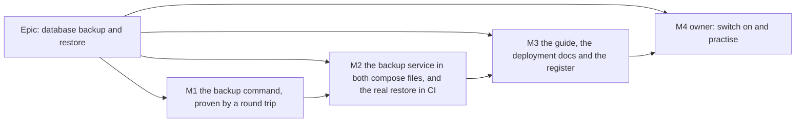

# Implementation Plan: Database backup and restore

- **Feature spec:** [`./feature-spec.md`](./feature-spec.md)
- **Status:** Draft — awaiting the product owner's approval, with the spec.
- **Owner:** product owner; implementation by the **builder** agent (Sonnet), one PR per milestone.

## Breakdown

### Epic

**Database backup and restore** — a nightly copy of the database kept 30 days on the same server, a plain-English way
to check and restore it, and CI proof on every change that it restores identically. Pre-1.0 requirement (a),
`docs/RELEASE_1_0.md` row 5.

**Rules that apply to every milestone.**

- **No `VITE_` flag** (ADR-0088 D1). Nothing in the web app changes. The rollback is the commit boundary, and for the
  operator, removing the `backup` service from the compose file.
- **No schema change.** If one appears to be needed, the milestone stops and goes to **database-architect**
  (CLAUDE.md §19.3). Creating, renaming and dropping whole databases at run time is not a schema change.
- **No new required CI check.** The ten checks stay ten; both CI additions are steps in existing jobs (`e2e-api`,
  `image`). No new root `check:*` script (prepush would then need a database).
- **ADR-0105:** this is a spec because it adds CI steps and 1.0-promised operator settings. Anything found outside a
  milestone's scope becomes a `docs/TECH_DEBT.md` row, not extra work in the PR.
- **Engine parity:** untouched; no engine file changes, so no `scripts/engine-parity.json` declaration.

---

### Milestone 1: The backup command, proven by a round trip (one PR)

**Outcome:** the API image contains `schedulepoint-backup` with its six commands, and every pull request proves a
backup of a full test database restores identically.
**Entry point:** `Ships dark:` no compose file runs the command yet; M2 adds the `backup` service that does. A
developer can run it today with `scripts/e2e-local.sh backup`.
**Journey:** the new `e2e-api` step "Backup and restore round trip" drives the shipped script against real data.

#### Feature: `schedulepoint-backup` in the API image

> **Description:** a POSIX `sh` script at `apps/api/backup/schedulepoint-backup.sh`, copied into the runtime image at
> `/app/backup/`, with the PostgreSQL 17 client tools installed.
> **Complexity:** M
> **Dependencies:** none
> **Risks:** busybox differences from GNU tools → tested in the same Alpine userland it ships in; client/server
> major drift → explicit check with a plain message.
> **Testing requirements:** the round trip below; a negative-control self-test; a shell lint.

##### Task 1.1 — The script (≈ half the PR)

- **Description:** commands `schedule` (default; 5-minute poll, 02:00 UTC with catch-up, immediate first copy),
  `now`, `list`, `check [file] [--keep]`, `restore <file> [--yes]`, `health`. Behaviour exactly as spec §2 (US-1 to
  US-5), §4.2, §4.3 and §4.4: atomic `.partial` → rename; `.sha256`; `pg_restore --list` validation; prune only after
  success, never the newest, only `schedulepoint-*.dump`; `LAST-BACKUP.txt`; JSON log lines `backup.succeeded` /
  `backup.failed` / `backup.pruned`; free-space guard; `--lock-wait-timeout=60s`; server-major check; restore
  preflight (no other connections), safety copy, load into `<db>_restoring` from `template0`, checks, swap by rename on
  the `postgres` database; version check of `_prisma_migrations` names against `/app/prisma/migrations` (path
  overridable by `MIGRATIONS_DIR` for the CI harness); `BACKUP_KEEP_DAYS` validated 1–3650; file arguments restricted
  to `schedulepoint-*.dump` names inside `/backups`; `umask 077`.
- **Complexity:** M
- **Dependencies:** none
- **Risks:** a quoting bug in a shell script is silent → `shellcheck` in the PR (run via Docker if not installed; record
  the command in the PR) and every command exercised by Task 1.3; `restore` is destructive in intent → the live
  database is only ever renamed, and the rename is the last step.
- **Testing:** Task 1.3; plus a manual run of each command on the local stack recorded in the PR.
- **Development steps:**
  1. Write the script with a header docblock stating the contract (commands, exit codes, files) and the spec link.
  2. Strict mode (`set -eu`), one function per command, all paths derived from `/backups`.
  3. Plain-English messages for the owner-facing commands (`check`, `restore`, `list`), matching the guide's words.

##### Task 1.2 — The image

- **Description:** `apps/api/Dockerfile` runtime stage installs `postgresql17-client` (`apk add --no-cache`) and copies
  `apps/api/backup/` to `/app/backup/` owned by `node`. Nothing else in the image changes; the API's own entrypoint and
  healthcheck are untouched.
- **Complexity:** S
- **Dependencies:** 1.1
- **Risks:** the package name or Alpine version differs from expectation → verify first
  (`docker run --rm node:22-alpine sh -c 'cat /etc/alpine-release; apk search postgresql17-client'`) and record the
  output in the PR; image growth → measure (`docker image ls` before/after) and record it.
- **Testing:** the `image` job builds it (ADR-0020); `docker run --rm <image> id node` confirms uid 1000 (recorded,
  because M2's owner step depends on it).
- **Development steps:**
  1. Run and record the two verification commands above.
  2. Add the `apk add` and `COPY` lines with a comment citing ADR-0192 and why the client major is pinned.

##### Task 1.3 — The round trip in CI and locally

- **Description:** `scripts/backup-restore-check.sh` and a new step in `.github/workflows/ci.yml`'s `e2e-api` job,
  after "Pairwise differential", plus a `backup` target in `scripts/e2e-local.sh`. Exact comparison as spec §4.7
  step 1: per-table counts and content checksums, sequences, triggers and their `tgenabled`, extensions, index and
  constraint counts; `UPDATE audit_events` refused with `0A000`; `prisma migrate deploy` and `prisma:check-drift`
  clean against the restored database; non-vacuity floor on nine tables and `_prisma_migrations` = migration
  directories; negative controls (one altered row, one disabled trigger) must both be caught.
- **Complexity:** M
- **Dependencies:** 1.1
- **Risks:** the step reads leftovers from earlier steps, which is only deterministic because nothing else writes
  after the pairwise step → the script asserts no other connections before dumping; runner PostgreSQL client is not 17
  → run the shipped script inside `postgres:17-alpine` via Docker with the repo's script and migrations mounted
  (unverified which client the runner has; the design does not depend on it); adding wall clock to `e2e-api`
  (measured 643 s, timeout 30 min, `ci.yml:296-297`) → measure and record the step's duration.
- **Testing:** the step itself; prove it red once against a deliberately broken restore (for example `--section=pre-data`
  only) and record that in the PR (ADR-0110).
- **Development steps:**
  1. Write the comparator SQL and the harness; make the script's own exit status the only result.
  2. Add the CI step with a comment in the house style (why it is here and what it cannot see).
  3. Add `backup` to `scripts/e2e-local.sh` (Docker if present, else local 17 client tools, else refuse).
  4. `docs/TESTING.md` "Before you push": when to run `scripts/e2e-local.sh backup`. `scripts/README.md`: one line.

##### Task 1.4 — ADR-0192 and the register

- **Description:** write ADR-0192 from spec §4.9; add its one line to CLAUDE.md §16, `docs/adr/README.md` and
  `docs/ROADMAP.md` (`check:adr-coverage`); bump the ADR count in CLAUDE.md's banner (`check:counts`).
- **Complexity:** S
- **Dependencies:** spec **Approved** first — `check:spec-status` refuses an ADR citing a Draft spec.
- **Risks:** none beyond the gates, which are the check.
- **Testing:** `pnpm prepush`.

**M1 changeset:** `@repo/api` **minor** — "The API image now carries a database backup command
(`schedulepoint-backup`). Nothing runs it until the compose file's new `backup` service is added (next release)."
**e2e:** `scripts/e2e-local.sh api` and `scripts/e2e-local.sh backup` before pushing. No Playwright suite touched.
**Reviewers:** devops-reviewer (Dockerfile, CI step), security-reviewer (credential handling, file modes, restore
refusals), backend-performance-reviewer (lock timeout, dump cost), test-engineer (comparator and negative controls).

---

### Milestone 2: The backup service, and the real restore in CI (one PR)

**Outcome:** an operator who takes the new compose file gets a nightly copy with no further action, and CI proves the
owner's exact restore commands against the shipped image.
**Entry point:** the `backup` service in `docker-compose.release.yml` (operator-facing; there is no browser surface),
reached with `docker compose -f docker-compose.release.yml run --rm backup <command>`.
**Journey:** the new `image`-job step "Back up, restore and boot" (spec §4.7 step 2), which runs `now`, stops the app,
runs `restore --yes`, starts it, and requires `/api/v1/health/ready` to answer 200.

#### Feature: compose service and settings

> **Description:** the `backup` block of spec §4.5 in both compose files; `BACKUP_DIR` and `BACKUP_KEEP_DAYS` in
> `.env.example`; `backups/` in `.gitignore`.
> **Complexity:** S–M
> **Dependencies:** M1 released (the block calls a script only M1's images contain)
> **Risks:** see tasks.
> **Testing:** the `image` job.

##### Task 2.1 — Compose blocks and settings

- **Description:** add the service to `docker-compose.release.yml` (image tag string identical to the API's, so
  Watchtower and tag pinning move them together) and to `docker-compose.yml` (built from the same Dockerfile).
  Settings documented in `.env.example`'s release-stack section with the 1.0-promise note.
- **Complexity:** S
- **Dependencies:** M1
- **Risks:** in `docker-compose.yml` a second service using the API's locally built image may make Compose try to
  **pull** it before building → give `backup` the same `build:` plus an explicit shared `image:` name, or
  `pull_policy: build`; verify with a clean `docker compose up --build` and record it. The two compose blocks drifting
  apart → they are written identically except `image`/`build`, and the PR description shows a diff of the two.
  `read_only: true` might break a tool that writes outside `/tmp` → the `image` job proves every command under it.
- **Testing:** Task 2.2.

##### Task 2.2 — The real restore in the `image` job

- **Description:** after the existing smoke steps in `ci.yml`'s `image` job: wait for `backup` healthy (its first copy
  is immediate), `run --rm backup check`, stop `api web`, `run --rm backup restore --yes <newest>`, start them, wait for
  health, `curl /api/v1/health/ready`, confirm a `*_before_restore_*` database exists and the API log shows no
  pending migrations applied. `--wait` on `up` now also waits for `backup` to be healthy.
- **Complexity:** S
- **Dependencies:** 2.1
- **Risks:** the `image` job's 15-minute timeout (`ci.yml:1185`) → measure the job before and after and record both;
  the database there holds only migrations, so this step proves the **mechanics** and the boot, and step 1.3 proves
  the **content** — say so in the step's comment.
- **Testing:** the step itself; proven red once (for example restore while `api` is still running must fail the step
  at the refusal) and recorded in the PR.

**M2 changeset:** `@repo/api` **patch** with an operator note — "Database backups: add the new `backup` service to
your compose file to get a nightly copy kept 30 days. See `docs/guides/back-up-and-restore.md`." (The note is how the
owner learns the release is ready for the host step; the compose file itself is not in any package.)
**e2e:** `scripts/e2e-local.sh backup`; the `image` job can only be run in CI or with a local Docker build
(`docker compose -f docker-compose.yml -f docker-compose.ci.yml up -d --build --wait`), which the PR records.
**Reviewers:** devops-reviewer (compose, Watchtower interplay, `image` job), security-reviewer (container hardening,
settings).

---

### Milestone 3: The guide, the deployment docs and the register (one PR, docs only)

**Outcome:** the owner has a plain-English, timed guide; the reference docs describe backups; follow-ups are filed.
**Entry point:** `docs/guides/back-up-and-restore.md`, linked from `docs/DEPLOYMENT.md` and `docs/HANDOFF.md`.
**Journey:** not applicable (documentation); `check:doc-links` proves every link resolves. M2's `image` step already
drives the commands the guide prints, so the guide's commands are tested commands.

##### Task 3.1 — The guide

- **Description:** write spec Appendix A in full, in `docs/guides/set-up-alerts.md`'s style: who it is for, words
  used, every step with "You should see" and "If not", a time for each part, Dockge notes, the `.env`-is-not-backed-up
  warning, and "What this does not protect against".
- **Complexity:** S
- **Dependencies:** M2 (the commands and outputs must be the shipped ones; copy them from a real run, not from the
  spec)
- **Risks:** the guide drifts from the script's messages → it quotes the script's actual output captured from the
  `image` job's log.

##### Task 3.2 — Reference docs and the 1.0 page

- **Description:** `docs/DEPLOYMENT.md` gains a "Backups" section (reference: what runs, settings, files, signals,
  restore semantics, client/server major rule) and, in "Deleted work", the precondition: a same-day `CHECK PASSED`
  before `RETENTION_HIERARCHY_ENABLED=true`. `docs/RELEASE_1_0.md` row 5 → "Built; waiting for your practice check".
  CLAUDE.md §17 gains one short bullet: copies are on the same server and do not survive losing it. `docs/HANDOFF.md`
  lists the owner's host steps (M4).
- **Complexity:** S

##### Task 3.3 — Register rows

- **Description:** file `docs/TECH_DEBT.md` rows for: off-site copies (encrypted, with their own check); a dedicated
  read-only backup role (`pg_read_all_data`); a copy before each self-migrating update (spec §6 Q1, if the owner keeps
  the default); a backup status line on the staff console (an ADR-0105 entry-point trigger); and the published database
  port (spec §4.10, for the security-reviewer).
- **Complexity:** S

**M3 changeset:** none (documentation only).
**Reviewers:** ux-reviewer for the guide's plain language (it is the owner's only interface to this feature).

---

### Milestone 4: Owner — switch on and practise (no PR by the builder)

**Outcome:** backups run on the owner's server and one copy has been checked there.
**Entry point:** the guide, Part 1 then Part 2.

| Step | What the owner does                                             | Minutes |
| ---- | --------------------------------------------------------------- | ------- |
| 1    | Create the backups folder (one command from the guide)          | 2       |
| 2    | Paste the `backup` block into the stack's compose file          | 5–10    |
| 3    | Optional: set `BACKUP_DIR` / `BACKUP_KEEP_DAYS` in `.env`       | 0–2     |
| 4    | Update the stack                                                | 2       |
| 5    | Confirm `LAST-BACKUP.txt` says OK and the service shows healthy | 3       |
| 6    | Save `.env` in a password manager                               | 5       |
| 7    | Practice: guide Part 2 (`list`, `check`), then read Part 3      | 30–45   |

**Done when** the owner reports one `CHECK PASSED` with its date and file name. A session then records it in
`docs/RELEASE_1_0.md` row 5 (**Done**, with the evidence) and in `docs/DECISIONS.md`, and closes nothing else.

---

## Sequencing & slices

M1 → (release reaches the host) → M2 → M3 → M4. Each PR leaves `main` releasable:

- **M1** changes the image only by adding tools and a file nothing calls; the round trip makes it tested from day one.
- **M2** adds a service that is self-contained (depends on `db` only). An operator who does not paste the block is
  exactly where they were.
- **M3** is documentation. It waits for M2 so the guide quotes real output.
- **M4** is the owner's. No session repeats a host step for them.

No feature flag (ADR-0088 D1). Rollback: revert the PR; on the host, remove the `backup` block and update.

## Definition of Done (per task)

Each task's PR must satisfy the Feature Completion Criteria in [`docs/PROCESS.md`](../../PROCESS.md) (code, tests,
docs, security, performance, accessibility, Docker build, CI, changelog, version impact). For this epic "tests" means
`pnpm prepush` **and** `scripts/e2e-local.sh api backup` were run (CLAUDE.md §19.8); accessibility is not affected
(no UI), which the PR states rather than omits.

## Version impact

- `@repo/api`: **minor** at M1 (new capability in the image), **patch** at M2 (operator note). `@repo/web`: none.
- Two operator settings (`BACKUP_DIR`, `BACKUP_KEEP_DAYS`) and the `backup` service join the 1.0 promise
  (`docs/RELEASE_1_0.md`, "What 1.0 promises" item 3). Renaming either after 1.0 is a major change.

## Risks & assumptions (rollup)

| Risk / assumption                                                                | Likelihood | Impact | Mitigation                                                                                                                |
| -------------------------------------------------------------------------------- | ---------- | ------ | ------------------------------------------------------------------------------------------------------------------------- |
| Copies live on the same disk as the database; a disk failure loses both          | low        | high   | Accepted by the owner; said plainly in the guide; §6 Q3 offers a second disk; off-site filed as a row                     |
| `postgresql17-client` missing from the image's Alpine, or `node` is not uid 1000 | low        | med    | Verified and recorded in Task 1.2 before anything depends on it                                                           |
| `db` image moves to PostgreSQL 18 without the client                             | low        | high   | Script refuses with a plain message; ADR-0192 consequence; the `image` job would fail on the next build                   |
| Owner forgets the folder ownership step                                          | med        | med    | Backup fails at once and visibly (unhealthy, log line names the step); the guide's "You should see" catches it in minutes |
| Owner's `POSTGRES_*` differ from defaults                                        | med        | low    | The block interpolates the same variables the API uses, so it follows whatever the host set                               |
| Dump size and duration unknown on the owner's data                               | high       | low    | Status file reports both from the first night; free-space guard refuses rather than filling the disk                      |
| A comparator that cannot fail                                                    | med        | high   | Negative controls on every run (ADR-0110); proven red once in the PR                                                      |
| `image` job time grows past its 15-minute guard                                  | low        | low    | Measured before/after in M2                                                                                               |
| `ENABLE ALWAYS` not preserved through dump/restore                               | low        | high   | Asserted by the round trip (`tgenabled = 'A'`) and by a refused `UPDATE`                                                  |
| The backups folder is readable by others on the host                             | low        | high   | Folder 700, files 600, `umask 077`; the guide's command sets the mode                                                     |
