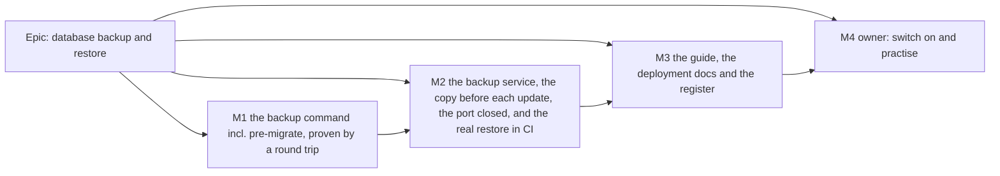

# Implementation Plan: Database backup and restore

- **Feature spec:** [`./feature-spec.md`](./feature-spec.md)
- **Status:** Approved — by the product owner, 2026-10-14, with the spec; a copy before each database update and
  closing the database port were added to scope on approval (spec §6). Not started.
- **Owner:** product owner; implementation by the **builder** agent (Sonnet), one PR per milestone.

## Breakdown

### Epic

**Database backup and restore** — a nightly copy of the database kept 30 days on the same server, a copy taken
automatically before any update changes the database, the database port closed to the network, a plain-English way
to check and restore, and CI proof on every change that it restores identically. Pre-1.0 requirement (a),
`docs/RELEASE_1_0.md` row 5.

**Rules that apply to every milestone.**

- **No `VITE_` flag** (ADR-0088 D1). Nothing in the web app changes. The rollback is the commit boundary, and for the
  operator, removing the `backup` service and the API's `/backups` volume line from the compose file.
- **No schema change.** If one appears to be needed, the milestone stops and goes to **database-architect**
  (CLAUDE.md §19.3). Creating, renaming and dropping whole databases at run time is not a schema change, and the
  CI-only probe migration in M2 is mounted at test time, never committed under `apps/api/prisma/migrations/`.
- **No new required CI check.** The ten checks stay ten; every CI addition is a step in an existing job (`e2e-api`,
  `image`). No new root `check:*` script (prepush would then need a database).
- **ADR-0105:** this is a spec because it adds CI steps, 1.0-promised operator settings and a change to what every
  release does on boot. Anything found outside a milestone's scope becomes a `docs/TECH_DEBT.md` row, not extra work
  in the PR.
- **Engine parity:** untouched; no engine file changes, so no `scripts/engine-parity.json` declaration.

---

### Milestone 1: The backup command, proven by a round trip (one PR)

**Outcome:** the API image contains `schedulepoint-backup` with its seven commands (including `pre-migrate`), and
every pull request proves a backup of a full test database restores identically and that `pre-migrate` decides
correctly.
**Entry point:** `Ships dark:` no compose file and no entrypoint runs the command yet; M2 adds the `backup` service
and the entrypoint call. A developer can run it today with `scripts/e2e-local.sh backup`.
**Journey:** the new `e2e-api` step "Backup and restore round trip" drives the shipped script against real data.

#### Feature: `schedulepoint-backup` in the API image

> **Description:** a POSIX `sh` script at `apps/api/backup/schedulepoint-backup.sh`, copied into the runtime image at
> `/app/backup/`, with the PostgreSQL 17 client tools installed.
> **Complexity:** M
> **Dependencies:** none
> **Risks:** busybox differences from GNU tools → tested in the same Alpine userland it ships in; client/server
> major drift → explicit check with a plain message.
> **Testing requirements:** the round trip below; a negative-control self-test; a shell lint.

##### Task 1.1 — The script (≈ half the PR)

- **Description:** commands `schedule` (default; 5-minute poll, 02:00 UTC with catch-up, immediate first copy),
  `now`, `list`, `check [file] [--keep]`, `restore <file> [--yes]`, `health`, and **`pre-migrate`**. Behaviour
  exactly as spec §2 (US-1 to US-5, US-7), §4.2, §4.3, §4.4 and §4.12: atomic `.partial` → rename; `.sha256`;
  `pg_restore --list` validation; prune only after success, never the newest nightly copy and never the newest
  pre-update copy, only `schedulepoint-*.dump`; nightly logic and `health` consider only nightly names
  (`schedulepoint-2*.dump`); `LAST-BACKUP.txt`; JSON log lines `backup.succeeded` / `backup.failed` /
  `backup.pruned` / `backup.pre_migrate_skipped` (reason `not_enabled` | `fresh` | `none_pending`) /
  `backup.pre_migrate_taken` / `backup.pre_migrate_failed`; free-space guard; `--lock-wait-timeout=60s`;
  server-major check; restore preflight (no other connections), safety copy, load into `<db>_restoring` from
  `template0`, checks, swap by rename on the `postgres` database; version check of `_prisma_migrations` names against
  `/app/prisma/migrations` (path overridable by `MIGRATIONS_DIR` for the CI harness); `BACKUP_KEEP_DAYS` validated
  1–3650; file arguments restricted to `schedulepoint-*.dump` names inside `/backups`; `umask 077`.
  **`pre-migrate` specifically:** no `/backups` → skip `not_enabled`; no `_prisma_migrations` or no rows → skip
  `fresh`; every migration directory applied → skip `none_pending`; otherwise copy as
  `schedulepoint-pre-migrate-YYYY-MM-DDTHHMMZ.dump` and remove `UPDATE-HELD.txt`; any failure, **including not being
  able to ask the database** → write `UPDATE-HELD.txt` where possible, print the one-line `UPDATE HELD — …` message
  of spec §4.12, exit non-zero. Connection details from `PG*` variables when set (backup service) or from
  `DATABASE_URL` with its query string removed (API container). It never prunes.
- **Complexity:** M
- **Dependencies:** none
- **Risks:** a quoting bug in a shell script is silent → `shellcheck` in the PR (run via Docker if not installed; record
  the command in the PR) and every command exercised by Task 1.3; `restore` is destructive in intent → the live
  database is only ever renamed, and the rename is the last step; `pre-migrate` wrongly deciding "nothing pending"
  would let a migration run uncopied → the decision table in Task 1.3 covers each branch, and the comparison is
  directory names against applied rows, never a parsed exit code (spec §4.12 says why `prisma migrate status` is not
  used).
- **Testing:** Task 1.3; plus a manual run of each command on the local stack recorded in the PR.
- **Development steps:**
  1. Write the script with a header docblock stating the contract (commands, exit codes, files) and the spec link.
  2. Strict mode (`set -eu`), one function per command, all paths derived from `/backups`.
  3. Plain-English messages for the owner-facing output (`check`, `restore`, `list`, the `UPDATE HELD` line),
     matching the guide's words.

##### Task 1.2 — The image

- **Description:** `apps/api/Dockerfile` runtime stage installs `postgresql17-client` (`apk add --no-cache`) and copies
  `apps/api/backup/` to `/app/backup/` owned by `node`. It must **not** create `/backups` (its absence is how
  `pre-migrate` knows backups are not switched on). The API's entrypoint and healthcheck are untouched in M1.
- **Complexity:** S
- **Dependencies:** 1.1
- **Risks:** the package name or Alpine version differs from expectation → verify first
  (`docker run --rm node:22-alpine sh -c 'cat /etc/alpine-release; apk search postgresql17-client'`) and record the
  output in the PR; image growth → measure (`docker image ls` before/after) and record it.
- **Testing:** the `image` job builds it (ADR-0020); `docker run --rm <image> id node` confirms uid 1000 and
  `docker run --rm <image> test ! -e /backups` confirms the folder is absent (both recorded, because M2's owner step
  and `pre-migrate` depend on them).
- **Development steps:**
  1. Run and record the verification commands above.
  2. Add the `apk add` and `COPY` lines with a comment citing ADR-0192 and why the client major is pinned.

##### Task 1.3 — The round trip and the `pre-migrate` decision table, in CI and locally

- **Description:** `scripts/backup-restore-check.sh` and a new step in `.github/workflows/ci.yml`'s `e2e-api` job,
  after "Pairwise differential", plus a `backup` target in `scripts/e2e-local.sh`. Exact comparison as spec §4.7
  step 1: per-table counts and content checksums, sequences, triggers and their `tgenabled`, extensions, index and
  constraint counts; `UPDATE audit_events` refused with `0A000`; `prisma migrate deploy` and `prisma:check-drift`
  clean against the restored database; non-vacuity floor on nine tables and `_prisma_migrations` = migration
  directories; negative controls (one altered row, one disabled trigger) must both be caught. **Plus the
  `pre-migrate` decision table** of spec §4.7 step 1 (six cases: not enabled, fresh, none pending, taken, held on an
  unwritable folder, held on an unreachable database), using temporary copies of the migrations folder via
  `MIGRATIONS_DIR`.
- **Complexity:** M
- **Dependencies:** 1.1
- **Risks:** the step reads leftovers from earlier steps, which is only deterministic because nothing else writes
  after the pairwise step → the script asserts no other connections before dumping; runner PostgreSQL client is not 17
  → run the shipped script inside `postgres:17-alpine` via Docker with the repo's script and migrations mounted
  (unverified which client the runner has; the design does not depend on it); adding wall clock to `e2e-api`
  (measured 643 s, timeout 30 min, `ci.yml:296-297`) → measure and record the step's duration.
- **Testing:** the step itself; prove it red once against a deliberately broken restore (for example
  `--section=pre-data` only) and once against a `pre-migrate` that always answers "none pending", and record both in
  the PR (ADR-0110).
- **Development steps:**
  1. Write the comparator SQL and the harness; make the script's own exit status the only result.
  2. Add the CI step with a comment in the house style (why it is here and what it cannot see).
  3. Add `backup` to `scripts/e2e-local.sh` (Docker if present, else local 17 client tools, else refuse).
  4. `docs/TESTING.md` "Before you push": when to run `scripts/e2e-local.sh backup`. `scripts/README.md`: one line.

##### Task 1.4 — ADR-0192 and the register

- **Description:** write ADR-0192 from spec §4.9 (D1–D10, including D9's amendment of ADR-0018); add its one line to
  CLAUDE.md §16, `docs/adr/README.md` and `docs/ROADMAP.md` (`check:adr-coverage`); mark ADR-0018's §16 line
  "amended by ADR-0192" and add the amendment note to ADR-0018 itself; bump the ADR count in CLAUDE.md's banner
  (`check:counts`).
- **Complexity:** S
- **Dependencies:** none — the spec is Approved (2026-10-14), so `check:spec-status` accepts an ADR citing it.
- **Risks:** none beyond the gates, which are the check.
- **Testing:** `pnpm prepush`.

**M1 changeset:** `@repo/api` **minor** — "The API image now carries a database backup command
(`schedulepoint-backup`). Nothing runs it until the next release's compose and start-up changes."
**e2e:** `scripts/e2e-local.sh api` and `scripts/e2e-local.sh backup` before pushing. No Playwright suite touched.
**Reviewers:** devops-reviewer (Dockerfile, CI step), security-reviewer (credential handling, file modes, restore
refusals), backend-performance-reviewer (lock timeout, dump cost), test-engineer (comparator, decision table and
negative controls).

---

### Milestone 2: The backup service, the copy before each update, the port closed, and the real restore in CI (one PR)

**Outcome:** an operator who takes the new compose file gets a nightly copy with no further action, a copy before any
update that changes the database, and a database no longer reachable from the network; CI proves the owner's exact
restore commands and all four pre-update cases against the built image.
**Entry point:** the `backup` service and the API's `/backups` mount in `docker-compose.release.yml`
(operator-facing; there is no browser surface), reached with
`docker compose -f docker-compose.release.yml run --rm backup <command>` and, for the pre-update copy, by any update.
**Journey:** the new `image`-job steps "Back up, restore and boot" and "Copy before an update" (spec §4.7 step 2).

#### Feature: compose service, start-up copy, closed port and settings

> **Description:** the `backup` block of spec §4.5 in `docker-compose.release.yml` and `docker-compose.yml`; the
> API's `/backups` mount in `docker-compose.release.yml` and `docker-compose.ci.yml`; the `pre-migrate` call in
> `apps/api/docker-entrypoint.sh`; the `db` port removed from `docker-compose.release.yml`; `BACKUP_DIR` and
> `BACKUP_KEEP_DAYS` in `.env.example`; `backups/` in `.gitignore`.
> **Complexity:** M
> **Dependencies:** M1 merged (the script and client tools must be in the image built from the same tree)
> **Risks:** see tasks.
> **Testing:** the `image` job.

##### Task 2.1 — Compose blocks, settings and the closed port

- **Description:** add the `backup` service to `docker-compose.release.yml` (image tag string identical to the API's,
  so Watchtower and tag pinning move them together) and to `docker-compose.yml` (built from the same Dockerfile).
  Add `volumes: - ${BACKUP_DIR:-./backups}:/backups` to the API in `docker-compose.release.yml` and
  `docker-compose.ci.yml` — **not** `docker-compose.yml` (spec §4.5 says why). Delete `ports: - '5432:5432'` from
  `db` in **`docker-compose.release.yml` only**, with a comment saying why and that `docker compose exec db psql`
  still works; leave `docker-compose.yml`'s port (local development uses it, `.env.example:14`). Update the
  release file's header comment where it describes what is exposed. Settings documented in `.env.example`'s
  release-stack section with the 1.0-promise note.
- **Complexity:** S
- **Dependencies:** M1
- **Risks:** in `docker-compose.yml` a second service using the API's locally built image may make Compose try to
  **pull** it before building → give `backup` the same `build:` plus an explicit shared `image:` name, or
  `pull_policy: build`; verify with a clean `docker compose up --build` and record it. The two `backup` blocks
  drifting apart → written identically except `image`/`build`, and the PR description shows a diff of the two.
  `read_only: true` might break a tool that writes outside `/tmp` → the `image` job proves every command under it.
  An operator connected a tool through the port → said plainly in the changeset note and the guide.
- **Testing:** Task 2.3.

##### Task 2.2 — The copy before an update, in the API's entrypoint

- **Description:** in `apps/api/docker-entrypoint.sh`, before `node_modules/.bin/prisma migrate deploy`, add
  `sh /app/backup/schedulepoint-backup.sh pre-migrate` with an `[entrypoint]` echo before it and a comment citing
  ADR-0192 D9 and spec §4.12. `set -e` (`:6`) is what turns a non-zero exit into "do not migrate"; the comment says
  so, because removing `set -e` would silently remove the hold.
- **Complexity:** S
- **Dependencies:** 2.1 (the CI mount), M1 (the command)
- **Risks:** a slow copy on a large database lengthens every update with a database change → measured in the
  `image` job and reported in the status file; the owner can read the nightly duration in advance. The API
  healthcheck's 40-second start period (`Dockerfile:63`) may be exceeded during a long copy → the container shows
  `unhealthy` until serving, which nothing acts on; **record** whether `web` is affected on a Watchtower recreate
  rather than changing the healthcheck in this PR. Servers without the mount → `not_enabled`, migrate as today;
  proven by the dev compose file, which has no mount and boots as before. libpq refusing `?schema=public` → the
  script strips the query string; the PR records what an unstripped URL does.
- **Testing:** Task 2.3.

##### Task 2.3 — The real restore and the pre-update copy in the `image` job

- **Description:** after the existing smoke steps in `ci.yml`'s `image` job, and with the folder created owned by
  uid 1000 before the first `up`:
  1. **Restore:** wait for `backup` healthy (its first copy is immediate), `run --rm backup check`, stop `api web`,
     `run --rm backup restore --yes <newest>`, start them, wait for health, `curl /api/v1/health/ready`, confirm a
     `*_before_restore_*` database exists and the API log shows no pending migrations applied. `--wait` on `up` now
     also waits for `backup` to be healthy.
  2. **Pre-update copy** (spec §4.7 step 2, in this order): first boot logged `pre_migrate_skipped`/`fresh`;
     `restart api` → `none_pending`; folder made unwritable + probe migration (`SELECT 1;`, mounted by a CI-only
     override file at `/app/prisma/migrations/99999999999999_ci_pending_probe`) + API recreated → API exits
     non-zero, `UPDATE HELD` in its log, probe **absent** from `_prisma_migrations`; folder made writable again and
     nothing else → the API comes up by itself, a `schedulepoint-pre-migrate-*.dump` exists, passes `check`, is
     older than the probe's `started_at`, and readiness answers 200.
  3. **Release file shape:** `docker compose -f docker-compose.release.yml config --format json` → `db` has no
     `ports`; `api` and `backup` both mount `/backups`.
- **Complexity:** M
- **Dependencies:** 2.1, 2.2
- **Risks:** the `image` job's 15-minute timeout (`ci.yml:1185`) → measure the job before and after and record both;
  if it no longer fits, raise the timeout in the same PR with the measurement as the reason. The database there holds
  only migrations, so these steps prove the **mechanics** and the boot, and Task 1.3 proves the **content** — say so
  in the steps' comment. The probe must run **after** the restore step (once applied, the restore command would
  rightly refuse a copy containing it as "newer"). Docker's restart back-off makes "comes up by itself" slow to
  observe → poll with a bounded wait and record the observed time.
- **Testing:** the steps themselves; proven red twice and recorded in the PR: restore while `api` is still running
  must fail at the refusal; and with the entrypoint's `pre-migrate` call deleted, the held case must fail at "probe
  applied although the copy failed" (ADR-0110).

**M2 changeset:** `@repo/api` **minor** with an operator note — "Database backups: add the new `backup` service to
your compose file for a nightly copy kept 30 days, and the backups folder to the `api` service for a copy before
every update that changes the database. If that copy cannot be made, the update waits and your data is not changed.
The release compose file no longer publishes the database port; tools connected from another computer will stop
working. See `docs/guides/back-up-and-restore.md`." (Minor rather than patch: a release can now refuse to migrate,
which is new behaviour an operator must know about. The note is how the owner learns the release is ready for the
host step; the compose file itself is not in any package.)
**e2e:** `scripts/e2e-local.sh backup`; the `image` job can only be run in CI or with a local Docker build
(`docker compose -f docker-compose.yml -f docker-compose.ci.yml up -d --build --wait`), which the PR records.
**Reviewers:** devops-reviewer (compose, Watchtower interplay, entrypoint, `image` job), **security-reviewer**
(container hardening, settings, **the closed port**, the API container now writing copies that hold credentials),
backend-performance-reviewer (boot-time cost of the pre-update copy).

---

### Milestone 3: The guide, the deployment docs and the register (one PR, docs only)

**Outcome:** the owner has a plain-English, timed guide; the reference docs describe backups, the pre-update copy and
the closed port; follow-ups are filed.
**Entry point:** `docs/guides/back-up-and-restore.md`, linked from `docs/DEPLOYMENT.md` and `docs/HANDOFF.md`.
**Journey:** not applicable (documentation); `check:doc-links` proves every link resolves. M2's `image` steps already
drive the commands the guide prints, so the guide's commands are tested commands.

##### Task 3.1 — The guide

- **Description:** write spec Appendix A in full, in `docs/guides/set-up-alerts.md`'s style: who it is for, words
  used, every step with "You should see" and "If not", a time for each part, Dockge notes, the three compose edits as
  paste-ready blocks, the `.env`-is-not-backed-up warning, Part 4 "If an update is held", the optional
  database-password section (with the plain warning that an `.env` edit alone breaks the connection on an existing
  installation, and the `ALTER USER` step and its undo), and "What this does not protect against".
- **Complexity:** S
- **Dependencies:** M2 (the commands and outputs must be the shipped ones; copy them from a real run, not from the
  spec)
- **Risks:** the guide drifts from the script's messages → it quotes the script's actual output, including the
  `UPDATE HELD` line, captured from the `image` job's log.

##### Task 3.2 — Reference docs and the 1.0 page

- **Description:** `docs/DEPLOYMENT.md` gains a "Backups" section (reference: what runs, settings, files, signals,
  the pre-update copy and its hold, restore semantics, client/server major rule) and, in "Deleted work", the
  precondition: a same-day `CHECK PASSED` before `RETENTION_HIERARCHY_ENABLED=true`. Its ADR-0018/self-migration
  text says a copy is taken first. `docs/RELEASE_1_0.md` row 5 → "Built; waiting for your practice check".
  CLAUDE.md §17 gains one short bullet: copies are on the same server and do not survive losing it, and an update
  with a database change can be held by a failed copy. `docs/HANDOFF.md` lists the owner's host steps (M4).
- **Complexity:** S

##### Task 3.3 — Register rows

- **Description:** file `docs/TECH_DEBT.md` rows for: off-site copies (encrypted, with their own check); a dedicated
  read-only backup role (`pg_read_all_data`); a backup status line on the staff console (an ADR-0105 entry-point
  trigger); a one-boot override for a held update (deliberately not built, spec §4.12); the API healthcheck's start
  period against a long pre-update copy, if M2 recorded a problem; and the default database password on existing
  installations (the guide's optional section, for the security-reviewer to revisit).
- **Complexity:** S

**M3 changeset:** none (documentation only).
**Reviewers:** ux-reviewer for the guide's plain language (it is the owner's only interface to this feature).

---

### Milestone 4: Owner — switch on and practise (no PR by the builder)

**Outcome:** backups run on the owner's server, the API takes a copy before updates, the database port is closed,
and one copy has been checked there.
**Entry point:** the guide, Part 1 then Part 2.

| Step | What the owner does                                                                                     | Minutes |
| ---- | ------------------------------------------------------------------------------------------------------- | ------- |
| 0    | Note whether any database tool on another computer connects to this server; it will stop working        | 1       |
| 1    | Create the backups folder (one command from the guide) — **before** step 4                              | 2       |
| 2    | Edit the stack's compose file: add the `backup` block, add the API's volume lines, delete the `db` port | 10–15   |
| 3    | Optional: set `BACKUP_DIR` / `BACKUP_KEEP_DAYS` in `.env`                                               | 0–2     |
| 4    | Update the stack                                                                                        | 2       |
| 5    | Confirm `LAST-BACKUP.txt` says OK and the backup service shows healthy (fix now if not)                 | 3       |
| 6    | Save `.env` in a password manager                                                                       | 5       |
| 7    | Practice: guide Part 2 (`list`, `check`), then read Part 3 and Part 4 through                           | 30–45   |

About **25 minutes** of set-up plus the 30–45 minute practice. The database password is **not** a step (spec §4.6).

**Done when** the owner reports one `CHECK PASSED` with its date and file name. A session then records it in
`docs/RELEASE_1_0.md` row 5 (**Done**, with the evidence) and in `docs/DECISIONS.md`, and closes nothing else. The
first `schedulepoint-pre-migrate-….dump` appears by itself at the next release with a database change; seeing it is
reassuring but not a condition of Done, because CI proves the path on every pull request.

---

## Sequencing & slices

M1 → M2 → (release reaches the host) → M3 → M4. Each PR leaves `main` releasable:

- **M1** changes the image only by adding tools and a file nothing calls; the round trip and the decision table make
  it tested from day one.
- **M2** changes every API boot, but safely for every existing server: with no `/backups` mounted, `pre-migrate`
  answers `not_enabled` and the API migrates exactly as today. The `backup` service depends on `db` only. Closing the
  port changes only operators who take the new compose file. An operator who does not paste the changes is exactly
  where they were.
- **M3** is documentation. It waits for M2 so the guide quotes real output.
- **M4** is the owner's. No session repeats a host step for them.

No feature flag (ADR-0088 D1). Rollback: revert the PR; on the host, remove the `backup` block and the API's volume
line and update. Re-adding the port is one line, and is not recommended.

## Definition of Done (per task)

Each task's PR must satisfy the Feature Completion Criteria in [`docs/PROCESS.md`](../../PROCESS.md) (code, tests,
docs, security, performance, accessibility, Docker build, CI, changelog, version impact). For this epic "tests" means
`pnpm prepush` **and** `scripts/e2e-local.sh api backup` were run (CLAUDE.md §19.8); accessibility is not affected
(no UI), which the PR states rather than omits.

## Version impact

- `@repo/api`: **minor** at M1 (new capability in the image), **minor** at M2 (a release can now hold its own
  migration; operator note). `@repo/web`: none.
- Two operator settings (`BACKUP_DIR`, `BACKUP_KEEP_DAYS`), the `backup` service, the API's `/backups` mount and the
  unpublished database port join the 1.0 promise (`docs/RELEASE_1_0.md`, "What 1.0 promises" item 3). Renaming
  either setting after 1.0 is a major change.

## Risks & assumptions (rollup)

| Risk / assumption                                                                | Likelihood | Impact | Mitigation                                                                                                                                                     |
| -------------------------------------------------------------------------------- | ---------- | ------ | -------------------------------------------------------------------------------------------------------------------------------------------------------------- |
| Copies live on the same disk as the database; a disk failure loses both          | low        | high   | Accepted by the owner (2026-10-14); said plainly in the guide; `BACKUP_DIR` available; off-site filed as a row                                                 |
| `postgresql17-client` missing from the image's Alpine, or `node` is not uid 1000 | low        | med    | Verified and recorded in Task 1.2 before anything depends on it                                                                                                |
| `db` image moves to PostgreSQL 18 without the client                             | low        | high   | Script refuses with a plain message; ADR-0192 consequence; the `image` job would fail on the next build                                                        |
| Owner forgets the folder ownership step                                          | med        | med    | Backup service unhealthy at once, before any update can be held; the guide's step 5 says to fix it then                                                        |
| A full or broken backups folder holds an update with a database change           | low        | high   | By design (owner, 2026-10-14). Usually visible a day ahead (nightly copy failing, service unhealthy); guide Part 4: free space or go back a version, 10–20 min |
| `pre-migrate` wrongly answers "nothing pending" and a migration runs uncopied    | low        | high   | Directory-vs-row comparison, not an exit code; decision table in Task 1.3; held/taken cases in Task 2.3 with a red proof                                       |
| The pre-update copy is slow on a large database, lengthening the update          | med        | low    | Only when a change is pending; duration visible nightly in `LAST-BACKUP.txt`; measured in CI                                                                   |
| Owner's `POSTGRES_*` differ from defaults                                        | med        | low    | Both the block and the API interpolate the same variables, so they follow whatever the host set                                                                |
| Owner changes `POSTGRES_PASSWORD` in `.env` alone and loses the connection       | low        | high   | Not a required step; the guide's optional section warns plainly and gives the `ALTER USER` step and its undo                                                   |
| A database tool on another computer stops working when the port closes           | med        | low    | Host step 0 and the changeset note say so; `check` and `docker compose exec db psql` replace it                                                                |
| Dump size and duration unknown on the owner's data                               | high       | low    | Status file reports both from the first night; free-space guard refuses rather than filling the disk                                                           |
| A comparator that cannot fail                                                    | med        | high   | Negative controls on every run (ADR-0110); proven red once in the PR                                                                                           |
| `image` job time grows past its 15-minute guard                                  | med        | low    | Measured before/after in M2; timeout raised with the measurement if needed                                                                                     |
| `ENABLE ALWAYS` not preserved through dump/restore                               | low        | high   | Asserted by the round trip (`tgenabled = 'A'`) and by a refused `UPDATE`                                                                                       |
| The backups folder is readable by others on the host                             | low        | high   | Folder 700, files 600, `umask 077`; the guide's command sets the mode                                                                                          |
