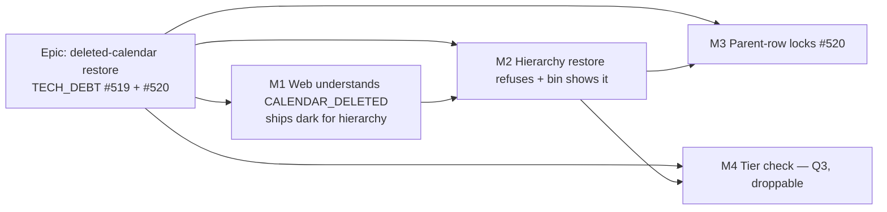

# Implementation Plan: A restore never brings work back onto a deleted calendar

- **Feature spec:** [`./spec.md`](./spec.md)
- **Status:** Approved — with the spec, 2026-10-17
- **Owner:** api (lead), web

## Breakdown

### Epic

**Deleted-calendar restore.** Close `docs/TECH_DEBT.md` #519 and #520 by extending ADR-0195's
refuse-and-explain rule to the hierarchy, and by locking the restore's parent check. Theme: data
integrity and recycle bin. **No `VITE_*` flag (ADR-0088 D1).** Each milestone is its own commit
boundary, and that boundary is the rollback.

**Agents:**

- **database-architect** before M2 and M3. It confirms that no schema change is needed, the bin query
  plan, and the lock order (CLAUDE.md §19.3: "every schema change"; this is the adjacent judgement,
  and it is cheap to ask).
- **builder** implements.
- Reviews:
  - **security-reviewer** and **api-reviewer** on M2;
  - **backend-performance-reviewer** on M2 (the guard and the bin lateral) and M3 (locks);
  - **ux-reviewer** and **accessibility-reviewer** on M1 and M2 copy;
  - **test-engineer** for the M3 race test.

---

### Milestone 1: the web understands `CALENDAR_DELETED` (shippable slice)

**Outcome:** a resource restore refused for its calendar shows a sentence that names the calendar.
An undo or redo refused for the same reason keeps its step and says what to do. For the hierarchy
this is ready in advance: the server does not send the reason there until M2.

**Entry point:** Recently deleted → a resource row → `Restore` (a resource whose calendar was deleted
since the list loaded). Hierarchy and undo: `Ships dark: the server does not send CALENDAR_DELETED
for hierarchy restores until M2. M2's journey drives both.`

**Journey:** none new in M1. The resource path's existing journey keeps passing. Both new journey
steps land in M2, where the capability becomes reachable (ADR-0081 §2).

#### Feature: refusal copy and the retryable undo step

> **Description:** `describeRestoreFailure` composes a sentence from `details.calendar.name`.
> `writeOrSetAside` turns `CALENDAR_DELETED` into a `ReplayFailure` that keeps the step.
> **Complexity:** S
> **Dependencies:** none
> **Risks:** the direction ("undo again" or "redo again") is not known inside `writeOrSetAside` →
> carry the calendar name on `ReplayFailure` and build the sentence in `history-result.ts`.
> **Testing requirements:** unit (Vitest) for both functions and both directions, and for the
> null-name fallback.

##### Task 1.1: restore-failure copy (≈ one PR, shared with 1.2)

- **Description:** add a `CALENDAR_DELETED` branch in
  `apps/web/src/features/recently-deleted/model/restore-failure.ts`. It returns `It uses the calendar
“<name>”, which is deleted. Restore that calendar first, then restore this.` When the name is null
  it returns `It uses a calendar that no longer exists.` `library` is null.
- **Complexity:** S · **Dependencies:** none
- **Risks:** this changes today's resource message (`Restore the calendar first.`), so the
  `RecentlyDeletedTable.test.tsx` cases around `:715-748` move with it. They assert the blocker row,
  not the alert, so the risk is low.
- **Testing:** new cases in the module's unit test; the existing table tests stay green.
- **Development steps:**
  1. Add the branch and its docblock line.
  2. Add the tests.
  3. Add a changeset (`web` patch).

##### Task 1.2: undo keeps a calendar-refused step

- **Description:**
  - `replay.ts` `writeOrSetAside`: on 409 with `reason === 'CALENDAR_DELETED'`, throw a
    `ReplayFailure` that carries the calendar name (extend the class with an optional `calendarName`,
    or add a subclass).
  - `use-plan-undo-redo.ts:351-355` already maps `ReplayFailure` to `failed` with `detail`.
  - Build the sentence in `history-result.ts` for each direction: `It uses the calendar “<name>”,
which was deleted after your edit. Restore that calendar from Recently deleted, then undo
again.` (or `redo again`).
- **Complexity:** S · **Dependencies:** none
- **Risks:** amending ADR-0176 D3 before its ADR lands → the ADR-0198 draft is committed in this PR
  as `Proposed`, and becomes `Accepted` in M2.
- **Testing:**
  - `commands.test.ts`: delete-activity undo refused with `CALENDAR_DELETED` gives `failed` with
    detail, and the stacks are intact (the `use-plan-edit-history.test.ts:308` pattern). A second
    undo after the calendar is "restored" (the fake server returns 200) applies.
  - `history-result` test for both directions.
- **Development steps:**
  1. Write the failing tests.
  2. Implement.
  3. Draft ADR-0198 (`Proposed`), using the spec's §4.9 outline.
  4. Add the CLAUDE.md §16 line, so `check:adr-coverage` passes.
  5. Add a changeset (`web` minor).

---

### Milestone 2: hierarchy restore refuses, and the bin shows it (shippable slice)

**Outcome:** no plan, project, client or activity restore can bind a deleted calendar. Recently
deleted names the calendar on the row and offers to restore it first. Undo says the same and lets
the planner retry.

**Entry point:** Recently deleted (`/orgs/$orgSlug/recently-deleted`, `apps/web/src/app/router.tsx:488`) → a plan row reading `Uses deleted
calendar “Mon-Wed”` → button `Restore calendar first…: Mon-Wed`. Also: the plan workspace's dock
undo strip after `Undo`.

**Journey:**

- In `apps/web/e2e/recently-deleted.spec.ts` (the base journey that already holds the calendar cases
  at `:240-286`): delete a plan, then delete its calendar through the API, open Recently deleted,
  assert the sub-line, press `Restore calendar first…: Mon-Wed`, confirm, then press `Restore plan
Plan`, and assert the plan is back. Include the a11y scan the suite already runs.
- In `apps/web/e2e-undo/undo.spec.ts`: delete an activity that has its own calendar, delete that
  calendar through the API, press Undo, and assert the strip sentence. Restore the calendar through
  the API, press **Try again**, and assert the activity is back.

#### Feature: the guard in `restoreBatch`

> **Description:** a calendar guard inside `HierarchyLifecycleService.restoreBatch`, before its first
> write, covering all five entry points (spec §2 Workflows).
> **Complexity:** M
> **Dependencies:** M1 merged (so the web never shows `changed` for this reason); database-architect
> sign-off on reads and lock order.
> **Risks:**
>
> - deadlock from the new calendar locks → the order is fixed by spec §4.6 and is consistent with
>   the documented plan → calendar (`activities.service.ts:359-363`).
> - latency on large batches → measure before and after at 2,000 activities (budget +10%,
>   ADR-0142).
>
> **Testing requirements:** lifecycle unit tests; API e2e per entry point; the reproduction test
> inverted.

##### Task 2.1: guard + error reason (≈ one PR)

- **Description:**
  - Add a private `assertCalendarsRestorable(tx, batchId, organizationId)` to
    `common/hierarchy/hierarchy-lifecycle.service.ts`. It collects the calendar ids referenced by
    plans and activities in the batch, minus calendars in the same batch. It takes
    `acquireCalendarWriteLock` in ascending id order, **then** runs `assertParentActive`, **then**
    reads the calendars' state. If one is missing or deleted it throws
    `ConflictError('Restore the calendar first.', { reason: CALENDAR_DELETED, calendar: { id, name, deleteBatchId } })`.
  - It needs `organizationId`. Thread it through from the five callers, which all hold it, or read
    it from the root.
  - Reuse `LIBRARY_RESTORE_REASON.CALENDAR_DELETED` from `@repo/types` and fix its doc comment
    (`index.ts:2270`).
  - Update the `@ApiConflictResponse` text on the five controllers.
- **Complexity:** M · **Dependencies:** M1
- **Risks:** the legacy no-batch branch (`:740-758`). The guard must also cover a root with
  `deleteBatchId === null` (that row's own `calendar_id`).
- **Testing:**
  - unit (`hierarchy-lifecycle.service.spec.ts`): in-batch calendar allowed; archived allowed;
    deleted refused before any `updateMany`; parent wins over calendar; lock order asserted by call
    order.
  - API e2e (`library-restore.e2e-spec.ts` and the hierarchy suites): E1, E2, E3, E4, E6 (both the
    single and the batch route), E7. All refuse with `details.calendar`, and the audit table has no
    `*.restored` row after a refusal.
- **Development steps:**
  1. Write the failing e2e cases.
  2. Implement the guard.
  3. Invert `library-restore.e2e-spec.ts:816-837`: plan restore → 409; calendar restore → 200; plan
     restore → 200; finish `2026-01-13`. Keep ADR-0195's remedy test by producing the legacy state
     directly through Prisma, labelled as legacy data (the spec, §4.10).
  4. Update `docs/API.md`: the `CALENDAR_DELETED` row at `:1438` and the plan, project, client and
     activity restore sections.
  5. Measure restore-batch at 2,000 activities before and after (scale seed; record the figures in
     the PR).
  6. Run `pnpm prepush` and `scripts/e2e-local.sh api`.
  7. Add a changeset (`api` minor: a new refusal on public endpoints).

##### Task 2.2: the bin shows the calendar blocker on hierarchy rows

- **Description:**
  - Widen the lateral in `recycle-bin.repository.ts:203-213` to `kind IN ('resource','plan','project','client')`.
  - For hierarchy kinds, find the lowest-id deleted calendar referenced by a plan or activity in the
    batch and not itself in the batch (spec §4.4).
  - Web: client/project wording in `RecentlyDeletedTable.tsx:229-234` and
    `RestoreBlockerDialog.tsx:61-69`.
- **Complexity:** M · **Dependencies:** Task 2.1 (the refusal must exist before the bin predicts it)
- **Risks:** query cost on a client batch with thousands of activities → EXPLAIN ANALYZE on the scale
  seed, comparing the two candidate shapes. **No new index** without database-architect and a reading
  that asks for one (`recycle-bin.repository.ts:77-79`).
- **Testing:**
  - `recycle-bin.e2e-spec.ts`: a plan, a project and a client each carry `blockedBy`
    `{ kind: 'calendar', relation: 'calendar' }` and `canRestore: false`; an in-batch project
    calendar does not.
  - Web unit tests for both wordings.
  - Both Playwright journey steps above.
- **Development steps:**
  1. Run EXPLAIN on both query shapes and pick one.
  2. Write the API e2e.
  3. Implement.
  4. Make the web copy changes and their tests.
  5. Add the journey steps and run `scripts/e2e-local.sh web:<suite>` for the base and undo suites.
  6. Mark ADR-0198 `Accepted`, add "amended by ADR-0198" to ADR-0176's CLAUDE.md line, and mark
     `docs/TECH_DEBT.md` #519 closed with the citations.
  7. Add a changeset (`web` minor).

---

### Milestone 3: parent-row locks (#520) (shippable slice)

**Outcome:** a restore and a delete of its parent, run at the same time, end consistently. Nothing
is left active under a deleted ancestor.

**Entry point:** `Ships dark: a concurrency guarantee with no surface; nothing new to press. The race
test is its gate.`

**Journey:** not applicable (no user-facing capability). The gate is the barrier race test below.

#### Feature: lock the parent, and lock the delete's root first

> **Description:** spec §4.6. A parent row is read `FOR SHARE` in `assertParentActive` (project and
> plan entities) and in `CalendarsService.restore`'s project read. Client and project cascades take a
> root-row lock that conflicts with it **before** reading their subtree.
> **Complexity:** M
> **Dependencies:** M2 (so the calendar-before-parent order lands with the guard that needs it)
> **Risks:**
>
> - a deadlock not foreseen by reading → the barrier test, plus the full API e2e suite run locally;
> - the root lock on a large client delete is held for the cascade's duration → it is held today
>   anyway: the `updateMany` on the same row at the end of the cascade already locks it, only later.
>
> **Testing requirements:** a barrier race test **verified red** with the lock removed (the
> `wbs-reparent-race.e2e-spec.ts:64-67` discipline).

##### Task 3.1: parent-row lock helper + three call sites (≈ one PR)

- **Description:**
  - A helper in `common/hierarchy/` (or `common/db/`): `lockActiveParentForShare(tx, 'client' | 'project', id)`.
    It is a parameterised `SELECT id … WHERE id = $1 AND deleted_at IS NULL FOR SHARE` and returns
    whether the parent is active.
  - Use it in `assertParentActive` for the `project` and `plan` entities.
  - Use it in `CalendarsService.restore` in place of the unlocked `findByIdInOrg` at `:537`. The
    `blockedBy` lookup still reads the project in any state.
  - In `cascadeSoftDelete`'s client and project branches, lock the root row first (no-op `updateMany`
    per `hierarchy-expiry.claim.ts`, or `FOR NO KEY UPDATE`).
- **Complexity:** M · **Dependencies:** M2
- **Risks:** ADR-0172's soft-delete gate must accept the raw read. It states `deleted_at IS NULL`.
- **Testing:**
  - `test/hierarchy-parent-lock-race.e2e-spec.ts` (new). Two direct service calls, each in its own
    transaction, with a barrier at the parent read, for (a) project-calendar restore vs project
    delete and (b) plan restore vs project delete. Assert the end state is never "child active,
    parent deleted". Record the durations with and without the lock, as the precedent does.
  - Unit: call order.
- **Development steps:**
  1. Write the race test and **see it red** on today's code.
  2. Implement.
  3. See it green.
  4. Remove each lock in turn and see it red again (non-vacuity).
  5. Run `pnpm prepush` and `scripts/e2e-local.sh api`.
  6. Close `docs/TECH_DEBT.md` #520. File the new row for plan/project **create** (spec §4.11).
  7. Add a changeset (`api` patch).

---

### Milestone 4: tier check on restore (Q3; drop if declined)

**Outcome:** a plan or activity cannot be restored onto a calendar that now belongs to another
project.

**Entry point:** Recently deleted → `Restore` on such a plan. It is refused, with the alert in spec
§4.4 and the link `Open the calendars library`.

**Journey:** one step in `apps/web/e2e/recently-deleted.spec.ts`: a narrowed calendar → the alert
text → the link is present.

##### Task 4.1: wrong-scope refusal

- **Description:**
  - In the M2 guard, after the deleted check: a calendar with `scope = PROJECT` and
    `project_id ≠` the holder's project (the plan's, or the activity's plan's) gives 409
    `CALENDAR_WRONG_SCOPE` with `details.calendar` and `details.projectId`.
  - Web: a branch in `restore-failure.ts`, with `library: 'calendars'`.
  - The bin does **not** predict it (rare, and not a deleted row).
- **Complexity:** S · **Dependencies:** Task 2.1
- **Risks:** `CALENDAR_WRONG_SCOPE` is today a 422 `ValidationError` on binding writes
  (`calendar-scope.guard.ts:99-104`). Reusing the name as a 409 on restore needs api-reviewer to
  agree. The alternative is a distinct `CALENDAR_OTHER_PROJECT` reason.
- **Testing:** API e2e for E9 (narrow while the plan is in the bin, then restore gives 409). Web
  unit test for the copy.
- **Development steps:**
  1. Settle the reason name with api-reviewer.
  2. Write the e2e.
  3. Implement.
  4. Update `docs/API.md`.
  5. Add a changeset (`api` minor, `web` patch).

## Sequencing & slices

1. **M1** first. It is web-only and harmless before M2: it handles a reason the hierarchy does not
   yet send, and it improves the resource alert, which does send it.
2. **M2**, Task 2.1 then 2.2. After 2.1 the API refuses, and the M1 copy covers the alert and undo.
   After 2.2 the bin predicts the refusal. `main` stays releasable between the two: without 2.2 a
   refusal still shows the M1 alert.
3. **M3**. Independent of M4, and touches the same file as M2, so it comes after M2 to avoid a
   conflict.
4. **M4** only if Q3 is answered yes.

No flag at any step (ADR-0088 D1). Each PR is revertible on its own.

## Definition of Done (per task)

Each task's PR must satisfy the Feature Completion Criteria in [`docs/PROCESS.md`](../../PROCESS.md):

- code, tests, docs (API.md, ADR-0198, TECH_DEBT rows);
- security, performance (the M2 measurement recorded), accessibility (no new control; copy reviewed);
- Docker build, CI green (read per CLAUDE.md §19.9);
- changeset, version impact.

`pnpm prepush` is run, plus `scripts/e2e-local.sh api` for every API task and
`scripts/e2e-local.sh web:<suite>` for the two journey suites.

## Risks & assumptions (rollup)

| Risk / assumption                                | Likelihood          | Impact | Mitigation                                                                                                                                                      |
| ------------------------------------------------ | ------------------- | ------ | --------------------------------------------------------------------------------------------------------------------------------------------------------------- |
| A deadlock from the new calendar and row locks   | low                 | high   | Fixed order (spec §4.6), argued by reading. The barrier test (M3). The full API e2e locally. database-architect review.                                         |
| The bin lateral is slow on a large client batch  | med                 | med    | EXPLAIN on the scale seed before choosing a shape. It runs per page root only. No index without a measurement.                                                  |
| Restore latency regresses at 2,000 activities    | low                 | low    | Measure before and after (+10% budget). The guard is two indexed reads plus a handful of locks.                                                                 |
| Plans already live on a deleted calendar stay so | med (unknown count) | med    | ADR-0195's remedy already covers them (restore the calendar). The owner can run spec §4.10's count query.                                                       |
| Q2 answered "set aside"                          | —                   | med    | Then 1.2 maps the reason to a new `calendar-deleted` set-aside clause instead of a throw (≈ the same size). The undo journey asserts the clause, not Try again. |
| Q1 answered "re-point"                           | —                   | high   | The design changes: an audit field for the re-point, a visible notice, and parity reasoning for the changed dates. Re-plan M2.                                  |

## Database-architect review (2026-10-17)

**Verdict: proceed with changes. No schema change is needed.**

1. **No schema or index change: confirmed.** The batch reads use `idx_plans_delete_batch_id`
   (`20260709160500_…/migration.sql:109`), `idx_activities_delete_batch_id` (`20260710092048_…:88`)
   and `idx_calendars_delete_batch_id` (`20260710120000_…:84`). These are partial on
   `delete_batch_id IS NOT NULL`, and an equality predicate implies that condition. None has been dropped.
   The calendar-state read and the parent `FOR SHARE` are primary-key lookups. The EXPLAIN of the bin's widened lateral lookup on the scale seed stays owed (§4.7).
2. **Lock order: no cycle among the paths listed.** One #520 hole is still open:
   - Client delete reads `planIds` and `calendarIds` as snapshots, and only takes the project rows at
     `project.updateMany` (`hierarchy-lifecycle.service.ts:378-404`). A **plan** restore, or a **project-calendar**
     restore, that takes its project `FOR SHARE` therefore never meets the client root lock. The delete
     then stamps the project over a restored plan or calendar, and nothing sweeps it: `plan.updateMany` is keyed by
     `id IN planIds` (`:398-400`). **Change:** a restore locks every ancestor `FOR SHARE`, **top-down**
     (client, then project). This applies to plan restore and to `CalendarsService.restore` (`calendars.service.ts:536-538`).
     That is deadlock-free: deletes lock only their own root and never request an ancestor or a calendar advisory lock.
     Add the barrier test for client-delete against plan-restore.
   - Everything else checks out. Activity restore and activity/plan update take plan advisory, then calendar advisory. Plan restore takes no plan advisory
     lock (`plans.service.ts:321-322`). Calendar delete and narrowing (`calendars.service.ts:316`, `:659`) and resource restore (`resources.service.ts:759`)
     take calendar advisory locks and no plan advisory or hierarchy row lock. The expiry runner takes no
     advisory lock. Its root claim does not conflict with `FOR SHARE … deleted_at IS NULL` on a row that is already deleted,
     because that read matches nothing.
3. **`FOR SHARE` is right.** `FOR KEY SHARE` would be wrong because it does not conflict with `FOR NO KEY UPDATE`. `FOR UPDATE` would
   serialise sibling restores for no benefit. For the delete root lock, use raw
   `SELECT … FOR NO KEY UPDATE` with `deleted_at IS NULL`, not a no-op `updateMany`: the update form writes a tuple and
   bumps `updated_at` on every delete.
4. **M4 and the expiry: M4 is worth keeping, but it closes only the restore route.** The narrowing guard counts **active**
   referencers only (`calendar.repository.ts:747-770`; resources likewise, `calendars.service.ts:1039`). So a
   soft-deleted plan, activity or resource in project X can still reference Y's calendar. When Y expires, the runner deletes Y's
   calendars (`hierarchy-expiry.runner.ts:192-207`) against RESTRICT FKs (`schema.prisma:1012`, `:1546`, `:3331`).
   That fails with 23503 every hour. An individually deleted activity in a live plan never expires, so the failure is
   permanent. This was found by reading and has **not been run**. **Change:** file a TECH_DEBT row (follow-on, outside this
   spec) to make the narrowing guard count references in any state. That is a code change, not a schema change, and it needs an
   ADR-0172 `any-state` comment.
