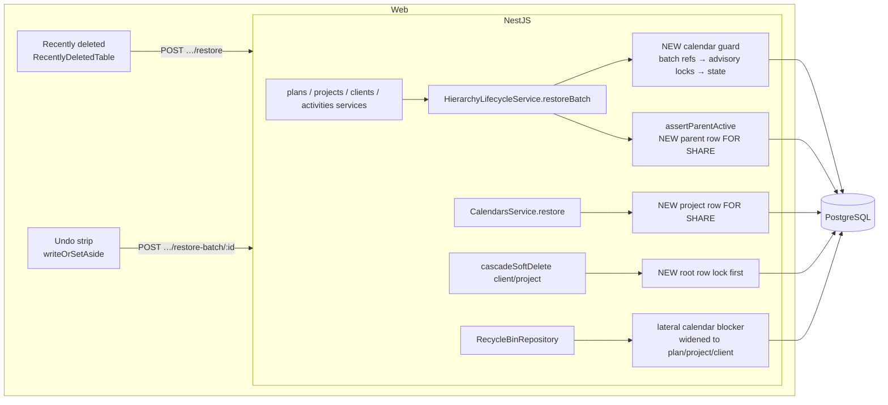
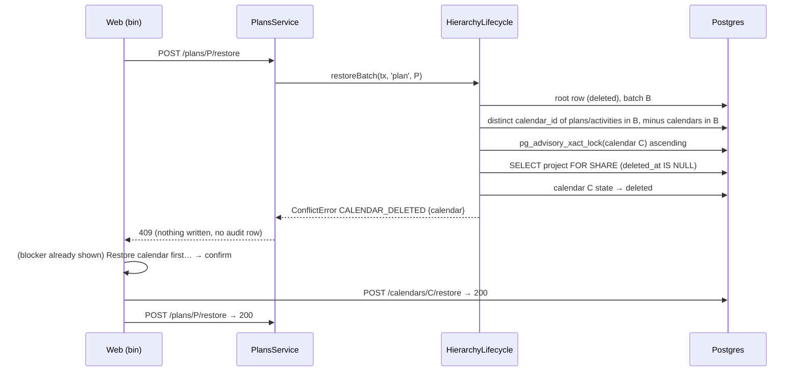
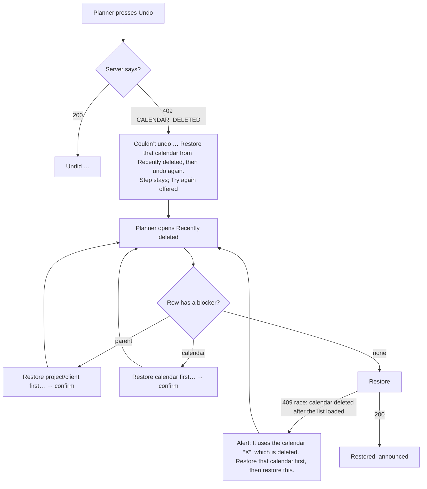

# Feature Spec: A restore never brings work back onto a deleted calendar

- **Status:** Approved — by the product owner, 2026-10-17, with the recommended defaults (Q1 refuse; Q2 keep the undo step; Q3 yes, M4 included)
- **Author(s):** feature-analyst (Claude), for the product owner
- **Date:** 2026-10-17
- **Tracking issue / epic:** `docs/TECH_DEBT.md` #519 (folds in #520)
- **Roadmap link:** none — a defect close-out on ADR-0195's library restore
- **Related ADR(s):** ADR-0195 (library restore, `CALENDAR_DELETED`), ADR-0176 (undo set-aside),
  ADR-0096 (batch restore), ADR-0053 (calendar tiers), ADR-0028 (the pen), ADR-0088 D1 (no flag).
  **A new ADR is required** (outline in §4.9): it extends ADR-0195's rule to the hierarchy, sets a
  lock order, and amends ADR-0176 D3 for one reason.

Why a spec and not just the debt row: the fix adds a refusal to four public restore endpoints, changes
what the Recently deleted screen and the undo strip say, and changes lock order in the shared
hierarchy service. Each of those is a trigger in ADR-0105.

---

## 1. Business understanding

### Problem

**A plan or activity can come back from the bin pointing at a calendar that is itself deleted. The
next recalculation then schedules it round the clock (24 hours a day, 7 days a week) and nothing on
screen says so.** A planner sees a programme that finishes days early and has no reason to doubt it.

The problem was re-checked against the code on 2026-10-17 (CLAUDE.md §19.11, "re-verify the
problem statement"). It is still true. Each step below was read in the code:

1. **The calendar delete guard counts only live users.** `CalendarsService.remove` refuses with
   `CALENDAR_IN_USE` only when active plans, activities or resources use the calendar
   (`apps/api/src/modules/calendars/calendars.service.ts:658-676`). The counts filter on
   `deletedAt: null` (`calendar.repository.ts:612-629`). So a calendar used only by deleted work can
   be deleted.
2. **No hierarchy restore looks at a calendar.** `HierarchyLifecycleService.restoreBatch`
   (`apps/api/src/common/hierarchy/hierarchy-lifecycle.service.ts:601-774`) checks only the parent
   (`assertParentActive`, `:877-916`) and name clashes (P2002 → `NAME_TAKEN`, `:759-764`). Every
   hierarchy restore goes through it:
   - plan restore (`plans.service.ts:321-322`);
   - project restore (`projects.service.ts:249-250`);
   - client restore (`clients.service.ts:230`);
   - single-activity restore (`activities.service.ts:2016-2027`);
   - the batch restore that undo uses (`activities.service.ts:1757-1769`).
3. **The engine treats a deleted calendar as no calendar.**
   - `ScheduleRepository.loadPlanCalendar` filters `deletedAt: null` and returns null
     (`schedule.repository.ts:473-487`).
   - `buildPlanCalendar(null)` returns the all-minutes calendar (`plan-calendar.ts:41-53`).
   - An activity's own calendar goes through the same `resolveCalendar`
     (`schedule.service.ts:1686-1690` → `:2029-2040`). So a deleted **activity** calendar also
     means 24-hour time. It does not fall back to the plan's calendar.
4. **It has been reproduced on a real database.** `apps/api/test/library-restore.e2e-spec.ts:816-837`
   ("reproduces the gap") finishes on 2026-01-13 on a Mon-Wed calendar. After the plan is restored
   onto the deleted calendar it finishes on 2026-01-09 (`:829`). Today the test **asserts the
   defect**: it expects the restore to succeed with 200 (`:824`).

ADR-0195 treated the symptom: restoring the calendar marks every plan that uses it "edited since
calculated" (`calendars.service.ts:585-589`). It did not remove the cause. That was a deliberate
choice, recorded in the ADR-0195 spec's Q4 (`docs/specs/restore-resources-calendars/feature-spec.md:3`).

**Folded in: #520.** A project-calendar restore reads its project's state without a lock
(`calendars.service.ts:536-552`). A project delete runs its calendar sweep before it marks the
project itself deleted (`hierarchy-lifecycle.service.ts:435` then `:439-441`). So the two can
interleave, and the result is an active calendar under a deleted project. Plan restore and project
restore make the same unlocked parent check (`:882-899`). The fix is a shared lock change in the
same file and on the same restore path, so it fits naturally here.

### Users

| Role                      | What they need                                                                                                                                           |
| ------------------------- | -------------------------------------------------------------------------------------------------------------------------------------------------------- |
| **Planner, Org Admin**    | Restore work from Recently deleted or with undo, and be told plainly when the work needs a calendar back first. These two roles hold every `*:restore` permission involved, including `calendar:restore` and `calendar:manage_org` (`apps/api/src/common/auth/org-permissions.ts:194-233`). So whoever is refused can always act on it. |
| Contributor, Viewer       | Nothing changes. They cannot restore.                                                                                                                    |
| External Guest            | Nothing changes. A guest sees only a live plan.                                                                                                          |

### Primary use cases

1. Restore a plan whose calendar was deleted after the plan was. **Refused, with the calendar named
   and a one-press way to restore it first.**
2. Restore a project or client whose plans or activities use a calendar deleted afterwards. Same
   refusal, on the project's or client's row.
3. Undo an activity delete after a colleague deleted the activity's own calendar. Undo stops, names
   the calendar, and **keeps the step**, so it can be retried once the calendar is back.
4. Restore a project whose own (project-scoped) calendars were removed **with** it. **Allowed**:
   those calendars come back in the same batch, exactly as they do today.

### User journeys

- **Recently deleted:** the row says `Uses deleted calendar “Mon-Wed”`. Its action is
  `Restore calendar first…`, which opens the existing confirmation. The planner confirms, the
  calendar comes back, the row becomes `Restore`, and the planner presses it. This is the same
  two-press flow ADR-0195 shipped for resources (§4.4).
- **Undo:** the strip says
  `Couldn’t undo Delete “Pour slab”. It uses the calendar “Mon-Wed”, which was deleted after your edit. Restore that calendar from Recently deleted, then undo again.`
  The planner restores the calendar and presses undo (or **Try again**). The step applies.

### Expected outcomes

- No restore path can make a plan or activity live on a deleted calendar. The characterisation test
  at `library-restore.e2e-spec.ts:829` is inverted.
- The bin shows the blocker before the press, not only after a refusal.
- A project-calendar restore can no longer leave a calendar active under a deleted project (#520).

### Success criteria

- Every one of the five restore entry points refuses with **409 `CALENDAR_DELETED`** and
  `details.calendar` `{ id, name, deleteBatchId }` when the restored batch would bind a deleted
  calendar that is not in the same batch. Proved by API e2e, one case per entry point.
- `computeSchedule` is byte-identical: the engine is not touched (§3, "Recalc parity").
- Restore latency at the measured ceiling (2,000 activities; `activities.service.ts:1800-1801`
  records 312-337 ms) grows by no more than **10%**, measured before and after (ADR-0142).
- The #520 race is shown closed by a barrier test below HTTP that turns red when the lock is
  removed (the `wbs-reparent-race.e2e-spec.ts:14-67` pattern).

### Open questions

**Critical. Each answer changes the design or the scope:**

- **Q1: Refuse, re-point, or restore the calendar too?** _Recommended: refuse_ (§4.8). Re-pointing
  changes the planner's data while bringing it back. Restoring the calendar automatically brings
  back rows nobody pressed for. ADR-0195 rejected both for the same reasons.
- **Q2: When undo is refused for this reason, should the step stay on the stack (retryable) or be
  set aside (ADR-0176 D3)?** _Recommended: keep it_, as a `failed` result with a sentence.
  Deleted activities are **not listed in Recently deleted**: `DeletedItem.kind` is
  `client | project | plan | resource | calendar` (`packages/types/src/index.ts:936`). So setting
  the step aside leaves the planner no way in the product to get that work back. Keeping it amends
  ADR-0176 D3 for this one reason.
- **Q3: Also refuse a restore whose calendar has since been narrowed to a different project
  (`CALENDAR_WRONG_SCOPE`)?** _Recommended: yes, as a separate task that can be dropped_ (§2 edge
  case E9). It is a second route to #519. It is also, by reading, a way to make the retention expiry
  fail on a foreign key.

**Defaults, not blocking:**

- No `VITE_*` flag (ADR-0088 D1). The rollback is a commit boundary.
- Rows that are **already** live on a deleted calendar are not repaired. ADR-0195's remedy still
  covers them: restoring the calendar marks the plan as needing recalculation. §4.10 gives a
  read-only count query the owner may run on the host. No product surface is added for it.
- The refusal names **one** calendar, the lowest id, like the resource precedent
  (`resources.service.ts:755-773`). Restoring it may reveal the next one.
- The plan-**create** path has the same unlocked parent read (`plans.service.ts:95`, outside any
  transaction). That is out of scope and goes in a new debt row (§4.11).

---

## 2. Functional requirements

### User stories & acceptance criteria

> **US-1**: As a **Planner**, I want a plan restore refused while its calendar is deleted, so that a
> restored plan never schedules on 24-hour time without my knowing.
>
> - **Given** plan P was deleted, **and** P's calendar C was deleted afterwards, **when** I restore
>   P, **then** I get 409 `CALENDAR_DELETED` with `details.calendar = { id: C, name, deleteBatchId }`,
>   and nothing is written (no rows, no audit event).
> - **Given** the same state, **when** I restore C and then P, **then** both succeed and the next
>   recalculation finishes on the Mon-Wed date (2026-01-13 in the reproduction test).
> - **Given** an activity in P has its own calendar A, and A was deleted after P, **when** I restore
>   P, **then** it is refused with `details.calendar` naming A.
> - **Given** C is **archived** but not deleted, **when** I restore P, **then** it succeeds.
>   Archived bindings stay live (ADR-0053 §4, `calendar-scope.guard.ts:72-84`).

> **US-2**: As a **Planner**, I want a project or client restore refused on the same condition, while
> its own project calendars still come back with it.
>
> - **Given** client K was deleted (its plans use ORG calendar C), **and** C was deleted afterwards,
>   **when** I restore K, **then** 409 `CALENDAR_DELETED` names C.
> - **Given** project R was deleted with its project calendar Q in the same batch
>   (`hierarchy-lifecycle.service.ts:435`), **when** I restore R, **then** it succeeds. Q is in the
>   batch being restored, so it is not a blocker.

> **US-3**: As a **Planner**, I want Recently deleted to tell me before I press anything.
>
> - **Given** the US-1 state, **then** P's row shows `Uses deleted calendar “<C>”` and the action
>   `Restore calendar first…`. The accessible name is `Restore calendar first…: <C>`, as the
>   resource case already reads (`RecentlyDeletedTable.tsx:315-328`).
> - **Given** a client or project row in that state, **then** the sub-line reads
>   `Work in it uses deleted calendar “<C>”`.
> - **When** I confirm the dialog, **then** C (and anything deleted with it) is restored, and P's row
>   changes to `Restore`.

> **US-4**: As a **Planner**, I want undo to say why it stopped and let me retry.
>
> - **Given** I deleted activity “Pour slab” (own calendar “Mon-Wed”), **and** a colleague deleted
>   “Mon-Wed”, **when** I undo, **then** the strip reads
>   `Couldn’t undo Delete “Pour slab”. It uses the calendar “Mon-Wed”, which was deleted after your edit. Restore that calendar from Recently deleted, then undo again.`
>   and the step stays on top of the undo stack (Q2 default).
> - **When** I restore “Mon-Wed” and undo again, **then** the activity comes back with its id and its
>   links.
> - A redo that restores (`commands.ts:575-583`) reads the same, with `redo` in place of `undo`.

> **US-5 (#520)**: As an **Org Admin**, I want a project-calendar restore and a project delete that
> race to end consistently.
>
> - **Given** a restore of project calendar Q and a delete of its project R run at the same time,
>   **then** either both calendar and project end deleted, or the restore is refused with
>   `PARENT_DELETED`. Never "Q active and R deleted".
> - The same holds for plan restore against project delete, and project restore against client
>   delete.

> **US-6 (Q3, if approved)**: a restore whose plan or activity uses a calendar now scoped to a
> **different** project is refused with 409 `CALENDAR_WRONG_SCOPE`, with `details.calendar` and
> `details.projectId`.

### Workflows

The guard runs inside `restoreBatch`, in the caller's transaction, **before the first write**:

1. `loadDeletedRoot` (unchanged, `:608`).
2. **Collect the batch's calendar references.** These are the distinct non-null `calendar_id` values
   of plans and activities with `delete_batch_id = B` in this organisation, minus calendars whose own
   `delete_batch_id = B` (they come back in the same batch, `:729-735`).
3. **Lock** each remaining calendar id in ascending order with `acquireCalendarWriteLock`
   (`common/db/calendar-advisory-lock.ts:25-30`). This is the lock the delete-in-use guard and every
   binding seam take (`calendar-scope.guard.ts:59-64`), so a calendar cannot be deleted between this
   check and the commit.
4. **Lock the parent row** (#520, §4.6) and evaluate `assertParentActive`. `PARENT_DELETED` wins over
   `CALENDAR_DELETED`, as in the bin (ADR-0195 D3) and in the resource restore
   (`resources.service.ts:624-625`).
5. Read the locked calendars' state. If any is missing or deleted → 409 `CALENDAR_DELETED`, naming
   the lowest id. (Q3: if any is PROJECT-scoped to another project → 409 `CALENDAR_WRONG_SCOPE`.)
6. The existing writes, unchanged.

### Edge cases

| #   | Case                                                                                                       | Expected                                                                                                                                                                                                                                                                                   |
| --- | ---------------------------------------------------------------------------------------------------------- | ------------------------------------------------------------------------------------------------------------------------------------------------------------------------------------------------------------------------------------------------------------------------------------------- |
| E1  | Plan's own calendar deleted after the plan                                                                 | 409 `CALENDAR_DELETED`                                                                                                                                                                                                                                                                     |
| E2  | An activity's own calendar deleted after its plan/project/client was                                       | 409. The plan's restore covers its activities, because they share the batch (`:670-672`).                                                                                                                                                                                                  |
| E3  | Project calendar swept **with** the project (same batch)                                                   | Restores, as today                                                                                                                                                                                                                                                                         |
| E4  | Project calendar deleted on its own (own batch), then the plan that used it restored                       | 409. Restoring the calendar first needs the project active (`calendars.service.ts:536-552`), which it is, because the plan's own restore needs that too.                                                                                                                                   |
| E5  | Calendar archived, not deleted                                                                             | Restores                                                                                                                                                                                                                                                                                   |
| E6  | Undo of a single or bulk activity delete, or of a WBS-summary cascade                                      | Same 409, through `restoreDeleteBatch`. The web keeps the step (Q2).                                                                                                                                                                                                                      |
| E7  | Several deleted calendars in one batch                                                                     | Names the lowest id. Restoring it, then retrying, names the next. The bin shows the same one (`ORDER BY id LIMIT 1`).                                                                                                                                                                      |
| E8  | Calendar row gone entirely                                                                                 | Unreachable while a plan or activity row references it: `plans.calendar_id` is `ON DELETE RESTRICT` (`schema.prisma:904-909`), and the expiry deletes plans and activities before calendars (`hierarchy-expiry.runner.ts:192-207`). The guard treats "missing" as deleted anyway, with `name: null`, as the resource guard does (`resources.service.ts:763-771`). |
| E9  | **(Q3)** ORG calendar narrowed to project Y while plan in project X sat in the bin, then the plan restored | Today it succeeds. The narrowing guard counts **active** plans outside the project only (`calendars.service.ts:1029-1049`, `calendar.repository.ts:746-770`). The plan then holds a calendar from another project. If project Y is later deleted, its cascade sweeps that calendar without checking outside users (`hierarchy-lifecycle.service.ts:332-334`), which is #519 again. When Y expires, the hard delete would hit `plans.calendar_id RESTRICT` (by reading `hierarchy-expiry.runner.ts:192-207`; **not run**). With Q3: 409 `CALENDAR_WRONG_SCOPE`. |
| E10 | Restore while a colleague deletes the calendar                                                             | Serialised on the calendar advisory lock. Whichever goes second sees the first's result.                                                                                                                                                                                                  |
| E11 | Already-active root                                                                                        | Unchanged no-op 200 (`plans.service.ts:317`)                                                                                                                                                                                                                                              |
| E12 | Batch with no calendar references                                                                          | One extra pair of reads, no locks, no change                                                                                                                                                                                                                                              |

### Permissions

No new permission. Every route keeps its gate:

| Route                                        | Permission (deny-by-default)                                  | Pen                                                            |
| -------------------------------------------- | ------------------------------------------------------------- | -------------------------------------------------------------- |
| `POST …/clients/:id/restore`                 | `client:restore`                                              | no                                                             |
| `POST …/projects/:id/restore`                | `project:restore`                                             | no                                                             |
| `POST …/plans/:id/restore`                   | `plan:restore`                                                | no                                                             |
| `POST …/activities/:id/restore`              | `activity:restore`                                            | **yes**, already (`activities.service.ts:2011`)                |
| `POST …/plans/:planId/activities/restore-batch/:batchId` | `activity:restore`                                | **yes**, already (`:1730`)                                     |
| `POST …/calendars/:id/restore`               | `calendar:restore`, plus `calendar:manage_org` for ORG        | no                                                             |

The change is a **refusal** on existing writes. It adds no write, so nothing new is structural under
ADR-0028. The guard reads calendars by id **and** `organization_id`. A batch id is a UUID and is
already org-scoped at every caller. The 409 names a calendar in the caller's own organisation, which
the caller can already list with `calendar:read`, so it leaks nothing.

### Validation rules

No new input. The guard reads stored state only.

### Error scenarios

| Scenario                                          | Detection                                                           | User-facing result                                                           | Status                            |
| ------------------------------------------------- | ------------------------------------------------------------------- | ---------------------------------------------------------------------------- | --------------------------------- |
| Batch binds a deleted calendar                    | guard step 5, under calendar locks                                  | Bin: blocker row, or an alert (§4.4). Undo: failed strip with detail (§4.5). | 409 `CALENDAR_DELETED`            |
| Parent still deleted                              | `assertParentActive`, now under a parent-row lock                   | unchanged                                                                    | 409 `PARENT_DELETED`              |
| (Q3) Calendar now scoped to another project       | guard step 5                                                        | alert with a link to the calendars library                                   | 409 `CALENDAR_WRONG_SCOPE`        |
| Name clash                                        | P2002 → `NAME_TAKEN` (`:759-764`)                                   | unchanged                                                                    | 409                               |
| Row expired meanwhile                             | unchanged (`:645-655`)                                              | "This item no longer exists."                                                | 404                               |

---

## 3. Technical analysis

| Area           | Impact | Notes |
| -------------- | ------ | ----- |
| Frontend       | low    | Five things change: (1) `writeOrSetAside` maps `CALENDAR_DELETED` to `ReplayFailure` (`replay.ts:190-212`, `:299-307`); (2) `describeRestoreFailure` composes a sentence from `details.calendar.name` (`restore-failure.ts:31-61`); (3) the bin sub-line and (4) the dialog get one client/project wording each (`RecentlyDeletedTable.tsx:229-234`, `RestoreBlockerDialog.tsx:61-69`); (5) for Q3, the alert links to the calendars library. **The blocker button, dialog and two-press flow need no change.** They already handle `relation: 'calendar'` for any row kind (`RecentlyDeletedTable.tsx:135-139`, `:311-336`). |
| Backend        | med    | A calendar guard and a parent-row lock in `HierarchyLifecycleService`. A root-row lock at the start of the client and project cascades. A project-row lock in `CalendarsService.restore`. |
| Database       | **none** | No schema change. The guard's reads use the existing partial `delete_batch_id` indexes on `plans`, `activities` and `calendars` (`migrations/20260709160500_…/migration.sql:109`, `20260710092048_…:88`, `20260710120000_…:84`). This conclusion still **goes to database-architect** for confirmation, along with the lock design (§19.3 covers schema changes; lock order on hot tables is that agent's judgement too). |
| API            | low    | A new 409 reason on five endpoints, with a shape already documented (`docs/API.md:1438`). OpenAPI `@ApiConflictResponse` text updated (e.g. `plan-activities.controller.ts:236-240`). The bin's `blockedBy` gains `relation: 'calendar'` on plan, project and client rows. The type already allows it (`packages/types/src/index.ts:983-996`). Pre-1.0, a new refusal is a **minor** bump. |
| Security       | low    | Org-scoped reads. No new permission. No raw SQL beyond the documented `FOR SHARE` read, which is parameterised and states `deleted_at IS NULL` (ADR-0172). |
| Performance    | low–med | The guard adds two batch-keyed reads, plus one advisory lock and one state read per distinct referenced calendar (usually 0–3). Measure at the 2,000-activity ceiling (§1 success criteria). The bin's lateral lookup widens from resource roots to plan, project and client roots. It runs per page root, after the `LIMIT` (`recycle-bin.repository.ts:193-213`). Needs an EXPLAIN on the scale seed. |
| Infrastructure | none   | |
| Observability  | low    | `restoreBatch` refusals already surface as 409 logs. Add `calendarId` to the conflict's log context. No metric. |
| Testing        | med    | API e2e per entry point. Lifecycle unit tests. A barrier race test for #520. Web unit tests for the copy and the undo mapping. Playwright: one bin step and one undo step (ADR-0081). |

**Recalc parity (the gate).** The engine, `computeSchedule` and every snapshot loader are untouched.
A restore the guard allows writes exactly the rows it writes today. A refused restore writes nothing.
So `computeSchedule`'s inputs, for every plan that can be computed, are byte-identical to today's for
the same stored state. Only the set of reachable stored states shrinks. The conformance harness is
unaffected (ADR-0034).

### Dependencies

- ADR-0195's resource guard and bin blocker are the exemplars to reuse (`resources.service.ts:745-774`,
  `recycle-bin.repository.ts:193-213`).
- Lock order already documented in this codebase: **plan → calendar**
  (`activities.service.ts:359-363`, `:641`). This design adds **calendar → parent row** and
  **root row → plan** (§4.6).
- Nothing must land first. M1 (web) can ship before the API (§5, plan).

---

## 4. Solution design

### 4.1 Architecture overview



### 4.2 Data flow: a refused, then successful, plan restore



### 4.3 User flow



### 4.4 Recently deleted: the bin and its copy

- **Server.** In `RecycleBinRepository.findDeletedPage`, widen the lateral lookup
  (`recycle-bin.repository.ts:203-213`). Today it runs for `pg.kind = 'resource'` rows with no parent
  blocker. It should also run for `plan | project | client` rows with no parent blocker. For those it
  returns the lowest-id calendar that is:
  - `deleted_at IS NOT NULL`;
  - `delete_batch_id IS DISTINCT FROM pg.delete_batch_id`; and
  - referenced by a plan or an activity carrying `pg.delete_batch_id`.

  A recommended query shape is to start from the organisation's **deleted calendars** (a small set)
  with two `EXISTS` probes on the batch indexes. Confirm it by EXPLAIN on the scale seed before
  choosing. `canRestore` follows from `parent_active` as today (`recycle-bin.service.ts:61`). The
  invariant "`calendar` only on a row with no deleted parent" still holds
  (`packages/types/src/index.ts:985-990`).
- **Row sub-line** (`RecentlyDeletedTable.tsx:229-234`):
  - plan or resource: `Uses deleted calendar “Mon-Wed”` (unchanged);
  - client or project: `Work in it uses deleted calendar “Mon-Wed”`.
- **Action** (unchanged): `Restore calendar first…`, accessible name `Restore calendar first…: Mon-Wed`.
- **Dialog description** (`RestoreBlockerDialog.tsx:62-65`):
  - plan or resource (unchanged template): `Plan “Tower A” uses the calendar “Mon-Wed”, which is also deleted. Restoring Mon-Wed brings back everything deleted with it — then you can restore Tower A separately.`
  - client or project: `Work in project “Tower” uses the calendar “Mon-Wed”, which is also deleted. Restoring Mon-Wed brings back everything deleted with it — then you can restore Tower separately.`
- **Race alert** (`restore-failure.ts`, a new `CALENDAR_DELETED` branch, for every kind including
  resource): `It uses the calendar “Mon-Wed”, which is deleted. Restore that calendar first, then restore this.`
  If `details.calendar.name` is null: `It uses a calendar that no longer exists.`
- **(Q3) alert:** `It uses the calendar “Site hours”, which now belongs to another project. Make it an organisation calendar again, then restore this.`
  It links with `Open the calendars library` (the existing `library: 'calendars'` link).

### 4.5 Undo: the strip and the stack

- In `writeOrSetAside` (`replay.ts:198-209`), before the generic 409 → `changed` fallthrough: when
  `reason === 'CALENDAR_DELETED'`, **throw** `new ReplayFailure(detail, err)`. `detail` is:
  - undo: `It uses the calendar “<name>”, which was deleted after your edit. Restore that calendar from Recently deleted, then undo again.`
  - redo: `… then redo again.`

  The direction is not known inside `writeOrSetAside`. So it takes an optional `direction` argument,
  or `ReplayFailure` carries the calendar name and `historyResultMessage` builds the sentence. The
  second is preferred: the copy stays in `history-result.ts` beside every other clause.
- Why this keeps the step: a throw leaves both stacks untouched (`use-plan-edit-history.ts:62`,
  `:240`). A `ReplayFailure` becomes `{ kind: 'failed', detail }` (`use-plan-undo-redo.ts:351-355`).
  It is rendered as `Couldn’t undo <label>. <detail>` (`history-result.ts:120-123`), and the strip
  offers **Try again** (ADR-0176 D3's own last sentence, lines 68-69).
- Today the same 409 would read `“Pour slab” was changed after your edit` (`replay.ts:208`). That is
  false, and the step would be popped.

### 4.6 Lock design (#519 guard and #520)

| Path                        | Order (new parts in **bold**)                                                                                          |
| --------------------------- | ---------------------------------------------------------------------------------------------------------------------- |
| Activity restore / batch    | plan advisory (existing, `:2019`, `:1758`) → **calendar advisory, ascending** → writes                                  |
| Plan / project restore      | **calendar advisory, ascending** → **parent row `FOR SHARE`** → writes                                                 |
| Client restore              | **calendar advisory, ascending** → writes (its parent is the organisation)                                             |
| Calendar restore            | calendar advisory (existing, `calendars.service.ts:528`) → **project row `FOR SHARE`** → writes                        |
| Client / project delete     | **root row lock (conflicts with `FOR SHARE`)** → plan advisory (existing, `:402`, `:428`) → activity rows → stamps       |
| Activity update / create    | plan advisory (when taken) → calendar advisory (existing, `activities.service.ts:359-363`, `:641`)                      |
| Calendar delete / edit      | calendar advisory → (edit) plan rows `FOR NO KEY UPDATE` (`mark-schedule-inputs-changed.ts:47-59`)                     |

**Why it closes #520.** A delete now takes its root row lock **before** it reads its subtree. Take a
restore that reads the parent `FOR SHARE`:

- **Restore first:** the delete waits on the row. Its later reads, which are new statements under
  READ COMMITTED (the default; no `isolationLevel` is set on these transactions, verified by grep),
  see the restored child and sweep it.
- **Delete first:** the restore's locking read waits. Postgres then re-evaluates
  `deleted_at IS NULL` against the committed row. It matches nothing, so the restore is refused with
  `PARENT_DELETED`.

`hierarchy-expiry.claim.ts:14-20` records the same READ COMMITTED re-evaluation, relied on there.
Locking the parent alone is **not** enough: the cascade sweeps calendars before it stamps the project
(`hierarchy-lifecycle.service.ts:435` before `:439-441`). Without a lock taken first, the delete
would already have missed the child when it reached the row.

**Why `FOR SHARE` and not a no-op update.** Two restores under one parent then do not serialise on
each other. And plan restore (calendar → project share) cannot deadlock with calendar restore
(calendar → project share): the two shares are compatible, and both paths take the calendar lock
first anyway. The root lock on delete is `FOR NO KEY UPDATE` (the lock an ordinary `UPDATE` takes).
It conflicts with `FOR SHARE` but not with the `FOR KEY SHARE` a child insert's foreign-key check
takes, so creating a plan under a project is not blocked. `claimExpiredRoot`'s no-op `updateMany` is
the precedent for taking such a lock without raw SQL (`hierarchy-expiry.claim.ts:27-45`). Either form
is acceptable. The raw form must state `deleted_at IS NULL` (ADR-0172).

**No cycle.** No path holds a plan advisory lock or a parent row and then asks for a calendar lock,
except activity restore and update, which take plan → calendar and never a client or project row.
Delete paths take no calendar advisory lock (`:335-354` updates calendar rows directly). This is the
argument by reading. The plan's race test exercises the #520 pair, and the full e2e suite exercises
the rest.

The activity branch takes **no** parent-row lock. Its parent (the plan) is already serialised by the
plan advisory lock that every activity restore takes (`activities.service.ts:1758`, `:2019`) and that
every plan, project and client delete takes (`hierarchy-lifecycle.service.ts:204-207`).

### 4.7 Database changes

**None.** The relevant facts were read:

- `plans.calendar_id` and `activities.calendar_id` exist (`schema.prisma:909`, `:1114`);
- `calendars.delete_batch_id` exists (`:1962`);
- partial `delete_batch_id` indexes exist on all three tables (§3).

No migration, no backfill. The database-architect agent confirms this and reviews the lock order and
the bin query plan (CLAUDE.md §19.3, §20).

### 4.8 Implementation approach & alternatives

**Chosen: refuse (option A).** A restore brings a deletion back as it was, or not at all. That is
ADR-0195's title and its rule for resources (`resources.service.ts:745-774`). The cure is one more
press the planner can make, and the bin already offers it.

| Option | What it does | Why not |
| ------ | ------------ | ------- |
| **A. Refuse `CALENDAR_DELETED`** (chosen) | 409 naming the calendar. The bin offers "Restore calendar first…". | One extra press. That is the honest cost of two separate deletions. |
| B. Re-point to the org default | Set `calendar_id` to the org's "Standard" calendar, or to null | There is no org default, only a calendar found by **name** that may itself be renamed or deleted (`plans.service.ts:97-114`). Null means all-minutes, which is the defect itself. Re-pointing an activity changes its dates in a way nobody chose, and silently, which is what #519 complains about. It breaks "comes back as it was". |
| C. Restore the calendar too | Restore the calendar's batch inside the plan restore | That batch may hold siblings nobody pressed for. ADR-0195 rejected exactly this for ancestors (`RestoreBlockerDialog.tsx:22-25`). It also needs `calendar:manage_org` inside a `plan:restore`, and the calendar's own `NAME_TAKEN` and `PARENT_DELETED` refusals. |
| D. Make calendar delete count deleted users too | Refuse the calendar delete while anything in the bin uses it | Hierarchy retention is **off by default** (`RETENTION_HIERARCHY_ENABLED`, CLAUDE.md §17), and purge is refused by design (ADR-0096 D1). So one deleted plan would make a calendar undeletable **for ever**, with nothing the planner can do. |

### 4.9 ADR required: outline (ADR-0198, next free number; `docs/adr/` ends at 0197)

**"A restore brings nothing back onto a deleted calendar"**: Accepted on approval. Amends ADR-0176 D3.

- **Context:** #519 and #520, with the evidence in §1.
- **D1:** Every hierarchy restore refuses with `CALENDAR_DELETED` when its batch binds a deleted
  calendar outside the batch. This is ADR-0195's rule, extended.
- **D2:** The bin shows it in advance on plan, project and client rows.
- **D3:** Lock order. Calendar advisory → parent row `FOR SHARE` on restore. Root row first on
  client and project delete.
- **D4:** Undo **keeps** a step refused for `CALENDAR_DELETED` (a `failed` result with a sentence),
  because the cure is in the planner's hands and the bin does not list activities. This amends
  ADR-0176 D3 for this one reason.
- **D5 (Q3):** Restore also refuses a calendar now in another project's tier.
- **Rejected:** options B, C and D above.

It also adds one line to CLAUDE.md §16 (`check:adr-coverage`) and an "amended by ADR-0198" marker on
ADR-0176's line.

### 4.10 Existing bad rows (not repaired; measurement only)

This read-only query counts live plans and activities on a deleted calendar. The owner may run it on
the host. It is not product code. The `soft-delete` filters are explicit.

```sql
SELECT 'plan' AS holder, count(*) FROM plans p JOIN calendars c ON c.id = p.calendar_id
 WHERE p.deleted_at IS NULL AND c.deleted_at IS NOT NULL
UNION ALL
SELECT 'activity', count(*) FROM activities a JOIN calendars c ON c.id = a.calendar_id
 WHERE a.deleted_at IS NULL AND c.deleted_at IS NOT NULL;
```

A non-zero count is cured by restoring the calendar. ADR-0195 then marks those plans stale.

### 4.11 Out of scope, recorded as new debt rows

- Plan **create** reads its project unlocked and outside a transaction (`plans.service.ts:95`, then
  the insert at `:105`). A foreign-key insert takes `FOR KEY SHARE`, which does not conflict with a
  delete's `FOR NO KEY UPDATE`. So "a plan created into a project being deleted" is still possible.
  It belongs to the same class as #520, but on a create path. Project create under a client is
  presumably the same and needs to be checked.
- Q3, if declined.

## 5. Links

- Implementation plan: [`./implementation-plan.md`](./implementation-plan.md)
- Docs this change will update: `docs/API.md` (the `CALENDAR_DELETED` row at `:1438` and the four
  hierarchy restore sections), `docs/TECH_DEBT.md` #519 and #520 (closed), ADR-0198 (new),
  ADR-0176 (amended marker), CLAUDE.md §16 (one line), `packages/types` doc comment on
  `LIBRARY_RESTORE_REASON.CALENDAR_DELETED` (`index.ts:2270`, "A resource in the batch" → "a row"),
  and `apps/api/test/library-restore.e2e-spec.ts:816-837` (inverted).
