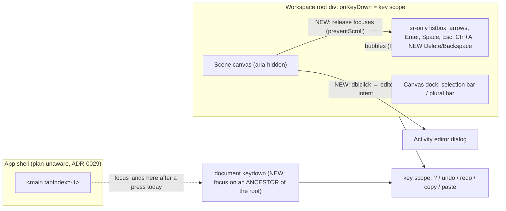
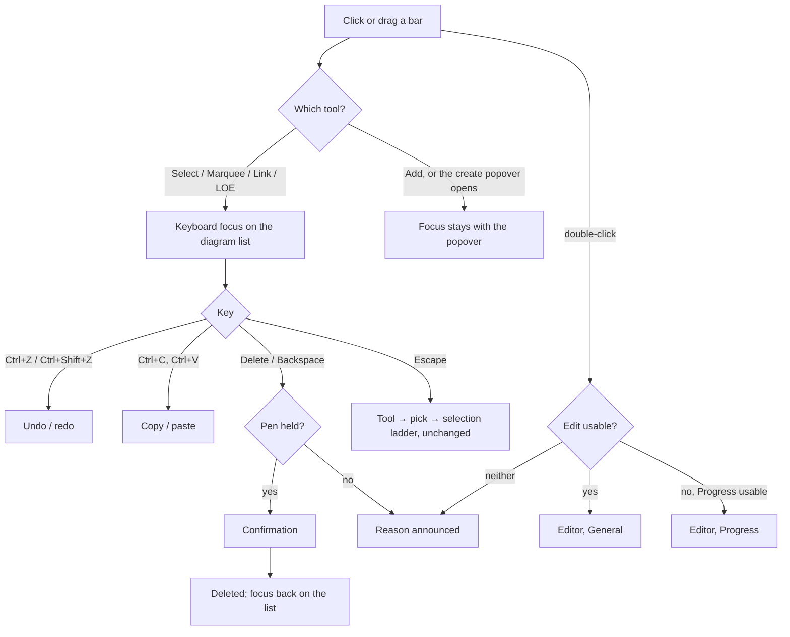

# Feature Spec: The diagram answers the keyboard after a click, and the selection bars fit a short window

- **Status:** Draft — awaiting approval before implementation.
- **Author(s):** feature-analyst (for the product owner)
- **Date:** 2026-11-12
- **Tracking issue / epic:** the owner's GUI review, first severity-2 batch (chosen 2026-11-12): runbook steps 3.3,
  3.14, 7.14, 8.4 and 8.6, and the walkthrough's 1024 × 600 findings (`docs/HANDOFF.md:139-148`, `:202-203`).
  ADR-0105: this adds user-facing entry points (two keys and a gesture) and may change a shared component's public
  contract (`Toolbar`), so it is a spec, not a register row.
- **Roadmap link:** GUI review remediation (`docs/HANDOFF.md`, "What is next").
- **Related ADR(s):** **one new ADR is required at M1** (ADR-0217 if still free when filed; 0216 is the highest on
  disk, `docs/adr/021*.md` listed 2026-11-12), outline in §4.9. **A second ADR is likely at M6** (outline in §4.9),
  decided by M5's measurement. Reads and builds on ADR-0026 §7, ADR-0048 (M5 body fallback), ADR-0064, ADR-0079 §4,
  ADR-0080, ADR-0092, ADR-0093, ADR-0111, ADR-0114, ADR-0135, ADR-0177, ADR-0185, ADR-0187, ADR-0204, ADR-0213,
  ADR-0216. No flag (ADR-0088 D1).

> **About the evidence.** Written from the source tree on 2026-11-12, without a browser. Every claim that decides
> something carries the file and line it was read from. Where a premise can only be settled in a browser it is marked
> **M0 check** or **M5 measure**, and those milestones settle it before anything is built (ADR-0113, ADR-0142). If a
> check contradicts a premise, the work stops and comes back. Nothing in this epic needs the owner to run or check
> anything on their server or devices: every check runs in Playwright here and on CI.

## 0. Plain-English summary

Six things on the diagram do not behave the way a planner expects. This change fixes them.

1. **Ctrl+Z, Ctrl+C and Ctrl+V will work straight after you click or drag on the diagram.** Today the click leaves
   the keyboard "nowhere", so the keys do nothing until you press a button first.
2. **The Delete key will delete the selected activity (or activities)**, after the same "Are you sure?" question the
   Delete button asks. On a Mac keyboard, the key marked delete (Backspace) will do the same.
3. **Double-clicking an activity will open its editor.**
4. **Ctrl-click will reliably add an activity to the selection.** It failed whenever you held the pen; that is a bug
   with a known cause.
5. **On a small screen (1024 × 600), selecting an activity will no longer take a third of the screen** or make the
   diagram jump. The bar of actions will be one line, with the less-used actions under a "More" button.
6. **With several activities selected, the bottom bar will be short and tidy**: a count, the actions, and Clear.
   "Link in sequence…" will say so when the activities are already linked that way.

Items 1 to 4 are quick and ship first, one small release each. Items 5 and 6 are measured on screen first, then built.

### The questions only you can answer (each has a recommended answer; say "defaults" to accept all)

| #   | Question                                                                                                                                                                                                                                                                                                                | Recommended                                                                                                              |
| --- | ----------------------------------------------------------------------------------------------------------------------------------------------------------------------------------------------------------------------------------------------------------------------------------------------------------------------- | ------------------------------------------------------------------------------------------------------------------------ |
| Q1  | When you click the diagram, may the keyboard "move to" the diagram? This is what makes Ctrl+Z, Delete, Esc and the arrow keys work after a click. (The alternative fixes only Ctrl+Z/C/V.) A side effect: **Esc will then clear the selection after a click**, which it does today only after using the keyboard.       | **Yes.**                                                                                                                 |
| Q2  | Should the Delete key (and Backspace) **ask "Are you sure?" first**, like the button does?                                                                                                                                                                                                                              | **Yes, always ask.** Undo also works afterwards.                                                                         |
| Q3  | What should double-click open? Recommended: the editor's **General** page for someone who can edit right now; the **Progress** page for a Contributor; otherwise it tells you why it cannot (for example, "take the pen first").                                                                                        | **As described.**                                                                                                        |
| Q4  | In the summer you asked for "all commands visible when we can" (the reason the old "⋯" menu was removed, `Toolbar.tsx:161-172`). On a **short window only** (704 px high or less), may the activity's action bar show its main actions and put the rest under **"More"**, so it stays one line? Tall windows unchanged. | **Yes, short windows only.** Which actions stay out front is settled by measuring (M5) and shown to you before it ships. |

Everything else has a stated default (§1, "Defaults taken without asking").

## 1. Business understanding

### Problem

Re-verified against the tree on 2026-11-12 (CLAUDE.md §19.11). The brief's leads were checked one by one; two were
right, one was incomplete, and one finding in `docs/HANDOFF.md` is wrong (P1.4).

**P1 — Keys do nothing after a mouse press on the diagram (problems 1 and 3).**

1. The workspace's key bindings (`?`, undo/redo, copy/paste) are **one React `onKeyDown` on the workspace root**
   (`apps/web/src/components/layout/workspace/plan-workspace-toolbar.tsx:1491-1504`, bound at `:2350`;
   composed in `use-plan-workspace-key-scope.ts:77-84`). A React handler hears only keys whose focused element is
   **inside** that root.
2. The diagram's canvases take no focus: the scene canvas is `aria-hidden` with no `tabIndex`
   (`apps/web/src/features/tsld/components/TsldCanvas.tsx:2758-2772`), and its `onPointerDown` only records the press
   and captures the pointer (`:2773-2778`); nothing calls `focus()`. A mouse press on a non-focusable element moves
   focus to its nearest focusable ancestor, which is the shell's `<main id="main" tabIndex={-1}>`
   (`apps/web/src/components/layout/navigator/app-shell.tsx:238-244`). `<main>` is an **ancestor** of the workspace
   root, so a key pressed there never passes through the root's handler. (**M0 check**: the focused element after a
   press in Chromium, Firefox and WebKit; `docs/HANDOFF.md:145-147` observed `<main>` in Chromium.)
3. Undo has a fallback, a document listener, that acts **only** when focus is on `<body>`
   (`apps/web/src/features/undo-redo/use-undo-redo-keybindings.ts:128-139`, the check at `:132-133`). `<main>` is not
   `<body>`, so it stands down. **Copy/paste has no fallback at all** (`apps/web/src/features/activity-copy/use-clipboard-keybindings.ts:45-77`
   returns only the React handler). Hence Ctrl+Z, Ctrl+C and Ctrl+V are all dead after a click, while the Undo
   **button** works.
4. **The same cause hides Escape, arrows, Enter and Space.** Those are the diagram's own keys, on the sr-only listbox
   (`apps/web/src/features/tsld/components/TsldPanel.tsx:3862-3882`, handler `:2316`). Escape on the listbox clears a
   selection (`:2464-2483`). So `docs/HANDOFF.md:275` ("Esc never clears a selection, by design") is **wrong**: it is
   not a design, it is this defect. Recorded here so the next reader does not inherit it (ADR-0076).
5. No journey presses Ctrl+Z or Ctrl+C after a **pointer** press on the canvas: `e2e-undo/undo.spec.ts` and
   `e2e-copy-paste/copy-paste.spec.ts` select by name through the keyboard surface (e.g. `copy-paste.spec.ts:241-243`),
   which is why every suite is green.

**P2 — No Delete key (problem 2).** No handler anywhere in `apps/web/src` acts on `Delete` or `Backspace` for a
selected activity (searched `'Delete'|Backspace` in non-test files: only button labels match). Delete is the bar's
button (`apps/web/src/features/plan-actions/selection-actions.tsx:1025-1035`, pen-gated) and the plural bar's
(`apps/web/src/features/tsld/components/BulkSelectionBar.tsx:228-236`); each opens a confirmation
(`use-plan-workspace-model.ts:300` sets the single target; `TsldPanel.tsx:3412-3415` opens the plural one).

**P3 — Double-click does nothing (problem 4).** The canvas has no `onDoubleClick` (searched `onDoubleClick|dblclick`
in `apps/web/src`: only the Gantt's `GanttCell.tsx:249`, `GanttColumnEdge.tsx:73` and `GanttPanel.tsx:2232`).

**P4 — Ctrl-click replaces the selection when the pen is held (neighbour finding; root cause found).** A plain click
reaches `onSelect(target, modifier)` with the modifier (`TsldCanvas.tsx:3024-3031`). But when a press runs the gesture
machine, which it does whenever editing with a reposition handler wired, or whenever Ctrl is held
(`marqueeArmable`, `:2786-2787`), a bar-body press becomes `repositioning` (`gesture-machine.ts:459-479`), and a
release that did not move returns `select: activityId` (`:654-655`; the resize branch the same at `:679-680`). The
canvas then calls **`onSelect(select)` with no modifier** (`TsldCanvas.tsx:2997`), which is a replace. Without the pen
the body press stays idle and falls through to the modifier path, so Ctrl-click works. That matches the record:
failed at steps 7.14 and in the walkthrough (pen held), worked at 8.4 (**M0 check**: whether the pen was held at 8.4
cannot be read from here; the reproduction is the test).

**P5 — At 1024 × 600 a selection takes a quarter to a third of the screen (problem 5).** The single-selection bar is
a wrapping `Toolbar` with up to about fifteen items (registered at `selection-actions.tsx:743-1255`: remedy, Logic,
Notes, Progress, Resources, Edit, Duplicate, Duplicate band, Make milestone, Dissolve, Move to swimlane, Set code,
Delete, Follow logic, Zoom to selection, Isolate, Float paths) plus a touch-only Clear (`:1271-1295`). The toolbar
wraps by design and never overflows (`apps/web/src/components/ui/toolbar/Toolbar.tsx:161-172`, the owner's "we need
all commands visible when we can"). The house already measured the cost: **the foot row is 167 px with a selection
at 1024 × 600, leaving 246 px of canvas**, and the 350 px floor is explicitly not asserted in selection states
(`apps/web/e2e-workspace-fit/floor-states.spec.ts:31-34`, citing `m3-measurement.md` §4). 167 of 600 is 28 %. **Why
the clicked bar "jumps"** is not established from the code; three hypotheses, settled by **M5 measure**: (H1) the
canvas shrinks under a fixed top-left world point, so the bar slides or leaves the view; (H2) a reveal pans the
selected bar into the smaller view; (H3) the shell's `<main overflow-auto>` (`app-shell.tsx:241`) scrolls.

**P6 — The plural bar is "a mess of words and buttons" (problem 6).** It is one `NoticeStrip` whose message is a full
sentence (`"N activities selected — "X" is the subject of single-activity actions."`, `BulkSelectionBar.tsx:192-196`),
then up to two more sentences (a refusal reason `:199-209` and the move hint `:210`), then up to five buttons
(`:211-239`), all in one wrapping row (`:198`), on its own dock row (`data-dock-row`, `:189`).

**P7 — "Link in sequence…" stays offered after the activities are linked (neighbour).** The button is gated on the
write right only, deliberately (`TsldPanel.tsx:3385-3397`: gating it on the chain's own refusal hid the dialog that
explains the refusal). The chain planner refuses too few, too many and a cycle (`chain-order.ts:133-160`) but not
"already linked", so a second press writes duplicates that the API refuses with 409 `DUPLICATE_DEPENDENCY`
(`apps/api/src/modules/dependencies/dependencies.service.ts:49-50`, `:613-614`) and the dialog shows a failure.

### Users

| Role               | What they need here                                                                                           |
| ------------------ | ------------------------------------------------------------------------------------------------------------- |
| Planner, Org Admin | Every fix. They hold the pen and do the structural edits (Delete, undo, copy/paste, editing).                 |
| Contributor        | Keys after a click (undo of their own progress edits where undo applies), double-click to Progress, the bars. |
| Viewer             | Selection keys after a click (Esc, arrows), Ctrl-click, the tidy bars. No write keys do anything.             |
| External Guest     | Not affected: the guest view is a separate read-only screen (ADR-0051) with no selection bars or edit keys.   |

### Primary use cases

1. Click or drag a bar, then press Ctrl+Z to take it back.
2. Click a bar, Ctrl+C, Ctrl+V to duplicate it.
3. Click a bar (or several), press Delete, confirm.
4. Double-click a bar to edit it.
5. Ctrl-click bars to build a selection, with the pen held.
6. Work at 1024 × 600 with a bar selected and still see most of the diagram, with the bar where you clicked it.

### User journeys

See the user-flow diagram in §4.3. Happy path: click a bar (keyboard focus moves to the diagram, invisibly) → the
action bar appears on one line → Delete → confirm → Ctrl+Z restores it.

### Expected outcomes

The diagram behaves like every other editing surface a planner knows: what you click is what the keyboard acts on.

### Success criteria

All are browser invariants asserted in existing Playwright suites, never pixel figures (`docs/HANDOFF.md:123-130`):

- SC-1 After a pointer press or drag on the canvas, Ctrl+Z undoes, Ctrl+C/Ctrl+V duplicate, and Escape clears the
  selection, in Chromium (and in Firefox/WebKit where the project runs them).
- SC-2 Delete and Backspace on a selection open the same confirmation as the button; confirm deletes; Ctrl+Z restores.
- SC-3 Double-click on a bar opens the editor on the tab §2 names; it never opens in the Link, LOE or Add tools.
- SC-4 Ctrl-click adds and removes with the pen held and without it.
- SC-5 At 1024 × 600 with one activity selected: the selection bar is one line, nothing in it is clipped, every
  control is pressable, the foot row does not scroll sideways, the clicked bar stays inside the canvas, and the
  canvas keeps at least the 350 px floor that `floor-states.spec.ts` asserts outside selection states (the exact
  bound is set by M5 and written into the journey only if it holds on CI's runner).
- SC-6 With several selected: the plural bar holds at most one sentence, every control is pressable, nothing is
  clipped.
- SC-7 No key fires while typing in a field or while a dialog is open (regression tests for every new key).

### Open questions

The four critical ones are Q1 to Q4 in §0.

**Defaults taken without asking** (say if any is wrong):

- D-a **Ctrl-click (P4) is in**, as a small fix of its own (M4).
- D-b **"Link in sequence…" (P7) is in**, as a refusal in the preview ("These activities are already linked in this
  order."), with existing links skipped when only some exist. The button stays lit, for the reason at
  `TsldPanel.tsx:3386-3394`.
- D-c **The Gantt is out** for Delete and double-click on a bar (a cell already uses double-click to edit,
  `GanttCell.tsx:249`). The Gantt **does** get the key-scope fix (M1), because it shares the workspace root.
- D-d **The activities table (bottom panel) is out** for the Delete key: it has its own row menus.
- D-e **Double-click on a link or on empty ground does nothing** in this epic.
- D-f **Touch:** double-tap is supported if the browser delivers it, but is not listed in the shortcuts sheet until
  verified, following the precedent at `PlanShortcutsHelp.tsx:197-205`.
- D-g **No flag** (ADR-0088 D1). The rollback is the commit.

## 2. Functional requirements

### User stories & acceptance criteria

> **US-1 — keys after a click.** As a planner, I want the keyboard to act on the diagram after I click it, so that
> Ctrl+Z, Ctrl+C/V, Escape and the arrows work without first pressing a button.
>
> - **Given** a plan with the pen held **when** I drag a bar and press Ctrl+Z **then** the move is undone.
> - **Given** a bar clicked **when** I press Ctrl+C then Ctrl+V **then** it is duplicated and announced.
> - **Given** a bar clicked **when** I press Escape **then** the selection clears and "Selection cleared." is announced.
> - **Given** focus on the diagram's list **then** its active option is the bar I clicked (the click moves the
>   cursor, `TsldPanel.tsx:2024-2028`).
> - **Given** an empty-ground click that cleared the selection **then** focusing the list does **not** select row 0
>   (the list's own `onFocus` default at `TsldPanel.tsx:3883-3891` is suppressed for this path).
> - **Given** a press in the Add tool, or one that opens the create popover **then** focus is not moved (the popover's
>   field keeps it).
> - **Given** the page does not scroll when focus moves (`preventScroll`).
> - **Given** a click on non-focusable workspace chrome (empty foot row, ruler, gutter) **then** Ctrl+Z still undoes
>   (the widened fallback, §4.8).

> **US-2 — Delete key.** As a planner holding the pen, I want Delete (or Backspace) to delete the selection after the
> usual confirmation.
>
> - **Given** one selected **when** Delete **then** the single confirmation opens; confirm deletes; focus returns to
>   the list (`focusListboxAfterModal`, `TsldPanel.tsx:869-914`) so Ctrl+Z restores it.
> - **Given** two or more selected **when** Delete **then** the plural confirmation opens.
> - **Given** no pen, or the Late-start overlay on **when** Delete **then** nothing is deleted and the same sentence
>   the shaded button gives is announced (ADR-0204).
> - **Given** focus in any text field, dialog, menu or popover **then** Delete/Backspace do what they always did.

> **US-3 — double-click.** As a planner, I want to double-click a bar to open its editor.
>
> - **Given** Select tool, a bar under the pointer, and both presses were plain selects (neither moved the bar)
>   **when** double-click **then** the editor opens: General if the bar's Edit is usable; else Progress if
>   Progress is usable (a Contributor, `selection-actions.tsx:841-846`); else nothing opens and Edit's refusal is
>   announced.
> - **Given** the Link, LOE or Add tool is armed **then** double-click does nothing extra (the tool's own two clicks
>   stand).
> - **Given** the first press dragged the bar **then** no editor opens.
> - Keyboard equivalent exists already (Tab to the bar → Edit), so WCAG 2.1.1 holds; Enter keeps opening Logic
>   (`TsldPanel.tsx:2377-2386`), unchanged.

> **US-4 — Ctrl-click.** With or without the pen, Ctrl/Cmd-click toggles a bar in the selection; Shift-click extends.

> **US-5 — a short window.** At a window 704 px high or less (the existing `short` breakpoint, `lib/breakpoints.ts:65-76`)
> the single-selection bar is one line: the leading actions inline, the rest in a "More" menu; the clicked bar stays
> in view. Taller windows are unchanged.

> **US-6 — plural bar.** The plural bar shows "N selected", its actions and Clear, with at most one sentence (a
> refusal, when there is one). "Link in sequence…" refuses an already-linked chain in its preview.

### Edge cases

- A press that becomes a pan (empty-ground drag) still focuses the list on release: the planner touched the diagram.
- Pointer released outside the canvas (cancelled gesture, `TsldCanvas.tsx:2966-2972`): focus still moves.
- The minimap and the viewport cluster are separate focusable controls; a press on them keeps their own focus.
- A press while a write is in flight still moves focus (keys stay live; the write guard is in the handlers).
- Delete with a selection whose last member is a WBS summary: same confirmation the button gives (no new rule).
- Delete held down: the confirmation is modal, so repeats land in the dialog, not on the plan.
- Double-click on a milestone, a short bar or a bar's outer 8 px: these classify as end handles (`docs/HANDOFF.md:88-92`);
  treated as the bar, as the Link-tool fix did.
- Double-click where the second press lands on a different bar (moved between clicks): opens nothing.
- A touch double-tap on the canvas: `touch-none` (`TsldCanvas.tsx:2763`) means no browser zoom competes; whether
  `dblclick` is delivered for touch is an **M0 check**.
- Text zoom 200 %: the short-window ladder reads the `short` breakpoint, which follows the root size; the one-line
  promise is re-measured at 200 % in M5.

### Permissions

No new permission. Every key and gesture calls an existing action through its existing gate (ADR-0012 is unchanged
because nothing new reaches the server):

| Action          | Gate (unchanged)                                                                                             |
| --------------- | ------------------------------------------------------------------------------------------------------------ |
| Undo/redo keys  | `undoRedoLive` (`plan-workspace-toolbar.tsx:1494`), refusal via `onUndoRedoBlocked`                          |
| Copy/paste keys | `canEditSchedule && !lateOverlayActive` (`:1501`)                                                            |
| Delete key      | the bar's Delete: `penGated`, `penRefusal` (`selection-actions.tsx:1032-1033`); plural: `bulk.gate.writable` |
| Double-click    | the bar's Edit (`:875-884`) then Progress (`:841-846`)                                                       |
| Selection keys  | none (a read)                                                                                                |

Structural writes still need the pen (ADR-0028); nothing here adds a structural write path.

### Validation rules

None (no new input).

### Error scenarios

| Scenario                                | Detection                      | User-facing result                                | Status  |
| --------------------------------------- | ------------------------------ | ------------------------------------------------- | ------- |
| Delete without the pen                  | `penRefusal`                   | announced reason, nothing deleted                 | n/a     |
| Delete races a peer's delete            | existing confirm → API         | the existing failure path of the confirmation     | 404/409 |
| Double-click a bar a reader cannot edit | Edit and Progress both shaded  | Edit's reason announced                           | n/a     |
| Link in sequence, already linked        | `planChain` refusal (new kind) | preview stays, sentence beside it, Confirm shaded | n/a     |

## 3. Technical analysis

| Area           | Impact | Notes                                                                                                                                                                 |
| -------------- | ------ | --------------------------------------------------------------------------------------------------------------------------------------------------------------------- |
| Frontend       | high   | `TsldCanvas`, `TsldPanel`, the key-scope hook, `BulkSelectionBar`, `SelectionActionsBar`, maybe `Toolbar`                                                             |
| Backend        | none   |                                                                                                                                                                       |
| Database       | none   | No schema change, so database-architect is not engaged                                                                                                                |
| API            | none   |                                                                                                                                                                       |
| Security       | low    | Keys call existing gated actions; deny-by-default unchanged; no new data path                                                                                         |
| Performance    | low    | One `focus()` per press; a `dblclick` handler; no paint change. The recalc parity gate is untouched: no scheduling input, `computeSchedule` is not called differently |
| Infrastructure | none   | No new Playwright config; probes go in the existing `apps/web/measure-toolbar/`                                                                                       |
| Observability  | none   |                                                                                                                                                                       |
| Testing        | high   | Unit (key handlers, guards, gesture machine), journeys in existing suites, the bottom-row suite list                                                                  |

### Dependencies

- Nothing must land first. M1 to M4 are independent of each other after M0; M6 and M7 depend on M5.
- Builders are working in `apps/web` now: M1 touches `TsldCanvas.tsx`, `TsldPanel.tsx` and the workspace toolbar, the
  three files most likely to conflict. Each milestone rebases on `main` immediately before its PR.
- The shortcuts sheet (`PlanShortcutsHelp.tsx`) gains rows in M2 and M3.

## 4. Solution design

### 4.1 Architecture overview



### 4.2 Data flow

```mermaid
sequenceDiagram
  actor P as Planner
  participant C as TsldCanvas
  participant L as Listbox (TsldPanel)
  participant R as Workspace root onKeyDown
  participant U as Undo stack
  P->>C: pointerdown / drag / pointerup on a bar
  C->>C: gesture machine → intent (move) or select
  C->>L: onSelect(id, modifier) sets cursor; then focus({preventScroll}) (no row-0 default)
  P->>L: Ctrl+Z
  L-->>R: keydown bubbles (React tree)
  R->>U: undo()
  U-->>P: bar restored, "Undone: …" announced
```

### 4.3 User flow



### 4.4 Database changes

None.

### 4.5 API changes

None.

### 4.6 Component changes

| File                                                              | Change                                                                                                                                        | MS         |
| ----------------------------------------------------------------- | --------------------------------------------------------------------------------------------------------------------------------------------- | ---------- |
| `features/tsld/components/TsldCanvas.tsx`                         | release → `onPressComplete` callback; `onDoubleClick` → `onActivateBar(id)`; select modifier carried through the gesture path                 | M1, M3, M4 |
| `features/tsld/interaction/gesture-machine.ts`                    | `repositioning`/`resizing` capture the select modifier at press (as `marqueeing` captures `additive`, `:493-495`) and return it with `select` | M4         |
| `features/tsld/components/TsldPanel.tsx`                          | `focusListFromPointer()` (no row-0 default, `preventScroll`); Delete/Backspace in `onListKeyDown`; double-click routing                       | M1–M3      |
| `components/layout/workspace/use-plan-workspace-key-scope.ts`     | owns ONE document fallback for the whole scope (ancestor rule); undo's own fallback removed                                                   | M1         |
| `features/undo-redo/use-undo-redo-keybindings.ts`                 | fallback moves out (above); handler unchanged                                                                                                 | M1         |
| `components/layout/workspace/PlanShortcutsHelp.tsx`               | rows for Delete/Backspace and double-click                                                                                                    | M2, M3     |
| `features/plan-actions/selection-actions.tsx` (+ maybe `Toolbar`) | short-window ladder: items declare where they sit on a short window; a "More" menu                                                            | M6         |
| `features/tsld/components/BulkSelectionBar.tsx`                   | count caption, one sentence, actions grouped                                                                                                  | M7         |
| `features/tsld/model/chain-order.ts`, `LinkChainDialog.tsx`       | `alreadyLinked` refusal; skip existing edges                                                                                                  | M7         |

States: no new loading/empty/error states; refusals reuse existing sentences (ADR-0204).

### 4.7 Options and recommendation for problems 1 to 3

| Option | What                                                                                                 | Fixes                                                 | Costs / risks                                                                                                                                                                                                                                                                      |
| ------ | ---------------------------------------------------------------------------------------------------- | ----------------------------------------------------- | ---------------------------------------------------------------------------------------------------------------------------------------------------------------------------------------------------------------------------------------------------------------------------------- |
| A      | A completed press on the canvas focuses the listbox                                                  | Ctrl+Z/C/V, **and** Esc, arrows, Enter, Space, Delete | A screen reader announces the list and the clicked activity on a mouse click (appropriate: ADR-0026 §7, "keyboard and visual focus never diverge", `docs/adr/0026-…md:289-295`). Must suppress the list's row-0 default and scroll. Does not cover clicks on non-focusable chrome. |
| B      | Make `<main>` (or a new focusable wrapper) the key scope                                             | Ctrl+Z/C/V                                            | `<main>` is the shell's and plan-unaware (ADR-0029); a focusable wrapper adds a meaningless tab stop (the reason the root is not focusable, `plan-workspace-toolbar.tsx:2335-2338`). Esc/Delete still dead.                                                                        |
| C      | Widen the document fallback: act when focus is on `<body>` **or any ancestor of the workspace root** | Ctrl+Z/C/V after any click, canvas or chrome          | Keys only; Esc/arrows/Delete still dead after a click. Needs copy/paste to gain a fallback (they have none).                                                                                                                                                                       |

**Recommended: A + C together (Q1).** A makes the diagram answer every key after a click, which is the owner's
expectation; C is the safety net for presses on chrome that holds no focus, and replaces undo's body-only rule with
one stated rule for the whole scope. Neither can fire in a text field or under a dialog: A puts focus on a list that
is not a text field, and C runs the same guards (`isTextEntryTarget`, `dialog[open]`, `modalOpen`).

**Why release, not press.** The browser's own focus move to `<main>` is the default action of `mousedown`, which
follows `pointerdown`; a `focus()` called during `pointerdown` is undone a moment later. Focusing on `pointerup`
(after it) is robust. (**M0 check** in all three engines, including for touch, where `mousedown` is synthesised
after `pointerup`.)

**The Escape rule is unchanged** (ADR-0064's tool → pick → selection ladder, `TsldPanel.tsx:2464-2472`; ADR-0079 §4's
"an Escape typed into a text field belongs to that field"). What changes is that it is now reachable after a click.

**Delete lives on the listbox, not on the root**, for the reason Ctrl+A does (`TsldPanel.tsx:2448-2456`): a handler
that runs only when the list has focus cannot swallow a Delete or Backspace typed anywhere else. Structural, not a
`closest('input')` test.

### 4.8 Problems 5 and 6: measure first, then choose a shape

**M5 measures** (a throwaway probe, `apps/web/measure-toolbar/diagram-keys-m5*.spec.ts`, in the style of
`follow-logic-m0*.spec.ts`), at 1024 × 600, 1280 × 720, 1366 × 768, 1440 × 900 and 1920 × 1080, fine and coarse
pointer, 100 % and 200 % text:

1. Single-selection bar: lines, height, canvas height, for a plain task, a summary, a conflict, swimlanes on, codes on.
2. Plural bar: the same, with and without the pen, with a refusal, with Move and Set code.
3. The jump: the clicked bar's screen rectangle before and after selection, `main.scrollTop`, and the viewport
   origin. Settles H1, H2 or H3.
4. Each candidate below, built in the probe only.

**Candidate shapes** (no pixel numbers are promised before M5):

- **S1 — a short-window ladder (recommended for problem 5, Q4).** Each selection item declares where it sits on a
  short window: inline or under "More". The precedent is ADR-0185 (a declared ladder at fixed stages, an anchor row
  that never moves, focus follows a moved command and the move is announced), applied to height with the existing
  `short` variant (`lib/breakpoints.ts:65-76`). Likely inline: the conflict remedy, Logic, Progress, Edit, Delete;
  under More: Notes, Resources, Duplicate, Make milestone, Dissolve, Move to swimlane, Set code, Follow logic (unless
  it is the remedy), Isolate, Float paths, Zoom to selection.
- **S2 — icon-only labels on a short window** (ADR-0185 D7's `labelVisibility`). Cheaper, but measured before at
  1024 wide it was not enough to fit one line (ADR-0187's M4 reading at `0187-…md:72-74` is the nearest evidence);
  M5 re-measures.
- **S3 — keep the clicked bar in view.** Whatever H1–H3 turns out to be, the canvas re-anchors so the selected bar's
  screen position is kept when the dock grows, or pans minimally if it would be hidden. Combined with S1.
- **P-shape for problem 6.** Caption "N selected" (the subject sentence goes to the accessible description, since it
  matters only for single-activity actions that are absent here per ADR-0080), one status line at most, the actions,
  Clear. On a short window the same S1 ladder: Link in sequence and Delete inline, Move and Set code under More.

**Risk to name now:** the owner removed a "⋯" overflow once (`Toolbar.tsx:161-172`). S1 differs in being bounded to
short windows by a declared rule, but it is still an overflow, which is why it is Q4 and not a default.

### 4.9 ADR outlines

**ADR-0217 (M1) — "A click on the diagram gives it the keyboard".** Status Proposed → Accepted at M1.
Context: P1 above. Decisions: **D1** a completed press on the scene canvas in Select, Marquee, Link or LOE moves focus
to the diagram's list with `preventScroll`, without the list's row-0 default, unless a create popover, dialog or text
field holds focus. **D2** the workspace key scope also acts when focus is on `<body>` or an ancestor of the workspace
root and no dialog is open; one document listener, owned by the scope (amends ADR-0048 M5's body-only fallback).
**D3** Delete and Backspace on the list open the same confirmation as the Delete button; refused aloud without the
pen. **D4** a double-click on a bar in Select opens the editor at the tab the reader can use (General, then Progress),
else announces Edit's reason. **D5** a selection made through the gesture machine carries its press modifier.
Consequences: Escape clears a selection after a click; a screen reader hears the list on a mouse press; the
shortcuts sheet gains two rows. Alternatives: B and C alone (§4.7). Reviewed under ADR-0111 before release.
(D3–D5 are added to the ADR by M2–M4 as dated amendments if the ADR is filed at M1 with D1–D2 only.)

**ADR-0218 (M6, if Q4 is yes and M5 supports S1) — "A selection bar on a short window keeps one line, and says what
moved".** Amends ADR-0187 (order on a short window), ADR-0092 / ADR-0114 (the dock's vertical budget in selection
states), and records the bounded exception to the `Toolbar` no-overflow position. If S1 needs a `Toolbar` prop, it is
a public-contract change: component-reviewer and accessibility-reviewer before release (ADR-0111).

### 4.10 Implementation approach & alternatives

Thin slices, cheapest first: M0 verify (no product change), M1 keys after a click (+ ADR), M2 Delete, M3 double-click,
M4 Ctrl-click, M5 measure the bars, M6 single bar on a short window, M7 plural bar and Link in sequence. Rejected:
a global `window` keydown for everything (cannot keep the "not while typing" promise structurally, the reason the
scope is a React handler, `use-plan-workspace-key-scope.ts:10-15`); making the canvas itself focusable (it is
`aria-hidden`; the list is its accessible twin, ADR-0026 §7); a flag (ADR-0088 D1).

## 5. Links

- Implementation plan: [`./implementation-plan.md`](./implementation-plan.md)
- Docs updated by this change: `CLAUDE.md` §16 (one line per ADR), `docs/UX_STANDARDS.md` (keyboard on the diagram),
  `docs/COMPONENT_LIBRARY.md` (if `Toolbar` gains a prop), `docs/TEST_PLAYBOOK.md` (if a seeded plan is named),
  `docs/HANDOFF.md:275` corrected at the next hand-off (not by this epic's builders: that file is the session's).
