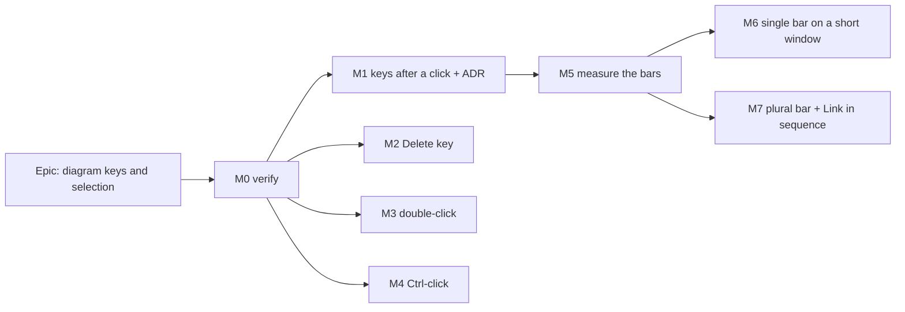

# Implementation Plan: The diagram answers the keyboard after a click, and the selection bars fit a short window

- **Feature spec:** [`./feature-spec.md`](./feature-spec.md)
- **Status:** Approved by the product owner, 2026-11-12, with all four defaults. M0 done 2026-11-12 (Chromium only; Firefox and
  WebKit are not installed here and remain unverified, see `m0-verification.md`).
- **Owner:** product owner; built by `builder` agents, one milestone per pull request.

## Breakdown

### Epic

**Diagram keys and selection** — the first severity-2 batch of the GUI review (2026-11-12): six problems and two
neighbours on the TSLD diagram. No schema, no API, no flag (ADR-0088 D1).

**Rules for every milestone**

- Rebase on `main` immediately before opening the PR (builders are active in `apps/web`).
- Journeys go in **existing** suites; no new Playwright config (that would be an ADR-0105 trigger).
- Browser assertions are invariants that hold on any machine (nothing clipped, every control pressable, no sideways
  scroll, the clicked bar inside the canvas, focus on a named element); figures go in the measurement record only
  (`docs/HANDOFF.md:123-127`). Poll for announcer text.
- Anything touching keys or focus: **accessibility-reviewer before release** (ADR-0111); component-reviewer where a
  shared primitive changes.
- A change to the diagram's bottom row runs, one at a time, with `PLAYWRIGHT_CHROMIUM_PATH` set:
  `web:workspace-fit`, `web:gantt-editing`, `web:narrow-shell`, `web:multi-select`, `web:undo`, `web:arrange`,
  `web:authoring-flow`, `web:authoring`, `web:swimlanes`, `web:workspace-chrome` (`docs/HANDOFF.md:127-130`).
- `pnpm prepush` before every push. Nothing asks the owner to run or check anything on their host or devices.

---

### Milestone M0 — Verify the premises (no product change)

**Outcome:** a written record that confirms or refutes the spec's M0 checks. **Ships dark:** nothing user-facing; a
probe and a markdown record only. No changeset.

#### Feature: verification probe

> **Description:** a throwaway probe `apps/web/measure-toolbar/diagram-keys-m0.spec.ts` and
> `docs/specs/diagram-keys-and-selection/m0-verification.md`.
> **Complexity:** S
> **Dependencies:** none
> **Risks:** a premise is false → stop and amend the spec before M1.
> **Testing requirements:** the probe itself; it is not a regression suite.

##### Task 1 — read what the browser does (≈ one PR)

- **Development steps:**
  1. In Chromium, Firefox and WebKit at 1024 × 600: after a canvas press, a drag, and a press on empty foot-row
     space, record `document.activeElement` (spec P1.2).
  2. Prototype in the probe (via `page.evaluate`) a `listbox.focus({preventScroll:true})` on `pointerup`: does focus
     stay there after `click`? Same with a touch-emulated tap.
  3. Record whether `dblclick` reaches the scene canvas for mouse and for touch emulation (spec D-f).
  4. Reproduce Ctrl-click with and without the pen (spec P4). **Result: it replaces both ways**; Shift-click only with the
     pen (`m0-verification.md`).
  5. Confirm Delete in a single selection opens a confirmation (`use-plan-workspace-model.ts:300`).
  6. Check whether a click on a Gantt bar leaves focus where the workspace root hears it.
  7. Write the record; if anything contradicts the spec, stop and report.

---

### Milestone M1 — Keys work after a click (problems 1 and 3, Escape)

**Outcome:** after clicking or dragging on the diagram, Ctrl+Z / Ctrl+Shift+Z / Ctrl+Y, Ctrl+C / Ctrl+V, Escape and
the arrow keys act on the diagram.
**Entry point:** the diagram canvas in the plan workspace (any press), then the keys.
**Journey:** `e2e-undo/undo.spec.ts` — drag a bar with the mouse, press `Control+z`, assert the bar's dates restored
via the API; `e2e-copy-paste/copy-paste.spec.ts` — click a bar with the mouse, `Control+c`, `Control+v`, assert the
announcement and the API count; `e2e-multi-select/multi-select.spec.ts` — click a bar, `Escape`, assert
"Selection cleared."; `expect(listbox).toBeFocused()` after the press.

#### Feature: focus on press + one fallback for the scope

> **Complexity:** M
> **Dependencies:** M0
> **Risks:** (1) the list's `onFocus` selects row 0 after an empty-ground clear → a one-shot suppression flag, as
> `conflictFocusPendingRef` does (`TsldPanel.tsx:915-918`), unit-tested. (2) focus stolen from the create popover →
> no focus move in the Add tool or while `pending`; journey in `e2e-authoring-flow`. (3) scroll jump → `preventScroll`.
> (4) the widened fallback double-fires with the React handler → the rule is "focus on an ANCESTOR of the root", which
> is disjoint from "inside the root"; unit test both. (5) a screen-reader user hears the list on a mouse press →
> accepted in the ADR; accessibility-reviewer judges.
> **Testing requirements:** unit (TsldPanel focus path; key scope fallback: body, `<main>`, inside-root, a text field,
> `dialog[open]`, `modalOpen`); journeys above; the bottom-row suite list is **not** required (no layout change), but
> `web:undo`, `web:multi-select`, `web:authoring-flow`, `web:gantt-editing` are.

##### Task 1 — ADR-0218 and the key-scope fallback

- **Development steps:**
  1. File ADR-0218 (D1, D2; spec §4.9) and its one line in `CLAUDE.md` §16.
  2. Move the document listener out of `use-undo-redo-keybindings.ts:128-139` into `usePlanWorkspaceKeyScope`, acting
     when `activeElement` is null, `<body>`, or contains the workspace root (`rootRef`), and no `dialog[open]`. It
     calls the composed handler, so copy/paste and `?` gain the fallback too.
  3. Update the hooks' docblocks (they state the body-only rule).

##### Task 2 — the canvas hands the keyboard to the list

- **Development steps:**
  1. `TsldCanvas`: a new optional `onPressComplete()` called at the end of every `onPointerUp` branch
     (`TsldCanvas.tsx:2960-3032`) **and from an `onClick`** (M0: for touch the compatibility `mousedown` after
     `pointerup` takes focus back, `click` is after it), except Add mode and `pending`.
  2. `TsldPanel`: `focusListFromPointer()` = set the suppression flag, `listboxRef.current?.focus({preventScroll:true})`.
  3. Shortcuts sheet: no new row (the keys are not new); `docs/UX_STANDARDS.md` gains one sentence.
  4. accessibility-reviewer before release; changeset `@repo/web` patch ("keys work after clicking the diagram").

---

### Milestone M2 — The Delete key (problem 2)

**Outcome:** Delete or Backspace on a selection opens the existing confirmation.
**Entry point:** the diagram (after a click, M1, or Tab) → `Delete`.
**Journey:** `e2e-multi-select/multi-select.spec.ts` — click one bar, `Delete`, confirm, assert gone via API,
`Control+z`, assert back; select two, `Backspace`, assert the plural confirmation; without the pen, `Delete`, assert
the reason announced and nothing deleted.

> **Complexity:** S · **Dependencies:** M0 (M1 for the pointer journey; the keyboard journey works without it)
> **Risks:** Backspace in a field → the handler is on the listbox only (structural, like Ctrl+A at
> `TsldPanel.tsx:2448-2456`); unit test that a keydown from an input inside the panel does nothing.
> **Testing:** unit for each branch (single, plural, no pen, Late overlay, LOE/Link tool armed → still opens confirm,
> or not — decide in the PR and state it); journey above.

##### Task 1 — Delete/Backspace in `onListKeyDown`

- **Development steps:**
  1. Single: call the same `ctx.onDelete` the bar uses (refusal via `penRefusal` announced). Plural: the same path as
     `BulkSelectionBar`'s `onDelete` (`TsldPanel.tsx:3412-3415`), refused with `bulk.gate.reason`.
  2. `aria-keyshortcuts="Delete"` on the bar's Delete buttons; shortcuts sheet row "Delete or Backspace — delete the
     selection (asks first)".
  3. ADR-0218 dated amendment D3. accessibility-reviewer. Changeset `@repo/web` minor.

---

### Milestone M3 — Double-click opens the editor (problem 4)

**Outcome:** double-clicking a bar opens its editor where the reader can work.
**Entry point:** the diagram canvas → double-click a bar.
**Journey:** `e2e-activity-editor/activity-editor.spec.ts` (or `e2e-workspace-chrome/activity-editor-chrome.spec.ts`)
— double-click a bar, assert the editor dialog and its General tab selected; as a Contributor, assert Progress; with
the Link tool armed, double-click, assert no dialog.

> **Complexity:** M · **Dependencies:** M0 (M4 shares the gesture path: land M4 first if both are in flight)
> **Risks:** a drag's two releases count as a double-click → open only if both presses ended in a plain select
> (a "last press was a select" ref set in `onPointerUp`); the editor's focus vs M1's list focus → the dialog is opened
> after the press-complete focus and takes focus on open (verify in the journey: `toBeFocused` inside the dialog);
> touch → M0's record decides whether the sheet lists it (spec D-f).
> **Testing:** unit for the routing rule (Edit → Progress → reason) and for "no open after a move"; journey above.

##### Task 1 — `onDoubleClick` on the scene canvas

- **Development steps:**
  1. `TsldCanvas`: `onDoubleClick` → hit-test (handles count as the bar) → `onActivateBar?.(id)` in Select only.
  2. `TsldPanel`: route via the selection context's Edit/Progress gates (no second rule).
  3. Shortcuts sheet row; ADR-0218 amendment D4; accessibility-reviewer; changeset minor.

---

### Milestone M4 — Ctrl-click adds to the selection with the pen held (neighbour)

**Outcome:** Ctrl/Cmd-click toggles and Shift-click extends, pen or no pen.
**Entry point:** the diagram canvas → Ctrl-click a bar.
**Journey:** `e2e-multi-select/multi-select.spec.ts` — take the pen, click bar A, Ctrl-click bar B, assert
"2 activities selected"; Ctrl-click B again, assert one.

> **Complexity:** S · **Dependencies:** M0
> **Risks:** the modifier must be captured at press, not read at release (the `marqueeing` precedent,
> `gesture-machine.ts:493-495`).
> **Testing:** gesture-machine unit (`repositioning` and `resizing` return the modifier with `select`); canvas unit;
> journey above.

##### Task 1 — carry the modifier through

- **Development steps:**
  1. `pointerDown` stores `selectModifier` on `repositioning`/`resizing`; `pointerUp` returns it beside `select`.
  2. `TsldCanvas.tsx:2997`: `onSelect(select, modifier)`.
  3. ADR-0218 amendment D5; changeset `@repo/web` patch.

---

### Milestone M5 — Measure the two bars and the jump (no product change)

**Outcome:** `m5-measurement.md` with the readings in spec §4.8 and a recommended shape. **Ships dark:** probes and a
record only. The owner sees the recommended shape (a screenshot pair per size, produced here) and answers Q4's detail
before M6 is built. No changeset.

> **Complexity:** M · **Dependencies:** M1 (focus behaviour affects nothing visual, but measure on the current tree)
> **Risks:** CI runner fonts differ → record figures, assert nothing in the probe.

##### Task 1 — probe `apps/web/measure-toolbar/diagram-keys-m5*.spec.ts`

- **Development steps:**
  1. Sweep the sizes, pointers and text sizes in spec §4.8 for single and plural selections.
  2. Settle H1/H2/H3 for the jump.
  3. Build S1, S2, S3 and the P-shape inside the probe only; read lines, foot height, canvas height, clipped controls.
  4. Write the record and a recommendation; stop for the owner's look.

---

### Milestone M6 — The single-selection bar on a short window (problem 5)

**Outcome:** at 704 px high or less, selecting an activity shows a one-line bar with "More", and the clicked bar
stays where it was.
**Entry point:** select an activity at 1024 × 600; the bar's **More** button.
**Journey:** `e2e-workspace-fit/floor-states.spec.ts` — at 1024 × 600 select a bar: the bar is one line, nothing
clipped, every control pressable, no sideways scroll, the selected bar's rectangle inside the canvas, the canvas at or
above the floor M5 shows holds on CI; open More, press a moved item (e.g. Duplicate), assert it acts.

> **Complexity:** L · **Dependencies:** M5, Q4 = yes
> **Risks:** reintroducing what the owner removed → bounded to `short`, declared per item, owner sees M5's pictures
> first; `Toolbar` contract change → ADR-0219, component-reviewer + accessibility-reviewer before release; roving
> order and first Tab stop (ADR-0187 D1) → journeys assert first stop, Home, End; focus when a resize moves the
> command the reader is on → ADR-0185 D4's rule (focus follows, move announced); the follow-logic offer's row
> (ADR-0216) shares the dock → run the full bottom-row suite list.
> **Testing:** unit for the ladder resolution; journey above; full bottom-row suite list one at a time.

##### Task 1 — the short-window ladder (shape per M5)

- **Development steps:**
  1. File ADR-0219; §16 line.
  2. Declare each item's short-window place; implement More (the APG `Menu`, items keep focus and reasons per
     ADR-0082/0204).
  3. S3: keep the selected bar's screen position (cause per M5).
  4. Docs: `docs/COMPONENT_LIBRARY.md`, `docs/UX_STANDARDS.md`. ux-reviewer, component-reviewer, accessibility-reviewer.
     Changeset `@repo/web` minor.

---

### Milestone M7 — The plural bar, and "Link in sequence" when already linked (problem 6, neighbour)

**Outcome:** the plural bar reads "N selected", at most one sentence, its actions and Clear; a second Link in
sequence on a linked chain is refused in the preview.
**Entry point:** select two or more activities; the bar's **Link in sequence…**.
**Journey:** `e2e-multi-select/multi-select.spec.ts` — at 1024 × 600 and 1440 × 900 select three: nothing clipped,
every control pressable, no sideways scroll; Link in sequence, confirm; press it again, assert the refusal sentence
and Confirm shaded.

> **Complexity:** M · **Dependencies:** M5 (shape), M6 if the same ladder is reused
> **Risks:** the subject sentence carried meaning (`BulkSelectionBar.tsx:192-196`) → kept as the accessible
> description; the move hint (`:179`, spoken by the panel too) stays spoken; the button must stay lit
> (`TsldPanel.tsx:3386-3394`).
> **Testing:** unit (`planChain` `alreadyLinked` and partial skip; bar rendering); journey above; bottom-row suite list.

##### Task 1 — plural bar shape

- **Development steps:** caption, one status line, grouped actions per M5; ux-reviewer and accessibility-reviewer;
  changeset minor.

##### Task 2 — `alreadyLinked`

- **Development steps:** `ChainRefusal` gains `{ kind: 'alreadyLinked' }`; `planChain` drops edges already in
  `existing` (same predecessor, successor, FS) and refuses when none remain; `LinkChainDialog` sentence "These
  activities are already linked in this order."; changeset patch (may share Task 1's PR if small).

## Sequencing & slices

M0 → M1 → M2 → M4 → M3 → M5 → M6 → M7. M1 to M4 each ship on their own and are each valuable alone; M2 and M3 work
from the keyboard and pointer without M1, but their pointer journeys are cleanest after it. M6 and M7 wait for M5 and
the owner's look at its pictures. Every slice keeps `main` releasable. No flag (ADR-0088 D1); the rollback is the
commit. Close the epic with the spec marked shipped, ADR-0218/0218 Accepted, and `docs/HANDOFF.md` updated (including
the correction of its line 275).

## Definition of Done (per task)

Each task's PR must satisfy the Feature Completion Criteria in [`docs/PROCESS.md`](../../PROCESS.md) (code, tests,
docs, security, performance, accessibility, Docker build, CI, changelog, version impact).

## Risks & assumptions (rollup)

| Risk / assumption                                                    | Likelihood | Impact | Mitigation                                                     |
| -------------------------------------------------------------------- | ---------- | ------ | -------------------------------------------------------------- |
| Focus on release does not stick in one engine                        | low        | high   | M0 checks all three before M1                                  |
| List's row-0 default selects on an empty-ground click                | high       | med    | one-shot suppression flag, unit-tested                         |
| Focus stolen from the create popover                                 | med        | high   | no move in Add / `pending`; authoring-flow journey             |
| Screen-reader users dislike focus moving on a mouse press            | low        | low    | ADR-0026 §7 supports it; accessibility-reviewer before release |
| Escape now clears a selection after a click, surprising the owner    | med        | low    | stated in Q1; it is the documented ladder                      |
| Overflow menu conflicts with the owner's "all commands visible"      | med        | high   | Q4; short windows only; M5 pictures shown before M6            |
| Bottom-row change breaks a far suite (as in ADR-0216's epic)         | med        | med    | full suite list one at a time                                  |
| Merge conflicts with concurrent builders in `TsldPanel`/`TsldCanvas` | high       | low    | small PRs, rebase just before opening                          |
| Pixel assertions flaky on CI                                         | med        | med    | invariants only; figures in records                            |
