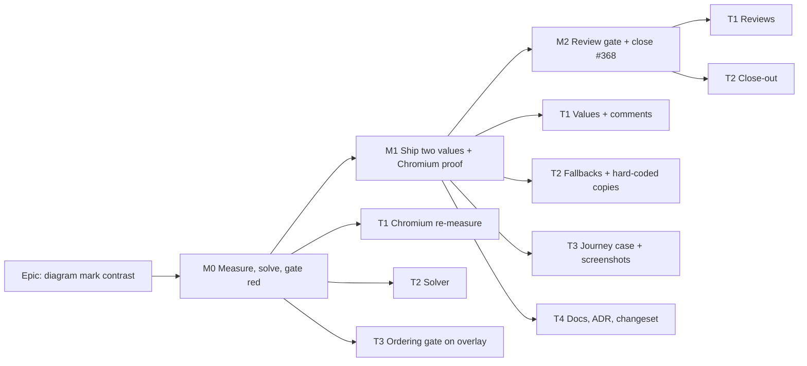

# Implementation Plan: Diagram mark contrast — the work is not fainter than the relationship

- **Feature spec:** [`./spec.md`](./spec.md)
- **Status:** Approved — with the spec, 2026-10-17
- **Owner:** web (James Ewbank; built by the **builder** agent once approved)

Planned for **Route A** (spec CQ-1 default). Where Route A+ or B would change a task, that is noted
in the task itself.

## Breakdown

### Epic

**Diagram mark contrast.** No ordinary link out-shouts the ordinary bar, and the build enforces it.
This is a canvas theme pass, taking up `docs/TECH_DEBT.md` #368.

### Milestone M0: Measure, solve, gate seen red (ships nothing visible)

**Outcome:** the stale #368 table is replaced by a Chromium measurement of today's painter. The
solved values exist. The ordering gate is on `main`, asserting against a proposed-value overlay, and
has been seen red against the shipped CSS.

**Entry point:** `Ships dark`. M0 changes no token the browser paints. M1 surfaces it on every
plan's diagram.

**Journey:** none owed. No user-facing capability is claimed.

---

#### Feature: M0 measurement and gate

> **Description:** re-take the problem in real Chromium, solve the values, and land the gate first.
> **Complexity:** M
> **Dependencies:** spec approved (CQ-1 answered)
> **Risks:**
>
> - The hand arithmetic in the spec is off by more than 0.01. Mitigation: the solver is the
>   instrument and the spec's figures are superseded by `m0-solved.md`.
> - The minimap-tint margin is thinner than the estimate. Mitigation: the solver includes the tint
>   as a constraint, not as an estimate.
>
> **Testing requirements:** the gate is seen red, with a mutation table recorded, in the
> netpoint-grammar M0-T3 style.

##### Task M0-T1: Re-measure the problem on today's painter (≈ one PR, docs + one measure spec)

- **Description:**
  - Measure, in Chromium in-container, the painted RGB of every canvas ink against `--canvas`,
    `--canvas-band` and `--print`, using `paintedRgb` through the scene canvas's scope. Also
    measure:
    - the Gantt bar's `bg-canvas-bar/60` fill and `ring-canvas-bar/70` composite against the
      Gantt row's **actual** computed ground;
    - whether `--plot-warning` is clamped (painted RGB against the OKLCH value).
  - Write `docs/specs/diagram-mark-contrast/m0-measure.md`.
- **Complexity:** S
- **Dependencies:** none
- **Risks:** a measurement taken from the wrong canvas. Mitigation: reuse the
  largest-canvas selector the netpoint-grammar specs use (`links.spec.ts:40-41`).
- **Testing:** the measurement is reported, not asserted. It runs under `scripts/e2e-local.sh`.
- **Development steps:**
  1. Move `paintedRgb` from `e2e-netpoint-grammar/links.spec.ts:38-56` into
     `e2e-netpoint-grammar/support.ts`, so two specs share one instrument (ADR-0124).
  2. Add a reported case, or a `measure-*` spec beside the existing `measure-gantt` precedent, that
     prints the table. Do **not** add a Playwright config. If one turns out to be needed, that is an
     ADR-0105 trigger and work stops.
  3. Record the figures beside the spec's hand figures, and state every disagreement.
  4. If the Gantt ring is confirmed under 3:1, or `--plot-warning` is confirmed out of gamut, file
     each as its own `docs/TECH_DEBT.md` row. Do not fix either here.

##### Task M0-T2: Solver (`apps/web/scripts/solve-mark-contrast.ts`)

- **Description:**
  - Write a reported script, the sibling of `solve-netpoint-grammar.ts`, built on the gate's own
    resolver (`src/test/scope-tokens.ts`) and `src/test/colour.ts`.
  - It holds C and h fixed and searches L for `--canvas-bar` (C 0.13, h 150) and `--canvas-link`
    (C 0.13, h 295).
  - It works under every constraint in the spec's §2 validation table, plus the new ordering. The
    ladder through the minimap tint is computed with the gate's own `compositeOver`.
  - It refuses out-of-gamut candidates (`oklchInGamut`).
  - It prints a table to `docs/specs/diagram-mark-contrast/m0-solved.md`.
  - **For Route A+** it also solves `--plot-warning` and `--plot-destructive`.
- **Complexity:** M
- **Dependencies:** none
- **Risks:** the script asserts its own answers. Mitigation: it is reported, never gated, as its
  sibling's docblock requires (`solve-netpoint-grammar.ts:7-9`).
- **Testing:** none of its own (it is a report). Its output is what M0-T3's gate holds.
- **Development steps:**
  1. Constraint list:
     - bar ≥ 3 on all three grounds;
     - ladder ≥ 1.5 untinted and through the tint, with ≥ 0.03 margin;
     - label ≥ 4.5;
     - inset ring ≥ 3;
     - mark ≥ 3 on bar and on the driving line;
     - link ≥ 3 on all three grounds;
     - ΔE76 ≥ 5 between each link and each rung;
     - **bar ≥ each ordinary link** (Y order).
  2. Choose the bar as the **darkest** L meeting the ladder-through-tint margin. Choose the link as
     the darkest L that stays ≤ the bar.
  3. Write `m0-solved.md` with the values, every pair, and the exact sRGB hex for the fallbacks.

##### Task M0-T3: Ordering gate on a proposed overlay, seen red

- **Description:**
  - Add a block to `apps/web/src/styles/token-contrast.test.ts`: "the work is not fainter than the
    relationship".
  - For each of `--canvas-link` and `--canvas-link-minor`, and each of `--canvas`, `--canvas-band`
    and `--print`, assert `ratio(ground, --canvas-bar) ≥ ratio(ground, link)`. The failure message
    names both ratios.
  - Add a `MARK_CONTRAST_PROPOSED` overlay, using the `NETPOINT_PROPOSED` pattern
    (`token-contrast.test.ts:1074-1082,1198-1206`), including its "keeps no proposed value that has
    already shipped" case.
  - Run every existing canvas pair over the overlay as well.
- **Complexity:** S
- **Dependencies:** M0-T2
- **Risks:** the gate passes for having tested nothing. Mitigation: record a mutation table:
  - with the overlay emptied, the ordering block must go **red** (today: 4.22 > 3.27);
  - with the link set back to 0.592, red;
  - with the bar set back to 0.629, red;
  - with the bar darkened past the ladder ceiling, red on the ladder pair.
- **Testing:** `pnpm exec vitest run src/styles/token-contrast.test.ts` from `apps/web`. Mutations
  are recorded in `m0-solved.md`.
- **Development steps:**
  1. Write the block red-first against the shipped CSS. Then add the overlay and see it green.
  2. Record the mutations, then `pnpm prepush`.
  3. **For Route B**, this task becomes a _reported_ ordering line only, the milestone ends, and
     the epic jumps to M2-T2.

### Milestone M1: Ship the two values, proven on real pixels

**Outcome:** on every diagram:

- ordinary driving links (≈ 3.40:1) and non-driving links (3.37:1) are no louder than the
  ordinary bar (≈ 3.45:1);
- critical and near-critical links are unchanged.

The same holds on paper, in the Gantt bar, the lens, the legend and the minimap.

**Entry point:** the plan workspace's diagram. Open any plan (Project Explorer, then a plan), and
the TSLD canvas paints with the new inks. A share-link guest sees the same, and so does the diagram's existing
PNG/PDF export (`use-diagram-image.ts`).

**Journey:** a new case in the existing `apps/web/e2e-netpoint-grammar` suite,
`mark-contrast.spec.ts`. It opens the reference plan (`openReferencePlan`), reads the painted inks
and asserts the ordering on real pixels. ADR-0081 is satisfied by driving the real product. No new
Playwright config.

---

#### Feature: M1 values and proof

> **Description:** write the solved values, update every copy of the old ones, and prove it in
> Chromium.
> **Complexity:** M
> **Dependencies:** M0
> **Risks:**
>
> - A hard-coded old value is missed. Mitigation: the grep below, and `nodes.spec.ts:37`'s exact
>   assertion fails loudly.
> - The look regresses. Mitigation: screenshots, plus the M2 ux and accessibility reviews.
>
> **Testing requirements:** unit (`token-contrast`, `palette.test`,
> `print-palette.structural.test`), the e2e journey, and `pnpm prepush` plus
> `scripts/e2e-local.sh web:netpoint-grammar`.

##### Task M1-T1: Write the values

- **Description:**
  - Set `--canvas-bar` and `--canvas-link` in `apps/web/src/styles/globals.css` (`:859`, `:845`) to
    the M0-T2 values.
  - Rewrite the comments above each (`:830-858`). They currently say "the **lightest** green that
    clears 3:1" and give the 4.0 target. They must state the new derivation and the ordering rule,
    with the solved ratios.
  - Empty `MARK_CONTRAST_PROPOSED`.
- **Complexity:** S
- **Dependencies:** M0-T3
- **Risks:** a comment quotes a stale figure, which is this register's favourite defect. Mitigation:
  every figure in the comment is copied from `m0-solved.md`, which the gate recomputes.
- **Testing:** the full `token-contrast.test.ts` is green with the overlay empty.
- **Development steps:**
  1. Edit both literals and their comments.
  2. Empty the overlay. The stale-entry case proves it.
  3. Run `pnpm prepush`.

##### Task M1-T2: Fallbacks and hard-coded copies

- **Description:** update every literal copy of the old values.
  - In `apps/web/src/features/tsld/render/palette.ts`:
    - `#459e5d` at `:172,177,277,280,392,495`;
    - `#846cc2` at `:166,273`.

    Use M0's exact hex.

  - `apps/web/e2e-netpoint-grammar/nodes.spec.ts:37`, the exact token assertion, and `:50`, the
    comment's rgb.
  - `apps/web/scripts/crossing-probe.ts:251` (`bar: '#459e5d'`).
- **Complexity:** S
- **Dependencies:** M1-T1
- **Risks:** a copy outside these files. Mitigation: grep `apps/web` for `459e5d|846cc2|0\.629 0\.13
150|0\.592 0\.13 295|69, ?158, ?93` and expect zero hits. The 2026-10-17 grep found exactly the
  files above.
- **Testing:** `palette.test.ts` and `print-palette.structural.test.ts` (fallback parity), and
  `nodes.spec.ts`.
- **Development steps:**
  1. Edit, grep, then `pnpm prepush`.

##### Task M1-T3: The journey, on real pixels, with pictures

- **Description:** add `apps/web/e2e-netpoint-grammar/mark-contrast.spec.ts`. It does four things.
  - **(a)** Reads `paintedRgb` for `--canvas`, `--canvas-band`, `--canvas-bar`, `--canvas-link` and
    `--canvas-link-minor` on the scene canvas. It computes WCAG contrast in the test and asserts the
    ordering and each ≥ 3 floor. This measures **what the browser paints**, gamut clamp included,
    which the CSS-reading matrix cannot do (`palette.ts:138-140` records the matrix asserting a
    mapping the browser did not perform).
  - **(b)** Runs a pixel census on the reference plan at the working tier. It finds ≥ N pixels near
    the bar ink and ≥ N near the driving-link ink, using the `countInk` approach in `links.spec.ts`.
    That proves the painter draws with the new values.
  - **(c)** Attaches screenshots via `testInfo.attach`: the canvas clip of the reference plan at the
    three tiers. It also includes Unit 300 at the working tier, imported through the dialog the way
    `prototype-comparison.md` §"How to reproduce" does it.
  - **(d)** A **control:** the same assertions against a page with the old values injected through a
    style override must fail the ordering. This is verified once and recorded. It is not left in
    the suite if it doubles runtime.
- **Complexity:** M
- **Dependencies:** M1-T1, M1-T2, and M0-T1's shared `paintedRgb`.
- **Risks:**
  - Anti-aliasing blends a 1–2 px line with the ground, so the census misses it. Mitigation: a
    tolerance, as `links.spec.ts:85` already handles.
  - Suite time. Mitigation: one plan opened, and the per-suite budget is checked against
    `scripts/e2e-durations.json`.
- **Testing:** `scripts/e2e-local.sh web:netpoint-grammar` before push, and CI's sharded `e2e-web`.
- **Development steps:**
  1. Write (a) red against the shipped CSS on a branch (it fails: 4.22 > 3.27), then green on
     M1-T1.
  2. Add (b) and (c).
  3. Do (d) once and record it in `m0-solved.md`.
  4. Run the e2e locally.

##### Task M1-T4: Docs, ADR, changeset

- **Description:**
  - `docs/DESIGN_SYSTEM.md`: the bar paragraph (`:1448`) and "The link on the diagram"
    (`:1458-1468`) gain the rule "no link is louder than its rung's bar", with the figures.
  - The ADR from the spec's §4.8 (next free number), with one line in CLAUDE.md §16. The stage
    banner's ADR count goes up by one, or `pnpm check:counts` refuses it.
  - Add an "Amended by" mention to ADR-0157's status line.
  - A changeset: `@repo/web` patch, "Ordinary links no longer out-shout ordinary bars on the
    diagram".
- **Complexity:** S
- **Dependencies:** M1-T1
- **Risks:** the ADR counts or coverage are missed. Mitigation: `pnpm prepush` runs
  `check:adr-coverage` and `check:counts`.
- **Testing:** `pnpm prepush`.
- **Development steps:**
  1. Write the docs and the ADR.
  2. Run `pnpm changeset`, then `pnpm prepush`.

### Milestone M2: Review gate and close-out

**Outcome:** the specialist reviews have run over the combined diff, every blocking finding is
folded with a test seen red, and #368 is closed with evidence.

**Entry point:** as M1 (no new surface).

**Journey:** M1-T3's case.

---

#### Feature: M2 gate pass

> **Description:** reviews, and closing the row.
> **Complexity:** S
> **Dependencies:** M1
> **Risks:** a reviewer judges a picture as worse. Mitigation: that is a finding, and the answer
> may be Route A+ (a CQ-1 re-ask), not a tweak made on an eye.
>
> **Testing requirements:** every fold carries a test seen red.

##### Task M2-T1: Reviews

- **Description:** run three reviewers on M1-T3's attached screenshots and the token diff:
  - **accessibility-reviewer**: WCAG 1.4.11 and 1.4.1 across the three grounds; colour is not the
    only channel for drivingness;
  - **ux-reviewer**: hierarchy on the reference plan and Unit 300 at three tiers;
  - **component-reviewer**: token usage and fallback parity.

  The performance reviewer is **not** owed. Bucketing is by rung key (`paint.ts:1499-1522`), so no
  draw-call change is possible from a value change. Say so in the PR.

- **Complexity:** S
- **Dependencies:** M1
- **Risks:** none beyond the feature risk above.
- **Testing:** as findings require.
- **Development steps:**
  1. Run the reviews.
  2. Fold the blocking findings.
  3. File the non-blocking ones as one `docs/TECH_DEBT.md` row.

##### Task M2-T2: Close #368

- **Description:**
  - Correct #368's table in place. Record that its two pairs were superseded by ADR-0157 two days
    after filing, and that it was re-measured here.
  - Set its status to closed, citing the ADR, `m0-solved.md` and the journey.
  - For Route B, close it on the re-measurement and the reported line alone.
  - Make sure the rows from M0-T1 (Gantt composite, `--plot-warning` gamut) exist if they were
    confirmed.
- **Complexity:** S
- **Dependencies:** M2-T1
- **Risks:** none.
- **Testing:** `pnpm check:debt-status`, run through `pnpm prepush`.
- **Development steps:**
  1. Edit the row.
  2. Run `pnpm prepush`.

## Sequencing & slices

M0 → M1 → M2, one milestone per commit and per PR.

- **M0** is releasable on its own. It changes no painted colour, and the gate asserts against an
  overlay.
- **M1** is the only visible change, and it is two literals. Rolling it back is reverting that
  commit (ADR-0088 D1). **No flag.**
- **M2** is reviews and docs.

No milestone touches the engine, the API, the schema or geometry, so recalc parity and FC-G1 layout
parity hold by construction.

Model routing (§19.14):

- this plan and its answers: Opus;
- M0–M2 build: the **builder** agent (Sonnet);
- reviews: Sonnet reviewers.

## Definition of Done (per task)

Each task's PR satisfies the Feature Completion Criteria in [`docs/PROCESS.md`](../../PROCESS.md):

- code, tests (`pnpm prepush`, plus `scripts/e2e-local.sh web:netpoint-grammar` for M0-T1 and
  M1-T3);
- docs;
- accessibility (M2 review);
- Docker build and CI green (check runs read and deduped per §19.9);
- changeset (M1);
- version impact: `@repo/web` patch.

**Nothing in this plan requires the product owner to check anything on their own devices.** Every
check is a unit gate, a Chromium run in the container, or an attached screenshot judged by a
reviewer agent.

## Risks & assumptions (rollup)

| Risk / assumption                                                              | Likelihood | Impact | Mitigation                                                                                                                                                                                           |
| ------------------------------------------------------------------------------ | ---------- | ------ | ---------------------------------------------------------------------------------------------------------------------------------------------------------------------------------------------------- |
| Hand-computed figures in the spec are off by more than 0.01                    | low        | low    | The M0 solver supersedes them. The spec says so in its header note.                                                                                                                                  |
| Ladder through the minimap tint lands under 1.5 at bar 3.45 (estimated ≈ 1.54) | med        | med    | The solver includes the tint as a constraint and lowers the bar if needed. The gate at `token-contrast.test.ts:413-425` fails loudly.                                                                |
| Parity, not dominance, does not satisfy "work leads"                           | med        | low    | Stated plainly in the spec (CQ-1). Route A+ is costed.                                                                                                                                               |
| Quieter ordinary driving links are harder to follow                            | low        | med    | Weight (2 px against 1 px) and chroma are unchanged. The mark contrast on the line improves (3.01 → ≈ 3.73). Critical and near-critical links are unchanged. The M2 UX review judges it on pictures. |
| A hard-coded old value is missed                                               | low        | low    | The grep in M1-T2, and `nodes.spec.ts:37`'s exact-value assertion.                                                                                                                                   |
| Gantt composite turns out under 3:1                                            | med        | med    | Measured in M0-T1 and filed as its own row. Route A slightly improves it either way.                                                                                                                 |
| `--plot-warning` out of gamut                                                  | med        | low    | Confirmed in M0-T1 and filed. The luminance effect is ≈ 0.0005.                                                                                                                                      |
| The minimap is a different diagram                                             | low        | low    | It reads the same bar token. Its frame pair and tint pairs are in the gate.                                                                                                                          |
