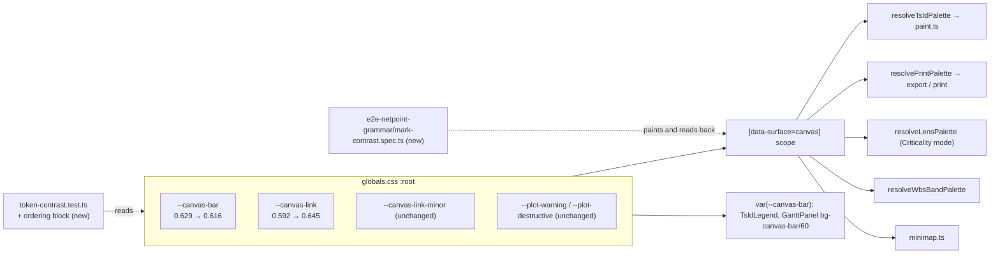
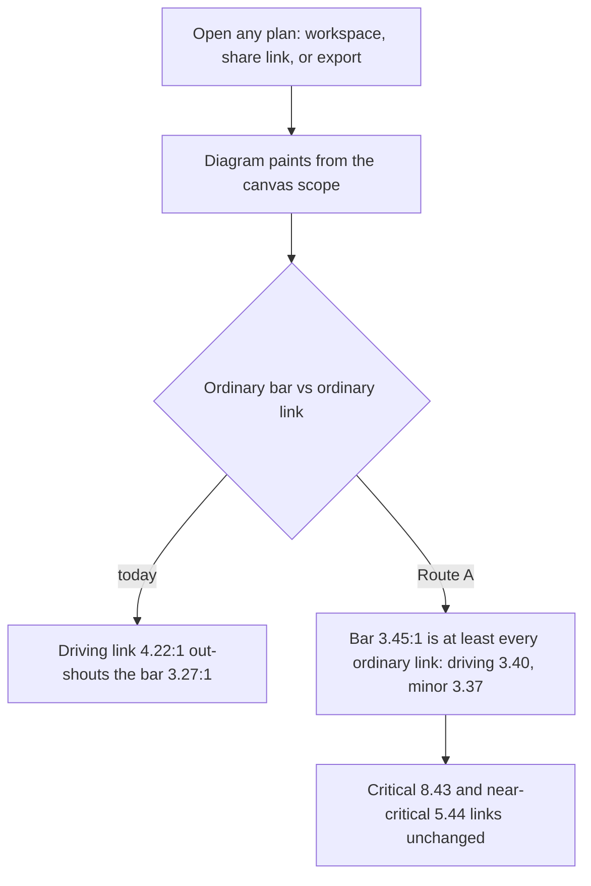

# Feature Spec: Diagram mark contrast — the work is not fainter than the relationship

- **Status:** Approved — by the product owner, 2026-10-17, Route A (two values change; bars and links equal) with its own short ADR amending ADR-0157
- **Author(s):** feature-analyst (Claude Code), for James Ewbank
- **Date:** 2026-10-17
- **Tracking issue / epic:** `docs/TECH_DEBT.md` #368 ("The work is fainter than the relationship
  between work")
- **Roadmap link:** none. This is a debt row taken up as a design pass on the canvas.
- **Related ADR(s):** ADR-0157 (would be amended), ADR-0097, ADR-0055, ADR-0102, ADR-0191 D3 (not
  re-opened), ADR-0088 D1 (no flag), ADR-0081 (entry point and journey). A short new ADR is proposed
  in §4.8.

> **How the numbers here were produced.** No shell was available to this analysis, so every ratio
> in §1 and §4 was computed **by hand** from the shipped OKLCH literals, using the arithmetic in
> §4.2. Where a figure could be cross-checked against one the repository already publishes, it was,
> and each one agreed (listed in §4.2). Treat the hand figures as ±0.01. **The instrument of record is
> the solver and the gate in M0 (plan), not this document.** Nothing here asks the product owner to
> check anything on their own devices.

## 1. Business understanding

### Problem

#368 was filed on 2026-09-22 with this measurement, taken in Chromium in the canvas scope:

| token                | painted as             | vs ground |
| -------------------- | ---------------------- | --------- |
| `--muted-foreground` | every dependency line  | 5.31:1    |
| `--primary`          | an on-schedule bar     | 3.14:1    |

That is, the commonest bar in any programme was 1.69 times fainter than the lines joining the bars.

**Re-verified for this spec, and the row's problem statement is stale. Neither of its two measured
pairs is what the painter draws today.** Two days after the row was filed, the NetPoint grammar
epic (ADR-0157, 2026-09-24) changed both marks:

- Bars no longer use `--primary`. `resolveTsldPalette` reads `bar: token('--canvas-bar', …)`
  (`apps/web/src/features/tsld/render/palette.ts:172`). The value is `--canvas-bar:
  oklch(0.629 0.13 150)` (`apps/web/src/styles/globals.css:859`).
- Links no longer use `--muted-foreground`. The link painter picks `palette.linkMinor` for a
  non-driving link and `palette.linkDriving` for an ordinary driving link
  (`paint.ts:1499-1507`). Those read `--canvas-link-minor: oklch(0.643 0.09 295)` and
  `--canvas-link: oklch(0.592 0.13 295)` (`palette.ts:163,166`; `globals.css:843,845`).
- That path is the one that ships. `scene.visualRefresh` is `CANVAS_DIRECT_MANIPULATION_ENABLED`
  (`scene-layers.ts:47`), which is `flagDefaultOn(...)` (`config/env.ts:716`).
- The ground also moved, from 0.958 to `oklch(0.995 0.002 250)` (`globals.css:574`).

`--muted-foreground` still has consumers on the canvas: the constraint pin (`paint.ts:693`), the
baseline, comparison and levelled ghost outlines (`paint.ts:1752,1816,1881`) and the hover ring. It
is **no longer any link**. `paint.link-marks.test.ts:101` asserts that a link is not drawn in
`palette.edge`.

**What survives, re-measured against today's tokens on the shipped ground (hand-computed, §4.2):**

| mark (what the painter draws)                | token                 | on `--canvas` |
| -------------------------------------------- | --------------------- | ------------- |
| grid day / month / year                      | `--canvas-grid-*`     | 1.15 / 1.50 / 2.00 (published, `m0-solved.md:43-45`) |
| **non-driving link** (1 px)                  | `--canvas-link-minor` | **3.37:1**    |
| **ordinary (on-schedule) bar** (6 px) and its node rim | `--canvas-bar` | **3.27:1** |
| **ordinary driving link** (2 px)             | `--canvas-link`       | **4.22:1**    |
| near-critical bar, and a near-critical driving link | `--warning`    | 5.44:1        |
| critical bar, and a critical driving link    | `--destructive`       | 8.43:1        |
| constraint pin, ghost outlines (not links)   | `--muted-foreground`  | 5.92:1        |

The inversion the row described **still exists, but it is smaller and it has moved**:

- The ordinary bar is still the **faintest mark that carries meaning** on the diagram.
- It is fainter than an ordinary driving link by 4.22 / 3.27 = **1.29×**. The row said 1.69×.
- It is marginally fainter than a non-driving link, by 1.03×. That gap is too small to see. The
  netpoint-grammar solver recorded it as "bar vs minor link (luminance) 1.03:1, reported"
  (`m0-solved.md:65`).

How it arose is on the record. `--canvas-bar` was solved as "the **lightest** green that clears 3:1"
(`m0-solved.md:18`). `--canvas-link` was given "clears 4.0:1 on all three grounds"
(`m0-solved.md:22`), and **no constraint is stated for that 4.0**. The one constraint near that link
works the other way: the direction mark must clear 3:1 *on* the driving line. It sits at 3.01:1
(`m0-solved.md:61`), so a lighter driving link would *relax* it.

There is a second reason the inversion runs against the epic's own aim. ADR-0157 copies NetPoint's
grammar, and in NetPoint's own picture the link is far quieter than the work: "NetPoint's own link
is **1.28:1**" (`prototype-comparison.md:91`). The design system also says "**Drivingness is
weight**" (`docs/DESIGN_SYSTEM.md:1462`), not lightness. So the 1.29× extra lightness contrast that
an ordinary driving link carries over the bar does no job that is written down anywhere.

### Users

Every role that sees the diagram: Org Admin, Planner, Contributor and Viewer in the plan workspace,
and the **External Guest** who opens a share link (ADR-0051, ADR-0163; the guest sees the same
painter). The printed and exported diagram (paper) carries the same inks
(`PRINT_TOKEN_SOURCES`, `palette.ts:262-300`), so whoever reads a printed programme is a user too.

### Primary use cases

1. A planner scans a programme for **the work**: where each activity sits and how long it runs.
2. A planner follows **the logic**: which link drives which activity. The critical and
   near-critical rungs keep their own loud inks. Only the *ordinary* links are affected here.
3. A reader of an exported PNG/PDF or a printed programme does the same on paper.

### User journeys

Nothing new to press. A user opens a plan, and the diagram paints with the re-balanced inks. The
same holds for the Gantt bar (`bg-canvas-bar/60`, `GanttPanel.tsx:2284`), the Colour-by
Criticality lens, the WBS band summary, the legend and the export, because they all read the same
two tokens. See §4.4.

### Expected outcomes

- **No ordinary link is lighter-contrast than the ordinary bar it joins**, on the screen ground, the
  month band, or paper. The same holds by construction for the critical and near-critical rungs,
  where the link ink *is* the bar ink.
- The ordinary bar is slightly stronger: 3.27 → 3.45:1. Its 1 px node rim, drawn in the same ink,
  gains the same amount.
- Ordinary driving links become quieter, 4.22 → 3.40:1, while keeping their 2 px weight. **Critical
  and near-critical links do not change.**
- The rule becomes a **computed gate**, so the next re-tune cannot quietly re-invert it.

### Success criteria

- SC-1: in `token-contrast.test.ts`, a new ordering block asserts `contrast(--canvas-bar) ≥
  contrast(link)` for `--canvas-link` and `--canvas-link-minor`, on `--canvas`, `--canvas-band` and
  `--print`. It is **seen red against today's CSS** and green after the change.
- SC-2: every existing canvas pair stays green with no relaxed floors. That covers the ladder
  (≥ 1.5 untinted and through the minimap tint), the label on the bar (≥ 4.5), the inset ring
  (≥ 3), the mark on the driving line, the bar and the ground (≥ 3), the link floors (≥ 3 on all
  three grounds) and ΔE ≥ 5 between link and bar hues.
- SC-3: in real Chromium, a Playwright case paints each token through the canvas scope, reads the
  pixel back and computes the same ordering. A pixel census of the reference plan also finds
  bar-ink and driving-link-ink pixels. That proves the painter, and not only the stylesheet, uses
  the new values.
- SC-4: before/after screenshots of the reference plan and Unit 300 at the three detail tiers are
  attached to the run, and the ux-reviewer and accessibility-reviewer agents judge them. **No
  device check by the owner.**

### Open questions

**Critical (the answer changes the design):**

- **CQ-1: Which hierarchy?** The options are set out with their arithmetic in §4.7.
  - **A (recommended, default):** *parity*. No ordinary link is louder than the ordinary bar. Two
    token values change and the criticality ladder does not move. The honest limit: the bar ends
    up level with the links (1.01–1.02× in luminance), **not dominant**. Dominance is out of reach
    without moving the ladder. The arithmetic is in §4.3.
  - **A+:** *dominance*. Bar ≈ 3.7:1, which also darkens near-critical and critical. That is five
    tokens and every warning-hued cue (the conflict triangle, the lane-overlap cue, the minimap).
  - **B:** close #368 as superseded by ADR-0157 and add only a *reported* ordering line. Nothing
    changes on screen.
- **CQ-2: Is a short ADR wanted, or an amendment note on ADR-0157?** Default: a short ADR
  (§4.8). The ordering is a rule every future canvas mark must obey. That is the kind of thing
  this repository records as an ADR, and `check:adr-coverage` keeps the register honest.

**Not critical. Defaults are stated and work proceeds on them:**

- No `VITE_*` flag (ADR-0088 D1). The rollback is the commit boundary.
- ADR-0191 D3 / #508 is **not re-opened**. The diagram keeps its own palette under a Windows
  contrast theme, and this spec only re-values two members of that palette.
- The Gantt bar's 60 % and 70 % alpha composites are **measured and reported in M0, not fixed
  here**. By hand estimate the ring is ≈ 2.2:1 on `--canvas` today (§4.6). If it is confirmed under
  3:1, it is filed as its own row.
- `--muted-foreground` on the canvas (the pin and the ghosts at 5.92:1) is out of scope. These are
  overlays and glyphs, not links, and they are reported rather than re-valued.
- A side finding on near-critical (`--plot-warning`) being slightly outside the sRGB gamut is
  confirmed in M0 and filed if true, not fixed here (§4.6).

## 2. Functional requirements

### User stories & acceptance criteria

> **US-1**: As any reader of the diagram, I want an ordinary activity to be at least as visible as
> the ordinary links that join it, so that the work is never the faintest meaningful thing on the
> picture.
>
> **Acceptance criteria**
>
> - **Given** the shipped theme **when** the diagram paints an ordinary bar and an ordinary driving
>   or non-driving link **then** the bar's contrast against the ground under it is ≥ the link's, on
>   the ground, on a month band, and on paper.
> - **Given** a critical or near-critical driving link **then** its ink is unchanged
>   (`--destructive` 8.43:1 and `--warning` 5.44:1).
> - **Given** the change has shipped **then** every pair in `token-contrast.test.ts` that involves
>   `--canvas-bar`, `--canvas-link` or `--canvas-link-mark` still meets its existing floor.

> **US-2**: As a planner following logic, I want driving links to stay distinguishable from
> non-driving ones, so that losing some lightness contrast costs me nothing.
>
> **Acceptance criteria**
>
> - **Given** an ordinary driving link and a non-driving link **then** the driving link is 2 px
>   and the non-driving link 1 px (unchanged, `paint.link-marks.test.ts:279-280`). The driving link
>   also keeps the higher chroma (C 0.13 against 0.09).
> - **Given** a violet link **then** its direction marks clear 3:1 on the line. They improve from
>   3.01 to ≈ 3.73:1.

> **US-3**: As the product owner, I want the rule enforced by the build and not by my eyes, so that
> a future palette pass cannot silently re-invert it.
>
> **Acceptance criteria**
>
> - **Given** a change that makes either link ink lighter-contrast-stronger than `--canvas-bar`
>   **then** `pnpm test` fails, naming the pair and both ratios.
> - **Given** the Chromium case **then** it fails if the painted colours (after any gamut clamp)
>   break the ordering.

### Workflows

None new. The diagram paints exactly as today, using the re-valued inks.

### Edge cases

- **Month band.** The band (`oklch(0.988 0.003 250)`) is 1.02:1 darker than the ground, so every
  ratio on it is about 2 % lower. All floors are re-checked there (§4.3). The ordering itself does
  not depend on the ground: for inks darker than the ground it is an ordering of luminance, so it
  holds on every light ground at once.
- **Paper.** `--print` is white, so every ratio is about 1.4 % higher than on the screen ground.
  Paper's grid tokens are not touched.
- **Selection and hover.** A highlighted link is re-inked in `--ring` (`paint.ts:1525`), which is
  unchanged.
- **Colour-by lens.** The Criticality mode reads `--canvas-bar`, so it follows the change. The float
  and WBS modes do not read either token.
- **Minimap.** It reads `--canvas-bar` for ordinary rows. The frame pair and the 8 % viewport tint
  are re-checked (§4.3).
- **Forced colours.** Out of scope by owner decision (ADR-0191 D3).

### Permissions

No permission, endpoint or scope changes. A read-only visual change, the same for every role,
including the External Guest. **The pen (ADR-0028): no write of any kind, so not structural.**

### Validation rules

None at the boundary. The "validation" is the contrast matrix:

| rule                                               | floor / ceiling                  | source |
| -------------------------------------------------- | -------------------------------- | ------ |
| every ordinary link ≤ ordinary bar (luminance)     | **new**, non-strict              | this spec |
| bar on ground, band, paper                         | ≥ 3.0                            | `token-contrast.test.ts:1122-1128` |
| link inks on ground, band, paper                   | ≥ 3.0                            | `:1089-1095`, `:937-961` |
| bar vs near-critical, untinted                     | ≥ 1.5                            | `:209-213`, `:1130-1137` |
| ladder through the minimap viewport tint           | ≥ 1.5                            | `:413-425` |
| `--primary-foreground` on the bar (summary name)   | ≥ 4.5                            | `:252`, `:1139-1142` |
| `--foreground` on the bar (inset ring)             | ≥ 3.0                            | `:253` |
| `--canvas-link-mark` on minor, driving, bar, ground | ≥ 3.0 (≥ 4.5 on ground, as text) | `:1100-1120` |
| link hue vs every bar rung                         | ΔE76 ≥ 5                         | `:1180-1189` |
| minimap frame pair on bar ink                      | max(stroke, halo) ≥ 3            | `:358-365` |
| every new value in the sRGB gamut                  | refused if not                   | `oklchInGamut`, `src/test/colour.ts` |

### Error scenarios

| Scenario                                   | Detection                                    | Result                         | Status |
| ------------------------------------------ | -------------------------------------------- | ------------------------------ | ------ |
| a re-tune makes a link out-shout the bar   | ordering block, `token-contrast.test.ts`     | `pnpm test` red, naming the pair | n/a  |
| new value out of the sRGB gamut            | solver refuses; gate's resolver              | M0 cannot propose it           | n/a    |
| painter not reading the token (scope bug)  | Chromium pixel census                        | e2e red                        | n/a    |
| a hard-coded old value left in a harness or test | `nodes.spec.ts:37` exact-value assertion fails | e2e red; fixed in M1-T2  | n/a    |

## 3. Technical analysis

| Area           | Impact | Notes |
| -------------- | ------ | ----- |
| Frontend       | low    | Two literals in `globals.css`. Fallback hexes in `palette.ts` (6 call sites). Comments beside the tokens. No component, route or state change. |
| Backend        | none   | |
| Database       | none   | No schema change, so database-architect is not engaged. |
| API            | none   | |
| Security       | none   | No input, no auth surface. |
| Performance    | none   | A colour value does not change paint cost. Links are bucketed by *rung key*, not by ink value (`paint.ts:1499-1522`), so bucket counts and draw calls are identical. No ADR-0128 hardware reading is owed. |
| Infrastructure | none   | No new Playwright config. The case joins the existing `e2e-netpoint-grammar` suite. |
| Observability  | none   | |
| Testing        | med    | New ordering block (red first). Solver output. One Chromium case with screenshots attached. Update `nodes.spec.ts:37,50` and `crossing-probe.ts:251`. |

**Recalc parity gate.** The CPM engine is not imported and no scheduling input is added, so
`computeSchedule` is byte-identical by construction. **Layout parity.** No geometry changes, so
FC-G1's route and lane fingerprints are unaffected. The golden paint log uses literal `PALETTE`
fixtures, not tokens (`paint.golden.test.ts:97-98`), so it is unaffected too.

### Dependencies

- Reuses the netpoint-grammar solver pattern (`apps/web/scripts/solve-netpoint-grammar.ts`) and the
  gate's own resolver (`src/test/scope-tokens.ts`). A copy of an instrument measures the copy
  (ADR-0124).
- Reuses `paintedRgb` (`e2e-netpoint-grammar/links.spec.ts:38-56`). It moves to `./support` if a
  second spec needs it, which this one does.
- ADR-0105: this work adds a shared-gate assertion, so the full spec is owed. This document is it.

## 4. Solution design

### 4.1 Architecture overview



### 4.2 The arithmetic (how every ratio here was computed)

WCAG contrast is `(Y₁ + 0.05) / (Y₂ + 0.05)`, where Y is relative luminance computed from linear
sRGB. For an in-gamut OKLCH colour, Y can be taken straight from LMS without passing through
sRGB.

1. `a = C·cos h`, `b = C·sin h`.
2. `l′ = L + 0.3963378a + 0.2158038b`, `m′ = L − 0.1055613a − 0.0638542b`,
   `s′ = L − 0.0894842a − 1.2914855b`, and `l = l′³`, `m = m′³`, `s = s′³`.
3. Linear sRGB is Björn Ottosson's OKLab matrix. Folding the 0.2126/0.7152/0.0722 luminance weights
   into its rows gives **Y = −0.040775·l + 1.112492·m − 0.071718·s**. The coefficients sum to
   0.999999, so white maps to 1.

The R, G and B rows were also evaluated for each proposed value, to confirm it is inside the gamut
(every channel in [0, 1]).

| colour | L C h | l / m / s | Y | Y + 0.05 |
| ------ | ----- | --------- | - | -------- |
| `--canvas` (ground) | 0.995 0.002 250 | 0.983065 / 0.985645 / 0.992483 | 0.985258 | **1.035258** |
| `--canvas-band` | 0.988 0.003 250 | 0.961461 / 0.965274 / 0.975404 | 0.964702 | 1.014702 |
| `--print` (white) | 1 0 0 | — | 1 | 1.05 |
| `--canvas-bar` **today** | 0.629 0.13 150 | 0.214283 / 0.258150 / 0.171071 | 0.266184 | 0.316184 |
| `--canvas-bar` **proposed** | **0.616 0.13 150** | 0.200619 / 0.242659 / 0.159332 | 0.250349 | 0.300349 |
| `--canvas-link` **today** | 0.592 0.13 295 | 0.203660 / 0.209291 / 0.403988 | 0.195558 | 0.245558 |
| `--canvas-link` **proposed** | **0.645 0.13 295** | 0.263806 / 0.270493 / 0.497258 | 0.254502 | 0.304502 |
| `--canvas-link-minor` | 0.643 0.09 295 | 0.262725 / 0.267330 / 0.413394 | 0.257041 | 0.307041 |
| `--plot-warning` | 0.528 0.13 62 | 0.192060 / 0.135977 / 0.052439 | 0.140181 (B clamped, §4.6) | 0.190181 |

Worked example, today's bar on the ground: 1.035258 / 0.316184 = **3.274**.

Proposed bar: 1.035258 / 0.300349 = **3.447**. Its gamut rows are R 0.0520, G 0.3244, B 0.1005,
all in range, ≈ `#409a59`. Proposed driving link: 1.035258 / 0.304502 = **3.400**. Its rows are
R 0.2956, G 0.2016, B 0.6577, all in range, ≈ `#947fd4`.

Figures used but not recomputed here, each taken from where the repository publishes it:

- `--plot-destructive` 8.43:1 on the ground, so Y + 0.05 = 0.122807 (`m0-solved.md:58`).
- `--canvas-link-mark` 12.67:1, so Y + 0.05 = 0.081710 (`m0-solved.md:49`).
- `--primary-foreground` on today's bar, 5.21:1, so the ink's Y + 0.05 = 0.060688
  (`m0-solved.md:59`).
- `--foreground` `oklch(0.321 0 0)`. It is neutral, so Y = 0.321³ = 0.033076.

**Cross-checks against figures the repository already publishes. All agree:**

- Bar 3.274 against `m0-solved.md:46`'s 3.27.
- Driving link 4.216 against 4.22.
- Minor link 3.372 against 3.37.
- Bar luminance 0.266 against `minimap.ts:105`'s 0.266.
- Near-critical luminance 0.140 against `minimap.ts:105`'s 0.140.
- Bar against near-critical, 0.316184 / 0.190181 = 1.663, against `minimap.ts:109`'s 1.66.
- Ground against band, 1.035258 / 1.014702 = 1.020, against `globals.css:566`'s 1.02.
- The minor ink's sRGB works out as `#9182be`, which is exactly the shipped fallback
  (`palette.ts:163`).
- Today's bar's sRGB works out as `#459e5d`, which is exactly the shipped fallback
  (`palette.ts:172`).

### 4.3 Proposed token changes (Route A) and every pair they touch

```css
--canvas-bar:  oklch(0.616 0.13 150);  /* was 0.629, 3.27:1 → 3.45:1 */
--canvas-link: oklch(0.645 0.13 295);  /* was 0.592, 4.22:1 → 3.40:1 */
/* --canvas-link-minor, --canvas-link-mark, --plot-warning, --plot-destructive: unchanged */
```

Hue and chroma are kept, so the grammar's hue classes (ADR-0157 D2/D4) and the ΔE separation do
not move. Only lightness is solved.

**Contrast against each ground (Y + 0.05 of the ground ÷ Y + 0.05 of the ink):**

| ink | `--canvas` today → new | `--canvas-band` today → new | `--print` today → new | floor |
| --- | ---------------------- | --------------------------- | --------------------- | ----- |
| `--canvas-link-minor` | 3.37 → 3.37 | 3.30 → 3.30 | 3.42 → 3.42 | ≥ 3 |
| `--canvas-link` | 4.22 → **3.40** | 4.13 → **3.33** | 4.28 → **3.45** | ≥ 3 |
| `--canvas-bar` | 3.27 → **3.45** | 3.21 → **3.38** | 3.32 → **3.50** | ≥ 3 |
| `--warning` | 5.44 | 5.34 | 5.52 | ≥ 3 |
| `--destructive` | 8.43 | 8.26 | 8.55 | ≥ 3 |

**The ordering (the new rule).** Compare Y + 0.05. A smaller value is a darker ink and therefore a
higher contrast on any lighter ground:

- bar 0.300349 < driving 0.304502 < minor 0.307041. The bar is the darkest of the three, on all
  three grounds at once.
- Bar over driving link: 1.0138×. Bar over non-driving link: 1.0223×.
- Today the bar is the **lightest** of the three, and the driving link is 0.316184 / 0.245558 =
  1.29× darker than it.

**Every pair that involves a changed token, re-checked:**

| pair | today | proposed | floor | computation (proposed) |
| ---- | ----- | -------- | ----- | ---------------------- |
| bar vs near-critical | 1.66 | **1.58** | ≥ 1.5 | 0.300349 / 0.190181 |
| bar vs critical | 2.57 | 2.45 | ≥ 1.5 | 0.300349 / 0.122807 |
| bar vs near-critical **through the 8 % minimap tint** | ≈ 1.62 (est.) | ≈ 1.54 (est.) | ≥ 1.5 | composited in sRGB; the gate (`token-contrast.test.ts:413-425`) is authoritative |
| `--primary-foreground` on bar (summary name) | 5.21 | **4.95** | ≥ 4.5 | 0.300349 / 0.060688 |
| `--foreground` inset ring on bar | 3.81 | **3.62** | ≥ 3 | 0.300349 / 0.083076 |
| `--canvas-link-mark` on bar (attachment dot) | 3.87 | 3.68 | ≥ 3 | 0.300349 / 0.081710 |
| `--canvas-link-mark` on driving line | **3.01** | **3.73** | ≥ 3 | 0.304502 / 0.081710 (improves) |
| `--canvas-link-mark` on minor line | 3.76 | 3.76 | ≥ 3 | unchanged |
| minimap frame stroke on bar ink | ≈ 4.8 | ≈ 4.6 | max(stroke, halo) ≥ 3 | frame ≈ 15.8:1 on ground (est.) ÷ 3.45 |
| link inks vs bar rungs (ΔE76) | 82–108 | still ≫ 5 | ≥ 5 | the hues are unchanged; the solver re-reports it |

**Why 3.45 and not higher. These are the ceilings that bind without moving the ladder:**

- **Ladder, untinted:** the bar's ratio must be ≤ near-critical's ratio ÷ 1.5 = 5.44 / 1.5 = **3.63**.
- **Ladder, through the 8 % minimap tint**, which by the estimate above costs about 0.04: about
  **3.52**. 3.45 leaves about 0.04 of margin, which is the margin the ladder already lives with
  (near-critical against critical is 1.55 against the same 1.5 floor).
- **Dark label** (`--primary-foreground`, 1.035258 / 0.060688 = 17.06:1 on the ground): the bar
  must be ≤ 17.06 / 4.5 = **3.79**.
- **Inset ring** (`--foreground`, 12.46:1 on ground): the bar must be ≤ 12.46 / 3 = **4.15**.

**Why the driving link moves down rather than the bar moving up past it.** Raising the bar to
today's driving link (4.22) is not reachable:

- It breaks the untinted ladder ceiling of 3.63.
- It lands in a **label dead zone**. A dark label needs the bar ≤ 3.79. A white label needs the
  bar ≥ 4.44, because white on the bar must be ≥ 4.5, and white against the ground is
  1.05 / 1.035258 = 1.0142, so the bar must be ≥ 4.5 / 1.0142. Between 3.79 and 4.44 neither ink
  clears 4.5.

The driving link's 4.0 target, by contrast, has no stated constraint behind it (§1). Lowering it
relaxes the one constraint that bound it, the mark on the line.

### 4.4 Consumers that change appearance

All of these read the two tokens and change with them. None needs code beyond a fallback hex:

- the canvas painter: bars, node rims, links, the ghost fills that use `palette.bar`
  (`paint.ts:2850,2883,2901,2920,2946`) and the lag chip;
- the minimap (`minimap.ts:412`);
- the Colour-by lens in Criticality mode (`palette.ts:392`);
- the WBS band (`palette.ts:495`);
- the legend swatches (`TsldLegend.tsx:55,397-584`);
- the Gantt bar (`GanttPanel.tsx:2284`);
- paper (`palette.ts:273,277,280`).

The legend census test keys swatches by token name, so it is unaffected.

**Hard-coded copies of the old values, which M1 must update:**

- `e2e-netpoint-grammar/nodes.spec.ts:37` asserts the literal `oklch(0.629 0.13 150)`, and its
  comment at `:50` gives `rgb(69, 158, 93)`.
- `apps/web/scripts/crossing-probe.ts:251` has `bar: '#459e5d'`.
- The six fallback hexes in `palette.ts`:
  - `#459e5d` becomes ≈ `#409a59`, at `:172,177,277,280,392,495`;
  - `#846cc2` becomes ≈ `#947fd4`, at `:166,273`.

  The exact hex comes from the solver, not from this hand figure.

### 4.5 Data flow

```mermaid
sequenceDiagram
  participant S as solve-mark-contrast.ts (M0)
  participant G as token-contrast.test.ts
  participant C as globals.css
  participant B as Chromium (canvas scope)
  participant P as resolveTsldPalette / paint.ts
  S->>S: search L at fixed C, h under every constraint in §2; refuse out-of-gamut
  S-->>G: proposed values (overlay, the NETPOINT_PROPOSED pattern)
  G->>G: ordering block red on today's CSS, green on the overlay
  Note over C: M1 writes the values, overlay emptied
  C->>B: :root tokens, then the [data-surface=canvas] rebind
  B->>P: getComputedStyle(sceneCanvas) gives the inks
  P->>B: fillStyle / strokeStyle on the scene canvas
  B-->>G: (e2e) paintedRgb + pixel census assert the same ordering on real pixels
```

### 4.6 Measured-in-M0, reported, not fixed here

- **Gantt bar composites.** `bg-canvas-bar/60` and `ring-canvas-bar/70`. Composited in sRGB over
  `--canvas` (assuming that is the row ground), the hand estimate is fill ≈ 1.96:1 and ring
  ≈ 2.2:1 today.
  - **That ground is an assumption, not a measurement.** M0 measures it in Chromium.
  - If it is confirmed under 3:1 it becomes its own `docs/TECH_DEBT.md` row.
  - Route A raises both slightly, so it does not make them worse.
- **`--plot-warning` gamut.** `oklch(0.528 0.13 62)` evaluates to a linear blue channel of
  **−0.0069** by hand, which is outside sRGB, so a browser clamps it.
  - The shipped fallback `#9f5600` (`palette.ts:279`), with blue exactly 00, is consistent with
    that clamp.
  - The luminance effect is 0.0722 × 0.0069 ≈ 0.0005, about 5.44 → 5.43, so no floor is at risk.
  - It does, though, mean the gate may be computing a colour the screen never shows, which is
    exactly what `globals.css:1073-1077` warns about for critical.
  - M0 confirms it with `oklchInGamut` and files it. It is not changed here, because moving
    near-critical is Route A+'s cascade.
- **`--muted-foreground` on the canvas** (5.92:1): the pin and ghost outlines. Reported only.

### 4.7 Alternatives considered

**Route A+: the bar dominates.** This puts the bar around 3.7:1, which is ≥ 1.07× every link and
not merely level with them.

- The cascade it needs:
  - near-critical ≥ 1.5 × 3.7 ≈ 5.55, plus the minimap-tint margin, so about 5.75;
  - critical ≥ 1.55 × near ≈ 8.9;
  - the bar stays ≤ 3.79 for its dark label.
- That is five tokens, not two.
- It moves every `--warning`-hued cue: the conflict triangle (`paint.ts:883`), the lane-overlap
  cue (`:833`), the near-critical node dot, the minimap and the legend. The minimap ladder is
  already within 0.04 of its floor.
- These figures are indicative. The solver would set them.
- **Not recommended as the default**, because the gain is 3.45 → 3.7 for five times the blast
  radius. It is offered because it is the only route to real dominance.

**Route B: close #368 as superseded.**

- The argument for it is real. A 6 px filled bar with a 15 px node is far more ink than a 1–2 px
  line, and thin lines need more contrast to be seen equally, so area salience already favours the
  bar.
- This spec cannot measure perceived salience, and it does not pretend to.
- Against it: the 4.0 target has no stated reason (§1), NetPoint's own picture puts links far below
  work, and an unenforced intent is how #368 arose in the first place.
- If chosen, M1 shrinks to the *reported* ordering line and the row closes.

**Route C: bar ≥ 4.44 with a white label (keep driving links loud). Rejected on arithmetic.**

- It needs near-critical ≥ 6.66 and critical ≥ 9.99.
- It breaks the inset ring: 12.46 / 4.44 = **2.81 < 3**.
- It drops the foreground outline on a critical bar to 12.46 / 9.99 = 1.25.
- It needs a new `--canvas-bar-foreground` token.

**Lighten both links under today's bar, leaving the bar alone.**

- The minor link must stay ≥ 3:1 on the band, which means ≥ 3.06 on the ground.
- Today's bar is 3.27, which leaves a 0.2 window.
- The result would be parity at the 3:1 floor, with the work still barely visible.
- Strictly worse than Route A, which also gains 0.18 on the bar.

**Repaint from system colours under forced colours.** Out of scope by owner decision (ADR-0191 D3,
#508).

### 4.8 ADR (proposed, outline)

**ADR-NNNN (next free number): "A link is never louder than the work it joins."** It would
*amend* ADR-0157 D2 and D4.

- **Context:** #368. This spec's §1 re-measurement. The 4.0 driving-link target with no stated
  constraint.
- **Decision:**
  1. For each criticality rung, no link ink exceeds that rung's bar ink in contrast on any plot
     ground or paper. This is gated in `token-contrast.test.ts`.
  2. `--canvas-bar` is solved as the darkest value that keeps the ladder through the minimap tint
     with margin, no longer as the lightest that clears 3:1.
  3. `--canvas-link` is solved to sit at or below the bar. Drivingness stays weight.
- **Consequences:**
  - ordinary driving links are quieter;
  - the bar gains 0.18;
  - parity, not dominance (A+ recorded as the route to dominance);
  - a new `docs/DESIGN_SYSTEM.md` rule in "The link on the diagram";
  - one line in CLAUDE.md §16, and the stage banner's ADR count goes up by one (`check:counts`).

### 4.9 User flow



### Database changes

None.

### API changes

None.

### Component changes

No component changes. The only edits are two token values and their comments in `globals.css`,
fallback hexes in `palette.ts`, and hard-coded copies in one e2e spec and one harness script. No
one-off styling.

### Implementation approach

Route A by default (CQ-1). It reuses the netpoint-grammar method:

1. Solve (a reported script).
2. Gate first, through a proposed-value overlay, seen red.
3. Ship the values and empty the overlay.
4. Prove it on real pixels in Chromium.
5. Run the review gate.

No flag (ADR-0088 D1). The rollback is the commit that changed two literals.

## 5. Links

- Implementation plan: [`./implementation-plan.md`](./implementation-plan.md)
- Evidence relied on:
  - `docs/TECH_DEBT.md:10380-10409` (#368);
  - `docs/specs/netpoint-grammar/m0-solved.md` and `prototype-comparison.md`;
  - `docs/adr/0157-a-marks-class-is-its-hue-and-its-shape.md`;
  - `docs/adr/0191-a-contrast-theme-is-the-readers-palette.md` D3.
- Docs that M1 updates:
  - `docs/DESIGN_SYSTEM.md` ("The link on the diagram", around `:1458`, and the bar paragraph at
    `:1448`);
  - the token comments in `globals.css`;
  - the new ADR and CLAUDE.md §16;
  - `docs/TECH_DEBT.md` #368, closed with evidence, its stale table corrected in place;
  - the new rows from §4.6 if they are confirmed.
