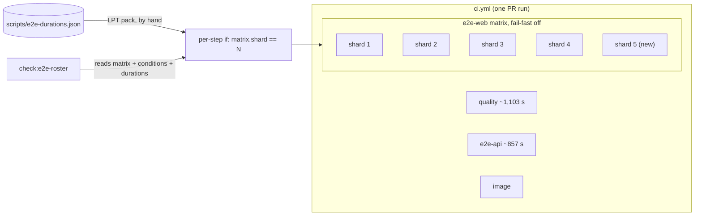
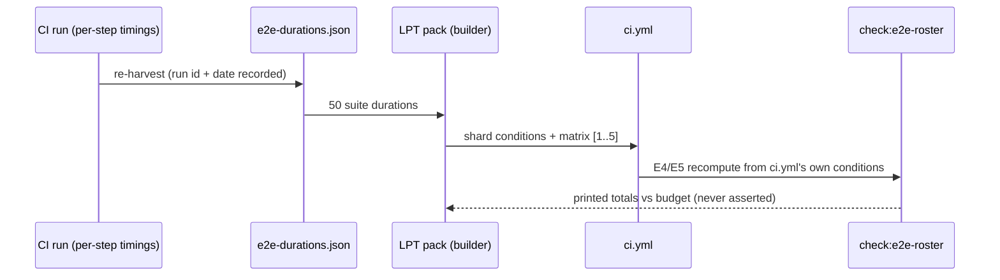

# Feature Spec: A fifth web end-to-end shard

- **Status:** Draft — awaiting product-owner approval (spec commissioned 2026-10-12: "Spec a fifth
  group"; building waits for approval of this document)
- **Author(s):** feature-analyst, for the product owner
- **Date:** 2026-10-12
- **Tracking issue / epic:** `docs/TECH_DEBT.md` #491 (as re-measured on branch
  `docs/toolbar-grid-after-record`, PR #951)
- **Roadmap link:** none. This is a tooling decision about how the repository works on itself; a
  planner cannot act on a CI job.
- **Related ADR(s):** ADR-0138 (the shard count and the rule that sets it); ADR-0058, ADR-0076,
  ADR-0105 (a CI step is a full-spec trigger, which is why this document exists), ADR-0110 D5 (a gate
  is proved by being made to fail). §4.5 proposes an **in-place dated amendment** to ADR-0138 rather
  than a new ADR.

---

## 0. Where every number came from

The argument is arithmetic, so the sources come first (ADR-0076).

| Figure                                                                               | Source                                                                                                                        | Verified here?                                                                                 |
| ------------------------------------------------------------------------------------ | ----------------------------------------------------------------------------------------------------------------------------- | ---------------------------------------------------------------------------------------------- |
| Web shard wall times 766 / 1,172 / 1,089 / 962 s; `e2e-api` 857 s; `quality` 1,103 s | CI run `38290423490` (PR #949's final CI), as recorded in #491 on `docs/toolbar-grid-after-record`                            | **Relayed, not re-read.** The Actions API returned 403 to this session's fetch. M0 re-reads it |
| Per-suite seconds, web total **3,567 s** across 50 suites                            | `scripts/e2e-durations.json` on `docs/toolbar-grid-after-record` (run `38290423490`, job `114948906657`, measured 2026-10-12) | **Yes.** I fetched the file and summed the 50 entries: 3,567                                   |
| Shard suite totals 657 / 1,070 / 995 / 845 s                                         | `check:e2e-roster`'s printed projection of today's assignment against those durations (#951)                                  | Relayed. The totals sum to 3,567, which is consistent                                          |
| Recorded web total **2,393 s** on `main`                                             | `scripts/e2e-durations.json` on `main`, `residualCheck`                                                                       | Yes                                                                                            |
| Shard budget **593 s** (`690 − 97`)                                                  | `scripts/check-e2e-roster.mjs:49-56`                                                                                          | Yes                                                                                            |
| Shard matrix `[1, 2, 3, 4]`, `fail-fast: false`, `timeout-minutes: 30`               | `.github/workflows/ci.yml:418-428`                                                                                            | Yes                                                                                            |
| "Re-measure `W` across three runs before acting"                                     | `docs/specs/ci-sharding/m4-measurement.md:247-249`                                                                            | Yes                                                                                            |
| Same shard on the same commit swings by up to **27 %**                               | ADR-0138 "Consequences" (line 104)                                                                                            | Yes (read)                                                                                     |
| Ten checks, "four `e2e-web` shards"                                                  | `CLAUDE.md:863-881` (§19.9)                                                                                                   | Yes                                                                                            |

**Derived here (arithmetic on the rows above):**

- **Per-shard fixed cost** (wall − suite): 109 / 102 / 94 / 117 s, mean ≈ 105 s.
- **Budget re-derived the way `check-e2e-roster.mjs` derives it** (`e2e-api` job − web fixed cost):
  857 − 105 ≈ **752 s**.
- **A longest-processing-time (LPT) pack of 3,567 s:** four shards ≈ **892 s** each (no single suite
  exceeds that; the largest is `workspace-chrome` at 525 s). Five shards ≈ **713 s** each. I ran the
  five-way pack by hand and it closes at 637–653 s before the 362 s of small suites are placed, so
  ~713 s is reachable.

## 1. Business understanding

### Problem

ADR-0138's first re-open trigger has fired, and the assignment has stopped being balanced.

- **Web total 3,567 s against a trigger of 2,372 s.** The committed `e2e-durations.json` says 2,393 s.
  It was harvested on 2026-09-11 and then topped up with local estimates, so it under-reports by
  1,174 s. The biggest movers are `workspace-chrome` (147 → 525 s), `workspace-fit` (56 → 422 s) and
  `narrow-shell` (22 → 174 s). **The cause of that growth is not established in this spec.** I have
  not read why those suites tripled, and I make no claim about it.
- **The slowest web shard (1,172 s, shard 2) is CI's critical path.** It runs above `quality`
  (1,103 s), so the web side has taken the constraint back. ADR-0138 D1 sharded precisely to prevent
  that.
- **The spread is assignment, not noise.** The measured suite spread is 413 s (657 → 1,070), against
  an LPT-packed spread of about 12 s. ADR-0138's fourth trigger reads this as "the measured spread
  dominates the packed spread", and it has fired.
- **The runaway guard is thinning.** `timeout-minutes: 30` is 1.54× the 1,172 s shard. ADR-0138 D5's
  guard was 2.9–3.4× when it shipped.

### Users

Contributors and agents opening pull requests. The cost they pay is the CI round trip on every
correction. Under §19.9 they also read the check roster before merging. No organisation role is
involved, because nothing under `apps/` changes.

### Expected outcomes and success criteria

1. **No web shard is CI's critical path** in the change's own CI run, compared within that run
   against `quality` and `e2e-api`. A within-run comparison is the only one that between-run variance
   cannot move (ADR-0138).
2. **`check:e2e-roster` is green** and prints five shard totals. Each printed total is at or below the
   re-derived budget.
3. **Every document that counts the shards or the checks agrees with `ci.yml`** (§4.4).
4. **Not a criterion:** a wall-clock figure. ADR-0138 D4 forbids asserting one, and this spec does not
   reintroduce one.

## 2. Functional requirements

> **US-1** — As a contributor, I want the web end-to-end work spread across five shards and packed
> from current durations, so that the end-to-end jobs are not CI's critical path.
>
> - **Given** run `38290423490`'s durations **when** the suites are LPT-packed into five shards
>   **then** each shard holds ~713 s of suite time, below the ~752 s budget.
> - **Given** a suite step conditioned on shard 5 **when** the matrix still declares `[1, 2, 3, 4]`
>   **then** `check:e2e-roster` fails with E5. This is the red-first proof.
> - **Given** the matrix widened to `[1, 2, 3, 4, 5]` **then** the gate passes.
> - **Given** a PR's check list **then** it carries `End-to-end tests (web shard 5)`, and §19.9,
>   `CONTRIBUTING.md` and the devops-reviewer brief name eleven fixed checks and five shards.

**Edge cases.**

- The three production-build suites (`csp`, `forced-colors`, `splitting`) stay on **one** shard. Each
  pays for a `vite build` that `e2e-durations.json` does not record (`ci.yml:1143-1150`), so splitting
  them makes several shards pay for one build.
- `promotion` builds its fixture twice. Its recorded 98 s includes that cost, so it packs normally.
- A suite added with no recorded duration is still charged the largest recorded duration (ADR-0138
  D4). That is now 525 s, so a newcomer projects pessimistically. This is intended.

**Permissions, validation, errors.** None: no product surface, API or data changes. CI failure modes
are covered in §4.6.

## 3. Technical analysis

| Area                          | Impact  | Notes                                                                                                                                                                                                         |
| ----------------------------- | ------- | ------------------------------------------------------------------------------------------------------------------------------------------------------------------------------------------------------------- |
| Frontend / Backend / DB / API | none    | `apps/` contributes zero files. No changeset, no release (ADR-0138 D7). Recalc parity is untouched because the engine is not imported.                                                                        |
| Security                      | none    | Same job definition, one more matrix value. No new secret, permission or action.                                                                                                                              |
| Performance                   | CI only | Whole-CI wall clock on run `38290423490`'s figures: today 1,172 s (web binds). Re-pack four gives ~1,000 s (`quality` binds at 1,103 s). Five gives ~820 s (`quality` binds).                                 |
| Infrastructure                | low     | One more `ubuntu-latest` runner per CI run. The repository is public, so Actions minutes cost nothing (`billable` reads 0, §19.9).                                                                            |
| Observability                 | low     | The check roster grows from ten fixed names to eleven.                                                                                                                                                        |
| Testing                       | low     | `check:e2e-roster`'s existing suite already covers an arbitrary shard count (`check-e2e-roster.test.mjs:313-327`) and E5 on shard 5 (`:282-295`). No new test logic is needed; §4.6 covers the red-first run. |

**Dependencies.** The re-harvested `e2e-durations.json` and the updated #491 are on PR #951, which is
not yet on `main`. **Default:** build on top of #951 once it merges. If #951 is still open, carry the
same re-harvest in M1, with the same run id so the two cannot disagree.

## 4. Solution design

### 4.1 The decision, stated with ADR-0138's own rule

ADR-0138 D1 says a shard count is set where the slowest web shard drops below the job that binds
whole-CI wall clock. On the one measured run:

| Option                | Worst web shard (wall) | Binding job | Whole CI | Margin under `quality` | Survives a 27 % slow draw?               |
| --------------------- | ---------------------- | ----------- | -------- | ---------------------- | ---------------------------------------- |
| Today (4, stale pack) | 1,172 s                | web shard 2 | 1,172 s  | −69 s                  | —                                        |
| **A. Re-pack 4**      | ~1,000 s               | `quality`   | 1,103 s  | ~100 s (10 %)          | **No.** 1,000 × 1.27 ≈ 1,270 s > 1,103 s |
| **B. Five shards**    | ~820 s                 | `quality`   | 1,103 s  | ~280 s (25 %)          | **Yes.** 820 × 1.27 ≈ 1,041 s < 1,103 s  |

**Stated plainly: on this one sample, five shards buy no whole-CI seconds over a four-shard re-pack.
Both options save the same 69 s.** The case for five rests on three other points:

1. **Five holds under ADR-0138's measured variance and four does not.** That ADR records the same
   shard on the same commit swinging by up to 27 %. A re-packed four hands the critical path back to
   the web side on a slow draw. Five does not.
2. **Five is what the gate's own budget says.** `check-e2e-roster.mjs` derives its budget against
   `e2e-api`. Re-derived, that is ~752 s: four shards need ~892 s each and fail it, five need ~713 s
   and pass.
3. **Five is right if `quality`'s 1,103 s is a high draw.** `quality` was 731–735 s when ADR-0138
   shipped, and 1,103 s is n = 1. If `quality` falls back, the end-to-end jobs bind again. Then five
   is strictly better than four, and even five sits about level with `e2e-api`.

**Recommendation: B, five shards with a fresh LPT pack, gated by M0's three-run re-measure**
(`m4-measurement.md:247-249` requires that). M0's decision rule is derived, not chosen: proceed with
five if the **lowest** of three web totals exceeds 4 × the re-derived budget (≈ 3,008 s). Otherwise
re-pack four and close #491 on that.

### 4.2 Alternatives

- **A. Re-pack four only.** This is the cheapest option, with no roster change. It is rejected as the
  default for the variance reason above. It remains M0's fallback outcome.
- **C. Split the two heavy suites** (`workspace-chrome` 525 s, `workspace-fit` 422 s) into more
  scripts, for example per Playwright project or viewport. It is not needed, because at five shards
  no single suite exceeds the ~713 s per-shard pack. It would also add scripts that
  `scripts/e2e-local.sh` and the roster must learn. **Trigger to revisit:** any single suite exceeding
  the per-shard budget, which is the point where no packing can help.
- **D. Make the suites faster.** This is worth doing and is a separate piece of work. The ×3–×8 growth
  of three suites is unexplained (§1), and explaining it is diagnosis rather than CI shape. **Default:**
  file it as a `docs/TECH_DEBT.md` row at M2, triggered by the next CI run in which either suite
  grows again.
- **E. Six or more shards.** Rejected under ADR-0138 D1 as unchanged: `quality` sits underneath.
- **F. Workers inside a job.** Rejected for the reason ADR-0138 gives: the suites share one database.

### 4.3 Architecture and data flow

The contributor's flow is unchanged except at one point. When reading checks before a merge (§19.9),
there are five shard names to confirm rather than four.

### 4.4 Exactly which files change

| File                                           | Change                                                                                                                                                                                                                                                                                                                                                                                      |
| ---------------------------------------------- | ------------------------------------------------------------------------------------------------------------------------------------------------------------------------------------------------------------------------------------------------------------------------------------------------------------------------------------------------------------------------------------------- |
| `.github/workflows/ci.yml`                     | `shard: [1, 2, 3, 4, 5]` (`:421`). Every web step's `if:` re-assigned from the LPT pack, with the three production-build suites kept together. Header comment `:400-417` restated with the new figures. `:1160`'s "four shards" made count-free. `timeout-minutes: 30` **kept**: re-derived, it is ~2.2× an ~820 s shard, inside D5's range. The `:1039-1040` move note is kept as history. |
| `scripts/check-e2e-roster.mjs`                 | `SHARD_BUDGET_SECONDS` 593 → the re-derived value (≈ 752), with the derivation and run id in its docblock (`:49-56`). The `:338-342` comment's "perfect four-way pack of 512 s" restated. **No logic change**: the shard set is already read from the matrix.                                                                                                                               |
| `scripts/check-e2e-roster.test.mjs`            | Comment `:268` "all four shards" made count-free. No new case is required (§3).                                                                                                                                                                                                                                                                                                             |
| `scripts/e2e-durations.json`                   | The run `38290423490` re-harvest (from #951 if merged, otherwise carried).                                                                                                                                                                                                                                                                                                                  |
| `CLAUDE.md` §19.9 (`:863-884`)                 | "Ten" → "Eleven". "four `e2e-web` shards" → "five". "four shards and `image`" → "five shards and `image`". "three jobs rather than seven" → "rather than eight". "four of the ten are shards" → "five of the eleven". "there should be ten of them" → "eleven". §16's ADR-0138 line gets its amendment note.                                                                                |
| `CONTRIBUTING.md` (`:101`, `:108`, `:114`)     | Add `(web shard 5)` to the list. The `:114` sentence that predicted "add a fifth shard and the list is silently short again" is updated, and this change is recorded as the instance it predicted.                                                                                                                                                                                          |
| `.claude/agents/devops-reviewer.md` (`:39-55`) | "Seven jobs" → "eight". "four `e2e-web` shards" → "five". The `:52-55` claim that "adding shards past four … is not worth doing" is replaced with this amendment's reading.                                                                                                                                                                                                                 |
| `docs/TESTING.md` (`:805-819`)                 | "four shard jobs" → "five". "four shards uploading one name" and "the other three" made count-free.                                                                                                                                                                                                                                                                                         |
| `docs/adr/0138-…md`                            | A dated **Amendment** section (§4.5). Its re-open triggers re-derived.                                                                                                                                                                                                                                                                                                                      |
| `docs/TECH_DEBT.md` #491                       | Deleted and ledgered when M1 merges, per the file's own rule. The suite-growth row (alternative D) is filed.                                                                                                                                                                                                                                                                                |

Out of scope and left alone: `scripts/e2e-local.sh` and `scripts/e2e-sweep.sh`, which stay
byte-unchanged as in ADR-0138, and `docs/HANDOFF.md`'s "ten checks", which records history.

### 4.5 ADR: amend ADR-0138 in place (default) rather than a new ADR

D1's **rule** ("set where the constraint changes hands") is unchanged. Only its output moves, and
this repository already records that shape as an in-place dated amendment (ADR-0140, "amended
2026-10-11 by #456"). A new ADR would restate D1 to change one number. **Outline of the amendment:**

- **Context:** the #491 measurements (§0).
- **Decision:** D1's count becomes five. The budget is re-derived as `e2e-api` − web fixed cost
  (≈ 752 s).
- **Argument:** the §4.1 table, including the honest "zero seconds over a re-pack on this sample".
- **Re-open triggers, re-derived:**
  - web total above 5 × budget (≈ 3,760 s, only ~5 % above today's 3,567 s, so this will fire again
    soon);
  - any single suite above the budget (alternative C);
  - D6's API trigger restated as `quality` below the `e2e-api` job (≈ 857 s) in two consecutive runs;
  - browser install and spread triggers unchanged.
- **Register line:** "(Accepted; D1's count amended 2026-10-xx by #N)".

### 4.6 Risks

| Risk                                                                                                                                                            | Mitigation                                                                                                                                                                                                   |
| --------------------------------------------------------------------------------------------------------------------------------------------------------------- | ------------------------------------------------------------------------------------------------------------------------------------------------------------------------------------------------------------ |
| **The check roster changes**, so a reader expecting ten under §19.9 sees eleven, and a stale doc goes undetected. `CONTRIBUTING.md:114` predicted exactly this. | Every counting site is listed in §4.4 and lands in the same PR. §19.9 deliberately keeps the count as prose ("never count it"), so the reader's real test is unchanged: every deduped survivor is `success`. |
| A single-sample decision. ADR-0138 records two single-sample estimates out by 17 % and 31 %.                                                                    | M0 takes n = 3 before any edit, with a derived decision rule (§4.1).                                                                                                                                         |
| A mis-assigned step: no condition (runs ×5) or a condition on an undeclared shard (never runs).                                                                 | `check:e2e-roster` E4/E5, proved red-first on the real file (plan M1, Task 1.2).                                                                                                                             |
| `fail-fast` is off, so one red shard of five does not cancel the others.                                                                                        | This is intended (ADR-0138 D1) and unchanged. The same "read every shard" rule applies to one more name.                                                                                                     |
| Runner cost.                                                                                                                                                    | None in money (public repository). One more queue slot, measured at 1–4 s per job in ADR-0138. Re-measure if concurrent PRs become common.                                                                   |
| The budget leaves only ~5 % headroom over today's total.                                                                                                        | Stated as the first re-open trigger, so the next fire is expected rather than surprising. Alternative D (faster suites) is the durable lever.                                                                |

## 5. Links

- Implementation plan: [`./implementation-plan.md`](./implementation-plan.md)
- Docs updated by the build: the files listed in §4.4.
