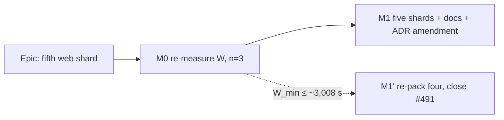

# Implementation Plan: A fifth web end-to-end shard

- **Feature spec:** [`./feature-spec.md`](./feature-spec.md) — Accepted; the owner chose the re-pack
- **Status:** Approved 2026-10-12 as **M1' only** ("Just rebalance four"). M0 and M1 were not run and
  stay documented as the alternative, to be taken up on the trigger in the spec's decision record.
- **Owner:** builder agent (Sonnet), with devops-reviewer at review

## Breakdown

### Epic

**Fifth web end-to-end shard.** This epic re-opens ADR-0138's shard count, now that its 2,372 s
trigger has fired. No roadmap theme applies, because this is repository tooling.

No milestone claims user-facing capability, so ADR-0081's entry-point and journey rules have no
subject. There is no flag (ADR-0088 D1), no changeset and no release (ADR-0138 D7). The epic's
terminal condition is **merged**.

---

### Milestone 0 — Re-measure `W` across three runs (no file changes except the record)

**Outcome:** a three-sample web total and fixed cost. With those, the decision between five shards
and a four-shard re-pack is taken by a rule rather than by one run (`m4-measurement.md:247-249`).

#### Task 0.1 — Read three runs (S)

- **Description:** collect three runs: `38290423490` plus the two most recent green CI runs on any
  PR. For each, read the web shard jobs' per-step timings (via `get_check_runs` / the job logs).
  Record per run:
  - the web total `W`;
  - the per-shard fixed cost (wall − suite);
  - `e2e-api` and `quality` wall times.
- **Dependencies:** none.
- **Risks:** a run whose head carries a failed or retried shard inflates `W`. Use only fully green
  heads, and say which.
- **Testing:** none. This is a measurement.
- **Steps:**
  1. Write the table into `docs/specs/e2e-fifth-shard/m0-measurement.md`, with run ids, job ids and
     n = 3 stated.
  2. Re-derive the budget as `min(e2e-api) − max(fixed cost)` across the three runs. Pessimistic, as
     ADR-0138 §5 argues.
  3. **Decide by the spec's §4.1 rule:**
     - if the lowest `W` is above 4 × budget, proceed to M1;
     - otherwise do M1' (re-pack four, the same tasks minus the matrix and count edits), and record
       why.

---

### Milestone 1 — Five shards (one PR, `ci(ci): add a fifth web end-to-end shard`)

**Outcome:** CI runs five web shards packed from current durations. Every document that counts
shards or checks agrees. ADR-0138 is amended.
**Entry point:** `Ships dark` in ADR-0081's sense. There is no product surface; the visible artefact
is the `End-to-end tests (web shard 5)` check.

#### Feature: the shard matrix and its gate

> **Complexity:** S–M · **Dependencies:** M0's PROCEED; PR #951 merged (or its re-harvest carried) ·
> **Risks:** see Task 1.2 · **Testing:** `check:e2e-roster` red-first, then `pnpm prepush`, then the
> PR's own CI run.

##### Task 1.1 — Durations and the pack (S)

- Bring in `scripts/e2e-durations.json` at run `38290423490`, from #951 if it is merged, otherwise
  carried.
- LPT-pack the 50 web suites into five shards, longest first with a name tie-break. Treat
  `csp` + `forced-colors` + `splitting` as **one unit** (they share a `vite build`).
- Record the pack (shard → suites → seconds) in the PR description. It must match what
  `check:e2e-roster` prints after Task 1.2.

##### Task 1.2 — `ci.yml` and the gate, red-first (M)

1. **Red first** (ADR-0110 D5). Re-condition the steps destined for shard 5 to
   `matrix.shard == 5` while the matrix still reads `[1, 2, 3, 4]`. Run `pnpm check:e2e-roster`
   and confirm it fails with **E5** naming each moved step. Paste the output into the PR.
2. Widen the matrix to `[1, 2, 3, 4, 5]` and apply the rest of the pack. Re-run the gate: it is
   green, and it prints five totals, each ≈ 713 s and at or below the new budget.
3. In `scripts/check-e2e-roster.mjs`, set `SHARD_BUDGET_SECONDS` to M0's re-derived budget, with the
   derivation and run ids in its docblock. Restate the `:338-342` comment.
   `scripts/check-e2e-roster.test.mjs:268`: make the comment count-free.
4. In `ci.yml`, restate the header comment `:400-417` with the new figures and make `:1160`
   count-free. Keep `timeout-minutes: 30`, with its new ratio (~2.2×) written beside it.

- **Risks:** a step left unconditioned runs on five shards (caught by E4). A condition naming 6
  never fires (caught by E5). A production-build suite separated from the other two makes a second
  shard pay a build; check this by reading the three `if:` lines.
- **Testing:** `node --test scripts/check-e2e-roster.test.mjs` (unchanged and green);
  `pnpm check:e2e-roster`; `pnpm prepush`.

##### Task 1.3 — The documents that count (S)

Make every edit in spec §4.4:

- `CLAUDE.md` §19.9: ten → eleven, four → five, seven → eight;
- the `CLAUDE.md` §16 line for ADR-0138;
- `CONTRIBUTING.md:101-117`;
- `.claude/agents/devops-reviewer.md:39-55`;
- `docs/TESTING.md:805-819`;
- the ADR-0138 **Amendment** section (spec §4.5), with re-derived triggers.

Then delete and ledger `docs/TECH_DEBT.md` #491, and file the suite-growth row (spec §4.2 D).

- **Testing:** `pnpm check:adr-coverage`, `check:debt-status`, `check:counts` and `check:spec-status`.
  All run inside `pnpm prepush`. Run a `grep -rn "four .*shard\|ten checks"` over the non-historical
  docs and confirm it returns nothing outside `docs/specs/ci-sharding/`, `docs/HANDOFF.md` and the
  ADR history.

##### Task 1.4 — Prove it on CI (S)

- The PR's own CI run is the acceptance test. Read it per §19.9, deduped:
  - eleven fixed names, every one `success`, including `End-to-end tests (web shard 5)`;
  - **within the same run**, the slowest web shard is below `quality` (spec §1 criterion 1).
- Record shard wall times, suite sums, `e2e-api` and `quality` in `m0-measurement.md` §"After". If
  the slowest shard is **not** below `quality`, stop and report: that is the re-open evidence, not a
  reason to tune.

## Sequencing & slices

M0 is a measurement and changes no behaviour. M1 is one PR: the matrix, the gate constant and the
counting documents must land together, or `main` carries a §19.9 that disagrees with its own check
list. Each slice leaves `main` releasable. There is no flag (ADR-0088 D1). The rollback is reverting
the M1 commit.

## Definition of Done (per task)

The Feature Completion Criteria in [`docs/PROCESS.md`](../../PROCESS.md) apply, with:

- no changeset (nothing under `apps/`);
- no security, a11y or Docker surface;
- `pnpm prepush` run locally;
- CI green on the pinned head, read per §19.9.

The e2e-local half of the gate is not triggered, because no suite or flag changes.

## Risks & assumptions (rollup)

| Risk / assumption                                                                     | Likelihood                                       | Impact | Mitigation                                                     |
| ------------------------------------------------------------------------------------- | ------------------------------------------------ | ------ | -------------------------------------------------------------- |
| M0 shows `W` below ~3,008 s, so five is not warranted                                 | low (three suites ×3–×8 is unlikely to be noise) | low    | M1' re-pack four, already planned                              |
| `quality`'s 1,103 s is a high draw                                                    | med                                              | low    | Five is the better choice in that case too (spec §4.1 point 3) |
| A counting doc is missed, so §19.9 or CONTRIBUTING disagree with CI                   | med                                              | med    | Exhaustive list in spec §4.4, plus the grep in Task 1.3        |
| Headroom over the new budget is ~5 %                                                  | high                                             | low    | First re-open trigger; suite-growth row filed                  |
| The run figures in spec §0 are relayed, not re-read (Actions API 403 to this session) | —                                                | med    | M0 Task 0.1 re-reads them before anything changes              |

**Agents to involve:** devops-reviewer (blocking review of the `ci.yml` and gate change),
test-engineer (optional, to confirm the red-first evidence), builder for M0 and M1. No
database-architect, because there is no schema change.
