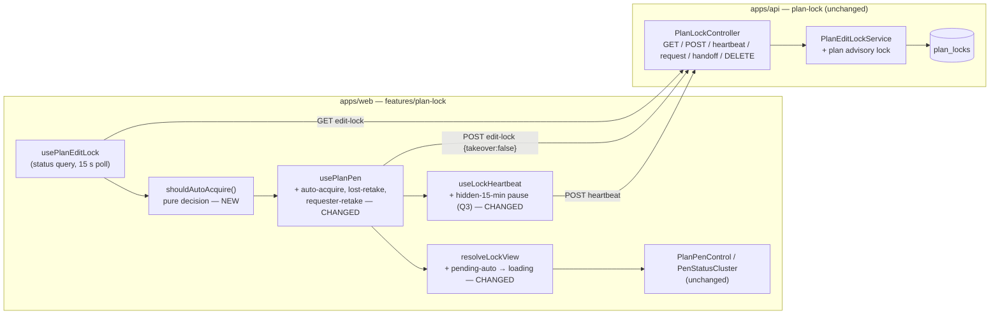
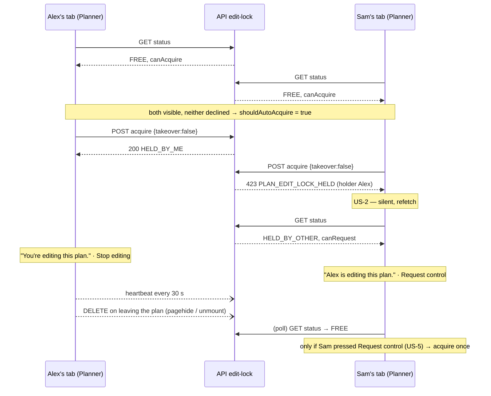
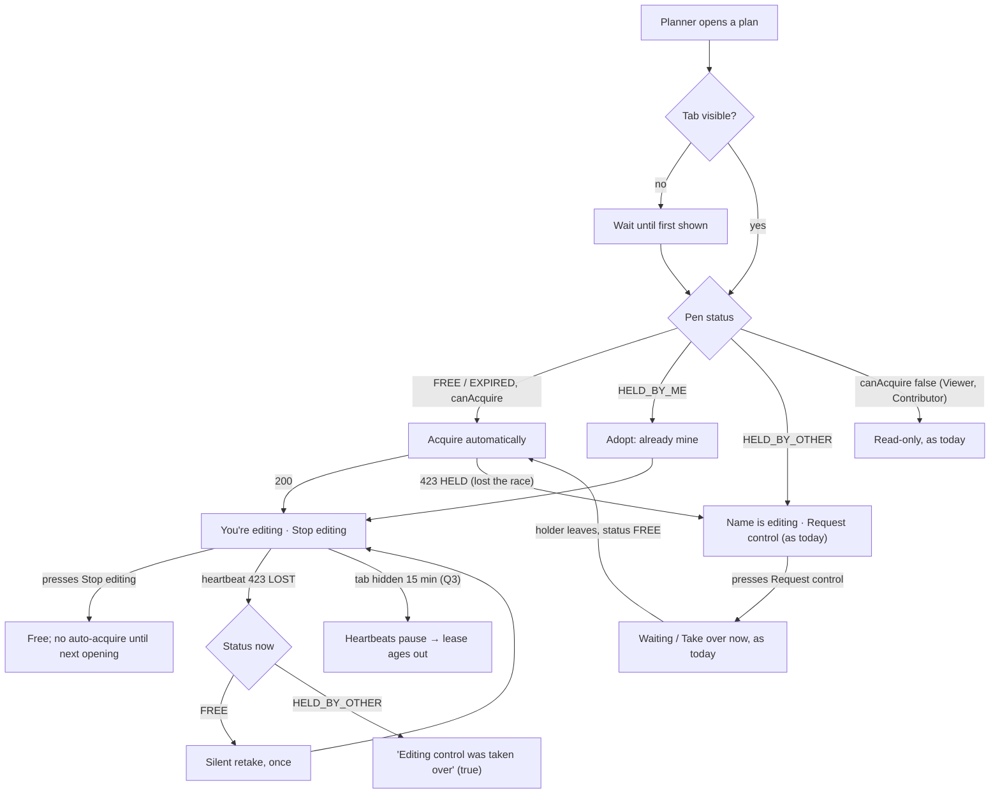

# Feature Spec: The first planner to open a free plan gets the pen

- **Status:** Draft — awaiting approval before implementation
- **Author(s):** feature-analyst (Claude Code), for the product owner
- **Date:** 2026-11-12
- **Tracking issue / epic:** none yet — the request is the product owner's runbook chapter 6 overall note, 2026-11-11
- **Roadmap link:** none; a workflow change to a shipped Must-have (single-editor plan lock, `docs/PROJECT_BRIEF.md` §8)
- **Related ADR(s):** ADR-0028 (the pen; amended by this work), ADR-0048 (undo is per pen session), ADR-0081
  (entry point and journey), ADR-0088 D1 (no flag), ADR-0112 (the pen sentence), ADR-0133 D5 (the pen leads the
  row it unlocks), ADR-0190 (what 1.0 promises). New: **ADR-0217** (provisional number, see §4.7).

---

## In plain English

**What you asked for.** Today every plan opens read-only, and a Planner has to press **Start editing** every
time. You asked that, when nobody else is editing a plan, the first Planner who opens it simply gets the pen,
and that the request/take-over steps only appear when a second Planner opens a plan someone is already editing.

**What I recommend.** Do exactly that, in the browser only: when a Planner or Org Admin opens a plan and
nobody holds the pen, the app takes it for them straight away. Contributors, Viewers and share-link guests
never take it. If somebody already holds it, nothing changes from today: the second person sees who is
editing and the **Request control** / **Take over** buttons. **Stop editing** still works, and once you press
it the app does not grab the pen back for you until you next open the plan. No server change, no database
change, nothing for you to switch on: it reaches your server with the next release.

**The honest cost.** A Planner who opens a plan just to look now holds the pen while that tab stays open, so a
colleague who arrives later has to ask for it (Request control, then up to 45 seconds). Today the same happens
only when someone forgets to press Stop. I propose a small follow-on (question 3) so that a plan left open in a
background tab lets go of the pen by itself. Most of the build effort is test upkeep: 29 of the browser test
suites press **Start editing** today and must be taught that the pen may already be theirs.

**The questions only you can answer** (each has a default I will use if you say "approve"):

| #   | Question                                                                                                                                                                                                                          | My default                                                                                           |
| --- | --------------------------------------------------------------------------------------------------------------------------------------------------------------------------------------------------------------------------------- | ---------------------------------------------------------------------------------------------------- |
| Q1  | Should the pen be taken **when the plan opens** (recommended), or only at the **first edit** you make (drag, add, open an editor)? The second never ties up a plan for a reader, but is three to four times the work and riskier. | **When the plan opens.**                                                                             |
| Q2  | Should **Org Admins** also get the pen automatically when they open a free plan, or only Planners?                                                                                                                                | **Yes, Admins too.** They are editors, and an Admin opening a free plan usually means to work on it. |
| Q3  | Should a plan left open in a **background tab** let go of the pen by itself after a while, so it doesn't block a colleague?                                                                                                       | **Yes, after 15 minutes hidden.** Cost: when you come back, your undo history for that plan is gone. |
| Q4  | Do you want a per-person **"don't take the pen automatically"** switch?                                                                                                                                                           | **No, not now.** Stop editing covers the occasional case; a switch can follow if anyone asks.        |

---

## 1. Business understanding

### Problem

A Planner opening a plan to work on it must first press **Start editing**, every time, on every plan. The
product owner, working through the runbook, called it "tiresome" (2026-11-11). The pen exists to stop two
people editing the same plan at once, and the owner accepts that. What he objects to is paying for it when
nobody else is there.

**Verified against the code, not the brief:**

- A plan opens with nobody holding the pen, and the pen is taken only by the **Start editing** control.
  `usePlanPen` acquires only inside `startEditing` and `takeOver`
  (`apps/web/src/features/plan-lock/api/use-plan-edit-lock.ts:241-260`); nothing calls `acquire` on mount. The
  deck's control calls `onStart` when pressed (`apps/web/src/features/plan-lock/components/PlanPenControl.tsx:93`).
- Every e2e helper that edits a plan presses the button first
  (`apps/web/e2e-support/pen.ts:20-24`, "Take the pen the way a planner does: press **Start editing**").
- On the owner's host the server gate is **on**: `PLAN_EDIT_LOCK_ENFORCED=true` (`docs/DEPLOYMENT.md:602`), so a
  structural write without the pen is refused with 423 (`apps/api/src/modules/plan-lock/plan-lock.service.ts:277-300`).
  The button is therefore not optional for him.

### Why the plan opens read-only today

The original spec settled it as a **non-critical default that was never put to the owner**:

> "**Acquire model:** explicit "Start editing" button (default), not auto-acquire on first edit gesture —
> clearer mental model, no accidental pen-grabbing on open." (`docs/features/plan-edit-lock/feature-spec.md:149-150`)

So the protections it bought were two, and any option here must answer both:

1. **Accidental grabbing.** A Planner who opened a plan to look should not lock a colleague out.
2. **A clear mental model.** You know when you are editing because you chose to.

Three further hazards follow from how the lease works, and the design must not make them worse:

3. **A lease held by an idle tab.** A holder heartbeats every 30 s while holding
   (`use-plan-edit-lock.ts:147-152`), including in a background tab (the hook's own note: a throttled beat "may
   slip toward 60 s, still < TTL", `:113-114`). So an open tab holds the pen indefinitely; the holder is never
   "inactive" (> 90 s without a beat, `apps/api/src/modules/plan-lock/plan-lock.policy.ts:24,59-61`) while it is
   open. A peer then needs Request control plus the 45 s grace (`plan-lock.policy.ts:29,81-92`).
4. **Release is per user, not per tab.** The lock's holder is the user (ADR-0028 D1). Release deletes the row for
   that user (`apps/api/src/modules/plan-lock/plan-lock.repository.ts:160-172`), and every tab whose status reads
   `HELD_BY_ME` heartbeats **and** fires a release on unmount or `pagehide` (`use-plan-edit-lock.ts:164-181`,
   `holdsPen` derived from server state at `:224`).
5. **A viewer must never block anyone.** A Viewer or Contributor lacks `plan:acquire_lock`
   (`apps/api/src/common/auth/org-permissions.ts:280-284`; the server's `canAcquire` is false,
   `plan-lock.policy.ts:112`).

**A defect found while checking hazard 4, which this work fixes.** The web design note says that when a user
closes one of two tabs, "the other's next heartbeat **re-acquires**" (`docs/archive/design/plan-edit-lock-web.md:441-445`).
The code does not do that. Closing tab B deletes the user's lease; tab A's next heartbeat is a conditional
`UPDATE … WHERE holder_user_id = … AND expires_at > now()` that matches no row
(`plan-lock.repository.ts:115-141`), so the service throws `PLAN_EDIT_LOCK_LOST`
(`plan-lock.service.ts:168-172`), and tab A shows **"Editing control was taken over — you're now read-only."**
(`apps/web/src/features/plan-lock/lib/lock-copy.ts:77-80`). Nobody took it over. The same thing can happen on a
reload, when the old page's `pagehide` release lands after the new page has read the status (the race the
`ensurePen` helper's comment records, `apps/web/e2e-arrange/support.ts:57-68`). Auto-acquire makes reloads
acquire, so it would hit this more often. US-4 fixes it.

### Users

| Role                        | Today                                                                                                         | After                                                                                  |
| --------------------------- | ------------------------------------------------------------------------------------------------------------- | -------------------------------------------------------------------------------------- |
| Planner                     | Opens read-only, presses Start editing                                                                        | **Holds the pen on opening** a free plan; sees today's hand-off controls if it is held |
| Org Admin                   | Same, plus immediate Take over                                                                                | Same as Planner (Q2), never auto-overrides a holder                                    |
| Contributor                 | Never acquires; progress is not pen-gated                                                                     | Unchanged                                                                              |
| Viewer                      | Never acquires                                                                                                | Unchanged                                                                              |
| External Guest (share link) | No pen at all; the share page does not mount the pen (no `plan-lock` use under `apps/web/src/features/share`) | Unchanged                                                                              |

### Primary use cases

1. A Planner opens a plan nobody is editing and starts work without pressing anything.
2. A second Planner opens the same plan and sees who is editing, with Request control, exactly as today.
3. A Planner who only wanted to look presses **Stop editing** (or closes the plan) and frees it.
4. A Planner reloads, or has the plan in two tabs, and is not told falsely that somebody took over.
5. (Q3) A Planner leaves a plan in a background tab; after 15 minutes the pen is free for a colleague.

### User journeys

**Happy path.** Alex (Planner) opens _Riverside Phase 2_ from the Project Explorer. The status line reads
"Checking who's editing this plan…" for one round trip, then "You're editing this plan."; the deck's pen reads
**Stop editing**; the authoring row is live. Alex drags a bar.

**Second planner.** Sam (Planner) opens the same plan a minute later. Sam's status reads "Alex is editing this
plan." with **Request control**, exactly as today (`lock-view.ts:242-262`). If Alex leaves the plan, the pen is
released (`use-plan-edit-lock.ts:164-181`); if Sam had asked for it, Sam's tab takes it (US-5).

**Reader.** Pat (Planner) opens the plan only to read the dates. Pat holds the pen until Pat leaves the plan,
presses Stop editing, or (Q3) leaves the tab in the background for 15 minutes.

See the user flow in §4.3.

### Expected outcomes

- The single-planner path loses one press per plan opened, and the Start editing control is no longer the
  first thing a Planner has to find.
- Everything that happens when two people want the same plan is unchanged.
- The false "taken over" message on a reload or a closed second tab goes away.

### Success criteria

- A Planner opening a free plan holds the pen **without pressing anything**, asserted by a journey that never
  clicks Start editing (M1).
- Exactly **one** acquire request per opening of a free plan (network invariant in the journey, M1).
- Two Planners opening the same free plan at once: **exactly one** holds it, the other sees Request control and
  **no** alert (M1 journey, invariant on any machine).
- A Viewer opening a free plan leaves it **free**, read back from the API by the other actor (M1 journey).
- Zero API e2e changes: `apps/api/test` is untouched (the acquire contract does not change, §4.5).
- No "taken over" message when nobody else holds the pen (M1 unit + journey: close one of two tabs).

### Open questions

**Critical** — Q1–Q4 in the plain-English table above.

**Non-critical, defaults taken:**

- **No feature flag** (ADR-0088 D1): a `VITE_` flag cannot be switched on a published image
  (`docs/DEPLOYMENT.md:569-573`); the rollback is pinning `WEB_IMAGE_TAG` (`:575-580`).
- **Auto-acquire happens once per opening**, plus the two narrow retakes in US-4 and US-5. It never fires on a
  status poll merely because the pen became free while you were watching (that would surprise a reader who
  had deliberately stopped, and race every other watcher).
- **Only a visible tab auto-acquires.** A plan opened in a background tab (middle-click) waits until it is
  first shown, so opening five plans in tabs does not take five pens.
- **The copy is unchanged.** "You're editing this plan." is already the holding sentence (`lock-copy.ts:46`).
- **No new audit row.** Lock events go to structured logs, not `audit_events` (`plan-lock.service.ts:411-428`;
  no `AuditService` in `apps/api/src/modules/plan-lock`, grep 2026-11-12). One `plan_edit_lock.acquired` log
  line per Planner opening is negligible.
- **An "untouched pen hands itself over when asked"** rule is out of scope; recorded as a follow-on in §4.8.

---

## 2. Functional requirements

### User stories & acceptance criteria

> **US-1 — Pen on opening.** As a **Planner or Org Admin**, I want to hold the pen as soon as I open a plan
> nobody is editing, so that I can start work without pressing Start editing.
>
> - **Given** the plan's status is `FREE` or `EXPIRED` and the server reports `canAcquire: true`, **when** the
>   workspace mounts in a visible tab, **then** the client sends one acquire and the deck shows **Stop editing**
>   and the status reads "You're editing this plan."
> - **Given** the status is `HELD_BY_ME` (another tab of mine holds it), **when** the plan opens, **then** no
>   acquire is sent; the tab adopts the lease as today.
> - **Given** the status is `HELD_BY_OTHER`, **when** the plan opens, **then** no acquire is sent and the view
>   is today's (`lock-view.ts:216-273`) — auto-acquire **never** takes over, including for an Org Admin.
> - **Given** `canAcquire: false` (Contributor, Viewer), **then** nothing is sent. The client reads the server's
>   capability flag and never re-derives the role (ADR-0028's client rule, `lock-view.ts:149-153`).
> - **Given** the tab is hidden when the plan opens, **then** the acquire waits until the tab is first visible.
> - **While** the automatic acquire is in flight, the pen view stays at its loading state ("Checking who's
>   editing this plan…", `lock-copy.ts:43`) rather than flashing "No one is editing this plan." first, so a
>   screen reader hears one sentence per opening, as today.
> - **From the first render at which the decision is "acquire"** — computed during render from the status, not
>   in an effect after it — the deck's pen control is busy and shaded (`PlanPenControl.tsx:89-92` already does
>   this for `isPending`). There is therefore no frame in which an enabled **Start editing** is offered to a
>   person, or to a test, while the app is about to take the pen itself.

> **US-2 — Losing the race is silent.** As a Planner who opened a free plan at the same moment as a colleague,
> I want to see that they got it, not an error.
>
> - **Given** two acquires race, the server serialises them under the plan advisory lock
>   (`plan-lock.service.ts:83-87`) and the loser receives 423 `PLAN_EDIT_LOCK_HELD` (`:114-118`). **Then** the
>   losing client shows no alert and no lost-control banner, refetches the status (the mutation already
>   invalidates on settle, `use-plan-edit-lock.ts:60`), and shows "<Name> is editing this plan." with Request
>   control.

> **US-3 — Stop means stop.** As a Planner who pressed **Stop editing**, I want the app not to grab the pen back.
>
> - **Given** I pressed Stop editing, hand over, or lost the pen to a colleague, **then** no automatic acquire
>   happens again until I next open the plan (a new workspace mount: plan switch, reload, or new tab — the
>   workspace is keyed per plan, `apps/web/src/routes/plan-detail.tsx:41`).
> - **Start editing** remains the way back in, unchanged.

> **US-4 — No false "taken over".** As a Planner whose own other tab or reload released my lease, I want to keep
> editing without being told someone took over.
>
> - **Given** my heartbeat returns 423 `PLAN_EDIT_LOCK_LOST`, **when** the refetched status is `FREE` or
>   `EXPIRED` and `canAcquire`, **then** the client re-acquires silently (no banner) — at most once per loss.
> - **When** the refetched status is `HELD_BY_OTHER`, **then** today's lost banner shows (the sentence is now
>   true).
> - The undo history is cleared on a lost pen exactly as today (ADR-0048, `docs/adr/0048-undo-redo-command-stack.md:48-50`);
>   this story does not change undo.

> **US-5 — The requester gets it when it is let go.** As a second Planner who pressed **Request control**, I
> want the pen when the holder leaves, without pressing Start editing.
>
> - **Given** my tab requested control and has not since seen a different holder, **when** a poll shows
>   `FREE`/`EXPIRED`, **then** my tab acquires once. (The server deletes the request with the row on release,
>   `plan-lock.repository.ts:160-172`, so this is the client remembering its own request.)

> **US-6 — Background tab lets go (Q3; default yes).** As a colleague, I want a plan left in someone's
> background tab not to block me indefinitely.
>
> - **Given** this tab holds the pen and has been hidden for 15 continuous minutes, **then** it stops
>   heartbeating (it does **not** send a release, so a visible sibling tab of the same user keeps the lease
>   alive by its own beats). After 90 s without any beat the holder is "inactive" and a peer may **Take over now**
>   without the grace wait (`plan-lock.policy.ts:59-61,81-92`); after 120 s the lease expires and the next
>   Planner to open the plan gets it under US-1.
> - **When** the tab becomes visible again it beats at once (existing, `use-plan-edit-lock.ts:154-162`); a
>   `PLAN_EDIT_LOCK_LOST` there is handled by US-4.

### Workflows

1. **Open.** Status query resolves → pure decision `shouldAutoAcquire(...)` → acquire or not → view.
2. **Stop.** Release (unchanged) → mark this opening "declined" → no automatic acquire until remount.
3. **Lost.** Heartbeat 423 → refetch → `FREE`: silent retake (once); `HELD_BY_OTHER`: lost banner.
4. **Request then free.** Request (unchanged) → remember "I asked" → poll shows free → acquire once.
5. **Hidden 15 min (Q3).** Heartbeat interval paused → lease ages out server-side → visible → beat → 4.

### Edge cases

| Case                                                           | Behaviour                                                                                                                                                                                        |
| -------------------------------------------------------------- | ------------------------------------------------------------------------------------------------------------------------------------------------------------------------------------------------ |
| Two tabs, same user, same plan                                 | Second tab reads `HELD_BY_ME`, sends nothing (US-1). Closing either tab: the other self-heals via US-4, no banner.                                                                               |
| Reload                                                         | Old page releases on `pagehide`; new page auto-acquires. If the release lands after, US-4 retakes on the next beat (≤ 30 s).                                                                     |
| Gantt view                                                     | Same workspace and same `usePlanPen` (`apps/web/src/components/layout/workspace/use-plan-workspace-model.ts:263`); switching views does not remount, so no second acquire.                       |
| Late-start overlay on                                          | Editing is paused client-side only (`plan-workspace-toolbar.tsx:1483`); the pen is held as today. Unchanged.                                                                                     |
| Plan switch in the Explorer                                    | The old plan's workspace unmounts and releases (`use-plan-edit-lock.ts:178-180`); the new one auto-acquires.                                                                                     |
| Share/guest page                                               | No pen mounted; unchanged.                                                                                                                                                                       |
| Status query errors                                            | No acquire; Start editing stays available, as today.                                                                                                                                             |
| Acquire fails with anything other than 423 HELD (5xx, network) | No banner; the pen shows Start editing (today's FREE view) — the planner can press it.                                                                                                           |
| Admin opens a plan a Planner holds                             | `HELD_BY_OTHER` → no acquire; the admin sees today's Take over (confirm dialog). Never automatic.                                                                                                |
| Server gate off (`PLAN_EDIT_LOCK_ENFORCED=false`)              | Same client behaviour; the pen is still the client's gate (`plan-gating.ts:37-45`).                                                                                                              |
| Keyboard focus on load                                         | Auto-acquire is not the user's action, so the focus-restore effect does not fire (`use-pen-lock-view.ts:149-155` runs only after `act`). The pen control relabels in place; focus does not move. |

### Permissions

No change. `plan:acquire_lock` and `plan:request_control` (Planner + Org Admin), `plan:override_lock` (Org Admin),
all evaluated in the plan's organisation (`org-permissions.ts:280-287`; `plan-lock.service.ts:304-316`). The
client acts only on the server's `canAcquire` flag. A forged client that acquires on open gains nothing it
could not already get by pressing the button.

**Is the new write structural?** Acquiring the pen is not a plan write; it is the lease (ADR-0028 D1). The
structural writes it unlocks are unchanged and still pass `assertHoldsPen`.

### Validation rules

None new. The acquire body is `{ takeover: false }` as sent today (`use-plan-edit-lock.ts:57`).

### Error scenarios

| Scenario                                 | Detection                                               | User-facing result                                | Status |
| ---------------------------------------- | ------------------------------------------------------- | ------------------------------------------------- | ------ |
| Lost the open race                       | acquire 423 `PLAN_EDIT_LOCK_HELD`                       | Silent; status shows the holder + Request control | 423    |
| Own lease released by sibling tab/reload | heartbeat 423 `PLAN_EDIT_LOCK_LOST`, status then `FREE` | Silent retake (US-4)                              | 423    |
| Pen genuinely taken by a peer            | heartbeat 423 LOST, status `HELD_BY_OTHER`              | Today's lost banner                               | 423    |
| Role cannot acquire                      | `canAcquire: false`                                     | No request sent; today's read-only view           | —      |
| Network/5xx on auto-acquire              | mutation error, not a lock error                        | Today's FREE view with Start editing; no alert    | 5xx    |

---

## 3. Technical analysis

| Area           | Impact   | Notes                                                                                                                                                                                                                                                                                         |
| -------------- | -------- | --------------------------------------------------------------------------------------------------------------------------------------------------------------------------------------------------------------------------------------------------------------------------------------------- |
| Frontend       | **med**  | `usePlanPen` gains the automatic acquire and the two retakes; one pure decision function; `resolveLockView` gains a "pending automatic acquire" input that returns the loading view. No new component. `PlanPen` gains fields (feature's public hook contract — an ADR-0105 trigger, stated). |
| Backend        | none     | No service, policy or controller change. Timings stay module constants (`plan-lock.policy.ts:14-29`).                                                                                                                                                                                         |
| Database       | none     | No schema change. Therefore no database-architect run is required; if any later milestone proposes one (e.g. a per-tab lease id, §4.6), it goes through that agent first (CLAUDE.md §19.3).                                                                                                   |
| API            | none     | The `/api/v1/organizations/:orgSlug/plans/:planId/edit-lock` routes (`plan-lock.controller.ts:43-134`) are part of the 1.0 contract (ADR-0190 D1, `docs/adr/0190-what-1-0-promises.md:26-33`); this work calls them exactly as the button does.                                               |
| Security       | low      | No authz change; the client never acquires for a role the server refuses. A security review confirms "auto-acquire never sends `takeover: true`".                                                                                                                                             |
| Performance    | low      | One extra `POST …/edit-lock` per Planner opening of a free plan; the acquire is one short transaction under the plan advisory lock (`plan-lock.service.ts:83-144`). Status polling unchanged (15 s, `use-plan-edit-lock.ts:20`). Q3 _reduces_ heartbeats from hidden tabs.                    |
| Infrastructure | none     | No env var, no compose change, nothing for the operator. `PLAN_EDIT_LOCK_ENFORCED` stays as set.                                                                                                                                                                                              |
| Observability  | low      | More `plan_edit_lock.acquired` log lines (one per Planner opening). No metric.                                                                                                                                                                                                                |
| Testing        | **high** | The dominant cost. See "The test estate" below. API e2e: none.                                                                                                                                                                                                                                |

### The test estate (the main cost)

Counted on 2026-11-12 with `Grep` over `apps/web/e2e*/**`:

- **29 Playwright suite directories** reach the pen through "Start editing" or the shared `takeThePen`
  helper (`e2e`, `e2e-activity-editor`, `e2e-arrange`, `e2e-assignment-lag`, `e2e-audit`, `e2e-authoring`,
  `e2e-authoring-flow`, `e2e-copy-paste`, `e2e-edit`, `e2e-gantt`, `e2e-gantt-editing`, `e2e-library`, `e2e-loe`,
  `e2e-multi-select`, `e2e-narrow-shell`, `e2e-notes`, `e2e-overview`, `e2e-programme`, `e2e-resource-view`,
  `e2e-search-nav`, `e2e-share`, `e2e-sub-day`, `e2e-swimlanes`, `e2e-toolbar`, `e2e-undo`, `e2e-unsaved-work`,
  `e2e-wbs`, `e2e-workspace-chrome`, `e2e-workspace-fit`).
- **About 20 helper call sites click Start editing unconditionally** and would time out once the pen is already
  held (e.g. `e2e-support/pen.ts:21`, `e2e-loe/support.ts:52`, `e2e-toolbar/support.ts:52`,
  `e2e-undo/support.ts:51`, `e2e-audit/audit.spec.ts:142,171`). `takeThePen` alone is used 21 times across
  7 spec files.
- **Thirteen suites have a local `ensurePen`, and ten of them are racy under auto-acquire.** Only three wait
  for the pen control to render before deciding (`e2e-arrange/support.ts:62-72`, `e2e-swimlanes/support.ts:220-224`,
  `e2e-workspace-chrome/support.ts:84-88`). The other ten ask `stop.isVisible()`, which answers at once
  (`e2e-overview/support.ts:66-70`, `e2e-search-nav:63`, `e2e-sub-day:121`, `e2e-assignment-lag:128`, `e2e-wbs:63`,
  `e2e-authoring-flow:77`, `e2e-activity-editor:55`, `e2e-multi-select:63`, `e2e-copy-paste:75`, `e2e-gantt:77`).
  Today that only bites after a reload (the PR #669 failure recorded at `e2e-arrange/support.ts:65-67`); with
  auto-acquire **every** opening is that case, since the helper would look while the acquire is still in flight
  and then wait for a `Start editing` that turns into `Stop editing`. Nine more suites have a plain
  `startEditing` that clicks unconditionally (`e2e-loe`, `e2e-share`, `e2e-gantt`, `e2e-edit`, `e2e-authoring`,
  `e2e-resource-view`, `e2e-undo`, `e2e-library`, `e2e-toolbar` support files). All of them collapse into one
  shared helper in M0.
- **About 14 spec-level assertions expect the free state** ("Start editing" visible, or a shaded reason naming
  it), e.g. `e2e-edit/pen-smoke.spec.ts:21`, `e2e-workspace-chrome/plan-switch.spec.ts:65`,
  `e2e-workspace-fit/pen-status.spec.ts:161`, `e2e-workspace-fit/command-surface.spec.ts:587,3435`,
  `e2e-undo/undo.spec.ts:647`, `e2e-wbs/wbs.spec.ts:255,270`, `e2e-gantt-editing/touch.spec.ts:265-269`. Those
  that release first in the same opening stay valid under US-3; those that reach the free state by reload or
  `goto` must press Stop editing first. Each is read, not pattern-edited.
- **API e2e: 22 files call the edit-lock routes directly** (`Grep "edit-lock" apps/api/test`). None changes:
  they acquire over HTTP and the contract is untouched.
- **Web unit tests** that mount the workspace mock `usePlanPen` (19 files, `Grep "vi.mock(.*plan-lock|usePlanPen"`),
  so the new behaviour inside the hook does not reach them. The hook's own tests
  (`use-plan-edit-lock.test.ts`) and `lock-view.test.ts` grow.

Because a suite helper that hangs would turn `main` red, the helper migration lands **first and on its own**,
behaviour-neutral (plan M0).

### Dependencies

- None to land first. Touches `apps/web` only (a builder is concurrently in `apps/api` and
  `docs/specs/progress-before-data-date`; no overlap).
- ADR-0217 must be filed before or with M1.

---

## 4. Solution design

### 4.1 Architecture overview

All of it lives in the web feature `features/plan-lock`. The server is the same; the change is **who presses
acquire, and when**.

### 4.2 Data flow — two planners open the same free plan

### 4.3 User flow

### 4.4 Database changes

None. The `plan_locks` row is unchanged (ADR-0028 D1).

### 4.5 API changes

None. Considered and rejected: an optional `auto: true` on the acquire body, to tell automatic from pressed
acquisitions in the logs. It is additive (not a break under ADR-0190 D2) but buys only a log field, and every
`/api/v1` change is a contract surface for ever. Revisit if the log volume needs explaining.

### 4.6 Component and hook changes

| Unit                                                          | Change                                                                                                                                                                                                                                                                                                                            |
| ------------------------------------------------------------- | --------------------------------------------------------------------------------------------------------------------------------------------------------------------------------------------------------------------------------------------------------------------------------------------------------------------------------- |
| `features/plan-lock/lib/auto-acquire.ts` (**new**, pure)      | `shouldAutoAcquire({ status, visible, declined, autoAttempted, pending })` → boolean; `shouldRetakeAfterLoss(...)`; `shouldTakeOnFree({ status, iRequested, sawOtherHolderSinceRequest })`. Exhaustively unit-tested with fixed inputs, like `plan-lock.policy.ts` is on the server.                                              |
| `features/plan-lock/api/use-plan-edit-lock.ts` — `usePlanPen` | Runs the decision when the status resolves or the tab becomes visible; one ref per opening (`autoAttempted`, `declined`, `iRequested`). `stopEditing`, a hand-over and a lost-to-peer set `declined`. A 423 `PLAN_EDIT_LOCK_HELD` from an **automatic** acquire is absorbed (no `lostControl`). Exposes `autoAcquiring: boolean`. |
| `useLockHeartbeat`                                            | `onLost` now refetches before deciding; Q3 adds the hidden-15-minute pause (constant `HIDDEN_LET_GO_MS = 15 * 60_000`, beside `HEARTBEAT_MS`).                                                                                                                                                                                    |
| `features/plan-lock/lib/lock-view.ts` — `resolveLockView`     | When `autoAcquiring` and the status is `FREE`/`EXPIRED`, return `null` (the existing loading view, `CompactPenStatus.tsx:152-161`).                                                                                                                                                                                               |
| `PlanPenControl`, `PenStatusCluster`, `EditLockBanner`        | No change. Busy state already covers an in-flight acquire (`PlanPenControl.tsx:89-92`).                                                                                                                                                                                                                                           |
| `e2e-support/pen.ts`                                          | `takeThePen` becomes "hold the pen, pressing Start editing only if it is offered"; a `releasePen` and an `expectPenHeldWithoutPressing` are added (M0/M1).                                                                                                                                                                        |

**Alternative for the reload race, rejected for now:** a per-tab lease id (a client-generated token stored on the
row and required by heartbeat and release), which would make release and heartbeat exact per tab. It is a schema
change and an API change for a race US-4 already makes harmless. Listed as the escape hatch.

### 4.7 The ADR (required) — outline of ADR-0217

Number provisional: take the next free number at landing (another epic may file one first).

> **ADR-0217 — The first planner to open a free plan holds the pen** _(amends ADR-0028; Accepted on approval)_
>
> - **Context.** ADR-0028 chose an explicit Start editing as an un-asked default
>   (`docs/features/plan-edit-lock/feature-spec.md:149-150`); the owner has now asked for the opposite
>   (2026-11-11). The 423 gate, the lease, and the hand-off are unchanged.
> - **D1 — Acquire on opening.** A workspace in a visible tab acquires once when the server says `FREE`/`EXPIRED`
>   and `canAcquire`. Never with `takeover: true`; never from a poll.
> - **D2 — Stop is respected for the opening.** Release, hand-over or a peer's take-over end automatic
>   acquisition until the next mount.
> - **D3 — A loss nobody caused is not announced.** A heartbeat 423 followed by `FREE` retakes silently once;
>   corrects `docs/archive/design/plan-edit-lock-web.md:441-445`, whose "re-acquires" was never true of the code.
> - **D4 — A requester takes a freed pen.** Client memory of its own request; server unchanged.
> - **D5 (Q3) — A hidden tab stops beating after 15 minutes**, rather than releasing, so a visible sibling of the
>   same user is not disturbed; the existing inactive (90 s) and TTL (120 s) rules do the rest.
> - **D6 — No flag** (ADR-0088 D1), **no API, schema or env change**; ADR-0190's contract is untouched.
> - **Alternatives.** Acquire on first gesture; a per-person preference; keyboard shortcut / remember-per-session;
>   per-tab lease id; auto-hand-over of an untouched pen.
> - **Consequences.** A reader holds the pen while the plan is open (bounded by D5); the e2e estate presses
>   Start editing far less; ADR-0028's header gains "amended by ADR-0217"; CLAUDE.md §16 gains one line and
>   ADR-0028's line its amendment note.

### 4.8 Approach and alternatives

**(a) Acquire on opening — recommended.** Smallest change that does what was asked: one hook, one pure
function, no server change. It answers the original two protections this way: _accidental grabbing_ is bounded
(you hold it only while the plan is open in a visible or recently visible tab, and Stop is respected) and is
the trade the owner chose; _the mental model_ is "if nobody else is on it, it is mine", which the deck states
(Stop editing) and the status line announces once.

**(b) The same, as a per-person preference ("Start editing automatically").** Where it would live: there is no
user-preferences table (`apps/api/prisma/schema.prisma` has no such model, grep 2026-11-12), so either a schema
change (database-architect, an API for settings, a settings screen) or device-local storage, which ADR-0173 set
as the precedent for a planner's own view settings. Default on, device-local, it is (a) plus a checkbox; default
off, it does not answer the request. **Not now (Q4)**; it can be added on top of (a) without rework.

**(c) Acquire on the first editing gesture.** Reading never takes the pen. But every pen-gated entry point must
become "live while free" and acquire before writing: the canvas drag and draw tools, Add, the Gantt cells and bar
moves, every editor dialog, paste, undo, the keyboard accelerators, auto-recalc. Today they are shaded on
`canEditSchedule = canWrite && holdsPen` (`plan-gating.ts:40`) with reasons naming Start editing
(`plan-gating.ts:63-75`), and each would need an acquire-then-write path that can **refuse a gesture already
drawn** when a colleague acquired a second earlier. That is the seam ADR-0081 records failing five times. An
editor opened and cancelled still takes the pen. Roughly three to four times (a)'s work, with a long tail of
"this one control forgot to acquire". **Not recommended (Q1).**

**(d) Keep the button, make it cheaper** (a keyboard shortcut, or "remember I'm editing this plan for the
session"). A shortcut removes the hunt but not the press; remembering per plan is (a) with a worse rule for the
first opening. **Rejected** as an answer to the request; a shortcut could still be added independently.

**Follow-on, not in this epic:** _an untouched pen hands itself over when asked._ If the holder's tab has made no
edit since acquiring automatically, it could answer a Request control by handing over at once. Cross-tab and
cross-device knowledge of "untouched" is the hard part (a sibling tab may be the one editing), so it needs either
cross-tab messaging or server knowledge of the last write. Worth doing only if the 45 s grace proves to bite.

### 4.9 How the recalc parity gate holds

No scheduling input is added; `computeSchedule` is not reached by this change. Nothing to prove.

---

## 5. Links

- Implementation plan: [`./implementation-plan.md`](./implementation-plan.md)
- Related docs updated by this change: ADR-0217 (new), ADR-0028 (header amendment line), CLAUDE.md §16 (one line
  plus ADR-0028's annotation), `docs/UX_STANDARDS.md` (the "Start editing" lines at 219/317/431, checked),
  `docs/TESTING.md` (the "Start editing" note), `docs/TEST_PLAYBOOK.md` (pen lines 114/116, checked),
  `docs/archive/design/plan-edit-lock-web.md` is archive and is **not** edited; ADR-0217 records the correction.
