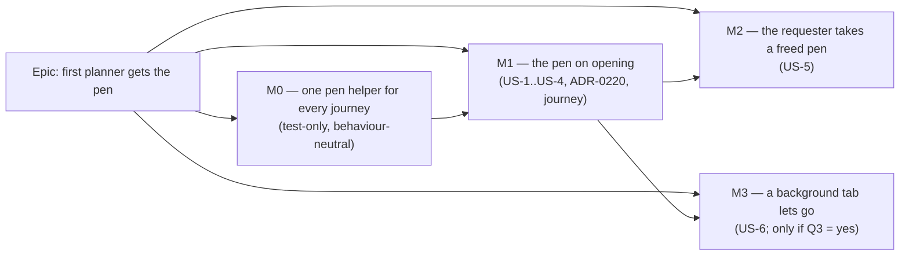

# Implementation Plan: The first planner to open a free plan gets the pen

- **Feature spec:** [`./feature-spec.md`](./feature-spec.md)
- **Status:** Approved by the product owner, 2026-11-12, with all four defaults. Not started.
- **Owner:** product owner (approval); builder agent (implementation)

## Breakdown

### Epic

**First planner gets the pen** — remove the Start-editing press from the single-planner path while keeping the
ADR-0028 hand-off exactly as it is for two. Web only; no API, schema or environment change; no feature flag
(ADR-0088 D1). Four pull requests.

**ADR-0105 triggers, all stated up front:** a changed behaviour at a user-facing entry point (opening a plan) —
M1; the public contract of the `plan-lock` feature's `PlanPen` hook gains fields — M1/M2; a new Playwright spec in
an existing config (`playwright.edit.config.ts`), no new config and no CI step — M1. **No schema change** (so no
database-architect run is owed; if any milestone grows one, it stops and that agent runs first, CLAUDE.md §19.3).
**No shared gate** changes.

---

### Milestone M0: one pen helper for every journey (shippable, behaviour-neutral)

**Outcome:** nothing changes for users. Every Playwright suite takes the pen through one helper that works both
before and after auto-acquire, so M1 cannot turn `main`'s end-to-end suite red by hanging on a button.
**Entry point:** `Ships dark: test-only; no product change. M1 surfaces the capability.`
**Journey:** none new; every existing journey is the oracle (they must pass unchanged in outcome).

#### Feature: shared `holdThePen` / `releaseThePen`

> **Description:** Replace `takeThePen`, the nine plain `startEditing` helpers and the thirteen local `ensurePen`
> helpers with one pair in `apps/web/e2e-support/pen.ts`.
> **Complexity:** M (mechanical, ~30 files)
> **Dependencies:** none
> **Risks:** a suite that relied on the helper _failing_ when the pen was already held (`pen.ts:15-16` says
> "Not idempotent: it fails loudly if the pen is already held") loses that tripwire → keep it as an explicit
> opt-in `expectPenFree(page)` assertion where a test means it.
> **Testing requirements:** every touched suite run locally with `scripts/e2e-local.sh web:<suite>` (CLAUDE.md
> §19.8); CI's four shards green.

##### Task M0-T1 — the helper (≈ one PR with T2)

- **Description:** `holdThePen(page)`: wait until **either** the `Stop editing` button is visible **or** a
  `Start editing` button that is **enabled** is visible (Playwright `getByRole('button', { name, disabled:
false })`); press Start only in the second case; then assert `Stop editing` and the exact holding sentence
  "You’re editing this plan." (`lock-copy.ts:46`), as `takeThePen` does today. `releaseThePen(page)`: press Stop,
  assert `Start editing`. Why "enabled": while the status loads, and (after M1) while the automatic acquire is in
  flight, the deck's pen is shaded (`PlanPenControl.tsx:70-75,89`), so an enabled Start means the pen is
  genuinely on offer.
- **Complexity:** S
- **Dependencies:** none
- **Risks:** `.or()` resolving to two elements → use `.first()` as `e2e-arrange/support.ts:68` does.
- **Testing:** the helper's docblock states both orderings; exercised by every suite in T2.
- **Development steps:**
  1. Rewrite `apps/web/e2e-support/pen.ts` (keep the "never call the lock endpoint directly" rule, `:9-11`).
  2. Add `expectPenFree(page)` for the tests that mean "nobody holds it".

##### Task M0-T2 — migrate every suite

- **Description:** Point the 29 suites at the shared helper and delete the local copies listed in spec §3.
  Spec-level unconditional clicks (`e2e-assignment-lag/assignment-lag.spec.ts:155`,
  `e2e-narrow-shell/narrow-shell.spec.ts:120`, `e2e-audit/audit.spec.ts:142,171`) move to the helper.
- **Complexity:** M
- **Dependencies:** M0-T1
- **Risks:** a relative import from a suite's own `testDir` (each is its own compilation root, `pen.ts:18`) →
  follow the existing `../e2e-support/pen` import shape.
- **Testing:** all suites, locally then CI.
- **Development steps:**
  1. Re-derive the site list by grep at build time (the spec's list is dated 2026-11-12).
  2. Migrate; delete the local helpers; keep each suite's own assertions untouched.
  3. No changeset (test-only). `docs/TESTING.md`'s "Start editing" note updated to name the helper.

---

### Milestone M1: the pen on opening (shippable slice)

**Outcome:** a Planner or Org Admin who opens a plan nobody is editing holds the pen without pressing anything;
losing a simultaneous race is silent; Stop is respected for the opening; a lease lost to your own other tab or a
reload is retaken without a false "taken over".
**Entry point:** open any plan from the Project Explorer as a Planner — the deck's pen control reads **Stop
editing** and the status line reads "You’re editing this plan." without the control being pressed.
**Journey:** `apps/web/e2e-edit/pen-auto.spec.ts` (new, in `playwright.edit.config.ts`), two browser contexts
via the existing `setUpTwoActors` fixture (`e2e-edit/pen-handoff.spec.ts:66-103`), lifted into
`e2e-edit/support.ts` as a move.

#### Feature: automatic acquire

> **Description:** US-1, US-2, US-3, US-4 of the spec.
> **Complexity:** L
> **Dependencies:** M0 merged
> **Risks:** see per-task; the rollup is at the end.
> **Testing requirements:** pure-function unit tests (exhaustive), hook tests with a mocked fetch, the
> two-context journey, accessibility review of the one-announcement claim.

##### Task M1-T1 — the decision, pure

- **Description:** `apps/web/src/features/plan-lock/lib/auto-acquire.ts`:
  `shouldAutoAcquire({ status, visible, declined, autoAttempted })` — true iff state is `FREE`/`EXPIRED`,
  `status.canAcquire`, the tab is visible, not declined, and not yet attempted in this opening.
  `shouldRetakeAfterLoss({ status, retakenForThisLoss })` — true iff `FREE`/`EXPIRED` and `canAcquire` and not
  already retaken once for this loss. Neither ever yields a take-over.
- **Complexity:** S
- **Dependencies:** none
- **Risks:** re-deriving policy on the client → reads only the server's `state` and `canAcquire`, like
  `lock-view.ts:149-153`.
- **Testing:** `auto-acquire.test.ts` — the full truth table (4 states × canAcquire × visible × declined ×
  attempted), including `HELD_BY_OTHER` with `canOverride: true` → **false**.

##### Task M1-T2 — wire it into `usePlanPen` and the view (≈ one PR with T1, T3, T4)

- **Description:** In `use-plan-edit-lock.ts`: per-opening refs (`autoAttempted`, `declined`); compute
  `autoAcquiring = shouldAutoAcquire(...) || (automatic acquire in flight)` **during render**; an effect fires the
  acquire (also on `visibilitychange → visible`); a 423 `PLAN_EDIT_LOCK_HELD` from an automatic acquire is
  absorbed (no `lostControl`); `stopEditing`, `handoff` success and a lost-to-peer set `declined`. In
  `useLockHeartbeat`'s `onLost` path: refetch, then `shouldRetakeAfterLoss` → silent acquire, else today's
  `lostControl`. `isPending` includes `autoAcquiring`. `resolveLockView` gains `autoAcquiring` and returns `null`
  for `FREE`/`EXPIRED` while it is set.
- **Complexity:** M
- **Dependencies:** M1-T1
- **Risks:**
  - The hook is not memoised and `usePenLockView` keys on stable pieces (`use-pen-lock-view.ts:200-253`) → the new
    fields are primitives; the stability test (`use-pen-lock-view.stability.test.tsx`) is extended, not edited.
  - A retake loop (lose → retake → lose) → `retakenForThisLoss` caps it at one per loss; a second loss in the
    same opening without an intervening successful beat shows the banner.
  - Undo: a 423 clears the stack as today (ADR-0048, `0048-undo-redo-command-stack.md:48-50`); not changed and
    stated in the ADR.
- **Testing:** `use-plan-edit-lock.test.ts` — opens FREE → one POST; HELD_BY_ME → zero POSTs; HELD_BY_OTHER →
  zero; canAcquire false → zero; hidden then visible → one POST on visible; 423 HELD → no `lostControl`; Stop
  then status FREE on poll → zero further POSTs; heartbeat 423 then FREE → one silent POST; heartbeat 423 then
  HELD_BY_OTHER → `lostControl`. `lock-view.test.ts` — `autoAcquiring` + FREE → `null`.

##### Task M1-T3 — the journey

- **Description:** `e2e-edit/pen-auto.spec.ts`, every assertion an invariant (role, accessible name, exact
  sentence, request counts, API state), never a pixel:
  1. **First planner gets it:** A opens the plan; `Stop editing` visible; the holding sentence exact; **no**
     `Start editing` click was made (the test never calls the helper); exactly **one** `POST …/edit-lock`
     observed via `page.on('request')`.
  2. **Second planner sees today's hand-off:** B (Planner) opens it; "Holder is editing this plan." (the fixture's user is
     named `Holder A` and the sentence uses the first name, `lock-copy.ts:37-39,49`); `Request control` visible; B issued **zero** acquires (or one 423 if B raced —
     asserted as "B does not hold": API `GET …/edit-lock` from B's context reads `HELD_BY_OTHER`).
  3. **Stop is respected:** A presses Stop; after B's forced refetch (`refetchLock`, `pen-handoff.spec.ts:25-28`)
     and A's own, A shows `Start editing` and A issued no further acquire.
  4. **Close a second tab, keep editing:** A opens the plan in a second page of the same context, closes it; A's
     first page receives a beat (forced via `visibilitychange`), then still reads "You’re editing this plan."
     and **no** element with the lost sentence exists.
  5. **A Viewer does not take it:** a Viewer opens the free plan; API `GET` from A's context reads `FREE`.
  6. **Simultaneous open:** two Planners `goto` the free plan in parallel (`Promise.all`); exactly one page shows
     `Stop editing`, the other `Request control`, and **no** `role="alert"` is present in either.
     **Fixture note:** in `setUpTwoActors` A is the organisation's creator and so an **Org Admin**
     (`pen-handoff.spec.ts:60-64`), B a Planner. Step 1 therefore proves the Admin case (Q2); the extracted fixture
     takes a role list so steps 5 and 6 can invite a Viewer and a second Planner, and step 1 is repeated with B
     opening a free plan first so the **Planner** case is proved too.
- **Complexity:** M
- **Dependencies:** M1-T2, M0
- **Risks:** cross-actor propagation is by poll (15 s) → the existing `refetchLock` nudge and the 20 s backstop
  the hand-off journey uses (`pen-handoff.spec.ts:18`). Step 4 relies on a heartbeat → force it with
  `visibilitychange` (the immediate-beat path, `use-plan-edit-lock.ts:154-162`) rather than waiting 30 s.
- **Testing:** run locally `scripts/e2e-local.sh web:edit` against the real API with the pen enforced; then CI.
- **Verified red:** before merge, comment out the effect that fires the automatic acquire and confirm steps 1
  and 6 fail while 2/3/5 pass (the ADR-0110 rule: a gate is verified against the defect it names).

##### Task M1-T4 — free-state assertions, ADR, docs

- **Description:** Read each of the ~14 free-state assertions (spec §3) and decide: still valid (released in
  the same opening) or needs `releaseThePen` first (reached by reload/`goto`). Update `e2e-edit/pen-smoke.spec.ts`
  so its opening assertion is the auto-held state and its free-state assertion follows an explicit Stop. File
  ADR-0220 (outline in spec §4.7); add the "amended by ADR-0220" line to ADR-0028's header; one line in CLAUDE.md
  §16 and ADR-0028's annotation; check `docs/UX_STANDARDS.md:219,317,431` and `docs/TEST_PLAYBOOK.md:114,116`.
  Changeset: `@repo/web` **minor** ("A plan you open while nobody else is editing it is yours to edit
  straight away").
- **Complexity:** M
- **Dependencies:** M1-T2
- **Risks:** `plan-switch.spec.ts` builds "a plan nobody can recalculate" by releasing, then switches back to it
  (`e2e-workspace-chrome/plan-switch.spec.ts:40-66`); switching back is a new opening and will auto-acquire →
  the test must release after switching, or seed that plan with a second actor holding it. Read, not
  pattern-edited.
- **Testing:** the full web e2e estate locally (`scripts/e2e-local.sh web:<suite>` for each touched suite),
  `pnpm prepush`, CI.

**Reviews for M1:** accessibility-reviewer (one announcement per opening; no focus movement on an automatic
acquire; the pen control's busy state), component-reviewer (`PlanPen`'s contract), security-reviewer (never
`takeover: true`; never for `canAcquire: false`), ux-reviewer (the reader-holds-it trade and copy). No
api-reviewer or database-architect: no API or schema change.

---

### Milestone M2: the requester takes a freed pen (shippable slice)

**Outcome:** a Planner who pressed Request control gets the pen as soon as the holder leaves, without pressing
Start editing.
**Entry point:** the foot row's **Request control** on a plan another Planner holds; when the holder leaves, the
requester's deck reads **Stop editing**.
**Journey:** `e2e-edit/pen-auto.spec.ts`, new step: B requests; A navigates away (unmount release,
`use-plan-edit-lock.ts:178-180`); after B's refetch, B shows `Stop editing` and B pressed nothing after Request.

#### Feature: remember my own request

> **Description:** US-5.
> **Complexity:** S
> **Dependencies:** M1
> **Risks:** taking a pen the requester no longer wants (they asked, then wandered off) → bounded by the same
> visibility rule as M1 (a hidden tab does not take it until shown); forgetting the request once a _different_
> holder is seen.
> **Testing requirements:** `shouldTakeOnFree` truth table; hook test (request → FREE → one POST; request →
> HELD_BY_OTHER(new holder) → FREE → zero POSTs); the journey step above.

##### Task M2-T1 — `shouldTakeOnFree` + wiring (one PR)

- **Description:** Pure function in `auto-acquire.ts`; `iRequested` ref set on request success, cleared on
  acquire or on seeing a holder other than the one asked.
- **Complexity:** S
- **Dependencies:** M1
- **Risks:** as above.
- **Testing:** as above; changeset `@repo/web` patch.

---

### Milestone M3: a background tab lets go (only if Q3 is answered yes)

**Outcome:** a plan left in a hidden tab for 15 minutes stops holding the pen against colleagues: after a
further 90 s a peer can take over at once, and after 120 s it is free for whoever opens it next.
**Entry point:** none new; observed as a colleague's **Take over now** being offered (existing,
`lock-view.ts:233-241`) or the plan opening as theirs (M1).
**Journey:** `e2e-edit/pen-auto.spec.ts` step using Playwright's `page.clock` on the holder's page: hide (emulated
`visibilityState`), fast-forward past 15 minutes, assert **no** `POST …/heartbeat` is issued after the threshold
(network invariant). The server-side consequence (inactive at 90 s) is already covered by
`plan-lock.policy.spec.ts`; it is not re-proved with a real 90 s wait.

#### Feature: pause the heartbeat while hidden

> **Description:** US-6. Stop beating, never release, so a visible sibling tab of the same user keeps the lease
> alive with its own beats.
> **Complexity:** S–M
> **Dependencies:** M1 (US-4 handles the return)
> **Risks:** the returning planner's undo history is cleared by the resulting 423 (ADR-0048) — stated in the
> owner's Q3 and in the ADR; a hidden tab's timers are throttled, so the threshold is measured from the
> `visibilitychange` timestamp, not by counting ticks.
> **Testing requirements:** `useLockHeartbeat` tests with fake timers and a stubbed `document.visibilityState`;
> the journey step; accessibility-reviewer on the return path (the US-4 silent retake, or the true lost banner).

##### Task M3-T1 — the pause (one PR)

- **Description:** `HIDDEN_LET_GO_MS = 15 * 60_000` beside `HEARTBEAT_MS` (`use-plan-edit-lock.ts:22`); the
  interval callback skips its beat when hidden for longer; the existing visible-again beat resumes it.
- **Complexity:** S
- **Dependencies:** M1
- **Risks:** as above.
- **Testing:** as above; ADR-0220 D5 confirmed; changeset `@repo/web` patch.

---

## Sequencing & slices

1. **M0** first, alone: behaviour-neutral, proves every suite can live with either world. Without it, M1 is one
   enormous PR whose journey failures are indistinguishable from helper failures.
2. **M1**: the capability, its ADR, its journey and the free-state assertions in one PR, because the
   behaviour and the assertions that contradict it must change together for `main` to stay green.
3. **M2** and **M3** independently after M1, each one small PR.

No feature flag (ADR-0088 D1; spec §1 "Open questions"). Rollback is pinning `WEB_IMAGE_TAG`
(`docs/DEPLOYMENT.md:575-580`); the API and database are untouched, so a web rollback is complete. Nothing for the
owner to run or check on his host or devices: the release reaches it through the ADR-0047 auto-pull.

**Version impact:** `@repo/web` minor (M1), patches (M2, M3). `@repo/api` none. Not a major under ADR-0190 D3:
no capability is removed and no saved link stops resolving.

## Definition of Done (per task)

Each task's PR must satisfy the Feature Completion Criteria in [`docs/PROCESS.md`](../../PROCESS.md) (code,
tests, docs, security, performance, accessibility, Docker build, CI, changelog, version impact) — including
`pnpm prepush` and `scripts/e2e-local.sh web:<suite>` for every Playwright suite touched (CLAUDE.md §19.8).

## Risks & assumptions (rollup)

| Risk / assumption                                                                                | Likelihood                  | Impact            | Mitigation                                                                                                                           |
| ------------------------------------------------------------------------------------------------ | --------------------------- | ----------------- | ------------------------------------------------------------------------------------------------------------------------------------ |
| A reader holds the pen and a colleague must Request + wait up to 45 s (`plan-lock.policy.ts:29`) | high                        | low–med           | The owner's accepted trade; Stop is one press; M3 bounds the idle-tab case; follow-on "untouched pen hands over" listed in spec §4.8 |
| Opening several plans in tabs takes several pens                                                 | med                         | low               | Only a visible tab acquires (US-1); M3 lets hidden ones go                                                                           |
| The e2e estate hangs on a Start editing that never comes                                         | high without M0             | high (red `main`) | M0 lands first; the shared helper waits for an _enabled_ Start or a Stop                                                             |
| Racy `isVisible()` helpers (10 suites) flake                                                     | high without M0             | med               | Removed in M0                                                                                                                        |
| Reload race deletes the new page's lease                                                         | med                         | low               | US-4 silent retake within one beat (≤ 30 s); per-tab lease id kept as the escape hatch (spec §4.6)                                   |
| Silent retake masks a real take-over                                                             | low                         | med               | Retake only when the refetched status is `FREE`/`EXPIRED`; `HELD_BY_OTHER` still shows the banner; capped at one per loss            |
| Screen readers hear "No one is editing" then "You're editing" on every open                      | med without the suppression | low               | `resolveLockView` returns the loading view while the automatic acquire is pending (US-1); accessibility review                       |
| Admin auto-acquire surprises an admin who only browses                                           | med                         | low               | Q2; Stop editing; never an override                                                                                                  |
| Log volume from `plan_edit_lock.acquired`                                                        | high                        | negligible        | One info line per Planner opening; no alerting keys on it                                                                            |
| Lost undo history on return from a long hidden spell (M3)                                        | med                         | low–med           | Stated to the owner in Q3 and in ADR-0220 D5                                                                                         |
