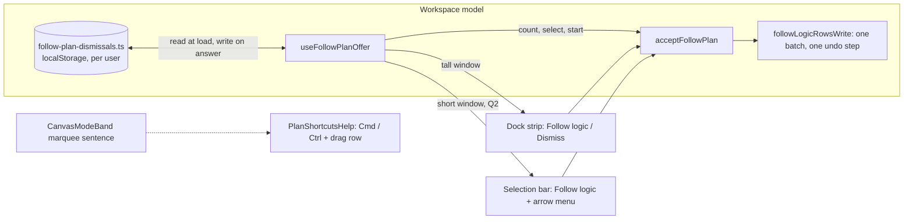
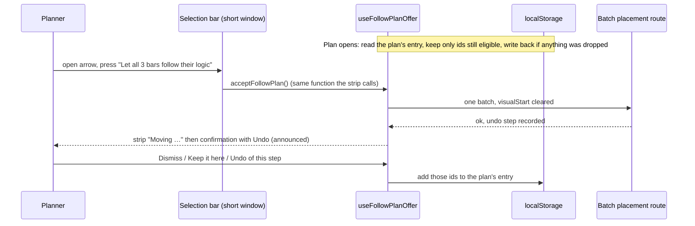

# Feature Spec: Follow logic follow-ups (remembered Dismiss, a short-window "let all follow", a one-line Select hint)

- **Status:** Approved — by the product owner, 2026-11-13: parts A and C as written; part B with Q1 answered "the arrow on Follow logic" and Q2 answered "only on a short window". Not yet built.
- **Author(s):** feature-analyst (Claude Code), for the product owner
- **Date:** 2026-11-13
- **Tracking issue / epic:** `docs/HANDOFF.md` "What is next", question 4 (three "Follow logic" choices)
- **Roadmap link:** none; follow-ons to ADR-0216 D6
- **Related ADR(s):** ADR-0216 (D6 amended in place by this work, section 4.7), ADR-0173 and ADR-0098 section 4.9
  (things kept on the device), ADR-0093 (an object action belongs on the object), ADR-0094 and ADR-0186 (the conflict
  chip and the remedy on the selection bar), ADR-0082 and ADR-0204 (a shaded control says why), ADR-0135 (focus when a
  control goes), ADR-0132 (what is announced), ADR-0142 (measure before building), ADR-0064 and ADR-0113 (the armed-tool
  sentence), ADR-0081 (entry point and journey), ADR-0088 D1 (no flag)

---

## In plain English

**A. Dismiss is remembered.** Today, when you press **Dismiss** on the strip that says "3 bars stay where they were
placed, before their logic allows.", it goes away until you reload the page or open the plan in a new tab, and then it
asks again. After this change it stays away on that computer and browser, for that plan. Another computer, another
browser, or another person signed in on the same browser, will still be asked. Bars you said **Keep it here** about,
and bars you moved and then took back with **Undo**, are remembered the same way, because today they are treated
exactly like a Dismiss. If one of those bars later stops being early and then becomes early again, you are asked
about it again, because that is a new situation.

**B. "Let all follow" on a short window.** On a short window (the laptop and 11-inch tablet size) the strip is not
shown at all, because it took too much of the diagram. Today the only way to fix those bars there is one at a time.
I recommend a small arrow beside the **Follow logic** button on the selected bar's action bar (the bar along the
bottom that appears when you select an activity, which is where **Next conflict** takes you). The arrow opens a menu
with one item: **"Let all 3 bars follow their logic"**. It does exactly what the strip's Follow logic does, as one
change with one Undo. The arrow appears only when the bar you have selected is one of those early bars and there is
at least one other. It costs the diagram no height while it waits; the arrow is about the width of a letter.

**C. A one-line Select hint.** When you press **Select** on the toolbar, the bottom row says "Marquee select · drag to
select, Ctrl to add · Esc to stop", which wraps onto a second line on a 1024 wide screen. It becomes **"Select · drag
across bars · Esc to stop"**. "Esc to stop" stays, because nothing else in the product says it. "Ctrl to add" moves
to the keyboard shortcuts sheet (press **?**), which today does not mention it at all, and to the Select button's
tooltip.

---

## 1. Business understanding

### Problem

ADR-0216 D6 shipped the whole-plan offer with three known gaps, each recorded in D6 or in `docs/HANDOFF.md`:

1. **Dismiss is forgotten on reload.** `use-follow-plan-offer.ts:122` holds `dismissedByPlan` in React state, and its
   docblock (lines 87-91) says "It is not persisted, so a reload asks again (ADR-0216, a known trade-off: a per-device
   memory is the owner's call)". The journey `e2e-workspace-chrome/follow-logic-plan.spec.ts:311` ("Dismiss puts a
   failed offer away; a reload asks again") pins that behaviour today. A planner who dragged a bar early on purpose is
   asked about it every time the plan is opened (ADR-0216, Consequences, second bullet).
2. **No whole-plan action on a short window.** `plan-workspace-toolbar.tsx:1293-1296` returns no strip when
   `useMediaQuery(SHORT_QUERY)` is true and the offer is idle. D6 records why (the diagram 312 px against 350 at
   1024 x 600) and that the per-bar route through the conflict chip and the selection bar is the only route left.
3. **The Select hint may wrap at 1024 wide.** `CanvasModeBand.tsx:74` returns a 58-character sentence; the band is
   a compact `NoticeStrip` with `messageFit="wrap"` and no `data-dock-row` (lines 111-124), so it shares the foot row
   with the plan facts. **This premise is not measured anywhere I could find**: `docs/HANDOFF.md:109-110` asserts it.
   Milestone M2 therefore writes the one-line check first and records it failing on today's sentence before the copy
   changes (ADR-0113: measure the problem, not only the remedy). If it passes on today's sentence, M2 stops and asks.

### Users

Planners and Org Admins holding the pen (all three parts). Contributors and Viewers see part C (Select is not
pen-gated, `tsld-toolbar-items.tsx:3252-3253`) and part B only as a shaded control (see Permissions). External
guests see none of it (the share page has no selection bar, toolbar or offer).

### Primary use cases

1. A planner dismisses the whole-plan offer, closes the laptop, opens the plan tomorrow: not asked again.
2. A planner on a 1024 x 600 window presses **Next conflict**, lands on an early bar, opens the arrow beside
   **Follow logic** and lets all of them follow in one step, with one Undo.
3. A planner on a 1024 wide window presses **Select** and reads the hint on one line.

### Expected outcomes and success criteria

- A: after Dismiss and a reload, `canvas-follow-logic-plan-offer` is absent; a bar that becomes newly eligible still
  brings the offer back (journey).
- B: at 1024 x 600 the whole-plan write is reachable by keyboard and pointer from the selection bar, and the diagram
  height with the arrow present equals its height without it (journey, no pixel figures).
- C: at 1024 wide the hint's sentence occupies one line box (journey, no pixel figures).

### Open questions

**Critical (part B only):**

- **Q1. Where the action sits.** Recommended: **an arrow beside the selection bar's Follow logic, opening a one-item
  menu "Let all N bars follow their logic"** (section 4.5). Alternative: a toolbar button beside **Arrange** (section
  4.6, option B2). Approve the recommendation, pick the alternative, or say no.
- **Q2. When it is shown.** Recommended: **only on a short window**, that is exactly where D6 hides the strip, so the
  plan never shows two routes to the same write at once. Alternative: whenever two or more early bars qualify and the
  selected one is among them, on any window, so the bar looks the same at every size.

**Defaults (no answer needed; say if you disagree):**

- D-A1. Remembered per person on the device (the key carries the signed-in user's id, as the recent-plans list does,
  `features/overview/model/recent-plans.ts:10-13`), not per device for everyone.
- D-A2. Keep it here and Undo of the offer's own step are remembered too (section 4.3).
- D-A3. Nothing is cleared at sign-out: the store holds activity ids only, never a name.
- D-B1. The menu item's label carries the count: "Let all 3 bars follow their logic".
- D-C1. The new hint is the owner's example, "Select · drag across bars · Esc to stop".

## 2. Functional requirements

### User stories and acceptance criteria

> **US-A1.** As a Planner, I want Dismiss to be remembered on this device, so I am not asked about bars I placed
> early on purpose every time I open the plan.
>
> - **Given** the whole-plan offer counting bars X and Y, **when** I press Dismiss and reload, **then** no offer is
>   shown.
> - **Given** that, **when** an edit makes bar Z newly early, **then** the offer returns counting 1 (Z only), and its
>   Follow logic moves Z only.
> - **Given** that I dismissed in plan P, **when** I open plan Q, **then** Q's offer is unaffected.
> - **Given** I pressed Keep it here on an edit offer about bar X, **when** I reload, **then** X is not counted.
> - **Given** I pressed Undo on the offer's own "now follow their logic" step, **when** I reload, **then** those bars
>   are not counted.
> - **Given** X was dismissed, then stopped being early (a link was removed), **when** I next open the plan and X is
>   early again, **then** X is counted again (pruned at load, section 4.3).
> - **Given** the browser refuses storage (private mode, quota), **then** behaviour is today's: remembered for the
>   session only, no error shown.

> **US-B1.** As a Planner on a short window, I want to let every early bar follow from the conflict review, so I
> do not have to visit them one by one.
>
> - **Given** a short window, the pen held, three early bars counted, and one of them selected, **when** I look at
>   the selection bar, **then** Follow logic shows an arrow, named "More Follow logic choices".
> - **When** I open it, **then** a menu has one item, "Let all 3 bars follow their logic".
> - **When** I press it, **then** the same write as the strip's runs (`followLogicRowsWrite`, one batch, one undo
>   step); the strip appears in its busy state "Moving …", then the confirmation with Undo, exactly as on a tall
>   window. These event phases take a dock row, as D6 already allows.
> - **Given** only the selected bar qualifies, **then** there is no arrow (Follow logic already does it).
> - **Given** the selected bar is not counted (started, a summary, dismissed, or not early), **then** no arrow.
> - **Given** a tall window (with Q2's default), **then** no arrow: the strip is the route there.
> - **Given** more than 2,000 qualify, **then** the menu item is shaded and says "Too many to follow at once (2,001;
>   the limit is 2,000). Follow logic still works on each bar." (`followPlanOverLimitReason`).
> - **Given** no pen, **then** Follow logic and its arrow are shaded together with the pen's sentence, as Follow
>   logic is today.

> **US-C1.** As anyone who can open the plan, I want the Select hint on one line at 1024 wide, and I still want to
> learn that Ctrl adds to a selection.
>
> - **Given** a 1024 wide window, a computed plan and nothing selected, **when** I press Select, **then** the band
>   reads "Select · drag across bars · Esc to stop" on one line, and the same sentence is announced.
> - **When** I press ?, **then** the shortcuts sheet lists "Cmd / Ctrl + drag on the diagram: Draw a box that adds
>   to the selection, without pressing Select".

### Edge cases

- A: an id in storage that no longer exists in the plan (deleted, or the plan was re-imported) is dropped at load.
  Storage that holds garbage, another version's shape or a non-array is treated as empty. Two tabs on the same plan:
  each reads at load; a Dismiss in one reaches the other on its next load, not live (no `storage` event listener;
  stated, not built).
- A: a plan opened with the pen not held: the offer is omitted (D6), the stored set is still read and pruned so that it
  is right when the pen arrives.
- B: the planner presses the item, and a peer's edit lands first: the write returns 409 and the strip says
  `FOLLOW_LOGIC_CONFLICT` with Try again, as today.
- B: the selected bar's own placement is cleared by the write, so Follow logic and its arrow leave the bar (the item
  is `isVisible: hasPlacement`, `selection-actions.tsx:1116`); focus handling is section 4.5.
- B: the window grows tall while the menu is open: with Q2's default the arrow goes; the menu closes with it and
  focus is handed back by the bar (ADR-0135). The strip appears.
- C: Ctrl or Cmd held at press time already adds (`TsldCanvas.tsx:2612`, `ctrl: e.ctrlKey || e.metaKey`;
  `gesture-machine.ts:528`), so "Cmd / Ctrl" in the sheet is true on a Mac too.

### Permissions

No server permission changes. The write is the existing batch placement route, pen-gated and organisation-scoped as
today. Part B's control follows Follow logic's gating (`penGated: true`, `penRefusal`); Viewers and Contributors see
it shaded with the existing sentence when it would be shown. Part A stores only what the signed-in user dismissed,
under their own user id. Part C is not gated.

### Validation rules

A: the stored value is parsed defensively: an object with `v: 1` and `plans` mapping a plan id to
`{ at: number, ids: string[] }`; anything else is ignored. Caps in section 4.3.

### Error scenarios

| Scenario                               | Detection                      | User-facing result                                       |
| -------------------------------------- | ------------------------------ | -------------------------------------------------------- |
| Storage blocked or full                | `try`/`catch` round every call | Nothing visible; dismissal lasts the session (today)     |
| Stored data corrupt or another version | parse guard                    | Treated as nothing remembered                            |
| B: stale version                       | 409 from the batch route       | Strip: `FOLLOW_LOGIC_CONFLICT`, Try again (today's path) |
| B: pen lost mid-press                  | 423                            | Strip returns to asking; the pen banner speaks (today)   |
| B: any other failure                   | `outcome.status === 'error'`   | Strip: `followFailedSentence`, Try again, logged (today) |

## 3. Technical analysis

| Area           | Impact | Notes                                                                                          |
| -------------- | ------ | ---------------------------------------------------------------------------------------------- |
| Frontend       | low    | One new pure module (A), one selection-bar item change (B), one sentence and one sheet row (C) |
| Backend        | none   | No endpoint, no service change                                                                 |
| Database       | none   | Browser storage only; no schema change, so no database-architect run is required               |
| API            | none   |                                                                                                |
| Security       | low    | Ids only in `localStorage`, keyed by user id; no names; no new write path                      |
| Performance    | low    | One read and parse per plan open, one write per answer; worst case stored size in section 4.3  |
| Infrastructure | none   | No flag (ADR-0088 D1)                                                                          |
| Observability  | none   | Storage failures are silent by design, as every device preference here is                      |
| Testing        | med    | Unit for the store, hook and copy; journeys for each part; browser accessibility review for B  |

**Recalculation parity.** No scheduling input changes. `computeSchedule` is untouched; the write in B is the existing
`followLogicRowsWrite`, which clears `visualStart` only (ADR-0216 D3, D7).

**The pen.** B's write is structural (placement), as Follow logic already is; it needs the pen and gets it the same
way. A and C write nothing to the server.

### Dependencies

None between parts. A and C can ship before B is approved. B reads A's dismissed set, so if both are in flight, B
lands on top of A (it uses `select`, which already excludes dismissed bars).

## 4. Solution design

### 4.1 Architecture overview

### 4.2 Data flow (A and B)

### 4.3 Part A: remembering Dismiss

**Where.** A new pure module, `apps/web/src/components/layout/workspace/follow-plan-dismissals.ts`, beside the hook,
with its unit test. **Pure over an injected `Storage`**, the shape of `features/overview/model/recent-plans.ts` (its
lines 1-19 and 36-72: read and write go through two guarded functions, tests pass a map or a throwing store).

**Why not the device-preference hook the brief pointed to.** ADR-0173's column widths do not use a shared helper:
`features/gantt/model/use-gantt-column-widths.ts:45-53, 75-81` hand-rolls its own `try`/`catch`, and its docblock
(lines 58-62) says why it does not use the shared one: that one writes on mount. The shared hook is
`hooks/use-device-pref.ts`, and it is also wrong here for a second reason: its `useState` initialiser reads the key
once (lines 18-26) while its effect writes the current value to whatever the key now is (lines 28-34), so moving from
plan P to plan Q would **copy P's dismissals into Q's key**. So: the try/catch discipline of ADR-0173, the shape of
recent-plans, no shared hook.

**Key and shape.** One key per signed-in user:
`schedulepoint:follow-plan-dismissed:<userId>` holding
`{ "v": 1, "plans": { "<planId>": { "at": <epoch ms>, "ids": ["<activity id>", …] } } }`.
One key per user rather than per plan, so the bound is one place and pruning old plans is one read.

**Bounds.** At most **20 plans** per user (least recently written dropped first, by `at`) and at most **1,000 ids**
per plan (an answer that would exceed it keeps the most recent 1,000; the rest are asked about again after a reload,
which is today's behaviour for them). Activity ids are UUIDs (`apps/api/prisma/schema.prisma:130`, `uuid(7)`), 36
characters, so the worst case is about 20 x 1,000 x 39 = 780,000 characters. Browsers allow about 5 million characters
per origin, shared with every other preference here. A typical entry is a handful of ids. These numbers are a default;
the builder may lower them, not raise them without saying why.

**When it is read, and pruning.** Once per plan opening, after the first activities list for that plan has arrived
and no edit is pending (`pendingEdits === 0`): the stored ids are intersected with `placedBeforeLogicIn(activities)`
(today's eligibility) and the result seeds the in-memory set for that plan. If anything was dropped, the entry is
written back. **Never pruned during a session**, because a recalculation in flight can briefly change flags and would
wipe answers the planner just gave; within a session the set behaves exactly as today.

**When it is written.** Every time today's code adds to the set (`addDismissed`, `use-follow-plan-offer.ts:143-150`),
which is reached from three places, all persisted:

| Answer                          | Today (in memory)                  | After      | Why                                                                                                                                                                            |
| ------------------------------- | ---------------------------------- | ---------- | ------------------------------------------------------------------------------------------------------------------------------------------------------------------------------ |
| Dismiss on the whole-plan offer | `dismiss`, line 238                | remembered | The owner's decision                                                                                                                                                           |
| Keep it here on an edit offer   | `dismissBars` via `keepFollowEdit` | remembered | An explicit answer about those bars; otherwise the plan offer re-asks it after every reload                                                                                    |
| Undo of the offer's own step    | `noteReplay`, line 251             | remembered | ADR-0216 D6: "it does not ask again the question the planner has just taken back"; one rule (what stops it this session stops it after a reload) is easier to explain than two |

**Per person on a device, said honestly.** ADR-0216 D6's trade-off sentence and the hook's docblock change to say:
remembered on this browser for the signed-in person, per plan; another device, browser or person is asked; clearing
the browser's site data forgets it. No sign-out clearing: ids only, no names (unlike recent plans, whose names-free
design is the same argument, `recent-plans.ts:15-18`).

### 4.4 Part C: the Select hint

- `modeStatementText({ kind: 'marquee' })` returns **"Select · drag across bars · Esc to stop"** (39 characters
  against 58). "Select" is the tool's own toolbar label (`tsld-toolbar-items.tsx:3261`), so the band names the
  button the planner just pressed. The announcement is the same string (it comes from the same function).
- **Where "Ctrl to add" goes.**
  1. A new row in `PlanShortcutsHelp.tsx` `MULTI_SELECT_SHORTCUTS` (lines 29-35): keys **"Cmd / Ctrl + drag on the
     diagram"**, action **"Draw a box that adds to the selection, without pressing Select"**. Precedent: the
     "Click (Add armed)" row and its docblock (lines 59-77), which moved a pointer gesture into the sheet for the same
     reason. Today the sheet does not mention it at all, so this is a net gain in discovery.
  2. The Select button's `description` (`tsld-toolbar-items.tsx:3262`, today "Marquee-select activities on the canvas")
     becomes "Drag a box across bars to select them. Hold Ctrl (Cmd on a Mac) to add to the selection." This is the
     hover and focus tooltip a plain `onActivate` item gets from `ToolbarButton` (`toolbar-registry.ts:91-95`).
- `CanvasModeBand.tsx`'s docblock (lines 41-61) gets a dated note: "Ctrl to add" was cut on the owner's instruction
  of 2026-11-13 and now lives in the sheet and the tooltip, so the capability is not re-hidden.
- **The one-line check, without pixel figures.** In the journey: at 1024 wide, computed plan, nothing selected,
  arm Select, then count the line boxes of the band's sentence: a DOM `Range` over the sentence's text node,
  `getClientRects()`, distinct `top` values, must equal **1**. This holds on any machine, font or zoom that leaves the
  sentence one line, and fails exactly when it wraps. (The brief suggested comparing with "a single-line band of
  another tool"; there is none to compare with: only `marquee` is painted as an armed-tool hint, ADR-0216
  Consequences, and the other two kinds, `linkPicking` and `linked`, use a different density and their own row,
  `CanvasModeBand.tsx:107-124`.) A second assertion: the diagram height with Select armed equals the height
  unarmed, the existing pattern at `dock.spec.ts:115`, run at 1024.
- **Stop rule.** The check is written first and run on today's sentence. If it already passes at 1024, the problem is
  not real at that width: stop and report before changing copy.

### 4.5 Part B: the recommended placement (Q1)

**What "the conflict review" is in the code.** There is no review panel. It is the toolbar's `find` group (**Next
conflict**, `tsld-toolbar-items.tsx:3034-3067`, and the `aria-hidden` count chip `next-conflict-status`,
3076-3099) and the **selection bar** that Next conflict lands on, where the remedy sits on the object
(`e2e-workspace-chrome/conflict-review.spec.ts:54-56`). For a bar placed before its logic that remedy is the bar's own
**Follow logic** (`selection-actions.tsx:1082-1149`). ("Review the constraint…" is the route remedy for a constraint
conflict and opens the editor; it is not this conflict's remedy.)

**Recommendation: an arrow on Follow logic.** The selection bar's `clear-visual-placement` item becomes a split
button (`ToolbarSplitButton`, as **Add** and **Link** are on the toolbar) when, and only when, all of these hold:

1. the window is short (`SHORT_QUERY`), per Q2's default;
2. the selected activity is in the whole-plan offer's counted set (`select`: placed, early, non-summary, unstarted,
   not dismissed);
3. that set has 2 or more members.

Otherwise it is today's plain **Follow logic**, unchanged.

| Part          | Text                                                  | Notes                                              |
| ------------- | ----------------------------------------------------- | -------------------------------------------------- |
| Primary half  | **Follow logic**                                      | Unchanged: this bar only                           |
| Arrow (caret) | accessible name **"More Follow logic choices"**       | `caretLabel`; `aria-haspopup="menu"`               |
| Menu item     | **"Let all 3 bars follow their logic"** ("2 bars", …) | Calls `acceptFollowPlan`, the strip's own function |

**What it counts.** Exactly the strip's count: `placedBeforeLogicIn(activities)` minus dismissed bars (the hook's
`count`, which today is computed even when the offer is withheld; the hook exposes it). So the menu's number and a
tall window's strip number are always the same number, and both can read lower than the conflict chip (D6 explains
why: the chip also counts summaries and started bars).

**The write and its phases.** Identical to the strip: `acceptFollowPlan` (`use-plan-workspace-model.ts:2428-2466`),
`followLogicRowsWrite`, one batch, one undo step. Once pressed, the strip's own busy ("Moving …"), failed (with Try
again) and done (with Undo, 15 s) phases appear in the dock: `plan-workspace-toolbar.tsx:1296` already shows every
non-idle phase on a short window, because D6 counts them as events the planner started. So **asking costs no
height; the answer's strip does, as it does on a tall window.** While a press is in flight the menu item is shaded
with "Already moving these bars." (ADR-0082: focusable, says why).

**Shading.** Without the pen the whole split button is shaded with the pen sentence Follow logic already uses
(`penRefusal`), both halves, so the menu cannot be opened (ADR-0204: a shaded control says why, on hover, focus and
touch). Over 2,000 the menu item alone is shaded with `followPlanOverLimitReason`. Under the Late-start overlay, the
shared gate's reason, as the strip does (`plan-workspace-toolbar.tsx:1282-1286`).

**Focus (ADR-0135).** Pressing the menu item closes the menu, and focus returns to the arrow (the `Menu` primitive's
opener return). When the write lands, the selected bar has no placement, so Follow logic and its arrow leave the bar
(`isVisible: hasPlacement`); the bar's focus hand-off moves focus to the neighbouring control and announces the
existing static `lostReason`, "This activity no longer has a hand-placed start to clear." (`selection-actions.tsx:1122`),
which is true. This is exactly what happens today after the per-bar Follow logic, so no new focus rule is introduced.
The conflict chip's count falls; it is `aria-hidden` and never focused, so nothing moves.

**Announcements (ADR-0132).** The arrow and the menu are not announced on appearing (a standing condition, like the
strip). The outcome is announced once by the existing path ("… now follow their logic", or the failure sentence).
Order: the hand-off sentence when the write lands, then the outcome when the recalculation settles. The accessibility
review in a browser (plan M3) must hear both, in that order, once each.

**Why this is honest about height.** The arrow adds about one icon's width to a bar that wraps. On the fullest bar at
1024 x 600 that could, in principle, tip a wrap onto a new line. M3 measures it first (ADR-0142): the diagram height
with a placed early bar selected, arrow present and absent, at 1024 x 600 on mouse and finger. If the arrow costs a
line in any of those, M3 stops and the owner chooses between the alternatives below.

### 4.6 Alternatives for B, and why not

| Option | What                                                                                                     | Why not chosen                                                                                                                                                                                                                                                                                                                                                                                                                                                                                                              |
| ------ | -------------------------------------------------------------------------------------------------------- | --------------------------------------------------------------------------------------------------------------------------------------------------------------------------------------------------------------------------------------------------------------------------------------------------------------------------------------------------------------------------------------------------------------------------------------------------------------------------------------------------------------------------- |
| B2     | A toolbar button "Let all follow…" in the `tools` group beside **Arrange** and **Apply levelled dates…** | It respects D6 ("never in the `find` group"), costs no height, and ADR-0093 D1 would put a plan-wide write there. But it sits on every window size (a toolbar control that appears only on short windows would move other controls as the window changes height), it costs width on a toolbar row that is already full at 1024 (placed-bar-follows-link spec section 4.8 said it "needs measuring"), and it is far from where Next conflict takes the planner. The owner's own suggestion was "inside the conflict review". |
| B3     | A separate button "Follow all 3" on the selection bar                                                    | Per-bar Follow logic alone measured 146 px of the bar (`selection-actions.tsx:1100-1103`); a second button of that size is likely another bar line at 1024 x 600, which is diagram height.                                                                                                                                                                                                                                                                                                                                  |
| B4     | Make the conflict chip ("3 conflicts") a menu                                                            | The chip is a presentational, `aria-hidden` read-out (ADR-0186 D6; `tsld-toolbar-items.tsx:3071-3075`), and D6 refuses a write in the `find` group.                                                                                                                                                                                                                                                                                                                                                                         |
| B5     | A compact standing strip on short windows                                                                | Measured and refused in D6: 304 px at 1024 x 600, worse than the full strip, because the sentence wraps.                                                                                                                                                                                                                                                                                                                                                                                                                    |

**ADR-0093 tension, stated.** D1 of ADR-0093 puts an action whose subject is the plan on the command surface. B's
subject is "this bar and the others in the same state", reached from this bar. It is a bulk action that starts from
the object (ADR-0080's sense), and it carries its count in its name, so the reader sees how far it reaches before
pressing. The D6 amendment records this rather than leaving it implicit.

### 4.7 ADR handling

**Amend ADR-0216 D6 in place, with dated notes; no new ADR.** All three parts change details D6 already decides
(the dismissal's lifetime, the short-window omission and its fallback route, and the armed-tool band note under
Consequences), and the ADR already carries a dated "Taken up (2026-11-12)" note in that style. Notes to add:

- A (M1): "Remembered (2026-11-1x): the dismissal is kept on the device for the signed-in person, per plan, …" replacing
  "A known trade-off: the dismissal is not remembered across a reload". The Consequences bullet "after a reload it asks
  again" is corrected the same way.
- C (M2): one line under the Consequences note about `CanvasModeBand`: the marquee sentence and where "Ctrl to add" went.
- B (M3, only if approved): the short-window fallback: "the selection bar's Follow logic gains an arrow …", the
  ADR-0093 tension above, and that D6's "never as a toolbar write in the `find` group" is respected, not amended.

CLAUDE.md section 16's ADR-0216 line gains "D6 amended 2026-11-1x" in its parenthesis, as other in-place amendments
are recorded (for example ADR-0056's line). No ADR count changes on the stage banner. The **web source file count**
on the banner does change (part A adds a module and its test), so `pnpm check:counts` will print the new number.

**ADR-0111.** No shared primitive's keyboard contract changes: `ToolbarSplitButton` and `Menu` are used as they are.
The accessibility review in a browser is still required for B before release, because it is a new control in a
roving toolbar whose focus moves when the write lands.

### 4.8 Database, API and component changes

- Database: none. API: none.
- Components: `use-follow-plan-offer.ts` (A: seeded from and writing to the store; exposes `count` regardless of the
  pen for B), new `follow-plan-dismissals.ts` (A), `selection-actions.tsx` `clear-visual-placement` becomes a `render`
  item that draws today's button or a `ToolbarSplitButton` (B), `SelectionActionContext` gains a `followAll` field
  (count, whether shown, shaded reason, `onFollowAll`) (B), `plan-workspace-toolbar.tsx` passes it in both views'
  selection contexts (B), `CanvasModeBand.tsx` (C), `PlanShortcutsHelp.tsx` (C), `tsld-toolbar-items.tsx` Select
  `description` (C).

## 5. Links

- Implementation plan: [`implementation-plan.md`](implementation-plan.md), beside this spec.
- Related docs updated by this change: ADR-0216 (D6 notes), CLAUDE.md section 16 line and banner count, the hook's and
  `CanvasModeBand`'s docblocks, `docs/HANDOFF.md` question 4 at the next hand-off.
