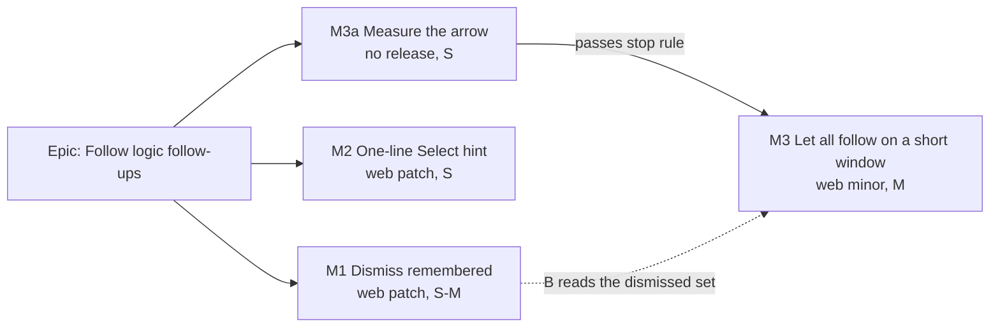

# Implementation Plan: Follow logic follow-ups

- **Feature spec:** [`feature-spec.md`](feature-spec.md) (Approved)
- **Status:** Approved (2026-11-13); Q1 the arrow on Follow logic, Q2 only on a short window
- **Owner:** product owner; built by the `builder` agent, one milestone per pull request

## Breakdown

### Epic

**Follow logic follow-ups**: three ADR-0216 D6 follow-ons from `docs/HANDOFF.md` question 4. No flag (ADR-0088 D1);
each milestone is its own commit boundary and its own release.

**Order.** M1 and M2 do not wait for B's approval and do not depend on each other; build M1 first (it is the larger
and touches the hook M3 uses), then M2. M3a and M3 start only after the owner answers Q1 and Q2.

---

### Milestone M1: Dismiss is remembered (web patch)

**Outcome:** Dismiss, Keep it here and Undo of the offer's own step are remembered on this browser for the signed-in
person, per plan, across reloads.
**Entry point:** the existing **Dismiss** on the whole-plan strip (`canvas-follow-logic-plan-offer`), and **Keep it
here** on the edit offer. No new control.
**Journey:** `e2e-workspace-chrome/follow-logic-plan.spec.ts`: Dismiss, reload, the offer is absent; then an edit
makes another bar early and the offer returns counting 1.

#### Feature: a device store for the dismissed set

> **Complexity:** M (two small tasks)
> **Dependencies:** none
> **Risks:** pruning during a recalculation wipes fresh answers → prune once per opening only, after the first
> settled list (spec 4.3). A plan switch copies one plan's set into another → no shared `useDevicePref` (spec 4.3
> explains its key-change behaviour); the store is keyed explicitly per call. The user id is not yet known at first
> render → read only once `useSession` has a user, as `use-remember-plan.ts:32-38` does.
> **Testing requirements:** unit (store, hook), journey (reload), the existing hook tests stay green.

##### Task M1-T1: `follow-plan-dismissals.ts` (pure)

- **Description:** `readDismissed(storage, { userId, planId })`, `rememberDismissed(storage, { userId, planId, ids, at })`,
  `pruneDismissed(storage, { userId, planId, keep })`. Key `schedulepoint:follow-plan-dismissed:<userId>`, shape
  `{ v: 1, plans: { [planId]: { at, ids } } }`, caps 20 plans (oldest `at` dropped) and 1,000 ids per plan (most
  recent kept). Every storage call in `try`/`catch`; corrupt or foreign data reads as empty.
- **Complexity:** S
- **Testing:** unit with a map-backed `Storage` and a throwing one (the `recent-plans.test.ts` pattern): round trip;
  other plans untouched; other users untouched; the 20-plan cap drops the oldest; the 1,000-id cap keeps the newest;
  corrupt JSON, wrong `v`, non-array `ids` all read as empty; quota error on write is swallowed; prune writes only when
  something was dropped.
- **Development steps:**
  1. Write the module and its test beside `use-follow-plan-offer.ts`.
  2. Docblock: the per-person-per-device sentence, the caps and the worst-case size, and why it is not `useDevicePref`.

##### Task M1-T2: wire it into `useFollowPlanOffer`

- **Description:** the hook takes `userId` (from `useSession`, passed by `use-plan-workspace-model.ts`) and an optional
  `storage` (default `window.localStorage`, injectable for tests). On a plan opening, once activities exist and
  `pendingEdits === 0`, seed the plan's in-memory set from `readDismissed` intersected with
  `placedBeforeLogicIn(activities)`, and `pruneDismissed` with the result. `addDismissed` also calls
  `rememberDismissed`. Expose `count` (already computed) for M3. Update the docblock (lines 87-91) and the `dismiss`
  JSDoc ("for this plan this session").
- **Complexity:** S to M
- **Dependencies:** M1-T1
- **Risks:** the seed must not reset a set the planner has already added to in this opening (seed once per plan id per
  mount, merge rather than replace).
- **Testing:** `use-follow-plan-offer.test.ts` gains: a seeded set suppresses the offer; a stored id no longer eligible
  is pruned and written back; Keep it here and the replay path both write; storage throwing leaves today's behaviour;
  switching plans reads the second plan's own entry.
- **Development steps:**
  1. Wire, test, run the `apps/web/src/components/layout/workspace` unit folder whole.
  2. Change the journey at `follow-logic-plan.spec.ts:311` ("Dismiss puts a failed offer away; a reload asks
     again"): after the reload the offer is **absent**; add the "a newly early bar brings it back, counting 1" step.
     Its line 352 comment ("Not remembered across a reload: a known trade-off") goes.
  3. ADR-0216 D6 dated note and Consequences bullet (spec 4.7); CLAUDE.md section 16 ADR-0216 line; set the banner's
     web source file count to what `pnpm check:counts` prints.
  4. Changeset: `@repo/web` **patch**, "Dismiss on the 'bars stay where they were placed' strip is now remembered on
     this browser after a reload."

**Suites to run, one at a time** (no foot-row layout change, so the short list): `pnpm prepush`, then
`scripts/e2e-local.sh web:workspace-chrome`, `web:arrange`, `web:gantt-editing` (both reference the plan offer).
Set `PLAYWRIGHT_CHROMIUM_PATH` for each (`docs/HANDOFF.md`).

---

### Milestone M2: a one-line Select hint (web patch)

**Outcome:** at 1024 wide the armed Select tool's sentence is one line; "Ctrl to add" is in the shortcuts sheet and
the Select button's tooltip.
**Entry point:** the toolbar's **Select** button (plan commands toolbar); the **?** shortcuts sheet.
**Journey:** `e2e-workspace-chrome/dock.spec.ts`: at 1024 wide, arm Select, the sentence is one line box, the
diagram height is unchanged; open the sheet, the Cmd / Ctrl + drag row is there.

#### Feature: the sentence, the sheet row, the tooltip

> **Complexity:** S
> **Dependencies:** none
> **Risks:** the premise is unmeasured (spec section 1, item 3) → T1 measures it first and stops if the old sentence
> already fits. The plan facts vary in width with the schedule's state (ADR-0216 D6) → the journey fixes the state:
> computed plan, nothing selected, facts current.
> **Testing requirements:** unit (copy, sheet), journey (one line box), multi-select suite.

##### Task M2-T1: the check first, red on today's sentence

- **Description:** in `dock.spec.ts`, a case at 1024 x 768: arm Select, then in the page take the band's sentence text
  node, build a `Range` over it, collect `getClientRects()`, and count distinct `top` values: expect **1**. Also expect
  the diagram height armed to equal it unarmed (the `dock.spec.ts:115` pattern). No pixel figures.
- **Complexity:** S
- **Testing:** run it on today's code and record that it fails (count 2). If it passes, **stop** and report to the
  owner: the problem is not real at 1024, and only the sheet row (which is a gain either way) should proceed.

##### Task M2-T2: the copy

- **Description:** `CanvasModeBand.tsx:74` returns "Select · drag across bars · Esc to stop"; dated note in the
  docblock at lines 41-61. `PlanShortcutsHelp.tsx` `MULTI_SELECT_SHORTCUTS` gains "Cmd / Ctrl + drag on the diagram"
  / "Draw a box that adds to the selection, without pressing Select", with a docblock pointing at the band. The Select
  item's `description` (`tsld-toolbar-items.tsx:3262`) becomes "Drag a box across bars to select them. Hold Ctrl (Cmd
  on a Mac) to add to the selection."
- **Complexity:** S
- **Dependencies:** M2-T1
- **Testing, every place that asserts the old sentence:**
  - `apps/web/src/features/tsld/components/CanvasModeBand.test.tsx:111` (exact string)
  - `apps/web/src/features/tsld/components/TsldPanel.marquee-mode.test.tsx:83` (`/^Marquee select · drag/`, the
    announcement) and `:92` (`/Ctrl to add/`: invert, the band no longer says it; assert the sheet does in the sheet's
    own test)
  - `apps/web/src/features/tsld/components/TsldPanel.mode-band.test.tsx:137` and `:544`
  - `apps/web/e2e-workspace-chrome/dock.spec.ts:109`, `:114` and `:877`
  - `apps/web/measure-toolbar/cq3-facts-chip.spec.ts:239` (a measurement suite; update so it still runs)
  - `PlanShortcutsHelp` unit test: the new row is present.
  - Historic mentions (ADR-0113, ADR-0114, `docs/specs/foot-row/spec.md`, `ToolbarSplitButton.tsx:56-60`, CHANGELOG)
    are records and are **not** edited; the `ToolbarSplitButton` docblock's "two shortcuts nothing else in the product
    documents" gets one dated clause saying Ctrl-drag is now in the sheet.
- **Development steps:**
  1. Change copy; update the tests above; M2-T1's check goes green.
  2. ADR-0216 Consequences note (one line).
  3. Changeset: `@repo/web` **patch**, "The Select tool's hint is shorter and fits one line; Ctrl-drag to add is listed
     under keyboard shortcuts."

**Suites to run, one at a time** (the band sits in the foot row): `web:workspace-chrome`, `web:minimap`,
`web:multi-select`, `web:workspace-fit`, `web:toolbar`, `web:authoring-flow`, then the rest of the roster through CI's
shards (read every shard, `docs/HANDOFF.md`: CI runs 51 suites).

---

### Milestone M3a: measure the arrow before building it (no release)

**Outcome:** a reading, not a feature. **Ships dark:** nothing user-facing; it decides whether M3 proceeds.
**Journey:** none; a measurement spec under `apps/web/measure-toolbar/`, as `m-f-foot-row.spec.ts` was.

- **Description:** at 1024 x 600, mouse and finger, a plan with three early placed bars, one selected (the fullest
  realistic bar for a placed, flagged, unstarted task): record the selection bar's line count and the diagram height
  with today's Follow logic, then with a stand-in caret of the split button's width beside it. Write the readings to
  `docs/specs/follow-logic-follow-ups/m3a-measurement.md`.
- **Complexity:** S
- **Stop rule:** if the caret adds a bar line (diagram shorter) in either pointer, **stop** and put the readings to
  the owner with option B2 (the toolbar button) as the fallback.

### Milestone M3: let all follow on a short window (web minor)

**Outcome:** on a short window, from the selected early bar, the planner lets every counted bar follow its logic in
one step with one Undo.
**Entry point:** the selection bar (reached by **Next conflict** or by selecting the bar), the arrow named **"More
Follow logic choices"** beside **Follow logic**, menu item **"Let all N bars follow their logic"**.
**Journey:** `e2e-workspace-chrome/follow-logic-plan.spec.ts` (new case) at 1024 x 600: Next conflict lands on an
early bar; the arrow is there; keyboard only, open it and press the item; the strip goes "Moving …" then shows the
confirmation; the conflict chip's count falls by N; Undo puts them back in one step; the diagram height with the arrow
present equals the height with a single-bar selection before; no arrow at 1024 x 800.

#### Feature: the split Follow logic

> **Complexity:** M
> **Dependencies:** owner's answers to Q1 and Q2; M3a passed; M1 merged (M3 uses `count` and the dismissed set)
> **Risks:** turning `clear-visual-placement` into a `render` item loses registry facts it declares today (icon
> function, `isVisible`, `lostReason`, `data-toolbar-item` id) → keep the id and every declared field, and assert
> `selection-duplication.structural.test.ts` and `conflict-remedy.structural.test.ts` stay green. Two announcements
> when the write lands (the hand-off sentence, then the outcome) could collide in the single polite region → the
> accessibility review in a browser must hear both; if one is lost, the fix is ordering, not a second region.
> `ToolbarSplitButton` inside the selection bar's roving toolbar is a first use there → component-reviewer checks the
> roving and the caret's Escape.
> **Testing requirements:** unit (context, item, shading, labels), journey (keyboard path, both views' bar), browser
> accessibility review before release.

##### Task M3-T1: context and item

- **Description:** `SelectionActionContext.followAll: { count: number; shown: boolean; reason: string | null;
onFollowAll: () => void } | null`, built in `plan-workspace-toolbar.tsx` from `model` (`followPlan` count,
  `useMediaQuery(SHORT_QUERY)`, the selected id's membership in `select(rows)`, `penRefusal`, the over-limit and
  Late-start reasons, the busy phase) for **both** the diagram's and the Gantt's selection contexts. The item renders
  today's button when `!shown`, otherwise a `ToolbarSplitButton` with `caretLabel="More Follow logic choices"` and one
  `MenuItem` "Let all N bars follow their logic", shaded with `reason` when set (ADR-0082: stays focusable).
- **Complexity:** M
- **Testing:** unit: shown only on a short window, only when the selected bar is counted and the count is 2 or more;
  label pluralises; pen-less shades both halves with the pen sentence; over 2,000 shades the item with
  `followPlanOverLimitReason`; busy shades with "Already moving these bars."; pressing calls `acceptFollowPlan` once.
- **Development steps:** wire; run `features/plan-actions` and `components/layout/workspace` unit folders whole.

##### Task M3-T2: journey, review, docs, release

- **Description:** the journey above; `e2e-gantt-editing/object-actions-reach.spec.ts` gains the arrow's presence in
  the Gantt's bar at 1024 x 600. Run **accessibility-reviewer in Chromium** (keyboard path, focus after the bar's
  control leaves, both announcements once each, shaded reasons on focus), **component-reviewer** (split button in the
  selection bar) and **ux-reviewer** (label, count, placement), before the release.
- **Complexity:** S to M
- **Development steps:**
  1. Journey, reviews, fixes.
  2. ADR-0216 D6 dated note (spec 4.7), CLAUDE.md section 16 line, banner count if files were added.
  3. Changeset: `@repo/web` **minor**, "On a short window, Follow logic on a selected early bar has a menu to let
     every early bar follow its logic at once."

**Suites to run, one at a time** (a foot-row change): `web:workspace-chrome`, `web:minimap`, `web:workspace-fit`,
`web:gantt-editing`, `web:multi-select`, `web:arrange`, `web:toolbar`, `web:undo`, `web:narrow-shell`, then read every
CI shard.

## Sequencing and slices

1. **M1** (web patch): approved, no new surface. Release on its own.
2. **M2** (web patch): approved, no new surface. Release on its own, or with M1 if both are ready together.
3. **M3a**: after the owner answers Q1 and Q2.
4. **M3** (web minor): after M3a passes its stop rule.

No feature flag (ADR-0088 D1): each milestone is its own commit boundary, and that is the rollback.

## Definition of Done (per task)

Each pull request meets the Feature Completion Criteria in [`docs/PROCESS.md`](../../PROCESS.md): `pnpm prepush` run
(with `NODE_OPTIONS=--max-old-space-size=8192`), the listed suites run locally one at a time, every check on the
current head read green after deduping by name, a changeset, and the docs named above in the same pull request.

## Risks and assumptions (rollup)

| Risk / assumption                                                  | Likelihood | Impact | Mitigation                                                                                    |
| ------------------------------------------------------------------ | ---------- | ------ | --------------------------------------------------------------------------------------------- |
| The Select hint already fits one line at 1024 (premise unmeasured) | med        | low    | M2-T1 measures first and stops                                                                |
| Pruning wipes answers mid-session                                  | low        | med    | Prune once per opening, after the first settled list                                          |
| A planner never sees the offer again for bars dismissed long ago   | med        | low    | Pruned when a bar stops being early; per-bar Follow logic and the conflict chip are unchanged |
| The arrow tips the selection bar onto another line at 1024 x 600   | low        | med    | M3a measures first and stops                                                                  |
| Two announcements collide when the bar's control leaves            | med        | med    | Browser accessibility review before release                                                   |
| Storage blocked                                                    | low        | low    | Today's session-only behaviour, silently                                                      |
