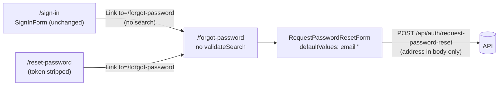

# Feature Spec: `/forgot-password?email=` — retire the param nothing writes (#242)

- **Status:** Approved — by the product owner, 2026-10-17, option (b): remove the unused `?email=` pre-fill (Q1)
- **Author(s):** feature-analyst (Claude), for the product owner
- **Date:** 2026-10-17
- **Tracking:** `docs/TECH_DEBT.md` #242 (`TECH_DEBT.md:1906-1972`)
- **Roadmap link:** none — closes a specified-but-unproduced capability
- **Related ADR(s):** [ADR-0074](../../adr/0074-account-recovery-verification-enforcement-and-csp.md), [ADR-0081](../../adr/0081-milestone-entry-point-and-journey.md), [ADR-0085](../../adr/0085-privacy-operations.md), [ADR-0088](../../adr/0088-flag-classification.md), [ADR-0105](../../adr/0105-a-register-row-is-not-a-spec.md), [ADR-0123](../../adr/0123-a-search-param-is-a-string-and-the-shape-is-decided-at-the-router.md)
- **Plan:** [`implementation-plan.md`](implementation-plan.md)

## 0. How to read this

Short spec for a small change. Stated once:

- **Why a spec at all.** Both ways out are ADR-0105 triggers (row #242, `TECH_DEBT.md:1931-1938`):
  carrying the address changes `SignInForm`'s public contract; deleting it changes a route's declared
  search and `RequestPasswordResetForm`'s props.
- **Users and roles.** Signed-out visitors only. `/forgot-password` is a public `rootRoute` child
  (`app/router.tsx:582-590`); a signed-in reader is redirected to `/account` copy
  (`routes/forgot-password.tsx:48-60`). No org scope, no RBAC change, External Guest unaffected.
- **The pen (ADR-0028).** Not involved — no plan write.
- **Recalc parity.** Not involved — no scheduling input; no touched file imports `computeSchedule`.
- **No new `VITE_*` flag** (ADR-0088 D1). The existing `PASSWORD_RESET_ENABLED` gate
  (`config/env.ts:1238`) is untouched. Rollback is the commit boundary.
- **No API, schema, OpenAPI or migration change.** database-architect not required.
- **No ADR.** Deleting an unproduced param is not architecturally significant; the decision is
  recorded in `docs/DECISIONS.md` and in row #242's closure.
- **Line numbers as read 2026-10-17.** Each citation also names its symbol.

### Critical question for the owner

1. **When someone clicks "Forgot your password?" on the sign-in screen, should the address they had
   already typed carry over to the next screen?**
   **(b) No — remove the unused pre-fill** _(recommended default)_. They type it again, and the
   browser's own autofill normally does that for them. Nothing new can leak.
   **(a) Yes — carry it over**, which means putting their email address in the web address for a
   moment, where it can be written into browser history and our web server's logs before we remove
   it. **(c) Yes, but without the web address** (carried in the browser's navigation state instead) —
   avoids the logs, costs a little more, and leans on router behaviour not yet verified here.

Everything else has a stated default below.

## 1. Business understanding

### Problem (re-verified 2026-10-17, per CLAUDE.md §19 "re-verify the problem")

- `docs/specs/account-security/feature-spec.md:805` specifies `/forgot-password` "prefill from
  `?email=`" (also `:308`, journey W1). ADR-0074 itself says nothing about a prefill (grep for
  `prefill|?email` in `0074-…md`: no matches) — the requirement lives only in the spec table.
- The reader exists: `routes/forgot-password.tsx:29-30` reads `search.email`; the route validator
  declares it (`app/router.tsx:585-588`); the form defaults from it
  (`RequestPasswordResetForm.tsx:38-41`, `:52`).
- **Nothing produces it.** The only two links to the route pass no `search`:
  `routes/sign-in.tsx:35` and `routes/reset-password.tsx:58`. A grep for `forgot-password` across
  `apps/web/src` finds no other producer; the row's 2026-09-13 re-derivation says the same of
  `apps/api/src` (`TECH_DEBT.md:1948-1953`).
- **Still true today**, so the row is not stale: every file above reads as cited.

So a planner who opened "Forgot your password?" after typing their address retypes it, and the code
that would have spared them is dead. That is ADR-0081's shape one layer down: a capability with no
entry point.

### Users

Signed-out people who cannot remember their password. No organisation or role context exists at this
point in the journey.

### Expected outcome / success criteria

The specification, the route contract and the screen agree: either the address is produced and
consumed, or neither. No dead branch remains, and no email address reaches a URL that did not before.

## 2. Functional requirements (recommended option (b))

**Story.** As a signed-out visitor, I reach the password-reset request screen and type the address
I want a link sent to.

**Acceptance criteria**

- AC1 — `/forgot-password` renders an empty Email field on arrival, with or without a query string.
- AC2 — `/forgot-password?email=ada%40example.com` still renders the form (no crash, no error state);
  the address is **not** prefilled. (Pinned by an inverted unit test, so the dead path cannot quietly
  return.)
- AC3 — The sign-in and reset-password links still point at exactly `/forgot-password`
  (`password-reset.parity.test.tsx:74-79` unchanged).
- AC4 — The request, enumeration-safe confirmation and signed-in redirect behave exactly as today
  (`forgot-password.test.tsx` cases other than the prefill one unchanged; `e2e-account/account.spec.ts:93-124`
  unchanged).
- AC5 — `/forgot-password` no longer declares `validateSearch`; Gate A's validator list is eight
  routes and Gate B no longer classifies `routes/forgot-password.tsx` as a search consumer.
- AC6 — The account-security spec line `:805` (and `:308`) carry an amendment note pointing here,
  rather than being silently rewritten (approved specs are history).

**Edge cases.** An old bookmark carrying `?email=` keeps working (AC2): TanStack merges undeclared
params into search rather than rejecting them (`search-consumer-census.structural.test.ts:14-16`
records this), and nothing reads it. The param remains visible in that one user's own address bar,
which is no worse than today.

**Validation / errors.** Unchanged — the form's Zod schema and server error mapping
(`RequestPasswordResetForm.tsx:50-59`, `:73`) are untouched.

## 3. Technical analysis

| Area            | Impact under (b)                                                                                     |
| --------------- | ---------------------------------------------------------------------------------------------------- |
| Router          | Delete `forgotPasswordRoute.validateSearch` (`router.tsx:585-588`) and its docblock mention          |
| Route screen    | Drop `useSearch`/`email` (`forgot-password.tsx:1,29-30,89`)                                          |
| Component       | Drop the `email` prop and `defaultValues` source (`RequestPasswordResetForm.tsx:37-53`); only caller is `forgot-password.tsx:89`; `message-once.test.tsx:38` already passes none |
| Gates           | `router-search.test.ts:165-177` block removed; `router-search-census.structural.test.ts:78-88,124` 9→8; `search-consumer-census.structural.test.ts:80,84` (B3 fails on a stale entry, `:154-159`) |
| Security/privacy| Strictly reduces surface: one fewer place an address can enter a URL                                 |
| Performance     | None                                                                                                 |
| Accessibility   | None — the field, label and focus order are unchanged                                                |
| API / DB        | None                                                                                                 |

**What option (a) would have cost, measured rather than assumed.**

- **Contract.** `SignInForm` takes only `onSuccess` (`SignInForm.tsx:17`). The live read already
  exists inside it — `getValues('email')` at `:53` for `ResendVerificationButton` — but the link is
  outside the form, in `sign-in.tsx:33-39`. So the form gains an `onEmailChange` (or exposes a
  `watch`ed value), and the screen holds state and recomposes the link's `search` per keystroke.
  `password-reset.parity.test.tsx:76-78` (exact `href`) would change, and the address would sit in
  the link's `href` — visible on hover and in the status bar — while typing.
- **Referer → logs.** The API is same-origin through nginx (`nginx.conf:78-85`), and the web origin's
  policy is `strict-origin-when-cross-origin` (`nginx-security-headers.conf:23`), which sends the
  **full URL including the query** on same-origin requests. `/forgot-password` fires a session fetch
  on mount (`forgot-password.tsx:31`) and a POST on submit, so unless the param is stripped before the
  first fetch, `Referer: …/forgot-password?email=…` reaches nginx and the API. `nginx.conf` sets no
  `access_log`/`log_format` (grep: no matches), so the image's default applies — **assumed, not
  verified here**, to be the stock `main` format that includes `$http_referer`. Edge proxies in front
  (Cloudflare → Nginx Proxy Manager, `nginx.conf:16-18`) may log it too.
- **Strip-on-arrival is a race, not a guarantee.** `reset-password.tsx:40-47` is the precedent:
  capture in a `useState` initialiser, strip in an effect with `replace: true`. The effect and the
  session query's first fetch both start after the first commit, so which goes first is not something
  this spec can assert; a jsdom test cannot observe a Referer at all. `replace: true` also removes the
  entry from session history but **not** necessarily from the browser's global history list, which may
  already have recorded the pushed URL (browser behaviour, not verified here).
- **CSP reports are already safe.** `csp-report-body.ts:107-111,132` strips query and fragment from
  `document_uri` before storage, so a report from that page would not carry the address.
- **Precedent cuts both ways.** `sign-up.tsx:32` already puts an address in `/verify-email?email=`.
  That one has a reason this one lacks: after sign-up the address may be needed for a session-less
  resend in a fresh tab, with no other source. Here the browser already holds the address
  (`autoComplete="email"`, `RequestPasswordResetForm.tsx:80`), so autofill recovers most of the kindness
  at zero exposure.

## 4. Solution design

### Recommendation: (b) delete the param, its validator branch, the prop, and amend the spec line

Reasoning, in order of weight:

1. **Privacy is a requirement, not a feature** (CLAUDE.md §2; ADR-0085). (a) adds a new path by which
   a stranger-typed address reaches server and edge logs, guarded only by an effect-ordering race the
   test tiers cannot see. (b) adds none.
2. **The benefit is small and mostly delivered already** by browser autofill on an `autocomplete=email`
   field.
3. **(b) is smaller and removes code**: one fewer validator, one fewer search consumer, one fewer prop,
   no new contract. The two census gates confirm the deletion mechanically (B3 refuses a stale entry).
4. **It is reversible.** If evidence later shows people abandon the reset flow at retyping, (c) can be
   specified then, against a measured problem (ADR-0142).

**Data flow.** The address exists only in the form field and the POST body — as today, minus the
dead URL branch. **User flow.** Unchanged for every reader who arrives via the app.

**Database / API changes.** None. **Component changes.** `RequestPasswordResetForm` loses its optional
`email` prop (narrowing; one caller). `SignInForm` is untouched.

### Alternatives considered

| Option | What | Why not (default) |
| ------ | ---- | ----------------- |
| (a) URL + strip | `SignInForm` gains `onEmailChange`; sign-in screen composes `search: { email }`; forgot-password captures in `useState` and strips with `replace: true` | Referer/log exposure before strip; global history may keep it; address in `href` while typing; jsdom cannot test the mitigation |
| (c) Navigation state | Same `SignInForm` change; link carries the address in router history `state`, not the URL; route keeps no `?email=` | No Referer/log/CSP exposure. Still a new public contract; history state persists for the tab; relies on TanStack `Link`'s `state` option, a dependency-internals claim that must be registered in `scripts/dependency-claims.json` and was **not verified here** (no `node_modules` in this checkout) |
| (d) Fragment `#email=` | `share` precedent — fragments are not sent to servers | Still in history and visible; the router's hash handling would need its own verification; same contract change |
| (e) Leave as is | — | Leaves a specified capability with no producer — the defect the row records |

## 5. Links

- Row: `docs/TECH_DEBT.md` #242 · Origin: `docs/specs/router-search-params/feature-spec.md:258`,
  ADR-0123 "Follow-up" (`0123-…md:154-157`)
- Plan: [`implementation-plan.md`](implementation-plan.md)
