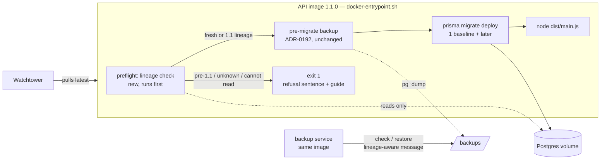
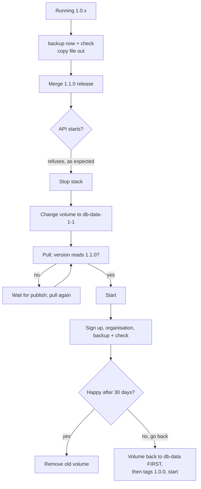

# Feature Spec: SchedulePoint 1.1.0 — the fresh start

- **Status:** Approved — by the product owner, 2026-11-08. Q1: option **E** (remove the unreachable fields, values, the placement-migration route and export file, recorded as a one-time exception in the new ADR). Q2: release freeze accepted. Version **1.1.0**, not 2.0.0, recorded as the same one-time exception. Every other question in this folder takes its recommended default, including `schema-design.md` §12 (answers recorded there).
- **Author(s):** feature-analyst, for the product owner
- **Date:** 2026-11-08
- **Tracking issue / epic:** no register row; the scope is the product owner's six decisions of 2026-11-08 (recorded
  in §1, "Owner decisions"). Closes `docs/TECH_DEBT.md` #121 as a side effect (§4.4).
- **Roadmap link:** none yet. `docs/ROADMAP.md` gains a 1.1.0 entry in M4.
- **Related ADR(s):** one **new** ADR, number taken at landing (ADR-0215 if nothing lands first — `docs/adr/` ends at
  0214 today). It amends ADR-0018, ADR-0192, ADR-0190 (record only), ADR-0088/ADR-0084 (record only), ADR-0025's
  amendments 2–7 ("NONE is permanent") and ADR-0214 ("until the 1.0 wipe"). Cited: ADR-0012, ADR-0028, ADR-0034,
  ADR-0047, ADR-0057, ADR-0076, ADR-0081, ADR-0105, ADR-0107, ADR-0110, ADR-0131, ADR-0138, ADR-0156, ADR-0194.
- **Companion file:** `docs/specs/fresh-start-1-1/schema-design.md` — the database design (database-architect, Proposed 2026-11-08): the baseline, the tidy, the boot refusal and how the baseline is proved; its open questions are §12.
  It owns the baseline migration and every schema change. **It did not exist when this spec was written** (the
  directory held nothing, 2026-11-08), so this spec states the contract that file must meet (§4.5) rather than its
  contents.

---

## In short

_Written for you, not for an engineer._

**What changes.** Version 1.1.0 is a clean start. It is the same product you have now, with three kinds of
clean-up inside it:

- The "switches" the developers used while building each feature are removed. Every one of them has been on
  for months on your server, so **you will not see any difference**.
- Bits of the program that only existed to cope with plans saved by older versions are removed. Example: a
  baseline taken before 8 November shows "Float change unknown" in comparisons today. After the fresh start
  there are no old baselines, so that message, and the code behind it, can go.
- The database's long history of changes (84 separate steps) is folded into one starting point. A new,
  empty database is built from it in one step.

**What you have to do on the day.** About 30 to 45 minutes, at a time you choose. A short guide walks you
through it, with every command printed.

1. **Before** you merge the 1.1.0 release: take one last backup and run its check, as you did on
   20 October. Copy that backup file somewhere safe, outside the backups folder (the folder tidies away old
   copies after 30 days).
2. Merge the 1.1.0 release. Your server will fetch it within about five minutes. **It will then refuse to
   start**, and say so in plain words. That is deliberate: it will not touch your old data.
3. Stop SchedulePoint, change one line in your setup so it uses a new, empty database, and start it again.
4. Sign up again, create your organisation again, and run one backup and check on the new database.

**What you lose.** Everything stored in SchedulePoint today: your account, Wood Group, its clients, projects,
plans, calendars, resources, notes, baselines, guest links, and the audit log. You said all of it is test
data. It is not destroyed. The old database is left untouched on your server, and you also keep the backup
file from step 1.

**What stays.** Your `.env` settings file and everything in it (passwords, mail, staff address, alerts, the
90-day clear-out switch). Nightly backups keep running. The product itself works exactly as before.

**If something goes wrong.** Going back is a two-line change: point the setup back at the old database and
ask for version 1.0.0. Your old data is exactly as you left it. The 0.106.0 rollback written in
`docs/RELEASE_1_0.md` stops applying, and the guide says so.

**One decision we need from you** (question 1 below): the developers can keep every published shape of the
web API and the export file exactly as it is, or they can remove some fields that will now always hold the
same value. Nothing outside SchedulePoint reads them today. We recommend keeping them.

---

## 1. Business understanding

### Problem

1.0.0 is released (tags `api-v1.0.0` and `web-v1.0.0` exist in `.git/refs/tags/`; `apps/api/package.json:3` and
`apps/web/package.json:3` both read `"version": "1.0.0"`; `.changeset/` holds only `README.md` and `config.json`, so
nothing is pending). The owner's server follows `latest` with Watchtower polling every 300 s
(`docker-compose.release.yml:89`, `:237`, `:308`), so 1.0.0 is probably running there.

The codebase still carries three kinds of weight that exist only for the past:

1. **48 web feature flags, all compiled on.** `scripts/flag-retirement.json` lists 48 entries under `"flags"`,
   every one `"class": "B"` with a guard-only `keep` (count of `"class": "B"`: 48; `classA` is `{}`). They cannot
   be switched by an operator: `.env.example:145-160` explains that Vite inlines them at build time and no build
   path passes them. Nine Playwright configs pin some of them **off**, so those suites test a product no image
   can produce (§3, "Flags").
2. **Code that copes with data written by older versions** — baselines captured before a column existed, five
   boot-time re-derivation services that correct plans calculated by an older engine, and a published report of
   a one-time data migration (§4.3 has the verified inventory).
3. **84 migrations** (`apps/api/prisma/migrations/*/migration.sql`, counted 2026-11-08; `CLAUDE.md` §1 says 84 and
   is gated by `check:counts`). Several exist only to transform old rows, and eleven API e2e specs exist only to
   prove those transformations (§4.3, item 13).

The owner has decided (below) that the only data ever stored is test data, so a new empty database lets all
three go at once.

### Owner decisions (product owner, 2026-11-08)

Recorded as decided; this spec does not re-ask them.

- **OD-1.** 1.0.0 stays as a private dress rehearsal. The fresh start ships as **1.1.0** for both `api` and `web`.
  Its release notes call it "the first public release; needs a fresh, empty database". "Public" is a label only;
  there is still one user.
- **OD-2.** Wipe everything: accounts, organisations, clients, projects, plans, calendars, resources, audit log.
  The operator's `.env` is kept. The owner keeps a final backup (ADR-0192 backup + `check`) before switching.
- **OD-3.** Method: a **new empty database** — not a wipe command, not an automatic wipe. The migrations are
  squashed into one baseline. The 1.1.0 image **refuses to start against a pre-1.1 database** and fails loudly
  with a pointer to a guide. The owner follows a short plain-English guide.
- **OD-4.** Remove code that exists only for data saved by older versions, and tidy schema leftovers that only
  existed for old rows (folded into the baseline; schema list owned by `schema-design.md`). Keep: the CSP
  legacy report body parser, soft delete, recycle bin, retention, backups, the edit lock, XER/MSPDI import.
- **OD-5.** Retire all 48 remaining web feature flags and the Playwright configs that pin flags off. Keep
  `flagDefaultOff`, `check:flags` and the ADR-0084/0088 process. API runtime switches stay.
- **OD-6.** One release: everything ships together as 1.1.0 (minor changesets for `api` and `web`). Nothing is
  released half done.

This supersedes one earlier decision: `docs/DECISIONS.md:40-45` (2026-11-08) and `docs/RELEASE_1_0.md:147-149`
record that "all plans will be wiped when I roll out **1.0**". The wipe now happens at 1.1.0. M0 adds a
`docs/DECISIONS.md` entry saying so; the earlier entry is not edited (that file's own rule, line 8).

### Users

| Who                           | Role                             | What they need from this                                                                     |
| ----------------------------- | -------------------------------- | -------------------------------------------------------------------------------------------- |
| The product owner as operator | host shell / Dockge, `.env`      | A safe, reversible switch to an empty database, with a guide and a loud refusal, not a crash |
| The product owner as user     | Org Admin after signing up again | The same product, no visible regressions, no "unknown" or "not comparable" leftovers         |
| Contributors and agents       | developers                       | One baseline migration, no flag-off harnesses, no dead legacy branches                       |

No organisation role gains or loses a permission. External Guest links all stop working, because the plans
they point at are gone (§2, edge cases).

### Primary use cases

1. The operator moves the live server from 1.0.x to 1.1.0 on a new database, keeping the old one intact.
2. An auto-pulled 1.1.0 meets the old database and refuses, changing nothing.
3. The operator rolls back to 1.0.0 on the old database.
4. A contributor runs the full test estate against a database built from one baseline migration.

### User journeys

See the user-flow diagram in §4.2. The happy path is the "On the day" guide (§2, Workflows). The important
alternates are the refusal (use case 2) and the rollback (use case 3).

### Expected outcomes

- The owner runs 1.1.0 on an empty database with their `.env` unchanged and backups running.
- No user-visible behaviour changes, except that messages about old data ("Float change unknown" for an old
  baseline, "captured before placements were recorded", the placement-migration notice) can no longer appear.
- The repository has one migration, no web feature flags, no flag-off Playwright config, and no code whose only
  purpose is a population of rows that cannot exist.

### Success criteria

- **SC-1.** The 1.1.0 API image, started against a database migrated by 1.0.0, exits non-zero **before** the
  pre-migrate backup and `prisma migrate deploy`, prints the refusal sentence and guide link, and leaves
  `_prisma_migrations` and the backups folder byte-for-byte unchanged. Proven by a CI image-job step that goes red
  when the refusal is removed (ADR-0110).
- **SC-2.** The same image against an empty volume applies the baseline, reaches `/api/v1/health/ready`, and the
  sign-up → create organisation → create plan journey passes.
- **SC-3.** A schema-only dump of a database built from the baseline equals one built from the 84 migrations,
  except for the changes `schema-design.md` lists (the database-architect owns the comparison method).
- **SC-4.** `scripts/flag-retirement.json` has `"flags": {}`; no `apps/web/playwright*.config.ts` sets a `VITE_`
  flag; `pnpm prepush` is green, including `check:flags`, `check:counts`, `check:ci-roster`, `check:e2e-roster`,
  `check:playbook` and `check:adr-coverage`.
- **SC-5.** The eight base-journey editing tests (#121) take the pen through the real UI and pass locally
  (`scripts/e2e-local.sh web:base`) and in CI.
- **SC-6.** The dress rehearsal (M4) is done on a throwaway stack: 1.0.0 with data → backup + check → 1.1.0 refuses →
  new volume → 1.1.0 boots empty → rollback to 1.0.0 on the old volume shows the data.

### Open questions

**Answered by the product owner, 2026-11-08** (clickable choices in the session):

- **Q1 → E.** Remove the fields, values, route and export file listed in §4.6 in 1.1.0. The new ADR records it as
  a one-time exception to ADR-0190 D1/D2 (no outside consumer, single user, fresh database), not a precedent.
  Where this document says "subject to Q1" or "K keeps…", read E.
- **Q2 → freeze accepted.**
- **Version → 1.1.0**, kept after the owner was told tag-pinning rollback does not cross the release
  (`schema-design.md` §12 Q5); recorded in the same ADR exception.
- **Everything else → the stated defaults.**

The questions as they were put:

**CRITICAL — the answers change scope.**

- **Q1. Keep every published shape, or accept a recorded exception?** (ADR-0190 D1/D2.) Removing old-data handling
  makes some published fields constant and some values unreachable. Nothing outside SchedulePoint calls the API
  (`docs/RELEASE_1_0.md:121`, "none does today"; line 53, row 12).
  - **Option K — keep (recommended).** Every `/api/v1` route, response field, declared enum value and
    organisation-export file and column stays. Values that can no longer arise stay declared and are documented
    as "not produced since 1.1.0". No major bump, no exception, no export format change. Cost: a few fields that
    always read `FULL`, `PLACED`, `true` or an empty list, and one route that always answers an empty report.
  - **Option E — recorded exception.** Remove those fields, values, the route and the export file in 1.1.0
    without a major bump, recorded in the new ADR as a one-time exception justified by "no outside consumer, single
    user, fresh database". Cost: breaks the letter of a promise made the same day; sets a precedent.
  - The complete list is in §4.6. **Default if unanswered: K.**
- **Q2. A release freeze while the epic is in flight.** OD-6 is only guaranteed if no Version Packages pull request
  is merged between the first epic PR and the 1.1.0 one (§4.8). An urgent 1.0.x fix during that window either waits
  and rides in 1.1.0, or the epic pauses. **Default: accept the freeze**; the owner is the only person who merges a
  Version Packages PR.

**Defaults stated, not asked.**

- **Watchtower.** No pinning. The owner takes the final backup and its check **before** merging the release, merges,
  lets 1.1.0 refuse (which changes nothing), then switches volumes. The outage is the owner's own 30–45 minutes,
  timed by their merge. Pinning `API_IMAGE_TAG`/`WEB_IMAGE_TAG` to `1.0.0` beforehand is described in the guide as an
  option for an owner who wants to merge now and switch later (§4.7).
- **How the new database is chosen.** A new named volume, by editing one volume line in the owner's compose file.
  The repository's `docker-compose.release.yml` is **not** changed (§4.7, alternatives).
- **The old volume** is kept until 1.1.0 has run 30 days; the guide gives the `docker volume rm` command for after.
- **The engine is not touched.** `apps/api/src/modules/schedule/engine/` keeps its optional inputs (§4.3, item 9).
- **Staff diagnostics** whose only question was the size of a population before a migration are removed; the staff
  console is outside ADR-0190's contract (`docs/RELEASE_1_0.md:112-114`).
- **`PLAN_EDIT_LOCK_ENFORCED`** keeps its default (`false`, `.env.example:120`). Only its comment changes.
- **`flagDefaultOn` is kept** beside `flagDefaultOff`: a new flag is born default-off and enabled by switching to
  `flagDefaultOn`, so both are the process's two states, not dead code.

## 2. Functional requirements

### User stories & acceptance criteria

> **US-1** — As the **operator**, I want the 1.1.0 image to refuse an old database, so that an automatic update can
> never damage or half-migrate my data.
>
> - **Given** a database whose `_prisma_migrations` holds finished rows and none of them is the 1.1 baseline's name,
>   **when** the 1.1.0 API container starts, **then** it exits non-zero before the pre-migrate backup and before
>   `prisma migrate deploy`, and prints, in this order: one plain sentence ("SchedulePoint 1.1 needs a new, empty
>   database. This database was made by SchedulePoint 1.0 or earlier. Nothing has been changed."), the guide's path
>   and URL, and one JSON log line `{"level":"error","event":"boot.database_refused","reason":"pre_1_1_lineage",…}`.
> - **Given** the same database, **then** `_prisma_migrations` row count and contents, every table, and the
>   backups folder are unchanged after any number of restarts.
> - **Given** a database with no `_prisma_migrations` table but at least one table in `public`, **then** it refuses
>   with reason `unknown_database` and the same guide.
> - **Given** an empty database (no table, or an empty `_prisma_migrations`), **then** it proceeds exactly as today.
> - **Given** a database that holds the baseline plus later 1.1.x migrations this image does not have (a rollback
>   inside 1.1.x), **then** it does **not** refuse. Today's rollback-by-tag behaviour inside one line is kept.

> **US-2** — As the **operator**, I want a short plain-English guide, so that I can switch on a day of my choosing.
>
> - **Given** the guide, **when** I follow it from a running 1.0.x, **then** I end with 1.1.0 on a new volume, my
>   `.env` unchanged, a 1.1 backup that passed `check`, and the old volume and the final backup file untouched.
> - The guide has a "before you merge" part, an "on the day" part, an "after you sign up" checklist and an "if you
>   need to go back" part, and every command is copy-paste ready for both `docker compose` and Dockge.

> **US-3** — As the **operator**, I want to check or restore an old copy with clear instructions, so that a 1.0-era
> backup is never reported as damaged or "made by a newer version".
>
> - **Given** a 1.1.0 backup container, **when** I run `check` on a copy made by 1.0.x, **then** it refuses with
>   "this copy was made by SchedulePoint 1.0 or earlier; check or restore it with the 1.0.0 image — see the fresh
>   start guide", instead of today's "made by a newer version" (`schedulepoint-backup.sh:608-611`).

> **US-4** — As the **owner as user**, I want 1.1.0 to behave exactly as 1.0.0 did on new data.
>
> - **Given** a fresh 1.1.0, **when** I sign up, create an organisation, build a plan, baseline it and compare,
>   **then** every surface works as in 1.0.0, and no surface offers an "unknown", "not recorded" or "not comparable"
>   state whose only cause was an old row.
> - States with a cause that still exists stay: a plan never calculated, a side not scheduled, a cross-plan
>   comparison matched on activity code (`CODE_IS_THE_CORRELATION_KEY`).

> **US-5** — As a **contributor**, I want no flag-off harness and the real pen in every editing journey.
>
> - **Given** the base journey, **when** it edits a plan, **then** it takes the pen through the UI ("Start editing")
>   first; `apps/web/playwright.config.ts` sets no `VITE_` variable.
> - **Given** `scripts/flag-retirement.json`, **then** all 48 entries sit under `retired` with `retiredOn` and a note,
>   and `"flags"` is empty.

### Workflows

**The owner's day (the guide — `docs/guides/start-fresh-on-1-1.md`, written in M4 from a draft in M0).**

_Before you merge the 1.1.0 release (about 15 minutes, any time before)._

1. Check that the stack is healthy: `docker compose ps`.
2. Take a copy: `docker compose run --rm backup now`. Wait for `BACKUP FINISHED`.
3. Check it: `docker compose run --rm backup check`. Wait for `CHECK PASSED`. **This must run while the stack is
   still on 1.0.x**: a 1.1.0 backup container refuses to check a 1.0 copy (US-3).
4. Copy that file and its `.sha256` out of the backups folder to somewhere safe. The nightly service deletes copies
   older than 30 days except the newest of each kind (`schedulepoint-backup.sh:404-419`), so a file left there will
   eventually go.
5. Write down the copy's name.

_On the day (about 20 minutes)._

6. Merge the "Version Packages" pull request for 1.1.0, and wait until the release has published (the GitHub release
   page shows `api-v1.1.0` and `web-v1.1.0`).
7. Within about five minutes Watchtower fetches 1.1.0. The API will refuse to start and the app will show an error.
   **This is expected and nothing has changed.** `docker compose logs --tail 20 api` shows the refusal sentence.
8. Stop the stack (Dockge: **Stop**; or `docker compose stop`).
9. In the compose file, change the database's volume from `db-data` to `db-data-1-1` in two places (the `db` service's
   `volumes:` line and the top-level `volumes:` list). The guide prints both lines before and after.
10. `docker compose pull`, then confirm the version: `docker compose run --rm --no-deps --entrypoint node api -e
"console.log(require('./package.json').version)"` prints `1.1.0`.
11. Start it (Dockge: **Deploy**; or `docker compose up -d`). The log shows the baseline being applied and the API
    starting.

_After you sign up (about 10 minutes) — the checklist._

12. Open SchedulePoint and **sign up again** with the same email. Confirm your email (mail is configured).
13. Create your organisation again.
14. `STAFF_EMAILS` still applies: once your email is confirmed, the staff console is available as before.
15. Take and check the first copy of the new database: `backup now`, then `backup check`.
16. The recycle bin's 90-day clear-out stays switched on (`RETENTION_HIERARCHY_ENABLED` is in `.env`); there is
    nothing in the bin, so nothing will be removed.
17. Any guest link you shared before no longer works. Make new ones if needed.
18. After 30 days, if you have not needed to go back, the guide's last step removes the old volume.

_If you need to go back._

19. Stop the stack. Put the volume line back to `db-data`. Set `API_IMAGE_TAG=1.0.0` and `WEB_IMAGE_TAG=1.0.0` in
    `.env`. Pull and start. Your old data is there. **Change the volume before the tag**: a 1.0.0 image started on
    the new volume would try to apply 84 migrations to a 1.1 schema (risk R6).
20. Pinned tags stop automatic updates (`docker-compose.release.yml:14-15`); remove them once you move forward again.
21. Restoring the final backup file is needed only if the old volume is lost. It is done with the 1.0.0 image
    (`backup restore <file>`, back-up guide Part 3).

### Edge cases

| Case                                                                   | Behaviour                                                                                                                                                                     |
| ---------------------------------------------------------------------- | ----------------------------------------------------------------------------------------------------------------------------------------------------------------------------- |
| Watchtower pulls 1.1.0 before the owner has taken the final backup     | The API refuses; nothing changes. The owner pins `1.0.0`, restarts, takes the backup, then carries on.                                                                        |
| Owner switches the volume while 1.0.0 is still the pulled image        | 1.0.0 builds a 1.0 schema on the new volume; 1.1.0 later refuses it. Guide step 10 checks the version first. Recovery: stop, `docker volume rm` the new volume, redo.         |
| A 1.0.0 image started on the new 1.1 volume                            | 1.0.0 has no refusal: its `migrate deploy` fails on the first `CREATE TABLE` and may record a failed row. Guide step 19 orders volume before tag (R6).                        |
| `pre-migrate` backups on (the owner's host) and 1.1.0 meets the old DB | The refusal runs first, so no pre-migrate copy is written. Without that order every restart would write a full copy (`schedulepoint-backup.sh:754-764`) until the disk fills. |
| Restart loop while refused                                             | `restart: unless-stopped` retries with Docker's back-off; logs are capped at 10 MB × 3 (`docker-compose.release.yml:59-63`).                                                  |
| `web` auto-updated to 1.1.0 while `api` is refused                     | The web app loads and its API calls fail (error screen). Acceptable for the owner's own outage window.                                                                        |
| Old browser session cookie after the switch                            | Refers to a user that no longer exists; the sign-in screen appears.                                                                                                           |
| Saved plan URLs and guest links                                        | Stop resolving, because the data is gone (see §4.6 "Tension with ADR-0190 D3").                                                                                               |
| A contributor's local `app_test` built from 84 migrations              | `scripts/e2e-local.sh` detects the old lineage and recreates `app_test` (it is disposable).                                                                                   |
| A contributor's `docker-compose.yml` dev volume                        | The dev API image refuses it; `docker compose down -v` (documented in README/CONTRIBUTING).                                                                                   |

### Permissions

No change. Nothing here adds an endpoint, a permission or a scope (ADR-0012). The refusal runs before the API
process exists. The guide is for the person holding the host. On the new database, the first sign-up creates the
organisation and becomes its Org Admin, exactly as today.

### Validation rules

The lineage rule (implemented in shell in the image, §4.4):

- `known` = the directory names under `/app/prisma/migrations/` (the same list `prisma migrate deploy` reads;
  `schedulepoint-backup.sh:584-589` already derives it).
- `baseline` = the baseline's directory name, fixed by `schema-design.md`, written into the script as a constant
  and asserted by a unit test to be the oldest directory.
- **Fresh:** no `public._prisma_migrations`, and no table in `public` → proceed. Or the table exists with zero rows
  → proceed (today's "fresh" definition, `schedulepoint-backup.sh:737-748`).
- **1.1 lineage:** at least one finished row and a row named `baseline` → proceed.
- **Pre-1.1 lineage:** finished rows and none named `baseline` → refuse, reason `pre_1_1_lineage`.
- **Unknown:** no `_prisma_migrations` but `public` has a table → refuse, reason `unknown_database`.
- **Cannot tell** (connection or query error) → refuse, reason `cannot_read`, and say the database could not be
  reached. Fail closed, as `pre-migrate` does (`schedulepoint-backup.sh:22-24`).

### Error scenarios

| Scenario                                     | Detection                       | Operator-facing result                                   | Exit |
| -------------------------------------------- | ------------------------------- | -------------------------------------------------------- | ---- |
| 1.1.0 image against a 1.0-lineage database   | lineage rule                    | refusal sentence + guide link + `boot.database_refused`  | 1    |
| Database not made by SchedulePoint           | tables, no `_prisma_migrations` | same, reason `unknown_database`                          | 1    |
| Database unreachable at boot                 | `psql` error                    | "could not reach the database" + reason `cannot_read`    | 1    |
| `check` of a 1.0 copy in a 1.1.0 container   | `verify_loaded` lineage test    | `CHECK FAILED: … made by SchedulePoint 1.0 or earlier …` | 1    |
| `restore` of a 1.0 copy in a 1.1.0 container | same                            | `RESTORE REFUSED: …` (live database unchanged, as today) | 1    |

## 3. Technical analysis

| Area           | Impact       | Notes                                                                                                                                                                                                                                   |
| -------------- | ------------ | --------------------------------------------------------------------------------------------------------------------------------------------------------------------------------------------------------------------------------------- |
| Frontend       | high         | 48 flag constants and their guards (`apps/web/src/config/env.ts` declares them; register `scripts/flag-retirement.json:139-533`); old-data UI states (§4.3); placement-migration notice (`apps/web/src/features/placement-migration/`). |
| Backend        | high         | Five boot re-derivation services, activity-history marker read, baselines/revision compare legacy branches, placement-migration module (subject to Q1), staff diagnostics, comments that describe old rows.                             |
| Database       | high         | 84 migrations → one baseline; schema tidy-ups. **Owned by `schema-design.md` and the database-architect** (CLAUDE.md §19.3).                                                                                                            |
| API            | low / medium | Option K: no contract change. Option E: the removals in §4.6.                                                                                                                                                                           |
| Security       | low          | The refusal reads the database before the app; it must never print `DATABASE_URL` (reuse the script's `redact`, `schedulepoint-backup.sh:88`). No auth change.                                                                          |
| Performance    | low          | Boot loses five re-derivation queries (each documented as a few ms on an empty pending set, e.g. `milestone-rederive.service.ts:42-49`); the refusal adds two `psql` queries.                                                           |
| Infrastructure | high         | `docker-entrypoint.sh` order; `schedulepoint-backup.sh` gains a `preflight` command and a lineage message; CI image-job step; `scripts/e2e-local.sh`; `scripts/backup-restore-check.sh`; `.env.example`; CI shard roster.               |
| Observability  | low          | One new JSON event `boot.database_refused`; five `*_rederive` boot log events disappear (`docs/OBSERVABILITY.md` lists them if it does — M3 checks).                                                                                    |
| Testing        | high         | Base-journey pen conversion (#121); five more pinned configs; delete flag-off suites; delete 11 migration-proof e2e specs and legacy-branch unit tests; new refusal step in CI; dress rehearsal.                                        |

### Flags — what was verified

- 48 registered flags, all Class B: `scripts/flag-retirement.json` (48 matches of `"class": "B"`, `"classA": {}`,
  `"classACap": 0` at `:536-537`).
- Nine configs pin flags off (grep for `VITE_…: 'false'` across `apps/web/playwright*.config.ts`):
  `playwright.config.ts:76-77` (`VITE_TSLD_EDITING`, `VITE_PLAN_EDIT_LOCK`), `playwright.programme.config.ts:65-66`
  and `playwright.notes.config.ts:63-64` (both), `playwright.float-paths.config.ts:80`,
  `playwright.health-check.config.ts:67`, `playwright.revision-compare.config.ts:66` (`VITE_PLAN_EDIT_LOCK`),
  `playwright.toolbar.config.ts:70` (`VITE_CANVAS_AUTHORING`), `playwright.authoring-flow-off.config.ts:70`
  (`VITE_CANVAS_AUTHORING_FLOW`), `playwright.designed-ui.config.ts:68` (`VITE_CANVAS_VISUAL_LANGUAGE`). 56 configs in
  all. Other configs may pin flags **on**; those pins are dead once the flag is gone and are removed with it.
- `VITE_TSLD_EDITING` is pinned off in three configs as well as `VITE_PLAN_EDIT_LOCK`; the brief named only the pen.
  The base journey's "read-only TSLD surface" coverage becomes a **Viewer** sign-in (the only read-only canvas a
  shipped bundle can show), not a deleted test.
- Operators cannot change any of them: `.env.example:145-160`. Retiring them therefore does **not** touch ADR-0190
  promise 3, whose subject is "the settings an operator uses" (`docs/RELEASE_1_0.md:110`): a line that never worked
  against a published image was never an operator setting, and `.env.example:168-173` already says so in the file.
  The removal is recorded in the ADR so nobody reads it as a broken promise later.
- `VITE_API_URL` stays (`.env.example:174`; `apps/web/Dockerfile` declares it as the one build arg, per
  `.env.example:150`).
- `.env.example:111-120` ties `PLAN_EDIT_LOCK_ENFORCED`'s safe-flip order to the web pen flag. The variable stays; the
  comment is rewritten because the pen is now always on.
- `.env.example:163` names `RETENTION_SWEEP_ENABLED` as a working switch. M1 checks whether that variable exists
  (CLAUDE.md §17 names `RETENTION_HIERARCHY_ENABLED`); if not, it is a wrong claim fixed in passing.

### Gates that count things

| Gate                                   | What moves                                                                                                                                                                                                                                                                                                                                                         |
| -------------------------------------- | ------------------------------------------------------------------------------------------------------------------------------------------------------------------------------------------------------------------------------------------------------------------------------------------------------------------------------------------------------------------ |
| `check:counts`                         | `migrations` 84 → 1 (`scripts/check-counts.mjs:50`), Playwright suites (`:76-82`, every `e2e-*` dir holding a spec), web source files, possibly Prisma models and API modules (Option E removes `placement-migration`). Figures in `CLAUDE.md` (required), README, `docs/ARCHITECTURE.md`, `docs/DATABASE.md` (`:139-146`) change **in the same PR** as the count. |
| `check:flags`                          | Register entries move from `flags` to `retired`.                                                                                                                                                                                                                                                                                                                   |
| `check:e2e-roster` / `check:ci-roster` | A deleted suite loses its CI step and shard condition; `scripts/e2e-durations.json` and the four-shard pack (ADR-0138, `ci.yml:421-450`) are re-derived.                                                                                                                                                                                                           |
| `check:adr-coverage`                   | The new ADR adds one line to CLAUDE.md §16.                                                                                                                                                                                                                                                                                                                        |
| `check:playbook`                       | Expected unchanged: the catalogue is seeded through the REST API (`apps/seed-cli/src` has no `prisma`, `DATABASE_URL` or `baseline` reference) and `docs/TEST_PLAYBOOK.md` has no old-data case (grep for `NONE`, `legacy`, `captured before`, `not comparable`: none).                                                                                            |
| `check:spec-status`                    | This spec's header stays canonical (`- **Status:**` on line 3).                                                                                                                                                                                                                                                                                                    |
| `check:engine-parity`                  | Must stay green; the engine is not edited (§4.3, item 9).                                                                                                                                                                                                                                                                                                          |

### Dependencies

- `schema-design.md` (database-architect) before M2.
- M1 is independent and can start at once.
- M3 depends on M2 (the refusal must be on `main` before any code assumes no old rows exist; §4.8).
- M4 depends on M1–M3.

## 4. Solution design

### 4.1 Architecture overview

Nothing new is added to the running architecture except one boot step. The image's entrypoint gains a lineage
check **before** the two steps it already has.



### 4.2 Data flow and user flow

```mermaid
sequenceDiagram
  participant O as Owner
  participant GH as GitHub release
  participant WT as Watchtower
  participant API as api 1.1.0
  participant Old as Old volume (db-data)
  participant New as New volume (db-data-1-1)
  O->>Old: backup now + check (on 1.0.x), copy file out
  O->>GH: merge Version Packages (1.1.0)
  WT->>API: pull + recreate (≤ 300 s)
  API->>Old: preflight reads _prisma_migrations
  API-->>O: refuses, exit 1 (Old untouched)
  O->>API: stop; edit volume line; pull; verify 1.1.0
  O->>API: up -d
  API->>New: preflight: fresh
  API->>New: pre-migrate: skipped (fresh)
  API->>New: migrate deploy: baseline
  O->>API: sign up, create organisation, backup now + check
```



### 4.3 What is removed, and what is not — the verified starting inventory

Every row was read on 2026-11-08. M3's first task completes this list with one rule: **remove a branch only if
its only producer is a row written by an older version**. A branch that also serves "plan never calculated",
"no active baseline", "side not scheduled" or "matched on code" stays.

| #   | Where                                                                                                                                                                                                                                                                                                                                                                                                                                                                          | What it handles                                                                                                                                       | Decision                                                                                                                                                                                                                                                                                              |
| --- | ------------------------------------------------------------------------------------------------------------------------------------------------------------------------------------------------------------------------------------------------------------------------------------------------------------------------------------------------------------------------------------------------------------------------------------------------------------------------------ | ----------------------------------------------------------------------------------------------------------------------------------------------------- | ----------------------------------------------------------------------------------------------------------------------------------------------------------------------------------------------------------------------------------------------------------------------------------------------------- |
| 1   | `schedule/finish-milestone-rederive.service.ts`, `cross-plan-rederive.service.ts`, `progressed-visual-rederive.service.ts`, `milestone-rederive.service.ts`, `cross-plan-instant-rederive.service.ts`; wired at `schedule/schedule.module.ts:10-15,42-61`                                                                                                                                                                                                                      | One-shot boot recalculation of plans an older engine wrote, keyed on a marker migration's `finished_at` (e.g. `milestone-rederive.service.ts:99-100`) | **Remove.** **Not in the brief.** After the squash the marker rows do not exist, so each query compares with a missing row and should select nothing; M2's boot test confirms that before M3 deletes them. `docs/DATABASE.md` "Re-derivation markers" keeps the pattern and loses the instances.      |
| 2   | `activity-history/activity-history.service.ts:18-24,127-145`                                                                                                                                                                                                                                                                                                                                                                                                                   | "Recorded since" = the history migration's `finished_at`, for activities older than the history table                                                 | **Remove the marker read**; `recordingSince` becomes `createdAt`. The response field keeps its shape; on a fresh database the two answers are equal.                                                                                                                                                  |
| 3   | `baselines/baselines.service.ts:511-522` (`NONE → NETWORK`), `schedule/schedule.service.ts:2065-2076`, `:2322-2330`, `:2385-2398`, `:2925-2946`; `baselines/revision-changes.ts:44,134-156,353-411,531`; `revision-ghosts.ts:89`; `revision-projections.ts:54-182`; `baseline.repository.ts:78-121,199,278,753-772`; `schedule/schedule.repository.ts:241,266,773-802`                                                                                                         | Baselines whose `placement/revision/swimlane/code/costSnapshotLevel` is the pre-capture default                                                       | **Remove the legacy arms.** Every current capture writes all five at their full value (`baseline.repository.ts:260,270,279,284,293`), and `baseline.repository.ts:245` is the only production `baseline.create` (grep across `apps`; the other hits are e2e specs).                                   |
| 4   | `baselines/revision-delta.ts:55-67`; `organization-export/export-columns.ts:348,583`; web `revision-compare/model/revision-sentences.ts:54,119`                                                                                                                                                                                                                                                                                                                                | Float minutes null because a row was calculated or captured before ADR-0214                                                                           | **Remove the "days known, minutes null" arm only.** Both null (never calculated) stays.                                                                                                                                                                                                               |
| 5   | `REVISION_NOT_ASSESSABLE_REASONS` `'NOT_SNAPSHOTTED'` (`packages/types/src/index.ts:3763-3767`); web `change-sentences.ts:81-83`                                                                                                                                                                                                                                                                                                                                               | A pair of revisions captured before the shape freeze                                                                                                  | **Producer removed.** The tuple member stays under Option K (§4.6). `SIDE_NOT_SCHEDULED` and `CODE_IS_THE_CORRELATION_KEY` stay.                                                                                                                                                                      |
| 6   | web `baselines/components/BaselineVarianceSummary.tsx:51`, `tsld/render/a11y.ts:381`, `lib/schedule-format.ts:129` (if its only producer is item 4)                                                                                                                                                                                                                                                                                                                            | "Captured before placements were recorded", "no lane", "N not comparable"                                                                             | **Remove** with their producers.                                                                                                                                                                                                                                                                      |
| 7   | `modules/placement-migration/` (route `GET /api/v1/organizations/:orgSlug/plans/:planId/placement-migration`, `placement-migration.controller.ts:34`); org export `records-placement-migrations` (`docs/ORGANISATION_EXPORT_FORMAT.md:790-792`, `organization-export.repository.ts:112,192`, `export-columns.ts:695`); web `features/placement-migration/` and its uses in `tsld/model/dock-strip.ts`, `TsldPanel.tsx`, `touch-gesture-hint.tsx`, `plan-workspace-toolbar.tsx` | The report of a one-time SNET strip done by a migration                                                                                               | **Web notice removed** (not a capability users rely on, ADR-0190 D3). **Route and export file: Q1.** K keeps them answering an empty list; E removes them. **Not in the brief.**                                                                                                                      |
| 8   | `overview/overview.repository.ts:248,317,350-352`                                                                                                                                                                                                                                                                                                                                                                                                                              | NONE-level baseline finish read from `captured_project_finish`                                                                                        | **Remove the NONE arm** if `schema-design.md` keeps the column only for it; otherwise simplify the `CASE`. Keep the query to one per list (`:243`).                                                                                                                                                   |
| 9   | `schedule/engine/earned-value.ts:53,128,138,233-234,395,449,510`                                                                                                                                                                                                                                                                                                                                                                                                               | Optional inputs                                                                                                                                       | **Keep the engine as it is.** "Absent ⇒ `UNIFORM`" (`:138`) is the recalc parity seam, not old data, and the engine is the conformance-gated core (ADR-0034, `check:engine-parity`). Only the API-side reader stops passing an `ACTIVITY`-level cost snapshot, which a fresh database cannot produce. |
| 10  | `schedule/schedule.repository.ts:237` ("null on a pre-ADR-0071 snapshot")                                                                                                                                                                                                                                                                                                                                                                                                      | Activity-level lump-sum expense absent from old snapshots                                                                                             | **Remove** the null meaning if the column becomes NOT NULL in `schema-design.md`; otherwise keep the type and correct the comment.                                                                                                                                                                    |
| 11  | `schedule/cross-plan-derivation.ts:111-117`                                                                                                                                                                                                                                                                                                                                                                                                                                    | The second cause of a null placed date (columns added without backfill)                                                                               | **Comment only** — delete the second cause. The null-handling code stays: "never calculated" still produces null.                                                                                                                                                                                     |
| 12  | `staff/staff-diagnostics.registry.ts` D-A … D-M (`:112-760`)                                                                                                                                                                                                                                                                                                                                                                                                                   | Pre-migration sizing counts (e.g. D-E at `:323-330`, "decides whether the capture-level discriminator needs a migration")                             | **Remove** the probes whose question was a migration's size (D-E, D-I, and any D-F/G/H tied to the SNET strip); **keep** probes that still describe the live estate (zero-duration tasks, visual conflicts, history entries). M3 classifies each. Not in ADR-0190's contract.                         |
| 13  | API e2e specs that read a migration file or a marker: `strip-bars-do-not-move`, `strip-drag-constraints-migration`, `progressed-visual-rederive`, `revision-compare-imported-index`, `milestone-cross-calendar`, `cross-plan-instant-rederive`, `cross-plan-lag-migration`, `cross-plan-rederive`, `drop-scheduling-mode-migration`, `finish-milestone-date-migration`, `account-issuer-migration` (grep `migration\.sql\|Rederive` in `apps/api/test`: 11 files)              | Proofs that a migration transformed old rows correctly (the ADR-0107 pattern)                                                                         | **Delete** in M2 (their migrations disappear); split out any assertion about a **current** invariant (a CHECK, an index) into a surviving spec first. `revision-compare-imported-index` and `milestone-cross-calendar` most likely hold such assertions.                                              |
| 14  | e2e specs that insert baselines with Prisma defaults (`hierarchy-expiry`, `code-schema`, `revision-delta-m0`, `baselines` — `apps/api/test/*.e2e-spec.ts`, grep `prisma.baseline.create`)                                                                                                                                                                                                                                                                                      | Seeding NONE-level rows on purpose or by default                                                                                                      | **Convert** to explicit full values, or drop the legacy case.                                                                                                                                                                                                                                         |
| 15  | `common/hierarchy/hierarchy-lifecycle.service.ts:905-909,954-957` ("legacy path (no batch id)")                                                                                                                                                                                                                                                                                                                                                                                | Restore of rows soft-deleted before `delete_batch_id` existed                                                                                         | **Remove only if** every current delete path stamps a batch id. M3 verifies by reading each delete; otherwise keep.                                                                                                                                                                                   |
| 16  | Comment-only mentions: `audit/audit-redactor.ts:64-65`, `calendars/calendar-scope.guard.ts:86-87`, `activities/day-factor.ts:20-22`, `invitations/invitations.service.ts:259-263`                                                                                                                                                                                                                                                                                              | Describe history; no code path                                                                                                                        | **Edit the sentence or leave it.** No behaviour. The audit-redactor note is confirmed comment-only (no branch reads old rows).                                                                                                                                                                        |

**Kept, and why (OD-4's list, verified).** `csp/csp-report-body.ts` — "legacy" is the `report-uri` body browsers
still send (`app-setup.ts:167`). `swimlaneSource` **`NONE`** is a live value a planner chooses
(`plans/dto/update-plan.dto.ts:33`, a **request** enum) — it is not the snapshot `NONE` and must not be touched.
`packages/interchange` reads other tools' files and SchedulePoint's v1 layout field (`xer-layout-fields.ts:265`),
which ADR-0190 promise 2 protects. Soft delete, the recycle bin, retention, backups and the edit lock are untouched.

### 4.4 The refusal at boot, and what each tool needs

**Placement.** `apps/api/docker-entrypoint.sh` becomes three steps: `preflight`, `pre-migrate`, `migrate deploy`.
`preflight` is a new command in `apps/api/backup/schedulepoint-backup.sh`, dispatched **before** the "no `/backups`
folder" early exit (`schedulepoint-backup.sh:799-808`), because the refusal must run whether or not backups are on.
That script already parses `DATABASE_URL` without putting the password on a command line (`:184-226`), derives the
migration list (`:584-589`), redacts (`:88`), is root-owned `0555` in the image (`apps/api/Dockerfile:69`), and has a
CI harness. `psql` is in the image (`apps/api/Dockerfile:56`).

**Why before `pre-migrate`.** Against an old database, 1.1.0's `pre-migrate` computes the baseline as pending
(`:754`), takes a full copy (`:759`), and returns 0; `migrate deploy` then fails; Docker restarts the container; the
next boot takes another copy. Pre-migrate copies are never pruned by that path (`:21-24`, "it never prunes"). So
without the order, an unattended refusal fills the disk.

**Why not rely on `prisma migrate deploy` failing.** It would try to apply the baseline to a populated schema. Whether
the failure is clean depends on Prisma's transaction and failed-row behaviour, which was **not** established here;
a failed row in `_prisma_migrations` would also block the 1.0.0 image afterwards. The refusal makes the question
irrelevant: Prisma never runs.

**Why not refuse every "newer database".** `docs/RELEASE_1_0.md:144-146` and ADR-0190 D4 make "pin the previous tag;
migrations are not reversed" the rollback. A rule that refused any applied migration the image lacks would forbid
that rollback inside 1.1.x. The rule refuses only the pre-1.1 lineage (§2, Validation rules).

**Backup `check` and `restore`.** `verify_loaded` (`:592-615`) reports any applied migration the image lacks as "made
by a newer version". For a 1.0 copy in a 1.1.0 container that message is wrong. It gains the same lineage test and
says "made by SchedulePoint 1.0 or earlier; check or restore it with the 1.0.0 image". The ADR records that a 1.0 copy
is checked and restored with the 1.0.0 image.

**CI (`.github/workflows/ci.yml`).**

- A new image-job step: build a database with the **1.0 migrations** (from a fixture copy of the 84 folders under
  `scripts/ci-fixtures/`, never under `apps/api/prisma/migrations/`, the same approach as the pending-migration probe,
  `ci.yml:1654-1666`), start the 1.1 image against it, and assert exit ≠ 0, the `boot.database_refused` event, an
  unchanged `_prisma_migrations`, and no new file in the backups folder. **It must go red when the `preflight` line is
  deleted from the entrypoint** (ADR-0110). Alternative if the 84-folder fixture is too heavy: a hand-written
  `_prisma_migrations` row with a 1.0 migration name plus one table; the database-architect and devops-reviewer pick.
- "Back up, restore and boot" (`ci.yml:1448-1482`) counts folders, so it moves to 1 by itself (`:1455`, `:1481`).
- `scripts/backup-restore-check.sh:389-391` simulates an older image by deleting the newest migration. With one
  migration that leaves an empty folder; the test-engineer decides whether that still proves "newer copy refused" or
  needs a two-migration fixture.
- The backup fixture's "sixteen tables non-empty" (`backup-restore-check.sh:25,295-298`) changes if `schema-design.md`
  drops a table it counts.

**API e2e and local tooling.**

- CI's e2e jobs create a fresh database per run (`Apply database migrations`, `ci.yml:366`, `:532`), so they need
  nothing beyond the deleted specs (§4.3, item 13).
- `scripts/e2e-local.sh:199-201` runs `prisma migrate deploy` against a long-lived `app_test`. It gains: if
  `app_test` holds the pre-1.1 lineage, drop and recreate it before migrating, with one printed line saying so. It is
  a disposable test database (`:118-120`, "an existing developer database is never clobbered" refers to role and
  database **creation**; M2 rewords it). Until 1.1.0 is released the baseline can still change (M3 folds tidy-ups
  into it), so the same reset fires on a checksum mismatch between `_prisma_migrations.checksum` and the file —
  **the checksum format is to be confirmed in M2**.
- `apps/seed-cli` needs nothing: it is a REST client (no `prisma`, `DATABASE_URL` or `baseline` in `apps/seed-cli/src`).
- `docker-compose.yml` (development) keeps `db-data` (`:34`, `:214-215`). A contributor's old dev volume is refused
  by the dev image; README/CONTRIBUTING says `docker compose down -v`.

### 4.5 Database changes — the contract `schema-design.md` must meet

Designed by the database-architect, not here. This spec needs only these properties from it:

1. **One baseline migration directory** whose name is fixed and recorded (the refusal keys on it).
2. **Proof of equivalence**: a database built from the baseline matches one built from the 84 migrations, schema
   objects that Prisma's diff cannot see included — the `ENABLE ALWAYS` triggers on `audit_events` (which
   `verify_loaded` itself checks, `schedulepoint-backup.sh:593-600`), partial indexes, CHECK constraints — except the
   listed tidy-ups.
3. **Every tidy-up names the code that reads it**, so M3 removes the reader in the same PR that folds the tidy-up into
   the baseline.
4. **Published shapes survive** under Option K: if a column that feeds a response field or export column is dropped,
   the API emits the constant (`FULL`, `PLACED`, `true`, an empty list) and the export writes the same header.
5. The baseline stays editable until 1.1.0 is released and is frozen from then on. Nothing deployed applies it before
   then (OD-6 and §4.8).

### 4.6 API changes, and the ADR-0190 question

**Option K (default): none.** The table below lists what becomes constant or unreachable. Each is documented in
`docs/API.md` and the DTO description as "not produced since 1.1.0".

**Option E: each row below is removed in 1.1.0**, recorded as a one-time exception.

| Published shape                                                                                                                           | After 1.1.0 it would always be                            | Evidence                                                                             |
| ----------------------------------------------------------------------------------------------------------------------------------------- | --------------------------------------------------------- | ------------------------------------------------------------------------------------ |
| Baseline response `placementSnapshotLevel` (`enum: ['NONE','FULL']`)                                                                      | `FULL`                                                    | `baselines/dto/baseline-response.dto.ts:69-77`                                       |
| Baseline response `swimlaneSnapshotLevel` (`enum: ['NONE','FULL']`)                                                                       | `FULL`                                                    | same file `:80-83`, `:111`                                                           |
| Baseline variance `basis` value `NETWORK`                                                                                                 | never `NETWORK` (still null with no baseline)             | `packages/types/src/index.ts:1844`, `:2008`; `baseline-variance-response.dto.ts:110` |
| Revision compare and cross-plan compare `datesBasis` value `NETWORK`                                                                      | `PLACED`                                                  | `index.ts:4130`, `:4170`; `schedule/dto/revision-compare.dto.ts:403-406`             |
| Revision compare `bothPlacementSnapshotted`                                                                                               | `true`                                                    | `baselines/revision-changes.ts:367`, `:411`                                          |
| `placementNotAssessableReason` / `notAssessableReason` value `NOT_SNAPSHOTTED`                                                            | never produced                                            | `index.ts:3763-3767`, `:3854`, `:4090`; `revision-changes.ts:531`                    |
| `GET /api/v1/organizations/:orgSlug/plans/:planId/placement-migration`                                                                    | `{ rows: [] }`                                            | `placement-migration.controller.ts:34-56`                                            |
| Organisation export file `records-placement-migrations` (JSON + CSV)                                                                      | header only, no rows                                      | `docs/ORGANISATION_EXPORT_FORMAT.md:790-792`                                         |
| Export `baselines.costSnapshotLevel` / `revisionSnapshotLevel` / `placementSnapshotLevel` / `swimlaneSnapshotLevel` / `codeSnapshotLevel` | `ASSIGNMENT` / `FULL` / `FULL` / `FULL` / `SWIMLANE_TYPE` | `ORGANISATION_EXPORT_FORMAT.md:252-259`, `:637-653`; `export-columns.ts:509-527`     |
| Export `totalFloatMinutes` "empty when calculated/captured before 2.5"                                                                    | empty only when never calculated                          | `ORGANISATION_EXPORT_FORMAT.md:503`, `:701`                                          |

Notes that hold under both options:

- Narrowing what a **response** emits is not a break for a reader that already handles the wider set; removing a
  field, a route or an export file is. That is why K needs no exception and E does.
- No **request** shape changes. `swimlaneSource: NONE` (a request value) is a live choice and stays.
- The staff routes (`/api/v1/staff/*`) and the database schema are outside the contract (ADR-0190 D1,
  `docs/adr/0190-what-1-0-promises.md:30-31`), so diagnostics and schema tidy-ups need no exception.
- `.env.example` loses 48 `VITE_` lines. Not a break of promise 3 (§3, "Flags").

**Two tensions with ADR-0190 that OD-1 has already decided, recorded rather than re-asked.**

- **D3 (`web`'s major).** "Its major moves … when saved links (plan URLs, share links) stop resolving"
  (`docs/adr/0190-what-1-0-promises.md:40-41`). After the fresh start every saved link stops resolving. The cause is
  the owner deleting the data, not a code change, so 1.1.0 can be a minor by D3's reasoning. The ADR says so.
- **The spirit of 1.0.** `docs/RELEASE_1_0.md:26` says 1.0 means "safe to keep your plans in". A release that cannot
  open the previous database is, in SemVer terms, as breaking as anything can be. D1 explicitly excludes the database
  schema, so by the letter 1.1.0 is a minor. The ADR records that this is a one-time owner decision (OD-1) for a
  single-user installation, not a precedent: from 1.1.0 on, a release that cannot open the previous database is a
  major.

### 4.7 The owner's switch — approach and alternatives

| Choice                                       | Chosen                                                                                                | Rejected, and why                                                                                                                                                                                                                                                                                                                                                        |
| -------------------------------------------- | ----------------------------------------------------------------------------------------------------- | ------------------------------------------------------------------------------------------------------------------------------------------------------------------------------------------------------------------------------------------------------------------------------------------------------------------------------------------------------------------------ |
| How the new database is selected             | Rename the volume in the owner's compose file (`db-data` → `db-data-1-1`)                             | **A new database in the same cluster** (`createdb`, change `POSTGRES_DB` in `.env`): no compose edit, but it changes `.env`, which OD-2 keeps, and leaves both in one data directory. **Changing the repository's `docker-compose.release.yml`**: every existing operator who pulls the file would come up on an empty volume, which is the automatic wipe OD-3 rejects. |
| Watchtower                                   | Back up and check before merging; merge; accept the owner-timed outage; the refusal is the safety net | **Pin `1.0.0` before the release merges**: safe, but two extra edits and pinned tags silently stop auto-updates until removed (`docker-compose.release.yml:14-15`). Offered in the guide as an option, not the default.                                                                                                                                                  |
| What happens if 1.1.0 meets the old database | Refuse before anything runs                                                                           | **Automatic wipe** — rejected by OD-3. **Let `migrate deploy` fail** — leaves a failed row that also blocks 1.0.0 (§4.4).                                                                                                                                                                                                                                                |
| Rollback                                     | Old volume + `1.0.0` tags                                                                             | **0.106.0 / 0.202.0** (`docs/RELEASE_1_0.md:144-146`): meaningless against a new database; that line is rewritten in M4. **Restore the final backup**: kept as the fallback if the old volume is lost, done with the 1.0.0 image.                                                                                                                                        |

### 4.8 How "nothing is released half done" is guaranteed

Watchtower deploys whatever is released (`docs/RELEASE_1_0.md:140-143`), and a release happens only when somebody
merges a Version Packages pull request (CLAUDE.md §11). Three rules together:

1. **No changeset in any epic PR except the last** (M4). With `.changeset/` empty today, the Release workflow has
   nothing to propose until then.
2. **Release freeze (Q2):** no Version Packages PR is merged while the epic is open. An unrelated changeset that lands
   meanwhile simply joins 1.1.0.
3. **Order of landing:** M1 (flags) first, because retiring flags that are already compiled on is safe even if
   released by mistake. **M2 (baseline + refusal) before M3 (removals)**: once the refusal is on `main`, an accidental
   release refuses the old database instead of running code that assumes old rows are gone. A release slip after M2
   costs the owner an early fresh start, never wrong output on old data.

### 4.9 Component changes

- Web: flag guards collapse to the enabled branch. The disabled branch is deleted, never kept as an option.
  `apps/web/src/config/env.ts` keeps `flagDefaultOn`, `flagDefaultOff` and `VITE_API_URL` handling.
- `derivePlanGating({ penManaged: false, … })` (`components/layout/workspace/use-plan-workspace-model.ts:269`, per
  `docs/TECH_DEBT.md` #121) — if `penManaged` is now always true from the shipped path, the `false` branch's remaining
  callers decide whether it stays (the guest view may use it). M1 checks; no dead branch survives.
- Removed web surfaces: the placement-migration notice, old-baseline sentences (§4.3, items 4–7). No new component,
  no new style, no new token.

### 4.10 The ADR

Required, because the self-migrating image (ADR-0018) gains a refusal step, ADR-0192's pre-migrate gains an
ordering constraint and a lineage-aware check, and the migration history is reset. Working title: **"A fresh start is
a new database, and the image refuses the old one"**. It amends ADR-0018 (entrypoint order), ADR-0192 (pre-migrate
runs after preflight; 1.0 copies are checked and restored with the 1.0.0 image), ADR-0025 amendments 2–7 (their "NONE
is permanent" clauses are moot on a fresh database; the discriminators stay or go per `schema-design.md`), ADR-0214
("until the 1.0 wipe" becomes "until the 1.1.0 fresh start"), and records against ADR-0190 the Q1 answer, the D3 and
"spirit" tensions, and why removing `VITE_` lines is not a promise-3 break; against ADR-0088/0084, that the last 48
Class B flags were retired as one batch and the process stays. Drafted in M0 as Proposed; Accepted at M4.

## 5. Links

- Implementation plan: [`./implementation-plan.md`](./implementation-plan.md)
- Schema design (database-architect): `./schema-design.md`
- Docs this change updates: `CLAUDE.md` (§1 figures, §16 line, §17 bullets on backups/retention/export that describe
  the owner's live data of 2026-10-20 and become history), `README.md` counts, `docs/RELEASE_1_0.md` (rollback line
  and "Old baselines" known limit), `docs/DEPLOYMENT.md` (rollback, re-derivation marker sections, per-feature flag
  rollback note), `docs/DATABASE.md` (counts, re-derivation markers), `docs/ARCHITECTURE.md` (counts),
  `docs/API.md` (Option K notes or Option E removals), `docs/ORGANISATION_EXPORT_FORMAT.md` (K: notes; E: a format
  version), `docs/guides/back-up-and-restore.md` (1.0 copies), new `docs/guides/start-fresh-on-1-1.md`,
  `docs/TECH_DEBT.md` (#121 closes; any row whose subject is old data or a retired flag), `docs/DECISIONS.md`,
  `docs/ROADMAP.md`, `docs/HANDOFF.md`, `.env.example`, `scripts/flag-retirement.json`.
