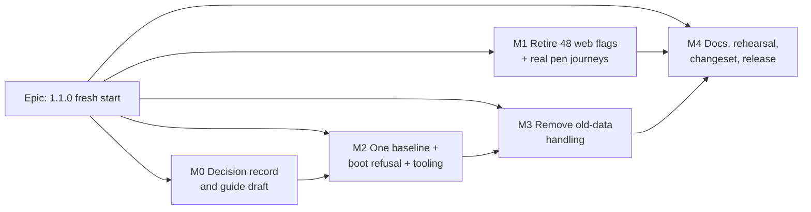

# Implementation Plan: SchedulePoint 1.1.0 — the fresh start

- **Feature spec:** [`./feature-spec.md`](./feature-spec.md)
- **Status:** Approved — by the product owner, 2026-11-08 (answers recorded in the spec's header and §1).
- **Owner:** product owner; built by the **builder** agent, schema by the **database-architect**

## Breakdown

### Epic

**SchedulePoint 1.1.0 — the fresh start.** One release that retires every web feature flag, resets the migration
history to one baseline behind an image that refuses the old database, and removes code that exists only for rows
written by older versions. Roadmap theme: release hygiene after 1.0.

### Ground rules for every milestone

- **No changeset until M4 T3** and **no Version Packages PR merged while the epic is open** (spec §4.8, Q2).
- **Re-read `main` at the start of each milestone.** This plan was written against a working tree whose
  `origin/main` is `eba3a577…` (`.git/refs/remotes/origin/main`); the brief named `dafbaa1c`. Which is newer was not
  established (no git command was available to the author).
- **Every schema change goes through the database-architect** (CLAUDE.md §19.3), including edits to the baseline
  after M2.
- **Pre-push gate is run, not assumed** (CLAUDE.md §19.8): `pnpm prepush`, plus `scripts/e2e-local.sh api` for any
  `apps/api` change, plus `scripts/e2e-local.sh web:<suite>` for every Playwright suite a task touches.
- **Specialist reviews named per task** below. Reviewers are read-only and their blocking findings are fixed before
  merge.
- The engine (`apps/api/src/modules/schedule/engine/`) is **not edited**; `check:engine-parity` stays green. No new
  scheduling input is added, so `computeSchedule` is byte-identical by construction (recalc parity gate).
- No structural write is added or changed (ADR-0028); no role gains or loses anything (ADR-0012).

---

### Milestone M0: Decision record and guide draft (shippable slice)

**Outcome:** the decisions are written down where the repository keeps them; nothing executes differently.
**Entry point:** `Ships dark: documents only.`
**Journey:** none (no user-facing capability).

#### Feature: Record the decisions

> **Description:** `docs/DECISIONS.md` entry (OD-1…OD-6 with date 2026-11-08, and that the 1.0-era "wipe at 1.0"
> entry at `docs/DECISIONS.md:40-45` is superseded by the 1.1.0 fresh start); the new ADR drafted as **Proposed**;
> the guide `docs/guides/start-fresh-on-1-1.md` drafted from spec §2 "Workflows".
> **Complexity:** S
> **Dependencies:** spec approved; Q1 and Q2 answered (Q1 decides which ADR section is written).
> **Risks:** the guide drifts from the code before M4 → mitigation: M4 T2's rehearsal runs the guide verbatim and
> corrects it.
> **Testing requirements:** `pnpm prepush` (`check:adr-coverage`, `check:doc-links`, `check:spec-status`).

##### Task M0-T1 — Decisions entry, ADR (Proposed), CLAUDE.md §16 line, guide draft (one PR)

- **Description:** as above. The ADR amends ADR-0018, ADR-0192, ADR-0025 (amendments 2–7), ADR-0214, and records
  against ADR-0190 and ADR-0088/0084 (spec §4.10).
- **Complexity:** S
- **Dependencies:** none
- **Risks:** an ADR number collision → take the number at landing.
- **Testing:** `pnpm prepush`.
- **Reviews:** none required beyond a human read; devops-reviewer reads the guide's commands.
- **Development steps:**
  1. Write the `docs/DECISIONS.md` entry, newest first.
  2. Draft the ADR (Proposed) and add its one line to CLAUDE.md §16.
  3. Draft the guide in the house style of `docs/guides/back-up-and-restore.md` (numbered steps, minutes per part,
     Dockge and `docker compose` both, "what this does not protect against").
  4. No changeset.

---

### Milestone M1: Retire the 48 web flags, and drive the real pen (shippable slice)

**Outcome:** no `VITE_` feature flag exists; every editing journey takes the pen through the UI; no Playwright config
pins a flag.
**Entry point:** `Ships dark: no user-visible change — every one of the 48 flags is already compiled ON in every
published image (.env.example:145-160, ADR-0088 D1), so removing the guard changes nothing a person can see.`
**Journey:** the rewritten base journey is the journey: `apps/web/e2e/` editing specs press **Start editing** (the
pen's accessible name — confirm against the UI before writing the locator) before each edit.

#### Feature: Real pen in every journey that edits

> **Description:** convert the eight base-journey editing tests (`activities.spec.ts` ×1, `baselines.spec.ts` ×3,
> `dependencies.spec.ts` ×2, `schedule.spec.ts` ×2, per `docs/TECH_DEBT.md` #121) to acquire the pen; convert the
> pen-off specs under `programme`, `notes`, `float-paths`, `health-check`, `revision-compare`; replace "read-only
> TSLD" coverage (`VITE_TSLD_EDITING: 'false'`) with a Viewer sign-in.
> **Complexity:** L
> **Dependencies:** none
> **Risks:** a shared helper that takes the pen hides a real pen defect → mitigation: one helper in `e2e-support/`,
> asserting the pen's visible "you hold the pen" state after pressing, never a direct API call. Tests that relied on
> role-only gating had an implicit assumption about `PLAN_EDIT_LOCK_ENFORCED` (default `false`) → keep e2e on the
> default; the edit-lock enforcement path is covered by its own API e2e.
> **Testing requirements:** each converted suite run locally with `scripts/e2e-local.sh web:<suite>`; a11y checks
> already in those journeys keep running.

##### Task M1-T1 — Base journey (#121) (≈ one PR)

- **Description:** add the pen helper; convert the eight tests; delete `VITE_TSLD_EDITING`/`VITE_PLAN_EDIT_LOCK` from
  `apps/web/playwright.config.ts:75-78` and rewrite its comment (`:65-74`); move read-only assertions to a Viewer.
- **Complexity:** M
- **Dependencies:** none
- **Risks:** flaky lock polling under parallel workers → the base config already uses `workers: 1` in CI
  (`playwright.config.ts:12`); keep each test on its own plan.
- **Testing:** `scripts/e2e-local.sh web:base` (or the script's name for the base suite) green, three consecutive
  local runs.
- **Reviews:** **test-engineer** (blocking), accessibility-reviewer (the pen control's name and focus after taking it).
- **Development steps:**
  1. Find the pen control's accessible name in the workspace and write the helper.
  2. Convert, one spec file at a time, running each.
  3. Remove the pins; close `docs/TECH_DEBT.md` #121 with the evidence (commit, run).

##### Task M1-T2 — The five other pen-off configs (≈ one PR)

- **Description:** `playwright.programme.config.ts:65-66`, `playwright.notes.config.ts:63-64`,
  `playwright.float-paths.config.ts:80`, `playwright.health-check.config.ts:67`, `playwright.revision-compare.config.ts:66`.
- **Complexity:** M
- **Dependencies:** M1-T1 (the helper)
- **Risks:** a suite that only ever read now has to edit to reach its state → use the seeded catalogue
  (`docs/TEST_PLAYBOOK.md`) instead of in-test editing where a seeded plan already holds the state.
- **Testing:** each suite run locally.
- **Reviews:** **test-engineer**.

##### Task M1-T3 — The three flag-off suites (≈ one PR)

- **Description:** `playwright.toolbar.config.ts:70` (`VITE_CANVAS_AUTHORING` off): convert its read-only toolbar case
  to a Viewer or a planner without the pen. `playwright.authoring-flow-off.config.ts` (whole config exists for
  `VITE_CANVAS_AUTHORING_FLOW=false`, `docs/TECH_DEBT.md` #76): delete the config and its suite directory, after moving
  any assertion that still describes the shipped product into `authoring-flow`. `playwright.designed-ui.config.ts:68`:
  delete the flag-off project.
- **Complexity:** M
- **Dependencies:** M1-T1
- **Risks:** deleting a suite moves `check:counts` (Playwright suites), `check:e2e-roster` and the shard pack
  (ADR-0138, `ci.yml:421-450`) → update the CLAUDE.md §1 figure, the CI steps, `scripts/e2e-durations.json` and the
  pack in the same PR.
- **Testing:** `pnpm prepush`; the surviving suites locally.
- **Reviews:** **test-engineer**, **devops-reviewer** (CI matrix and roster).

#### Feature: Delete the flags

> **Description:** remove the 48 constants and their guards in production code, keeping the enabled branch; move
> every entry from `"flags"` to `"retired"` in `scripts/flag-retirement.json` with `retiredOn` and a note; remove pins
> that set a now-deleted flag **on** in any config; remove the 48 `VITE_` lines and their comments from
> `.env.example` (keep `VITE_API_URL`, keep the banner's explanation reworded as history); reword the
> `PLAN_EDIT_LOCK_ENFORCED` comment (`.env.example:111-120`).
> **Complexity:** XL across tasks (≈ 4 PRs)
> **Dependencies:** M1-T1…T3 merged (no config may still pin a flag being deleted)
> **Risks:** a flag gates more files than its register row suggests (`scripts/flag-retirement.json:538` records that
> the "one line" claim was false for every flag sampled) → batch by the register's own `batch` field and measured blast
> radius, smallest first; delete the disabled branch's tests with it. A derived flag (e.g. multi-select derived from
> direct manipulation, `.env.example:352`) deleted before its parent → delete parents and derived flags in the same PR.
> `env.ts` shows 38 one-line `flagDefaultOn(import…`/`flagDefaultOff(import…` calls against 48 register entries (some
> calls wrap lines, some flags are derived) → reconcile the two lists in T4 before deleting anything.
> **Testing requirements:** `pnpm prepush` (`check:flags`, `check:counts` for web source files, bundle budget);
> unit suites of touched features; one local run of `scripts/e2e-local.sh web:edit` and `web:base` per PR.

##### Task M1-T4 — Reconcile and plan the batches (no PR, or folded into T5)

- **Description:** list each flag's constant, production files and derived flags; group into ~4 PRs.
- **Complexity:** S

##### Task M1-T5 … T8 — Delete flags, batch by batch (≈ one PR each)

- **Complexity:** M each
- **Dependencies:** T4; each batch after the previous
- **Risks:** as above
- **Testing:** as above
- **Reviews:** **component-reviewer** (no orphaned props, no dead branch), ux-reviewer on the last batch (a sweep of
  the workspace for anything that rendered differently with a flag off and is now unconditional — expected nothing).
- **Development steps (each):**
  1. Delete the constant and every `if (FLAG)` / `FLAG ? a : b`, keeping the enabled branch.
  2. Delete tests that exercised the disabled branch.
  3. Move the register entries to `retired`.
  4. `.env.example` lines for this batch.
  5. `pnpm prepush`, local e2e as above.

##### Task M1-T9 — Docs for the retired flags

- **Description:** `docs/FRONTEND_ARCHITECTURE.md`/`docs/FRONTEND_QUALITY.md` flag sections, `docs/DEPLOYMENT.md`
  "per-feature rollback" (`:1009-1030`), README if it lists flags; confirm whether `RETENTION_SWEEP_ENABLED`
  (`.env.example:163`) exists and fix the line if not.
- **Complexity:** S
- **Reviews:** devops-reviewer (for `.env.example`).

---

### Milestone M2: One baseline, the boot refusal, and the tooling around it (shippable slice)

**Outcome:** `main` builds databases from one migration, and its image refuses a pre-1.1 database before touching it.
From this merge on, `main` is releasable **only** as 1.1.0 (the freeze holds).
**Entry point:** `Ships dark: an operator-facing refusal, reachable only on the day of the switch; M4's rehearsal
drives it end to end.`
**Journey:** the CI image-job refusal step (operator journey; no browser surface).

#### Feature: The baseline migration

> **Description:** replace `apps/api/prisma/migrations/*` (84 directories) with the one baseline designed in
> `schema-design.md`. **Internals owned by the database-architect.** Default for this milestone: the baseline is an
> exact equivalent of today's schema, with tidy-ups deferred to M3 (folded into the unreleased baseline then), unless
> `schema-design.md` pairs a tidy-up with its code reader in this PR.
> **Complexity:** L
> **Dependencies:** `schema-design.md` written and approved; M0
> **Risks:** a raw-SQL object (the `audit_events` `ENABLE ALWAYS` triggers, partial indexes, CHECKs) is lost in the
> squash → mitigation: spec §4.5 item 2, a schema-only comparison that includes triggers, plus the existing
> `verify_loaded` trigger check (`schedulepoint-backup.sh:593-600`) in CI. Boot services that read marker rows
> (`schedule/*-rederive.service.ts`, `activity-history.service.ts:139-145`) misbehave when the rows are absent →
> mitigation: an API e2e boot on the baseline asserts each logs nothing pending and no error; the services are
> deleted in M3.
> **Testing requirements:** `pnpm --filter @repo/api prisma:check-drift` against the baseline; the equivalence proof;
> `scripts/e2e-local.sh api` and the full CI e2e.

##### Task M2-T1 — Squash, prove equivalence, delete migration-proof specs (one PR)

- **Description:** the baseline; delete the 11 migration-proof e2e specs (spec §4.3, item 13) after moving any
  assertion about a **current** invariant into a surviving spec; update the `migrations` figure in `CLAUDE.md`,
  README, `docs/ARCHITECTURE.md`, `docs/DATABASE.md` (`check:counts`).
- **Complexity:** L
- **Dependencies:** `schema-design.md`
- **Risks:** as above; e2e specs that seed baselines with Prisma defaults (spec §4.3, item 14) break if defaults change
  → convert in this PR if the schema changes defaults.
- **Testing:** `scripts/e2e-local.sh api` (after the app_test reset of T3, or a fresh `DATABASE_URL`), full CI.
- **Reviews:** **database-architect** (blocking, owner of the design), **backend-performance-reviewer** (indexes
  survive), **test-engineer** (which assertions survive).

#### Feature: The refusal at boot

> **Description:** a `preflight` command in `apps/api/backup/schedulepoint-backup.sh` implementing spec §2
> "Validation rules", dispatched before the `/backups` early exit (`:799-808`); `apps/api/docker-entrypoint.sh` runs
> it first; `verify_loaded` (`:592-615`) reports 1.0 copies with the lineage message (US-3).
> **Complexity:** M
> **Dependencies:** M2-T1 (the baseline's name)
> **Risks:** the refusal prints `DATABASE_URL` in an error → reuse `redact`/`first_line` (`:88-95`); the restart loop
> floods logs → logs are capped (`docker-compose.release.yml:59-63`) and the message is three lines; the rule refuses a
> legitimate 1.1.x rollback → only "no baseline row" refuses (spec §4.4), with a test for "baseline plus a migration
> this image lacks → proceeds".
> **Testing requirements:** shell unit cases in the existing harness (`scripts/backup-restore-check.sh` or a sibling);
> the CI image-job step (below) that goes red when the `preflight` line is deleted (ADR-0110).

##### Task M2-T2 — `preflight`, entrypoint order, lineage-aware `check`/`restore` (one PR)

- **Description:** as above, plus the `boot.database_refused` JSON event in the shape the script's `emit` already uses
  (`:106-129`), a constant for the baseline name with a test that it is the oldest directory, and the image-job step:
  build an old-lineage database from a fixture under `scripts/ci-fixtures/` (never under `apps/api/prisma/migrations/`,
  as the pending probe does, `ci.yml:1654-1666`), start the 1.1 image, assert exit ≠ 0, the event, unchanged
  `_prisma_migrations`, no new file in `/backups`. Update `docs/guides/back-up-and-restore.md` Part 2/3 for 1.0 copies.
- **Complexity:** M
- **Dependencies:** M2-T1
- **Risks:** the 84-folder fixture is heavy → fall back to a hand-written `_prisma_migrations` row with a 1.0 name plus
  one table (database-architect and devops-reviewer choose).
- **Testing:** the image-job step locally with `docker compose -f docker-compose.ci.yml` if feasible, else CI; shell
  cases for fresh / empty table / 1.1 lineage / 1.1 lineage + unknown later migration / pre-1.1 / unknown / unreachable.
- **Reviews:** **devops-reviewer** (blocking: entrypoint, image, CI), **security-reviewer** (no credential in output,
  fail-closed), **database-architect** (the lineage query).

#### Feature: Local and CI tooling

> **Description:** `scripts/e2e-local.sh` resets `app_test` on a pre-1.1 lineage or a baseline checksum mismatch
> (spec §4.4); `scripts/backup-restore-check.sh` reviewed for one-migration semantics (`:389-391` "older image"
> simulation; `:295-298` sixteen non-empty tables); README/CONTRIBUTING note on the dev volume
> (`docker compose down -v`).
> **Complexity:** M
> **Dependencies:** M2-T1
> **Risks:** the reset fires on a developer's own database → it fires only for the database `e2e-local.sh` itself
> manages (`app_test`) or the one in `DATABASE_URL` that it is about to migrate, prints what it does, and never touches
> a database whose lineage is already 1.1. Prisma's checksum format is unconfirmed → confirm in this task by reading
> `_prisma_migrations.checksum` after a `migrate deploy` and comparing with `sha256sum migration.sql`; if it does not
> match, reset on lineage only and document "re-create app_test after pulling a baseline change" until release.
> **Testing requirements:** run the script against an `app_test` built from 1.0.0's migrations and confirm one reset,
> then a second run with no reset.

##### Task M2-T3 — Tooling (one PR, may merge with T2)

- **Complexity:** M
- **Reviews:** **devops-reviewer**, **test-engineer** (backup-restore-check semantics).

---

### Milestone M3: Remove the old-data handling (shippable slice)

**Outcome:** no code branch whose only producer is a row from an older version; schema tidy-ups folded into the
baseline; published shapes per Q1.
**Entry point:** `Ships dark: removes states that a fresh database cannot produce; nothing new to reach.`
**Journey:** the existing baselines and revision-compare journeys (`playwright.revision-compare.config.ts`, base
`baselines.spec.ts`) must stay green unchanged except for assertions on removed old-data messages.

#### Feature: Complete the inventory

##### Task M3-T0 — Finish spec §4.3 with its rule (no PR; recorded in this directory as `m3-inventory.md`)

- **Description:** for every row of spec §4.3 and every further hit of `captured before|before this column|no
backfill|pre-ADR|legacy|NOT_SNAPSHOTTED|NONE` in `apps/api/src`, `apps/web/src`, `packages/types/src`, record the
  file and line, the producer, and keep/remove. Pair each schema tidy-up from `schema-design.md` with its reader.
- **Complexity:** M
- **Risks:** removing a branch that also serves a live cause (never calculated, no active baseline) → the rule in
  spec §4.3 and a unit test per kept cause.

#### Feature: API-side removals

> **Description:** spec §4.3 items 1–3, 8, 10–12, 15–16; item 7's route/export per Q1; item 9 reader-side only.
> **Complexity:** L
> **Dependencies:** M2 merged; M3-T0
> **Risks:** an exhaustive `switch` on a snapshot level loses its compile-time guard when a value is removed from the
> Prisma enum → keep the exhaustive check over whatever the enum becomes. Removing the five re-derivation services
> changes boot behaviour → none should fire on a 1.1 database (proved in M2); delete with their unit and e2e tests.
> Shapes under Option K → every field still serialised; add an e2e assertion per row of spec §4.6 that the value is
> the constant.
> **Testing requirements:** unit suites of touched modules; `scripts/e2e-local.sh api`; `check:engine-parity`.

##### Task M3-T1 — Boot re-derivation services and the history marker (one PR)

- **Description:** delete the five services and their wiring (`schedule/schedule.module.ts:10-15,42-61`), the
  `schedule.service.ts:665-668` cross-references, and the history marker read (spec §4.3, item 2); update
  `docs/DATABASE.md` "Re-derivation markers" and the `docs/DEPLOYMENT.md` marker sections (`:807-876`) to history.
- **Complexity:** M
- **Reviews:** **backend-performance-reviewer**, **api-reviewer** (the history response field keeps its shape).

##### Task M3-T2 — Baselines and revision compare, API side (one or two PRs)

- **Description:** spec §4.3 items 3–5, 8, 10; schema tidy-ups for these tables folded into the baseline in the same PR.
- **Complexity:** L
- **Reviews:** **database-architect** (blocking where the baseline changes), **api-reviewer** (blocking: shapes per
  Q1), **backend-performance-reviewer** (overview query stays one per list).

##### Task M3-T3 — Placement migration (route and export per Q1), staff diagnostics, hierarchy legacy path, comments (one PR)

- **Description:** spec §4.3 items 7 (API half), 11, 12, 15, 16. Under Option K the route answers `{ rows: [] }` and
  the export writes the header; under Option E both are removed and `docs/ORGANISATION_EXPORT_FORMAT.md` gains a
  format version entry.
- **Complexity:** M
- **Reviews:** **api-reviewer**, **security-reviewer** (the hierarchy restore path is an authorisation-relevant seam),
  database-architect if the table is dropped.

#### Feature: Web and shared types

##### Task M3-T4 — Web removals and `@repo/types` (one PR)

- **Description:** spec §4.3 items 4–7 (web half): `revision-sentences.ts:54,119`, `change-sentences.ts:81-83`,
  `BaselineVarianceSummary.tsx:51`, `tsld/render/a11y.ts:381`, `schedule-format.ts:129` if orphaned, the
  `features/placement-migration/` notice and its dock/toolbar/hint uses. `packages/types` unions stay under K and
  narrow under E.
- **Complexity:** M
- **Dependencies:** M3-T2 (the producers)
- **Risks:** the revision-compare printout and screen-reader summary still name a removed state → the print and a11y
  tests are part of this PR.
- **Testing:** unit; `scripts/e2e-local.sh web:revision-compare`, `web:base`.
- **Reviews:** **component-reviewer**, **accessibility-reviewer** (removed live-region and summary sentences),
  ux-reviewer.

#### Feature: Tests that seeded old rows

##### Task M3-T5 — Convert or delete (may fold into T2/T3)

- **Description:** spec §4.3 item 14 and every unit test whose fixture is a `NONE`-level baseline or a null-minutes row
  with known days.
- **Complexity:** S
- **Reviews:** test-engineer.

---

### Milestone M4: Docs, the dress rehearsal, the changeset, the release (shippable slice)

**Outcome:** 1.1.0 is released; the owner follows the guide.
**Entry point:** the guide `docs/guides/start-fresh-on-1-1.md`, linked from the refusal message, `docs/DEPLOYMENT.md`
and `docs/RELEASE_1_0.md`.
**Journey:** M4-T2, the rehearsal, drives the real images end to end (ADR-0081: operator capability, real product).

##### Task M4-T1 — Documentation sweep (one PR)

- **Description:** `CLAUDE.md` §1 figures (all six re-derived by `check:counts`) and §17 bullets that describe the
  owner's live data on 2026-10-20 (backups, retention's first run removing 9 clients, the org export) rewritten as
  history before 1.1.0 plus the post-switch state; `docs/RELEASE_1_0.md` rollback (`:144-149`) and "Old baselines"
  known limit (`:169-170`); a short `docs/RELEASE_1_1.md` or a section in the former (author's choice, plain words);
  `docs/DEPLOYMENT.md`; `docs/API.md` (K notes or E removals); `docs/ORGANISATION_EXPORT_FORMAT.md`; `docs/ROADMAP.md`;
  `docs/TECH_DEBT.md` sweep (rows whose subject is old data or a retired flag close with evidence; #121 already closed
  in M1); `docs/OBSERVABILITY.md` if it lists the re-derivation events; ADR status → Accepted.
- **Complexity:** M
- **Reviews:** devops-reviewer (deployment and guide).

##### Task M4-T2 — Dress rehearsal on a throwaway stack (no code; record in `m4-rehearsal.md`)

- **Description:** with `docker-compose.release.yml` on a scratch host or CI runner: run 1.0.0, seed one organisation
  through the REST API, `backup now` + `check`; start a 1.1.0 **candidate** image (`sha-…` tag from `main`) → confirm the
  refusal and an unchanged database; follow the guide's on-the-day steps verbatim → fresh boot, sign-up journey, `backup
now` + `check`; follow "if you need to go back" → 1.0.0 on the old volume shows the seeded data. Fix the guide where
  reality differs.
- **Complexity:** M
- **Dependencies:** M1–M3, M4-T1
- **Risks:** the rehearsal passes on a different host shape from the owner's Dockge setup → the guide keeps both
  command forms and states the one assumption (compose project and volume names) with the command that shows them
  (`docker volume ls`).
- **Reviews:** **devops-reviewer** (blocking).

##### Task M4-T3 — The changeset (one PR, last)

- **Description:** one changeset, `'@repo/api': minor`, `'@repo/web': minor`, text: "SchedulePoint 1.1.0 — the first
  public release. **Needs a fresh, empty database**: this version refuses to start on a database made by 1.0 or
  earlier and leaves it untouched. Follow docs/guides/start-fresh-on-1-1.md." Then the owner merges the Version Packages
  pull request when they choose, after the guide's "before you merge" part.
- **Complexity:** S
- **Dependencies:** M4-T1, M4-T2
- **Risks:** the Version Packages PR shows `action_required` checks (CLAUDE.md §11) → read by hand per §19.9.
- **Testing:** `pnpm prepush`; read the generated Version Packages diff (two `package.json`, two changelogs, both at
  1.1.0).

## Sequencing & slices

1. **M0** (docs) and **M1** (flags) start at once; M1 is safe to land in any order relative to M2/M3 because the flags
   are already on.
2. **M2** lands before any M3 PR. From M2 on, an accidental release refuses the old database instead of misbehaving on
   it (spec §4.8).
3. **M3** PRs land in T1 → T2 → T3 → T4 order; T5 folds in where convenient.
4. **M4** last; its T3 is the only changeset in the epic.
5. No feature flag is introduced (ADR-0088 D1): the rollback for any slice is its commit, and the release as a whole
   rolls back by volume + tag (spec §4.7).

Estimated size: M0 S; M1 XL (≈ 7–8 PRs); M2 L (≈ 2–3 PRs); M3 L (≈ 4–5 PRs); M4 M (≈ 2 PRs).

## Definition of Done (per task)

Each task's PR must satisfy the Feature Completion Criteria in [`docs/PROCESS.md`](../../PROCESS.md) (code, tests,
docs, security, performance, accessibility, Docker build, CI, changelog, version impact) — with the epic's one
exception that **no changeset is added before M4-T3** (version impact is assessed in each PR description as "rides in
1.1.0").

## Risks & assumptions (rollup)

| #   | Risk / assumption                                                                                                | Likelihood | Impact | Mitigation                                                                                                       |
| --- | ---------------------------------------------------------------------------------------------------------------- | ---------- | ------ | ---------------------------------------------------------------------------------------------------------------- |
| R1  | A Version Packages PR is merged mid-epic and Watchtower deploys a partial 1.1                                    | low        | high   | No changeset until M4-T3; release freeze (Q2); M2 before M3 so the partial build refuses rather than misbehaves. |
| R2  | The squash loses a raw-SQL object (audit triggers, partial index, CHECK)                                         | med        | high   | Schema-only equivalence proof including triggers (spec §4.5); `verify_loaded`'s trigger check in CI.             |
| R3  | The refusal runs after `pre-migrate` and the restart loop fills the disk with copies                             | low        | high   | Entrypoint order fixed in M2-T2 and asserted by the CI step ("no new file in /backups").                         |
| R4  | The owner's final backup is pruned after 30 days                                                                 | med        | med    | Guide step 4: copy it out of the backups folder (`schedulepoint-backup.sh:404-419`).                             |
| R5  | The owner checks the final backup after 1.1.0 has been pulled and gets a refusal                                 | med        | low    | Guide orders backup + check before merging; US-3 makes the refusal message say exactly what to do.               |
| R6  | A 1.0.0 image is started on the new 1.1 volume during a rollback and leaves a failed migration row               | low        | med    | Guide: volume first, then tag. Recovery: the new volume is disposable on day one (`docker volume rm`).           |
| R7  | Prisma `migrate deploy` behaviour on an edited, already-applied baseline (pre-release) is not what M2-T3 assumes | med        | low    | Confirm in M2-T3; fall back to lineage-only reset plus a documented manual step for contributors.                |
| R8  | A removed branch also served a live cause (never calculated, no baseline)                                        | med        | med    | Spec §4.3's rule; a unit test per kept cause in M3-T0's inventory.                                               |
| R9  | Pen-converted journeys become flaky                                                                              | med        | low    | One helper asserting visible pen state; three local runs before merge; CI retries are already 2.                 |
| R10 | Deleting suites unbalances the four CI shards                                                                    | high       | low    | Re-derive the pack in the same PR (ADR-0138); `check:e2e-roster` refuses a stale roster.                         |
| R11 | `schema-design.md` drops a column feeding a published field and the API stops emitting it                        | low        | high   | Spec §4.5 item 4; api-reviewer blocking on M3-T2/T3; an e2e assertion per spec §4.6 row under Option K.          |
| R12 | Assumption: nobody but the owner has data on any 1.x host                                                        | —          | —      | OD-2. If false, the refusal still protects that host; only the guide is needed.                                  |
| R13 | Assumption: the owner's compose uses a volume named `db-data`                                                    | med        | low    | Guide shows `docker volume ls` and the `db` service's `volumes:` line before editing.                            |
