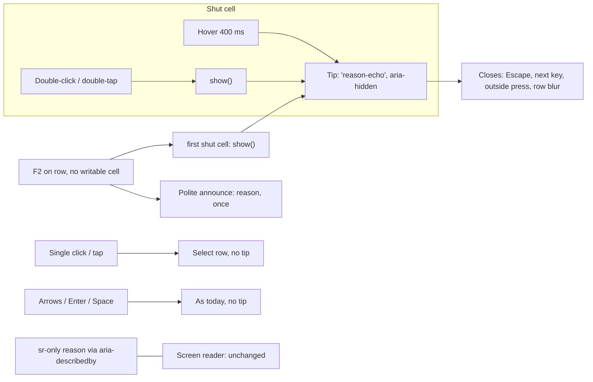

# Feature Spec: A read-only Gantt cell shows its reason when it is pressed

- **Status:** Approved — by the product owner, 2026-10-22, with all defaults
- **Author(s):** feature-analyst
- **Date:** 2026-10-21
- **Tracking issue / epic:** `docs/TECH_DEBT.md` #538 (`docs/TECH_DEBT.md:9552-9559`)
- **Owner's decision (2026-10-21):** "Show on press". This spec is the how.
- **Related ADR(s):** **amends ADR-0204** (D3 and its "Not in scope" bullet, `0204-…md:44-60`, `:72-73`).
  Builds on ADR-0083, ADR-0095, ADR-0111, ADR-0117, ADR-0082, ADR-0183, ADR-0081, ADR-0088 D1.
- **Why a full spec (ADR-0105):** the fix changes a shared primitive's public contract (`useTooltip`
  gains an option and a returned function), which is a stated trigger.

## 1. Business understanding

**Problem (re-verified against the code, 2026-10-21).** A read-only Gantt cell gives a sighted reader
its reason only as a native `title` (`features/gantt/components/GanttCell.tsx:213`), pinned by
`GanttCell.test.tsx:73-78` and `e2e-gantt-editing/grid-edit.spec.ts:649`. A `title` is hover-only: a
keyboard reader and a finger never see it. The reason does reach assistive technology, through an
`sr-only` span linked by `aria-describedby` (`GanttCell.tsx:214`, `:243-247`; test `:62-71`).
Reasons in use are in `model/cell-gate.ts:87-118`: summary roll-up, milestone duration, a started
activity's start, "Recalculate the plan to set dates.", and the permission/pen sentence
("Start editing to change this.").

**One premise in ADR-0204 and in #538 is wrong, and it changes the design.** Both say a tip on focus
would pop "on every cell the arrow keys cross" (`0204-…md:72`). Arrow keys do not cross cells: the
grid's roving focus is per **row** (`GanttPanel.tsx:946-960`, `focusRowAt` at `:701-709` focuses the
row, `:696`), and cells are `tabIndex={-1}` with no cell cursor (`GanttCell.tsx:197-202`; F2's
comment `GanttPanel.tsx:1005-1008`). What **does** focus a cell is a mouse click: Playwright's click
lands on a cell and makes it `[active]` (`grid-edit.spec.ts:376-384`). So `reason-echo` used as-is
would open the tip on **every single click that selects a row** (its `onFocus` opens immediately,
`tooltip.tsx:439-443`, and its `onClickCapture` opens on any click, `:448-454`). With the pen not held,
every editable cell is shut, so that is a tip on every row selection. That is the noise to avoid,
not arrow keys.

**Users.** Anyone who sees the editable grid and meets a shut cell: a Planner or Org Admin without
the pen (ADR-0028), a Contributor or Viewer refused by role, anyone on a summary, a milestone or a
started activity. A host that supplies no editing bundle renders no `GanttCell` at all
(`GanttPanel.tsx:2120-2123`, plain gridcell at `:2163-2179`), so print and any surface without editing
are unchanged.

**Outcome.** The gesture that would have edited a cell, when refused, shows why: to a mouse, a
finger and a keyboard. Browsing the grid stays quiet. The AT announcement is unchanged except that a
refused F2, which says nothing today, now says the reason once. Proved by unit and journey tests, not
by anyone on a device.

## 2. Functional requirements

### 2.1 Which gestures show the tip (decided here; CQ-1 below)

| Gesture on a shut cell                        | Today                                                                                    | After                                                                                                       |
| --------------------------------------------- | ---------------------------------------------------------------------------------------- | ----------------------------------------------------------------------------------------------------------- |
| Hover (mouse, pen)                            | native `title` after the browser's delay                                                 | tip after 400 ms (`TOOLTIP_OPEN_DELAY_MS`); `title` removed                                                 |
| Single click / tap                            | selects the row (`GanttPanel.tsx:2023-2035`)                                             | selects the row; **no tip**                                                                                 |
| Double-click / double-tap                     | nothing (`GanttCell.tsx:226`; journey `:653-654`)                                        | **tip shows**; still no field, no write                                                                     |
| Long-press (touch)                            | row's own touch handling                                                                 | unchanged; the tip's long-press path is off for cells                                                       |
| Row focus by arrow keys                       | nothing                                                                                  | nothing                                                                                                     |
| F2 on a row whose editable cells are all shut | nothing; falls through silently (`GanttPanel.tsx:1009-1022`)                             | **tip on the first shut editable cell**, and the reason is announced once in the panel's polite live region |
| Enter / Space on a row                        | activates the row (`GanttPanel.tsx:2039-2045`; test `GanttPanel.test.tsx:179`)           | unchanged, no tip                                                                                           |
| Typing a character                            | nothing; the grid has no type-to-edit (no key-length branch in `onKeyDown`, `:916-1037`) | unchanged                                                                                                   |

**Why these.** ADR-0204 D3's rule is that a press on a shaded control "does nothing, so showing why is
the answer to it, not the 'tap that does both' noise" (`0204-…md:52-55`; `tooltip.tsx:31-35`). A
single click on a cell **does** something (it selects the row), so a tip there is the noise. The press
that does nothing on a shut cell is the **edit gesture**: double-click (and double-tap, which fires
`dblclick` on the Surface; `device-results.md:33`) and F2, the grid's edit key (`GanttPanel.tsx:999-1004`).
Enter is the row's activation key, and there is no cell cursor for it to act on; giving it a second
meaning would break a shipped binding. Typing has no edit meaning in this grid to refuse.

### 2.2 User stories and acceptance criteria

- **US-1.** As a planner using a mouse or a finger, when I double-click or double-tap a shut cell, I see why it will not open.
  - AC-1.1 A tip with the gate's reason appears beside the cell; no field opens and nothing is written.
  - AC-1.2 A single click or tap on a shut cell selects the row and shows no tip.
  - AC-1.3 The shut cell has no `title`; hover shows the same tip after 400 ms, so a mouse reader loses nothing.
- **US-2.** As a keyboard planner, when I press F2 on a row and nothing can be edited, I am told why.
  - AC-2.1 The tip appears on the first shut editable cell in column order, and the reason is announced once (polite).
  - AC-2.2 F2 on a row with a writable cell opens it exactly as today; no tip, no announcement.
  - AC-2.3 Arrow keys, Home/End, Enter, Space and Shift+F10 behave exactly as today and open no tip.
  - AC-2.4 The tip closes on Escape (which still reaches the grid, `tooltip.tsx:316-338`), on the next key press, on a press elsewhere, and when the row's focus moves.
- **US-3 (AT unchanged).** The cell keeps `aria-readonly` and its `aria-describedby` to the `sr-only` reason, character for character. The tip is `aria-hidden` (`'reason-echo'`, `tooltip.tsx:469-473`), so nothing is read twice.

**Edge cases.** A cell's reason flips while the tip is open (pen taken mid-way): the tip closes when the
gate stops being shut (`tooltip.tsx:264-270`). A shut cell with `reason: null`: no tip, as today. A
started activity's Start is shut while Duration is open: F2 opens Duration (AC-2.2), a double-click on
Start shows its reason (the journey case). A row scrolled out by the virtualizer unmounts its cells,
which closes and releases the tip (`tooltip.tsx:255-262`).

**Permissions / validation / errors.** None change. Gates and reason strings are untouched.

## 3. Technical analysis

- **Frontend only.** No API, no schema, no `@repo/types`. `computeSchedule` is not imported, so recalc
  parity holds by construction. No write is added, so the pen is irrelevant (the refusal is the point).
- **No feature flag** (ADR-0088 D1); rollback is the commit boundary. **Entry point (ADR-0081):** the
  existing Gantt grid in the plan workspace; nothing new to reach.
- **Primitive change (the reason this is a spec).** `useTooltip` needs a way to show a tip only on
  request. Proposed, final names for component-reviewer:
  - option `opensOn?: 'focus' | 'request'`, default `'focus'` (every caller unchanged). Under
    `'request'`: hover still opens after 400 ms, but focus, a click and a touch long-press do not.
  - returned `show(): void`, which opens immediately and takes the one-open token (`tooltip.tsx:196-199`).
  - under `'request'` an open tip also closes on the next `keydown` anywhere (capture), because it
    answers one press and focus may sit on the row rather than on the cell (the F2 case), so `onBlur`
    would never close it.
  - It keeps `purpose: 'reason-echo'` (aria-hidden, nothing linked). A new purpose was rejected:
    purpose is the ARIA wiring, and that does not change.
- **`GanttCell`.** Calls `useTooltip({ content: gate.readOnly ? gate.reason ?? undefined : undefined,
purpose: 'reason-echo', opensOn: 'request' })`, spreads `triggerProps` on the gridcell (its `ref`
  merged), renders `tooltip`, removes the `title` at `:213`, and on a shut cell's double-click calls
  `show()` where today it does nothing (`:226`). It exposes `show` to the panel through a handle map,
  the pattern `menuHandles` already uses (`GanttPanel.tsx:931`, `:940`).
- **`GanttPanel` F2.** When the loop at `:1011-1021` finds no writable cell, it shows the first shut
  editable cell's tip, announces that cell's reason once through the panel's existing live region
  (the channel `resizeBar` uses for its refusal, `:903-905`; builder confirms which handle owns it),
  and calls `preventDefault`.
- **Keep or drop `title`? Drop.** A native `title` and the custom tip both show on hover (ADR-0204 D3
  withdrew `title` for the same reason, `0204-…md:59-60`; `e2e-toolbar/toolbar.spec.ts:251` pins
  "the native channel is gone, not doubled"). AT loses nothing: the `sr-only` span is the
  description (`GanttCell.tsx:214`, `:243-247`), and the unit suite asserts it is unchanged.
- **Performance.** One hook per editable cell in view (rows × editable columns), inert while the cell
  is writable (`active` false, `tooltip.tsx:213`); listeners attach only while open (`:332-360`).
  performance-reviewer confirms; the fallback is one panel-level instance anchored on request.
- **Surface test sheet (`docs/specs/gantt-coarse-pointer/device-checklist.md:15-18`). It does not
  change.** Every touch step runs after "Start editing" (`:40`) on a normal task row (`:55`), and the
  only cell step, item 5, double-taps a **writable** Duration (`:67-68`), which still opens a field.
  Long-press (item 4) is untouched because `'request'` turns the tip's long-press path off. The PR and
  the hand-off say "sheet checked, unchanged". This spec creates **no owner test step** of any kind.
- **Keyboard contract (§19.13, ADR-0111).** `useTooltip` is a shared primitive and F2 gains a refusal
  behaviour, so **accessibility-reviewer runs before ship**, executing the component in a real browser.
  component-reviewer runs too, for the new option.

## 4. Solution design

**Alternatives.** (a) `reason-echo` as-is: opens on every row-selecting click (§1). Rejected.
(b) Inline reason text in the cell: the cell holds a value in a 28 px row (ADR-0183's Gantt exception),
no room. Rejected. (c) Rely on the pen banner: it explains the pen, not a summary, a milestone or a
started activity. Rejected. (d) Tip on single click as well: the owner's words include "clicks"; see CQ-1.

**ADR-0204 amendment outline (dated 2026-10-xx, in the build PR).** D3 gains: "A `'reason-echo'` tip
may open on **request** only (`opensOn: 'request'`): hover and the refused gesture, never focus or a
plain click. The Gantt's shut cell uses it: double-click, double-tap and a refused F2." The "Not in
scope" bullet (`:72-73`) is replaced, and its arrow-key premise corrected (arrows move rows, a click
focuses a cell). No new ADR: the decision is ADR-0204's rule extended to one more surface. The §16
line's parenthetical becomes `(Accepted; amends ADR-0082 §2, extends ADR-0117; amended for the Gantt
cell, #538)`.

## 5. Critical questions (defaults stated)

- **CQ-1 — Which press?** Your decision named tap, click and Enter. **Default: double-click, double-tap
  and F2; not a single click or tap, not Enter.** A single click already selects the row, and without
  the pen every editable cell is shut, so the tip would appear on every row you click. Enter already
  activates the row. Double-click and F2 are the gestures that try to edit, so they are the ones that
  are refused. If you want single click too, it is one line more and the cost is that tip on every
  selection.

Everything else is a stated default: hover kept (replacing the `title`), `title` dropped, F2's
refusal announced once, typing unchanged.
