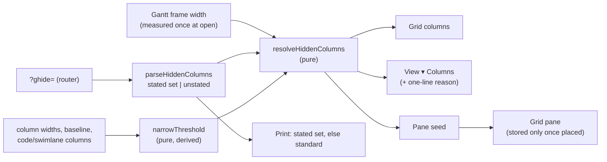

# Feature Spec: The Gantt starts with fewer columns when it is narrow

- **Status:** Approved — by the product owner, 2026-11-13: Q1 reset the saved divider once for everyone; Q2 narrow is measured on the Gantt's own space (timeline at least two fifths). Built 2026-11-14 (journey not yet run; the M1-T0 measurement was set aside, see the threshold constant's docblock).
- **Author(s):** feature-analyst (Claude Code), for the product owner
- **Date:** 2026-11-13
- **Tracking issue / epic:** walkthrough finding rank 35 (owner decision, 2026-11-13)
- **Roadmap link:** none; a follow-on to ADR-0095 M5-T6 (column choice in the URL) and ADR-0173 (widths)
- **Related ADR(s):** ADR-0095 (the Gantt's view memory), ADR-0123 (a search param is a string, the shape is
  decided at the router), ADR-0173 and ADR-0188 (widths are the planner's), ADR-0179 (designed from 1024 up),
  ADR-0213 (ask your own frame, not the window), ADR-0132 (what is announced), ADR-0081 (entry point and journey),
  ADR-0088 D1 (no flag), ADR-0113 (measure the problem first)

---

## In plain English

On a small laptop or an 11-inch tablet, the table on the left of the Gantt takes most of the screen and the
timeline is a thin strip. After this change, when the Gantt has little room, a **new** Gantt view starts without
the **Code** and **Finish** columns (the owner's "Early finish"; the column is headed "Finish" on screen). On a
wider screen it looks exactly as today. Anyone can tick those columns back on in **View ▾ → Columns**, and a
view where somebody has already chosen columns keeps that choice, including in a link sent to a colleague.
Printing is unchanged.

**One thing the owner needs to know before approving** (question Q1): hiding the two columns on its own does
**not** widen the timeline for anybody who has opened the Gantt before on that computer. The app quietly saves
the position of the divider between the table and the timeline the first time the Gantt opens, and today a
hidden column's room goes to the Activity column rather than to the timeline. So this change also has to stop
the app from saving that divider until someone actually moves it, and decide what happens to the positions
already saved.

---

## 1. Business understanding

### Problem (verified on today's code)

1. **The default table is wide.** The default columns sum to 584 px (Code 80, Activity 180, Duration 84, Start
   90, Finish 90, Float left 60; `column-widths.ts:45-57`), plus the row-menu column 28 and the end gutter 20
   (`pinned-geometry.ts:18,29`): a seed of **632 px**, 704 with an active baseline (`VARIANCE_COLUMN_WIDTH` 72,
   `pinned-geometry.ts:9`). Predecessors is already off by default (`gantt-view-state.ts:76`).
2. **The Gantt's room at 1024 is small.** The Project Explorer is 276 px wide when open
   (`use-explorer-prefs.ts:28`), leaving roughly 750 px for the whole Gantt at a 1024 window: a timeline of about
   120 px. This is arithmetic from constants, **not a measurement**; M1-T0 measures it in a browser first
   (ADR-0113).
3. **Hiding columns does not, today, give the timeline any room.** The pane's width is stored by
   `useResizablePanelPrefs`, which writes its state to `localStorage` in a mount effect
   (`use-resizable-panel-prefs.ts:91-97`), so the seed is saved the first time the Gantt opens
   (`use-gantt-grid-prefs.ts:48-54`, key `schedulepoint:gantt-grid-width`). After that "the planner's width wins
   over a column change ... Activity gives up the room instead" (`GanttPanel.tsx:569-572`), and Activity is the
   elastic column (`column-widths.ts:230-239`). So a stored 632 px pane with Code and Finish hidden draws a
   **wider Activity column and the same thin timeline**. `use-gantt-column-widths.ts:58-60` calls the mount write
   "harmless" for the pane; under this change it is not.
4. **"Say nothing" and "the default" are one string today.** `useUrlFilterState` deletes a param equal to its
   default (`use-url-filter-state.ts:45`) and the hidden default is `predecessors`
   (`gantt-view-state.ts:233`). If the default became width-dependent, a planner on a narrow Gantt who ticks
   Code and Finish back on produces `ghide=predecessors`, which is deleted, which reads as "say nothing", which
   hides them again. This is the trap `HIDE_NOTHING` was invented for (`gantt-view-state.ts:78-91`).

### Users and roles

Everyone who can open the Gantt: Org Admin, Planner, Contributor, Viewer. External guests have no Gantt (the
only host of `GanttPanel` is `plan-workspace-toolbar.tsx`). Nothing here is a plan write, so **no pen**
(ADR-0028) and no server change.

### Success criteria

- At 1024 x 768 with the Explorer open, a fresh browser opening the Gantt with no column choice in its address
  shows no Code or Finish column, the timeline gets at least the minimum share of the Gantt's width (section
  4.3), no header is cut off, and the page has no sideways scroll (journey, no pixel figures).
- At 1920 x 1080, today's columns (journey: the existing `e2e-gantt-editing` suite stays green unchanged).
- A stated choice in the address wins at every width, including `ghide=none` ("show all").

### Open questions

**Critical (for the owner):** Q1 (saved divider positions) and Q2 (what counts as narrow), in the summary
handed back with this spec and in section 4.7.

**Defaults (say if you disagree):**

- D1. Decided once when the Gantt view opens, not live on resize (section 4.4).
- D2. "Narrow" is the room the Gantt itself has, so an open Explorer or a side panel counts (section 4.3).
- D3. Printing uses the standard columns unless somebody chose columns (section 4.6).
- D4. The Columns list says, in one line, why two columns are off (section 4.5).

## 2. Functional requirements

> **US-1.** As anyone on a small screen, I want a new Gantt view to leave the timeline readable, so I can see
> the bars without first rearranging the table.
>
> - **Given** a Gantt address with no `ghide` and a Gantt frame below the threshold, **when** the view opens,
>   **then** Code, Finish and Predecessors are hidden, and the address still has no `ghide`.
> - **Given** the same at or above the threshold, **then** only Predecessors is hidden (today).
> - **Given** a narrow-default view, **when** I tick Code in View ▾ → Columns, **then** Code shows and the
>   address gains `ghide=earlyFinish,predecessors`; ticking Finish too gives `ghide=predecessors`, **which
>   stays** in the address (problem 4).
> - **Given** the narrow default, **when** I widen the window, **then** nothing jumps; reopening the view (a
>   reload, or switching to Diagram and back) decides again.

> **US-2.** As somebody who already chose columns, I keep my choice.
>
> - **Given** any `ghide` value (`none`, a list, or a list with unknown keys), **then** it is used as today at
>   every width, and the width is never consulted.
> - **Given** a link with `ghide` copied from a wide screen, **when** opened on a narrow one, **then** it shows
>   the columns the link states. A link with no `ghide` gets the receiver's own default.

> **US-3.** As anyone, the divider I placed stays where I put it; a divider I never touched follows the
> default.
>
> - **Given** I never moved the divider (never dragged it, used its keys, typed a Table width, or dragged
>   Activity's edge), **then** nothing is stored and the pane opens at the seed for the columns shown.
> - **Given** I moved it, **then** it is stored and stands (ADR-0173), as today.

### Edge cases

- Frame not yet measured (first render, jsdom, `display: none`): **not narrow**, the rule `chartGuard` already
  states for an unmeasured scroller (`column-widths.ts:292-294`). So every unit test that mounts the host keeps
  today's columns.
- A baseline, code columns or the Swimlane column raise the threshold, because it is derived from the seed of
  what would be shown (section 4.3).
- Below 1024 (ADR-0179 reflow): the same rule, so the narrow default applies; the Gantt scrolls inside itself
  as today; the page must not scroll sideways.
- Storage blocked: the pane follows the seed every opening (today's behaviour for a denied store).
- `?ghide=auto` typed by hand: read as "say nothing" (section 4.2). Harmless.

### Error scenarios

None new: no request is made. Corrupt stored pane width is ignored as today (`use-resizable-panel-prefs.ts:67-84`).

## 3. Technical analysis

| Area           | Impact | Notes                                                                                   |
| -------------- | ------ | --------------------------------------------------------------------------------------- |
| Frontend       | low    | Parser shape, a pure resolver, one frame measurement, the pane's persist rule, one hint |
| Backend / API  | none   |                                                                                         |
| Database       | none   | No schema change, so no database-architect run                                          |
| Security       | none   | Only column keys in the URL, as today                                                   |
| Performance    | none   | One `ResizeObserver` already exists in the host (`plan-workspace-toolbar.tsx:861-875`)  |
| Infrastructure | none   | No flag (ADR-0088 D1); the rollback is the commit                                       |
| Testing        | med    | Unit (parser, resolver, persist rule), journey at 1024, browser accessibility review    |

**Recalculation parity.** No scheduling input; `computeSchedule` untouched.

**Shared primitive.** `useResizablePanelPrefs` gains one opt-in option (section 4.4). Its other consumers pass
nothing and are unchanged; component-reviewer reviews the option.

## 4. Solution design

### 4.1 Overview



### 4.2 The URL contract (ADR-0123)

- `parseHiddenColumns` returns a tagged value: `{ stated: true, hidden }` or `{ stated: false }`. The router
  still decides the shape; the width is **not** the parser's business, so the parser stays pure and total.
- `GANTT_VIEW_DEFAULTS[ghide]` becomes a sentinel, `HIDDEN_UNSTATED = 'auto'`, which
  `serialiseHiddenColumns` can never produce (it yields a list or `none`). So any chooser change writes the
  param, and an absent `ghide` stays absent when another param (sort, collapse) changes. This closes problem 4.
- Old URLs: every value that existed before reads exactly as before. Only the meaning of "absent" changes.

### 4.3 The threshold, derived

```text
wideSeed  = defaultGridWidth(shownColumns(DEFAULT_HIDDEN_COLUMNS, swimlanesOffered), extraPinned, codeCount)
threshold = wideSeed / (1 - TIMELINE_MIN_SHARE)
narrow    = frameWidth > 0 && frameWidth < threshold
NARROW_DEFAULT_HIDDEN = DEFAULT_HIDDEN_COLUMNS ∪ { code, earlyFinish }
```

`TIMELINE_MIN_SHARE` = **0.4**: "a new Gantt gives the timeline at least two fifths of its width". With today's
widths that puts the threshold at about 1,053 px of Gantt (632 / 0.6), about 1,173 with a baseline. Its
justification goes in the constant's docblock (ADR-0151): it is the smallest round share at which a 1024 window
is narrow with the Explorer either open or closed, while a 1440 window with the Explorer open is not. M1-T0
measures the frame widths that sentence depends on before the number is fixed; if they disagree, the owner sees
the measured table with Q2.

**Which width.** The Gantt view's own box (the element `GanttPanel` fills in the host), measured by the host, not
`window.innerWidth`: ADR-0213's rule that a surface asks its own frame. Consequence stated: an open Explorer or
side panel counts.

### 4.4 When it is decided, and the pane

> Changed in build, 2026-11-14 (owner): when the narrow default applies, Activity also opens at its 120 px floor (still draggable wider), so the narrow pane seeds at 402. Measured at 1024 with the Explorer open: with Activity at 180 the pane was 462 of a 747 px frame, a share of 0.38, short of two fifths; at 120 it is 0.46. Wide openings and stated choices are unchanged.

- **Once per opening** (D1): the first measured frame width after the Gantt view mounts for a plan is resolved
  and held in host state; resizing does not re-resolve. Columns that move under the pointer while a planner
  drags a window edge are worse than a default that is slightly wrong until the next opening. Measured in a
  layout effect so the first painted frame already has the right columns.
- **The pane** gets a new opt-in on the shared hook, `persist: 'on-change'`: nothing is written at mount; state
  holds "unplaced" until `setSize` or `resetSize`; an unplaced pane reads its `defaultSize`. The Gantt passes
  it, with `defaultSize` = the seed of the columns **resolved at opening**, held for the opening so a later
  column toggle does not move the divider (Activity absorbs, ADR-0173 D5, unchanged). Reset widths
  (`gantt-columns-group.tsx:126-139`) removes the stored pane, returning it to unplaced.
- **Saved panes:** Q1.

### 4.5 The Columns list

- Checkbox labels unchanged (`GANTT_COLUMN_LABELS`: "Code", "Finish").
- While the narrow default is in effect (unstated and narrow), one muted line under the checkboxes, wired to the
  group by `aria-describedby`: **"Code and Finish start off when the Gantt is narrow. Tick them to show them."**
  A standing condition, so **not announced** (ADR-0132). It goes as soon as a choice is stated.
- Ticking a box: today's behaviour and announcement, nothing new.

### 4.6 Print and export

- Print follows the reader's **stated** choice (`use-tsld-toolbar-context.tsx:875-887`, #217). When unstated it
  prints the standard set: paper is not narrow, and the Table width hint already says "Printing uses the standard
  layout" (`gantt-columns-group.tsx:117-120`). The host passes `printHidden` beside `hidden`.
- XER, MSPDI, CSV, PNG and PDF exports carry no Gantt columns: unchanged.

### 4.7 Alternatives and owner questions

| Option                                   | Why not                                                                                      |
| ---------------------------------------- | -------------------------------------------------------------------------------------------- |
| Window width (media query)               | Ignores the Explorer, the case that makes 1024 worst; ADR-0213 says ask the frame            |
| Live re-evaluation on resize             | Columns appear and vanish under a resizing pointer; hysteresis adds a second magic number    |
| Write the narrow set into the URL        | Turns a default into a "choice", which then travels in links to wide screens                 |
| Store a per-device column choice         | There is none today (columns live only in `ghide`); adding one is a new contract for no gain |
| Hide columns but keep the pane mechanism | Gives Activity the room, not the timeline (problem 3): the change would do nothing visible   |

**Q1 (critical): saved divider positions.** The app cannot tell a divider somebody dragged from one it saved by
itself. A: **(recommended)** start the divider afresh once on this update (a new storage key); a person who had
dragged it drags it again once. B: keep every saved divider; then this change only helps on a computer that has
never opened the Gantt.

**Q2 (critical): what counts as narrow.** Recommended: when the Gantt's own space is too small to give the
timeline two fifths of it with all the usual columns. In practice: a 1024 screen always, a 1280 laptop only with
the side list open, a 1440 or wider screen not (with a baseline the line moves a little wider). Alternative: only
the window size, ignoring the side list.

### 4.8 ADR handling

No new ADR. Dated in-place notes: ADR-0095 (M5-T6: an absent `ghide` resolves against the Gantt's frame at
opening; a stated one never does) and ADR-0173 (the pane is stored only once placed; the "harmless" mount write
withdrawn). CLAUDE.md section 16 lines for both gain "amended 2026-11-1x". Docblocks to correct:
`gantt-view-state.ts:69-76` and `:12-46`, `use-gantt-column-widths.ts:58-60`, `GanttPanel.tsx:569-572`,
`column-widths.ts:254-258`.

### 4.9 Changes

- `gantt-view-state.ts`: tagged parse, `HIDDEN_UNSTATED`, `NARROW_DEFAULT_HIDDEN`.
- `pinned-geometry.ts`: `TIMELINE_MIN_SHARE` (import-free, so the journey reads the same constant).
- New pure `layout/narrow-default.ts`: `narrowThreshold`, `resolveHiddenColumns`.
- `use-gantt-view-state.ts`: exposes `hiddenStated`.
- `use-resizable-panel-prefs.ts`: `persist?: 'mount' | 'on-change'` (default `'mount'`).
- `use-gantt-grid-prefs.ts`: passes `persist: 'on-change'` and the at-opening seed.
- `plan-workspace-toolbar.tsx`: measures the Gantt frame, resolves once, passes `hidden`, `printHidden`,
  `narrowDefault` to the panel, chooser and print.
- `gantt-columns-group.tsx`: the one-line reason.

## 5. Links

- Implementation plan: [`implementation-plan.md`](implementation-plan.md)
