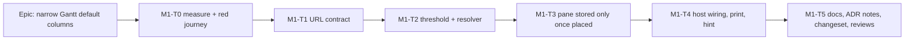

# Implementation Plan: The Gantt starts with fewer columns when it is narrow

- **Feature spec:** [`feature-spec.md`](feature-spec.md)
- **Status:** Built 2026-11-14 (M1-T0 measurement set aside; the journey is the check, run centrally)
- **Owner:** product owner; built by the `builder` agent, one pull request

## Breakdown

### Epic

One milestone, one commit boundary, **`@repo/web` minor** (a default a reader sees changes). No flag (ADR-0088 D1).
No schema, API or engine change; no database-architect run.

---

### Milestone M1: a narrow Gantt opens without Code and Finish

**Outcome:** with no column choice in the address and a Gantt frame below the derived threshold, the Gantt opens
without Code and Finish and the timeline gets the room; a stated choice wins everywhere; print is unchanged.
**Entry point:** opening the Gantt view (**Gantt** in the view switch); **View ▾ → Columns** to switch back.
**Journey:** new `apps/web/e2e-gantt-editing/narrow-default.spec.ts` (this suite runs at 1920 x 1080,
`playwright.gantt-editing.config.ts:50-52`; the new spec sets its own viewport).

> **Complexity:** M
> **Risks:** (1) Without T3 the change is invisible to anybody who has opened the Gantt (spec problem 3).
> (2) An unchanged `GANTT_VIEW_DEFAULTS` re-hides columns a planner ticked back on (spec problem 4).
> (3) A first frame painted before measurement flashes the wide set: resolve in a layout effect; unmeasured is
> not narrow. (4) Other journeys that read Code or Finish below the threshold: T0 lists them (explorer agent)
> and each either states `ghide` or is reworded; none is silently loosened. (5) The shared-hook option must leave
> the other consumers byte-identical.
> **Testing requirements:** unit as below; the new journey; `web:gantt-editing` and every suite T0 lists.

#### Task M1-T0: measure, and a check that fails on today's code

- **Description:** in a browser at 1024 x 768, 1280 x 800 and 1440 x 900, Explorer open and closed, with and
  without a baseline, record the Gantt frame width and the timeline width today; add the table to this folder as
  `m0-measurement.md`. If it contradicts the spec's Q2 sentence, stop and show the owner before T2.
  Then write the journey's first case and run it red on today's code:
  - fresh context, 1024 x 768, Explorer open, plan with a computed schedule, `?view=gantt` with no `ghide`;
  - the Code and Finish column headers are absent; Activity, Duration, Start and Float left are present;
  - timeline width / Gantt frame width >= `TIMELINE_MIN_SHARE` (a ratio, never a pixel figure). The constant
    lives in `pinned-geometry.ts`, the import-free module Playwright can already load (its lines 1-6 say why
    `column-widths.ts` cannot be);
  - every header cell's right edge <= the grid pane's right edge (nothing cut off);
  - `document.scrollingElement.scrollWidth <= clientWidth` (no sideways page scroll).
- **Complexity:** S

#### Task M1-T1: the URL contract

- **Description:** `parseHiddenColumns` returns `{ stated: true, hidden } | { stated: false }`;
  `HIDDEN_UNSTATED = 'auto'` becomes `GANTT_VIEW_DEFAULTS[ghide]`; `NARROW_DEFAULT_HIDDEN` added;
  `useGanttViewState` exposes `hiddenStated`. Docblocks at `gantt-view-state.ts:12-46, 69-76` corrected.
- **Complexity:** S
- **Testing (unit, `gantt-view-state.test.ts`, `use-gantt-view-state` test):** absent and `auto` are unstated;
  `none`, a list and an unknown-key list are stated exactly as today; `serialiseHiddenColumns` never yields
  `auto`; through the hook, ticking back to `{predecessors}` **keeps** `ghide=predecessors` in the URL (red on
  today's code); changing sort leaves an absent `ghide` absent.

#### Task M1-T2: threshold and resolver (pure)

- **Description:** `TIMELINE_MIN_SHARE` in `pinned-geometry.ts` (docblock carries its justification and T0's
  table); new `features/gantt/layout/narrow-default.ts`: `narrowThreshold({ swimlanesOffered, extraPinned, codeCount })` from
  `defaultGridWidth`, `resolveHiddenColumns({ parsed, frameWidth, threshold })`.
- **Complexity:** S
- **Testing:** stated wins at every width including 0; unstated with width 0 is the wide set; just below and at
  the threshold; a baseline, code columns and the Swimlane column each raise it; the threshold equals
  `wideSeed / (1 - share)` for the shipped widths (asserted from the constants, not a literal).

#### Task M1-T3: the pane is stored only once placed

> Changed in build, 2026-11-14 (owner): when the narrow default applies, Activity also opens at its 120 px floor (still draggable wider), so the narrow pane seeds at 402. Measured at 1024 with the Explorer open: with Activity at 180 the pane was 462 of a 747 px frame, a share of 0.38, short of two fifths; at 120 it is 0.46. Wide openings and stated choices are unchanged.

- **Description:** `useResizablePanelPrefs` gains `persist?: 'mount' | 'on-change'` (default `'mount'`, today).
  Under `'on-change'`: no mount write; an unplaced pane reads `defaultSize`; `setSize` stores; `resetSize` removes
  the key and returns to unplaced. `useGanttGridPrefs` passes it with the at-opening seed. If the owner answers
  Q1 "A", the key becomes `schedulepoint:gantt-grid-width.v2` and the old key is removed once. Correct
  `use-gantt-column-widths.ts:58-60`, `GanttPanel.tsx:569-572`, `column-widths.ts:254-258`.
- **Complexity:** S to M
- **Testing:** the shared hook's existing tests unchanged and green (the `'mount'` path); new cases for
  `'on-change'` (no write at mount, follows `defaultSize` while unplaced, stores on set, reset removes, storage
  throwing is silent). Journey case: with a pre-seeded old-key pane, the outcome matches the Q1 answer.

#### Task M1-T4: host wiring, print, the reason line

- **Description:** in `plan-workspace-toolbar.tsx`, measure the Gantt view's own box in a layout effect, resolve
  once per opening (plan id + view mount), pass `hidden` to the panel and chooser, `printHidden` (stated set, else
  `DEFAULT_HIDDEN_COLUMNS`) to print (`use-tsld-toolbar-context.tsx:887`), and `narrowDefault` to
  `GanttColumnsGroup`, which shows "Code and Finish start off when the Gantt is narrow. Tick them to show them."
  (muted, described-by, not announced).
- **Complexity:** M
- **Testing:** unit: the group shows the line only when `narrowDefault`; print receives the standard set when
  unstated and the stated set when stated. Journey cases: tick Code and Finish back on, both columns show and
  the address keeps `ghide`; reload, still shown; open `?ghide=none` at 1024, every column shows; open a URL
  with no `ghide` at 1920, today's columns; widen the window after opening narrow, columns do not change. Axe
  check on the open Columns list.

#### Task M1-T5: docs, changeset, reviews

- **Description:** ADR-0095 and ADR-0173 dated notes; CLAUDE.md section 16 lines; banner counts from
  `pnpm check:counts`; `docs/TEST_PLAYBOOK.md` if a catalogue plan is used; changeset `@repo/web` **minor**: "On a
  narrow screen a new Gantt view starts without the Code and Finish columns, so the timeline has room. Switch
  them back on in View, Columns. Views where you already chose columns are unchanged."
- **Reviews before merge:** component-reviewer (the shared-hook option), ux-reviewer (the reason line, the
  threshold's feel at 1024/1280/1440), accessibility-reviewer **in a browser** (the described-by line is read
  with the group, nothing is announced on opening, ticking still announces, reflow below 1024).
- **Gate:** `pnpm prepush`; `scripts/e2e-local.sh web:gantt-editing` and every suite T0 listed, one at a time.
