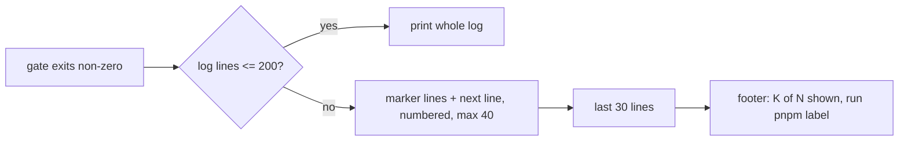

# Feature Spec: A failing gate shows its finding (`docs/TECH_DEBT.md` #276)

- **Status:** Approved — by the product owner, 2026-10-22, with all defaults
- **Author(s):** Claude (feature-analyst, for the product owner)
- **Date:** 2026-10-21
- **Tracking issue / epic:** `docs/TECH_DEBT.md` #276 (`:6927`) — repository tooling, one milestone
- **Roadmap link:** none (a tooling change a planner cannot act on; ADR-0136 precedent)
- **Related ADR(s):** ADR-0105 (why this is a spec), ADR-0164, ADR-0124, ADR-0058, ADR-0076

`scripts/prepush.sh` is a shared gate, so changing what it prints fires ADR-0105's trigger however
small the change (the row says so itself, `TECH_DEBT.md:6978-6981`). No product surface, schema,
API, role, pen or flag is involved.

## 0. Evidence (read at base `9dfb5e7`; nothing here was run)

- **E1** Both non-passing branches print `tail -12` of the log: WARN at `scripts/prepush.sh:168`,
  FAIL at `:172`. The row cites `:108,112`; those numbers are **stale** (the file grew with #280's
  `--push`), the behaviour is not.
- **E2** A passing gate prints only `ok` and its output is never shown (`prepush.sh:162-165`). That
  is ADR-0164's "no print-but-pass state" and this spec does not touch it.
- **E3** One log per **run**, overwritten by each gate (`:96`, `:162`) and deleted on every exit
  (`:97`; again before `exec git push`, `:218`). So printing the log's path would point at a file
  that holds a later gate's output, then does not exist.
- **E4** `check:doc-register` now chains **sixteen** test files with `&&` (`package.json:21`) — the
  row counted three, then twelve (`TECH_DEBT.md:6937-6942`). Its 110-line green output is the row's
  measurement (`:6942`), not re-taken here.
- **E5** The suites print `✗ <case>` then the error on the **next** line, and a summary last, then
  exit non-zero (`scripts/check-ci-roster.test.mjs:358-370`). Gate findings print `  ✗ <problem>`
  and a `FAIL — n finding(s)` summary last (`scripts/lib/doc-register.mjs:386,398`); a problem may
  itself span lines (`scripts/check-ci-roster.mjs:221-224`).
- **E6** The live hit was **not** a chained gate: `check:counts`, a single script, printed a FAIL
  and twelve lines that did not include the finding (`TECH_DEBT.md:6931-6935`).
- **E7** Every `run` label is also the `pnpm` script that reproduces it: `run "lint" pnpm lint`
  (`:181-183`) and `run "$gate" pnpm "$gate"` (`:199`).
- **E8** The harness to drive the real script in a throwaway tree with stub gates exists:
  `scripts/prepush-push.test.mjs:41-72` (copies `prepush.sh`, writes a stub `package.json`).

## 1. Business understanding

**Problem.** When a gate fails, `prepush` names it and then shows the last 12 lines of its output.
For any gate whose finding is more than ~11 lines from the end, the reader gets the verdict without
the reason and has to re-run the gate alone (E6). For the chained suites the failing **case** name
scrolls off while the file's summary survives (`TECH_DEBT.md:6944-6951`).

**Users.** Anyone running `pnpm prepush` or `pnpm prepush:push`, human or agent.

**Outcome.** A FAIL or WARN shows the lines that say **why**, within a bounded amount of output.

**Success criteria.** The row's case (a `✗` line more than 11 lines from the end) and E6's case (a
finding early in a long log) are both visible in `prepush` output; a passing gate is still silent.

## 2. Functional requirements

- **AC1** A non-passing gate whose log has **≤ 200 lines** prints the whole log, indented as today.
- **AC2** Above 200 lines it prints: every line matching the failure markers **plus the one line
  after each** (E5's error line), prefixed with its line number, capped at 40 matches; a `…`
  separator; the **last 30 lines**; and one footer line, _showing K of N lines; run
  `pnpm <label>` for all of it_ (E7). Bounded at roughly 115 lines whatever the gate printed.
- **AC3** Markers: `✗`, `×` (Vitest), the word `FAIL`, the word `error`/`Error` (ESLint, `tsc`
  `error TS…`), `ERR_`. Case-sensitive except `error`.
- **AC4** A passing gate still prints only `ok` (E2). Exit status, the `FAILED:`/`WARNED:` summary and
  every `--push` behaviour are unchanged.
- **AC5** WARN (`:166-169`) and FAIL (`:170-174`) use the same printing function.
- **AC6** The log stays per-run and is still removed on exit; no path is printed (E3).

**Edge cases.** An empty log prints nothing beyond the FAIL line (as today). A log with no marker
over 200 lines degrades to "last 30 + footer", which is still more than today's 12. Bytes that are
not valid UTF-8 are matched bytewise and printed unchanged.

**Permissions, validation, errors.** Not applicable — a local developer script with no input.

## 3. Technical analysis

Only `scripts/prepush.sh` and a new test change. Dependencies: `awk`, `wc`, `sed` — already used in
the repo's shell scripts and present on CI's `ubuntu-latest` and in the dev container.
`check:advisory-agreement` reads `ADVISORY_GATES` from this file (`prepush.sh:148-152`); the edit
does not touch that array. `scripts/prepush-push.test.mjs` asserts on refs and `NOT PUSHED`, never on
the tail, so it should pass unedited. ADR-0124's text says `prepush` "prints only `tail -12` of a
**passing** gate's log" (`docs/adr/0124-…:90`) — wrong when written (it is a failing gate's) and an
ADR is history, so it is left as is and not cited as current.

## 4. Solution design

A `show_log <label>` function in `prepush.sh` replaces both `tail -12 … | sed` lines. Constants
`LOG_WHOLE_MAX=200`, `LOG_MATCH_MAX=40`, `LOG_TAIL=30` sit beside it with one sentence each on why.

**Why 200.** The row's worst measured case is `check:doc-register` at 110 green lines plus the
failing case's message (E4); 200 keeps every chained-suite failure whole, where the reader most wants
everything. Bigger logs are `lint`, `typecheck` and `test` through turbo, where the whole log is
noise and the markers are the signal.

**Alternatives.**

- **Give each chained suite its own `check:*` key** (the row's other option). Rejected: sixteen new
  root gates means sixteen new CI steps, because `check:ci-roster` R1 requires each in CI
  (`scripts/check-ci-roster.mjs:213-226`), and it **would not have fixed the live hit** (E6), which
  was a single script. The row says do not do both (`TECH_DEBT.md:6986`).
- **Print the whole log, uncapped.** Simplest, but a failing `pnpm test` through turbo prints every
  workspace's output; a reader scrolling past thousands of lines loses the finding the other way.
- **Keep the failing log and print its path.** Needs a second per-gate file and its cleanup, and
  reintroduces the shared-path hazard #414 removed (`prepush.sh:93-95`). The footer's `pnpm <label>`
  reproduces the log with no file at all.
- **Wider fixed tail (e.g. `tail -60`).** Fixes the chained suites, not E6's early finding in a long
  log.

**ADR.** None. This changes what a script prints on failure, not what passes or blocks; ADR-0164's
pass/WARN/FAIL contract and ADR-0124's advisory declaration are untouched.

## 5. Questions for the product owner

None block. Defaults, each overturnable: the 200 / 40 / 30 numbers above; the marker set in AC3.

## 6. Links

- Plan: [`implementation-plan.md`](implementation-plan.md)
- Row: `docs/TECH_DEBT.md` #276
