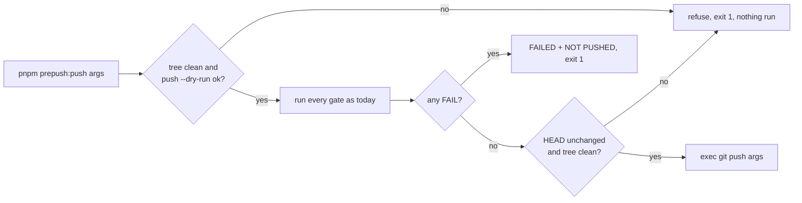

# Feature Spec + Plan: Two gate-invocation repairs (`docs/TECH_DEBT.md` #354, #280)

- **Status:** Approved — by the product owner, 2026-10-21, with all defaults
- **Author(s):** Claude (feature-analyst, for the product owner)
- **Date:** 2026-10-21
- **Tracking:** `docs/TECH_DEBT.md` #354 (`:9161`) and #280 (`:7510`) — repository tooling, two milestones
- **Related ADR(s):** ADR-0105 (why this is a spec), ADR-0058, ADR-0124, ADR-0164, ADR-0076

Both rows change a shared gate (`check:flags`) or its invocation (`prepush`), which ADR-0105 makes a
spec trigger regardless of size. No product surface, no schema, no API, no role, no pen, no flag.

## 0. Evidence (every claim below was read at base `46edeb56`)

- **E1** Assertion 4 scans the **whole** config text with the pin regex — `scripts/check-flags.mjs:246-248`.
- **E2** A shared stripper exists; it is regex-based and string-blind in two documented ways (`//` and
  `/*` inside a string) — `scripts/lib/strip-comments.mjs:11-17,24-26`. Its one caller is
  `scripts/check-engine-parity.mjs:55`; the blind spots are pinned by `check-engine-parity.test.mjs:293`.
- **E3** Blind spot 1 is present in today's configs (`'http://localhost:5173'`, e.g.
  `apps/web/playwright.config.ts:15`), but **no line carries both a URL and a pin** — grep for a pin
  and a `//` on one line, either order, over `apps/web/playwright*.config.ts`: no matches.
- **E4** Blind spot 2 (`/*` inside a string — the one that could swallow a **real** pin across lines)
  occurs in no config — grep for a quote followed by `/*` on one line: no matches; `testMatch`
  values are plain names (`apps/web/playwright.account.config.ts:29`).
- **E5** No config **today** has a comment-only pin, so the fix changes no current verdict — grep for a
  pin on a line starting `*` or `//`: no matches (#354's exhibit was reworded, row `:9200-9204`).
- **E6** `prepush.sh` exits 0/1 correctly; the #280 failure was the call site's pipe —
  `scripts/prepush.sh:9-11,159-171`, row `:7517-7524`.
- **E7** Only `check:*` keys join the derived roster, so `prepush:push` is not itself run as a gate —
  `scripts/prepush.sh:146-149`.
- **E8** Gate self-tests are chained in front of the gate (the `check:claims` shape) —
  `package.json:31`; the grab-bag script-test chain is `package.json:21`.
- **E9** No git `pre-push` hook exists; `.husky/` holds `commit-msg` and `pre-commit` only.
- **E10** The root package is private, so a changeset has nothing to release — `package.json:4`.

## 1. Problem and outcome

- **#354:** a comment that writes out a pin literal blocks a flag retirement as if it were a pin.
  Mild direction (blocks, never admits) but it has happened (row `:9171-9180`) and is the fifth
  instance of "a code scan reads prose". Outcome: assertion 4 sees pins in code only, and the
  stripper's blind spots cannot newly **hide** a real pin.
- **#280:** `pnpm prepush 2>&1 | tail -5 && git push` pushed on a red gate, because `&&` read
  `tail`'s status. Outcome: one command that runs the gate and pushes **only** on success, so no
  pipe at the call site can carry a push past a failure.

Users: anyone pushing to this repo, human or agent. Not a product capability, so no journey and no
entry point in the app (ADR-0081 is about user-facing capability); the entry point is the CLI command.

## 2. Requirements and acceptance criteria

**#354 — pins read from code, not comments**

- AC1: a config whose `env:` pins a retired flag `'false'` (or `'true'`) still fails `check:flags`.
- AC2: a config that mentions the same literal only in a `/** */` docblock or a `//` comment passes.
- AC3: a config with a `/*` inside a string literal, or a `//`-bearing string followed by a pin on
  the same line, is **refused loudly** naming file and line ("cannot read this safely") rather than
  read through the stripper's blind spot (ADR-0124: refuse by declaration). E3/E4: none today.
- AC4: no fifth private stripper — reuse `scripts/lib/strip-comments.mjs` unchanged (E2's "keep the
  copies identical").
- AC5: each fixture verified **red** against both wrong gates: the old raw scan (AC2 fixtures fail)
  and a stripper that removes everything (AC1 fixtures fail).

**#280 — gate and push in one process**

- AC6: `pnpm prepush:push [git-push-args…]` runs the full `prepush` and calls `git push <args>` only
  if no gate FAILed. Advisory WARN still pushes (same meaning as today, `prepush.sh:159-167`).
- AC7: on failure it prints `NOT PUSHED` beside the existing `FAILED:` line and exits 1; the remote
  is untouched. Piping it through `tail` cannot cause a push (the push is inside, after the check).
- AC8: refuses **before** running the gates if the working tree is dirty (`git status --porcelain`
  non-empty) — otherwise the gate validates content the push does not carry — and if
  `git push --dry-run <args>` fails (no upstream, bad ref), so a six-minute run (`docs/TESTING.md:401-402`)
  does not end in a push error.
- AC9: refuses after the gates if `HEAD` moved or the tree became dirty during the run.
- AC10: `--checks` with `--push` is refused: pushing on the checks alone skips lint/typecheck/test.

Edge: `pnpm prepush` and `--checks` behave exactly as today (no flag given → no new code path).

## 3. Design

**#354.** New `scripts/lib/playwright-pins.mjs` exports `findPins(text) → { pins: [{flag, value, line}], refusals: [...] }`:
run the AC3 refusal checks on raw text, then `stripComments` and the existing regex unchanged.
`check-flags.mjs:246-256` calls it; refusals become `problems` entries. Its docblock (assertion 4,
`:26-32`, `:229-243`) gains one paragraph citing #354.

**#280.** `scripts/prepush.sh` gains `--push` (rest of argv forwarded to `git push`), and
`package.json` gains `"prepush:push": "bash scripts/prepush.sh --push"`. One script, so the push
cannot run on a different roster from the gate.

**Alternatives rejected.** #280 option 1 (sentinel file) guards the call site instead of removing
it, and still needs the caller to read it. A husky `pre-push` hook (E9) would make every push cost
~6 minutes and is bypassed by `--no-verify` — the bypass `scripts/prepush.sh:64-66` warns of. Option 3
(rely on CI) leaves `main` unprotected (CLAUDE.md §8). For #354, a TypeScript parser would remove
the blind spots but is a new dependency for one regex; AC3's refusal closes the dangerous half.

## 4. Implementation plan

**Epic: gate-invocation repairs.** Two milestones, each one commit that leaves `main` releasable.
Every step runs in the session container; **nothing asks the owner to test or measure anything.**

**M1 — #354 (S).** Depends on nothing.

- T1 `scripts/lib/playwright-pins.mjs` + `scripts/lib/playwright-pins.test.mjs` (node:assert, the
  `check-adr-coverage.test.mjs` shape): fixtures for AC1 (`'false'` and `'true'`), AC2 (docblock,
  `//`, and #354's exhibit wording), AC3 (both refusals), and two pass-through pins of the URL case
  that _is_ safe (URL line, pin on the next line).
- T2 Verify red (AC5): run the suite against the raw regex, then against `() => ''`; record both
  outcomes in the commit body.
- T3 Rewire `check-flags.mjs:244-256`; `package.json` → `"check:flags": "node scripts/lib/playwright-pins.test.mjs && node scripts/check-flags.mjs"`.
- T4 Confirm unchanged verdict on today's tree (E5): `pnpm check:flags` green, same summary line.
- T5 Close #354 in `docs/TECH_DEBT.md` in the form `check:debt-status` accepts.
- Risk: the stripper's blind spot hides a future pin → AC3 refuses instead. Tests: T1, `pnpm prepush`.

**M2 — #280 (S).** Independent of M1; lands second only to keep commits small.

- T1 `prepush.sh`: parse `--push`, AC8 preflight, AC9 post-check, AC10 refusal, `exec git push "$@"`;
  update its usage block (`:23-27`).
- T2 `scripts/prepush-push.test.mjs`: copies `prepush.sh` into a temp repo with a bare local remote
  and a stub `package.json` (`lint`/`typecheck`/`test` as no-ops, `check:pass`, `check:fail`,
  `check:reconcile-due` exiting 2). Cases: green → remote ref advances; FAIL → unchanged + `NOT
PUSHED`; **the #280 replay** (`bash -c '… | tail -5'` with a failing gate) → unchanged; WARN only
  → pushes; dirty tree → refused before any gate runs; `--checks --push` → refused. Verify each red
  by making the push unconditional. Chain into `check:doc-register` (`package.json:21`).
- T3 Docs: `docs/TESTING.md` "Before you push" (`:377`) names `pnpm prepush:push` as the way to push
  and says why; CLAUDE.md §19.8 gains one clause naming it; close #280 in `docs/TECH_DEBT.md`.
- Risk: `pnpm` forwards args differently than expected → T2 exercises `pnpm prepush:push origin HEAD`
  through pnpm, not only `bash`. Risk: test cost — stub gates are no-ops, so seconds.

**Gates for both:** `pnpm prepush`. No `apps/api` change, no Playwright suite, so no e2e half.

## 5. Change impact

- **ADR:** none. No architectural decision; both apply existing ones (ADR-0058, ADR-0124).
- **Changeset:** none — root package is private (E10); nothing in `apps/*` or `packages/*` changes.
- **Docs:** `docs/TESTING.md` "Before you push"; CLAUDE.md §19.8 (one clause); `docs/TECH_DEBT.md`
  #354 and #280 closed; docblocks in `check-flags.mjs` and `prepush.sh`.
- **Agents:** none of database/api/security needed. Review with **devops-reviewer** (shell script,
  git invocation) and **test-engineer** (fixture design and the red verification).

## 6. Questions for the product owner

None block. One default to confirm or overturn: **CLAUDE.md §19.8 names `pnpm prepush:push`** (one
clause, costed against §19.14's always-loaded rule), because §19.8 is where every agent learns how to
push; leaving it only in `docs/TESTING.md` repeats the "documented but not where the habit forms" gap
#280 records.
