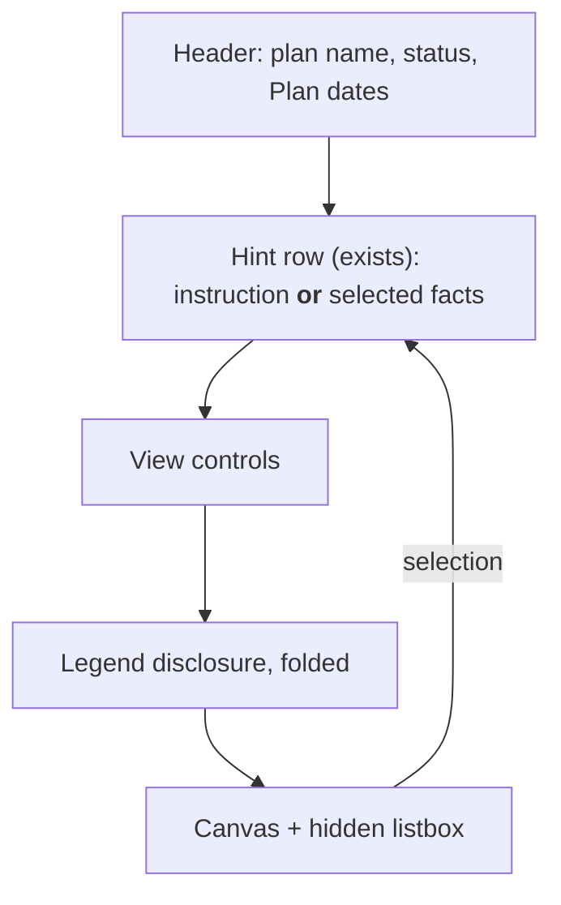

# Feature Spec: A guest who selects an activity reads its facts

- **Status:** Approved — by the product owner, 2026-11-14: show the float as "Total float", with Critical or Near-critical beside it. Not yet built.
- **Author(s):** feature-analyst (Claude Code), for the product owner
- **Date:** 2026-11-14
- **Tracking issue / epic:** walkthrough finding rank 16, second half (product owner, 2026-11-14)
- **Roadmap link:** none; a follow-on to Batch F (`d21450a`, the guest legend)
- **Related ADR(s):** ADR-0051 §4 as amended by ADR-0163, ADR-0198, ADR-0205 and ADR-0210 (the guest scope), ADR-0026
  §7 and ADR-0218 (selection by keyboard and click), ADR-0132 (announced once), ADR-0187 (a bar leads with its
  subject), ADR-0184 (a subject wraps, never clips), ADR-0179 (1024 x 600 floor, reflow below), ADR-0142 (measure
  before building), ADR-0064 and ADR-0092 (nothing overlays the diagram), ADR-0081 (entry point and journey),
  ADR-0088 D1 (no flag)

---

## In plain English

Today, when your client opens the shared link and clicks a bar, the bar gets a ring and nothing else happens on the
screen. After this change, the line just above the diagram that reads "Drag to pan, scroll to zoom. The critical path
is highlighted." is replaced, while something is selected, by that activity's facts:

> **Pour slab, A1020** · Start 3 Mar 2026 · Finish 14 Mar 2026 · Total float 4 d · Progress 40% · Status In progress

Click empty ground or press Esc and the instruction comes back. Nothing new is sent to your client: every one of
those facts is already in what the shared page downloads today. The diagram does not get shorter, because the facts
use the line the instruction already occupies. It is read-only; there are no buttons in it.

---

## 1. Business understanding

### Problem

`GuestPlanView.tsx:280-316` mounts `TsldPanel` with `canEdit={false}` and `guestChrome`. A guest can select a bar
(pointer, or Tab to the diagram and the arrow keys, ADR-0026 §7, ADR-0218), but the selection shows only a ring. The
single-activity bar that members see is not mounted for a guest: `TsldPanel.tsx:1949-1950` wires it only when the host
passes `onOpenLogic`, `onEditActivity` and `onDeleteActivity`, and the guest page passes none. What a selection says
is one live-region sentence (`announceSelectionCount`, `TsldPanel.tsx:2215-2218`, the option's `describeActivity`
text) and the listbox option name. A sighted client therefore cannot read status or progress anywhere, and reads
dates only by estimating them against the time axis.

### Users

External Guests holding a share link (ADR-0051). Members are untouched: the workspace mounts `TsldPanel` chromeless,
and the row this changes is not rendered when chromeless (`TsldPanel.tsx:3378`).

### Primary use cases

1. A client clicks a bar and reads when it starts and finishes, how much float it has, and how far along it is.
2. A keyboard client Tabs into the diagram, arrows through activities, and reads each one's facts on screen.

### Success criteria

- At 1024 x 600 the facts appear on selection and the diagram's height is the same selected and unselected (journey,
  an equality, no pixel figures).
- Selecting sends no request (journey counts share requests before and after).
- The facts' dates are the dates the listbox option speaks for the same activity (journey compares the two strings).

### Open questions

**Critical (owner):**

- **Q1. Show a float number?** The shared link already carries each activity's **total float** (ADR-0051 §4 names
  it). On a bar the planner has moved by hand, members see a different, smaller figure, "float left", which a guest is
  not sent (ADR-0163). So a client could read "Total float 10 d" where the planner's screen says "2d float left".
  Recommended: **show it, labelled "Total float"**, the activity editor's own label (`activity-editor-context.ts:38`),
  with "Critical" or "Near-critical" beside it where that applies. Alternative: show only the word (Critical,
  Near-critical, or nothing), which is what the spoken sentence does today (ADR-0198 D3).

**Defaults (no answer needed; say if you disagree):**

- D1. The facts take the instruction's line while something is selected (section 4.2); they never get a line of their
  own.
- D2. Actual start and finish, and duration, are not shown: duration is already printed under each bar
  (`centreItemText`, `a11y.ts:101-114`), and two more dates would push the line past one row at 1024 wide.
- D3. With two or more selected (Ctrl-click), the line reads "3 activities selected." and no facts.
- D4. The spoken sentence does not change; the facts are plain text on the page, not announced (section 4.4).

## 2. Functional requirements

### What the guest is sent today (verified)

`GuestActivityDto.from` (`apps/api/src/modules/share/dto/guest-activity.dto.ts:188-217`), used by
`share-guest.service.ts:160`, copies exactly: `id`, `code`, `name`, `type`, `durationDays`, `durationMinutes`,
`derivedDurationMinutes`, `derivedDurationDays`, `laneIndex`, `memberOfSwimlaneId`, `swimlaneLaneIndex`, `earlyStart`,
`earlyFinish`, `lateStart`, `lateFinish`, `totalFloat` (line 139-140, working days), `isCritical`, `isNearCritical`,
`status` (153-154), `percentComplete` (156-157), `actualStart`, `actualFinish`, `visualEffectiveStart`,
`visualEffectiveFinish` (165-185). Excluded by construction (docblock 32-49): `remainingFloat`, `visualStart`,
`visualConflict*`, `visualDriftDays`, cost, resources, baselines, notes, constraints, audit columns.
`GuestPlanViewDto.from` (`guest-plan.dto.ts:201-214`) adds the plan header, calendar, summary and swimlanes; none is
needed here.

| Owner asked for | In the payload?                                                    | Shown as                         |
| --------------- | ------------------------------------------------------------------ | -------------------------------- |
| Dates           | yes: `visualEffectiveStart/Finish` (drawn), also early/late/actual | Start, Finish (the drawn span)   |
| Float           | `totalFloat` yes; `remainingFloat` ("float left") **no**           | Total float (Q1)                 |
| % complete      | yes: `percentComplete`                                             | Progress                         |
| Status          | yes: `status`; criticality from `isCritical`/`isNearCritical`      | Status; criticality beside float |

**Restricted links.** There are none to honour. A link has only `label` and `expiresAt`
(`create-share.dto.ts:11-39`); ADR-0198 records per-link scoping as rejected (line 55). Every guest gets the same
payload, and the facts read only from it.

### User stories and acceptance criteria

> **US1.** As a guest, I want to read a selected activity's facts, so I know when it happens and how it stands.
>
> - **Given** nothing selected, **then** the row above the diagram reads today's instruction, unchanged.
> - **When** I click a bar, or focus the diagram and press an arrow key, **then** that row reads the activity's
>   name (and code), Start, Finish, Total float, Progress and Status, and the instruction is gone.
> - **When** I arrow to another activity, **then** the row shows that one.
> - **When** I press Esc or click empty ground, **then** the instruction returns.
> - **Then** at 1024 x 600 the diagram is the same height in every one of those states.

### Edge cases

| Case                                     | Line reads                                                              |
| ---------------------------------------- | ----------------------------------------------------------------------- |
| Milestone (start equals finish)          | one date, labelled "Date"                                               |
| WBS summary                              | no float fact (0 by convention, ADR-0197; as `a11y.ts:209-210`)         |
| `totalFloat` null                        | no float fact                                                           |
| Plan never calculated (drawn start null) | name, then "Not yet scheduled" in place of dates and float              |
| Two or more selected                     | "3 activities selected." (D3)                                           |
| Very long name                           | the name wraps; it is never cut (ADR-0184); M0 measures where it starts |

### Permissions, validation, errors

No permission, no write, no request, no validation. The facts are derived from data already in the query cache.
Nothing can fail that does not already fail the page.

## 3. Technical analysis

| Area           | Impact | Notes                                                                                       |
| -------------- | ------ | ------------------------------------------------------------------------------------------- |
| Frontend       | low    | One pure facts builder, one small read-only component, one branch in `TsldPanel`'s hint row |
| Backend / API  | none   | No endpoint, DTO or service change; `guest-dto.spec.ts` key sets untouched                  |
| Database       | none   | No schema change, so no database-architect run                                              |
| Security       | none   | Nothing new leaves the server; confirmed by security-reviewer (section 5)                   |
| Performance    | low    | One `find` by id per selection; no canvas, painter or layout change                         |
| Infrastructure | none   | No flag (ADR-0088 D1)                                                                       |
| Testing        | low    | Unit (builder, component, panel branch), the share journey                                  |

**Recalculation parity.** No scheduling input; `computeSchedule` is untouched. **The pen.** A guest never writes.
**Print and export.** No change to `render/`, `export/` or the printed programme; a guest has no export control.
Browser print of the page prints what the screen shows, as it does today with the instruction.

## 4. Solution design

### 4.1 Where it goes, and why there

The guest page has **no foot row**: it registers no `CanvasDockOutlet`, so `CanvasDock` renders in place, between
the legend and the canvas (`canvas-dock.tsx:160-163`; `TsldPanel.tsx:3463`). A strip there would push the diagram
down, the cost the dock was built to remove. The row that already exists and is nearly empty is the hint row
(`TsldPanel.tsx:3379-3405`): for a guest it holds one sentence, because Batch F removed the shortcuts button from its
right end (`!guestChrome`, line 3395) and the editing toolbar needs `canEdit`.

| Option                                   | Why not chosen                                                                                                                                                            |
| ---------------------------------------- | ------------------------------------------------------------------------------------------------------------------------------------------------------------------------- |
| Popover anchored to the bar              | Overlays the diagram (ADR-0064, ADR-0092), must track pan and zoom: the selection bar's per-frame placement loop was deleted for this (`selection-actions.tsx:1340-1344`) |
| A strip in the dock, or a new foot row   | Costs diagram height on every selection (or always)                                                                                                                       |
| The header                               | About 350 px free at 1024 beside the plan dates; the facts would wrap; and they would sit away from the diagram they describe                                             |
| Beside the instruction, on the same line | About 550 px free at 1024; name plus five facts exceeds it, so it wraps and costs height                                                                                  |

### 4.2 The line

- **Replaces the instruction while one or more activities are selected** (D1); `guestChrome` only. The selection
  proves the reader has found the diagram, which is what the instruction teaches.
- **Leads with its subject** (ADR-0187): `activityLabel(a, withCodes)` (`a11y.ts:59-70`), the listbox option's own
  identity, in the foreground colour; then the facts, muted labels and foreground values, `text-xs`, each fact
  `whitespace-nowrap`, the row `flex-wrap` with zero row gap, the pattern of `PlanFacts`' `Fact`
  (`plan-facts.tsx:266-283`). `min-h-5` keeps the row at the instruction's 20 px line box, so selecting cannot shrink
  it either.
- **A `<dl aria-label="Selected activity">`**, no interactive children (the `ContextStrip` contract,
  `form-layout.tsx:274-275`), so nothing in it takes focus and no focus rule applies (ADR-0135 is not engaged).

### 4.3 Wording (one vocabulary)

| Fact        | Source                                                 | Label and format                                                                         | Precedent                                                 |
| ----------- | ------------------------------------------------------ | ---------------------------------------------------------------------------------------- | --------------------------------------------------------- |
| Start       | `barDatesFor(a, barDateSource).start` (the drawn date) | "Start 3 Mar 2026", `formatCalendarDate`                                                 | Gantt grid `grid-columns.ts:101`, CSV `export-csv.ts:114` |
| Finish      | `.finish`                                              | "Finish 14 Mar 2026"                                                                     | `grid-columns.ts:109`, `export-csv.ts:115`                |
| Total float | `totalFloat`                                           | "Total float 4 d", `formatFloat`; "· Critical" or "· Near-critical" from `criticality()` | editor `activity-editor-context.ts:37-41`, CSV `:120`     |
| Progress    | `percentComplete`                                      | "Progress 40%"                                                                           | editor `activity-editor-context.ts:50-53`                 |
| Status      | `status`                                               | "Status In progress", `ACTIVITY_STATUS_LABELS`                                           | `lib/activity-status-labels.ts:6-10`, CSV `:112`          |

Start and Finish are the **drawn** dates, not "Early start": the editor's early dates are the network's and can
differ from where a placed bar is drawn, and the bar, the spoken sentence and this line must agree (`a11y.ts:153-185`).
"Status" means progress here, as in the CSV; the editor's strip uses "Status" for criticality
(`activity-editor-context.ts:55`), so criticality is put beside the float instead, never under that word.

### 4.4 Keyboard and announcements

Selection already works by click (ADR-0218) and by the listbox's arrows and Esc (ADR-0026 §7); nothing new is bound.
The selection is already announced **once**, by `announceSelectionCount` with the option sentence
(`TsldPanel.tsx:2210-2225`). The line is a standing condition, not an event (ADR-0132): it is not a live region and
announces nothing, as `PlanFacts` announces nothing (`plan-facts.tsx:38-48`). A screen-reader user can read it in
browse mode. The option sentence is unchanged (D4); the accessibility review decides in a browser whether status and
progress need a clause in it, which would be a guest-only option to `describeActivity`.

### 4.5 Sizes

At 1024 x 600 the row is about 990 px wide (`main p-4`). The line's ink for a 20-character name is roughly 500 px, so
it fits with room; a long name wraps onto a second 16 px line, a cost of about 12 px only while that activity is
selected. **This is an estimate, which is why M0 measures it** (ADR-0142). Below 1024 the facts wrap whole (ADR-0179);
at 320 nothing scrolls sideways (the share journey already drives 320, `share.spec.ts:187`).

### 4.6 Components

- New `apps/web/src/features/tsld/model/selected-activity-facts.ts` (pure): `selectedActivityFacts(activity,
barDateSource)` returns the subject and the ordered fact list per section 4.3 and the edge-case table. In `tsld`,
  not `share`, because `TsldPanel` renders it and `share` already depends on `tsld`.
- New `apps/web/src/features/tsld/components/GuestSelectionFacts.tsx`: renders the `<dl>`.
- `TsldPanel.tsx` hint row: `guestChrome && selection.ids.length > 0` renders `GuestSelectionFacts` (or the count),
  otherwise today's `
`.
- `GuestPlanView.tsx`: no change. API: none.

### 4.7 ADR handling

No new ADR: no scope change, no new pattern. A dated note under ADR-0051 §4 records that the guest page now shows a
selected activity's facts, read from the existing scope. The CLAUDE.md banner's web source file count changes (two
files and their tests); `pnpm check:counts` prints the number.

## 5. Links

- Implementation plan: [`implementation-plan.md`](implementation-plan.md)
- Docs updated by the change: ADR-0051 (dated note), CLAUDE.md banner count, `TsldPanel`'s `guestChrome` docblock.
