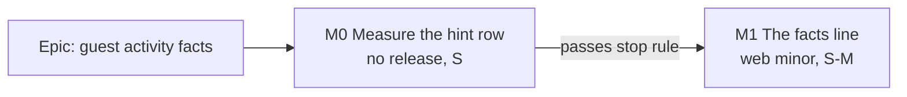

# Implementation Plan: A guest who selects an activity reads its facts

- **Feature spec:** [`feature-spec.md`](feature-spec.md)
- **Status:** Approved (2026-11-14); float shown as "Total float"
- **Owner:** product owner; built by the `builder` agent, one milestone per pull request

## Breakdown

### Epic

**Guest activity facts**: a selected activity's read-only facts on the shared page, in the row the instruction
already occupies. No flag (ADR-0088 D1); each milestone is its own commit boundary. No `apps/api` diff in either.

---

### Milestone M0: measure before building (no release)

**Outcome:** a reading, not a feature. **Ships dark:** nothing user-facing.
**Journey:** none; a measurement spec beside the share suite, run under `playwright.share.config.ts`, readings written
to `docs/specs/guest-activity-details/m0-measurement.md`.

- **Description:** on a shared link, at 1024 x 600, 1280 x 800 and 320 x 720, mouse and finger: record the hint row's
  height and the canvas height with nothing selected; then, with a stand-in line of the final markup (subject plus the
  five facts) injected in place of the instruction, for names of 10, 20, 40 and 80 characters and for the longest
  activity name in a catalogue plan (the builder picks one from `docs/TEST_PLAYBOOK.md` and records which). Record the
  name length at which the line first wraps at 1024.
- **Complexity:** S
- **Stop rule:** if a 40-character name changes the canvas height at 1024 x 600 on either pointer, **stop** and put
  the readings to the owner (the fallbacks are shorter labels, or dropping Status into the float note). A wrap past 40
  characters is the accepted cost and is recorded, not refused (ADR-0184: a name is never cut). Also stop if the
  instruction line and the facts line differ in height with no selection-dependent wrap (the `min-h-5` premise).

---

### Milestone M1: the facts line (web minor)

**Outcome:** a guest who selects an activity reads its name, Start, Finish, Total float (per Q1), Progress and Status.
**Entry point:** selecting a bar on the shared page: click it, or Tab to the diagram and press an arrow key.
**Journey:** `apps/web/e2e-share/share.spec.ts`, a new case (below).

#### Feature: builder, component, panel branch

> **Complexity:** S to M
> **Dependencies:** M0 passed; the owner's answer to Q1 (only the float fact depends on it)
> **Risks:** the line and the spoken sentence disagree on dates → both read `barDatesFor` with the panel's
> `barDateSource`, and the journey compares them. The row's height moves on selection → `min-h-5`, M0's reading, and
> the journey's equality. A future host passes `guestChrome` while chromeless → the branch sits inside the
> non-chromeless row, so it cannot render there; the `guestChrome` docblock says so.
> **Testing requirements:** unit, the share journey, browser reviews.

##### Task M1-T1: `selected-activity-facts.ts` (pure)

- **Description:** `selectedActivityFacts(activity, barDateSource)` returns `{ subject, facts: { label, value,
note? }[] }` per spec section 4.3: drawn Start/Finish (one "Date" when equal); Total float with `criticality()` as
  the note, omitted for a WBS summary or a null float; Progress; Status. Drawn start null returns the subject and
  "Not yet scheduled" only. `subject` is `activityLabel(a, withCodes)`.
- **Complexity:** S
- **Testing:** unit, one case per row of the spec's edge-case table, plus: Late source is never passed by the guest
  (`barDateSourceFor(false)`), but the builder honours whatever it is given; labels are exactly the vocabulary table's.

##### Task M1-T2: `GuestSelectionFacts.tsx` and the `TsldPanel` branch

- **Description:** the `<dl aria-label="Selected activity">` (subject first, `text-xs`, nowrap facts, `flex-wrap
gap-y-0`, `min-h-5`, `data-testid="guest-selection-facts"`). In `TsldPanel`'s hint row: when `guestChrome` and one
  activity is selected, the component; two or more, "N activities selected."; none, today's `
`. Extend the
  `guestChrome` prop docblock.
- **Complexity:** S
- **Dependencies:** M1-T1
- **Testing:** unit on `TsldPanel` with `guestChrome`: instruction with nothing selected; facts after an arrow key;
  instruction again after Esc; count at two selected; **without** `guestChrome` the row is unchanged on selection;
  the line contains no focusable element; no announcement is added (the announcer receives the option sentence once,
  as today). `GuestPlanView.test.tsx` gains one selection case.

##### Task M1-T3: journey, reviews, docs, release

- **Description:** a new case in `share.spec.ts`, machine-independent (no pixel figures, no dates typed into the test
  that the seed does not set):
  1. At 1024 x 600: open the link; record the canvas height and the count of `/api/v1/share/` requests.
  2. Focus the listbox, press ArrowDown: the facts line is visible; its Start and Finish strings appear in the
     selected option's text; Status reads the seeded status; Progress the seeded percent.
  3. Canvas height equals step 1's; the share request count equals step 1's.
  4. Esc: the instruction is back. Click a bar: the facts are back (pointer path).
  5. At 320 x 720 with a selection: no horizontal scroll (the suite's existing 320 check, `share.spec.ts:187`).
     Reviews before release: **accessibility-reviewer in Chromium** (browse-mode reading of the line, nothing announced
     twice, whether the option sentence needs a progress clause, spec D4); **component-reviewer** (the new component
     against `ContextStrip` and `PlanFacts`' `Fact`, no one-off styling); **ux-reviewer** (wording, order, the
     instruction yielding); **security-reviewer**, scoped to confirming no `apps/api` diff, no new fetch in
     `GuestPlanView`/`guest-api.ts`, and `guest-dto.spec.ts` untouched.
- **Complexity:** S
- **Development steps:**
  1. Journey, reviews, fixes.
  2. ADR-0051 §4 dated note; CLAUDE.md banner web source file count from `pnpm check:counts`.
  3. Changeset: `@repo/web` **minor**, "On a shared plan, selecting an activity shows its start, finish, total float,
     progress and status."

**Suites to run, one at a time:** `pnpm prepush`, then `scripts/e2e-local.sh web:share`, and `web:workspace-chrome` as
a smoke run because `TsldPanel` is touched (the branch is guest-only and the workspace is chromeless, so the foot-row
suites are not owed). Set `PLAYWRIGHT_CHROMIUM_PATH` (`docs/HANDOFF.md`). Read every CI shard on the current head.

## Sequencing

1. **M0** (no release) on approval.
2. **M1** (web minor) after M0 passes and Q1 is answered.

## Definition of Done

The Feature Completion Criteria in [`docs/PROCESS.md`](../../PROCESS.md): `pnpm prepush` run, the suites above run
locally, every check on the current head green after deduping by name, a changeset, and the docs named above in the
same pull request.

## Risks and assumptions

| Risk / assumption                                                   | Likelihood | Impact | Mitigation                                                          |
| ------------------------------------------------------------------- | ---------- | ------ | ------------------------------------------------------------------- |
| The line wraps at 1024 for ordinary names                           | low        | med    | M0 measures first and stops                                         |
| A client reads "Total float" as the planner's "float left"          | med        | low    | Q1; the label is the editor's, never "float left"                   |
| A screen-reader guest misses status and progress inside the listbox | med        | low    | Browser accessibility review decides on a sentence clause           |
| Something new reaches the guest                                     | very low   | high   | No `apps/api` diff; request count in the journey; security-reviewer |
