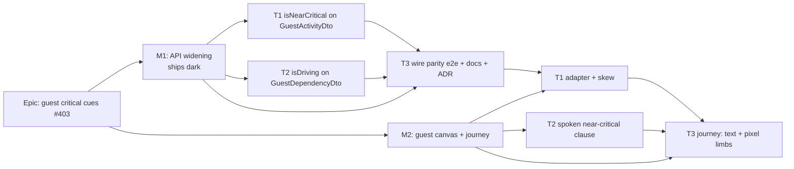

# Implementation Plan: A share link shows the near-critical rung and the driving links

- **Feature spec:** [`./spec.md`](./spec.md)
- **Status:** Approved — with the spec, 2026-10-17
- **Owner:** unassigned (api + web)

## Breakdown

### Epic

**Guest critical cues**: the External-Guest share view draws and speaks the near-critical rung and
the driving links a member sees. `docs/TECH_DEBT.md` #403. No roadmap theme; this is a register-row
fix that widens a security boundary.

**Flag:** none. ADR-0088 D1: a `VITE_*` flag cannot be switched off in a published image, so the
rollback is the commit boundary between M1 and M2 (or a revert of either). The guest surface itself
stays under the existing default-on `VITE_GUEST_SHARE_LINKS` (`apps/web/src/config/env.ts:674`).

**Q1 gate.** If the product owner answers Q1 "no", delete M1-T2, the dependency half of M2-T1, and
FC-2 and the `i` limb of FC-7. Nothing else moves.

---

### Milestone M1: API widening (shippable slice)

**Outcome:** `GET /api/v1/share/activities` returns `isNearCritical`, and
`GET /api/v1/share/dependencies` returns `isDriving`, each equal to the member read, each with a
written reason, and backed by an ADR amending ADR-0051 §4.
**Entry point:** `Ships dark: the web adapter still hard-codes both to false (guest-api.ts:243, :314), so no guest sees a difference until M2. An older web bundle ignores the extra keys (guest-api.ts:43).`
**Journey:** none in M1. It is dark by declaration (ADR-0081 §1), and M2 carries the journey.

---

#### Feature F1.1: near-critical on the guest activity

> **Description:** `GuestActivityDto` exposes `isNearCritical`.
> **Complexity:** S
> **Dependencies:** spec approved, Q1 answered (D1 does not depend on Q1).
> **Risks:** a mapper that hard-codes `false` passes a fixture whose value is already `false`
> (`guest-dto.spec.ts:71`). Mitigated by flipping the fixture to `true` (FC-3).
> **Testing requirements:** DTO unit (exact keys, forbidden list, value). API e2e parity (FC-1).

##### Task M1-T1: `GuestActivityDto.isNearCritical` (≈ one PR, with T2 and T3)

- **Description:** add the property and its mapping. Remove `'isNearCritical'` from
  `FORBIDDEN_ACTIVITY_KEYS`. Add it to the exact-key list **with a written reason comment**, as every
  sibling has.
- **Complexity:** S
- **Dependencies:** none
- **Risks:** the docblock reasons drift from the ADR. Mitigation: quote the ADR's D1 sentence.
- **Testing:** `apps/api/src/modules/share/dto/guest-dto.spec.ts`. Run red first: add the key to the
  exact-key list and set the fixture to `true` **before** touching the DTO, and record the failure.
- **Development steps:**
  1. In `guest-dto.spec.ts`: set `isNearCritical: true` in `activityRow()` (`:71`). Move
     `'isNearCritical'` from `:143` into the exact-key list (`:190-223`) with a reason comment.
     Assert `dto.isNearCritical === true` in the value case (`:230-240`). Run it and record red.
  2. In `guest-activity.dto.ts`: add `@ApiProperty({ description: … })` `isNearCritical!: boolean`
     beside `isCritical` (`:114-115`). Add `isNearCritical: entity.isNearCritical` in `from()`
     (`:170`). Update the class docblock (`:20-45`) with the reason (spec §4.5.1).
  3. Run green.

#### Feature F1.2: driving on the guest dependency

> **Description:** `GuestDependencyDto` exposes `isDriving`, the engine-owned link flag only.
> **Complexity:** S
> **Dependencies:** Q1 answered "yes".
> **Risks:** confusing it with `ResourceAssignment.isDriving`. Mitigated by naming the exclusion in
> the docblock, the ADR and the API docs, and by FC-4's wire list still containing
> `resourceAssignments`.
> **Testing requirements:** DTO unit, API e2e parity with mixed true/false edges (FC-2).

##### Task M1-T2: `GuestDependencyDto.isDriving`

- **Description:** add the property and mapping. Remove `'isDriving'` from the dependency forbidden
  list (`guest-dto.spec.ts:314`). Add it to the exact-key list (`:302-308`) with a reason comment.
- **Complexity:** S
- **Dependencies:** none (parallel with T1)
- **Risks:** as F1.2.
- **Testing:** `guest-dto.spec.ts`, run red first. The fixture already has `isDriving: true`
  (`:285`). Add a value assertion that it carries through.
- **Development steps:**
  1. Update the spec file and record red.
  2. In `guest-dependency.dto.ts`: add `@ApiProperty` `isDriving!: boolean`, map
     `entity.isDriving`, and rewrite the docblock at `:8-21`. It currently says the DTO
     "deliberately omits the engine-owned `isDriving`"; it should state D2's reason and name
     `ResourceAssignment.isDriving` as still excluded.
  3. Run green.

#### Feature F1.3: wire-level parity, documentation and the ADR

> **Description:** prove the guest and member reads agree on a real database, and file the decision.
> **Complexity:** S
> **Dependencies:** M1-T1, M1-T2
> **Risks:** a fixture with no near-critical row, or with no non-driving edge, proves nothing.
> Mitigated by the in-case preconditions (FC-1, FC-2).
> **Testing requirements:** Supertest e2e against Postgres; `scripts/e2e-local.sh api`.

##### Task M1-T3: e2e parity, docs, ADR, changeset

- **Description:** add two e2e cases, update the docs, and file the ADR.
- **Complexity:** S
- **Dependencies:** M1-T1, M1-T2
- **Risks:** the e2e plan's calendar decides whether a float lands in the band (spec §4.8 N2).
  Mitigation: pick a float of 1–2 working days, which is inside the band on any calendar.
- **Testing:** `apps/api/test/share-guest.e2e-spec.ts`.
- **Development steps:**
  1. Fixture through the member REST API, then recalculate. The data date is a Monday.
     - A (5 d) → B (5 d), FS: driving, both critical.
     - A → C (3 d), FS, with C having no successor: C has about 2 d float, so it is near-critical
       (make-open-ends-critical left at its default).
     - D (1 d) → B, FS: **non-driving**, because B is held by A.
  2. **FC-1:** read members and guest. Assert at least one member row has `isNearCritical: true`
     (precondition). Then for every id, guest equals member.
  3. **FC-2:** assert at least one member edge is `true` and at least one is `false` (precondition).
     Then for every id, guest equals member.
  4. Leave the wire `FORBIDDEN_KEYS` list (`:285-317`) unchanged (FC-4). Add a comment that the two
     new fields are exposed by the new ADR and are deliberately absent from it.
  5. Update `docs/API.md:754-755` and `:766-772`. Optionally correct the stale "default off" at
     `:779` (spec §4.6).
  6. File the ADR (next free number, ADR-0198 on 2026-10-17) from spec §4.7. Add its one line to
     CLAUDE.md §16. Amend ADR-0051's status line ("Amended by ADR-0163 … and ADR-0198 …"). Set
     this spec to `Approved`, and to `Accepted — shipped (ADR-0198)` once M2 ships
     (`check:spec-status` S3 refuses a cited Draft).
  7. Add a changeset for `api` (minor). In words: every live share link now returns two more
     fields.
  8. Run `pnpm prepush` and `scripts/e2e-local.sh api`. **Reviewers:** security-reviewer (the
     scope widening, against spec §4.5) and api-reviewer (OpenAPI descriptions, additive contract).

---

### Milestone M2: guest canvas and journey (shippable slice)

**Outcome:** a guest sees near-critical bars and nodes, sees driving links heavier and in their
rung, hears "near-critical" in the listbox, and hears "start driven by …" on `i`. The legend rows
for these marks become true.
**Entry point:** the public guest view at `/share#<token>`: the region "Time-scaled logic diagram"
and its listbox options (`GuestPlanView.tsx:254-266`). The guest reaches it by opening the link a
Planner created with **Share & export ▸ Share…**.
**Journey:** a new test in `apps/web/e2e-share/share.spec.ts` opens the guest URL in a cookie-less
context, focuses the listbox, reads the near-critical option, presses `i` on the driven activity,
and measures near-critical ink after **Fit to plan** (FC-7, FC-8).

---

#### Feature F2.1: the adapter carries the two values

> **Description:** `guest-api.ts` stops hard-coding `false`.
> **Complexity:** S
> **Dependencies:** M1 merged (or at least its API shape agreed; the skew rule makes order safe).
> **Risks:** using `??` where absence and `null` mean different things. Not the case here, because
> both columns are `NOT NULL` (`schema.prisma:1290`, `:1711`). The docblock says so, so the
> `visualEffectiveStart` precedent is not copied by mistake.
> **Testing requirements:** `guest-api.test.ts` (FC-5).

##### Task M2-T1: adapter and wire types

- **Description:** make the fields optional on the wire types, pass them through, and default to
  `false` when absent.
- **Complexity:** S
- **Dependencies:** M1-T3
- **Risks:** as above.
- **Testing:** `apps/web/src/features/share/guest-api.test.ts`: absent → `false`, `true` → `true`,
  `false` → `false`, for each field.
- **Development steps:**
  1. Write the four FC-5 cases and record red for the `true → true` cases.
  2. `GuestActivity.isNearCritical?: boolean`, `GuestDependency.isDriving?: boolean`. In the
     adapters (`:243`, `:314`) use `?? false`. Update the docblocks at `:185-190` and `:291-294`.
  3. Run green.

#### Feature F2.2: the spoken near-critical clause

> **Description:** `describeActivity` says ", near-critical" when float is withheld.
> **Complexity:** S
> **Dependencies:** none (parallel with M2-T1)
> **Risks:** changing a member sentence by accident. Mitigated by FC-6's byte-identical clause and
> the full existing `a11y.test.ts` passing unchanged.
> **Testing requirements:** `a11y.test.ts`. accessibility-reviewer reviews the wording.

##### Task M2-T2: `a11y.ts` float clause

- **Description:** in the branch at `render/a11y.ts:190-196`, when `remainingFloat === null` and
  `isNearCritical` (not a WBS summary), return `', near-critical'`.
- **Complexity:** S
- **Dependencies:** none
- **Risks:** see F2.2.
- **Testing:**
  - New case: guest-shaped input (`remainingFloat: null`, `isNearCritical: true`) contains
    ", near-critical" and no float figure.
  - New pinned member case: `remainingFloat: 2`, `isNearCritical: true` gives exactly today's
    sentence.
  - The existing suite passes unchanged.
- **Development steps:**
  1. Write the cases and record red.
  2. Change the branch. Add a comment explaining why the branch is only reachable on the guest
     (spec §4.4).
  3. Run green.

#### Feature F2.3: the journey

> **Description:** prove both cues in the real product, by text and by paint.
> **Complexity:** M (the pixel limb)
> **Dependencies:** M2-T1, M2-T2, M1 deployed in the local stack
> **Risks:**
> - The ink count may not discriminate because of anti-aliasing or a missing token. Mitigation:
>   read the colour from the canvas surface's computed style, use a tolerance, and assert a floor
>   only. If it cannot discriminate, **stop** (spec §2, after FC-8).
> - The `i` key is bound only when `CANVAS_MULTI_SELECT_ENABLED`. It is default-on
>   (`env.ts:1326-1327`), and the suite runs default config.
> **Testing requirements:** Playwright, Chromium, axe pass on the guest page.

##### Task M2-T3: `e2e-share` journey

- **Description:** a new test beside the ADR-0163 test in `apps/web/e2e-share/share.spec.ts`.
- **Complexity:** M
- **Dependencies:** M2-T1, M2-T2
- **Risks:** see F2.3.
- **Testing:** the new test is itself the test.
- **Development steps:**
  1. Add a `seedDependencies(page, orgSlug, edges)` helper to `apps/web/e2e-share/support.ts`, using
     the member REST API as `seedActivities` does (`:114`). Seed the M1-T3 fixture and call
     `recalculatePlan` (`:229`).
  2. Check the fixture on the member read: C `isNearCritical`, A→B driving, D→B non-driving. Fail
     fast if not.
  3. Create the share link (same flow as `:349-359`) and open it in a new context.
  4. **FC-7 text limb:**
     - The guest option for C contains "near-critical".
     - Focus B's option, press `i`, and the live region contains "start driven by A".
     - Press `[` and the announcement ends ", driving."
     - Record red against today's web build first.
  5. **FC-8 pixel limb:** press **Fit to plan**. Read the near-critical ink from the canvas
     surface's computed token. Count matching pixels in the guest canvas and assert above a small
     floor. Record red (expected 0).
  6. Record whether the guest can reach Isolate (spec §4.8 N3) as a one-line note in the PR. Add no
     assertion.
  7. Run axe (`wcag2a`, `wcag2aa`) on the guest page.
  8. Run `pnpm prepush` and `scripts/e2e-local.sh` for the share suite. Add a changeset for `web`
     (minor) saying guests now see near-critical and driving cues.
  9. **Reviewers:** accessibility-reviewer (sentence and announcements), component-reviewer (adapter
     docblocks; no one-off styling introduced), ux-reviewer (legend now matches canvas).
  10. Close `docs/TECH_DEBT.md` #403 citing the ADR. File N1 and N2 (spec §4.8) if no rows exist.

## Sequencing & slices

1. **M1 (one PR):** M1-T1, M1-T2 and M1-T3. `main` stays releasable: the API gains fields that no
   shipped web bundle reads.
2. **M2 (one PR):** M2-T1 and M2-T2 in parallel, then M2-T3. `main` stays releasable: the web
   reads the fields and falls back to today's picture against an older API (FC-5). The images
   auto-pull independently (ADR-0047), so either order of deployment is safe.
3. No flag (ADR-0088 D1). Rollback is reverting M2, which restores today's guest picture, or
   reverting M1, which removes the fields so the M2 web falls back to `false`.

The whole epic is S–M in size. Merging M1 and M2 into one PR is acceptable if the reviewers prefer.
Two PRs keep the security review focused on the API diff.

## Definition of Done (per task)

Each task's PR must satisfy the Feature Completion Criteria in
[`docs/PROCESS.md`](../../PROCESS.md): code, tests (`pnpm prepush` **run**, plus `e2e-local.sh api`
for M1 and the share suite for M2), docs (API.md, ADR, CLAUDE.md §16 line), security review (M1),
accessibility review (M2), performance (no new query; payload estimate in spec §3), Docker build, CI
green (every deduped check run on the current head `success`, CLAUDE.md §19.9), changesets, and
version impact (minor, pre-1.0).

## Risks & assumptions (rollup)

| Risk / assumption                                                                     | Likelihood | Impact | Mitigation                                                                                                                   |
| ------------------------------------------------------------------------------------- | ---------- | ------ | ---------------------------------------------------------------------------------------------------------------------------- |
| R1: `isDriving` lets a guest infer that some non-logic bound (constraint or external date) exists | certain    | low    | Q1 asks the product owner to accept it in words. If declined, drop D2 (a deletion, not a redesign).                          |
| `ResourceAssignment.isDriving` confused with the link flag                            | low        | high   | Named exclusion in the DTO docblock, the ADR and API.md. The wire forbidden list keeps `resourceAssignments` (FC-4).         |
| A member a11y sentence changes by accident                                            | low        | med    | FC-6 byte-identical pin. The existing suite passes unchanged.                                                                |
| The pixel limb is flaky or cannot discriminate                                        | med        | med    | Token-derived colour, a floor not an exact count, and stop rather than ship on text alone.                                   |
| Every live share link changes on release                                              | certain    | low    | Intended (Q3). The changeset states it.                                                                                      |
| The near-critical band label is wrong on non-24-hour calendars (N2)                   | unknown    | low    | Out of scope. Filed. Guest and member stay equal either way.                                                                 |
| Assumption: no OpenAPI snapshot to regenerate                                         | —          | —      | Checked: no `openapi` script in the root or `apps/api` `package.json`. The document is built at boot (`main.ts:48-49`).      |
