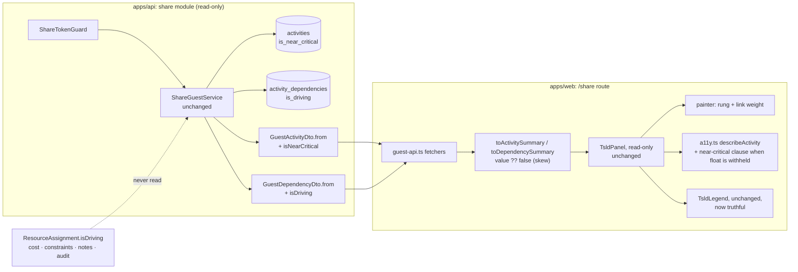
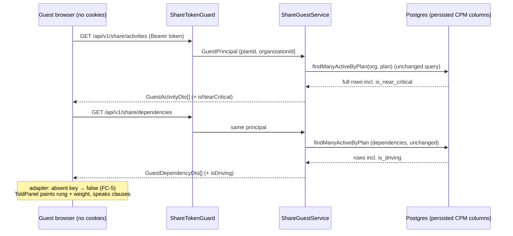
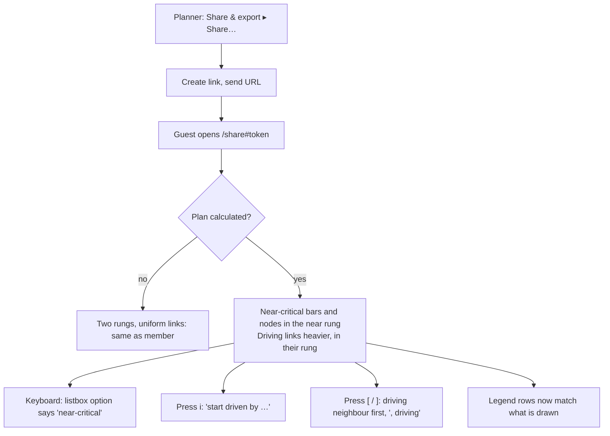

# Feature Spec: A share link shows the near-critical rung and the driving links

- **Status:** Accepted — shipped (ADR-0198). Approved by the product owner, 2026-10-17, Q1 accepted (guests see both near-critical and driving links); Q2–Q4 as the stated defaults.
- **Author(s):** feature-analyst (for the product owner)
- **Date:** 2026-10-17
- **Tracking issue / epic:** `docs/TECH_DEBT.md` #403
- **Roadmap link:** none. This fixes a register row. It gets a full spec because it **widens a
  security boundary**: the guest scope `SCHEDULE_READ`, the product's only unauthenticated data read
  (ADR-0105 trigger: a component's public contract and an entry point's content change).
- **Related ADR(s):** ADR-0051 (guest share links, §4 `SCHEDULE_READ`), ADR-0163 (the last widening
  of that scope, and the ADR that filed this row), ADR-0151 (the near-critical rung), ADR-0154 (link
  weight shows what drives), ADR-0088 D1 (no flag), ADR-0081 (entry point and journey), ADR-0110 D5
  (red first). **A new ADR is recommended, amending ADR-0051 §4 again** (§4.7). It takes the next
  free number when it is filed. On 2026-10-17 that is **ADR-0198**, because `docs/adr/` ends at 0197.

> **What this spec decides, in one sentence.** `SCHEDULE_READ` grows by exactly two engine-owned
> booleans: `isNearCritical` on a guest activity and `isDriving` on a guest dependency. The guest
> canvas then draws them the way the member canvas already does. Each field is argued separately in
> §4.5, because the register row says each is its own widening.

---

## 0. What was checked, and what the row gets wrong

Register row #403 (`docs/TECH_DEBT.md:10733-10742`) was re-read on 2026-10-17 against the code.
Its claims hold, but one citation is stale and the row leaves out three facts.

| Claim (row or brief)                                           | What the code says today                                                                                                                                                                                                             | Holds? |
| -------------------------------------------------------------- | ------------------------------------------------------------------------------------------------------------------------------------------------------------------------------------------------------------------------------------ | ------ |
| `guest-dto.spec.ts` forbids `isNearCritical`, with no reason   | `apps/api/src/modules/share/dto/guest-dto.spec.ts:143`. Its neighbours at `:111-119`, `:149-169` each carry a written reason. This one does not.                                                                                     | yes    |
| `guest-dto.spec.ts` forbids `isDriving`, with no reason        | `guest-dto.spec.ts:314`. The DTO docblock just says "deliberately omits the engine-owned `isDriving`" (`guest-dependency.dto.ts:13-14`) and gives no reason.                                                                         | yes    |
| The guest summary already exposes `nearCriticalCount`          | `apps/api/src/modules/share/dto/guest-plan.dto.ts:99-100, :109`. It is asserted present at `guest-dto.spec.ts:405-409`.                                                                                                              | yes    |
| ADR-0163 cites the exclusions at `guest-dto.spec.ts:136, :266` | They are now at `:143` and `:314` (`docs/adr/0163-a-guest-sees-the-plan-as-placed.md:112`). The citation has drifted. The ADR is historical and is not edited.                                                                       | moved  |
| The guest canvas "lacks" the two cues                          | The web adapter **hard-codes** both to `false`: `apps/web/src/features/share/guest-api.ts:243` (`isNearCritical: false`) and `:314` (`isDriving: false`). The painter reads them at `render/paint.ts:433`, `:604`, `:1518`, `:1536`. | yes    |

**Three facts the row does not have.**

1. **The guest legend already promises both cues.** `TsldPanel` mounts `TsldLegend` for every
   non-chromeless host (`apps/web/src/features/tsld/components/TsldPanel.tsx:3006-3010`), and the
   guest host is not chromeless (`GuestPlanView.tsx:254-266`). The legend lists "Near-critical",
   "Near-critical (node)", "Driving link — critical", "Driving link — near-critical" and "Driving
   link" (`TsldLegend.tsx:52-65, :96-109`; the flag that gates the link rows,
   `CANVAS_DIRECT_MANIPULATION_ENABLED`, is default-on at `config/env.ts:716`). So a guest is shown a
   key for marks the guest canvas never draws. The legend's own comment calls exactly this a defect:
   "a key naming a mark the canvas no longer paints is the ADR-0151 M6 defect"
   (`TsldLegend.tsx:93`).
2. **The guest canvas labels a gap on driving links that the member canvas does not.** The gap label
   is withheld on any link with `edge.isDriving` (`render/link-facts.ts:80-90`). On the guest every
   link is `isDriving: false`, so every link with a drawn gap gets a label. That includes a driving
   link whose successor was hand-placed later. The two canvases differ today in a way nobody chose.
3. **Adding the field alone will not make a screen reader say "near-critical" to a guest.**
   `describeActivity` speaks the near-critical clause only inside the `remainingFloat !== null`
   branch (`render/a11y.ts:190-196`). `remainingFloat` is excluded from the guest scope by ADR-0163
   and set to `null` by the adapter (`guest-api.ts:279`). Without a change to that sentence, a
   sighted guest would see the near-critical rung and a screen-reader guest would not hear it. That
   is a WCAG 1.1.1 gap of the same kind ADR-0163 fixed. §4.4 covers it.

There are also **two different fields called `isDriving`**, and only one of them is in scope:

- `ActivityDependency.isDriving` (`apps/api/prisma/schema.prisma:1705-1711`) is engine-owned. It
  answers "is this the link that sets its successor's start?" **This spec exposes this one.**
- `ResourceAssignment.isDriving` (`schema.prisma:3394-3401`) is a planner input. It answers "which
  resource's calendar does this activity schedule on?" That is resource data, ADR-0051 §4 keeps it
  out, and **this spec does not touch it**.

---

## 1. Business understanding

### Problem

A share link lets a planner hand the programme to someone who was not in the room, such as a
client's owner rep or a subcontractor (ADR-0051 context). The member canvas shows three rungs of
criticality (critical, near-critical, ordinary). It draws the link that **drives** each activity
heavier than the links that only wait (ADR-0151, ADR-0154). These are the two cues a reader uses to
answer "what is about to become critical?" and "what is actually holding this up?".

The guest canvas shows neither. The first is the question a client most often asks in a progress
meeting. The second is the question a subcontractor asks about their own package. The guest sees
two rungs instead of three. Every link has the same weight. A legend promises otherwise. The plan
header says how many activities are near-critical (`nearCriticalCount`) but the picture never says
which ones.

Nobody decided this. The exclusions carry no written reason (§0), unlike every sibling exclusion in
the same file. ADR-0163 noticed and filed the row rather than widen the scope twice in one change
(`docs/adr/0163-a-guest-sees-the-plan-as-placed.md:111-114`).

### Users

| Role                                                        | Need                                                                                                                  |
| ----------------------------------------------------------- | --------------------------------------------------------------------------------------------------------------------- |
| **External Guest** (share-link holder)                      | To see which work is close to critical and which link holds each activity, as the planner sees it, by eye and by ear. |
| **Planner / Org Admin** (who issues the link, `plan:share`) | To know the link shows the same criticality picture they see, and **nothing about cost, resources or people**.        |
| Contributor / Viewer                                        | Not affected. They use the member view, which already has both cues.                                                  |

### Primary use cases

1. A client opens a share link and can tell which activities are near-critical by the rung colour,
   the node shape, the legend and the spoken listbox sentence.
2. A subcontractor selects their activity and sees, and can hear with `i`, which predecessor drives
   its start.

### User journeys

The planner opens **Share & export ▸ Share…**, creates a link and sends it. The guest opens
`/share#<token>`. The read-only diagram draws near-critical bars and nodes in the near-critical rung
and driving links heavier, in the rung of their two ends. A keyboard guest moves through the listbox
and hears "near-critical" on those activities. Pressing `i` on an activity says
"start driven by …", and `[` / `]` move along the driving chain first. See the user flow in §4.

### Expected outcomes

- The guest and member canvases agree on criticality rung and link weight for every activity and
  link.
- The guest legend describes only marks the guest canvas can draw. (The constraint pin is still an
  exception; see §4.8.)
- No new route, query, schema change, engine call or flag.

### Success criteria

The falsification conditions in §2 hold. FC-1, FC-2, FC-3, FC-6, FC-7 and FC-8 are each **run red
against today's code first** and the red output is recorded in the PR (ADR-0110 D5).

### Open questions

**One critical question.** The others have defaults and can be overturned without redesign.

- **Q1 (CRITICAL — decides whether `isDriving` ships).** Exposing `isDriving` turns one inference
  from an estimate into an exact fact: _"this activity's start is held by something other than its
  links"_. That something is a date constraint, an external date (ADR-0043), or the data date, and
  the guest is not told which (§4.5.2, R1). ADR-0163 refused `visualConflictReason` partly because
  `LATER_THAN_BOUND` "would also reveal that a constraint exists". **Is this residual acceptable?**
  **Recommended default: yes, accept it and say so in the ADR.** The reasons: it names no cause,
  type or date. A guest can already estimate it from exposed dates on any day-granular plan, and the
  guest canvas already paints the estimate as gap labels (§0 fact 2). A schedule that shows driving
  logic without that inference is not possible. **If the answer is no,** ship `isNearCritical` alone
  (M1-T1, M2-T1's activity half, M2-T2) and drop M1-T2 plus the dependency half of M2. The plan is
  sliced so this is a deletion, not a redesign.
- **Q2 (not critical).** One ADR or two? **Default: one ADR with two separately reasoned decisions
  (D1 near-critical, D2 driving).** The row asks for separate _reasoning_, not separate documents,
  and Q1's answer can withdraw D2 alone.
- **Q3 (not critical).** Every existing live link starts showing both cues when the release lands,
  because ADR-0051 has no per-link scope column (`docs/adr/0051-external-guest-share-links.md:159-161`).
  **Default: accept, as ADR-0163 did.** The changeset says so in words.
- **Q4 (not critical).** Should the spoken sentence say "near-critical" for a guest even though it
  cannot say how much float is left? **Default: yes.** Without it the cue is visual-only (WCAG
  1.1.1). The clause reads ", near-critical" with no number, because `remainingFloat` stays out of
  scope (§4.4).

---

## 2. Functional requirements

### User stories & acceptance criteria

> **US-1** — As an **External Guest**, I want near-critical activities drawn in the near-critical
> rung, so that I can see what is about to become critical.
>
> - **Given** an activity the engine marked near-critical, **when** I open the share link, **then**
>   its bar fill and node are the near-critical ones (`paint.ts:433`, `:604`), as in the member view.
> - **Given** a critical activity, **then** it is drawn critical, never near-critical. The engine
>   never sets both (`engine/compute.ts:730-731`), and `criticalityRung` gives critical priority
>   (`render/render-model.ts:287-294`).

> **US-2** — As an **External Guest**, I want the link that drives each activity drawn heavier and
> in its rung, so that I can see what is holding the work up.
>
> - **Given** a driving link between two critical activities, **then** it is drawn at weight 2 in
>   the critical ink. Between two at-least-near-critical activities it uses the near-critical ink.
>   Otherwise it uses the driving-link ink (`render/link-marks.ts:23-30`, `paint.ts:1518-1536`).
> - **Given** a non-driving link, **then** it is drawn at weight 1 in the minor ink, with its gap
>   label where the member shows one (`link-facts.ts:80-109`).

> **US-3** — As an **External Guest using a screen reader**, I want the listbox and the logic
> summary to say the same things the picture shows.
>
> - **Given** a near-critical activity, **then** its listbox option contains "near-critical".
> - **Given** an activity with a driving predecessor, **when** I press `i` on it, **then** the
>   announcement contains "start driven by <predecessor>" (`a11y.ts:602-603`, `TsldPanel.tsx:2257-2261`).
> - **When** I press `[`, **then** the driving predecessor is chosen first and announced as
>   "…, driving" (`a11y.ts:645-669`).

> **US-4** — As the **Planner who issued the link**, I want to be sure the link shows nothing new
> about cost, resources, constraints or people.
>
> - **Given** any guest response, **then** it still carries none of the fields
>   `guest-dto.spec.ts` forbids, except the two this spec removes from those lists. In particular it
>   carries no `ResourceAssignment` data, no constraint field, and no audit field.

### Falsification / acceptance conditions

Each condition names its instrument. **Conditions marked "Red" must be run against today's code
first, with the red output recorded in the milestone's PR.**

| #        | Condition                                                                                                                                                                                                                                                                                                                                                                   | Instrument                                                    | Today                                     |
| -------- | --------------------------------------------------------------------------------------------------------------------------------------------------------------------------------------------------------------------------------------------------------------------------------------------------------------------------------------------------------------------------- | ------------------------------------------------------------- | ----------------------------------------- |
| **FC-1** | For every activity, the guest's `isNearCritical` **equals** the member's `isNearCritical` for that row. **Precondition inside the case:** at least one row is `true` on the member read, or the case proves nothing.                                                                                                                                                        | `apps/api/test/share-guest.e2e-spec.ts` (new case)            | Red: key absent                           |
| **FC-2** | For every dependency, the guest's `isDriving` **equals** the member's. **Precondition:** at least one edge is `true` **and** at least one is `false` on the member read.                                                                                                                                                                                                    | same file (new case)                                          | Red: key absent                           |
| **FC-3** | The guest activity key set grows by **exactly** `isNearCritical`. The guest dependency key set grows by **exactly** `isDriving`. Every other forbidden key stays forbidden. The activity fixture's `isNearCritical` changes from `false` (`guest-dto.spec.ts:71`) to `true`, so a mapping that hard-codes `false` fails. The dependency fixture is already `true` (`:285`). | `guest-dto.spec.ts` exact-key, `it.each` and value cases      | Red: exact-key (one key missing in each)  |
| **FC-4** | **The boundary did not widen anywhere else.** The diff to the two `FORBIDDEN` lists removes exactly those two entries. The wire-level forbidden list (`share-guest.e2e-spec.ts:285-317`) is unchanged and still contains `resourceAssignments`. Each new exposure gets a **written reason** beside it, as its siblings have.                                                | PR diff + both spec files                                     | —                                         |
| **FC-5** | **Version skew.** If a response has **no** `isNearCritical` or `isDriving` key (an older API), the adapter reads `false`, which is today's picture. If the key is present, the adapter passes the value through.                                                                                                                                                            | `apps/web/src/features/share/guest-api.test.ts` (new cases)   | n/a                                       |
| **FC-6** | **The spoken clause.** `describeActivity` for `{ isCritical: false, isNearCritical: true, remainingFloat: null }` contains ", near-critical". For every input with `remainingFloat !== null` the sentence is **byte-identical** to today's. The existing `a11y.test.ts` passes unchanged, plus one pinned member case.                                                      | `apps/web/src/features/tsld/render/a11y.test.ts`              | Red: clause absent                        |
| **FC-7** | **Journey, text limb.** In the guest view, the listbox option for the near-critical fixture activity contains "near-critical". Pressing `i` on the driven activity announces "start driven by <driver>".                                                                                                                                                                    | `apps/web/e2e-share/share.spec.ts` (new test)                 | Red (reasoned): neither phrase is present |
| **FC-8** | **Journey, pixel limb.** After **Fit to plan**, the guest canvas holds painted pixels in the near-critical palette ink (read from the canvas surface's computed token, not hard-coded) above a small floor. Today the count is 0.                                                                                                                                           | same test; ink helper adapted from `e2e-share/support.ts:301` | Red: 0 near-critical pixels               |
| **FC-9** | **No engine, no schema, no service change.** `share-guest.service.ts` has no diff. `computeSchedule` is not imported anywhere new. No migration.                                                                                                                                                                                                                            | `git diff --stat` in the PR description                       | —                                         |

**Why FC-8 exists as well as FC-7.** The listbox and the painter read the same `ActivitySummary`
array but are separate code paths. A half fix could change the a11y sentence and leave the painter
reading a different object, which would turn FC-7 green while the canvas stays unchanged. FC-8 is
the only check that looks at paint. **If FC-8 cannot reliably separate the cases** (for example
because anti-aliasing blends the near-critical ink into neighbouring pixels), **stop and report**
rather than ship on FC-7 alone. The fallback is a unit-level painter assertion over the guest
adapter's output.

### Workflows

1. **API.** `ShareGuestService` is unchanged. `ActivityRepository.findManyActiveByPlan` loads full
   rows with no `select` (`activities/activity.repository.ts:136-148`). The dependency read
   `include`s endpoints over every scalar (`dependencies/dependency.repository.ts:22-29`). So both
   columns are already in memory and only the two `from()` mappers change.
2. **Web.** `fetchGuestActivities` / `fetchGuestDependencies` → `toActivitySummary` /
   `toDependencySummary` now carry the two values, defaulting to `false` when absent (FC-5) →
   `TsldPanel` paints and describes exactly as for a member. No host prop changes.

### Edge cases

| Case                                                      | Behaviour                                                                                                                                                                                 |
| --------------------------------------------------------- | ----------------------------------------------------------------------------------------------------------------------------------------------------------------------------------------- |
| Plan never calculated                                     | Both columns are at their defaults, `false` (`schema.prisma:1290`, `:1711`). Two rungs and uniform links, the same as a member sees.                                                      |
| Edit since the last recalculation                         | The guest reads the persisted columns, as the member does. Both see the same, possibly stale, picture until the coalesced recalc lands (ADR-0032).                                        |
| Level-of-effort or WBS summary                            | Never critical or near-critical by engine rule (`compute.ts:721-731`). An edge touching an LOE is never driving (`compute.ts:391-396`). Unchanged.                                        |
| `LONGEST_PATH` critical definition                        | `isCritical` (already exposed) is built from the driving edges (`compute.ts:429-437`). Exposing `isDriving` adds the edges to a set the guest already sees.                               |
| Driving link whose successor was hand-placed later        | Drawn as driving, with no gap label, as for a member (`link-facts.ts:83`). Today the guest shows a gap label here (§0 fact 2), so this change removes that difference.                    |
| Near-critical on a calendar whose working day is not 24 h | The guest gets whatever the engine wrote, so it matches the member. Whether the engine's band is right on such a calendar is a separate question (§4.8, N2).                              |
| Cross-plan link                                           | Not in the guest read (the guest lists `ActivityDependency` rows only, `share-guest.service.ts:118-153`), and has no `isDriving` (`cross-plan-dependency-response.dto.ts:25`). Unchanged. |
| API older than web (skew, or API image rolled back)       | FC-5: the keys are absent, so both read `false`. That is today's picture.                                                                                                                 |
| Web older than API                                        | The old bundle ignores extra keys (`guestFetch` is a plain cast, `guest-api.ts:43`). That is today's picture.                                                                             |

### Permissions

- **Who can reach it:** anyone with a live share token, as a `GuestPrincipal` resolved by
  `ShareTokenGuard` (ADR-0051 §3). **The token is still the whole scope.** No path, query or body
  parameter is added, and the service has no diff (`share-guest.service.ts:34-50`).
- **Who can create the link:** unchanged. `plan:share` belongs to Planner and Org Admin.
- **Members** (Org Admin, Planner, Contributor, Viewer): unaffected.
- **Scope change:** `SCHEDULE_READ` gains `Activity.isNearCritical` and `ActivityDependency.isDriving`
  (§4.5, new ADR).
- **The pen (ADR-0028):** not involved. There is no write, so nothing structural.

### Validation rules

None. This is a read-only change. Both fields are engine-owned, are never accepted from a write DTO
(`schema.prisma:1705-1709`), and are written on every recalculation
(`schedule/schedule.repository.ts:842`, `:1089-1096`).

### Error scenarios

| Scenario                       | Detection         | User-facing result                        | Status |
| ------------------------------ | ----------------- | ----------------------------------------- | ------ |
| Dead / revoked / expired token | `ShareTokenGuard` | Uniform "no longer available" (unchanged) | 404    |
| Rate limit                     | throttler         | "Too many requests" (unchanged)           | 429    |
| Older API without the fields   | key absent        | Today's picture (FC-5)                    | 200    |

---

## 3. Technical analysis

| Area           | Impact  | Notes                                                                                                                                                                                                                                                                                                                                                                                               |
| -------------- | ------- | --------------------------------------------------------------------------------------------------------------------------------------------------------------------------------------------------------------------------------------------------------------------------------------------------------------------------------------------------------------------------------------------------- |
| Frontend       | low     | `guest-api.ts`: two optional wire fields and two adapter lines. `render/a11y.ts`: one branch in the float clause (§4.4). No component, prop, token or legend change. The legend becomes truthful without being edited.                                                                                                                                                                              |
| Backend        | low     | `GuestActivityDto` and `GuestDependencyDto`: one `@ApiProperty` and one line in `from()` each, plus a rewritten docblock giving the reason. The service is unchanged.                                                                                                                                                                                                                               |
| Database       | none    | No schema change, so **database-architect is not engaged**. There is nothing to design. This is not a judgement that the change is small (CLAUDE.md §19.3).                                                                                                                                                                                                                                         |
| API            | low     | Additive, non-breaking response fields on `GET /api/v1/share/activities` and `GET /api/v1/share/dependencies`. OpenAPI is generated from the decorators (`apps/api/src/main.ts:48-49`), and there is no committed snapshot to regenerate. `docs/API.md:754-755` and `:766-772` need updating.                                                                                                       |
| Security       | **med** | **Widens ADR-0051 `SCHEDULE_READ`** on the product's only unauthenticated read. §4.5 argues each field. Needs a security-reviewer pass before merge.                                                                                                                                                                                                                                                |
| Performance    | low     | No new query or join. Estimated from the JSON shape, not measured: about 22 bytes per activity (`"isNearCritical":false,`) and about 18 per dependency (`"isDriving":false,`), so roughly 80 kB before gzip for a 2,000-activity, 2,000-link plan. Paint cost is unchanged per link. A guest canvas draws fewer gap labels than today, because driving links stop getting one (`link-facts.ts:83`). |
| Infrastructure | none    | No flag (ADR-0088 D1). The guest surface is already governed by `VITE_GUEST_SHARE_LINKS`, which is default-on (`apps/web/src/config/env.ts:674`).                                                                                                                                                                                                                                                   |
| Observability  | none    | —                                                                                                                                                                                                                                                                                                                                                                                                   |
| Testing        | med     | DTO unit (FC-3/4), API e2e (FC-1/2), web unit (FC-5/6), journey (FC-7/8), axe on the guest view.                                                                                                                                                                                                                                                                                                    |

### Dependencies

- The engine already writes both columns on every recalculation (`schedule.repository.ts:842`,
  `:1089-1096`).
- The member painter, legend and a11y layer already handle both values. Nothing waits on another
  epic.
- **The recalc parity gate (ADR-0034) is untouched.** No engine module is imported or edited, and
  the change only reads persisted columns. `computeSchedule` therefore stays byte-identical, because
  nothing calls it differently.

---

## 4. Solution design

### 4.1 Architecture overview

### 4.2 Data flow

### 4.3 User flow

### 4.4 Component changes (web)

- **`apps/web/src/features/share/guest-api.ts`.**
  - `GuestActivity` gains `isNearCritical?: boolean` and `GuestDependency` gains `isDriving?: boolean`.
    Both are **optional on the wire type** for version skew, as `visualEffectiveStart` already is
    (`:118`).
  - `toActivitySummary` sets `isNearCritical: activity.isNearCritical ?? false` (replacing `:243`).
    `toDependencySummary` sets `isDriving: dependency.isDriving ?? false` (replacing `:314`).
  - `??` is correct here, unlike the placed span (`:254-260`). Both columns are `NOT NULL`, so there
    is no `null` state that would mean anything different from "absent".
  - Update the docblock at `:185-190` so "duration/float/critical" names the near-critical rung, and
    the one at `:291-294` so it no longer says engine fields default.
- **`apps/web/src/features/tsld/render/a11y.ts:190-196`, the float clause.** Today:
  `isCritical → ', critical'`; `WBS_SUMMARY || remainingFloat === null → ''`; otherwise the
  near-critical clause with a number. **Change:** when `remainingFloat === null` and the activity is
  near-critical (and not a WBS summary, which is never near-critical anyway), emit `', near-critical'`
  with no number.
  - **Why member sentences cannot change.** A member's `remainingFloat` is `null` only until the
    plan's first calculation (`activities/dto/activity-response.dto.ts:402-408`). Before that
    calculation `isNearCritical` is still its default `false` (`schema.prisma:1290`). So the new
    branch is reachable only on the guest, and FC-6 pins that.
  - This is a change to a shared render function, not to a primitive's keyboard contract, so
    CLAUDE.md §19.13 does not apply. accessibility-reviewer still reviews the sentence.
- **No change** to `GuestPlanView.tsx`, `TsldPanel.tsx`, the painter, `TsldLegend.tsx` or any token.
  Loading, empty and error states are unchanged.

### 4.5 Security reasoning: what each field reveals

ADR-0051 §4 lets a guest read the schedule (dates, duration, total float, `isCritical`, the logic
ties and the summary) and never read cost or Earned Value, resources, baselines, notes, audit or any
user identity. ADR-0163 added the placed span and held a line: _"a guest is shown where the work
sits, never the planner's working notes about why"_. Each field is tested below against that line.
The method: name the field's inputs, and mark which inputs a guest can already read.

#### 4.5.1 `Activity.isNearCritical` (proposed decision D1)

**Definition** (`engine/compute.ts:730-731`, threshold `engine/constants.ts:10`):
`!isCritical && 0 < totalFloat ≤ 7,200 working minutes`. `totalFloat` is measured on the activity's
own calendar (`compute.ts:702-711`). It is stored in days, rounded on that calendar's day factor
(`schedule.repository.ts:836-838`).

| Input                        | Already exposed to a guest?                                                                                                                                     |
| ---------------------------- | --------------------------------------------------------------------------------------------------------------------------------------------------------------- |
| `isCritical`                 | **Yes** (`guest-activity.dto.ts:114-115`)                                                                                                                       |
| `totalFloat` (days, rounded) | **Yes** (`:111-112`)                                                                                                                                            |
| the activity's day factor    | **Effectively yes.** `durationMinutes` and `durationDays` are both exposed (`:72, :80`), and their ratio is the factor for any non-zero duration                |
| the 7,200-minute threshold   | A product constant, the same for every plan and organisation. There is no per-plan threshold anywhere in `apps/` (searched for `nearCritical[A-Z]`, 2026-10-17) |
| how many activities qualify  | **Yes**, as `nearCriticalCount` (`guest-plan.dto.ts:99-100`)                                                                                                    |

**What is new:** _which_ activities make up the count the guest already sees, exact even at the band
edge, where a guest working from a rounded `totalFloat` might misjudge one activity. **Nothing about
cost, resources, constraints, notes or people is an input.** Verdict: a convenience of data already
in scope. It is not a new category of information.

#### 4.5.2 `ActivityDependency.isDriving` (proposed decision D2)

**Definition** (`engine/compute.ts:381-414`, `engine/edge-bounds.ts:35-61`): an incoming edge drives
when its forward lower bound, rolled onto the successor's calendar, equals the successor's early
start. The bound is built from the predecessor's early start or finish, the link type and lag, and
the lag calendar. An edge touching a level-of-effort activity never drives. The computation **reads
only the forward-pass maps** (`compute.ts:381-382`), so it says nothing about levelling (ADR-0041,
ADR-0166). Resource levelling is an overlay and does not move these dates.

| Input                                          | Already exposed to a guest?                                                                                                                                                                                         |
| ---------------------------------------------- | ------------------------------------------------------------------------------------------------------------------------------------------------------------------------------------------------------------------- |
| predecessor and successor early start / finish | **Yes**, day precision (`guest-activity.dto.ts:99-103`)                                                                                                                                                             |
| link type, lag (days and exact minutes)        | **Yes** (`guest-dependency.dto.ts:32-47`)                                                                                                                                                                           |
| the lag calendar (`lagCalendar`)               | **No** (forbidden, `guest-dto.spec.ts:313`)                                                                                                                                                                         |
| the successor's calendar                       | **No.** The guest gets the plan calendar's weekday mask and exceptions only (`guest-dto.spec.ts:371-373`). For a resource-dependent activity this is the driving resource's calendar, which stays hidden (#86 CQ-4) |

So `isDriving` is **one bit per link** computed over two inputs the guest cannot see. One bit cannot
recover a calendar id, a shift pattern, a resource or an assignment. It adds precision only where
those hidden inputs matter: sub-day lags, per-activity calendars, and resource-dependent activities.
On a day-granular single-calendar plan, a guest can already compute it from exposed dates. **The
guest canvas already paints that estimate.** Every link with a drawn gap gets a gap label today,
because the adapter forces `isDriving: false` (§0 fact 2, `link-facts.ts:80-109`).

**Residual inference R1 (the subject of Q1).** Take an activity that has not started, is not a
level-of-effort, and has incoming links. If none of those links drives, its early start is held by
something other than logic: a date constraint, an external early start (ADR-0043), or the data
date. The data date is already exposed. So R1 reveals that **a constraint or an external date may
exist** on that activity. It does not reveal which of the two, its type, or its date.

**How R1 compares with ADR-0163's refusal.** `visualConflictReason: LATER_THAN_BOUND` would have
_named_ the cause class on the object. R1 names nothing and can already be estimated. This spec
therefore treats R1 as the same "partly derivable" kind of disclosure ADR-0163 accepted for drift and
remaining float (`docs/adr/0163-a-guest-sees-the-plan-as-placed.md:93-100`). It is not the
working-notes kind ADR-0163 refused. That is a judgement, and Q1 asks the product owner to confirm
it.

**R2: the driving chain becomes explicit.** Combined with `isCritical`, a guest can trace the driving
path. That is the schedule itself, the thing ADR-0051 §4's "critical path" bullet already promises a
guest (`0051-external-guest-share-links.md:148-149`). It is not a working note.

**Explicitly not exposed:** `ResourceAssignment.isDriving` (`schema.prisma:3394-3401`, which
resource drives), `lagCalendar`, `drivingResourceCalendarId`, `dayFactorMinutes`,
`lagDayFactorMinutes`, and every field the spec files already forbid.

#### 4.5.3 What does not change

- **Tenancy and IDOR.** No new parameter. The service methods still take only the
  `GuestPrincipal` (`share-guest.service.ts:39-44`).
- **Rate limits, headers, uniform 404.** Unchanged (`docs/API.md:757-765`).
- **No new write.** There is no audit event, because nothing is mutated (ADR-0073).
- **Every live link gains both fields on release** (Q3). The changeset says so in words.

### 4.6 API changes

| Method | Path                         | Change                                                                                                                                                                                                                                    |
| ------ | ---------------------------- | ----------------------------------------------------------------------------------------------------------------------------------------------------------------------------------------------------------------------------------------- |
| GET    | `/api/v1/share/activities`   | Each item gains `isNearCritical: boolean`. `@ApiProperty({ description: 'CPM near-critical flag (engine-owned): not critical, with total float above zero and inside the near-critical band. The same value the member read returns.' })` |
| GET    | `/api/v1/share/dependencies` | Each item gains `isDriving: boolean`. `@ApiProperty({ description: 'Engine-owned: true when this link sets its successor’s early start. Not the resource assignment’s driving flag, which is never exposed.' })`                          |

- Status codes, envelopes, pagination and throttling are unchanged.
- The change is additive and non-breaking. Under pre-1.0 SemVer it is a **minor** bump for `api` and
  `web`, with changesets.
- **Docs:** `docs/API.md:754-755` (list the new fields) and `:766-772` (state the two exposures and
  the one `isDriving` that stays out).
- **Optional, same PR:** `docs/API.md:779` says `VITE_GUEST_SHARE_LINKS` is "default off", but
  `env.ts:674` is `flagDefaultOn`. Correct it if touched, since it is stale prose in the paragraph
  being edited.

### 4.7 ADR outline (new, amending ADR-0051 §4)

**Title:** _A guest sees what is near critical and what drives_.
**Status:** Proposed → Accepted on approval. **Amends:** ADR-0051 §4. **Follows:** ADR-0163.
**Spec:** `docs/specs/guest-critical-cues/`.

- **Context:** §0 and §1 of this spec. Exclusions with no written reason, a legend promising marks
  that are never drawn, a gap-label divergence, and a count without its members.
- **D1:** `SCHEDULE_READ` gains `Activity.isNearCritical`. Reason: §4.5.1. It is a function of
  exposed fields and a product constant, and its count is already public.
- **D2:** `SCHEDULE_READ` gains `ActivityDependency.isDriving`. `ResourceAssignment.isDriving` is
  named as excluded. Reason: §4.5.2, including R1 accepted in words (or D2 is withdrawn if Q1 is no).
- **D3:** The guest's spoken sentence says "near-critical" without a figure, because
  `remainingFloat` stays excluded (§4.4).
- **Alternatives:** (a) keep both excluded and **remove** the legend rows on the guest. Rejected:
  the guest is shown less schedule than ADR-0051 §4 promises, and the count stays without its
  members. (b) per-link opt-in scope. ADR-0051 already rejected per-link scoping on YAGNI grounds,
  and ADR-0163 did not reopen that. (c) derive the cues client-side from exposed dates. Rejected:
  this is wrong exactly where calendars differ (§4.5.2), and it would put a second, inexact copy of
  engine logic in the web app.
- **Consequences:** every live link gains both cues. R1 is accepted. No parity-gate impact. Add one
  line to CLAUDE.md §16 (`check:adr-coverage`). The ADR-0051 status line names the amendment.

### 4.8 Neighbouring findings: filed, not fixed

- **N1: the guest legend still keys a constraint pin** (`TsldLegend.tsx:71`). Constraints are out
  of the guest scope, so that row can never be drawn on a guest canvas. This spec did not check
  whether a register row already exists. File one if not.
- **N2: the near-critical band may be wider than its label on non-24-hour calendars.** Read, not
  run: the threshold is a fixed 7,200 working minutes (`constants.ts:6-10`, "5 working days at
  1,440 min/day"), and total float is measured in working minutes on the activity's calendar
  (`compute.ts:702-711`). On an 8-hour-day calendar that band would be 15 working days, while
  `guest-plan.dto.ts:99` describes it as "≤ 5 working days". This is an **engine-semantics**
  question and affects members and guests equally. A search of `docs/TECH_DEBT.md` for "7,200" and
  "7200" on 2026-10-17 found no row. File it, and do not fold it in.
- **N3: Isolate ▸ driving on the guest.** `computeLogicPath(…, { mode: 'driving' })` reads
  `isDriving` (`render/logic-path.ts:41`). Whether a guest can reach Isolate at all (the guest view
  mounts no `role="toolbar"`, `e2e-share/share.spec.ts:97`) was not established. If it is reachable,
  it begins to work after this change. M2-T3 records which.

### 4.9 Implementation approach & alternatives

**Chosen:** widen the two DTO mappers and the web adapter, and fix the one sentence that would
otherwise leave the cue visual-only. Everything else (painter, legend, chain navigation, logic
summary) already handles both values for members and needs no change. This is the smallest change
that makes the guest and member canvases agree, and it puts no second copy of engine logic in the
web app. Alternatives are in §4.7.

## 5. Links

- Implementation plan: [`./implementation-plan.md`](./implementation-plan.md)
- Related docs updated by this change: `docs/API.md`, the new ADR, `docs/adr/0051-…` (status line),
  CLAUDE.md §16 (one line), `docs/TECH_DEBT.md` #403 (closed by the merging PR), new rows for N1/N2
  if none exist.
