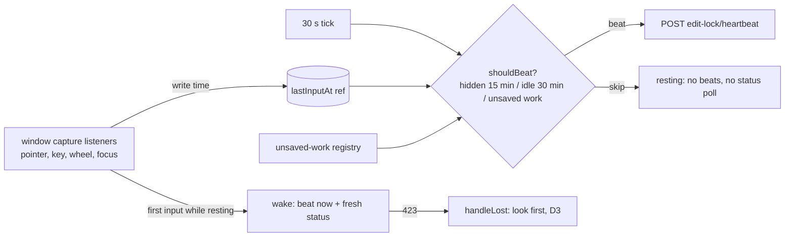
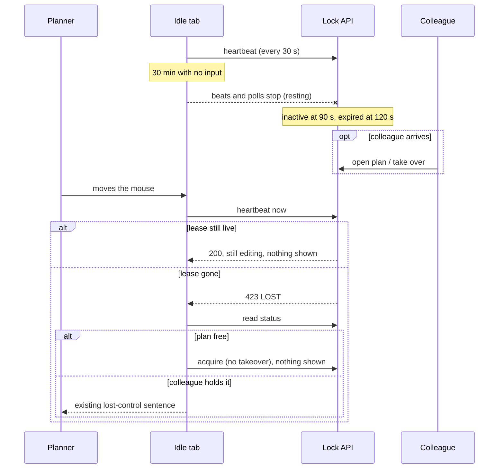
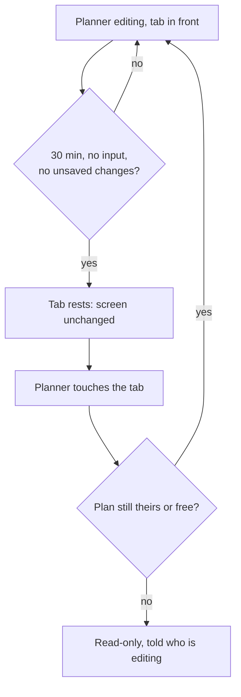

# Feature Spec: A plan left in front and unattended lets go after 30 minutes

- **Status:** Approved — by the product owner, 2026-11-13, as written (including the rule that unsaved typed work keeps the plan held). Built (2026-11-13), journey pending a browser run.
- **Author(s):** feature-analyst (Claude Code), for the product owner
- **Date:** 2026-11-13
- **Tracking issue / epic:** none. ADR-0220's Consequences names the visible idle tab as a known cost; there is no `docs/TECH_DEBT.md` row for it (searched for "ADR-0220", "idle" and "visible tab", 2026-11-13).
- **Roadmap link:** none; a follow-on to ADR-0220 D5
- **Related ADR(s):** ADR-0028 (the pen), ADR-0220 (amended by this work: a new D8, see §4.7), ADR-0081 (entry point and journey), ADR-0088 D1 (no flag), ADR-0060 / unsaved work (CQ-2), ADR-0190 (what 1.0 promises)

---

## In plain English

**What happens today.** A Planner (or Org Admin) who opens a plan is given the editing pen. If that tab is in the
background for 15 minutes it lets go. If it stays **in front** and nobody touches it, it keeps the plan for ever, so a
colleague has to ask for it and wait.

**What changes.** If nobody has used the mouse, keyboard or touch screen in that tab for 30 minutes, the tab quietly
stops renewing its hold. About two minutes later the plan is free for anyone. Nothing pops up and nothing is said.

**What the person sees when they come back.** They move the mouse or press a key, and:

1. **Nobody took the plan:** nothing visible happens. They are still editing, exactly as they left it.
2. **A colleague took it:** the existing "Ben is now editing this plan" message appears, as it does today when
   someone takes over, and the plan is read-only for them.
3. **They had a form open with typed changes:** the tab never let go in the first place (see §2, rule R4).

---

## 1. Business understanding

### Problem

ADR-0220 D1 takes the pen for whoever opens a free plan first. D5 lets a **hidden** tab let go after 15 minutes.
A **visible** tab never lets go: `useLockHeartbeat` beats every 30 s whenever the tab is not hidden
(`apps/web/src/features/plan-lock/api/use-plan-edit-lock.ts:177-185`, the only skip is the hidden test at `:181`).
The ADR records this as a known cost (`docs/adr/0220-the-first-planner-to-open-a-free-plan-holds-the-pen.md:103-105`).
A plan left open on a second screen over lunch locks colleagues out until they Request control and wait out the
45-second grace, or until the holder comes back.

The owner decided on 2026-11-13: after 30 minutes with no input in a visible tab, let go quietly, no prompt, and resume
on the next input unless a colleague took the plan.

### Users

Org Admin and Planner (the roles with `plan:acquire_lock`; both auto-acquire under ADR-0220 Q2). Contributors,
Viewers and share-link guests never hold the pen and see no change, except that a plan left idle by someone else
becomes free sooner.

### Primary use cases

1. A Planner leaves a plan open in front and walks away; a colleague can edit it about 32 minutes later at most.
2. The Planner returns, touches the mouse, and carries on editing without noticing anything.
3. The Planner returns after a colleague took the plan and is told, by the sentence that already exists.

### Expected outcomes and success criteria

- A visible tab with no input for 30 minutes sends no heartbeat (journey, network count).
- The first input afterwards sends a heartbeat at once, and if the plan is free the tab holds it again with **no**
  change to the pen sentence and nothing announced (journey records the live region).
- A tab with unsaved form changes never lets go for idleness (hook test).
- No new request, no new control, no API or schema change.

### Open questions

None critical. Defaults are stated where each choice is made, chiefly R1 (what counts as input), R4 (unsaved work),
R5 (an idle tab also stops checking the plan's status) and §4.7 (an ADR-0220 D8, not a new ADR).

## 2. Functional requirements

### User story

> **US-1**: As a Planner who opened a plan and walked away, I want my tab to stop holding the plan after 30 minutes
> untouched, so that colleagues are not locked out, and I want to carry on without being asked anything when I return.
>
> - **Given** I hold the pen in a visible tab **when** 30 minutes pass with no input in that tab **then** it stops
>   heartbeating and nothing on screen changes.
> - **Given** that tab has let go **when** I move the mouse, press a key, scroll, touch or focus it **then** it
>   heartbeats at once; if the plan is free I am editing again and nothing is announced.
> - **Given** a colleague took the plan meanwhile **when** I next touch the tab **then** I see the existing
>   lost-control sentence naming them, and the plan is read-only.
> - **Given** an editor in this tab has unsaved changes **then** the 30 minutes never run out.

### Rules

- **R1. What counts as input (default).** `pointerdown`, `pointermove`, `keydown`, `wheel` and `focus` (a capture
  listener on `window` hears every element's focus as well), plus the existing return from hidden. Touch arrives as pointer events. Listened once on `window`, in the
  **capture** phase (so a canvas or dialog that stops propagation cannot hide it) and **passive**. Each event only
  writes `Date.now()` into a ref: no React state, no throttle needed, no re-render. The `scroll` event is **not**
  counted, because the app scrolls things itself; a person scrolling produces `wheel` or pointer events anyway.
  - A video-call screen share of the tab produces no input in it, so it lets go after 30 minutes and resumes on the
    next touch. That is the intended behaviour.
  - Input in **another tab** of the same person is not counted and does not need to be: the lock is per person, not
    per tab, so a tab they are using keeps the lease alive with its own beats (D5's reasoning,
    `docs/adr/0220-…:74-76`). The idle tab never sends a release.
- **R2. The threshold.** `IDLE_LET_GO_MS = 30 * 60_000`, a constant beside `HIDDEN_LET_GO_MS`
  (`use-plan-edit-lock.ts:30`). Measured from the last input by the clock, never by counting ticks. The clock starts
  at the opening and restarts whenever the tab becomes visible. On the first 30 s tick at or past it, the beat is
  skipped. The last beat is therefore 29.5 to 30 minutes after the last input; the server calls the holder inactive
  90 s later and expires the lease at 120 s (`apps/api/src/modules/plan-lock/plan-lock.policy.ts:15,24`), so the plan
  is free **at most about 32 minutes** after the last touch.
- **R3. Never release.** Like D5, the tab only stops renewing. It sends no `DELETE`.
- **R4. Unsaved work keeps the pen (default; the option that never loses typed work).** While this tab's unsaved-work
  registry holds any report (`registry.read()` with `hasUnsavedWork`,
  `apps/web/src/components/layout/unsaved-work/unsaved-work-provider.tsx:27-34,110-112`,
  `apps/web/src/lib/unsaved-work/report.ts:79-81`), the idle rule does not apply. The alternative, relying on the
  existing "They can no longer be saved, because you no longer hold the edit lock." report (`report.ts:149`), does not
  lose work silently, but it does lose it if a colleague took the plan, which is the case this feature makes more
  likely. Cost: someone who types into an editor and walks away holds the plan as they do today. D5 (hidden tabs) is
  left as it is.
- **R5. A resting tab also stops checking the status (default).** While the tab has let go for idleness ("resting")
  its 15 s status poll (`use-plan-edit-lock.ts:22,41`) pauses, as it already does in a hidden tab. This is what keeps
  the screen unchanged: without it, once the lease expired the poll would read `EXPIRED`, the tab would stop counting
  itself as holding (`:278`), the pen sentence would change to the person's own name "was editing (inactive)"
  (`apps/web/src/features/plan-lock/lib/lock-copy.ts:44-45`) and be announced, and the heartbeat hook, which only runs
  while holding (`:178,189`), would no longer be listening for the input that is meant to resume it. That is why the
  brief's "skip beats, beat on next input" is not enough on its own for a visible tab.
- **R6. Waking.** The first input in a resting tab ends resting, beats at once and asks for a fresh status. The beat
  either renews the lease (a sibling tab kept it alive, or it is within the 120 s) or meets the 423
  `PLAN_EDIT_LOCK_LOST` that `handleLost` already answers (`use-plan-edit-lock.ts:428-454`): a silent retake when the
  plan is free (D3), the lost sentence when a colleague holds it.
- **R7. No flash on waking.** From waking until that beat has settled, a status read that says `FREE` or `EXPIRED`
  must not repaint the pen as free: the view keeps showing the last held lease, as D3's `retaking` already does
  (`:509-510`). _Changed in review, 2026-11-13:_ the mask covers every status, not only FREE and EXPIRED, until the beat and the
  retake's read have settled, so a colleague's take goes straight from held to the lost sentence. The same guard covers a hidden tab coming back (see Edge cases, E5).

### Edge cases

| #   | Case                                                                         | Behaviour                                                                                                                                                                                                                                                                                                                                                                                                                                                                       |
| --- | ---------------------------------------------------------------------------- | ------------------------------------------------------------------------------------------------------------------------------------------------------------------------------------------------------------------------------------------------------------------------------------------------------------------------------------------------------------------------------------------------------------------------------------------------------------------------------- |
| E1  | A colleague asks for control while the holder is idle but still leased       | Today's request prompt shows on the holder's screen. If the holder rests, the requester can take over without the grace 90 s after the last beat, or gets the plan automatically at expiry (D4).                                                                                                                                                                                                                                                                                |
| E2  | A colleague asks after the holder rested                                     | The holder's screen does not show the prompt (no poll). The requester is served as in E1. The holder sees the lost sentence on return.                                                                                                                                                                                                                                                                                                                                          |
| E3  | Same person, same plan, a second tab in use                                  | That tab's beats keep the lease. The idle tab wakes with a beat that succeeds; nothing is shown.                                                                                                                                                                                                                                                                                                                                                                                |
| E4  | First input is itself an edit (a keyboard shortcut such as Delete, or a tap) | The wake beat and the write leave together. If the write reaches the server first it is refused (423). A refused write while waking goes through `handleLost`'s look-first path, so a free plan is retaken silently, and the person is then told once (banner and live region, _changed in review, 2026-11-13_): "You were away, so that change was not saved. Try it again." The write is not re-sent. A mouse user normally moves before clicking, which wakes the tab first. |
| E5  | A hidden tab returns after the lease really expired                          | Unverified today: the existing journey says its lease "was never really idle" (`apps/web/e2e-edit/pen-auto.spec.ts:327-328`). The status refetch on return can land before the beat's 423 and briefly show the free view. R7 removes that for both cases.                                                                                                                                                                                                                       |
| E6  | Laptop sleeps with the plan in front                                         | On wake the clock has moved on; the next tick finds 30 minutes passed and skips. The next input resumes.                                                                                                                                                                                                                                                                                                                                                                        |
| E7  | An Org Admin force-releases a resting tab's lease (direct API call only)     | The tab retakes on its next input, as it would within 30 s today. Same known cost as `docs/TECH_DEBT.md` #587; not widened.                                                                                                                                                                                                                                                                                                                                                     |
| E8  | A screen-reader user reading in browse mode                                  | Browse-mode arrow keys may not reach the page, so the tab can rest while they read. Nothing is announced and the view does not change; their next key that reaches the page resumes it.                                                                                                                                                                                                                                                                                         |

### Permissions

Unchanged. The client reads only the server's `state` and `canAcquire` (ADR-0028's client rule). The server's 423 gate
is the authority; nothing here can grant the pen.

### Error scenarios

| Scenario                                  | Detection                       | What the person sees                               | Status |
| ----------------------------------------- | ------------------------------- | -------------------------------------------------- | ------ |
| Lease gone, plan free, on waking          | heartbeat 423, then status read | nothing (silent retake, D3)                        | 423    |
| Lease gone, colleague holds it, on waking | heartbeat 423, then status read | existing lost-control sentence naming them         | 423    |
| Write sent in the same instant as waking  | write 423 while waking (E4)     | that change does not happen; no message if retaken | 423    |
| Network down on waking                    | beat fails, not a lock error    | nothing new; the next tick beats again             | n/a    |

## 3. Technical analysis

| Area          | Impact | Notes                                                                                                                                                             |
| ------------- | ------ | ----------------------------------------------------------------------------------------------------------------------------------------------------------------- |
| Frontend      | low    | `use-plan-edit-lock.ts` (the heartbeat hook, `usePlanPen`, the status query's poll), one pure decision in `features/plan-lock/lib/`. No component or copy change. |
| Backend / API | none   | Lease, inactivity and expiry already do the rest (`plan-lock.policy.ts:15,24,29`; heartbeat refuses an expired lease, `plan-lock.repository.ts:123-129`).         |
| Database      | none   | No schema change, so database-architect is not needed.                                                                                                            |
| Security      | none   | No new request type; the client can only send fewer.                                                                                                              |
| Performance   | better | A resting tab sends no beats and no polls (today about 6 requests a minute, forever). Listeners are passive and write a ref.                                      |
| Observability | none   | The server already logs expiry and re-acquire.                                                                                                                    |
| Testing       | low    | Unit (pure decision), hook (fake timers), one journey (fake page clock).                                                                                          |

### Dependencies

- Lands **after** the Cancel request work (`docs/specs/cancel-request-control/`, approved 2026-11-13), which edits the
  same hook and adds ADR-0220 D7. No behavioural conflict: a waiting requester gets the plan when an idle holder's lease
  expires (D4, `docs/adr/0220-…:60-65`); one who cancelled (D7) does not, and sees the plan free. The resting holder
  meets the requester as a colleague on waking (E1, E2).

## 4. Solution design

### Architecture overview

### Data flow

### User flow

### Database and API changes

None.

### Component changes

None. `EditLockBanner`, `PlanPenControl` and `lockCopy` are untouched; the pen view is fed the same `PlanPen` shape.

### Implementation approach

1. Extend the pure decision beside `shouldAutoAcquire` (`features/plan-lock/lib/auto-acquire.ts`): one function that
   takes `now`, `hiddenSince`, `lastInputAt`, `hasUnsavedWork` and answers beat or skip, so D5 and D8 share one rule.
2. In `useLockHeartbeat`: the window listeners (R1), the idle branch in the tick (R2, R4), a resting flag held in a ref,
   and the wake (R6). The listeners must stay attached while the tab is resting even if the status later stops saying
   "held by me".
3. Pause the status poll while resting (R5): `refetchInterval` becomes a function that reads the resting flag, and the
   wake asks for a fresh read. The builder confirms the TanStack Query v5 behaviour this relies on (a function
   returning `false` stops polling until the next fetch) and registers the claim in `scripts/dependency-claims.json`
   if a docblock cites it (CLAUDE.md §19.11).
4. In `usePlanPen`: the waking mask (R7) and the E4 routing of a write's 423 while waking.

**Alternatives considered.**

- **Keep polling and hide the expiry** (show the last held state while the poll says free). Rejected: it needs
  `holdsPen` to report true while the client knows it is false, a lie spread through every gate that reads it
  (`plan-gating.ts`, `activity-editor-gating.ts`, `tsld-toolbar-items.tsx` and three more files outside the hook).
- **Show the truth while resting** ("{own name} was editing (inactive)" and Start editing). Rejected by the owner's
  "quietly": it changes the screen and the live region announces it.
- **A prompt** ("Are you still editing?"). Rejected by the owner: it interrupts someone reading.
- **Release on idleness.** Rejected for D5's reason: it would also end a sibling tab's lease.
- **Per-person setting for the threshold.** Not now; a constant like D5's.

### 4.7 ADR

**Amend ADR-0220 with a D8, no new ADR.** The lease, its permissions and the server are unchanged; this is D5's
mechanism applied to a second trigger, which is how D5 itself was added. D8 records R1 to R7, E4 and E5. The
Consequences bullet that says a visible idle tab holds the pen "with **no time limit**" (`docs/adr/0220-…:103-105`) is
rewritten to the new limit and to R4's exception. CLAUDE.md §16's ADR-0220 line gains "D8 added for the idle tab"
after the Cancel request work's "D7 added for #588". No new ADR, so `pnpm check:counts` is unaffected.

### Accessibility

Nothing new is announced, by design. What a screen-reader user hears:

- **While resting:** nothing. The pen sentence and badge are unchanged.
- **On return, plan free:** nothing. The silent retake keeps "You're editing this plan." on screen (D3).
- **On return, colleague took it:** the existing lost-control sentence, once, from the pen's polite `role="status"`
  region (`EditLockBanner.tsx:71-72`). Note `docs/HANDOFF.md:132-133`: that sentence can already be announced twice.
- **A colleague asked while still leased:** today's request prompt, unchanged.

Because R7 changes what the status region shows between waking and the beat settling, **accessibility-reviewer must run
in a real browser before release** (CLAUDE.md §19.13; the hidden-tab step's review was a code read,
`docs/HANDOFF.md:137-139`).

### Flag and versioning

No flag (ADR-0088 D1). The rollback is pinning `WEB_IMAGE_TAG`. Changeset: `@repo/web` minor. The 1.0 promises
(ADR-0190) are not touched: the API contract is unchanged.

## 5. Links

- Implementation plan: [`./implementation-plan.md`](./implementation-plan.md)
- Docs updated by this change: ADR-0220 (D8, Consequences), CLAUDE.md §16 (ADR-0220 line), the docblocks in
  `use-plan-edit-lock.ts`.
