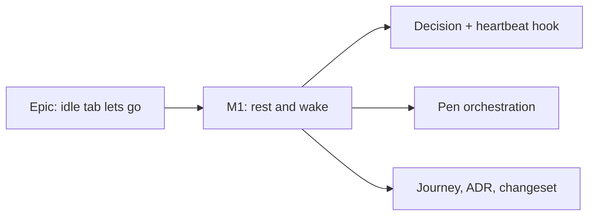

# Implementation Plan: A plan left in front and unattended lets go after 30 minutes

- **Feature spec:** [`./feature-spec.md`](./feature-spec.md)
- **Status:** Approved (2026-11-13). Built on `feat/idle-tab`; the journey is written and awaits its first browser run.
- **Owner:** product owner; built by the builder agent

## Breakdown

### Epic

**The idle tab lets go**: ADR-0220 D8, the visible-tab twin of D5. Web only.

### Milestone M1: rest and wake (one PR, size M)

**Outcome:** a plan left in front and untouched for 30 minutes is free for colleagues about two minutes later; the
holder carries on without noticing, unless a colleague took it.
**Entry point:** no new control. The entry point is the existing one: a Planner opening a plan (ADR-0220 D1), then
leaving it untouched. The journey drives exactly that.
**Journey:** `apps/web/e2e-edit/pen-auto.spec.ts`, a new test beside "a tab hidden for fifteen minutes stops
heartbeating" (`:292-339`), reusing its helpers.
**Prerequisite:** the Cancel request work has merged (same hook, ADR-0220 D7). Rebase onto it; do not interleave.

---

#### Feature 1: the decision and the heartbeat hook

> **Complexity:** M
> **Risks:** listeners detached when the status stops saying "held by me" → keep them attached while resting (spec R5);
> per-event cost → listeners passive, ref-only.
> **Testing:** unit for the pure decision; hook tests with fake timers.

##### Task 1.1: the pure decision (S)

1. In `features/plan-lock/lib/auto-acquire.ts` (or a sibling `let-go.ts`), add one function answering beat or skip
   from `now`, `hiddenSince`, `lastInputAt`, `hasUnsavedWork`, with `IDLE_LET_GO_MS = 30 * 60_000`.
2. Unit tests: visible and touched, beat; visible idle 29:59, beat; 30:00, skip; idle but unsaved work, beat;
   hidden 15 min, skip (D5 unchanged); hidden 15 min with unsaved work, skip (D5 deliberately unchanged).

##### Task 1.2: listeners, rest, wake (M)

1. `useLockHeartbeat`: window capture, passive listeners for `pointerdown`, `pointermove`, `keydown`, `wheel`,
   `focusin` and `focus`, writing `Date.now()` to a ref. Reset the clock at mount and on becoming visible.
2. The 30 s tick asks Task 1.1's function; read unsaved work with `registry.read()` at tick time (called, not
   rendered: `unsaved-work-provider.tsx:30-31`), so typing causes no re-render.
3. On the first skip for idleness, set a resting ref and tell the status query to stop polling (spec R5).
4. First input while resting: clear resting, beat at once, request a fresh status (spec R6).
5. Update the hook's docblock (`use-plan-edit-lock.ts:108-130`) and the constant's comment.
6. Hook tests: no beat after 30 idle minutes; a `pointermove` before 30 minutes keeps beating; first input after
   resting beats immediately; unsaved work keeps beating; resting stops the status poll; 100 pointer moves cause no
   re-render of the consumer.

#### Feature 2: pen orchestration in `usePlanPen` (S)

> **Risks:** a status read landing before the wake beat's 423 flips the view to free (spec R7, E5) → the waking mask;
> a write racing the wake (E4) → route its 423 through `handleLost`.
> **Testing:** hook tests.

1. Waking mask: from wake until the beat settles, `FREE` or `EXPIRED` reads display the last held lease (extend the
   `retaking`/`lastHeld` path, `use-plan-edit-lock.ts:323-324,508-513`). Apply it to the hidden-tab return too.
2. `onWriteRejected`: a 423 while waking goes to `handleLost` instead of `acknowledgeLost` (spec E4).
3. Hook tests: wake, beat 423, status free → silent retake, `lostControl` null, displayed status never `FREE`;
   wake, beat 423, status held by a colleague → `lostControl` set; wake with a successful beat → nothing changes;
   a write 423 while waking with the plan free → no lost sentence.

#### Feature 3: journey, ADR, docs, changeset (S)

1. Journey "a tab left in front for thirty minutes stops heartbeating, and carries on at the next touch":
   `a.clock.install()` before load; count heartbeat POSTs; positive control: `page.mouse.move` then `runFor(2 min)`
   shows beats; `fastForward(31 min)` then `runFor(2 min)` with no input shows none; `page.mouse.move` → exactly one
   beat; `recordPenSurface` shows only "You're editing this plan." and "Stop editing". Use `fastForward` for long
   spans and the file's `realPause`, never `page.waitForTimeout` under the fake clock (`docs/HANDOFF.md:244-245`,
   `pen-auto.spec.ts:281-282`). Like the hidden-tab test, the server lease never really expires here (only the page
   clock moves); the expired branches are proven by the hook tests.
2. ADR-0220: add D8 (spec §4.7) and rewrite the "no time limit" Consequences bullet (`docs/adr/0220-…:103-105`).
3. CLAUDE.md §16 ADR-0220 line: add "D8 added for the idle tab".
4. Changeset: `@repo/web` minor, one plain sentence.
5. Run `pnpm prepush` and `scripts/e2e-local.sh web:<the e2e-edit suite>`.

## Sequencing & slices

One PR after Cancel request merges. It is releasable on its own and needs no flag (ADR-0088 D1). Rollback is pinning
`WEB_IMAGE_TAG`.

## Reviews before release

- **accessibility-reviewer, in a real browser** (CLAUDE.md §19.13): the status region between waking and the beat
  settling, and the return-after-takeover announcement.
- **component-reviewer** is not needed (no component change). No database-architect (no schema), no api or security
  reviewer (no API change); **security-reviewer** may be skipped, but a short read confirming R3 (no release is ever
  sent) is cheap.

## Definition of Done (per task)

The Feature Completion Criteria in [`docs/PROCESS.md`](../../PROCESS.md): code, tests, docs, accessibility review run,
Docker build, CI green, changeset, version impact (web minor).

## Risks & assumptions (rollup)

| Risk / assumption                                                          | Likelihood | Impact | Mitigation                                                                                                                  |
| -------------------------------------------------------------------------- | ---------- | ------ | --------------------------------------------------------------------------------------------------------------------------- |
| TanStack Query's poll does not stop and restart as R5 assumes              | low        | med    | Builder verifies in the installed version and registers the claim; fall back to a `resting` input on the query's `enabled`. |
| A keyboard shortcut as the very first input is refused (E4)                | low        | low    | Routed through `handleLost`; the person repeats one action. Mouse users wake on `pointermove` first.                        |
| Mouse jitter keeps a tab awake                                             | low        | low    | Accepted; same as today.                                                                                                    |
| A browse-mode screen reader lets the tab rest while reading (E8)           | med        | low    | Nothing changes on screen; next key resumes. Checked in the real-browser review.                                            |
| An unattended editor with typed changes still holds the plan for ever (R4) | med        | low    | Deliberate: no typed work is put at risk. Revisit only if reported.                                                         |
| The hidden-tab return flash (E5) exists today unproven                     | med        | low    | R7 covers it; the hook test proves it.                                                                                      |
