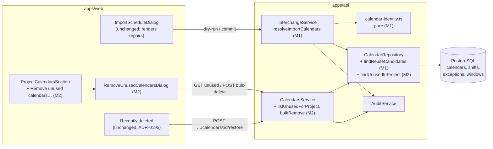
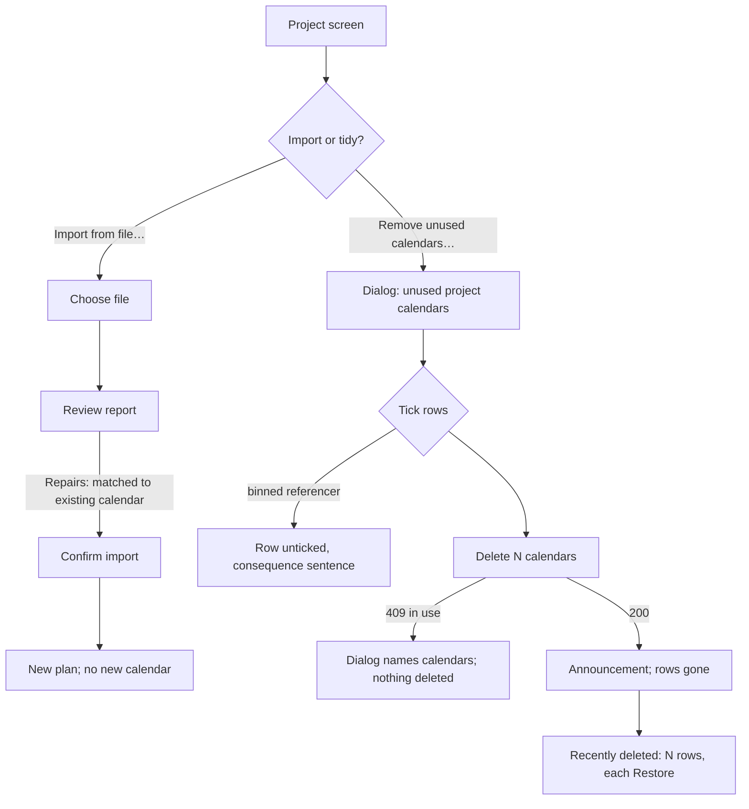

# Feature Spec: Tidy up the calendars an import leaves behind

- **Status:** Draft — awaiting product-owner approval
- **Author(s):** feature-analyst (Claude Code), for the product owner
- **Date:** 2026-10-26
- **Tracking issue / epic:** `docs/BACKLOG.md:261-265` ("Tidy up the calendars an import leaves behind"), chosen by the product owner on 2026-10-26
- **Roadmap link:** schedule interchange (ADR-0050 follow-on); calendar library manageability (ADR-0053 follow-on)
- **Related ADR(s):** ADR-0053 §5 (the "an import never reuses a calendar" rule — **amended** by this work), ADR-0050 (interchange pipeline and report), ADR-0068 (hours per day), ADR-0195 (library rows in the bin, per-row restore), ADR-0201 (no restore onto a deleted calendar), ADR-0096 (the bin, retention expiry — untouched), ADR-0072 / ADR-0073 (audit), ADR-0012 (RBAC + scope), ADR-0028 (the pen — not required), ADR-0081 (entry point + journey), ADR-0088 D1 (no flag), ADR-0105 (why this is full-spec work). A new **ADR-0207** is proposed (§4 "ADR").

---

## In plain English (for the product owner)

When you import a schedule file into a project, SchedulePoint creates that file's calendars inside
the project. If the project already has a calendar with the same name, today it **always makes a
new copy**, named something like `Site 6-Day (imported 2026-10-26)`. It never reuses the one that is
already there, because two calendars with the same name can have different working weeks, and
reusing the wrong one would quietly move every imported date.

So importing revision after revision of one programme into one project leaves a growing pile of
copies, and deleting an old revision's plan does not remove them. They have to be deleted by hand,
one at a time, from the organisation's Calendars screen. The project's own calendar list has no
Delete button.

**The recommendation has two parts.**

1. **Reuse a calendar only when it is exactly the same** (Milestone 1). When the project already
   has a calendar from an earlier import of the same programme, and its working week, its holidays
   and exceptions, and its hours per day all match the file exactly, the import uses that calendar
   instead of making a copy. The import report says so. The dates come out exactly as they would on
   a copy. If anything differs, even one holiday, you get a copy as today. Most revisions keep their
   calendars, so most re-imports stop making copies.
2. **"Remove unused calendars…" on the project screen** (Milestone 2). This lists the project's own
   calendars that no live plan or activity uses. You tick the ones to delete and confirm. Each goes
   to **Recently deleted** and can be restored. This clears out copies that already exist, and
   copies that were made because a calendar really did change.

There is one change you would notice. Two revisions that use one shared calendar are linked
through it. Editing that calendar changes the dates in both, and both are marked "edited since
calculated". That is already true for any two plans in a project that share a calendar. Question 2
asks whether that is acceptable.

**No database change is needed for either milestone.** No feature flag either (ADR-0088 D1).

---

## 0. What the code actually says (verified, not assumed)

Every fact the design rests on was checked against the source on `main` at `aa67ab9f`
(CLAUDE.md §19.11). **Corrections to the brief are marked.**

| #   | Claim                                                                                                                                                                                                                                                                                                                                                                                                | Evidence (read)                                                                                                                                                                                                                                                                                                 |
| --- | ---------------------------------------------------------------------------------------------------------------------------------------------------------------------------------------------------------------------------------------------------------------------------------------------------------------------------------------------------------------------------------------------------- | --------------------------------------------------------------------------------------------------------------------------------------------------------------------------------------------------------------------------------------------------------------------------------------------------------------- |
| F1  | Deleting a plan stamps **no** calendar. Only a project or client delete sweeps project calendars.                                                                                                                                                                                                                                                                                                    | `common/hierarchy/hierarchy-lifecycle.service.ts:497-508` (plan branch: baselines, links, steps, notes, shares, activities, swimlanes, plan); `deleteCalendarsUnderProjects` is called only at `:465` (client) and `:490` (project).                                                                            |
| F2  | **Brief correction:** the `(imported <date>)` name is built in `interchange.service.ts`, not `calendar.repository.ts`. The repository only probes for names that are already taken.                                                                                                                                                                                                                  | `IMPORTED_NAME_SUFFIX` at `interchange.service.ts:108-109`, applied by `disambiguateImportedName` `:1196-1216`; `CalendarRepository.findTakenNamesWithPrefixes` `calendar.repository.ts:344-364`.                                                                                                               |
| F3  | **An import never reuses a calendar, by decision.** Matching by name would silently reschedule. ADR-0053 names this paragraph as the place to revisit "should calendar reuse ever be introduced".                                                                                                                                                                                                    | `interchange.service.ts:998-1003`, `:1169-1171` (the finding's reason); `docs/adr/0053-…md:373-384`; `docs/API.md:1011-1013`.                                                                                                                                                                                   |
| F4  | **Problem re-verified, and narrower than the brief says.** `docs/TECH_DEBT.md` #540 ("importing the same file twice in one day failed at commit") is **closed**. The prefix probe now finds every earlier variant. A pile of copies no longer makes an import fail. The remaining cost is clutter: duplicate rows in every calendar picker in the project, and no way to tell which copy is current. | `docs/TECH_DEBT.md:5667`; `interchange.e2e-spec.ts:1198-1218` pins three imports into one project producing three distinct names; pickers read `findManyActiveForProject` (`calendar.repository.ts:722-742`), which returns every project calendar.                                                             |
| F5  | **Copies pile up without any plan being deleted.** Any re-import whose calendar name the project already holds makes a copy, even while the earlier plan is still live. A delete-time tidy (backlog option 1) would not prevent this.                                                                                                                                                                | `interchange.e2e-spec.ts:1164-1196`, where the first plan stays live.                                                                                                                                                                                                                                           |
| F6  | The import creates **every** calendar in the file, including ones nothing uses. A reused resource keeps its own calendar, so the file's copy of that resource's calendar (forced to the **ORG** tier) is created and bound to nothing. _Read, not run._ M1's test pins the identical case. Recommend a TECH_DEBT row for the non-identical case.                                                     | `interchange.service.ts:556-588` inserts all `graph.calendars`; the code-match reuse path `:862-877` binds no calendar; `packages/interchange/src/mapper.spec.ts:131` ("lands an UNUSED source RESOURCE calendar…").                                                                                            |
| F7  | A project calendar can be deleted only from the organisation Calendars screen. The project's calendar section has archive and tier moves but no Delete.                                                                                                                                                                                                                                              | `CalendarsTable.tsx:302`, `:491` ("Delete calendar"); `ProjectCalendarsSection.tsx:4-8` imports archive/unarchive hooks only.                                                                                                                                                                                   |
| F8  | The single-calendar delete guard counts **active** plans, activities and resources only. A calendar used only by a plan in the bin can therefore be deleted. That plan's restore is then refused with 409 `CALENDAR_DELETED` "Restore the calendar first" (ADR-0201), which can be recovered from.                                                                                                   | `calendars.service.ts:672-690`; `calendar.repository.ts:617-634`; `hierarchy-lifecycle.service.ts:976-983`.                                                                                                                                                                                                     |
| F9  | A plan restore brings back **every calendar stamped with the plan's batch**. That would make option 1's restore free, but see F10–F11.                                                                                                                                                                                                                                                               | `hierarchy-lifecycle.service.ts:806-812`; same-batch calendars are skipped as blockers at `:957`.                                                                                                                                                                                                               |
| F10 | The bin picks a group's acted-on row as "the first row whose blocker is outside the batch". A project calendar under a live project has no blocker. A plan delete that also stamped calendars would therefore have **two candidate roots**, chosen by uuid order, and the Restore button could restore only the calendar.                                                                            | `apps/web/src/features/recently-deleted/model/group-deletions.ts:38-46`; `recycle-bin.repository.ts:175-192` (`blocker_kind` NULL when `pj.deleted_at IS NULL`); `CalendarsService.restore` restores one calendar (`calendars.service.ts:590-594`).                                                             |
| F11 | Retention expiry removes calendars **by project ownership only**. It never uses `delete_batch_id`. A calendar stamped with an expired plan's batch would outlive the plan in the bin with no expiry, because a project calendar expires only with its project (ADR-0195 D4).                                                                                                                         | `hierarchy-expiry.runner.ts:14-19` ("Ownership scope, never `delete_batch_id`"), `:210-228`.                                                                                                                                                                                                                    |
| F12 | **Nothing records which calendars an import created.** The `Calendar` model has no source or provenance column. The `interchange.imported` audit row records a count, not ids, and the audit log is not a product data source.                                                                                                                                                                       | `apps/api/prisma/schema.prisma:1982-2066`; `interchange.service.ts:358-374` (`calendarCount`).                                                                                                                                                                                                                  |
| F13 | If the import fails, its compensation step **hard-deletes** every id in `createdCalendarIds`. A reused calendar must never be on that list.                                                                                                                                                                                                                                                          | `interchange.service.ts:555-560`, `:325`, `:1532-1539`. Reused resources are already excluded the same way (`:1527-1531`).                                                                                                                                                                                      |
| F14 | What "the same working time" means. The engine reads a calendar's shifts and its exceptions (start, end, windows), loaded by calendar id. `hours_per_day_minutes` is the service's day-to-minute factor (ADR-0068): the engine never reads it, but it decides how a typed "5d" is stored. Exception labels are read by neither.                                                                      | `schedule/plan-calendar.ts:20-39`, `:52-71`; `schedule.repository.ts:149-161`; `schema.prisma:2016-2042`.                                                                                                                                                                                                       |
| F15 | Calendar **content** edits (shifts, exceptions) are version-gated but do **not** take the calendar advisory lock. Only a tier move, a restore, a delete and binding seams take it. The lock order everywhere is calendar first, then ancestors.                                                                                                                                                      | `acquireCalendarWriteLock` call sites: `calendars.service.ts:317, 529, 673`, `calendar-scope.guard.ts:64`, `resources.service.ts:759`, `hierarchy-lifecycle.service.ts:902`; order comment at `hierarchy-lifecycle.service.ts:667-668`. Import takes the project chain first: `interchange.service.ts:262-267`. |
| F16 | Who may do what. `interchange:import` and every `calendar:*` write are Planner and Org Admin only. A shared-library (ORG) calendar additionally needs `calendar:manage_org`.                                                                                                                                                                                                                         | `common/auth/org-permissions.ts:204-233`, `:283-287`; `calendars.service.ts:654-663`.                                                                                                                                                                                                                           |

---

## 1. Business understanding

### Problem

A planner who re-imports successive revisions of one P6 or MS Project programme into one project
gets a new copy of every calendar on every import (F3, F5). Each copy is named
`<name> (imported YYYY-MM-DD)`, with an ordinal suffix if the same day already has one. The copies
are not harmful: #540 is closed (F4). They are clutter. Every calendar picker in the project lists
them all, the planner cannot tell which copy is current, and removing them is one at a time from a
screen outside the project (F7). Deleting the old revision's plan does not help (F1).

The same thing happens in the **shared organisation library** when an import carries resource
calendars (F6). Those are forced to the ORG tier, so every member sees the clutter.

### Users

| Role                       | Need                                                                               | This work                                                                      |
| -------------------------- | ---------------------------------------------------------------------------------- | ------------------------------------------------------------------------------ |
| **Planner**, **Org Admin** | Re-import revisions without a pile of copies, and clear the pile they already have | M1 (import reuses an identical calendar), M2 (remove unused project calendars) |
| Contributor, Viewer        | Calendar pickers and lists without duplicates                                      | Benefit only; no new capability (they cannot import or delete calendars)       |
| External Guest             | none                                                                               | Not affected. A share link exposes no calendar library.                        |

### Primary use cases

1. **Re-import a revision whose calendars did not change.** No new calendar is created, the report
   says which existing calendar was used, and the dates match what a fresh copy would give.
2. **Re-import a revision whose calendar did change.** A copy is created exactly as today.
3. **Clear out a project's unused calendars**, including copies from imports made before M1, in
   one confirmed action. Each calendar can be restored from Recently deleted.

### User journeys

- **Happy path (M1):** Project → **Import from file…** → choose `Programme Rev B.xer` → the review
  report's **Repairs** section reads _calendar "Site 6-Day" will use the existing calendar "Site
  6-Day"_ → **Confirm import** → the project's calendar section still shows one "Site 6-Day".
- **Happy path (M2):** Project → calendar section → **Remove unused calendars…** → the dialog lists
  three `(imported …)` copies, all ticked → **Delete 3 calendars** → they leave the list, and each
  appears in **Recently deleted** with its own Restore.
- **Alternate:** a ticked calendar becomes used between opening the dialog and confirming. The
  whole delete is refused and the dialog names the calendar and what uses it. Nothing is deleted.

### Expected outcomes

- Re-importing an unchanged programme creates no new calendars.
- An existing pile can be cleared in one action, and the action can be undone per calendar.
- The rule "an import never silently reschedules onto a different working week" still holds,
  because reuse requires identical working time.

### Success criteria

- Importing the same programme twice into one project (two plan names) leaves **one** calendar per
  source calendar. This is an API e2e, replacing the expectation at `interchange.e2e-spec.ts:1185-1190`.
- The reused import's persisted activity dates are **byte-identical** to the dates the same file
  produces on fresh copies (API e2e, two projects compared).
- Clearing N unused calendars takes one dialog and one confirmation, and each of the N can be
  restored on its own from Recently deleted (journey).
- No change under `apps/api/src/modules/schedule/` (ADR-0034 parity: no new engine input).

### Open questions

See §6. There are four critical questions, each with a recommended default.

---

## 2. Functional requirements

### User stories & acceptance criteria

> **US-1 — Reuse an identical calendar (M1).** As a **Planner**, I want a re-import to use the
> calendar the project already has when it is exactly the same, so that revisions do not pile up
> copies.
>
> **Acceptance criteria**
>
> - **Given** project P holds an active, unarchived PROJECT calendar C named "Site 6-Day", and C's
>   identity (defined in "Validation rules" below) equals the file's "Site 6-Day", **when** I
>   commit the import, **then** no calendar is created for it, every imported plan, activity and
>   resource reference that would have gone to the copy points at C, and the report holds one
>   `repair` finding: _calendar “Site 6-Day” was matched to the existing calendar “Site 6-Day”_,
>   reason _it has the same working week, exceptions and hours per day, so a copy would differ
>   only in its name (ADR-0207)_.
> - **Given** the same, **when** I run the dry-run, **then** the review report already holds that
>   finding (shared resolver, so the dry-run and the commit cannot disagree).
> - **Given** C differs from the file in **anything** in the identity (one exception, one window
>   minute, hours per day, one exception label), **when** I import, **then** a copy is created under
>   the free `(imported <date>)` name exactly as today, with today's "was created as" finding.
> - **Given** C's name is `Site 6-Day (imported 2026-10-20)`, which is the importer's own variant
>   of the file's name, and its identity matches, **then** C is reused (Q1 default: the name lineage
>   is required).
> - **Given** a project holds both "Site 6-Day" and an identical `Site 6-Day (imported …)`, **then**
>   the exact-name calendar is preferred, then variants oldest `created_at` first.
> - **Given** the only identical calendar is **archived**, deleted, in another project, or in the
>   other tier, **then** it is not reused and a copy is created.
> - **Given** a resource-held calendar (forced ORG, F6) identical to an active, unarchived ORG
>   calendar of that lineage, **then** the ORG calendar is reused (same rule, ORG tier).
> - **Given** the file holds two calendars that would both match the same existing C, **then** the
>   first in file order takes C and the second is created as a copy. One existing calendar is
>   claimed by at most one source calendar per import, so the file's calendar count is kept.
>   Calendars **inside** one file are never merged with each other.
> - **Given** the import's recalculation fails and compensation runs, **then** C still exists with
>   all its shifts, exceptions and windows (F13).
>
> **US-2 — Remove unused project calendars (M2).** As a **Planner**, I want to delete a project's
> unused calendars in one action, so that I can clear the copies earlier imports left.
>
> **Acceptance criteria**
>
> - **Given** I hold `calendar:delete` and project P has at least one own (PROJECT-tier) calendar
>   with no active referencer, **when** I open P, **then** the calendar section shows **Remove
>   unused calendars…**. Otherwise the button is not rendered, which is the existing
>   `canWrite` gating pattern of that section.
> - **When** I press it, **then** a dialog lists those calendars by name, with an "Archived" badge
>   where it applies. Each row has a checkbox.
> - **Given** a listed calendar is used only by a plan or activity that is in Recently deleted,
>   **then** its row says _Used by a deleted plan. Restoring that plan will ask you to restore this
>   calendar first._ and starts unticked. Every other row starts ticked (Q4 default).
> - **When** I confirm **Delete N calendars**, **then** each ticked calendar is soft-deleted with
>   its exceptions under **its own** `delete_batch_id`, one `calendar.deleted` audit row is written
>   per calendar, the list refreshes, and a polite announcement says _N calendars deleted. You can
>   restore them from Recently deleted._
> - **Given** any ticked calendar has gained an active referencer since the dialog opened, **then**
>   nothing is deleted, the result is 409 `CALENDAR_IN_USE`, and the dialog names each such
>   calendar with its counts.
> - **Given** a calendar deleted this way, **when** I restore it from Recently deleted, **then** it
>   comes back with its exceptions through the existing `CalendarsService.restore` (ADR-0195),
>   unchanged.
> - ORG-tier calendars are **never** listed. The shared library keeps its own screen, where its
>   full reach is visible (`ProjectCalendarsSection.tsx:47-51`).

### Workflows

**M1 commit** (dry-run is the same without writes and without locks):

1. Parse and map the file, unchanged.
2. **Probe the candidates**, outside the transaction: for each tier present in the graph, the
   active, unarchived calendars of that tier (and of the target project for PROJECT) whose name
   starts with the lineage prefix of a source name. This is the same prefix the name probe uses
   (`importedNameProbePrefix`, `interchange.service.ts:123-124`). Load each candidate with its
   shifts, active exceptions and windows, then filter in memory to exact lineage.
3. Open the transaction. **Take the calendar advisory lock on each candidate id, in ascending id
   order, before the project chain lock**. This is the calendar-then-ancestors order every other
   path uses (F15).
4. Take the project chain lock, unchanged (`interchange.service.ts:262-267`).
5. **Re-read** the locked candidates under the lock, and drop any that is now deleted or archived.
   Resolve each source calendar to **reuse C** or **create under a free name**. One pure function
   serves both the dry-run and the commit, following the `findGraphResourceCollisions` precedent
   (`interchange.service.ts:1046-1052`). A candidate that appeared after step 2 is not locked and
   so is not reused: the safe direction is a copy.
6. Insert only the calendars to create. Fill `calendarIdByKey` with created and reused ids alike.
   Push only created ids onto `createdCalendarIds`.
7. Everything else (plan, activities, resources, recalculation, audit, lanes) is unchanged.
   `interchange.imported`'s `after` gains `calendarsReused: <n>`.

**M2:**

1. `GET …/projects/:projectId/calendars/unused` returns the project's own active PROJECT calendars
   (archived included) that have zero active plans, activities or resources. This is the same
   predicate as the single-delete guard (F8). For each one it also reports how many **deleted**
   plans and activities still reference it.
2. The planner ticks and confirms, and the web calls `POST …/calendars/bulk-delete { ids }`.
3. In one transaction: lock every id in ascending order, re-load each in this organisation, apply
   the single delete's gates per row (`calendar:delete`, plus `calendar:manage_org` if ORG),
   re-count active referencers, and refuse the whole request if any is in use. Otherwise
   soft-delete each with its own batch id and write one audit row each, using the same producer
   shape as `calendars.service.ts:698-710`.

### Edge cases

| Case                                                                                                | Behaviour                                                                                                                                                                          |
| --------------------------------------------------------------------------------------------------- | ---------------------------------------------------------------------------------------------------------------------------------------------------------------------------------- |
| Candidate edited between the dry-run and the commit                                                 | The commit re-reads under the lock. If it no longer matches, a copy is made and the post-commit report says "was created as". The dry-run was advisory, as for names today.        |
| Candidate's content edited **during** the commit                                                    | Content edits do not take the advisory lock (F15). See Risk R2: the mitigation is a row lock on the reused calendar, decided at build with backend-performance review.             |
| Candidate deleted or archived during the commit                                                     | Delete takes the advisory lock (`calendars.service.ts:673`), so it waits or has already happened. The re-read in step 5 drops a deleted or archived candidate, and a copy is made. |
| Source name near the 120-character ceiling                                                          | Lineage uses the same clipped prefix as the name probe, so clipped variants still match (`interchange.service.ts:117-124`).                                                        |
| Window-only calendar (empty week, ADR-0036)                                                         | Its identity is an empty shift set plus its exceptions. Compared like any other.                                                                                                   |
| Hand-authored calendar whose exceptions are one multi-day **range**, where the file has single days | Not identical (stored rows differ), so a copy is made. This is conservative by design: a miss costs today's behaviour, a false match would cost dates.                             |
| Reused calendar later deleted                                                                       | Unchanged. The delete guard counts the new plan as an active referencer and refuses.                                                                                               |
| MSPDI import                                                                                        | Same rule. MSPDI calendars are always PROJECT (ADR-0053 §5), so only PROJECT candidates apply.                                                                                     |
| M2: project has only ORG calendars                                                                  | The button is not rendered.                                                                                                                                                        |
| M2: 0 rows ticked                                                                                   | The confirm button is disabled with its reason (ADR-0204); a `Dialog` footer action is a shaded control.                                                                           |
| M2: more than 200 ticked                                                                            | The DTO caps `ids` at 200 (422). The dialog sends in pages of 200 sequentially, and a mid-way 409 stops it and names what remains.                                                 |
| M2: a binned plan referencing a deleted calendar is then restored                                   | Existing ADR-0201 behaviour: 409 `CALENDAR_DELETED`, and the bin offers "Restore calendar first".                                                                                  |

### Permissions

Deny-by-default, organisation-scoped (ADR-0012). No new permission codes.

| Action                                       | Permission                                                           | Roles              | Scope                                                                                                                                                                                                                |
| -------------------------------------------- | -------------------------------------------------------------------- | ------------------ | -------------------------------------------------------------------------------------------------------------------------------------------------------------------------------------------------------------------- |
| Import that reuses a PROJECT or ORG calendar | `interchange:import` (unchanged)                                     | Planner, Org Admin | Candidates are read only within the caller's organisation and, for PROJECT, the target project. Binding to an ORG calendar is what `assertCalendarUsableBy` already permits every binder; it writes no shared state. |
| List unused project calendars                | `calendar:read`                                                      | All members        | Project resolved active and in-org first (404 otherwise), as `ProjectCalendarsController` does.                                                                                                                      |
| Bulk delete                                  | `calendar:delete` per row, plus `calendar:manage_org` for an ORG row | Planner, Org Admin | Every id loaded with `organizationId`. A foreign or unknown id is 404 for the whole request, with no partial delete and no existence oracle.                                                                         |
| Restore                                      | `calendar:restore` (unchanged, ADR-0195 D5)                          | Planner, Org Admin | unchanged                                                                                                                                                                                                            |

**The pen (ADR-0028):** neither milestone is a structural write to an existing plan. M1 creates a
new plan and takes and releases that plan's pen as today. Reusing a calendar writes nothing to
it. M2 is a library write, and the single calendar delete takes no pen today
(`calendars.service.ts:647-716`).

### Validation rules

**Calendar identity (M1).** Two calendars are identical when all of the following are equal after
normalisation:

- `hours_per_day_minutes`;
- the **set** of weekly shifts `(weekday, startMinute, endMinute)`, sorted;
- the **set** of active exceptions `(startDate, endDate, label, sorted windows)`, sorted by start date.

Excluded: id, name, description, scope, project, version, audit columns. **Labels are included**,
although no scheduling path reads them (F14). Default: keep the file's holiday names rather than
silently dropping a renamed one. A label-only difference therefore makes a copy, which is the
conservative direction.

The function compares stored rows against the `ImportCalendarBatchInput` the importer would write
(`calendar.repository.ts:141-172`), after `resolveHoursPerDayMinutes` and the single-day exception
expansion (`:299-316`). Comparing against what would actually be written, not the parsed file,
means "identical" means "a copy would have been indistinguishable".

**Name lineage (M1, Q1 default).** The candidate's name equals the source name, or is
`<clipped base> (imported YYYY-MM-DD)` optionally followed by ` (<n>)`, as built by
`IMPORTED_NAME_SUFFIX`. The name is a necessary filter, never a sufficient one.

**Bulk delete DTO (M2).** `ids`: array of UUIDs, 1–200, unique (`@ArrayMinSize(1)`,
`@ArrayMaxSize(200)`, `@ArrayUnique()`, `@IsUUID('all', { each: true })`). Unknown fields are
rejected by the global whitelist.

### Error scenarios

| Scenario                                             | Detection                              | User-facing result                                                                                                | Status |
| ---------------------------------------------------- | -------------------------------------- | ----------------------------------------------------------------------------------------------------------------- | ------ |
| Import without `interchange:import`                  | `resolveTarget` (unchanged)            | "You do not have permission…"                                                                                     | 403    |
| Bulk delete without `calendar:delete` / `manage_org` | per-row gate, before any write         | "You do not have permission…"                                                                                     | 403    |
| Bulk id unknown, foreign or already deleted          | org-scoped load inside the transaction | "Calendar not found." No partial delete.                                                                          | 404    |
| A ticked calendar is now in use                      | active-referencer count under the lock | `CALENDAR_IN_USE`, `details.calendars[]` with `{ id, name, plans, activities, resources }`; the dialog names them | 409    |
| `ids` empty, over 200, duplicated or not UUIDs       | DTO                                    | standard validation envelope                                                                                      | 422    |
| Unused-list project unknown, foreign or deleted      | project load                           | "Project not found."                                                                                              | 404    |

---

## 3. Technical analysis

| Area           | Impact          | Notes                                                                                                                                                                                                                                                                                                                                                                                                 |
| -------------- | --------------- | ----------------------------------------------------------------------------------------------------------------------------------------------------------------------------------------------------------------------------------------------------------------------------------------------------------------------------------------------------------------------------------------------------- |
| Frontend       | low/med         | M1: **no web code** (the report already renders `repair` findings, `InterchangeReportTable.tsx:56-60`). M2: one button and one dialog in `features/calendars/`, plus two hooks in `api/use-calendars`.                                                                                                                                                                                                |
| Backend        | med             | M1: `InterchangeService` calendar resolution, a pure identity function, one repository read, a change to the lock order in commit. M2: two `CalendarsService` methods, one controller route on each existing calendar controller.                                                                                                                                                                     |
| Database       | none (expected) | **No schema change.** M1 identifies an import's calendars by content plus lineage, with no provenance (F12). M2's "unused" is the existing guard's predicate. Conditional need: if Q1 is answered "content only", the candidate set becomes the whole tier, and a content fingerprint column may be needed. That **must go to database-architect before build** (CLAUDE.md §19.3). Not designed here. |
| API            | med             | Import behaviour change: binds an existing calendar, adds a finding text and an audit field. Two new endpoints (M2). `docs/API.md` and OpenAPI updated.                                                                                                                                                                                                                                               |
| Security       | med             | Candidate reads org- and project-scoped. Bulk delete keeps per-row gates, is all-or-nothing, and gives no oracle. Compensation must never hard-delete a reused calendar (F13). security-reviewer on both milestones.                                                                                                                                                                                  |
| Performance    | low             | M1 adds one query per tier (candidates plus shifts/exceptions/windows), bounded by lineage, plus k advisory locks. M2's list uses grouped counts, never one per calendar. Measured in M1 (Plan T1.6).                                                                                                                                                                                                 |
| Infrastructure | none            | No flag (ADR-0088 D1), no env, no CI step. The M2 journey goes into the existing base Playwright suite.                                                                                                                                                                                                                                                                                               |
| Observability  | low             | The commit log line `interchange commit persisted a plan` gains `calendarsReused`. The bulk delete logs one line with count and ids.                                                                                                                                                                                                                                                                  |
| Testing        | med             | Unit (identity, resolver), API e2e (reuse matrix, compensation, bulk delete), two journeys (ADR-0081), red-first mutations for the two safety properties.                                                                                                                                                                                                                                             |

**Recalc parity (ADR-0034).** Neither milestone adds a scheduling input. `computeSchedule` and
everything under `apps/api/src/modules/schedule/` stay unchanged. M1 binds a calendar whose rows
equal, after normalisation, the rows a copy would have held. `buildPlanCalendar` sorts both shifts
and windows (`plan-calendar.ts:56-67`), so it receives equal input. The proof is an e2e comparing
persisted dates of a reused import against a fresh-copy import of the same file. M2 deletes only
calendars with no active referencer, so no live plan's inputs change. A binned referencer's
restore is refused until the calendar returns (F8, ADR-0201), so no plan is ever computed on a
calendar this deleted.

**Audit (ADR-0073).** M1: reusing a calendar mutates nothing in it, so there is no calendar event.
`interchange.imported` (best-effort, after phase 2, `interchange.service.ts:338-374`) gains
`calendarsReused`. M2: one `calendar.deleted` per calendar, inside the transaction, with the same
shape as the single delete, so the audit log cannot tell the two paths apart. Default: identical
payload, no `via` field.

**Restore, the bin and undo.** M1 deletes nothing, so the bin and restore are unaffected. M2 gives
**each calendar its own batch**, so the bin lists N independent rows, each with its own Restore.
One shared batch would form a group whose root is picked by uuid (F10), and Restore on that root
would bring back one calendar while the group implied all of them. The calendars screens have no
undo stack (ADR-0048 is plan authoring only), and none is added. The confirmation copy says the
calendars can be restored from Recently deleted. Retention: a deleted PROJECT calendar expires only
with its project (ADR-0195 D4), so nothing changes in ADR-0096 D2's scope.

### Dependencies

- None to land first. M2 does not depend on M1.
- Touches the interchange e2e expectations at `interchange.e2e-spec.ts:1164-1240`. Those tests
  are rewritten, not deleted: the never-reuse-by-**name** guarantee is kept, with a fixture whose
  content differs.
- `docs/API.md:1000-1015` ("Calendars take the opposite route… always created") is rewritten.

---

## 4. Solution design

### Architecture overview



### Data flow (M1 commit)

```mermaid
sequenceDiagram
  participant W as Web (Confirm import)
  participant I as InterchangeService
  participant R as CalendarRepository
  participant P as Postgres
  W->>I: POST …/interchange/commit (file)
  I->>I: parse + map (unchanged)
  I->>R: findReuseCandidates(tier, project, lineage prefixes)
  R->>P: calendars + shifts + exceptions + windows (active, unarchived)
  I->>P: BEGIN
  loop candidate ids ascending
    I->>P: pg_advisory_xact_lock(calendar)
  end
  I->>P: lock project chain FOR SHARE (unchanged)
  I->>R: re-read locked candidates
  I->>I: resolve: reuse C | create "name (imported date)"
  I->>P: createManyForImport(created only)
  I->>P: plan, activities, resources … (calendarIdByKey holds reused ids)
  I->>P: COMMIT
  I->>I: recalculate; on failure compensate(createdCalendarIds only)
  I->>P: audit interchange.imported {calendarsReused}
  I-->>W: { planId, report.repairs[…"matched to the existing calendar"…] }
```

### User flow



### Database changes

**None.** No model, column, index or constraint changes, and no data migration. The reasons are
in §3 "Database". The single conditional need (a content fingerprint, only if Q1 is answered
"content only") is named, not designed, and would go to **database-architect** before any build.
If M1's measurement (Plan T1.6) shows the lineage-bounded candidate read is too slow, that also
goes to database-architect. No index is added on a guess (`calendar.repository.ts:715-720`).

### API changes

**M1 (behaviour, no new route):** `POST …/projects/:projectId/interchange/dry-run` and
`…/commit`. A source calendar may now resolve to an existing calendar, and the report's
`repairs[]` gains a finding with `entity: 'calendar'` and detail
`calendar “<source>” was matched to the existing calendar “<existing>”`. No new finding kind
(the #541 contract argument, `interchange.service.ts:177-180`).

**M2:**

- `GET /api/v1/organizations/:orgSlug/projects/:projectId/calendars/unused` → **200**
  `{ data: UnusedCalendar[], meta: { nextCursor } }`, cursor-paginated with the same params as the
  project list. `UnusedCalendar = { id, name, archived: boolean, version, deletedReferencers: { plans: number, activities: number } }`.
  404 for an unknown, foreign or deleted project. Read-only, on `ProjectCalendarsController`.
- `POST /api/v1/organizations/:orgSlug/calendars/bulk-delete` with body `{ ids: uuid[] }` →
  **200** `{ data: { deleted: { id, name, deleteBatchId }[] } }`. 403, 404, 409 `CALENDAR_IN_USE`
  (details per calendar) and 422 as in §2. It sits on the **org** calendars controller, so there
  remains one calendar write surface (`project-calendars.controller.ts:26-29`), and it is a `POST`
  per the batch-delete precedent (`docs/API.md:1943`).

### Component changes

M2 only, all in `apps/web/src/features/calendars/`:

- `components/RemoveUnusedCalendarsButton.tsx`: `Button variant="outline"` "Remove unused
  calendars…", rendered in `ProjectCalendarsSection`'s header actions when `canWrite` holds and the
  unused list is non-empty.
- `components/RemoveUnusedCalendarsDialog.tsx`: the `Dialog` primitive with a `fieldset`/`legend`
  checkbox list (design-system `Checkbox` and `Badge`; no one-off styling). States: **loading**
  (the settled shape plus one sentence, ADR-0202), **empty** ("Every calendar in this project is in
  use."), **error** (the envelope message, `role="alert"`), **409** (names each calendar), and
  **success** (polite announcement, focus returns to the section heading because the button may
  have unmounted, ADR-0135).
- `api/use-calendars.ts`: `useUnusedProjectCalendars`, `useBulkDeleteCalendars`. On success these
  invalidate the project calendar list, the org list and the deleted-items query.

M1 has no component change.

### Implementation approach & alternatives

**Recommended: B (reuse an identical calendar, M1) followed by C (remove unused calendars, M2).**

| Option                                                                                          | Verdict              | Why                                                                                                                                                                                                                                                                                                                                                                                                                                                                                                                                                                                                                         |
| ----------------------------------------------------------------------------------------------- | -------------------- | --------------------------------------------------------------------------------------------------------------------------------------------------------------------------------------------------------------------------------------------------------------------------------------------------------------------------------------------------------------------------------------------------------------------------------------------------------------------------------------------------------------------------------------------------------------------------------------------------------------------------- |
| **A. Offer to remove an import's unused calendars when its plan is deleted** (backlog option 1) | Rejected             | (1) It **needs a schema column**: nothing records which calendars an import made (F12), and the file's unused calendars are referenced by nothing (F6), so they cannot be inferred. (2) It acts too late: copies pile up while the old plan is still live (F5). (3) Stamping calendars into the plan's batch restores them for free (F9), but it makes the bin's group root ambiguous (F10). The calendars would also outlive the plan's expiry (F11), and a plan restore would fail on a name a later import took. That is a restore that works today and would stop working. (4) The copies' names stay suffixed forever. |
| **B. Reuse an IDENTICAL calendar** (backlog option 2)                                           | **Recommended (M1)** | Stops the pile-up at its source, including while earlier plans are live. Needs no schema and changes nothing in the bin, restore or expiry. It answers ADR-0053 §5's stated reason exactly: the rule existed because a **name** match could change working time, and an identity match cannot. ADR-0053 itself names this as the seam to revisit (F3). The cost is that revisions share a calendar (Q2).                                                                                                                                                                                                                    |
| **C. "Remove unused calendars" on the project screen**                                          | **Recommended (M2)** | Clears copies B cannot prevent: those from before B, and those from a calendar that really changed. Fixes F7 (no delete on the project screen). It is the single delete's own predicate and rules in bulk, so it adds no new definition of "unused" and needs no schema. It is restorable per calendar through ADR-0195 with no change.                                                                                                                                                                                                                                                                                     |
| B with content-only matching (no name lineage)                                                  | Not default (Q1)     | Would bind an import to an unrelated, identically-shaped calendar ("Crew A nights") that its owner may change later. It would widen the candidate read to the whole tier, which likely needs a fingerprint column and therefore a database-architect pass.                                                                                                                                                                                                                                                                                                                                                                  |
| B, reusing archived calendars with auto-unarchive (the resources CQ-4 precedent)                | Rejected             | Resources unarchive because a name collision **forces** a match (`docs/adr/0053-…md:386-394`). A calendar can always fall back to a copy, so reviving a deliberately retired calendar would be a choice nobody asked for.                                                                                                                                                                                                                                                                                                                                                                                                   |
| B, merging identical calendars within one file                                                  | Rejected             | Changes the file's structure, and an export would no longer round-trip its calendar count.                                                                                                                                                                                                                                                                                                                                                                                                                                                                                                                                  |
| An import option "always create new calendars"                                                  | Not default (Q2)     | Adds a control to a dialog that already carries a tier option and collision answers, for a need nobody has stated yet.                                                                                                                                                                                                                                                                                                                                                                                                                                                                                                      |
| A feature flag                                                                                  | Rejected             | ADR-0088 D1: a published image carries every flag at its default. The rollback is the commit boundary, and each milestone is one.                                                                                                                                                                                                                                                                                                                                                                                                                                                                                           |

**ADR required: yes.** M1 overturns an accepted rule (ADR-0053 §5, "An import never REUSES a
calendar"). Draft outline:

> **ADR-0207 — An import reuses a calendar it would have copied exactly** _(Proposed; amends ADR-0053 §5)_
>
> - **Context:** F3–F6. The never-reuse rule's reason was a name match changing working time. The
>   cost is unbounded copies per re-import, including in the ORG library.
> - **D1:** A source calendar reuses an existing calendar when its identity (hours per day,
>   shifts, active exceptions with labels and windows, normalised) equals what the import would
>   write, and its name is the source name or the importer's own `(imported …)` variant of it.
>   Name is necessary, never sufficient.
> - **D2:** Candidates are active, unarchived, in the source calendar's tier, and for PROJECT in
>   the target project. Exact name first, then oldest variant. One candidate per source calendar
>   per import. No merging inside a file.
> - **D3:** Candidates are advisory-locked in id order before the project chain, re-read under
>   lock, and never hard-deleted by compensation.
> - **D4:** Reported as a `repair` finding in dry-run and commit. No new kind.
>   `interchange.imported` gains `calendarsReused`.
> - **D5:** Unused project calendars can be deleted in bulk from the project screen, each under its
>   own batch, with the single delete's gates, all-or-nothing.
> - **D6:** No flag (ADR-0088 D1). The engine is untouched (ADR-0034).
> - **Alternatives:** this table.
> - **Consequences:** revisions share a calendar, and an edit reaches all of them and stamps each
>   one stale. ADR-0053 §5's CQ-4 sentence for calendars ("not applicable") is restated as "reuse
>   skips archived". `docs/API.md` §interchange rewritten.

CLAUDE.md §16 gains the ADR-0207 line, and `check:adr-coverage` enforces it.

---

## 5. Links

- Implementation plan: [`./implementation-plan.md`](./implementation-plan.md)
- Related docs updated by this change: `docs/adr/0207-…` (new), `docs/adr/0053-…md` §5 (amendment
  pointer), `CLAUDE.md` §16, `docs/API.md` (interchange calendars paragraph; M2 endpoints),
  `docs/BACKLOG.md:261-265` (item removed when M2 lands), `docs/TECH_DEBT.md` (new row for F6's
  non-identical case, if confirmed by M1's test).

---

## 6. Critical questions

Each has a recommended default. Everything else in this spec is a stated default.

1. **Q1 — Must a reused calendar also carry the file's name (or the importer's own
   `(imported …)` variant of it), or is identical content enough?**
   **Default: content AND name lineage.** It is narrower and safer. It never binds an import to
   someone's differently-named calendar, and it keeps the candidate read small, with no schema
   change. Content-only would catch more copies, but it widens the read to the whole tier and
   probably needs a database-architect pass for a fingerprint column.
2. **Q2 — Is it acceptable that revisions which reuse a calendar share it, so editing it changes
   every revision's dates (each marked "edited since calculated"), with no per-import "always copy"
   option?**
   **Default: yes, no option.** That is what sharing a calendar already means within a project, and
   the report names every reuse. An "always copy" checkbox can follow if anyone asks.
3. **Q3 — Should reuse apply to the shared organisation library too, for the resource calendars an
   import forces to ORG?**
   **Default: yes, the same rule in each tier.** Today every such re-import adds a copy that the
   whole organisation sees (F6). Reuse writes nothing to the shared library, so it is strictly less
   intrusive than today.
4. **Q4 — Build M2 ("Remove unused calendars…") now, and how should it treat a calendar that only
   a plan in Recently deleted uses?**
   **Default: build it now, and list such calendars unticked, with the sentence "Used by a deleted
   plan. Restoring that plan will ask you to restore this calendar first."** Excluding them would
   hide exactly the copies an old revision left. Ticking them by default would make the old plan's
   restore a two-step job without the planner noticing.

**Awaiting product-owner approval before implementation.**
