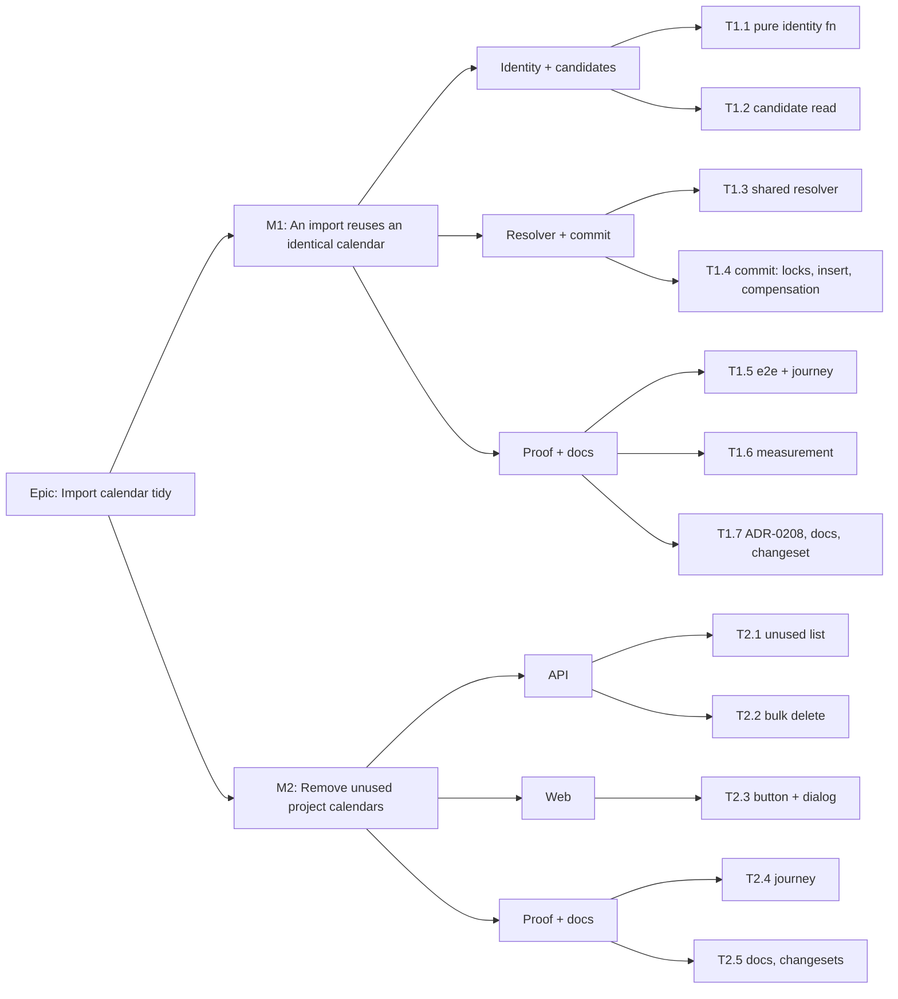

# Implementation Plan: Tidy up the calendars an import leaves behind

- **Feature spec:** [`./feature-spec.md`](./feature-spec.md)
- **Status:** Accepted — shipped (ADR-0208), 2026-10-26. Approved by the product owner the same day with every default (Q1 to Q4)
- **Owner:** product owner (James Ewbank); built by the **builder** agent, reviewed as listed per task

## Breakdown

### Epic

**Import calendar tidy.** Re-importing revisions stops piling up calendar copies, and the copies
already made can be cleared. Roadmap theme: schedule interchange (ADR-0050) and calendar library
manageability (ADR-0053).

**No schema change in either milestone.** Two conditions send the work to **database-architect**
before any build: Q1 answered "content only", or T1.6's measurement asking for an index or
fingerprint column. If either fires, the builder **stops** (CLAUDE.md §19.3, ADR-0105). **No
feature flag** (ADR-0088 D1). Each milestone is its own commit boundary and rollback.

---

### Milestone 1: An import reuses an identical calendar (shippable slice)

**Outcome:** re-importing a programme whose calendars have not changed creates no new calendars.
The review report says which existing calendar each one will use.
**Entry point:** Project screen → **Import from file…** (`ImportScheduleButton.tsx:39-41`) →
dialog "Import schedule from file" → review report, **Repairs** section → **Confirm import**.
The capability shows in an existing surface. No new control is needed.
**Journey:** `apps/web/e2e-interchange/interchange.spec.ts`, new test _"a re-imported revision
reuses its unchanged calendar"_. It imports a calendar-bearing `.xer` into a project, imports a
second `.xer` (same calendar, different project name), and asserts that the review report's
Repairs region contains "was matched to the existing calendar". After **Confirm import** it
asserts that the project's calendar section lists exactly one "Site 6-Day" and no row matching
`(imported`.

---

#### Feature: Calendar identity and candidates

> **Description:** a pure definition of "a copy would be indistinguishable", and the one read that
> finds the calendars that could be one.
> **Complexity:** M
> **Dependencies:** none
> **Risks:** a normalisation gap that calls two calendars equal when they are not, which would
> change dates → property tests, conservative inclusion (labels included), and T1.5's
> byte-identical-dates e2e.
> **Testing requirements:** unit (Vitest) for identity and lineage; API e2e for the read's scoping.

##### Task 1.1 — Pure calendar identity and name lineage (≈ one PR)

- **Description:** `apps/api/src/modules/interchange/calendar-identity.ts`, holding
  `calendarIdentityKey(input)` and `isImportedVariantOf(candidateName, sourceName)`. The identity
  covers `hoursPerDayMinutes`, the sorted shift set, and the sorted active exceptions
  `(startDate, endDate, label, sorted windows)`. It is computed from **both** a stored candidate
  and an `ImportCalendarBatchInput` (`calendar.repository.ts:141-172`), so the comparison is
  against what the import would actually write. Lineage reuses `IMPORTED_NAME_SUFFIX` and
  `importedNameProbePrefix` (`interchange.service.ts:108-124`), exported, not restated.
- **Complexity:** S
- **Dependencies:** —
- **Risks:** the suffix rule drifts from the builder of the suffix → import the same constant, and
  add a test that builds variants with `disambiguateImportedName`'s rule and asserts that
  `isImportedVariantOf` accepts them.
- **Testing:** unit cases: equal modulo row order; differs by one window minute, one exception,
  hours per day, or label only; window-only calendar; empty exceptions; multi-day range against
  single days (not equal); name exact, variant, variant with ordinal, clipped-at-120 variant, and
  an unrelated name with the same prefix (`Site 6-Day North` is **not** a variant).
- **Development steps:**
  1. Write the failing unit suite first.
  2. Implement the two functions with no I/O.
  3. Export the suffix helpers from `interchange.service.ts` (or move them to a small
     `imported-name.ts` beside it, without changing behaviour).

##### Task 1.2 — `CalendarRepository.findReuseCandidates`

- **Description:** one query per tier: active (`deletedAt: null`), unarchived
  (`archivedAt: null`), in `organizationId` and `scope`, with `projectId` for PROJECT, `name`
  `startsWith` any of the lineage prefixes, including shifts, active exceptions and windows (the
  `findActiveDetailByIdsInOrg` include, `calendar.repository.ts:530-547`). Plus
  `findReuseCandidatesByIds(ids, organizationId, tx)` for the re-read under lock. Both carry the
  ADR-0172 soft-delete annotation.
- **Complexity:** S
- **Dependencies:** —
- **Risks:** a missing org or project predicate is an IDOR → the API e2e seeds an identical
  calendar in a second org and in a second project and asserts neither is reused.
- **Testing:** covered by T1.5's e2e matrix; `check:soft-delete` (ADR-0172) passes on the
  annotations.
- **Development steps:**
  1. Add both methods beside `findTakenNamesWithPrefixes`.
  2. Docblock: why archived rows are **excluded** here, the opposite of the name probe, which
     includes them because archiving keeps the name.

---

#### Feature: The shared resolver and the commit

> **Description:** one function decides reuse or create for the dry-run and the commit. The
> commit locks, re-reads, inserts only what it creates, and never compensates a reused calendar.
> **Complexity:** M
> **Dependencies:** T1.1, T1.2
> **Risks:** see R1–R3 in the rollup.
> **Testing requirements:** unit (resolver), API e2e (commit and dry-run), red-first mutations.

##### Task 1.3 — `resolveImportCalendars` (replaces `resolveImportCalendarNames`)

- **Description:** returns, per source calendar key,
  `{ kind: 'reuse', id, existingName } | { kind: 'create', name }` plus findings. The pure core
  takes the graph, the candidate rows and the taken-names sets, and applies: exact-name candidate
  first, then variants by `createdAt` ascending; one claim per existing calendar per import; no
  merging inside the file; and on no match, today's `disambiguateImportedName`. Findings: today's
  "was created as" for renames, and the new
  `calendar “<source>” was matched to the existing calendar “<existing>”` with the ADR-0208
  reason. The dry-run calls it outside any transaction, and the commit inside (the
  `findGraphResourceCollisions` precedent, `interchange.service.ts:1046-1052`).
- **Complexity:** M
- **Dependencies:** T1.1, T1.2
- **Risks:** the dry-run and the commit disagree → one function, and an e2e asserts the dry-run
  finding matches the commit finding for an unchanged candidate.
- **Testing:** unit: each preference rule; two source calendars matching one candidate (the
  second is created); a source matching nothing; an archived-only match (create); a mixed-tier
  graph.
- **Development steps:**
  1. Unit tests for the pure core.
  2. Implement the core, then the I/O wrapper (taken names plus candidates per tier).
  3. Swap both call sites (`:188`, `:548`).

##### Task 1.4 — Commit: lock order, insert, compensation, audit

- **Description:** in `commit`, probe candidate ids **before** the transaction. Inside it, take
  `acquireCalendarWriteLock` on each id in ascending order, **then** `lockActiveProjectChainForShare`
  (`:262`). This is the calendar-then-ancestors order of `CalendarsService.restore` and
  `restoreBatch` (`hierarchy-lifecycle.service.ts:667-669`). Then re-read with
  `findReuseCandidatesByIds` and resolve. Only locked candidates are eligible. In `persistGraph`,
  build `calendarInputs` from the `create` entries only, fill `calendarIdByKey` with both kinds,
  and push only created ids onto `createdCalendarIds` (`:553-560`). Add `calendarsReused` to the
  `interchange.imported` `after` (`:365-374`) and to the commit log line (`:297-310`).
  **Decide R2 here with backend-performance-reviewer:** whether to also take `SELECT … FOR SHARE`
  on the reused calendar rows, so a concurrent version-gated content edit waits for the commit.
- **Complexity:** M
- **Dependencies:** T1.3
- **Risks:** R1 (deadlock from inverted lock order), R2 (concurrent content edit), R3 (a reused id
  reaching compensation).
- **Testing:** API e2e: compensation with a reused calendar (force the recalc to fail with the
  existing test hook or a spy) leaves the calendar and its shifts, exceptions and windows intact.
  A concurrent-delete e2e (calendar delete racing the commit) ends with either a reuse and a 409
  on the delete, or a copy. Never a plan on a deleted calendar. **Red-first:** (a) push reused ids
  onto `createdCalendarIds` → the compensation test goes red; (b) take the project lock before the
  calendar locks → the race test is run for 8 rounds as in ADR-0195's matrix, and the deadlock
  outcome is recorded honestly whether or not it reproduces; (c) drop the archived filter → the
  archived test goes red.
- **Development steps:**
  1. Write the e2e cases (failing).
  2. Reorder locks; restrict insert and compensation lists.
  3. Audit field and log field.
  4. Run the red-first mutations and record which tests went red in the ADR ledger.

---

#### Feature: Proof, measurement, documentation

> **Description:** the evidence that M1 changes no dates and costs little, plus the decision
> record.
> **Complexity:** M
> **Dependencies:** T1.4
> **Risks:** rewriting the existing never-reuse tests could quietly drop the guarantee they pinned
> → each rewritten test keeps its subject, with content that differs.
> **Testing requirements:** API e2e, Playwright journey, one measurement.

##### Task 1.5 — API e2e matrix and the journey

- **Description:** in `apps/api/test/interchange.e2e-spec.ts`:
  - **Rewrite** `:1164` _"suffixes (never reuses) a calendar name the project already holds"_ to
    use a second file with the **same name and different working week**. It still expects two
    calendars and the "was created as" finding.
  - **Rewrite** `:1198` (#540 regression) with three files whose same-named calendars differ in
    content. It still expects three distinct names.
  - **Rewrite** `:1220` (dry-run names the rename) the same way.
  - **Add:** identical re-import into one project → one calendar, both plans bound to it, finding
    present. **Byte-identical dates:** the same file imported into a fresh project B (copies) and
    as a reuse in project A gives equal `earlyStart/earlyFinish/lateStart/lateFinish/totalFloat`
    for every activity code. Exact-name preferred over a variant. Archived identical → copy.
    Identical in another project, and in another org → copy. A label-only difference → copy. A
    resource-held ORG calendar identical to an ORG library variant → reused (Q3 default). Two
    identical source calendars, one candidate → one reuse and one copy. Compensation keeps a
    reused calendar (T1.4).
  - Add a `xerWithCalendar` variant parameter for the working week, if the helper lacks one.
  - Web journey per the milestone header, in `e2e-interchange`.
- **Complexity:** M
- **Dependencies:** T1.4
- **Risks:** journey locators drift → run `scripts/e2e-local.sh web:interchange` locally before
  pushing (CLAUDE.md §19.8).
- **Testing:** this task is the testing. `scripts/e2e-local.sh api` and
  `scripts/e2e-local.sh web:interchange` green locally.
- **Development steps:**
  1. Rewrite the three tests, then add the new ones.
  2. Add the journey test.
  3. Run both locally.

##### Task 1.6 — Measure the candidate read

- **Description:** a `test/measure/` harness in the style of
  `recycle-bin-library.measure.ts` (ADR-0195). One project holds 50 lineage variants of one name,
  each with 300 exceptions, plus an org at the ADR-0053 ceiling of 1,000 calendars. Measure the
  dry-run's added wall time p50/p95 over 15 runs and `EXPLAIN ANALYZE` the candidate query.
  Record the reading in ADR-0208's ledger. **Escalation rule:** if the added p95 exceeds 50 ms (a
  quarter of the 200 ms read target, CLAUDE.md §15), stop and take an index or fingerprint
  proposal to **database-architect**. Do not add one on a guess.
- **Complexity:** S
- **Dependencies:** T1.2
- **Risks:** a synthetic seed misleads → state its shape beside the numbers.
- **Testing:** n/a (measurement).
- **Development steps:**
  1. Build the seed.
  2. Run and record.
  3. Decide against the rule above.

##### Task 1.7 — ADR-0208, docs, changeset

- **Description:** `docs/adr/0208-an-import-reuses-a-calendar-it-would-have-copied-exactly.md`
  (outline in spec §4), with the acceptance-status ledger. A dated amendment pointer in ADR-0053
  §5 at `:373-384` and `:395-398`. The CLAUDE.md §16 line. `docs/API.md:1000-1015` rewritten.
  ADR-0050's mapping table row for calendars, if it states "always created". A changeset:
  **`@repo/api` minor** (import behaviour and report contract; pre-1.0 minor per CLAUDE.md §10).
  No web changeset (M1 ships no web code). File a `docs/TECH_DEBT.md` row for F6's non-identical
  case (a reused resource still gets an unbound ORG copy of its calendar) if T1.5 confirms it.
- **Complexity:** S
- **Dependencies:** T1.5, T1.6
- **Risks:** a stale doc claim (the API.md "always created" paragraph) survives → grep for
  "never reuses" and "always created" across `docs/` and code docblocks
  (`interchange.service.ts:102-107`, `:998-1003`, `:1169-1171`, `:1193`;
  `calendar.repository.ts:339-342`) and update each.
- **Testing:** `pnpm prepush` (includes `check:adr-coverage`, `check:spec-status`,
  `check:counts`).
- **Development steps:**
  1. Write the ADR and the §16 line.
  2. Sweep the docblocks and docs.
  3. Add the changeset.
  4. Set this spec's status to `Accepted — shipped (ADR-0208)` only when M2 has also shipped, or
     when M2 is declined.

**M1 reviewers:** security-reviewer (candidate scoping, compensation), backend-performance-reviewer
(lock order, R2, T1.6), api-reviewer (finding contract, audit field), test-engineer (e2e matrix).

---

### Milestone 2: Remove unused project calendars (shippable slice)

**Outcome:** a Planner clears a project's unused calendars in one confirmed action, and each one
can be restored from Recently deleted.
**Entry point:** Project screen → calendar section (`ProjectCalendarsSection`) → **Remove unused
calendars…** (button, accessible name "Remove unused calendars…") → dialog "Remove unused
calendars" → **Delete N calendars**.
**Journey:** `apps/web/e2e/project-calendars-tidy.spec.ts` (base suite, no flag). Through the
public API it seeds a project with one plan on calendar "Kept", plus two project calendars that
nothing uses. It opens the project, presses **Remove unused calendars…**, asserts that both
unused rows are listed and ticked and "Kept" is absent, presses **Delete 2 calendars**, and
asserts the announcement. It then opens **Recently deleted** and asserts two separate calendar
rows, each with **Restore**. It restores one and asserts it is back in the project section. It
includes the suite's a11y check on the open dialog. If `check:e2e-roster` registers spec files,
register this one.

---

#### Feature: API

> **Description:** a read of the unused set and an all-or-nothing bulk delete with the single
> delete's rules.
> **Complexity:** M
> **Dependencies:** none (independent of M1)
> **Risks:** R4 (partial delete), R5 (bin grouping), R6 (N+1 counts).
> **Testing requirements:** unit (service gates), API e2e (Supertest).

##### Task 2.1 — `GET …/projects/:projectId/calendars/unused`

- **Description:** `CalendarsService.listUnusedForProject` and a route on
  `ProjectCalendarsController`. It lists the project's own PROJECT calendars, archived included,
  with zero active plans, activities and resources (the `remove` predicate,
  `calendars.service.ts:676-681`), cursor-paginated. It adds `deletedReferencers { plans,
activities }` from soft-deleted plans and activities. That is **one grouped count per table for
  the page**, never one per calendar. Response DTO plus OpenAPI.
- **Complexity:** S
- **Dependencies:** —
- **Risks:** R6 → a statement-count assertion in the e2e, or a query-count spy in the unit test.
- **Testing:** e2e: a used calendar is excluded; an archived unused one is included with
  `archived: true`; one referenced only by a binned plan is included with
  `deletedReferencers.plans: 1`; ORG calendars are excluded; a foreign or deleted project gives
  404; a Viewer can read (it is `calendar:read`).
- **Development steps:**
  1. Repository read(s) with ADR-0172 annotations.
  2. Service plus DTO plus route.
  3. e2e.

##### Task 2.2 — `POST …/calendars/bulk-delete`

- **Description:** `CalendarsService.bulkRemove(principal, orgSlug, ids, context)`. In one
  transaction: ids sorted ascending → `acquireCalendarWriteLock` each → org-scoped load of each
  (any miss → 404, nothing written) → per row `calendar:delete`, plus `calendar:manage_org` for an
  ORG row (gate order as `remove`, `:653-663`) → active-referencer counts (grouped) → any in use →
  409 `CALENDAR_IN_USE` with `details.calendars[]` → otherwise `softDeleteWithExceptions` per row
  (each mints its own batch id, `calendar.repository.ts:823-838`) and one `calendar.deleted`
  audit row per row, with the same payload as `:698-710`. DTO limits per spec §2.
- **Complexity:** M
- **Dependencies:** —
- **Risks:** R4, R5; lock-order deadlock against a concurrent hierarchy restore → ascending order,
  the same as `lockBatchCalendars` (`hierarchy-lifecycle.service.ts:902`).
- **Testing:** e2e: deletes N under N distinct batch ids; one in-use id → 409 and none deleted;
  a foreign-org id → 404 and none deleted; a Contributor → 403; an ORG id without `manage_org` →
  403; duplicates, empty and 201 ids → 422; N audit rows; each deleted calendar appears as its own
  bin row and restores alone through `POST …/calendars/:id/restore`. **Red-first:** (a) one shared
  batch id → the "N distinct batches" test goes red; (b) skip the in-use recount under the lock →
  a race test (a plan bound to a ticked calendar concurrently) goes red, or is recorded honestly if
  it does not reproduce; (c) drop the org scope from the load → the foreign-id test (the ADR-0195
  finding that a later re-read can mask this is noted, and the test asserts behaviour).
- **Development steps:**
  1. DTO, service, route, OpenAPI.
  2. e2e plus red-first.

---

#### Feature: Web

> **Description:** the button and dialog on the project's calendar section.
> **Complexity:** M
> **Dependencies:** T2.1, T2.2
> **Risks:** focus loss when the button unmounts after the last unused calendar is deleted →
> ADR-0135 hand-back to the section heading.
> **Testing requirements:** component tests (Vitest + Testing Library), a11y.

##### Task 2.3 — `RemoveUnusedCalendarsButton` and `RemoveUnusedCalendarsDialog`

- **Description:** per spec §4 "Component changes". Hooks `useUnusedProjectCalendars` (fetches
  every page before showing the list, so the list is never partial) and `useBulkDeleteCalendars`
  (pages of 200; invalidates the project calendars, org calendars and deleted-items queries).
  Copy: title "Remove unused calendars"; a lead sentence "These calendars belong to {project} and
  no plan or activity uses them. Deleted calendars can be restored from Recently deleted."; the
  binned-referencer line; confirm "Delete {n} calendar(s)", shaded with its reason at 0 (ADR-0204);
  a 409 message naming each calendar and its counts.
- **Complexity:** M
- **Dependencies:** T2.1, T2.2
- **Risks:** one-off styling → design-system primitives only (`Dialog`, `Checkbox`, `Badge`,
  `Button`); component-reviewer.
- **Testing:** unit: renders nothing without `canWrite` or with an empty list; default ticks (a
  binned-referencer row unticked); a 409 names calendars; success announces and returns focus;
  the confirm button is shaded at 0 with its reason reachable by keyboard.
- **Development steps:**
  1. Hooks with MSW-backed tests.
  2. Dialog and button.
  3. Mount in `ProjectCalendarsSection` header actions.

---

#### Feature: Proof and docs

> **Description:** the ADR-0081 journey and the documentation.
> **Complexity:** S
> **Dependencies:** T2.3
> **Risks:** declaring the milestone done without the journey run locally → §19.8.
> **Testing requirements:** Playwright journey, a11y check.

##### Task 2.4 — Journey

- **Description:** per the milestone header.
- **Complexity:** S
- **Dependencies:** T2.3
- **Risks:** selectors tied to copy → use roles and accessible names.
- **Testing:** `scripts/e2e-local.sh web` green locally.
- **Development steps:**
  1. Seed through the API helper the base suite already uses.
  2. Write and run the journey.

##### Task 2.5 — Docs and changesets

- **Description:** `docs/API.md` (two endpoints), ADR-0208 D5 ledger rows, and removal of
  `docs/BACKLOG.md:261-265`. Changesets: **`@repo/api` minor** (new endpoints) and **`@repo/web`
  minor** (new user-facing action). Set the spec status to `Accepted — shipped (ADR-0208)` and the
  plan's status to match.
- **Complexity:** S
- **Dependencies:** T2.4
- **Risks:** —
- **Testing:** `pnpm prepush`.
- **Development steps:**
  1. Docs.
  2. Changesets.
  3. Status lines.

**M2 reviewers:** api-reviewer, security-reviewer (per-row gates, all-or-nothing, no oracle),
backend-performance-reviewer (grouped counts, lock order), component-reviewer,
accessibility-reviewer (dialog checkbox list, focus hand-back, shaded confirm), ux-reviewer (copy,
default ticks).

## Sequencing & slices

1. **M1** (T1.1 → T1.2 → T1.3 → T1.4 → T1.5 ∥ T1.6 → T1.7). Shippable alone: it stops new
   copies and is invisible except as a report line.
2. **M2** (T2.1 ∥ T2.2 → T2.3 → T2.4 → T2.5). Independent of M1 and could ship first, but M1
   first means the pile M2 clears stops growing.

Each task is one PR that keeps `main` releasable. **No feature flag** (ADR-0088 D1): the rollback
for each milestone is its commit. Version impact: M1 `@repo/api` minor; M2 `@repo/api` minor and
`@repo/web` minor. No database migration in either.

## Definition of Done (per task)

Each task's PR must satisfy the Feature Completion Criteria in
[`docs/PROCESS.md`](../../PROCESS.md): code, tests, docs, security, performance, accessibility,
Docker build, CI, changelog, version impact. "Tests" means `pnpm prepush` has been **run**, plus
`scripts/e2e-local.sh api` for every `apps/api` change, plus the named `web:` suite for each
journey (CLAUDE.md §19.8).

## Risks & assumptions (rollup)

| Risk / assumption                                                                                                                                                    | Likelihood           | Impact | Mitigation                                                                                                                                                 |
| -------------------------------------------------------------------------------------------------------------------------------------------------------------------- | -------------------- | ------ | ---------------------------------------------------------------------------------------------------------------------------------------------------------- |
| **R1** The import takes calendar locks after the project chain lock, the opposite of every other path, and deadlocks against a calendar restore                      | med                  | med    | Probe before the transaction and lock calendars first, in id order (T1.4); race test plus red-first.                                                       |
| **R2** A version-gated content edit commits mid-import, so the plan binds a calendar that no longer matches the file. Content edits take no advisory lock (spec F15) | low                  | med    | Re-read under lock; decide `FOR SHARE` on reused rows with backend-performance-reviewer (T1.4). Residual: the same exposure any shared calendar has today. |
| **R3** A reused calendar id reaches compensation and is hard-deleted                                                                                                 | low                  | high   | Separate lists; e2e plus red-first mutation (T1.4).                                                                                                        |
| **R4** Bulk delete partially applies                                                                                                                                 | low                  | med    | One transaction, all-or-nothing, 409 names the blockers (T2.2).                                                                                            |
| **R5** One shared batch makes a bin group whose Restore brings back one calendar (spec F10)                                                                          | med if built naively | med    | One batch per calendar, pinned by a red-first test (T2.2).                                                                                                 |
| **R6** Unused list issues one count per calendar                                                                                                                     | med                  | low    | Grouped counts per page; query-count assertion (T2.1).                                                                                                     |
| **R7** Identity misses a stored property, so "identical" calendars schedule differently                                                                              | low                  | high   | Identity is built from the importer's own write shape; the byte-identical-dates e2e (T1.5); conservative label inclusion.                                  |
| **R8** Planners expect revisions to have independent calendars (Q2)                                                                                                  | med                  | low    | The finding names every reuse; editing stamps every user stale; an "always copy" option can follow if anyone asks.                                         |
| **A1** No schema change is needed                                                                                                                                    | —                    | —      | Holds under the Q1 default. If Q1 is "content only", or T1.6 escalates, stop for **database-architect** (CLAUDE.md §19.3).                                 |
| **A2** The existing never-reuse e2e tests express a name guarantee, not a content guarantee                                                                          | —                    | —      | Their comments say so (`interchange.e2e-spec.ts:1187-1188`); rewritten with differing content (T1.5).                                                      |

**Approved and shipped (ADR-0208).**
