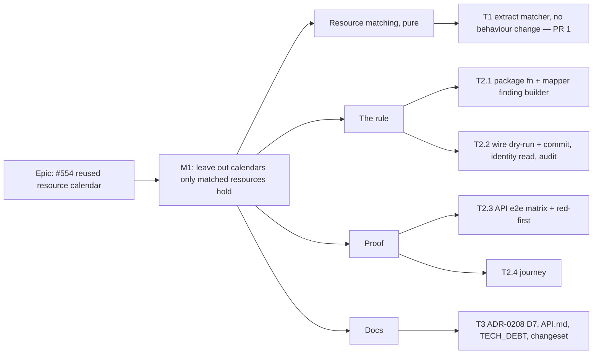

# Implementation Plan: An import does not create a calendar that only a reused resource would hold

- **Feature spec:** [`./spec.md`](./spec.md)
- **Status:** Accepted — shipped ([ADR-0208](../../adr/0208-an-import-reuses-a-calendar-it-would-have-copied-exactly.md) D7). Approved by the product owner, 2026-11-01, every recommended answer: Q1 use the library crew as it is and say in the report that the file's hours differ; Q3 no clean-up of copies earlier imports left (a bulk tool gets its own spec if wanted). Q2 was taken by the session as the recommended default: a crew calendar also used by activities stays in the shared library (today's behaviour), with a follow-up row.
- **Owner:** product owner (James Ewbank); built by the **builder** agent, reviewed as listed per task

## Breakdown

### Epic

**#554: a reused resource's calendar is not copied.** Re-imports that use library crews stop adding dead
calendars to the shared organisation library. Roadmap theme: schedule interchange (ADR-0050), calendar
library manageability (ADR-0053, ADR-0208).

**No schema change.** If any review asks for an index or a column, the builder **stops** and the work goes
to **database-architect** (CLAUDE.md §19.3, ADR-0105). **No feature flag** (ADR-0088 D1): each PR is its
own commit boundary and rollback. **Nothing is asked of the product owner's server or devices:** every
proof is a unit test, an API e2e on a disposable database, or a Playwright journey, run by `pnpm prepush`,
`scripts/e2e-local.sh` and CI.

### Milestone 1: Leave out a calendar only matched resources would hold (shippable slice)

**Outcome:** importing a file whose crews are already in the library creates no calendar for those crews,
and the review report says so.
**Entry point:** Project screen → **Import from file…** (`apps/web/src/features/interchange/components/ImportScheduleButton.tsx:40`)
→ dialog "Import schedule from file" → review report, **Approximations** region → **Confirm import**. An
existing surface; no new control.
**Journey:** `apps/web/e2e-interchange/interchange.spec.ts`, new test _"a re-imported revision with a
library crew leaves no copy of its calendar"_ (T2.4).

---

#### Feature: Resource matching as a pure decision

> **Description:** the commit's resource loop decides insert-or-match with I/O interleaved
> (`interchange.service.ts:931-1016`). Extract the decision so the dry-run and the commit can make it
> before calendars, from one function.
> **Complexity:** M
> **Dependencies:** none
> **Risks:** a behaviour change hidden in a refactor → this task changes **no** behaviour and ships alone;
> every existing interchange e2e must stay green unmodified.
> **Testing requirements:** unit (Vitest) for the matcher; the full `interchange.e2e-spec.ts` unchanged.

##### Task 1 — Extract `matchImportResources` (≈ PR 1)

- **Description:** new `apps/api/src/modules/interchange/resource-match.ts`, pure:
  `matchImportResources(graph, library, resolutions)` → per source key `{ kind: 'insert' }` or
  `{ kind: 'match', via: 'code' | 'answer' | 'file', libraryId?: string, fileKey?: string }`, the
  unanswered collisions (today's `findGraphResourceCollisions` result, `:1109-1145`, folded in or called),
  and the archived rows to unarchive. `persistGraph` consumes it: ids for inserted rows are still minted
  in the loop, `via: 'file'` resolves to the id minted for `fileKey`.
- **Complexity:** M
- **Dependencies:** —
- **Risks:** order-sensitivity of `resolvedIdByCode` / `resolvedIdByName` (`:892-896`, `:993-996`) → the
  matcher walks source order exactly as the loop does; unit cases for two rows sharing a code, sharing a
  name, and a code match after a name match.
- **Testing:** unit: every branch of today's loop (code match library; code match file; name match file;
  `REUSE_EXISTING`; `CREATE_COPY`; archived library row; unanswered). API e2e: none changed, all green.
- **Development steps:**
  1. Write the matcher's unit cases against today's loop behaviour first.
  2. Move the decision out; leave the inserts, the unarchive and the findings where they are.
  3. Keep the unanswered-collision 422 at the same point in this PR (moving it is T2.2).
  4. `pnpm prepush`, `scripts/e2e-local.sh api`. No changeset (no behaviour change).

#### Feature: The rule

> **Description:** decide matches before calendars, leave out calendars only matched resources hold, and
> swap the mapper's tier sentence for the new one, in both the dry-run and the commit.
> **Complexity:** M
> **Dependencies:** Task 1
> **Risks:** see the rollup (R1–R5).
> **Testing requirements:** unit for the package function; API e2e matrix; red-first mutations.

##### Task 2.1 — Package: `leaveOutCalendarsOnlyMatchedResourcesHold` and the tier finding (≈ PR 2, part)

- **Description:** in `packages/interchange/src/`:
  - `mapper.ts`: extract the resource-tier finding (`:86-96`) into an exported
    `resourceTierFinding(calendar)` that the mapper itself calls, and an exported
    `isResourceTierFinding(finding, calendarKey)` that compares `kind`, `entity`, `reason` and the
    **clamped** `sourceRef` (so it survives `boundReport`, `report.ts:266-310`).
  - new `library-match.ts`: `leaveOutCalendarsOnlyMatchedResourcesHold(graph, report, matched)` where
    `matched: ReadonlyMap<resourceKey, { name: string; keptCalendarSame: boolean }>`. Rule (spec US-1):
    K is left out iff K ≠ `graph.plan.defaultCalendarKey`, no activity has `calendarKey === K`, some
    resource has it, and every resource holding it is in `matched`. Returns graph′ (K removed from
    `calendars`; `calendarKey` nulled on the matched resources that held it), report′ (each left-out K's
    tier finding removed, the spec's sentence appended to `approximations` in file order), and the
    left-out keys.
  - Export both from the package index.
- **Complexity:** S
- **Dependencies:** —
- **Risks:** text drift between the builder and the predicate → they share one module and one test that
  builds the finding, bounds it with a 400-character name, and asserts the predicate still matches.
- **Testing:** unit: E1, E6, E7, E8, E11, E17 as graph cases; graph′ parses under the package's graph
  schema; report′ has the same `approximations.length` per left-out calendar; the "same" and
  "different" reason forms; more-than-three holders.
- **Development steps:**
  1. Unit tests first, red.
  2. Implement; `pnpm --filter @repo/interchange test build`.

##### Task 2.2 — API: wire the rule into dry-run and commit (≈ PR 2, part)

- **Description:**
  - **Dry-run** (`interchange.service.ts:176-226`): read the library resources once (the existing query
    at `:1091-1098`, plus `calendarId`), run `matchImportResources` with `options.resourceResolutions`
    if supplied (unanswered counts as insert), compute `keptCalendarSame` for matched holders of a
    candidate K, apply the package function, then `resolveImportCalendars` on graph′ and report
    collisions from the same read. One read instead of today's one: no new round trip.
  - **Commit** (`:246-300`, `persistGraph` `:551-1064`): the lock prediction (`:262-265`) stays on the
    full graph (spec D5). Inside the transaction, move the library read (`:864-880`, plus `calendarId`)
    and the matcher **before** step 1, throw the unanswered-collision 422 there, compute
    `keptCalendarSame`, apply the package function, and run the rest of `persistGraph` on graph′ and
    report′. The resource loop consumes the same match result (T1).
  - **`keptCalendarSame`:** for each matched holder of a candidate K, compare
    `calendarIdentityKey(calendarWriteShape(K))` with the identity of the calendar the match keeps: for a
    library row, its `calendarId` read through the existing `calendars.loadReuseContent` +
    `identityKeysFromFlatRows` (`:1265-1270`) with its `hoursPerDayMinutes`; for `via: 'file'`, the
    earlier source row's calendar's write shape. A null calendar, or one the read does not return
    (soft-deleted), is "different". Skip the read entirely when no K is a candidate.
  - `reusedCalendarCount` unchanged in meaning; add `skippedCalendarCount`. Both log lines and the audit
    `after` gain `calendarsSkipped`; add it to `audit-redactor.ts:185-196`.
  - Confirm `calendars.createManyForImport([])` is a no-op (E17).
- **Complexity:** M
- **Dependencies:** Task 1, Task 2.1
- **Risks:** R1 (a referenced calendar left out) → `resolveCalendarId` (`:1818-1831`) fails the import;
  mutation (b) in T2.3. R2 (dry-run and commit disagree) → one matcher, one package function; the
  commit's in-transaction read is authoritative and the post-commit report says what was done.
  R3 (superset locks) → backend-performance review.
- **Testing:** unit for the `keptCalendarSame` decision if extracted; e2e in T2.3.
- **Development steps:**
  1. Dry-run path, with the T2.3 dry-run e2e red first.
  2. Commit path, with the #554 e2e inverted red first.
  3. Audit field + redactor; log lines.
  4. `pnpm prepush`, `scripts/e2e-local.sh api`.

#### Feature: Proof

> **Description:** the e2e matrix, red-first mutations, and the journey ADR-0081 requires.
> **Complexity:** M
> **Dependencies:** Task 2.2
> **Risks:** MSPDI is **read, not run** (spec F16) → T2.3 imports a real MSPDI document built with the
> e2e's existing MSPDI builder or `packages/interchange/src/mspdi.fixtures.ts`.
> **Testing requirements:** listed per task.

##### Task 2.3 — API e2e matrix and red-first mutations (≈ PR 2, part)

- **Description:** in `apps/api/test/interchange.e2e-spec.ts`:
  - **Invert** `leaves a non-identical resource calendar as an unbound shared copy (docs/TECH_DEBT.md #554)`
    (`:2159-2177`) into _"creates no copy of a reused resource's calendar"_: zero `Crew Shift (imported …)`
    rows; the dry-run and the commit both carry the new approximation with the "different working week"
    reason and neither carries the mapper's tier sentence for `C3`; the new plan's `calendarId`, every
    activity's `calendarId`, `Site Crew`'s `calendarId` and the persisted activity dates are asserted
    (these pass unchanged on today's code; only the copy count differs, spec §3 parity); audit
    `after.calendarsSkipped: 1`.
  - **Rewrite** `reuses an identical shared-library calendar for a resource, per tier` (`:2131-2157`):
    `Crew Shift` is now left out ("same" reason), and a **new** test keeps ORG-tier ADR-0208 reuse
    covered: the second file adds a **new** crew `CREW-B` holding an identical `Crew Shift`, which is
    then reused (E10).
  - New: `REUSE_EXISTING` answer leaves the calendar out (E2); `CREATE_COPY` keeps it (E3); archived
    library crew (E4); calendar also used by an activity (E6); plan default (E7); matched + inserted
    holders (E8); same-code pair in one file (E5); library crew with no calendar (E15); library crew
    deleted between dry-run and commit, so the crew is inserted and the calendar created and bound (E13);
    every calendar left out (E17); MSPDI with `Code` (E16); recalculation failure still compensates
    exactly the created calendars (extend the existing compensation test).
  - **Red-first, one mutation each, applied and reverted, recorded in the PR body:**
    (a) count a matched resource as a holder → the inverted #554 test red;
    (b) leave out a calendar an activity also uses → E6 red with 422 `INCONSISTENT_GRAPH`;
    (c) treat a `CREATE_COPY` row as matched → E3 red;
    (d) skip the tier-finding removal → the report assertions red;
    (e) decide matches from the dry-run's read instead of the transaction's → E13 red.
- **Complexity:** M
- **Dependencies:** Task 2.2
- **Risks:** fixture sprawl → extend `tieredCalendarXer` (`:264-288`) with optional crews rather than new
  builders.
- **Testing:** this task is the testing.
- **Development steps:**
  1. Write each test red against T2.2's absence where it applies.
  2. Run the five mutations and record what went red.
  3. `scripts/e2e-local.sh api`.

##### Task 2.4 — Journey (≈ PR 2, part)

- **Description:** `apps/web/e2e-interchange/interchange.spec.ts`, new test _"a re-imported revision with
  a library crew leaves no copy of its calendar"_, beside `a re-imported revision reuses its unchanged
calendar` (`:538-570`): import a crew-bearing `.xer`, import a second revision whose crew calendar
  differs, assert the **Approximations** region contains `was not created` and `Crew Shift`, confirm, open
  the organisation Calendars screen and assert no row matching `Crew Shift (imported`.
- **Complexity:** S
- **Dependencies:** Task 2.2
- **Risks:** locator drift on the Calendars screen → use the table's accessible name, as the sibling test
  does (`:565-569`).
- **Testing:** `scripts/e2e-local.sh web:interchange` (the suite's existing entry).
- **Development steps:**
  1. Add a crew-bearing calendar file helper to `e2e-interchange/support.ts`.
  2. Write the journey; run it locally.

#### Feature: Docs

##### Task 3 — ADR amendment, docs, register, changeset (≈ PR 2, part)

- **Description:**
  - Set the spec's and this plan's **Status** to `Approved` first (`check:spec-status` S3 refuses a
    `Draft` spec an ADR cites, `scripts/check-spec-status.mjs:296-303`), and to
    `Accepted — shipped (ADR-0208)` when it lands.
  - `docs/adr/0208-…md`: add **D7** and rewrite the #554 Consequences bullet (spec §4 draft); add a
    ledger line for the five mutations.
  - `docs/adr/0053-…md` §5 rule 1: "(unless only matched resources hold it, ADR-0208 D7)".
  - `docs/adr/0050-…md`: the `RSRC` mapping row gains the clause.
  - `CLAUDE.md` §16: the ADR-0208 line's status gains "D7 added for #554" (`pnpm check:adr-coverage`).
  - `docs/API.md:1184-1226`: the rule, the sentence, `calendarsSkipped`.
  - `docs/TECH_DEBT.md`: close #554 citing the commit; **open** two rows found by the spec: F17 (the
    MSPDI report says every calendar is project-scoped while the mapper puts resource calendars in the
    shared library; ADR-0053 §5:370-371 says the same) and F3 (a code-matched resource silently drops the
    file's rate, with no finding). Q2's answer, if "later", becomes a third row.
  - Changeset: `api` **minor** ("an import no longer creates a calendar that only reused resources would
    hold"). No `web` changeset (journey only).
- **Complexity:** S
- **Dependencies:** Tasks 2.1–2.4
- **Risks:** a doc claim without evidence → each amended sentence cites file:line or the e2e (CLAUDE.md
  §19.11).
- **Testing:** `pnpm prepush` (runs `check:adr-coverage`, `check:spec-status`, `check:counts`,
  `check:claims`).
- **Development steps:**
  1. Statuses, then ADRs and API.md, then the register rows, then the changeset.

## Sequencing & slices

1. **PR 1 — Task 1.** Behaviour-preserving refactor. Releasable alone; no changeset.
2. **PR 2 — Tasks 2.1–2.4 and 3.** The behaviour change with its tests, journey and docs in one commit
   boundary, so a revert removes all of it. `api` minor.

No feature flag (ADR-0088 D1).

**Reviewers.** PR 1: backend-performance-reviewer (the read is unchanged, confirm), test-engineer.
PR 2: **api-reviewer** (no new kind, the audit field, API.md), **security-reviewer** (org-scoped read,
no write to a matched resource, one fewer shared write), **backend-performance-reviewer** (the moved
read, the identity read, R3's superset locks; decides whether a measurement is owed),
**test-engineer** (matrix and mutations), **ux-reviewer** (the finding's wording only). Not needed:
database-architect (no schema change; mandatory if that changes), component/accessibility reviewers
(no UI code).

## Definition of Done (per task)

Each task's PR must satisfy the Feature Completion Criteria in
[`docs/PROCESS.md`](../../PROCESS.md) (code, tests, docs, security, performance, accessibility, Docker
build, CI, changelog, version impact). "Tests" means `pnpm prepush` and `scripts/e2e-local.sh api` (and
`web:interchange` for PR 2) were **run**. Nothing is verified on the product owner's host or devices.

## Risks & assumptions (rollup)

| Risk / assumption                                                                          | Likelihood | Impact                        | Mitigation                                                                                                                                                     |
| ------------------------------------------------------------------------------------------ | ---------- | ----------------------------- | -------------------------------------------------------------------------------------------------------------------------------------------------------------- |
| R1. A calendar something references is left out                                            | low        | high (wrong dates)            | Cannot happen silently: `resolveCalendarId` fails the import (`interchange.service.ts:1818-1831`); mutation (b); E6–E8                                         |
| R2. Dry-run and commit disagree because the library changed in between                     | low        | low                           | One matcher, one package function; the commit is authoritative (E13, E14). The planner sees only the dry-run (spec F9), which is ADR-0208's existing limit too |
| R3. The prediction locks a candidate for a calendar later left out                         | med        | low                           | `FOR SHARE` on one calendar for one transaction, the cost ADR-0208 R2 accepted; backend-performance review                                                     |
| R4. The tier-finding predicate misses a clamped finding                                    | low        | med (report says both things) | Builder and predicate share a module; unit test through `boundReport` with a long name                                                                         |
| R5. MSPDI behaviour assumed from reading                                                   | med        | low                           | T2.3's MSPDI e2e (E16)                                                                                                                                         |
| R6. The dry-run preview before a collision is answered shows the calendar as created (E12) | certain    | low                           | The collision copy already says reuse drops the calendar; option G if asked                                                                                    |
| A1. No schema change is needed                                                             | high       | —                             | If review asks for an index or column: stop, database-architect                                                                                                |
