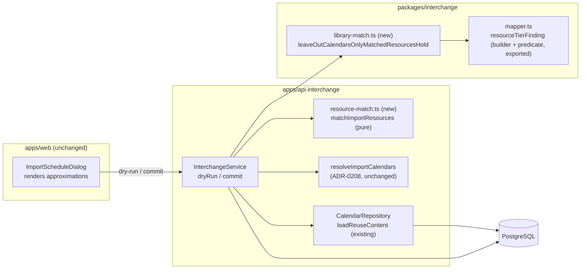
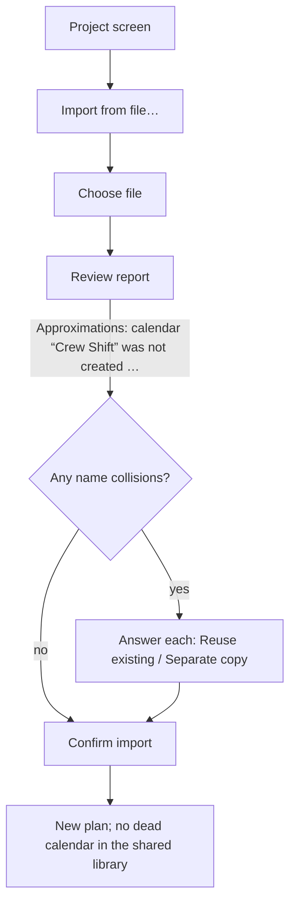

# Feature Spec: An import does not create a calendar that only a reused resource would hold

- **Status:** Approved — by the product owner, 2026-11-01, every recommended answer: Q1 use the library crew as it is and say in the report that the file's hours differ; Q3 no clean-up of copies earlier imports left (a bulk tool gets its own spec if wanted). Q2 was taken by the session as the recommended default: a crew calendar also used by activities stays in the shared library (today's behaviour), with a follow-up row. — awaiting approval before implementation
- **Author(s):** feature-analyst (Claude Code), for the product owner
- **Date:** 2026-11-01
- **Tracking issue / epic:** `docs/TECH_DEBT.md` #554 ("A reused resource keeps its own calendar, so the file's differing copy of it is created and bound to nothing"), chosen for build by the product owner on 2026-11-01
- **Roadmap link:** schedule interchange (ADR-0050 follow-on); calendar library manageability (ADR-0053, ADR-0208 follow-on)
- **Related ADR(s):** ADR-0208 (an import reuses a calendar it would have copied exactly; **amended in place by this work**, see §4 "ADR"), ADR-0053 §5 (interchange tiering; rule 1 gains a pointer), ADR-0050 (pipeline and report; one mapping-table row reworded), ADR-0039 (resources and their calendars), ADR-0034 (recalc parity), ADR-0012 (RBAC + scope), ADR-0028 (pen: not required), ADR-0072/0073 (audit), ADR-0081 (entry point + journey), ADR-0088 D1 (no flag), ADR-0105 (why this is full-spec work), ADR-0172 (soft-delete filter at every read)

---

## In plain English (for the product owner)

When you import a schedule file, each crew (resource) in the file is matched to your library. If the
library already has that crew (same code, or you chose "use the existing one" for a crew with the same
name), the import uses your crew as it is and leaves its calendar alone. That part is right and stays.

What goes wrong is the file's own calendar for that crew. The import creates it anyway, in the shared
organisation library that everyone sees, and then nothing uses it. Each re-import of a revision adds
another one, named like `Crew Shift (imported 2026-10-26)`. It is clutter, and it contradicts two things
SchedulePoint already tells you: the collision question says "use the existing one" drops the file's
calendar, and the API documentation says the same.

**The change:** if the only things in the file that use a calendar are crews that matched your library,
the import does not create that calendar. The review report says so in the line that used to say "was
created in the shared organisation library". Any calendar that an activity, the plan itself, or a new
crew uses is created exactly as today.

Nothing about your dates changes: the calendar that is no longer created was never used by anything. No
database change, no feature flag, no new screen. You do not need to test or check anything on your
server or devices; every proof below runs in the automated tests.

---

## 0. What the code actually says (verified, not assumed)

Every fact the design rests on was read on `main` at `5e9435e5` (CLAUDE.md §19.11). Facts marked
**Read, not run** were established by reading code only. **Corrections to the brief are marked.**

| #   | Claim | Evidence (read) |
| --- | ----- | --------------- |
| F1  | The pure mapper forces every calendar a source resource holds to `ORG` and writes an `approximation` finding for it: _calendar “X” was created in the shared organisation library (organisation scope) because an imported resource uses it_. It cannot know whether that resource will be matched, because it never sees the library. | `packages/interchange/src/mapper.ts:68-72`, `:86-96`, `:177-195` |
| F2  | The commit inserts **every** calendar in the graph (reused ones aside) **before** it decides anything about resources. | `apps/api/src/modules/interchange/interchange.service.ts:598-641` (calendars), `:848-1017` (resources) |
| F3  | A source resource matched **by code** (to a library row, or to a row this import has already made) is bound and skipped: it never reaches `newResourceRows`, so its `calendarKey` is never read. No report finding is written for a code match at all (only the CQ-4 unarchive one, if archived). | `interchange.service.ts:931-950`; the only reader of `resource.calendarKey` is `:1011`, on the insert branch; CQ-4 finding `:317-327` |
| F4  | **Brief correction (wider than "code-matched").** A resource whose **name** collides and that the planner answered `REUSE_EXISTING` takes the same branch: bound, never inserted, calendar never read. Its finding already says _“the file’s own rate and calendar for it were not imported”_, `docs/API.md:1192-1193` promises the same, and the web's collision copy says reuse “drops the file’s own rate and calendar”. All three are **false today for the calendar**: it is created, unbound. | `interchange.service.ts:956-975`; `docs/API.md:1192-1193`; `apps/web/src/features/interchange/components/ResourceCollisionResolver.tsx:12-14` |
| F5  | A third matched case: a later source row whose code or name an earlier row **in the same file** already resolved. It too is bound and not inserted. | `interchange.service.ts:934-943` (`resolvedIdByCode`, `resolvedIdByName`) |
| F6  | The defect is pinned by an e2e: two imports of `tieredCalendarXer`, the second with a different working week, leave an `ORG` calendar `Crew Shift (imported …)` with zero resources and zero activities on it. The identical case is pinned too, and today reports `calendar “Crew Shift” was matched to the existing calendar “Crew Shift”`. | `apps/api/test/interchange.e2e-spec.ts:2159-2177`; `:2131-2157`; fixture `:264-288` (resource `CREW-A` holds `C3` `CA_Rsrc`) |
| F7  | The report has **three** finding kinds, a closed enum. A reader **refuses** an unknown kind (key tolerance is for keys, never values). A web tab one release behind would fail to render a dry-run whose report used a new kind. That is the #541 contract argument, already applied to calendar reuse by ADR-0208 D4. | `packages/interchange/src/report.ts:24-25`, `:36-40`; `interchange.service.ts:186-189`; `docs/adr/0208-…md:67-70` |
| F8  | The web renders findings generically: one section per kind, each line `entity [sourceRef]: detail — reason`. A new sentence in an existing kind needs **no web change**. | `apps/web/src/features/interchange/components/InterchangeReportTable.tsx:56-66`, `:115-130` |
| F9  | The planner only ever **sees the dry-run report**. On a successful commit the dialog closes and navigates to the plan; the post-commit report is returned by the API but not shown. | `apps/web/src/features/interchange/components/ImportScheduleDialog.tsx:196-215` |
| F10 | The web sends `resourceResolutions` on the **commit only**. The dry-run that produces the reviewed report runs before the planner answers any collision. The API's dry-run does accept the field. | `ImportScheduleDialog.tsx:178`, `:186`, `:193` (dry-run starts), `:202` (commit); `interchange.service.ts:176-184`; `interchange.controller.ts:79-87` |
| F11 | Every calendar key a graph can reference is one of: the plan default, an activity's, a resource's. Dependencies and assignments carry none. | `packages/interchange/src/import-graph.ts:123`, `:160`, `:233` |
| F12 | A calendar key that resolves to no id **throws** inside the transaction (422 `INCONSISTENT_GRAPH`), so a calendar wrongly left out can never produce a half-written import. | `interchange.service.ts:1818-1831` |
| F13 | The engine reads calendars only through the plan's, an activity's and an assigned resource's bindings, by id. A calendar row nothing binds is not an engine input. | `apps/api/src/modules/schedule/schedule.repository.ts:91-93`, `:128-129`, `:358`, `:483-508` |
| F14 | Recalculation-failure compensation hard-deletes only `createdCalendarIds`. A calendar that is never created is never on it. | `interchange.service.ts:361-363`, `:598-620`; ADR-0208 D3 |
| F15 | The commit predicts reuse candidates **before** its transaction and locks them; inside, it re-resolves under those locks. | `interchange.service.ts:257-299` |
| F16 | **MSPDI is affected too. Read, not run.** MSPDI resources carry `CalendarUID`, and MSPDI goes through the same mapper, so a resource-held MSPDI calendar is also forced to `ORG`. MS Project resources often have no `Code`, so the usual MSPDI match is the name-collision path (F4). | `packages/interchange/src/mspdi-adapter.ts:609-617`; `packages/interchange/src/import-mspdi.ts:90`; `mapper.ts:177-195` |
| F17 | **Found while checking F16, out of scope here.** For an MSPDI file with a resource calendar the report already contradicts itself: the adapter says _every calendar was created in this project_ while the mapper says that one went to the shared library. ADR-0053 §5 likewise says "MSPDI import is always PROJECT". **Read, not run.** Recommend a new TECH_DEBT row (Plan T3). | `mspdi-adapter.ts:363-376`; `mapper.ts:86-96`; `docs/adr/0053-…md:370-371` |
| F18 | A calendar that **nothing** in the file references (not even a resource) is created today, at `PROJECT`. That is not this row and is not changed (non-goal). | `mapper.spec.ts:131-135`; `interchange.service.ts:605-641` |
| F19 | `interchange.imported`'s `after` is an allow-list. A new key is dropped unless listed. | `apps/api/src/modules/audit/audit-redactor.ts:185-196` |
| F20 | Who may import: `interchange:import`, Planner and Org Admin only. | `apps/api/src/common/auth/org-permissions.ts:164-172`, `:297-301` |

---

## 1. Business understanding

### Problem

When a re-imported file carries crews the organisation already has, the import uses the library crews
(correct) but still creates the file's calendar for each of them in the **shared organisation library**,
bound to nothing (F1–F6). Every member sees these calendars in every calendar list and picker for the
shared library. Each revision adds more. And two statements the product already makes are false
because of it (F4).

### Users

| Role | Need | This work |
| ---- | ---- | --------- |
| **Planner**, **Org Admin** | Re-import revisions that use library crews without filling the shared library with dead calendars | The import stops creating them, and the review report says so |
| Contributor, Viewer | Shared-library lists without clutter | Benefit only; they cannot import |
| External Guest | none | Not affected; a share link exposes no calendar library |

### Primary use cases

1. **Re-import a revision whose crews are already in the library** (matched by code). No calendar is
   created for those crews; the review report names each calendar not created and why.
2. **Import a file whose crew names clash, and answer "use the existing one".** The same, which makes
   the collision question's copy true (F4).
3. **Import a file whose crew calendar is also used by activities, or by a new crew.** Created as today.

### User journeys

- **Happy path:** Project → **Import from file…** → choose `Programme Rev B.xer` → the review report's
  **Approximations** section reads _calendar “Crew Shift” was not created: the only resources in the
  file that use it (“Site Crew”) matched existing resources, which keep their own calendars_ →
  **Confirm import** → the organisation Calendars screen holds no `Crew Shift (imported …)`.
- **Alternate (collision):** the dry-run shows the collision question; the planner picks **Reuse
  existing** and confirms. No calendar is created for that crew. The review report shown before the
  answer still describes the calendar as created (F10); see edge case E12.

### Expected outcomes

- A re-import whose crews are all in the library adds **zero** calendars to the shared library for them.
- The collision copy, the API documentation and the post-commit finding all become true (F4).
- No schedule date changes (F12, F13).

### Success criteria

- The #554 e2e (`interchange.e2e-spec.ts:2159-2177`) is rewritten to assert **no** `Crew Shift (imported …)`
  row exists after the second import, and that the report carries the new sentence.
- The same holds for an MSPDI file (code match) and for a `REUSE_EXISTING` answer (name match).
- A calendar also used by an activity, by the plan default, or by an inserted resource is still created
  and bound: each is an e2e.
- No change under `apps/api/src/modules/schedule/` (ADR-0034).

---

## 2. Functional requirements

### User stories & acceptance criteria

> **US-1 — Leave out a calendar only matched crews would hold.** As a **Planner**, I want an import not
> to create a calendar that nothing in the new plan would use, so that the shared library stays clean.
>
> **Acceptance criteria**
>
> - **Given** a file whose calendar K is held by source resources only, **and** every one of those
>   resources is matched (by code to a library row; by a `REUSE_EXISTING` answer; or to an earlier row of
>   the same file), **and** K is not the plan's default calendar, **and** no activity uses K, **when** I
>   run the dry-run or commit the import, **then** K is not created, and the mapper's _“was created in the
>   shared organisation library … because an imported resource uses it”_ approximation for K is
>   **replaced** by one approximation for K (wording under "Report finding" below).
> - **Given** the same, **then** each matched resource keeps the calendar it already has. Nothing in the
>   library is written beyond today's writes (CQ-4 unarchive, if archived).
> - **Given** K is also used by an activity, or is the plan default, or is held by a resource the import
>   **inserts** (a new crew, or a `CREATE_COPY` answer), **then** K is created and bound exactly as today,
>   including ADR-0208 identical-calendar reuse.
> - **Given** K is identical to an existing `ORG` calendar (ADR-0208) and only matched resources hold it,
>   **then** K is left out, not reused. The report carries the new sentence, not ADR-0208's “was matched to
>   the existing calendar”.
> - **Given** a collision the dry-run asked about and nobody has answered yet, **then** the dry-run treats
>   that resource as inserted (its calendar is shown as created). The commit, which has the answer, decides
>   (E12).
> - **Given** the commit's recalculation fails, **then** compensation deletes exactly what was created, as
>   today (F14).
> - **Given** an MSPDI file, **then** the same rule applies (F16).

### Report finding

One `approximation`, `entity: 'calendar'`, `sourceRef: <calendar key>`. No new kind, no new field (F7).

- **detail:** `calendar “<name>” was not created: the only resources in the file that use it (“<A>”, “<B>”)
  matched existing resources, which keep their own calendars` (names in file order; more than three
  shown as `“A”, “B”, “C” and N more`).
- **reason**, chosen per Q1's default (b):
  - every matched holder's kept calendar is identical to K (ADR-0208's `calendarIdentityKey`):
    `the calendar each of them already has is the same as the file’s, so nothing was lost`;
  - otherwise: `the file gives <“A”> a different working week, so <its/their> work is scheduled on the
    calendar the library already holds; an import never changes an existing resource’s calendar`. A
    matched resource with **no** calendar of its own counts as different (its work follows the activity
    calendar).

`approximation` because the file's working time for those crews is replaced by the library's, which is
the ADR-0050 meaning of the class (`report.ts:17-19`). It also lands in the section where the replaced
finding sat, so the planner sees one line change, not one line vanish and another appear elsewhere.

### Workflows

**Dry-run** (`InterchangeService.dryRun`):

1. Parse and map the file, unchanged.
2. Read the library resources the graph could match: the query `findResourceCollisions` already runs
   (`interchange.service.ts:1083-1100`), plus each row's `calendarId`.
3. **Match** every source resource with one pure function (shared with the commit): inserted, or matched
   (library code / answer / earlier row of this file). Unanswered collisions count as inserted.
4. For matched holders of a candidate K, read the kept calendars' identity (only those; usually none or
   a handful) with the existing content read ADR-0208 uses (`calendars.loadReuseContent`,
   `identityKeysFromFlatRows`, `interchange.service.ts:1265-1270`).
5. **Apply** the pure package function: graph′ without the left-out calendars, report′ with the
   findings swapped (§4).
6. Resolve calendars on graph′ (ADR-0208, unchanged), then report collisions as today.

**Commit**: the lock prediction (F15) runs on the **unmodified** graph, so it may lock a candidate for a
calendar that ends up left out (a superset; see R3). Inside the transaction, steps 2–5 run against `tx`
**before** calendar resolution, then `persistGraph` runs on graph′. The resource loop
(`:931-1016`) consumes the same match result, so the dry-run, the left-out set and the inserted rows
cannot disagree.

### Edge cases

| #   | Case | Behaviour |
| --- | ---- | --------- |
| E1  | Code match to a library row (XER) | K left out; the new finding. The #554 case. |
| E2  | Name collision answered `REUSE_EXISTING` | K left out. The existing "matched to the existing library resource" repair stays and becomes true. |
| E3  | Name collision answered `CREATE_COPY` | The copy is inserted and holds K: created, as today. |
| E4  | Matched library row is **archived** (CQ-4) | Matched and unarchived as today; K left out. |
| E5  | Two source rows share a code; the first is inserted, the second matched to it | The second is not a holder. If it holds a different calendar that nothing else holds, that calendar is left out; its "kept calendar" for the reason is the first row's source calendar (compared by identity within the file). |
| E6  | K also used by an activity | Created. It stays `ORG` because the mapper put it there; see Q2. |
| E7  | K is the plan default | Created. |
| E8  | K held by a matched **and** an inserted resource | Created and bound to the inserted one. |
| E9  | K identical to an existing ORG calendar, only matched holders | Left out, not reused (US-1). `calendarsReused` falls by one and `calendarsSkipped` rises by one versus today. |
| E10 | K identical to an existing ORG calendar, also held by an inserted resource | ADR-0208 reuse, unchanged. |
| E11 | A calendar nothing references | Created, as today (F18). Non-goal. |
| E12 | Dry-run shown before a collision is answered | The preview treats the resource as inserted, so it shows K as created. After **Reuse existing** the commit leaves K out. The collision copy already says reuse drops the file's calendar (F4), so the planner is told; the post-commit report is exact. Default: no web change (Q-default D3). |
| E13 | Library resource deleted between dry-run and commit | The commit's in-transaction read is authoritative: the resource is inserted, K is created and bound. Safe direction. |
| E14 | Library resource created between dry-run and commit | The commit matches it by code and leaves K out. The post-commit report says so. |
| E15 | Matched library resource has no calendar | K left out; the reason uses the "different working week" form (it follows the activity calendar). |
| E16 | MSPDI resource with `Code` / without | Code match → E1; name clash → the collision path, E2/E3. |
| E17 | Every calendar in the file is left out | Only possible when the plan has no default calendar key and no activity names a calendar; then no calendar is inserted. `createManyForImport` must accept an empty list (Plan T2.2 checks it, and T2.3's e2e covers it). |
| E18 | Long names | The report bounds every sentence (`report.ts:258-310`); the replaced-finding match is structural, so a clamped sentence is still found (§4). |

### Permissions

Deny-by-default, organisation-scoped (ADR-0012). **No new permission.** `interchange:import` (Planner,
Org Admin, F20) is unchanged. The library read is the existing org-scoped, soft-delete-filtered query
(`interchange.service.ts:869-877`, `:1091-1097`; ADR-0172). The change **removes** a write to shared
tenant state; it adds none.

**The pen (ADR-0028):** not a structural write to an existing plan. The import creates a new plan and
takes and releases its pen as today (`interchange.service.ts:358-362`).

### Validation rules

No new input. `resourceResolutions` keeps its existing validator
(`dto/resource-resolution-validator.ts`). graph′ satisfies the same invariants as the graph (every
referenced calendar key exists): the pure function nulls `calendarKey` on the matched resources whose
calendar it removed, and its unit tests parse graph′ with the package's graph schema.

### Error scenarios

| Scenario | Detection | Result | Status |
| -------- | --------- | ------ | ------ |
| A left-out calendar is referenced after all (a defect) | `resolveCalendarId` (F12) | Whole import rolled back | 422 `INCONSISTENT_GRAPH` |
| Unanswered collision at commit | unchanged (`:912-924`), now thrown before any insert | unchanged message | 422 `UNRESOLVED_RESOURCE_COLLISIONS` |
| All others | unchanged | unchanged | unchanged |

---

## 3. Technical analysis

| Area | Impact | Notes |
| ---- | ------ | ----- |
| Frontend | none | No component change (F8). The collision copy (F4) becomes true as written. One Playwright journey is added (ADR-0081). |
| Backend | med | `InterchangeService`: one pure resource matcher (extracted from the loop at `:931-1016`), the library read moved ahead of calendar resolution in the commit and shared in the dry-run, an identity read for matched holders, `calendarsSkipped` in the log line and the audit row. |
| Pure package | low | `packages/interchange`: one new pure function beside the mapper, and the mapper's resource-tier finding exposed as a builder + predicate so the API never matches on text. |
| Database | none | **No schema change, no migration, no index.** The reads are the existing resource query (plus one column it already has, `calendarId`) and ADR-0208's existing content read. If review asks for an index or column, the work **stops for database-architect** (CLAUDE.md §19.3). |
| API | low | Behaviour: fewer calendars created. Report: one sentence in an existing kind, no new kind or field (F7). Audit: `after.calendarsSkipped`. `docs/API.md` and the ADRs updated. No OpenAPI schema change. |
| Security | low | No new input, no new permission, one fewer shared-state write. security-reviewer confirms the library read stays org-scoped and that a matched resource still never has its calendar written. |
| Performance | low | Dry-run: the library read already happens (`:204-208`); it moves earlier. Commit: the same read moves earlier inside the transaction (no new round trip). New: one content read for matched holders' kept calendars, only when a calendar is a candidate to leave out. **Not measured**; the content read's cost is ADR-0208's ledger (+17 ms p95 at 5 calendars of 30 exceptions). backend-performance-reviewer decides whether a measurement is owed. |
| Infrastructure | none | No flag (ADR-0088 D1), no env, no CI step. The journey joins the existing `e2e-interchange` suite. |
| Observability | low | `interchange commit persisted a plan` and the dry-run log line gain `calendarsSkipped`. |
| Testing | med | Unit (package function, matcher), API e2e matrix (E1–E17), red-first mutations, one journey. |

**Recalc parity (ADR-0034).** No scheduling input is added and nothing under
`apps/api/src/modules/schedule/` changes. A left-out calendar is, by the rule's own definition, one the
plan, no activity and no inserted resource references; the engine reads calendars only through those
bindings (F13), so `computeSchedule` receives exactly the input it receives today. The rule cannot be
wrong silently: a wrongly left-out calendar fails the whole import at `resolveCalendarId` (F12). The
e2e proof (Plan T2.3) asserts the new plan's bindings (the plan's `calendarId`, every activity's, every
assigned resource's) and its persisted activity dates, and is run red-first against today's code: those
assertions pass **unchanged** on both, and only the "no `Crew Shift (imported …)` row" assertion differs.

**Audit (ADR-0073).** No new event. `interchange.imported` gains `calendarsSkipped: <n>`, added to the
redactor allow-list (F19). `findingCount` is unchanged in meaning: a left-out calendar swaps one
approximation for one approximation.

**Restore, the bin and undo.** Nothing is created or deleted that was not before, apart from rows that
are now never created. Unaffected.

### Dependencies

- None to land first. ADR-0208 has shipped; this builds on its resolver unchanged.
- Rewrites two e2e expectations: `interchange.e2e-spec.ts:2131-2157` (the identical case now reports a
  left-out calendar, so a replacement test keeps ORG-tier reuse covered with an **inserted** crew) and
  `:2159-2177` (the #554 pin, inverted).

---

## 4. Solution design

### Architecture overview



### Data flow (commit)

```mermaid
sequenceDiagram
  participant W as Web
  participant I as InterchangeService
  participant L as packages/interchange
  participant P as Postgres
  W->>I: POST …/interchange/commit (file, resourceResolutions)
  I->>L: parse + map (unchanged)
  I->>P: predict ADR-0208 candidates on the full graph (superset)
  I->>P: BEGIN; calendar advisory locks; project chain; FOR SHARE
  I->>P: read library resources (code/name, archivedAt, calendarId)
  I->>I: matchImportResources (pure): inserted | matched
  I->>P: identity of the matched holders' kept calendars (only if any)
  I->>L: leaveOutCalendarsOnlyMatchedResourcesHold(graph, report, matches)
  L-->>I: graph′, report′, left-out keys
  I->>I: resolveImportCalendars(graph′) — ADR-0208 unchanged
  I->>P: insert calendars, plan, activities, …, inserted resources (graph′)
  I->>P: COMMIT
  I->>I: recalc; on failure compensate(createdCalendarIds)
  I->>P: audit interchange.imported {calendarsReused, calendarsSkipped}
  I-->>W: { planId, report′ }
```

### User flow



### Database changes

**None.** No model, column, index or constraint, and no data migration. Existing dead copies on any host
are left alone (Q3).

### API changes

No new route, no new field, no new finding kind. `POST …/projects/:projectId/interchange/dry-run` and
`…/commit`: a calendar only matched resources would hold is not created, and `approximations[]` carries
the sentence above in place of the mapper's tier sentence for it. `interchange.imported.after` gains
`calendarsSkipped`. `docs/API.md` (the "Resource-name collisions" and "Imported calendars land in the
target project" paragraphs, `:1184-1226`) is updated.

### The two pure functions

- **`matchImportResources(graph, library, resolutions)`** (API, `resource-match.ts`): for each source
  resource, `{ kind: 'insert' }` or `{ kind: 'match', via: 'code' | 'answer' | 'file', targetKey?,
  libraryId? }`, plus the unanswered collisions. It is the existing loop's decision with the I/O taken
  out, the `findGraphResourceCollisions` precedent (`interchange.service.ts:1102-1145`). The commit's loop
  is refactored to consume it first, with no behaviour change, so the refactor is provable on its own.
- **`leaveOutCalendarsOnlyMatchedResourcesHold(graph, report, matched)`** (package, beside the mapper):
  the rule in US-1, plus the finding swap. It lives in the package because ADR-0053 §5 puts the tier
  decision and its sentence there ("the decision lives in the pure package"), and because removing the
  mapper's finding needs the mapper's own definition of it. The mapper exports
  `resourceTierFinding(calendar)` (which it now uses itself) and `isResourceTierFinding(finding, key)`,
  tested through `boundReport` so a clamped sentence still matches. The API never matches a sentence by
  text.

### Implementation approach & alternatives

**Recommended: A.**

| Option | Verdict | Why |
| ------ | ------- | --- |
| **A. Decide resource matches first, leave out calendars only matched resources hold, swap the mapper's finding in the package** | **Recommended** | Fixes the clutter at its source, in both formats and for all three match paths (F3–F5). No schema, no engine input, no new report kind. Makes F4's three statements true. Fails closed (F12). |
| B. Code matches only (the row's literal wording) | Rejected | Leaves the `REUSE_EXISTING` path creating the copy while the UI and API docs say it does not (F4). It is the more common path for MSPDI, whose resources often carry no code (F16). |
| C. Create the calendar, then soft-delete it at the end of the commit | Rejected | Writes then hides shared state, puts rows in Recently deleted nobody asked for, and still needs the same decision. |
| D. Create it at `PROJECT` instead of `ORG` | Rejected | Still a dead row, now in the project's picker. |
| E. Re-run the mapper with the matched set (a second parse) | Rejected | Doubles parse cost per request for the same result; the package function in A works on the mapped graph. |
| F. A new finding kind (`skipped`) | Rejected | A reader refuses an unknown kind, so a tab a release behind fails the dry-run (F7, #541). |
| G. Re-run the dry-run when a collision is answered, so the preview is exact (E12) | Not default | A web change to a dialog for a case the collision copy already explains. Can follow if asked. |
| H. A feature flag | Rejected | ADR-0088 D1: the rollback is the commit. |

**ADR required: yes, as an in-place amendment of ADR-0208** (six days old, and its Consequences bullet
names #554 as the open case). It changes which calendars an import creates, which ADR-0208 and ADR-0053
§5 rule 1 describe. A new ADR is not proposed: no new principle, the same decision family, the precedent
of dated in-place additions (ADR-0056, ADR-0138). Draft:

> **ADR-0208 D7 (added 2026-11-xx, `docs/TECH_DEBT.md` #554). A calendar only matched resources would
> hold is not created.** Resource matches are decided before calendars. A source calendar is left out
> when no activity uses it, it is not the plan default, at least one source resource holds it, and every
> source resource holding it is matched (library code, a `REUSE_EXISTING` answer, or an earlier row of
> the file). The mapper's resource-tier approximation for it is replaced by one approximation saying why,
> and whether the kept calendars match the file's. A matched resource's calendar is never written.
> No new finding kind (#541). `interchange.imported` gains `calendarsSkipped`. A left-out calendar takes
> precedence over D1 reuse, since nothing would bind either. Parity: nothing references a left-out
> calendar, and a reference fails the import (`resolveCalendarId`).
> **Consequences (rewritten):** the #554 bullet becomes "a reused resource keeps its calendar and the
> file's copy is not created"; the dry-run preview before a collision is answered still shows the
> calendar as created (E12).

Also: ADR-0053 §5 rule 1 gains "(unless only matched resources hold it, ADR-0208 D7)"; ADR-0050's
`RSRC` mapping row gains one clause; CLAUDE.md §16's ADR-0208 line gains "D7 added for #554"
(`check:adr-coverage`). The amendment is written **after approval**: `check:spec-status` S3 refuses a
`Draft` spec that an ADR cites (`scripts/check-spec-status.mjs:296-303`).

---

## 5. Links

- Implementation plan: [`./plan.md`](./implementation-plan.md)
- Docs updated by this change: `docs/adr/0208-…md` (D7, Consequences), `docs/adr/0053-…md` §5,
  `docs/adr/0050-…md` (mapping row), `docs/API.md:1184-1226`, `CLAUDE.md` §16, `docs/TECH_DEBT.md`
  (#554 closed; new rows for F17 and for the silent rate drop on a code match, F3).

---

## 6. Critical questions

Each has a recommended answer. Everything else is a stated default (below).

1. **When a crew is already in your library, and the file gives that crew different working hours,
   what should the import do?**
   **Recommended: (b) use your library crew as it is, and say plainly in the review report that the
   file's hours were different.**
   Alternatives: (a) use your crew and report only that the file's calendar was not created, without
   saying whether the hours differed (slightly less work); (c) stop and ask you, per crew, whether to
   replace your crew's calendar with the file's. (c) is not recommended: changing a library crew's
   calendar moves the dates of every plan that uses that crew, across all projects.

2. **If a crew's calendar in the file is also used by some activities, should it still go into the
   shared organisation library, or into this project only?**
   **Recommended: keep today's behaviour (shared library) in this change, and record the idea as a
   follow-up.** Today it goes to the shared library because a crew uses it. Once the crew is matched,
   only this project's activities use it, so the project would be the tidier home. Moving it is a
   separate change to where imported calendars live, and it affects which existing calendars an import
   can reuse.
   Alternative: put it in the project now.

3. **Copies earlier imports already left in the shared library: should this work also clear them out?**
   **Recommended: no.** This change stops new ones. Existing ones can be deleted one at a time from the
   organisation Calendars screen today, and a bulk clean-up of the shared library touches every project,
   so it deserves its own spec. Nothing is asked of you on your server either way.
   Alternative: add a "Remove unused calendars…" for the shared library (an extension of ADR-0208's
   project-only one), as a second milestone.

### Engineering defaults (no answer needed)

- **D1. All three match paths count** (code, `REUSE_EXISTING`, earlier row of the file), not only code
  matches (F4; alternative B rejected).
- **D2. `approximation`, replacing the mapper's tier finding in place**; no new kind (F7).
- **D3. No web change.** The dry-run preview before a collision is answered treats the resource as
  inserted (E12).
- **D4. Leaving out beats ADR-0208 reuse** when only matched resources hold the calendar (E9).
- **D5. The lock prediction stays on the full graph** (a superset of locks, R3).
- **D6. `calendarsSkipped`** on the audit row and both log lines.
- **D7. An unreferenced calendar is still created** (F18, non-goal).
- **D8. ADR-0208 amended in place (D7)**, not a new ADR.
- **D9. No flag** (ADR-0088 D1), **no schema change**; changeset `api` minor.

**Awaiting approval before implementation.**
