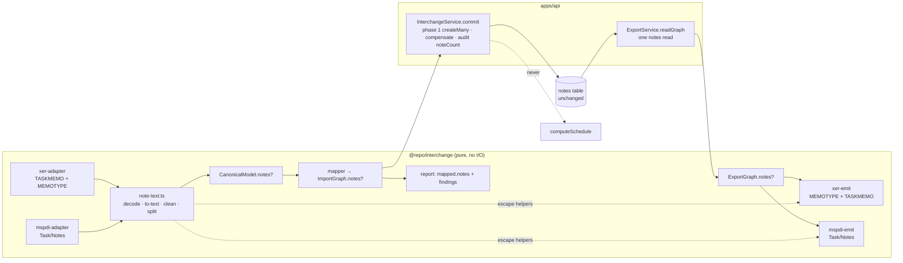
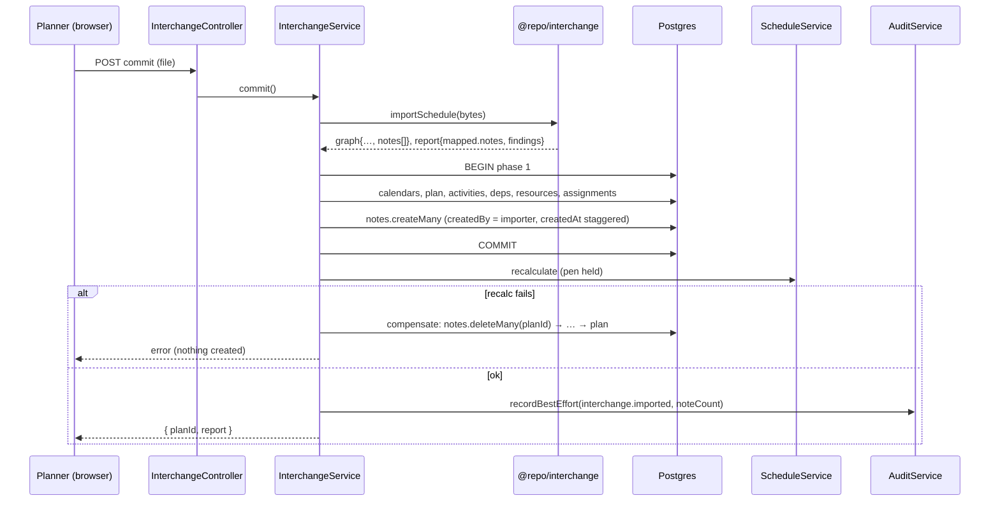
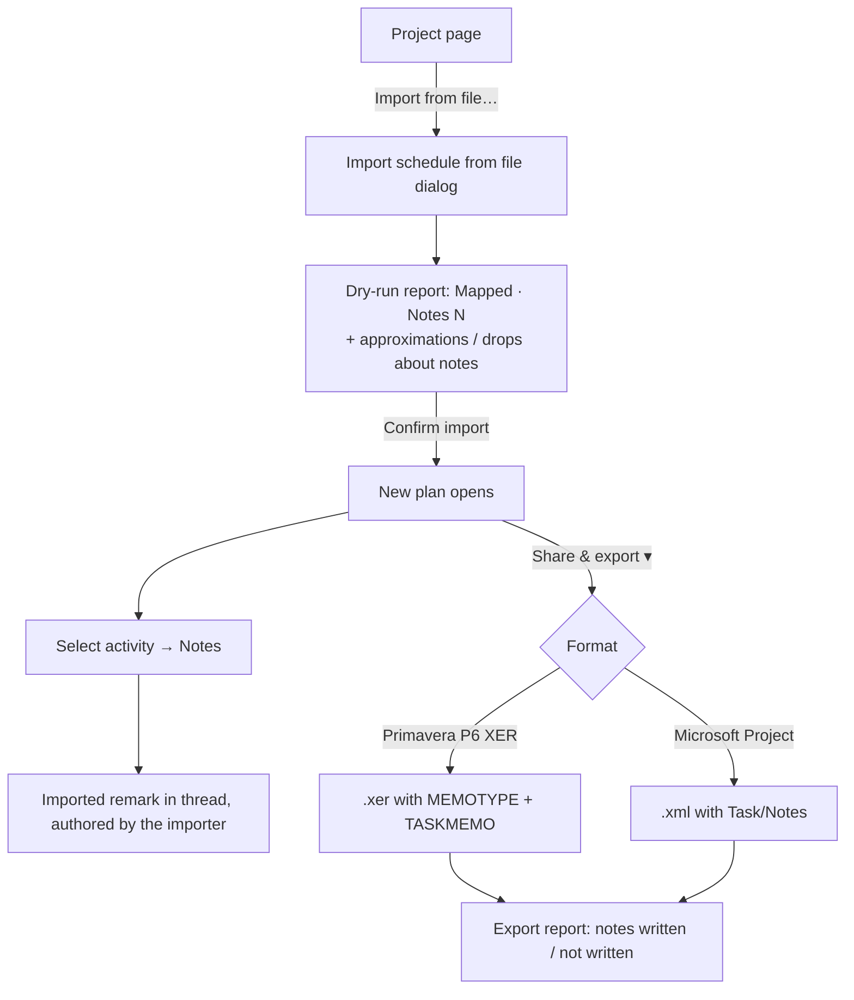

# Feature Spec: Carry activity notes through XER and MSPDI

- **Status:** Accepted — shipped (ADR-0209)
- **Author(s):** feature-analyst (Claude), for James Ewbank (product owner)
- **Date:** 2026-10-26
- **Tracking issue / epic:** `docs/BACKLOG.md` "Carry activity notes through XER and MSPDI"; follows
  closed `docs/TECH_DEBT.md` #543 (the report half)
- **Roadmap link:** Schedule interchange (ADR-0050), the carry half of #543
- **Related ADR(s):** ADR-0046 (notes), ADR-0050 (interchange and its mapping contract), ADR-0156
  (a SchedulePoint value travels under an exact, namespaced label), ADR-0162 D9 (report readers
  strip unknown keys), ADR-0073 C3.4 (the import's audit row and phase 2's hard delete), ADR-0129
  (an import is always a new plan; identity across imports is the code). **A new ADR is proposed**
  (outline in §4.9).

## 1. Business understanding

### Problem

A programme's remarks do not survive interchange in either direction.

- **Import drops them.** Neither adapter reads notes. Each one counts them and adds one aggregate
  `drop` finding: `xer-adapter.ts:445-461` counts non-blank `TASKMEMO.task_memo` rows for the first
  project, and `mspdi-adapter.ts:414` with `:565-575` counts tasks that have a `<Notes>`. Both
  produce "N activity notes were not imported". The tests that pin this are
  `import-xer.spec.ts:774-815` and `mspdi-adapter.spec.ts:392-416`. #543 closed this half on purpose:
  the loss is now reported, but nothing is carried (`docs/DECISIONS.md:163-164`).
- **Export never writes them.** `xer-emit.ts` writes PROJECT, CALENDAR, PROJWBS, TASK, TASKPRED,
  RSRC, TASKRSRC and the layout user-defined fields (`xer-emit.ts:453-471`), and nothing for memos. The
  MSPDI emitter has no `Notes` leaf: a grep for `Notes` in `packages/interchange/src` finds only the
  adapter's counter and the test fixture's writer (`mspdi.fixtures.ts:158`).
- **Demand.** On 2026-10-22 the owner had to send a programme's remarks as a separate spreadsheet
  beside the XER (backlog row, `docs/BACKLOG.md:245-250`). That session turned a NetPoint programme
  into an XER for import (`docs/DECISIONS.md:179-196`), so the owner can put remarks into a file
  that SchedulePoint will read.

Re-verifying the problem statement (CLAUDE.md §19.11): checked against `main` at `aa67ab9f` on
2026-10-26. Both drops and both tests are as described, and neither emitter writes notes. Nothing
since #543 has fixed either half.

### Users

| Role                                        | Need                                                                                                        |
| ------------------------------------------- | ----------------------------------------------------------------------------------------------------------- |
| **Planner, Org Admin** (importers)          | A P6 or MS Project file's remarks arrive as activity notes, and the report says what changed on the way in. |
| **Every member** (exporters, Viewer and up) | An exported XER or MSPDI carries the plan's activity notes, so the recipient sees them in P6 or Project.    |
| **Contributor**                             | Reads and adds notes on imported activities, exactly as on activities created by hand.                      |
| **External Guest**                          | No change. Guests never see notes (`share-guest.controller.ts:59`) and cannot import or export.             |

### Primary use cases

1. **Import a P6 programme with remarks.** Each `TASKMEMO` becomes an activity note on its activity.
2. **Import an MS Project file with task notes.** Each task's `<Notes>` becomes an activity note. A
   summary task's note goes on its WBS summary activity.
3. **Export a plan to P6 or MS Project.** Activity notes travel in the file, so no spreadsheet is
   needed beside it.
4. **SchedulePoint → XER → SchedulePoint round trip.** Every activity note comes back on the activity
   with the same code, with the same text, as separate notes.

### User journeys

- **Import:** Project → **Import from file…** → choose a `.xer` or `.xml` → the dry-run report shows
  **Notes: N** under _Mapped_, plus any notes that changed or were left out → **Confirm import** →
  the new plan opens → select an activity → **Notes** on the selection bar → the imported remark is
  in the thread.
- **Export:** plan canvas → **Share & export ▾** → **Primavera P6 (XER)** or **Microsoft Project** →
  the file downloads with its notes, and the export report names anything left out (plan notes,
  notes on WBS summaries in XER).

### Expected outcomes

- Remarks move with the schedule file in both directions, for both formats.
- The aggregate "N activity notes were not imported" drop goes away for the normal case. What remains
  is a precise account of what was changed (formatting removed, long notes split) and what genuinely
  could not come across.

### Success criteria (falsifiable)

- **FC-1 (round trip, XER):** take a plan with notes on at least 20 activities, including an
  activity with three notes, a note with blank lines, a note of exactly 5,000 characters, and notes
  containing `&`, `<`, `>`, `"`, a tab and non-Latin text. Export it to XER and re-import it. Matched
  by activity code, every activity has the **same multiset of note bodies**, compared byte for byte.
- **FC-2 (round trip, MSPDI):** the same plan through MSPDI. Activities with one note come back
  byte-identical. Activities with several notes come back as **one** note whose text is the bodies
  joined by the documented separator (§4.6). That loss is reported on export, not hidden.
- **FC-3 (parity):** a file with no notes gives the same canonical model, the same import graph and
  the same report as on `main`, with no `notes` key and no new finding. The engine is not touched
  (§3, recalc parity).
- **FC-4 (compensation):** when the post-commit recalculation is forced to fail (the
  `interchange.e2e-spec.ts:586` pattern), the plan **and its imported notes** are gone, with no
  `23503`.
- **FC-5 (no rendered markup):** a `TASKMEMO` containing ``, `` and `<head>…</head>` with their contents.
2. Turn ` `, `
`, `
`, `</li>`, `</tr>` and `
` into `\n`, and `<li>` into `• `.
3. Remove every other tag, then decode the named entities `amp lt gt quot apos nbsp` and numeric
   entities.
4. Collapse runs of three or more newlines to two, and trim.

The step is linear, uses no dependency, and is a hand-written tokenizer, not a regex over the whole
input with backtracking.

### 4.6 Export mapping

- **XER (Q2 default).**
  - One `MEMOTYPE` row: `memo_type_id = SPNOTES` and `memo_type = SchedulePoint notes v1`. The column
    set is an assumption (§3).
  - One `TASKMEMO` row per real activity that has notes: `memo_id`, `proj_id`, `task_id`,
    `memo_type_id` and `task_memo`, with `task_memo` **last**, so our parser's continuation rule holds
    for our own files. The table is written after `TASK`.
  - `task_memo` is HTML: each note body is HTML-escaped (`& < > "`, a tab as `&#9;`, a newline as
    ` `), and the bodies are joined oldest first with `
` inside `<html><body>…</body></html>`.
  - Because every tab and newline is escaped, the serialiser's collapse (`xer-serialiser.ts:36-39`)
    never touches a note, so the round trip is exact (FC-1). On re-import a body that literally
    contains `
` was escaped to `&lt;hr&gt;` and cannot split.
  - The table is written only when at least one note exists, as `RSRC` and `TASKRSRC` are today
    (`xer-emit.ts:462-467`). A plan without notes therefore exports **byte-identical** to `main`, which
    is the export half of FC-3.
- **MSPDI.** `<Notes>` leaf on the task: bodies joined oldest first with `\n\n————\n\n`, with
  XML-forbidden characters removed and the serialiser's existing escaping applied. A multi-note
  activity therefore round-trips as one note (FC-2), reported.
- **Not written, reported once each:** authors and dates (an `approximation` naming the count of
  notes written, "bodies only; P6 and Project show no author"), plan notes (`drop`), and WBS-summary
  notes in XER (`drop`).

### 4.7 The report

| Finding                                                                                                        | Kind            | When                                      |
| -------------------------------------------------------------------------------------------------------------- | --------------- | ----------------------------------------- |
| `mapped.notes` (optional, absent = 0)                                                                          | count           | any note created                          |
| "formatting was removed from N notes"                                                                          | `approximation` | markup beyond line structure was removed  |
| "N long notes were split into M notes"                                                                         | `approximation` | Q3 default                                |
| "N notes were not imported" plus a reason: no matching activity, rich text, too large, or over the limit       | `drop`          | one finding per reason, each with a count |
| Export: "N notes written as the P6 notebook topic 'SchedulePoint notes v1'; authors and dates are not written" | `approximation` | XER export with notes                     |
| Export: "N notes on WBS summaries / M plan notes were not written"                                             | `drop`          | when present                              |

Every finding is aggregate, never one per note, following #543. The existing
"N activity notes were not imported" wording is retired, and its two tests are rewritten.

### API changes

- No new route.
- `InterchangeReportResponseDto.mapped.notes?: number`, with an OpenAPI description, in the pattern of
  `placements` (`interchange-report-response.dto.ts:87-108`, `:262-267`).
- The `GET …/interchange/export/:format` description adds that activity notes are written.
- `docs/API.md` interchange section updated.

### Component changes

- `InterchangeReportTable.tsx`: one optional row, `{ label: 'Notes', value: report.mapped.notes }`,
  shown only when defined. This is the existing pattern, and it inherits that component's existing
  states and accessibility. No new component and no new styling.
- **Entry points:** **Import from file…** → dialog **Import schedule from file** (existing), the
  selection bar's **Notes** button (existing, `features/plan-actions/selection-actions.tsx:756`), and **Share & export ▾ →
  Primavera P6 (XER)** (existing).
- **Journey** (`apps/web/e2e-interchange/interchange.spec.ts`, extended, ADR-0081):
  1. Import a fixture `.xer` with a `TASKMEMO`.
  2. Assert **Notes 1** in the report.
  3. Confirm and open the plan.
  4. Select the activity, press **Notes**, and see the remark text.
  5. Run axe on the thread.
  6. In M2, extend the existing export→re-import test so a note survives.

### 4.8 Implementation approach & alternatives

**Chosen.**

- Model notes as a model-level array, `notes[{ activityId, body }]`, not as a field on
  `canonicalActivitySchema`. That schema is `.strict()` and its fields are about scheduling. A sibling
  array keeps the activity shape and the engine input unchanged, so no adapter that ignores notes
  changes. This mirrors how assignments sit beside activities.
- Use one pure text module that both adapters and both emitters share. Conversion and escaping
  therefore live in one place and are round-trip-tested against each other.
- Write in phase 1, removed by compensation. An import that reports N notes then actually created N,
  atomically.

**Alternatives.**

- **Write notes after phase 2, best-effort like phase 3.** Compensation would not change. Rejected as
  the default: the report would claim notes that might not exist, and the brief requires notes to be
  removed with the plan. It is kept as **the fallback if M1-T0 measures phase 1 over budget**, with
  the report then saying "notes could not be saved" on failure. A second fallback, if the ceiling
  breaks, is an explicit `timeout` option on the import transaction. That is a measured change and
  ADR-0050 B3's territory.
- **Store HTML and render it sanitised.** Rejected. ADR-0046 defines notes as plain text, nothing in
  the web renders HTML, and adding a sanitiser plus a rich renderer for imported content only is new
  attack surface for formatting nobody asked for.
- **A dependency (`html-to-text`, an RTF parser).** Rejected (CLAUDE.md §2). The conversion needed is
  small and must be bounded. RTF is left out and reported.
- **One `TASKMEMO` per note.** This is Q2's alternative.
- **A SchedulePoint `UDFVALUE` instead of `TASKMEMO`.** Rejected. The point is that P6 users **see**
  the remarks, and a user-defined field is the wrong P6 surface for prose.

**M1-T0 result (ADR-0142), taken 2026-10-26 before any production write.**

- **The stop line was set against the wrong timeout.** §3 and the plan said phase 1 runs under
  Prisma's 5 s default. It does not: `PrismaService` is built with
  `transactionOptions: { timeout: TRANSACTION_TIMEOUT_MS }` (`apps/api/src/prisma/prisma.service.ts:25`
  and `:58`), 15 s, and `interchange.service.ts` passes no override, so the import transaction has 15 s.
  The first harness used a bare `PrismaClient` and so measured against the wrong limit.
- **First reading (bare client, activities and dependencies only, 5 runs, local Postgres).** No notes:
  p50 1.6 s, max 1.9 s. 5,000 notes of 1,000 characters: p50 2.0 s. 10,000: p50 2.9 s. 20,000: p50 3.9 s,
  max 4.5 s. That was over the 2.5 s line set against 5 s and is why M1 stopped.
- **Second reading, the real path.** The throwaway spec drove `POST …/interchange/commit` with the
  note write in place, 5 runs each, and timed `persistGraph`, which is the transaction's whole body.
  Plan: 5,000 activities, 9,999 relationships, 200 resources, 5,000 assignments. With no notes the file
  is 0.6 MB and `persistGraph` took p50 2.6 s, max 2.9 s. With 20,000 notes of 650 characters the file
  is 14.1 MB and it took p50 5.6 s, max 5.9 s (5.0, 5.1, 5.6, 5.8, 5.9). The whole request, including
  parse and the phase-2 recalculation, was p50 7.7 s, max 8.1 s. The notes add about 3 s, which is
  below half of the 15 s budget (7.5 s) with the shared, noisy container as the caveat.
- **Chunking.** `note.createMany` is one call, and the splitting of its parameters across statements is
  delegated to Prisma (PostgreSQL allows 32,767 bind parameters per statement, so about 3,600 rows of
  this table go in each). The 20,000-row reading above exercised that path; an API e2e with 4,000
  notes keeps it exercised in CI.
- **Decision (product owner's coordinator): keep one atomic transaction and `MAX_NOTES` = 20,000.** No
  phase 1b and no new timeout. The fallbacks above stay documented for the day a measurement says
  otherwise.
- **What the volume ceiling really is.** The multipart upload is capped at 16 MiB, so the note text
  of one import is bounded by about 14 MB whatever `MAX_NOTES` says. 20,000 notes of 1,000 characters
  is unreachable through the API.

### 4.9 ADR required: outline

**ADR-NNNN (next free number at filing): "An imported note is the importer's, and a SchedulePoint
note travels as text under its own topic."**

- **Context:** the #543 drop, ADR-0046's author-only edit rule, ADR-0156's exact-label precedent, and
  the parser's entity and newline facts.
- **Decisions:**
  - **D1** — An imported note's author is the importer (Q1), and its timestamps are the import's.
  - **D2** — Notes are plain text. Imported markup is converted, never stored or rendered.
  - **D3** — Splitting at 5,000 characters is not a loss (Q3), and every change is reported in
    aggregate.
  - **D4** — The XER export uses one memo per activity under the exact label `SchedulePoint notes v1`,
    as HTML-escaped text, split back on re-import (Q2). MSPDI joins notes without a split.
  - **D5** — Notes are written in phase 1 and removed by compensation. The audit carries a count and
    individual notes earn no event.
  - **D6** — No schema change and no engine change, with the parity argument.
  - **D7** — What is assumed about P6 (FC-7) and what would settle it.
- **Amends:** ADR-0050's mapping-table row for `TASKMEMO` / `<Notes>`.
- **Rejected:** stored HTML, best-effort notes, one memo per note, a UDF.

## 5. Links

- Implementation plan: [`./implementation-plan.md`](./implementation-plan.md)
- Docs this change updates when built:
  - ADR-0050 mapping table (row `TASKMEMO.task_memo / <Task><Notes>`)
  - the new ADR, plus its line in CLAUDE.md §16 (`check:adr-coverage`), plus CLAUDE.md §1's ADR count
    (`check:counts`)
  - `docs/API.md`
  - `docs/BACKLOG.md` (remove the row)
  - `docs/TEST_PLAYBOOK.md`, only if a seeded catalogue case is added (optional)
